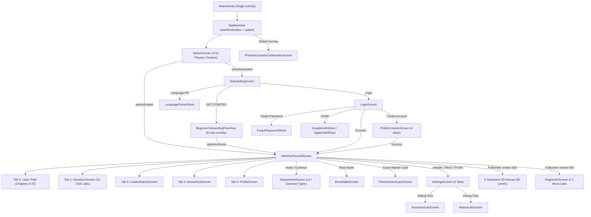

# Codeingo / AshCrypt Android Screens — Full Analysis & Code Report

> **Project:** `com.simats.codeingo` (branded in-app as **AshCrypt** / **CNS Defense**)  
> **UI Framework:** Jetpack Compose + Material 3 (`compileSdk = 35`, `minSdk = 26`, `targetSdk = 35`), Hilt DI, Navigation Compose, Room, Retrofit/Kotlinx Serialization, Coil GIF, Lottie, Konfetti, Rive.  
> **Architecture Pattern:** Single-Activity (`MainActivity`) driving a `NavHost` (`AppNavHost`) plus a multi-tab `MainDashboardScreen` that hosts 5 `HorizontalPager` tabs, fullscreen `zIndex` overlays (Arenas, Diagnostic, Micro-Labs), and modal bottom sheets/dialogs.

---

## 1. High-Level Navigation Architecture

All navigation starts in [MainActivity.kt](file:///Users/user1/Code_in_go_android/app/src/main/java/com/simats/codeingo/MainActivity.kt#L22-L67), which calls `enableEdgeToEdge()`, holds the system splash using a `ViewTreeObserver.OnPreDrawListener` until `GameManager.instance.isInitialized.value` (with a `1500ms` timeout), wraps the tree in `CodeingoTheme` + `ProvideScreenMetrics`, and mounts `AppNavHost()`.



### Route Definitions & `AppNavHost` Wiring

From [Routes.kt](file:///Users/user1/Code_in_go_android/app/src/main/java/com/simats/codeingo/navigation/Routes.kt#L3-L24):

```kotlin
sealed class Screen(val route: String) {
    object Splash : Screen("splash")
    object Onboarding : Screen("onboarding")
    object Login : Screen("login")
    object ProfileCreation : Screen("profile_creation")
    object Dashboard : Screen("dashboard")
    object Assessment : Screen("assessment/{unitId}/{levelNumber}/{totalLevelsInUnit}/{isBoss}") {
        fun createRoute(unitId: Int, levelNumber: Int, totalLevelsInUnit: Int = 6, isBoss: Boolean = false) =
            "assessment/$unitId/$levelNumber/$totalLevelsInUnit/$isBoss"
        fun createRoute(lessonId: String) = "assessment/1/1/6/false"
    }
    object BossBattle : Screen("boss_battle/{bossId}") {
        fun createRoute(bossId: String) = "boss_battle/$bossId"
    }
    object Visualizer : Screen("visualizer")
    object PracticeHub : Screen("practice_hub")
    object PhoenixSanctuary : Screen("phoenix_sanctuary")
    object PhoenixEggHatch : Screen("phoenix_egg_hatch")
    object Settings : Screen("settings")
    object AnimationLab : Screen("animation_lab")
    object MotionLab : Screen("motion_lab")
}
```

And from [AppNavHost.kt](file:///Users/user1/Code_in_go_android/app/src/main/java/com/simats/codeingo/navigation/AppNavHost.kt#L86-L106):

```kotlin
composable(
    route = Screen.Splash.route,
    exitTransition = {
        fadeOut(animationSpec = tween(350))
    }
) {
    SplashScreen(
        onFinishedSplash = {
            val destination = runCatching {
                if (com.simats.codeingo.domain.AuthService.instance.isAuthenticated.value) {
                    Screen.Dashboard.route
                } else {
                    Screen.Onboarding.route
                }
            }.getOrDefault(Screen.Onboarding.route)
            navController.navigate(destination) {
                popUpTo(Screen.Splash.route) { inclusive = true }
            }
        }
    )
}
```

> **Route Registration Gap:** `Screen.Visualizer`, `Screen.PracticeHub`, and `Screen.PhoenixEggHatch` are declared in [Routes.kt](file:///Users/user1/Code_in_go_android/app/src/main/java/com/simats/codeingo/navigation/Routes.kt#L17-L20) but have **no `composable(...)` blocks** in [AppNavHost.kt](file:///Users/user1/Code_in_go_android/app/src/main/java/com/simats/codeingo/navigation/AppNavHost.kt#L86-L269). Navigating to them via `navController` would throw an `IllegalArgumentException`. Instead, `VisualizerScreen` lives inside `MainDashboardScreen`'s pager, `PhoenixEggHatch3DView` is rendered inline inside `AssessmentScreen`/`BossBattleScreen`, and `PracticeHubScreen` is currently unreachable (see Section 9).

---

## 2. Complete Screen & Modal Inventory

| Category | Screen / Composable | File Path | Mounting Mechanism | Primary State / VM |
| :--- | :--- | :--- | :--- | :--- |
| **Entry** | `SplashScreen` | [SplashScreen.kt](file:///Users/user1/Code_in_go_android/app/src/main/java/com/simats/codeingo/ui/splash/SplashScreen.kt#L67) | `AppNavHost` (`splash`) | Local frame-nano timeline |
| **Onboarding** | `OnboardingScreen` | [OnboardingScreen.kt](file:///Users/user1/Code_in_go_android/app/src/main/java/com/simats/codeingo/ui/onboarding/OnboardingScreen.kt#L106) | `AppNavHost` (`onboarding`) | `LocalizationManager` |
| **Onboarding** | `BeginnerOnboardingFlowView` | [BeginnerOnboardingFlowView.kt](file:///Users/user1/Code_in_go_android/app/src/main/java/com/simats/codeingo/ui/onboarding/BeginnerOnboardingFlowView.kt#L102) | Overlay inside `OnboardingScreen` | Local step state + `GameManager` |
| **Onboarding** | `LanguagePickerSheet` | [LanguagePickerSheet.kt](file:///Users/user1/Code_in_go_android/app/src/main/java/com/simats/codeingo/ui/onboarding/LanguagePickerSheet.kt#L52) | `ModalBottomSheet` | `LocalizationManager` |
| **Auth** | `LoginScreen` | [LoginScreen.kt](file:///Users/user1/Code_in_go_android/app/src/main/java/com/simats/codeingo/ui/auth/LoginScreen.kt#L129) | `AppNavHost` (`login`) & `ProfileScreen` Dialog | `AuthRepository`, `SyncRepository`, `AuthService` |
| **Auth** | `ProfileCreationScreen` | [ProfileCreationScreen.kt](file:///Users/user1/Code_in_go_android/app/src/main/java/com/simats/codeingo/ui/auth/ProfileCreationScreen.kt#L116) | `AppNavHost` (`profile_creation`) & `ProfileScreen` Dialog | `AuthRepository`, `AuthService` |
| **Auth** | `ForgotPasswordSheet` | [ForgotPasswordSheet.kt](file:///Users/user1/Code_in_go_android/app/src/main/java/com/simats/codeingo/ui/auth/ForgotPasswordSheet.kt#L86) | `ModalBottomSheet` (Login & Settings) | `AuthRepository` |
| **Auth** | `GoogleAuthSheet` / `AppleAuthSheet` | [GoogleAuthSheet.kt](file:///Users/user1/Code_in_go_android/app/src/main/java/com/simats/codeingo/ui/auth/GoogleAuthSheet.kt#L63) | `ModalBottomSheet` (Login & Signup) | Local sheet callbacks |
| **Shell** | `MainDashboardScreen` | [MainDashboardScreen.kt](file:///Users/user1/Code_in_go_android/app/src/main/java/com/simats/codeingo/ui/dashboard/MainDashboardScreen.kt#L183) | `AppNavHost` (`dashboard`) | `MainDashboardViewModel` (`@HiltViewModel`) + `GameManager` |
| **Tab 1** | `VisualizerScreen` | [VisualizerScreen.kt](file:///Users/user1/Code_in_go_android/app/src/main/java/com/simats/codeingo/ui/visualizer/VisualizerScreen.kt#L122) | `HorizontalPager` page 1 | `GameManager`, `LocalizationManager` |
| **Tab 2** | `LeaderboardsScreen` | [LeaderboardsScreen.kt](file:///Users/user1/Code_in_go_android/app/src/main/java/com/simats/codeingo/ui/leaderboards/LeaderboardsScreen.kt#L87) | `HorizontalPager` page 2 | `LeaderboardViewModel` (`@HiltViewModel`) |
| **Tab 3** | `ArenasHubScreen` | [ArenasHubScreen.kt](file:///Users/user1/Code_in_go_android/app/src/main/java/com/simats/codeingo/ui/arenas/hub/ArenasHubScreen.kt#L134) | `HorizontalPager` page 3 | `GameManager` |
| **Tab 4** | `ProfileScreen` | [ProfileScreen.kt](file:///Users/user1/Code_in_go_android/app/src/main/java/com/simats/codeingo/ui/profile/ProfileScreen.kt#L72) | `HorizontalPager` page 4 | `GameManager`, `LocalizationManager`, `PhoenixEmotionManager` |
| **Quiz** | `AssessmentScreen` | [AssessmentScreen.kt](file:///Users/user1/Code_in_go_android/app/src/main/java/com/simats/codeingo/ui/exercise/AssessmentScreen.kt#L152) | `AppNavHost` (`assessment/...`) | Local state + `LessonCompletionUseCase` |
| **Boss** | `BossBattleScreen` | [BossBattleScreen.kt](file:///Users/user1/Code_in_go_android/app/src/main/java/com/simats/codeingo/ui/exercise/BossBattleScreen.kt#L88) | `AppNavHost` (`boss_battle/{bossId}`) | Local state + `CourseRepository` + `GameManager` |
| **Diagnostic** | `DiagnosticScreen` | [DiagnosticScreen.kt](file:///Users/user1/Code_in_go_android/app/src/main/java/com/simats/codeingo/ui/exercise/DiagnosticScreen.kt#L76) | Fullscreen overlay in `MainDashboardScreen` | Local state + `ConceptMasteryDao` + `GameManager` |
| **Micro-Labs** | `BitTogglerLab`, `ModuloClockLab`, `XorBoardLab` | [BitTogglerLab.kt](file:///Users/user1/Code_in_go_android/app/src/main/java/com/simats/codeingo/ui/exercise/labs/BitTogglerLab.kt#L62) | Fullscreen overlay in `MainDashboardScreen` | Local interactive bit/modulo/XOR state |
| **Arenas (5)** | `CipherSanctumArenaScreen`, `BlockCipherForgeArenaScreen`, `KeyExchangeCitadelArenaScreen`, `IntegrityFoundryArenaScreen`, `CyberBastionArenaScreen` | [CipherSanctumArenaScreen.kt](file:///Users/user1/Code_in_go_android/app/src/main/java/com/simats/codeingo/ui/arenas/cipher_sanctum/CipherSanctumArenaScreen.kt#L78) | Fullscreen overlay (`zIndex(500f)`) in `MainDashboardScreen` | `ArenaProgressionManager` + `ArenaCompletionUseCase` |
| **Phoenix** | `PhoenixSanctuaryScreen` | [PhoenixSanctuaryScreen.kt](file:///Users/user1/Code_in_go_android/app/src/main/java/com/simats/codeingo/ui/phoenix/PhoenixSanctuaryScreen.kt#L149) | `AppNavHost` (`phoenix_sanctuary`) | `GameManager` (18 stages) |
| **Phoenix** | `PhoenixEvolutionCelebrationScreen` | [PhoenixEvolutionCelebrationScreen.kt](file:///Users/user1/Code_in_go_android/app/src/main/java/com/simats/codeingo/ui/phoenix/PhoenixEvolutionCelebrationScreen.kt#L74) | Global overlay in `AppNavHost` | `GameManager.showEvolutionModal` |
| **Phoenix** | `PhoenixEggHatch3DView` | [PhoenixEggHatch3DView.kt](file:///Users/user1/Code_in_go_android/app/src/main/java/com/simats/codeingo/ui/phoenix/PhoenixEggHatch3DView.kt#L85) | Inline victory screen in `AssessmentScreen` & `BossBattleScreen` | Local crack-step animation |
| **Settings** | `SettingsScreen` | [SettingsScreen.kt](file:///Users/user1/Code_in_go_android/app/src/main/java/com/simats/codeingo/ui/settings/SettingsScreen.kt#L110) | `AppNavHost` (`settings`) | `ThemeManager`, `MotionController`, `PhoenixEmotionManager`, `SharedPreferences` |
| **Modals** | `GemShopSheet`, `StreakSocietySheet`, `PhoenixEmotionPickerSheet`, `AskAshBottomSheet`, `DSAChapterStoryIntroSheet`, `DSAFinalMasterJourneyView` | [GemShopSheet.kt](file:///Users/user1/Code_in_go_android/app/src/main/java/com/simats/codeingo/ui/shop/GemShopSheet.kt#L182) | `ModalBottomSheet` / `Dialog` in `MainDashboardScreen` / `ProfileScreen` | `GameManager`, `StreakManager`, `PhoenixEmotionManager` |
| **Debug Labs** | `AnimationLabScreen`, `MotionLabScreen` | [AnimationLabScreen.kt](file:///Users/user1/Code_in_go_android/app/src/main/java/com/simats/codeingo/ui/components/AnimationLabScreen.kt#L71) | `AppNavHost` (guarded by `BuildConfig.DEBUG` in `SettingsScreen`) | `MotionController`, `EffectBudgetManager` |
| **Unwired** | `PracticeHubScreen`, `CipherLabScreen`, `UniversalVisualizerView`, `AshCryptPlusSheet`, `AnimationGalleryScreen`, `ExamReadinessDashboard`, `CipherCardShareView`, `DailyCipherChallengeCard`, `FriendsSocialLayer` | Various under `ui/` | Present in codebase, not reachable from active navigation | See Section 9 |

---

## 3. Entry, Onboarding & Authentication Screens

### 3.1 `SplashScreen`
- **File:** [SplashScreen.kt](file:///Users/user1/Code_in_go_android/app/src/main/java/com/simats/codeingo/ui/splash/SplashScreen.kt#L67-L390)
- **Behavior:** Runs a 3.5-second frame-synchronized (`withFrameNanos`) physics timeline across 4 phases:
  1. `[0.0s–0.45s]` Distance fly-in (`easeFlyIn = 1 - (1 - p0)^3`).
  2. `[0.45s–0.62s]` Kinetic energy squeeze (`sin(pSqueeze * PI)`).
  3. `[0.62s–1.25s]` Explosion into 32 3D glossy ember particles (`RealisticSplashBubble`) + dual expanding shockwave rings.
  4. `[1.25s–3.50s]` Spiral vortex re-formation + damped elastic landing (`exp(-5.5 * p) * cos(14 * p)`).

```kotlin
LaunchedEffect(Unit) {
    val startNanos = System.nanoTime()
    while (true) {
        withFrameNanos { frameTimeNanos ->
            elapsedTimeSec = (frameTimeNanos - startNanos) / 1_000_000_000f
        }
        if (elapsedTimeSec >= 3.5f) {
            onFinishedSplash()
            break
        }
    }
}
```

### 3.2 `OnboardingScreen` & `BeginnerOnboardingFlowView`
- **Files:** [OnboardingScreen.kt](file:///Users/user1/Code_in_go_android/app/src/main/java/com/simats/codeingo/ui/onboarding/OnboardingScreen.kt#L106-L583), [BeginnerOnboardingFlowView.kt](file:///Users/user1/Code_in_go_android/app/src/main/java/com/simats/codeingo/ui/onboarding/BeginnerOnboardingFlowView.kt#L79-L845), [LanguagePickerSheet.kt](file:///Users/user1/Code_in_go_android/app/src/main/java/com/simats/codeingo/ui/onboarding/LanguagePickerSheet.kt#L52-L173)
- **OnboardingScreen:** Hosts `PhoenixAtmosphericBackgroundView`, `HeaderView` (language picker pill + login link), a 4-page `HorizontalPager` (`HeroPageSlide` with `AnimatedHomeMascotView` + 3 `FeatureSlide`s), and pinned `AppButton`s (`GET STARTED` -> launches `BeginnerOnboardingFlowView`; `I ALREADY HAVE AN ACCOUNT` -> `Screen.Login`).
- **BeginnerOnboardingFlowView:** An 8-step interactive onboarding flow that includes a live Caesar shift dial exercise (`KHOOR -> HELLO`), saves preferences per user to `ashcrypt_onboarding_prefs`, awards `+20 XP`, and triggers `AuthService.instance.signInAsGuest()` before navigating to `Dashboard`.

```kotlin
enum class OnboardingStep(val stepIndex: Int) {
    WELCOME(0),
    GOAL_SELECTION(1),
    DAILY_TIME(2),
    PRIOR_LEVEL(3),
    CAESAR_INTRO(4),
    CAESAR_LESSON(5),
    FIRST_SUCCESS(6),
    INITIALIZING(7)
}
```

### 3.3 `LoginScreen`, `ProfileCreationScreen` & Auth Sheets
- **Files:** [LoginScreen.kt](file:///Users/user1/Code_in_go_android/app/src/main/java/com/simats/codeingo/ui/auth/LoginScreen.kt#L129-L1188), [ProfileCreationScreen.kt](file:///Users/user1/Code_in_go_android/app/src/main/java/com/simats/codeingo/ui/auth/ProfileCreationScreen.kt#L116-L1247), [ForgotPasswordSheet.kt](file:///Users/user1/Code_in_go_android/app/src/main/java/com/simats/codeingo/ui/auth/ForgotPasswordSheet.kt#L86-L475), [GoogleAuthSheet.kt](file:///Users/user1/Code_in_go_android/app/src/main/java/com/simats/codeingo/ui/auth/GoogleAuthSheet.kt#L63), [AppleAuthSheet.kt](file:///Users/user1/Code_in_go_android/app/src/main/java/com/simats/codeingo/ui/auth/AppleAuthSheet.kt#L55)
- **Security & Auth Handling:**
  - `LoginScreen` and `ForgotPasswordSheet` attach `WindowManager.LayoutParams.FLAG_SECURE` via `DisposableEffect(activity)` to prevent screenshots during credential entry.
  - `LoginScreen` acquires Hilt-injected `AuthRepository` and `SyncRepository` via `EntryPointAccessors.fromApplication(..., AuthServiceEntryPoint::class.java)`.
  - On `ApiResult.NetworkError`, `LoginScreen` falls back to `AuthService.shared.verifyPassword(trimmed, password)`.
- **ProfileCreationScreen:** 4-step wizard (`1: Age`, `2: Coding Goal` + Google quick-fill, `3: Name/Email/Password`, `4: Flame Ignition Celebration`). Registers via `authRepository.register(...)`, automatically attempts `authenticate(...)` on HTTP `409`, and falls back locally on `NetworkError`.
- **ForgotPasswordSheet:** 5-state machine (`ENTER_EMAIL` -> `SENDING_EMAIL` -> `VERIFY_CODE` -> `RESET_PASSWORD` -> `SUCCESS`).

---

## 4. Main Dashboard Shell & Core Tabs

### 4.1 `MainDashboardScreen` & `MainDashboardViewModel`
- **Files:** [MainDashboardScreen.kt](file:///Users/user1/Code_in_go_android/app/src/main/java/com/simats/codeingo/ui/dashboard/MainDashboardScreen.kt#L183-L2009), [MainDashboardViewModel.kt](file:///Users/user1/Code_in_go_android/app/src/main/java/com/simats/codeingo/ui/dashboard/MainDashboardViewModel.kt#L33-L366), [BottomNavBar.kt](file:///Users/user1/Code_in_go_android/app/src/main/java/com/simats/codeingo/navigation/BottomNavBar.kt#L80-L351)
- **Pager & Bottom Nav:** Hosts a 5-page `HorizontalPager` paired with `BottomNavBar` (a custom liquid-glass floating capsule bar with viscoelastic horizontal stretch `stretchX = 1f + abs(delta) * 0.40f`).
- **Learn Tab (`DashboardTab.LEARN`) Stack:**
  1. `TopStatsHeader` + `DynamicPillHUD`.
  2. Live Backend Sync Banner & Admin Broadcast `systemAnnouncement` banner (from `MainDashboardViewModel`).
  3. `EthicalReengagementGreeting` + `ContinueHeroCard` + `DailyGoalAndStreakPill` + `TodaysMissionsCarousel` + `DailyRewardChestCard`.
  4. `BasecampFoundationsCard`: Chapter 0 card launching `DiagnosticScreen`, 3 Micro-Labs, and Stages `101..105`.
  5. Winding 25-Chapter Curriculum Path (`ChapterRegistry.getCoreUnits() + ChapterRegistry.getExpansionUnits()`): `UnitSectionBanner`, stepping-stone connectors, `LessonNodeButton` (3D pushable bevel nodes), and `PhoenixNodeJumpFlightView`.
  6. Floating Stage Action Card (`selectedStageCardNode`) + `GrandMasterJourneyCard`.

```kotlin
val dashboardTabs = remember {
    listOf(
        DashboardTab.LEARN,
        DashboardTab.VISUALIZER,
        DashboardTab.LEADERBOARDS,
        DashboardTab.ARENAS,
        DashboardTab.PROFILE
    )
}
```

Full-screen overlay mounting inside `MainDashboardScreen`:

```kotlin
activeWorldArena?.let { arenaKey ->
    BackHandler {
        activeWorldArena = null
    }
    Box(
        modifier = Modifier
            .fillMaxSize()
            .zIndex(500f)
    ) {
        when (arenaKey) {
            ArenaRoute.CIPHER_SANCTUM -> CipherSanctumArenaScreen(onDismiss = { activeWorldArena = null })
            ArenaRoute.BLOCK_CIPHER_FORGE -> BlockCipherForgeArenaScreen(onDismiss = { activeWorldArena = null })
            ArenaRoute.KEY_EXCHANGE_CITADEL -> KeyExchangeCitadelArenaScreen(onDismiss = { activeWorldArena = null })
            ArenaRoute.INTEGRITY_FOUNDRY -> IntegrityFoundryArenaScreen(onDismiss = { activeWorldArena = null })
            ArenaRoute.CYBER_BASTION -> CyberBastionArenaScreen(onDismiss = { activeWorldArena = null })
            else -> CipherSanctumArenaScreen(onDismiss = { activeWorldArena = null })
        }
    }
}
```

### 4.2 `VisualizerScreen` (Tab 1)
- **File:** [VisualizerScreen.kt](file:///Users/user1/Code_in_go_android/app/src/main/java/com/simats/codeingo/ui/visualizer/VisualizerScreen.kt#L122-L1904)
- **Dual Mode:** Switches between `VisualizerDisplayMode.LIST` (search bar, 5 category filter chips: `All`, `Classical`, `Symmetric`, `Asymmetric`, `Hashing & Protocols`, plus 5-chapter roadmap cards) and `VisualizerDisplayMode.VISUALIZER` (`TopicDetailView` with a 4-mode `CNSLabModeTabBar`).

```kotlin
when (selectedType) {
    DSAVisualizerType.ARRAY -> CaesarCipherVisualizer(mode = activeLabMode)
    DSAVisualizerType.STACK -> DESFeistelVisualizer(mode = activeLabMode)
    DSAVisualizerType.QUEUE -> AESMatrixVisualizer(mode = activeLabMode)
    DSAVisualizerType.LINKED_LIST -> VigenereCipherVisualizer(mode = activeLabMode)
    DSAVisualizerType.BINARY_TREE -> DiffieHellmanVisualizer(mode = activeLabMode)
    DSAVisualizerType.AVL_TREE -> RSAPublicKeyVisualizer(mode = activeLabMode)
    DSAVisualizerType.TRIE -> ECCPointVisualizer(mode = activeLabMode)
    DSAVisualizerType.GRAPH -> SHA256Visualizer(mode = activeLabMode)
    DSAVisualizerType.SORTING -> HMACCollisionVisualizer(mode = activeLabMode)
    DSAVisualizerType.STEP_RECORDER -> TLS13HandshakeVisualizer(mode = activeLabMode)
}
```

### 4.3 `LeaderboardsScreen` & `LeaderboardViewModel` (Tab 2)
- **Files:** [LeaderboardsScreen.kt](file:///Users/user1/Code_in_go_android/app/src/main/java/com/simats/codeingo/ui/leaderboards/LeaderboardsScreen.kt#L87-L837), [LeaderboardViewModel.kt](file:///Users/user1/Code_in_go_android/app/src/main/java/com/simats/codeingo/ui/leaderboards/LeaderboardViewModel.kt#L19-L64)
- **States:** `completedLessons < 3` -> `LockedLeaderboardsView`; `isLoading && rankings.isEmpty()` -> spinner; `rankings.isEmpty()` -> `EmptyLeaderboardView`; otherwise `UnlockedLeaderboardsView` + `MilestoneCeremonyOverlay`.

### 4.4 `ArenasHubScreen` (Tab 3)
- **File:** [ArenasHubScreen.kt](file:///Users/user1/Code_in_go_android/app/src/main/java/com/simats/codeingo/ui/arenas/hub/ArenasHubScreen.kt#L134-L567)
- **Content:** Player combat stats HUD (`5 / 5 ACTIVE ARENAS`, `35 STATIONS`, `CRYPTO XP`) and 5 `ArenaBattleHeroCard`s driven by `CNS_ARENAS_SPECS`, locked/unlocked by `spec.unitNumber <= maxUnlockedChapter`. Uses frozen parity route keys from [ArenaRoute.kt](file:///Users/user1/Code_in_go_android/app/src/main/java/com/simats/codeingo/ui/arenas/routing/ArenaRoute.kt#L12-L35).

### 4.5 `ProfileScreen` (Tab 4)
- **File:** [ProfileScreen.kt](file:///Users/user1/Code_in_go_android/app/src/main/java/com/simats/codeingo/ui/profile/ProfileScreen.kt#L72-L1808)
- **States:** Switches between `AuthenticatedProfileBody` and `UnauthenticatedProfileBody` (with `Create Account`, `Sign In`, and `Quick Demo Sign In`).
- **Sections when authenticated:** `UserHeaderCard`, `LevelProgressCard`, `YourPhoenixCustomizationSection`, 2x2 `StatisticsSection`, `LearningJourneySection`, `AchievementsSection`, `CryptoCodexGallery`, `AddFriendsSection`, and Sign Out confirmation `AlertDialog`.

---

## 5. Learning, Assessment, Boss & Micro-Lab Screens

### 5.1 `AssessmentScreen`
- **File:** [AssessmentScreen.kt](file:///Users/user1/Code_in_go_android/app/src/main/java/com/simats/codeingo/ui/exercise/AssessmentScreen.kt#L152-L1569)
- **Flow:** Optional `MiniLessonIntroCards` -> Active Question Stage (`12+` exercise types) -> `HeartRecoveryView` (if 0 hearts) / `PhoenixEggHatch3DView` (if `isBoss`) / `CelebrationOverlay`.

Exercise dispatch inside [AssessmentScreen.kt](file:///Users/user1/Code_in_go_android/app/src/main/java/com/simats/codeingo/ui/exercise/AssessmentScreen.kt#L666-L848):

```kotlin
when (currentQuestion.gameType) {
    DSAExerciseType.MULTIPLE_CHOICE  -> { /* HolographicCommandTile list */ }
    DSAExerciseType.MATCH_PAIRS      -> MatchPairsExerciseView(...)
    DSAExerciseType.ORDER_STEPS      -> OrderStepsExerciseView(...)
    DSAExerciseType.FILL_CODE        -> FillCodeExerciseView(...)
    DSAExerciseType.COMPLEXITY_DIAL,
    ExerciseType.KEY_SIZE_DIAL       -> ComplexityDialExerciseView(...)
    DSAExerciseType.TRUE_FALSE_SWIPE -> TrueFalseSwipeExerciseView(...)
    ExerciseType.CIPHER_WHEEL        -> CipherWheelExerciseView(...)
    ExerciseType.BIT_FLIPPER         -> BitFlipperExerciseView(...)
    ExerciseType.ROUND_BUILDER       -> RoundBuilderExerciseView(...)
    ExerciseType.MODULAR_MATH        -> ModularMathExerciseView(...)
    ExerciseType.PACKET_TRIAGE       -> PacketTriageExerciseView(...)
    ExerciseType.SPOT_THE_FLAW       -> SpotTheFlawExerciseView(...)
}
```

### 5.2 `BossBattleScreen`
- **File:** [BossBattleScreen.kt](file:///Users/user1/Code_in_go_android/app/src/main/java/com/simats/codeingo/ui/exercise/BossBattleScreen.kt#L88-L534)
- **Mechanics:** Loads `DSABossSpec` via `CourseRepository.getBossById(bossId)`, tracks `bossHp`, 3 `learnerHearts`, and countdown timer.

```kotlin
com.simats.codeingo.ui.phoenix.PhoenixEggHatch3DView(
    unitId = unitId,
    levelNumber = boss.targetPhoenixStageAwarded,
    totalLevelsInUnit = 6,
    isBoss = true,
    xpEarned = bossXP,
    starsEarned = starsEarned,
    accuracyPercentage = 100,
    onContinue = {
        GameManager.instance.addStars(starsEarned)
        GameManager.instance.awardBossVictory(boss, unitId)
        GameManager.instance.completeLessonAndExtendStreak()
        onVictory()
    },
    onFinish = {
        GameManager.instance.addStars(starsEarned)
        GameManager.instance.awardBossVictory(boss, unitId)
        GameManager.instance.completeLessonAndExtendStreak()
        onVictory()
    },
    onUpgradePhoenixNextUnit = {
        GameManager.instance.addStars(starsEarned)
        GameManager.instance.awardBossVictory(boss, unitId)
        GameManager.instance.completeLessonAndExtendStreak()
        onVictory()
    }
)
```

### 5.3 `DiagnosticScreen` & Chapter 0 Micro-Labs
- **`DiagnosticScreen`** ([DiagnosticScreen.kt](file:///Users/user1/Code_in_go_android/app/src/main/java/com/simats/codeingo/ui/exercise/DiagnosticScreen.kt#L76-L594)): 12-question zero-XP, zero-heart-cost placement test across 4 categories (`BINARY_HEX`, `MODULO`, `XOR`, `SECURITY`), saving mastery to Room `ConceptMasteryDao` and recommending Chapter 0 or Chapter 1.
- **Micro-Labs (mounted fullscreen from `BasecampFoundationsCard`):**
  - [BitTogglerLab.kt](file:///Users/user1/Code_in_go_android/app/src/main/java/com/simats/codeingo/ui/exercise/labs/BitTogglerLab.kt#L62): 8-bit interactive switchboard (`128..1` weights) computing Decimal, Hex, ASCII, and challenge targets.
  - [ModuloClockLab.kt](file:///Users/user1/Code_in_go_android/app/src/main/java/com/simats/codeingo/ui/exercise/labs/ModuloClockLab.kt#L67): Animated Canvas clock supporting Mod 12, Mod 26, and Mod 7 with `((x % n) + n) % n`.
  - [XorBoardLab.kt](file:///Users/user1/Code_in_go_android/app/src/main/java/com/simats/codeingo/ui/exercise/labs/XorBoardLab.kt#L58): 4-bit interactive `P ⊕ K = C` board proving `(P ⊕ K) ⊕ K = P`.

---

## 6. The 5 Interactive Crypto Arenas (35 Levels)

All 5 arenas are launched from `MainDashboardScreen` (`activeWorldArena` overlay at `zIndex(500f)`), share common HUD/briefing/debrief/loadout components (`ArenaBriefingView`, `ArenaDebriefView`, `ArenaComboHUD`, `ArenaLoadoutSheet`, `ArenaProgressionManager`, `ArenaScoring`), and integrate with `ArenaCompletionUseCase`.

| Arena Screen | Route Key | Level Enum & 7 Levels |
| :--- | :--- | :--- |
| [CipherSanctumArenaScreen.kt](file:///Users/user1/Code_in_go_android/app/src/main/java/com/simats/codeingo/ui/arenas/cipher_sanctum/CipherSanctumArenaScreen.kt#L78) | `"array"` | `CipherSanctumLevel`: `CaesarDialLevel`, `FindTheShiftLevel`, `FrequencyRadioLevel`, `VigenereRotorsLevel`, `RailFenceGridLevel`, `CryptanalysisSprintLevel`, Boss: `SphinxBossBattleLevel` |
| [BlockCipherForgeArenaScreen.kt](file:///Users/user1/Code_in_go_android/app/src/main/java/com/simats/codeingo/ui/arenas/block_cipher_forge/BlockCipherForgeArenaScreen.kt#L81) | `"linkedlist"` | `BlockCipherForgeLevel`: `SBoxForgeLevel`, `ShiftRowsSliderLevel`, `MixColumnsMixerLevel`, `AddRoundKeyLockLevel`, `ModeDetectiveLevel`, `AvalancheSprintLevel`, Boss: `BlockOverlordBossLevel` |
| [KeyExchangeCitadelArenaScreen.kt](file:///Users/user1/Code_in_go_android/app/src/main/java/com/simats/codeingo/ui/arenas/key_exchange_citadel/KeyExchangeCitadelArenaScreen.kt#L77) | `"stack"` | `KeyExchangeCitadelLevel`: `ClockArithmeticLevel`, `PaintMixHandshakeLevel`, `TrapdoorLabLevel`, `KeyPairForgeLevel`, `CurveWalkerLevel`, `KeySizeGauntletLevel`, Boss: `QuantumCryptanalystBossLevel` |
| [IntegrityFoundryArenaScreen.kt](file:///Users/user1/Code_in_go_android/app/src/main/java/com/simats/codeingo/ui/arenas/integrity_foundry/IntegrityFoundryArenaScreen.kt#L77) | `"queue"` | `IntegrityFoundryLevel`: `DigestPressLevel`, `BitFlipLabLevel`, `SpongeChamberLevel`, `WaxSealLevel`, `SignatureSealLevel`, `BirthdayRadarLevel`, Boss: `CollisionBeastBossLevel` |
| [CyberBastionArenaScreen.kt](file:///Users/user1/Code_in_go_android/app/src/main/java/com/simats/codeingo/ui/arenas/cyber_bastion/CyberBastionArenaScreen.kt#L78) | `"tree"` | `CyberBastionLevel`: `TlsHandshakeLevel`, `CipherSuiteLabLevel`, `IpsecTunnelLevel`, `StatefulFirewallLevel`, `DnssecChainLevel`, `SynCookieDefenseLevel`, Boss: `CyberTitanBossLevel` |

Shared arena heart-deduction and level-completion pattern (from [CipherSanctumArenaScreen.kt](file:///Users/user1/Code_in_go_android/app/src/main/java/com/simats/codeingo/ui/arenas/cipher_sanctum/CipherSanctumArenaScreen.kt#L139-L180)):

```kotlin
fun onDeductHeart() {
    if (equippedTool == ArenaTacticalTool.SECOND_CHANCE && !toolUsedInLevel) {
        toolUsedInLevel = true
    } else {
        gameManager.loseHeart()
        comboCount = 0
        shakeController.shake()
        if (heartsCount <= 1) {
            debriefIsVictory = false
            showDebrief = true
        }
    }
}

fun onActionSuccess(points: Int = 100) {
    comboCount++
    score += com.simats.codeingo.domain.scoring.ArenaScoring.calculateEarnedPoints(points, comboCount)
}
```

---

## 7. Phoenix Companion, Sanctuary & Modals

- **`PhoenixSanctuaryScreen`** ([PhoenixSanctuaryScreen.kt](file:///Users/user1/Code_in_go_android/app/src/main/java/com/simats/codeingo/ui/phoenix/PhoenixSanctuaryScreen.kt#L149-L624)): 2-column grid of all 18 Phoenix evolution stages (`allPhoenixStages`) filterable by `ALL (18)`, `ACT 1: HATCH`, `ACT 2: TRIALS`, `ACT 3: COSMIC`, with 360° preview `PhoenixStageDetailSheet`.
- **`PhoenixEvolutionCelebrationScreen`** ([PhoenixEvolutionCelebrationScreen.kt](file:///Users/user1/Code_in_go_android/app/src/main/java/com/simats/codeingo/ui/phoenix/PhoenixEvolutionCelebrationScreen.kt#L74-L328)): Global overlay inside `AppNavHost` triggered by `GameManager.showEvolutionModal`.
- **`PhoenixEmotionPickerSheet`** ([PhoenixEmotionPickerSheet.kt](file:///Users/user1/Code_in_go_android/app/src/main/java/com/simats/codeingo/ui/phoenix/PhoenixEmotionPickerSheet.kt#L77-L389)): Catalog of 28 mascot emotions (`allPhoenixEmotions`) + `Auto Emotion Engine` toggle.
- **`GemShopSheet`** ([GemShopSheet.kt](file:///Users/user1/Code_in_go_android/app/src/main/java/com/simats/codeingo/ui/shop/GemShopSheet.kt#L182-L1668)): Cosmetic store (`Hats`, `Outfits`, `Accessories`, `Effects`, `Hearts`) with live try-on preview.
- **`StreakSocietySheet`** ([StreakSocietySheet.kt](file:///Users/user1/Code_in_go_android/app/src/main/java/com/simats/codeingo/ui/streak/StreakSocietySheet.kt#L71-L358)): Midnight countdown timer, 24h streak repair (50 gems), Weekend Amulet & Quiet Mode toggles.

---

## 8. Settings & Debug Developer Labs

### 8.1 `SettingsScreen`
- **File:** [SettingsScreen.kt](file:///Users/user1/Code_in_go_android/app/src/main/java/com/simats/codeingo/ui/settings/SettingsScreen.kt#L110-L2392)
- **4 Tabs (`Preferences`, `Notifications`, `Courses`, `Account`):** Theme switching, language picker, `EffectTier` (`FULL`/`REDUCED`/`OFF`), haptics/sound, password reset, mascot emotion engine, arena dossiers, progress reset, export security dossier, and Google Play-compliant account deletion:

```kotlin
TextButton(onClick = {
    showDeleteAccountAlert = false
    scope.launch {
        runCatching {
            com.simats.codeingo.data.db.CodeingoDatabase.getDatabase(context).offlineSyncDao().clearAll()
        }
        com.simats.codeingo.domain.AuthService.instance.deleteAccount()
        onLogout()
    }
}) {
    Text("PERMANENTLY DELETE", color = DuolingoRed, fontWeight = FontWeight.Black)
}
```

### 8.2 Debug Labs (Guarded by `BuildConfig.DEBUG`)
- **`AnimationLabScreen`** ([AnimationLabScreen.kt](file:///Users/user1/Code_in_go_android/app/src/main/java/com/simats/codeingo/ui/components/AnimationLabScreen.kt#L71-L367)): Interactive playground for `EffectTier`, `DynamicPillController` events, `ParticlePool`, and gated springs.
- **`MotionLabScreen`** ([MotionLabScreen.kt](file:///Users/user1/Code_in_go_android/app/src/main/java/com/simats/codeingo/ui/debug/MotionLabScreen.kt#L103-L736)): Debug gallery for `EffectBudgetManager` (`isCalmMode`, `isQuietHoursEnabled`), all 11 motion modifiers, `FlipCard`, `ExplodeHost`, `ConfettiHost`, and `NumberRollText`.

---

## 9. Architectural Findings, Bugs & Unwired Code

1. **Unreachable `PracticeHubScreen` & Broken `SideMenuDrawer` `SHOP`/`PRACTICE` Routing:**
   - In [MainDashboardScreen.kt](file:///Users/user1/Code_in_go_android/app/src/main/java/com/simats/codeingo/ui/dashboard/MainDashboardScreen.kt#L216-L246), `dashboardTabs` only contains 5 tabs (`LEARN`, `VISUALIZER`, `LEADERBOARDS`, `ARENAS`, `PROFILE`), yet `SideMenuDrawer` renders all 8 entries of `DashboardTab.values()`.
   - Tapping `Practice` in `SideMenuDrawer` redirects `pagerState` to `VISUALIZER` instead of `PracticeHubScreen`.
   - Tapping `Shop` in `SideMenuDrawer` computes `dashboardTabs.indexOf(DashboardTab.SHOP) == -1`, so nothing happens.
2. **Three Declared Routes Missing from `AppNavHost`:**
   - `Screen.Visualizer`, `Screen.PracticeHub`, and `Screen.PhoenixEggHatch` in [Routes.kt](file:///Users/user1/Code_in_go_android/app/src/main/java/com/simats/codeingo/navigation/Routes.kt#L17-L20) are not registered in [AppNavHost.kt](file:///Users/user1/Code_in_go_android/app/src/main/java/com/simats/codeingo/navigation/AppNavHost.kt).
3. **Orphaned / Unmounted ViewModels:**
   - [LessonViewModel.kt](file:///Users/user1/Code_in_go_android/app/src/main/java/com/simats/codeingo/ui/exercise/viewmodel/LessonViewModel.kt#L57), [MistakeVaultViewModel.kt](file:///Users/user1/Code_in_go_android/app/src/main/java/com/simats/codeingo/ui/practice/viewmodel/MistakeVaultViewModel.kt#L20), and [DashboardViewModel.kt](file:///Users/user1/Code_in_go_android/app/src/main/java/com/simats/codeingo/ui/dashboard/viewmodel/DashboardViewModel.kt#L12) are `@HiltViewModel` classes with zero callers.
4. **Unwired Visualizers & Sandbox Modules:**
   - [UniversalVisualizerView.kt](file:///Users/user1/Code_in_go_android/app/src/main/java/com/simats/codeingo/ui/visualizer/scaffold/UniversalVisualizerView.kt#L56) (and its 25-spec [CnsVisualizerRegistry.kt](file:///Users/user1/Code_in_go_android/app/src/main/java/com/simats/codeingo/ui/visualizer/scaffold/CnsVisualizerRegistry.kt#L7)) is never invoked from `VisualizerScreen`.
   - [CipherLabScreen.kt](file:///Users/user1/Code_in_go_android/app/src/main/java/com/simats/codeingo/ui/visualizer/CipherLabScreen.kt#L75) and 5 standalone visualizers ([CertificateChainVisualizer.kt](file:///Users/user1/Code_in_go_android/app/src/main/java/com/simats/codeingo/ui/visualizer/CertificateChainVisualizer.kt#L49), [EcbCbcCtrVisualizer.kt](file:///Users/user1/Code_in_go_android/app/src/main/java/com/simats/codeingo/ui/visualizer/EcbCbcCtrVisualizer.kt#L62), [KerberosVisualizer.kt](file:///Users/user1/Code_in_go_android/app/src/main/java/com/simats/codeingo/ui/visualizer/KerberosVisualizer.kt#L58), [MerkleTreeVisualizer.kt](file:///Users/user1/Code_in_go_android/app/src/main/java/com/simats/codeingo/ui/visualizer/MerkleTreeVisualizer.kt#L49), [PasswordHashingVisualizer.kt](file:///Users/user1/Code_in_go_android/app/src/main/java/com/simats/codeingo/ui/visualizer/PasswordHashingVisualizer.kt#L51)) are not wired into `VisualizerScreen`.
5. **Unwired Profile/Monetization/Social Cards:**
   - [AshCryptPlusSheet.kt](file:///Users/user1/Code_in_go_android/app/src/main/java/com/simats/codeingo/ui/shop/AshCryptPlusSheet.kt#L44), [DailyCipherChallenge.kt](file:///Users/user1/Code_in_go_android/app/src/main/java/com/simats/codeingo/ui/challenge/DailyCipherChallenge.kt#L62), [ExamReadinessDashboard.kt](file:///Users/user1/Code_in_go_android/app/src/main/java/com/simats/codeingo/ui/profile/ExamReadinessDashboard.kt#L51), [CipherCardShareView.kt](file:///Users/user1/Code_in_go_android/app/src/main/java/com/simats/codeingo/ui/profile/CipherCardShareView.kt#L56), [FriendsSocialLayer.kt](file:///Users/user1/Code_in_go_android/app/src/main/java/com/simats/codeingo/ui/social/FriendsSocialLayer.kt), [AnimationGalleryScreen.kt](file:///Users/user1/Code_in_go_android/app/src/main/java/com/simats/codeingo/ui/components/AnimationGalleryScreen.kt#L59), [LoadingScreen.kt](file:///Users/user1/Code_in_go_android/app/src/main/java/com/simats/codeingo/ui/dashboard/LoadingScreen.kt#L53), and [DashboardSkeletonLoading.kt](file:///Users/user1/Code_in_go_android/app/src/main/java/com/simats/codeingo/ui/dashboard/DashboardSkeletonLoading.kt#L34) are standalone/unmounted in the active app flow.

---

# 10. Complete Source Code of All Android UI & Navigation Files

> **Total Files Included:** 221 (updated post bug-fix & wiring pass)

## File Index

1. `app/src/main/java/com/simats/codeingo/MainActivity.kt` (67 lines)
2. `app/src/main/java/com/simats/codeingo/navigation/AppNavHost.kt` (375 lines)
3. `app/src/main/java/com/simats/codeingo/navigation/BottomNavBar.kt` (351 lines)
4. `app/src/main/java/com/simats/codeingo/navigation/Routes.kt` (24 lines)
5. `app/src/main/java/com/simats/codeingo/ui/arenas/block_cipher_forge/BlockCipherForgeArenaScreen.kt` (701 lines)
6. `app/src/main/java/com/simats/codeingo/ui/arenas/block_cipher_forge/BlockCipherForgeModels.kt` (22 lines)
7. `app/src/main/java/com/simats/codeingo/ui/arenas/block_cipher_forge/levels/AddRoundKeyLockLevel.kt` (316 lines)
8. `app/src/main/java/com/simats/codeingo/ui/arenas/block_cipher_forge/levels/AvalancheSprintLevel.kt` (343 lines)
9. `app/src/main/java/com/simats/codeingo/ui/arenas/block_cipher_forge/levels/BlockOverlordBossLevel.kt` (470 lines)
10. `app/src/main/java/com/simats/codeingo/ui/arenas/block_cipher_forge/levels/MixColumnsMixerLevel.kt` (356 lines)
11. `app/src/main/java/com/simats/codeingo/ui/arenas/block_cipher_forge/levels/ModeDetectiveLevel.kt` (419 lines)
12. `app/src/main/java/com/simats/codeingo/ui/arenas/block_cipher_forge/levels/SBoxForgeLevel.kt` (399 lines)
13. `app/src/main/java/com/simats/codeingo/ui/arenas/block_cipher_forge/levels/ShiftRowsSliderLevel.kt` (321 lines)
14. `app/src/main/java/com/simats/codeingo/ui/arenas/cipher_sanctum/CipherSanctumArenaScreen.kt` (606 lines)
15. `app/src/main/java/com/simats/codeingo/ui/arenas/cipher_sanctum/CipherSanctumModels.kt` (58 lines)
16. `app/src/main/java/com/simats/codeingo/ui/arenas/cipher_sanctum/levels/CaesarDialLevel.kt` (419 lines)
17. `app/src/main/java/com/simats/codeingo/ui/arenas/cipher_sanctum/levels/CryptanalysisSprintLevel.kt` (292 lines)
18. `app/src/main/java/com/simats/codeingo/ui/arenas/cipher_sanctum/levels/FindTheShiftLevel.kt` (377 lines)
19. `app/src/main/java/com/simats/codeingo/ui/arenas/cipher_sanctum/levels/FrequencyRadioLevel.kt` (373 lines)
20. `app/src/main/java/com/simats/codeingo/ui/arenas/cipher_sanctum/levels/RailFenceGridLevel.kt` (334 lines)
21. `app/src/main/java/com/simats/codeingo/ui/arenas/cipher_sanctum/levels/SphinxBossBattleLevel.kt` (381 lines)
22. `app/src/main/java/com/simats/codeingo/ui/arenas/cipher_sanctum/levels/VigenereRotorsLevel.kt` (418 lines)
23. `app/src/main/java/com/simats/codeingo/ui/arenas/common/ArenaBottomBar.kt` (171 lines)
24. `app/src/main/java/com/simats/codeingo/ui/arenas/common/ArenaBriefingView.kt` (236 lines)
25. `app/src/main/java/com/simats/codeingo/ui/arenas/common/ArenaComboHUD.kt` (242 lines)
26. `app/src/main/java/com/simats/codeingo/ui/arenas/common/ArenaDebriefView.kt` (382 lines)
27. `app/src/main/java/com/simats/codeingo/ui/arenas/common/ArenaEnvironmentBackground.kt` (155 lines)
28. `app/src/main/java/com/simats/codeingo/ui/arenas/common/ArenaGameSpeed.kt` (16 lines)
29. `app/src/main/java/com/simats/codeingo/ui/arenas/common/ArenaLevelTrack.kt` (282 lines)
30. `app/src/main/java/com/simats/codeingo/ui/arenas/common/ArenaLoadoutSheet.kt` (247 lines)
31. `app/src/main/java/com/simats/codeingo/ui/arenas/common/ArenaMotion.kt` (343 lines)
32. `app/src/main/java/com/simats/codeingo/ui/arenas/common/ArenaProgressionManager.kt` (52 lines)
33. `app/src/main/java/com/simats/codeingo/ui/arenas/crypto/ArenaCryptoEngine.kt` (696 lines)
34. `app/src/main/java/com/simats/codeingo/ui/arenas/cyber_bastion/CyberBastionArenaScreen.kt` (606 lines)
35. `app/src/main/java/com/simats/codeingo/ui/arenas/cyber_bastion/CyberBastionModels.kt` (22 lines)
36. `app/src/main/java/com/simats/codeingo/ui/arenas/cyber_bastion/levels/CipherSuiteLabLevel.kt` (312 lines)
37. `app/src/main/java/com/simats/codeingo/ui/arenas/cyber_bastion/levels/CyberTitanBossLevel.kt` (390 lines)
38. `app/src/main/java/com/simats/codeingo/ui/arenas/cyber_bastion/levels/DnssecChainLevel.kt` (562 lines)
39. `app/src/main/java/com/simats/codeingo/ui/arenas/cyber_bastion/levels/IpsecTunnelLevel.kt` (557 lines)
40. `app/src/main/java/com/simats/codeingo/ui/arenas/cyber_bastion/levels/StatefulFirewallLevel.kt` (479 lines)
41. `app/src/main/java/com/simats/codeingo/ui/arenas/cyber_bastion/levels/SynCookieDefenseLevel.kt` (370 lines)
42. `app/src/main/java/com/simats/codeingo/ui/arenas/cyber_bastion/levels/TlsHandshakeLevel.kt` (414 lines)
43. `app/src/main/java/com/simats/codeingo/ui/arenas/hub/ArenasHubScreen.kt` (567 lines)
44. `app/src/main/java/com/simats/codeingo/ui/arenas/integrity_foundry/IntegrityFoundryArenaScreen.kt` (602 lines)
45. `app/src/main/java/com/simats/codeingo/ui/arenas/integrity_foundry/IntegrityFoundryModels.kt` (22 lines)
46. `app/src/main/java/com/simats/codeingo/ui/arenas/integrity_foundry/levels/BirthdayRadarLevel.kt` (291 lines)
47. `app/src/main/java/com/simats/codeingo/ui/arenas/integrity_foundry/levels/BitFlipLabLevel.kt` (310 lines)
48. `app/src/main/java/com/simats/codeingo/ui/arenas/integrity_foundry/levels/CollisionBeastBossLevel.kt` (282 lines)
49. `app/src/main/java/com/simats/codeingo/ui/arenas/integrity_foundry/levels/DigestPressLevel.kt` (484 lines)
50. `app/src/main/java/com/simats/codeingo/ui/arenas/integrity_foundry/levels/SignatureSealLevel.kt` (410 lines)
51. `app/src/main/java/com/simats/codeingo/ui/arenas/integrity_foundry/levels/SpongeChamberLevel.kt` (358 lines)
52. `app/src/main/java/com/simats/codeingo/ui/arenas/integrity_foundry/levels/WaxSealLevel.kt` (473 lines)
53. `app/src/main/java/com/simats/codeingo/ui/arenas/key_exchange_citadel/KeyExchangeCitadelArenaScreen.kt` (602 lines)
54. `app/src/main/java/com/simats/codeingo/ui/arenas/key_exchange_citadel/KeyExchangeCitadelModels.kt` (22 lines)
55. `app/src/main/java/com/simats/codeingo/ui/arenas/key_exchange_citadel/levels/ClockArithmeticLevel.kt` (313 lines)
56. `app/src/main/java/com/simats/codeingo/ui/arenas/key_exchange_citadel/levels/CurveWalkerLevel.kt` (463 lines)
57. `app/src/main/java/com/simats/codeingo/ui/arenas/key_exchange_citadel/levels/KeyPairForgeLevel.kt` (549 lines)
58. `app/src/main/java/com/simats/codeingo/ui/arenas/key_exchange_citadel/levels/KeySizeGauntletLevel.kt` (284 lines)
59. `app/src/main/java/com/simats/codeingo/ui/arenas/key_exchange_citadel/levels/PaintMixHandshakeLevel.kt` (529 lines)
60. `app/src/main/java/com/simats/codeingo/ui/arenas/key_exchange_citadel/levels/QuantumCryptanalystBossLevel.kt` (299 lines)
61. `app/src/main/java/com/simats/codeingo/ui/arenas/key_exchange_citadel/levels/TrapdoorLabLevel.kt` (381 lines)
62. `app/src/main/java/com/simats/codeingo/ui/arenas/routing/ArenaRoute.kt` (35 lines)
63. `app/src/main/java/com/simats/codeingo/ui/auth/AppleAuthSheet.kt` (336 lines)
64. `app/src/main/java/com/simats/codeingo/ui/auth/ForgotPasswordSheet.kt` (475 lines)
65. `app/src/main/java/com/simats/codeingo/ui/auth/GoogleAuthSheet.kt` (333 lines)
66. `app/src/main/java/com/simats/codeingo/ui/auth/LoginScreen.kt` (1188 lines)
67. `app/src/main/java/com/simats/codeingo/ui/auth/ProfileCreationScreen.kt` (1247 lines)
68. `app/src/main/java/com/simats/codeingo/ui/challenge/DailyCipherChallenge.kt` (278 lines)
69. `app/src/main/java/com/simats/codeingo/ui/components/AnimationGalleryScreen.kt` (274 lines)
70. `app/src/main/java/com/simats/codeingo/ui/components/AnimationLabScreen.kt` (367 lines)
71. `app/src/main/java/com/simats/codeingo/ui/components/AppButton.kt` (229 lines)
72. `app/src/main/java/com/simats/codeingo/ui/components/AppCard.kt` (37 lines)
73. `app/src/main/java/com/simats/codeingo/ui/components/AppChip.kt` (76 lines)
74. `app/src/main/java/com/simats/codeingo/ui/components/AppDialog.kt` (121 lines)
75. `app/src/main/java/com/simats/codeingo/ui/components/AppleLogoView.kt` (56 lines)
76. `app/src/main/java/com/simats/codeingo/ui/components/AshButton.kt` (235 lines)
77. `app/src/main/java/com/simats/codeingo/ui/components/AshMono.kt` (37 lines)
78. `app/src/main/java/com/simats/codeingo/ui/components/CandyCrushStarsView.kt` (75 lines)
79. `app/src/main/java/com/simats/codeingo/ui/components/CustomTextField.kt` (204 lines)
80. `app/src/main/java/com/simats/codeingo/ui/components/Duolingo3DButton.kt` (87 lines)
81. `app/src/main/java/com/simats/codeingo/ui/components/DuolingoButton.kt` (146 lines)
82. `app/src/main/java/com/simats/codeingo/ui/components/DuolingoSpeechBubbleView.kt` (140 lines)
83. `app/src/main/java/com/simats/codeingo/ui/components/DynamicPill.kt` (410 lines)
84. `app/src/main/java/com/simats/codeingo/ui/components/EmptyState.kt` (131 lines)
85. `app/src/main/java/com/simats/codeingo/ui/components/FacebookLogoView.kt` (45 lines)
86. `app/src/main/java/com/simats/codeingo/ui/components/GoogleLogoView.kt` (95 lines)
87. `app/src/main/java/com/simats/codeingo/ui/components/HeaderView.kt` (137 lines)
88. `app/src/main/java/com/simats/codeingo/ui/components/LoadingView.kt` (161 lines)
89. `app/src/main/java/com/simats/codeingo/ui/components/ProgressBarAnimated.kt` (66 lines)
90. `app/src/main/java/com/simats/codeingo/ui/components/StatBadge.kt` (132 lines)
91. `app/src/main/java/com/simats/codeingo/ui/components/ToastBanner.kt` (72 lines)
92. `app/src/main/java/com/simats/codeingo/ui/components/UnitGuideSheetView.kt` (245 lines)
93. `app/src/main/java/com/simats/codeingo/ui/components/guide/AskAshBottomSheet.kt` (424 lines)
94. `app/src/main/java/com/simats/codeingo/ui/components/guide/CoachMarkOverlay.kt` (323 lines)
95. `app/src/main/java/com/simats/codeingo/ui/components/guide/GlossaryChip.kt` (205 lines)
96. `app/src/main/java/com/simats/codeingo/ui/components/guide/SpeechBubble.kt` (226 lines)
97. `app/src/main/java/com/simats/codeingo/ui/components/motion/AshMotionModifiers.kt` (395 lines)
98. `app/src/main/java/com/simats/codeingo/ui/components/motion/AshMotionScheme.kt` (77 lines)
99. `app/src/main/java/com/simats/codeingo/ui/components/motion/CelebrationOverlay.kt` (334 lines)
100. `app/src/main/java/com/simats/codeingo/ui/components/motion/ConfettiHost.kt` (68 lines)
101. `app/src/main/java/com/simats/codeingo/ui/components/motion/EffectBudgetManager.kt` (155 lines)
102. `app/src/main/java/com/simats/codeingo/ui/components/motion/ExplodeEffect.kt` (130 lines)
103. `app/src/main/java/com/simats/codeingo/ui/components/motion/FlipCard.kt` (122 lines)
104. `app/src/main/java/com/simats/codeingo/ui/components/motion/InteractivePhoenixMascotHUD.kt` (197 lines)
105. `app/src/main/java/com/simats/codeingo/ui/components/motion/KineticMotionModifiers.kt` (216 lines)
106. `app/src/main/java/com/simats/codeingo/ui/components/motion/MilestoneCeremonyOverlay.kt` (225 lines)
107. `app/src/main/java/com/simats/codeingo/ui/components/motion/MotionTier.kt` (82 lines)
108. `app/src/main/java/com/simats/codeingo/ui/components/motion/NativeEffects.kt` (713 lines)
109. `app/src/main/java/com/simats/codeingo/ui/components/motion/NumberRollText.kt` (90 lines)
110. `app/src/main/java/com/simats/codeingo/ui/dashboard/BasecampFoundationsCard.kt` (429 lines)
111. `app/src/main/java/com/simats/codeingo/ui/dashboard/ChestRewardCeremonyView.kt` (305 lines)
112. `app/src/main/java/com/simats/codeingo/ui/dashboard/DashboardSkeletonLoading.kt` (123 lines)
113. `app/src/main/java/com/simats/codeingo/ui/dashboard/EthicalReengagementGreeting.kt` (121 lines)
114. `app/src/main/java/com/simats/codeingo/ui/dashboard/LessonNodeButton.kt` (269 lines)
115. `app/src/main/java/com/simats/codeingo/ui/dashboard/LoadingScreen.kt` (196 lines)
116. `app/src/main/java/com/simats/codeingo/ui/dashboard/MainDashboardScreen.kt` (2041 lines)
117. `app/src/main/java/com/simats/codeingo/ui/dashboard/MainDashboardViewModel.kt` (366 lines)
118. `app/src/main/java/com/simats/codeingo/ui/dashboard/MoreBottomDrawer.kt` (164 lines)
119. `app/src/main/java/com/simats/codeingo/ui/dashboard/PhoenixEggCompanionMascotView.kt` (243 lines)
120. `app/src/main/java/com/simats/codeingo/ui/dashboard/RealmHeroDashboardCards.kt` (609 lines)
121. `app/src/main/java/com/simats/codeingo/ui/dashboard/SideMenuDrawer.kt` (134 lines)
122. `app/src/main/java/com/simats/codeingo/ui/dashboard/TopStatsHeader.kt` (331 lines)
123. `app/src/main/java/com/simats/codeingo/ui/dashboard/UnitSectionBanner.kt` (226 lines)
124. `app/src/main/java/com/simats/codeingo/ui/dashboard/viewmodel/DashboardViewModel.kt` (45 lines)
125. `app/src/main/java/com/simats/codeingo/ui/debug/MotionLabScreen.kt` (736 lines)
126. `app/src/main/java/com/simats/codeingo/ui/exercise/AssessmentScreen.kt` (1569 lines)
127. `app/src/main/java/com/simats/codeingo/ui/exercise/BossBattleScreen.kt` (534 lines)
128. `app/src/main/java/com/simats/codeingo/ui/exercise/DSAGamifiedExerciseViews.kt` (1911 lines)
129. `app/src/main/java/com/simats/codeingo/ui/exercise/DiagnosticScreen.kt` (594 lines)
130. `app/src/main/java/com/simats/codeingo/ui/exercise/components/MiniLessonIntroCards.kt` (295 lines)
131. `app/src/main/java/com/simats/codeingo/ui/exercise/labs/BitTogglerLab.kt` (524 lines)
132. `app/src/main/java/com/simats/codeingo/ui/exercise/labs/ModuloClockLab.kt` (461 lines)
133. `app/src/main/java/com/simats/codeingo/ui/exercise/labs/XorBoardLab.kt` (380 lines)
134. `app/src/main/java/com/simats/codeingo/ui/exercise/types/CnsInteractiveExerciseViews.kt` (582 lines)
135. `app/src/main/java/com/simats/codeingo/ui/gamification/DSAChapterStoryIntroSheet.kt` (355 lines)
136. `app/src/main/java/com/simats/codeingo/ui/gamification/DSAFinalMasterJourneyView.kt` (490 lines)
137. `app/src/main/java/com/simats/codeingo/ui/leaderboards/LeaderboardViewModel.kt` (64 lines)
138. `app/src/main/java/com/simats/codeingo/ui/leaderboards/LeaderboardsScreen.kt` (837 lines)
139. `app/src/main/java/com/simats/codeingo/ui/mascot/MascotController.kt` (238 lines)
140. `app/src/main/java/com/simats/codeingo/ui/motion/AshHaptics.kt` (36 lines)
141. `app/src/main/java/com/simats/codeingo/ui/motion/AshMotion.kt` (441 lines)
142. `app/src/main/java/com/simats/codeingo/ui/onboarding/BeginnerOnboardingFlowView.kt` (845 lines)
143. `app/src/main/java/com/simats/codeingo/ui/onboarding/CreativeTemperatureGaugeView.kt` (437 lines)
144. `app/src/main/java/com/simats/codeingo/ui/onboarding/LanguagePickerSheet.kt` (173 lines)
145. `app/src/main/java/com/simats/codeingo/ui/onboarding/OnboardingScreen.kt` (583 lines)
146. `app/src/main/java/com/simats/codeingo/ui/phoenix/AnimatedGIFView.kt` (178 lines)
147. `app/src/main/java/com/simats/codeingo/ui/phoenix/LiveActionPhoenixNotingView.kt` (198 lines)
148. `app/src/main/java/com/simats/codeingo/ui/phoenix/Phoenix3DLiveWavingMascotView.kt` (201 lines)
149. `app/src/main/java/com/simats/codeingo/ui/phoenix/PhoenixAnimatedMascotView.kt` (161 lines)
150. `app/src/main/java/com/simats/codeingo/ui/phoenix/PhoenixAtmosphericBackgroundView.kt` (213 lines)
151. `app/src/main/java/com/simats/codeingo/ui/phoenix/PhoenixDynamicLogoView.kt` (211 lines)
152. `app/src/main/java/com/simats/codeingo/ui/phoenix/PhoenixEggHatch3DView.kt` (462 lines)
153. `app/src/main/java/com/simats/codeingo/ui/phoenix/PhoenixEmotionPickerSheet.kt` (389 lines)
154. `app/src/main/java/com/simats/codeingo/ui/phoenix/PhoenixEmotionReactionBanner.kt` (227 lines)
155. `app/src/main/java/com/simats/codeingo/ui/phoenix/PhoenixEvolutionCelebrationScreen.kt` (328 lines)
156. `app/src/main/java/com/simats/codeingo/ui/phoenix/PhoenixNodeJumpFlightView.kt` (441 lines)
157. `app/src/main/java/com/simats/codeingo/ui/phoenix/PhoenixSanctuaryScreen.kt` (624 lines)
158. `app/src/main/java/com/simats/codeingo/ui/phoenix/SmoothFlyingPhoenixView.kt` (141 lines)
159. `app/src/main/java/com/simats/codeingo/ui/practice/PracticeHubScreen.kt` (1178 lines)
160. `app/src/main/java/com/simats/codeingo/ui/practice/viewmodel/MistakeVaultViewModel.kt` (96 lines)
161. `app/src/main/java/com/simats/codeingo/ui/profile/CipherCardShareView.kt` (243 lines)
162. `app/src/main/java/com/simats/codeingo/ui/profile/CryptoCodexGallery.kt` (451 lines)
163. `app/src/main/java/com/simats/codeingo/ui/profile/ExamReadinessDashboard.kt` (194 lines)
164. `app/src/main/java/com/simats/codeingo/ui/profile/ProfileScreen.kt` (1833 lines)
165. `app/src/main/java/com/simats/codeingo/ui/settings/SettingsScreen.kt` (2392 lines)
166. `app/src/main/java/com/simats/codeingo/ui/shop/AshCryptPlusSheet.kt` (245 lines)
167. `app/src/main/java/com/simats/codeingo/ui/shop/GemShopSheet.kt` (1668 lines)
168. `app/src/main/java/com/simats/codeingo/ui/social/FriendsSocialLayer.kt` (337 lines)
169. `app/src/main/java/com/simats/codeingo/ui/sound/AshSoundPool.kt` (89 lines)
170. `app/src/main/java/com/simats/codeingo/ui/splash/SplashScreen.kt` (390 lines)
171. `app/src/main/java/com/simats/codeingo/ui/streak/StreakSocietySheet.kt` (358 lines)
172. `app/src/main/java/com/simats/codeingo/ui/theme/AshColors.kt` (74 lines)
173. `app/src/main/java/com/simats/codeingo/ui/theme/AshTokens.kt` (140 lines)
174. `app/src/main/java/com/simats/codeingo/ui/theme/AshType.kt` (125 lines)
175. `app/src/main/java/com/simats/codeingo/ui/theme/Color.kt` (231 lines)
176. `app/src/main/java/com/simats/codeingo/ui/theme/Motion.kt` (1144 lines)
177. `app/src/main/java/com/simats/codeingo/ui/theme/ResponsiveLayout.kt` (166 lines)
178. `app/src/main/java/com/simats/codeingo/ui/theme/Shape.kt` (23 lines)
179. `app/src/main/java/com/simats/codeingo/ui/theme/Theme.kt` (428 lines)
180. `app/src/main/java/com/simats/codeingo/ui/theme/Type.kt` (144 lines)
181. `app/src/main/java/com/simats/codeingo/ui/visualizer/AESMatrixVisualizer.kt` (279 lines)
182. `app/src/main/java/com/simats/codeingo/ui/visualizer/CNSChallengeCardView.kt` (391 lines)
183. `app/src/main/java/com/simats/codeingo/ui/visualizer/CNSLabModeTabBar.kt` (103 lines)
184. `app/src/main/java/com/simats/codeingo/ui/visualizer/CNSLanguageCodeProvider.kt` (1143 lines)
185. `app/src/main/java/com/simats/codeingo/ui/visualizer/CNSLanguageImplementationCardView.kt` (370 lines)
186. `app/src/main/java/com/simats/codeingo/ui/visualizer/CNSTestVectorCardView.kt` (203 lines)
187. `app/src/main/java/com/simats/codeingo/ui/visualizer/CaesarCipherVisualizer.kt` (310 lines)
188. `app/src/main/java/com/simats/codeingo/ui/visualizer/CertificateChainVisualizer.kt` (238 lines)
189. `app/src/main/java/com/simats/codeingo/ui/visualizer/CipherLabScreen.kt` (385 lines)
190. `app/src/main/java/com/simats/codeingo/ui/visualizer/DESFeistelVisualizer.kt` (291 lines)
191. `app/src/main/java/com/simats/codeingo/ui/visualizer/DiffieHellmanVisualizer.kt` (198 lines)
192. `app/src/main/java/com/simats/codeingo/ui/visualizer/ECCPointVisualizer.kt` (167 lines)
193. `app/src/main/java/com/simats/codeingo/ui/visualizer/EcbCbcCtrVisualizer.kt` (261 lines)
194. `app/src/main/java/com/simats/codeingo/ui/visualizer/HMACCollisionVisualizer.kt` (152 lines)
195. `app/src/main/java/com/simats/codeingo/ui/visualizer/KerberosVisualizer.kt` (264 lines)
196. `app/src/main/java/com/simats/codeingo/ui/visualizer/MerkleTreeVisualizer.kt` (287 lines)
197. `app/src/main/java/com/simats/codeingo/ui/visualizer/PasswordHashingVisualizer.kt` (255 lines)
198. `app/src/main/java/com/simats/codeingo/ui/visualizer/RSAPublicKeyVisualizer.kt` (205 lines)
199. `app/src/main/java/com/simats/codeingo/ui/visualizer/SHA256Visualizer.kt` (188 lines)
200. `app/src/main/java/com/simats/codeingo/ui/visualizer/TLS13HandshakeVisualizer.kt` (242 lines)
201. `app/src/main/java/com/simats/codeingo/ui/visualizer/VigenereCipherVisualizer.kt` (176 lines)
202. `app/src/main/java/com/simats/codeingo/ui/visualizer/VisualizerScreen.kt` (2235 lines)
203. `app/src/main/java/com/simats/codeingo/ui/visualizer/components/AvalancheMeterView.kt` (247 lines)
204. `app/src/main/java/com/simats/codeingo/ui/visualizer/components/PredictThenRevealPrompt.kt` (224 lines)
205. `app/src/main/java/com/simats/codeingo/ui/visualizer/components/VisualizerPlaybackController.kt` (337 lines)
206. `app/src/main/java/com/simats/codeingo/ui/visualizer/engine/AesEngine.kt` (417 lines)
207. `app/src/main/java/com/simats/codeingo/ui/visualizer/engine/DesEngine.kt` (253 lines)
208. `app/src/main/java/com/simats/codeingo/ui/visualizer/engine/DhEngine.kt` (179 lines)
209. `app/src/main/java/com/simats/codeingo/ui/visualizer/engine/HmacPasswordEngine.kt` (205 lines)
210. `app/src/main/java/com/simats/codeingo/ui/visualizer/engine/KasiskiEngine.kt` (252 lines)
211. `app/src/main/java/com/simats/codeingo/ui/visualizer/engine/RsaEngine.kt` (292 lines)
212. `app/src/main/java/com/simats/codeingo/ui/visualizer/engine/SafeCryptoEngine.kt` (179 lines)
213. `app/src/main/java/com/simats/codeingo/ui/visualizer/engine/Sha256Engine.kt` (291 lines)
214. `app/src/main/java/com/simats/codeingo/ui/visualizer/engine/TlsEngine.kt` (260 lines)
215. `app/src/main/java/com/simats/codeingo/ui/visualizer/model/CNSChallenges.kt` (462 lines)
216. `app/src/main/java/com/simats/codeingo/ui/visualizer/model/CNSLabMode.kt` (8 lines)
217. `app/src/main/java/com/simats/codeingo/ui/visualizer/model/CNSTestVectors.kt` (113 lines)
218. `app/src/main/java/com/simats/codeingo/ui/visualizer/scaffold/CnsVisualizerRegistry.kt` (1189 lines)
219. `app/src/main/java/com/simats/codeingo/ui/visualizer/scaffold/UniversalVisualizerView.kt` (638 lines)
220. `app/src/main/java/com/simats/codeingo/ui/visualizer/scaffold/VisualizerBeat.kt` (56 lines)
221. `app/src/main/java/com/simats/codeingo/ui/visualizer/scaffold/VisualizerScaffold.kt` (718 lines)

---

## 1. `app/src/main/java/com/simats/codeingo/MainActivity.kt`

```kotlin

package com.simats.codeingo

import android.os.Bundle
import androidx.activity.ComponentActivity
import androidx.activity.compose.setContent
import androidx.activity.enableEdgeToEdge
import androidx.compose.foundation.layout.fillMaxSize
import androidx.compose.material3.Surface
import androidx.compose.ui.Modifier
import com.simats.codeingo.navigation.AppNavHost
import com.simats.codeingo.ui.theme.CodeingoTheme
import com.simats.codeingo.ui.theme.DarkBackground
import com.simats.codeingo.ui.theme.ProvideScreenMetrics

import android.view.View
import android.view.ViewTreeObserver
import com.simats.codeingo.domain.GameManager
import dagger.hilt.android.AndroidEntryPoint

@AndroidEntryPoint
class MainActivity : ComponentActivity() {
    override fun onCreate(savedInstanceState: Bundle?) {
        super.onCreate(savedInstanceState)
        enableEdgeToEdge()

        // Keep splash screen up until the snapshot is ready (with a 1500ms safety timeout)
        val content: View = findViewById(android.R.id.content)
        val startTime = System.currentTimeMillis()
        content.viewTreeObserver.addOnPreDrawListener(
            object : ViewTreeObserver.OnPreDrawListener {
                override fun onPreDraw(): Boolean {
                    val isReady = GameManager.instance.isInitialized.value
                    val isTimedOut = (System.currentTimeMillis() - startTime) > 1500L
                    return if (isReady || isTimedOut) {
                        content.viewTreeObserver.removeOnPreDrawListener(this)
                        true
                    } else {
                        false
                    }
                }
            }
        )

        com.simats.codeingo.ui.theme.FeedbackManager.init(this)
        com.simats.codeingo.ui.motion.SoundEffectsManager.getInstance(this)

        setContent {
            CodeingoTheme {
                ProvideScreenMetrics {
                    val colors = com.simats.codeingo.ui.theme.LocalDynamicThemeColors.current
                    Surface(
                        modifier = Modifier.fillMaxSize(),
                        color = colors.background
                    ) {
                        AppNavHost()
                    }
                }
            }
        }
    }

    override fun onResume() {
        super.onResume()
        com.simats.codeingo.data.network.worker.ProgressSyncWorker.enqueue(this)
    }
}
```

## 2. `app/src/main/java/com/simats/codeingo/navigation/AppNavHost.kt`

```kotlin
package com.simats.codeingo.navigation

import androidx.activity.compose.BackHandler
import androidx.compose.animation.AnimatedContentTransitionScope
import androidx.compose.animation.AnimatedVisibility
import androidx.compose.animation.core.spring
import androidx.compose.animation.core.tween
import androidx.compose.animation.fadeIn
import androidx.compose.animation.fadeOut
import androidx.compose.foundation.layout.Box
import androidx.compose.foundation.layout.fillMaxSize
import androidx.compose.runtime.Composable
import androidx.compose.runtime.collectAsState
import androidx.compose.runtime.getValue
import androidx.compose.runtime.mutableStateOf
import androidx.compose.runtime.remember
import androidx.compose.runtime.setValue
import androidx.compose.ui.Modifier
import androidx.compose.ui.zIndex
import androidx.navigation.NavHostController
import androidx.navigation.NavType
import androidx.navigation.compose.NavHost
import androidx.navigation.compose.composable
import androidx.navigation.compose.rememberNavController
import androidx.navigation.navArgument
import com.simats.codeingo.domain.GameManager
import com.simats.codeingo.ui.arenas.block_cipher_forge.BlockCipherForgeArenaScreen
import com.simats.codeingo.ui.arenas.cipher_sanctum.CipherSanctumArenaScreen
import com.simats.codeingo.ui.arenas.cyber_bastion.CyberBastionArenaScreen
import com.simats.codeingo.ui.arenas.integrity_foundry.IntegrityFoundryArenaScreen
import com.simats.codeingo.ui.arenas.key_exchange_citadel.KeyExchangeCitadelArenaScreen
import com.simats.codeingo.ui.arenas.routing.ArenaRoute
import com.simats.codeingo.ui.auth.LoginScreen
import com.simats.codeingo.ui.auth.ProfileCreationScreen
import com.simats.codeingo.ui.dashboard.MainDashboardScreen
import com.simats.codeingo.ui.exercise.AssessmentScreen
import com.simats.codeingo.ui.exercise.BossBattleScreen
import com.simats.codeingo.ui.onboarding.OnboardingScreen
import com.simats.codeingo.ui.phoenix.PhoenixEggHatch3DView
import com.simats.codeingo.ui.phoenix.PhoenixEvolutionCelebrationScreen
import com.simats.codeingo.ui.phoenix.PhoenixSanctuaryScreen
import com.simats.codeingo.ui.practice.PracticeHubScreen
import com.simats.codeingo.ui.settings.SettingsScreen
import com.simats.codeingo.ui.splash.SplashScreen
import com.simats.codeingo.ui.visualizer.VisualizerScreen

@Composable
fun AppNavHost(
    navController: NavHostController = rememberNavController(),
    modifier: Modifier = Modifier
) {
    val gameManager = GameManager.instance
    val showEvolutionModal by gameManager.showEvolutionModal.collectAsState()
    val evolutionFrom by gameManager.evolutionFromStage.collectAsState()
    val evolutionTo by gameManager.evolutionToStage.collectAsState()

    Box(modifier = modifier.fillMaxSize()) {
        NavHost(
            navController = navController,
            startDestination = Screen.Splash.route,
            enterTransition = {
                slideIntoContainer(
                    towards = AnimatedContentTransitionScope.SlideDirection.Start,
                    animationSpec = spring(
                        dampingRatio = 0.88f,
                        stiffness = 380f
                    )
                ) + fadeIn(animationSpec = tween(280))
            },
            exitTransition = {
                slideOutOfContainer(
                    towards = AnimatedContentTransitionScope.SlideDirection.Start,
                    animationSpec = spring(
                        dampingRatio = 0.88f,
                        stiffness = 380f
                    ),
                    targetOffset = { fullWidth -> (fullWidth * 0.35f).toInt() }
                ) + fadeOut(animationSpec = tween(240))
            },
            popEnterTransition = {
                slideIntoContainer(
                    towards = AnimatedContentTransitionScope.SlideDirection.End,
                    animationSpec = spring(
                        dampingRatio = 0.88f,
                        stiffness = 380f
                    ),
                    initialOffset = { fullWidth -> (fullWidth * 0.35f).toInt() }
                ) + fadeIn(animationSpec = tween(280))
            },
            popExitTransition = {
                slideOutOfContainer(
                    towards = AnimatedContentTransitionScope.SlideDirection.End,
                    animationSpec = spring(
                        dampingRatio = 0.88f,
                        stiffness = 380f
                    )
                ) + fadeOut(animationSpec = tween(240))
            }
        ) {
            composable(
                route = Screen.Splash.route,
                exitTransition = {
                    fadeOut(animationSpec = tween(350))
                }
            ) {
                SplashScreen(
                    onFinishedSplash = {
                        val destination = runCatching {
                            if (com.simats.codeingo.domain.AuthService.instance.isAuthenticated.value) {
                                Screen.Dashboard.route
                            } else {
                                Screen.Onboarding.route
                            }
                        }.getOrDefault(Screen.Onboarding.route)
                        navController.navigate(destination) {
                            popUpTo(Screen.Splash.route) { inclusive = true }
                        }
                    }
                )
            }

            composable(Screen.Onboarding.route) {
                OnboardingScreen(
                    onGetStarted = {
                        if (!com.simats.codeingo.domain.AuthService.instance.isAuthenticated.value) {
                            com.simats.codeingo.domain.AuthService.instance.signInAsGuest()
                        }
                        navController.navigate(Screen.Dashboard.route) {
                            popUpTo(Screen.Onboarding.route) { inclusive = true }
                        }
                    },
                    onLoginClick = {
                        navController.navigate(Screen.Login.route)
                    }
                )
            }

            composable(Screen.Login.route) {
                LoginScreen(
                    onLoginSuccess = { _, _ ->
                        navController.navigate(Screen.Dashboard.route) {
                            popUpTo(Screen.Login.route) { inclusive = true }
                        }
                    },
                    onDismiss = {
                        navController.popBackStack()
                    },
                    onCreateAccountClick = {
                        navController.navigate(Screen.ProfileCreation.route)
                    }
                )
            }

            composable(Screen.ProfileCreation.route) {
                ProfileCreationScreen(
                    onProfileCreated = { _, _ ->
                        navController.navigate(Screen.Dashboard.route) {
                            popUpTo(Screen.ProfileCreation.route) { inclusive = true }
                        }
                    },
                    onLoginClick = {
                        navController.navigate(Screen.Login.route)
                    },
                    onDismiss = {
                        navController.popBackStack()
                    }
                )
            }

            composable(Screen.Dashboard.route) {
                MainDashboardScreen(
                    onStartLesson = { unitId, levelNumber, totalLevelsInUnit, isBoss ->
                        navController.navigate(Screen.Assessment.createRoute(unitId, levelNumber, totalLevelsInUnit, isBoss))
                    },
                    onStartBoss = { bossId ->
                        navController.navigate(Screen.BossBattle.createRoute(bossId))
                    },
                    onOpenPhoenixSanctuary = {
                        navController.navigate(Screen.PhoenixSanctuary.route)
                    },
                    onOpenPracticeHub = {
                        navController.navigate(Screen.PracticeHub.route)
                    },
                    onOpenSettings = {
                        navController.navigate(Screen.Settings.route)
                    },
                    onLogout = {
                        com.simats.codeingo.domain.AuthService.shared.signOut()
                        com.simats.codeingo.domain.LocalizationManager.instance.resetProfileData()
                        com.simats.codeingo.domain.GameManager.instance.deleteAccountAndClearAllData()
                        navController.navigate(Screen.Onboarding.route) {
                            popUpTo(0) { inclusive = true }
                        }
                    }
                )
            }

            composable(
                route = Screen.Assessment.route,
                arguments = listOf(
                    navArgument("unitId") { type = NavType.IntType; defaultValue = 1 },
                    navArgument("levelNumber") { type = NavType.IntType; defaultValue = 1 },
                    navArgument("totalLevelsInUnit") { type = NavType.IntType; defaultValue = 6 },
                    navArgument("isBoss") { type = NavType.BoolType; defaultValue = false }
                )
            ) { backStackEntry ->
                val unitId = backStackEntry.arguments?.getInt("unitId") ?: 1
                val levelNumber = backStackEntry.arguments?.getInt("levelNumber") ?: 1
                val totalLevelsInUnit = backStackEntry.arguments?.getInt("totalLevelsInUnit") ?: 6
                val isBoss = backStackEntry.arguments?.getBoolean("isBoss") ?: false
                AssessmentScreen(
                    unitId = unitId,
                    levelNumber = levelNumber,
                    totalLevelsInUnit = totalLevelsInUnit,
                    isBoss = isBoss,
                    onComplete = { _ ->
                        navController.popBackStack()
                    },
                    onDismiss = {
                        navController.popBackStack()
                    }
                )
            }

            composable(
                route = Screen.BossBattle.route,
                arguments = listOf(navArgument("bossId") { type = NavType.StringType })
            ) { backStackEntry ->
                val bossId = backStackEntry.arguments?.getString("bossId") ?: "boss_unit_01"
                BossBattleScreen(
                    bossId = bossId,
                    onVictory = {
                        navController.popBackStack()
                    },
                    onDismiss = {
                        navController.popBackStack()
                    }
                )
            }

            composable(Screen.Visualizer.route) {
                var activeWorldArena by remember { mutableStateOf<String?>(null) }
                Box(modifier = Modifier.fillMaxSize()) {
                    VisualizerScreen(
                        onOpenArrayKingdom = { activeWorldArena = ArenaRoute.CIPHER_SANCTUM },
                        onOpenStackTower = { activeWorldArena = ArenaRoute.KEY_EXCHANGE_CITADEL },
                        onOpenQueueStation = { activeWorldArena = ArenaRoute.INTEGRITY_FOUNDRY },
                        onOpenLinkedListRoad = { activeWorldArena = ArenaRoute.BLOCK_CIPHER_FORGE },
                        onOpenBinaryTreeForest = { activeWorldArena = ArenaRoute.CYBER_BASTION },
                        modifier = Modifier.fillMaxSize()
                    )
                    ArenaOverlay(
                        activeWorldArena = activeWorldArena,
                        onDismiss = { activeWorldArena = null }
                    )
                }
            }

            composable(Screen.PracticeHub.route) {
                var activeWorldArena by remember { mutableStateOf<String?>(null) }
                Box(modifier = Modifier.fillMaxSize()) {
                    PracticeHubScreen(
                        onBack = { navController.popBackStack() },
                        onOpenArrayKingdom = { activeWorldArena = ArenaRoute.CIPHER_SANCTUM },
                        onOpenStackTower = { activeWorldArena = ArenaRoute.KEY_EXCHANGE_CITADEL },
                        onOpenQueueStation = { activeWorldArena = ArenaRoute.INTEGRITY_FOUNDRY },
                        onOpenLinkedListRoad = { activeWorldArena = ArenaRoute.BLOCK_CIPHER_FORGE },
                        onOpenBinaryTreeForest = { activeWorldArena = ArenaRoute.CYBER_BASTION },
                        modifier = Modifier.fillMaxSize()
                    )
                    ArenaOverlay(
                        activeWorldArena = activeWorldArena,
                        onDismiss = { activeWorldArena = null }
                    )
                }
            }

            composable(Screen.PhoenixSanctuary.route) {
                PhoenixSanctuaryScreen(
                    onDismiss = {
                        navController.popBackStack()
                    }
                )
            }

            composable(Screen.PhoenixEggHatch.route) {
                PhoenixEggHatch3DView(
                    onContinue = {
                        navController.popBackStack()
                    },
                    onFinish = {
                        navController.popBackStack()
                    }
                )
            }

            composable(Screen.Settings.route) {
                SettingsScreen(
                    onDismiss = {
                        navController.popBackStack()
                    },
                    onLogout = {
                        com.simats.codeingo.domain.AuthService.shared.signOut()
                        com.simats.codeingo.domain.LocalizationManager.instance.resetProfileData()
                        com.simats.codeingo.domain.GameManager.instance.deleteAccountAndClearAllData()
                        navController.navigate(Screen.Onboarding.route) {
                            popUpTo(0) { inclusive = true }
                        }
                    },
                    onOpenAnimationLab = {
                        navController.navigate(Screen.AnimationLab.route)
                    },
                    onOpenMotionLab = {
                        navController.navigate(Screen.MotionLab.route)
                    }
                )
            }

            composable(Screen.AnimationLab.route) {
                com.simats.codeingo.ui.components.AnimationLabScreen(
                    onDismiss = {
                        navController.popBackStack()
                    }
                )
            }

            composable(Screen.MotionLab.route) {
                com.simats.codeingo.ui.debug.MotionLabScreen(
                    onDismiss = {
                        navController.popBackStack()
                    }
                )
            }
        }

        // Global Phoenix Evolution Celebration Overlay
        AnimatedVisibility(
            visible = showEvolutionModal,
            enter = fadeIn(),
            exit = fadeOut()
        ) {
            PhoenixEvolutionCelebrationScreen(
                fromStageId = evolutionFrom,
                toStageId = evolutionTo,
                onDismiss = {
                    gameManager.dismissEvolutionModal()
                }
            )
        }
    }
}

@Composable
private fun ArenaOverlay(
    activeWorldArena: String?,
    onDismiss: () -> Unit
) {
    activeWorldArena?.let { arenaKey ->
        BackHandler(onBack = onDismiss)
        Box(
            modifier = Modifier
                .fillMaxSize()
                .zIndex(500f)
        ) {
            when (arenaKey) {
                ArenaRoute.CIPHER_SANCTUM -> CipherSanctumArenaScreen(onDismiss = onDismiss)
                ArenaRoute.BLOCK_CIPHER_FORGE -> BlockCipherForgeArenaScreen(onDismiss = onDismiss)
                ArenaRoute.KEY_EXCHANGE_CITADEL -> KeyExchangeCitadelArenaScreen(onDismiss = onDismiss)
                ArenaRoute.INTEGRITY_FOUNDRY -> IntegrityFoundryArenaScreen(onDismiss = onDismiss)
                ArenaRoute.CYBER_BASTION -> CyberBastionArenaScreen(onDismiss = onDismiss)
                else -> CipherSanctumArenaScreen(onDismiss = onDismiss)
            }
        }
    }
}

```

## 3. `app/src/main/java/com/simats/codeingo/navigation/BottomNavBar.kt`

```kotlin
package com.simats.codeingo.navigation

import android.view.HapticFeedbackConstants
import androidx.compose.animation.animateColorAsState
import androidx.compose.animation.core.animateDpAsState
import androidx.compose.animation.core.animateFloatAsState
import androidx.compose.animation.core.spring
import androidx.compose.foundation.Canvas
import androidx.compose.foundation.background
import androidx.compose.foundation.border
import androidx.compose.foundation.clickable
import androidx.compose.foundation.interaction.MutableInteractionSource
import androidx.compose.foundation.layout.Arrangement
import androidx.compose.foundation.layout.Box
import androidx.compose.foundation.layout.BoxWithConstraints
import androidx.compose.foundation.layout.Column
import androidx.compose.foundation.layout.Row
import androidx.compose.foundation.layout.fillMaxHeight
import androidx.compose.foundation.layout.fillMaxSize
import androidx.compose.foundation.layout.fillMaxWidth
import androidx.compose.foundation.layout.height
import androidx.compose.foundation.layout.navigationBarsPadding
import androidx.compose.foundation.layout.offset
import androidx.compose.foundation.layout.padding
import androidx.compose.foundation.layout.size
import androidx.compose.foundation.layout.width
import androidx.compose.foundation.shape.RoundedCornerShape
import androidx.compose.material.icons.Icons
import androidx.compose.material.icons.filled.Build
import androidx.compose.material.icons.filled.Home
import androidx.compose.material.icons.filled.Leaderboard
import androidx.compose.material.icons.filled.Person
import androidx.compose.material.icons.filled.Shield
import androidx.compose.material.icons.filled.ShoppingBag
import androidx.compose.material3.Icon
import androidx.compose.material3.Text
import androidx.compose.runtime.Composable
import androidx.compose.runtime.getValue
import androidx.compose.runtime.remember
import androidx.compose.ui.Alignment
import androidx.compose.ui.Modifier
import androidx.compose.ui.draw.clip
import androidx.compose.ui.draw.drawBehind
import androidx.compose.ui.draw.scale
import androidx.compose.ui.draw.shadow
import androidx.compose.ui.geometry.CornerRadius
import androidx.compose.ui.geometry.Offset
import androidx.compose.ui.geometry.Size
import androidx.compose.ui.graphics.Brush
import androidx.compose.ui.graphics.Color
import androidx.compose.ui.graphics.graphicsLayer
import androidx.compose.ui.graphics.vector.ImageVector
import androidx.compose.ui.platform.LocalView
import androidx.compose.ui.text.font.FontFamily
import androidx.compose.ui.text.font.FontWeight
import androidx.compose.ui.tooling.preview.PreviewLightDark
import androidx.compose.ui.unit.dp
import androidx.compose.ui.unit.sp
import com.simats.codeingo.data.model.DashboardTab
import com.simats.codeingo.ui.theme.AmberGold
import com.simats.codeingo.ui.theme.AppFontFamily
import com.simats.codeingo.ui.theme.CodeingoTheme
import com.simats.codeingo.ui.theme.LocalDynamicThemeColors
import com.simats.codeingo.ui.theme.PhoenixMotion
import com.simats.codeingo.ui.theme.pressScale
import kotlin.math.abs

// ══════════════════════════════════════════════════════════════════
// 📱 LiquidFloatBottomNavBar — High-Level Liquid Floating Tab Bar
// Features:
// 1. Floating Capsule Geometry (hovering above bottom navigation insets)
// 2. Translucent Liquid Glassmorphism with dual-tone specular perimeter rim
// 3. Morphing Liquid Indicator Pill with fluid viscoelastic horizontal stretch
// 4. Ambient Radial Glow drawn dynamically beneath active tab
// 5. Active Icon Liquid Spring Lift & Elevation Wobble
// 6. Instagram-Level Silky Responsive Micro-Interactions & Haptics
// ══════════════════════════════════════════════════════════════════

@Composable
fun BottomNavBar(
    selectedTab: DashboardTab,
    onTabSelected: (DashboardTab) -> Unit,
    modifier: Modifier = Modifier,
    swipePosition: Float? = null
) {
    val dynamicColors = LocalDynamicThemeColors.current
    val isDark = dynamicColors.isDark
    val view = LocalView.current

    val coreTabs = listOf(
        DashboardTab.LEARN,
        DashboardTab.VISUALIZER,
        DashboardTab.LEADERBOARDS,
        DashboardTab.ARENAS,
        DashboardTab.PROFILE
    )

    val selectedIndex = coreTabs.indexOf(selectedTab).coerceAtLeast(0)
    val targetIndex = swipePosition?.coerceIn(0f, (coreTabs.size - 1).toFloat()) ?: selectedIndex.toFloat()

    // Animated float index for smooth liquid interpolation
    val animatedIndex by animateFloatAsState(
        targetValue = targetIndex,
        animationSpec = spring(
            dampingRatio = 0.72f,
            stiffness = 340f
        ),
        label = "liquidTabIndex"
    )

    // Dynamic Viscoelastic Stretch: elongates horizontally during motion
    val delta = targetIndex - animatedIndex
    val stretchX = 1f + (abs(delta) * 0.40f).coerceIn(0f, 0.42f)
    val squashY = 1f - (abs(delta) * 0.20f).coerceIn(0f, 0.22f)

    val capsuleShape = RoundedCornerShape(32.dp)

    Box(
        modifier = modifier
            .fillMaxWidth()
            .navigationBarsPadding()
            .padding(horizontal = 14.dp, vertical = 8.dp),
        contentAlignment = Alignment.Center
    ) {
        // 1. Outer Translucent Liquid Glass Floating Capsule
        Box(
            modifier = Modifier
                .fillMaxWidth()
                .height(68.dp)
                .shadow(
                    elevation = 18.dp,
                    shape = capsuleShape,
                    spotColor = if (isDark) Color(0x77000000) else Color(0x33475569)
                )
                .clip(capsuleShape)
                .background(
                    if (isDark) {
                        Brush.verticalGradient(
                            listOf(
                                Color(0xFF131D33).copy(alpha = 0.92f),
                                Color(0xFF090E1B).copy(alpha = 0.96f)
                            )
                        )
                    } else {
                        Brush.verticalGradient(
                            listOf(
                                Color.White.copy(alpha = 0.98f),
                                Color(0xFFF1F5F9).copy(alpha = 0.98f)
                            )
                        )
                    }
                )
                .border(
                    width = 1.2.dp,
                    brush = if (isDark) {
                        Brush.verticalGradient(
                            listOf(
                                Color.White.copy(alpha = 0.24f),
                                Color.White.copy(alpha = 0.05f)
                            )
                        )
                    } else {
                        Brush.verticalGradient(
                            listOf(
                                Color(0xFFCBD5E1),
                                Color(0xFFE2E8F0)
                            )
                        )
                    },
                    shape = capsuleShape
                )
        ) {
            // Specular Top-Rim Sheen Arc
            Box(
                modifier = Modifier
                    .fillMaxWidth()
                    .height(1.dp)
                    .align(Alignment.TopCenter)
                    .background(
                        Brush.horizontalGradient(
                            if (isDark) listOf(
                                Color.Transparent,
                                Color(0xFFFF9E44).copy(alpha = 0.45f),
                                Color.White.copy(alpha = 0.4f),
                                Color(0xFFFF9E44).copy(alpha = 0.45f),
                                Color.Transparent
                            ) else listOf(
                                Color.Transparent,
                                Color(0xFFFF7A00).copy(alpha = 0.35f),
                                Color.White.copy(alpha = 0.6f),
                                Color(0xFFFF7A00).copy(alpha = 0.35f),
                                Color.Transparent
                            )
                        )
                    )
            )

            // 2. Sliding Liquid Morphing Pill & Radial Glow
            BoxWithConstraints(
                modifier = Modifier
                    .fillMaxSize()
                    .padding(horizontal = 4.dp, vertical = 6.dp)
            ) {
                val tabCount = coreTabs.size
                val tabWidth = maxWidth / tabCount
                val pillWidth = tabWidth - 6.dp
                val pillLeft = tabWidth * animatedIndex + 3.dp

                // Liquid Morphing Pill Indicator (Crisp floating bubble without blurry background shadow)
                Box(
                    modifier = Modifier
                        .offset(x = pillLeft)
                        .width(pillWidth)
                        .fillMaxHeight()
                        .graphicsLayer {
                            scaleX = stretchX
                            scaleY = squashY
                        }
                        .shadow(
                            elevation = 4.dp,
                            shape = RoundedCornerShape(26.dp),
                            spotColor = if (isDark) Color(0x44FF3D00) else Color(0x28E65100),
                            ambientColor = if (isDark) Color(0x22FF5722) else Color(0x18000000)
                        )
                        .clip(RoundedCornerShape(26.dp))
                        .background(
                            Brush.linearGradient(
                                listOf(
                                    AmberGold,
                                    Color(0xFFFF5722),
                                    Color(0xFFFF3D00)
                                )
                            )
                        )
                        .drawBehind {
                            // Glossy top-half shine on the liquid pill
                            drawRoundRect(
                                color = Color.White.copy(alpha = 0.34f),
                                topLeft = Offset(4.dp.toPx(), 2.dp.toPx()),
                                size = Size(size.width - 8.dp.toPx(), size.height * 0.40f),
                                cornerRadius = CornerRadius(12.dp.toPx(), 12.dp.toPx())
                            )
                        }
                )

                // 3. Tab Items Row with Dynamic Elevations & Micro-Animations
                Row(
                    modifier = Modifier.fillMaxSize(),
                    horizontalArrangement = Arrangement.SpaceEvenly,
                    verticalAlignment = Alignment.CenterVertically
                ) {
                    coreTabs.forEachIndexed { index, tab ->
                        val isSelected = if (swipePosition != null) {
                            abs(animatedIndex - index) < 0.5f
                        } else {
                            selectedTab == tab
                        }
                        val interactionSource = remember { MutableInteractionSource() }

                        // Animated Icon Scale & Spring Elevation Lift
                        val iconScale by animateFloatAsState(
                            targetValue = if (isSelected) 1.20f else 1.0f,
                            animationSpec = spring(
                                dampingRatio = 0.55f,
                                stiffness = 420f
                            ),
                            label = "tabIconScale_${tab.name}"
                        )

                        val iconOffsetY by animateDpAsState(
                            targetValue = if (isSelected) (-2.5).dp else 0.dp,
                            animationSpec = spring(
                                dampingRatio = 0.6f,
                                stiffness = 400f
                            ),
                            label = "tabIconOffset_${tab.name}"
                        )

                        val contentColor by animateColorAsState(
                            targetValue = if (isSelected) Color.White
                            else if (isDark) Color(0xFF94A3B8)
                            else Color(0xFF64748B),
                            animationSpec = spring(),
                            label = "tabColor_${tab.name}"
                        )

                        val tabIcon: ImageVector = when (tab) {
                            DashboardTab.LEARN -> Icons.Default.Home
                            DashboardTab.VISUALIZER -> Icons.Default.Build
                            DashboardTab.LEADERBOARDS -> Icons.Default.Leaderboard
                            DashboardTab.ARENAS -> Icons.Default.Shield
                            DashboardTab.SHOP -> Icons.Default.ShoppingBag
                            DashboardTab.PROFILE -> Icons.Default.Person
                            else -> Icons.Default.Home
                        }

                        Box(
                            modifier = Modifier
                                .weight(1f)
                                .fillMaxHeight()
                                .pressScale(targetScale = 0.92f)
                                .clickable(
                                    interactionSource = interactionSource,
                                    indication = null
                                ) {
                                    view.performHapticFeedback(HapticFeedbackConstants.KEYBOARD_TAP)
                                    onTabSelected(tab)
                                },
                            contentAlignment = Alignment.Center
                        ) {
                            Column(
                                horizontalAlignment = Alignment.CenterHorizontally,
                                verticalArrangement = Arrangement.spacedBy(2.dp),
                                modifier = Modifier.offset(y = iconOffsetY)
                            ) {
                                Icon(
                                    imageVector = tabIcon,
                                    contentDescription = tab.title,
                                    tint = contentColor,
                                    modifier = Modifier
                                        .size(23.dp)
                                        .scale(iconScale)
                                )
                                Text(
                                    text = tab.title,
                                    fontSize = 10.5.sp,
                                    fontWeight = if (isSelected) FontWeight.Black else FontWeight.Bold,
                                    fontFamily = AppFontFamily,
                                    color = contentColor,
                                    letterSpacing = 0.2.sp,
                                    maxLines = 1
                                )
                            }
                        }
                    }
                }
            }
        }
    }
}

@PreviewLightDark
@Composable
private fun BottomNavBarPreview() {
    CodeingoTheme {
        BottomNavBar(
            selectedTab = DashboardTab.LEARN,
            onTabSelected = {}
        )
    }
}

```

## 4. `app/src/main/java/com/simats/codeingo/navigation/Routes.kt`

```kotlin
package com.simats.codeingo.navigation

sealed class Screen(val route: String) {
    object Splash : Screen("splash")
    object Onboarding : Screen("onboarding")
    object Login : Screen("login")
    object ProfileCreation : Screen("profile_creation")
    object Dashboard : Screen("dashboard")
    object Assessment : Screen("assessment/{unitId}/{levelNumber}/{totalLevelsInUnit}/{isBoss}") {
        fun createRoute(unitId: Int, levelNumber: Int, totalLevelsInUnit: Int = 6, isBoss: Boolean = false) =
            "assessment/$unitId/$levelNumber/$totalLevelsInUnit/$isBoss"
        fun createRoute(lessonId: String) = "assessment/1/1/6/false"
    }
    object BossBattle : Screen("boss_battle/{bossId}") {
        fun createRoute(bossId: String) = "boss_battle/$bossId"
    }
    object Visualizer : Screen("visualizer")
    object PracticeHub : Screen("practice_hub")
    object PhoenixSanctuary : Screen("phoenix_sanctuary")
    object PhoenixEggHatch : Screen("phoenix_egg_hatch")
    object Settings : Screen("settings")
    object AnimationLab : Screen("animation_lab")
    object MotionLab : Screen("motion_lab")
}

```

## 5. `app/src/main/java/com/simats/codeingo/ui/arenas/block_cipher_forge/BlockCipherForgeArenaScreen.kt`

```kotlin
package com.simats.codeingo.ui.arenas.block_cipher_forge

import android.content.Context
import androidx.compose.foundation.background
import androidx.compose.foundation.border
import androidx.compose.foundation.clickable
import androidx.compose.foundation.layout.Arrangement
import androidx.compose.foundation.layout.Box
import androidx.compose.foundation.layout.Column
import androidx.compose.foundation.layout.Row
import androidx.compose.foundation.layout.Spacer
import androidx.compose.foundation.layout.fillMaxSize
import androidx.compose.foundation.layout.fillMaxWidth
import androidx.compose.foundation.layout.height
import androidx.compose.foundation.layout.navigationBarsPadding
import androidx.compose.foundation.layout.padding
import androidx.compose.foundation.layout.size
import androidx.compose.foundation.layout.statusBarsPadding
import androidx.compose.foundation.layout.width
import androidx.compose.foundation.rememberScrollState
import androidx.compose.foundation.shape.CircleShape
import androidx.compose.foundation.shape.RoundedCornerShape
import androidx.compose.foundation.verticalScroll
import androidx.compose.material.icons.Icons
import androidx.compose.material.icons.filled.Close
import androidx.compose.material.icons.filled.Diamond
import androidx.compose.material.icons.filled.Favorite
import androidx.compose.material.icons.filled.HelpOutline
import androidx.compose.material.icons.filled.MilitaryTech
import androidx.compose.material3.ExperimentalMaterial3Api
import androidx.compose.material3.Icon
import androidx.compose.material3.IconButton
import androidx.compose.material3.ModalBottomSheet
import androidx.compose.material3.Text
import androidx.compose.runtime.Composable
import androidx.compose.runtime.LaunchedEffect
import androidx.compose.runtime.collectAsState
import androidx.compose.runtime.getValue
import androidx.compose.runtime.mutableIntStateOf
import androidx.compose.runtime.mutableStateOf
import androidx.compose.runtime.remember
import androidx.compose.runtime.rememberCoroutineScope
import kotlinx.coroutines.launch
import androidx.compose.runtime.setValue
import androidx.compose.ui.Alignment
import androidx.compose.ui.Modifier
import androidx.compose.ui.draw.clip
import androidx.compose.ui.graphics.Color
import androidx.compose.ui.text.font.FontWeight
import androidx.compose.ui.unit.dp
import androidx.compose.ui.unit.sp
import com.simats.codeingo.domain.GameManager
import com.simats.codeingo.ui.arenas.block_cipher_forge.levels.AddRoundKeyLockLevel
import com.simats.codeingo.ui.arenas.block_cipher_forge.levels.AvalancheSprintLevel
import com.simats.codeingo.ui.arenas.block_cipher_forge.levels.BlockOverlordBossLevel
import com.simats.codeingo.ui.arenas.block_cipher_forge.levels.MixColumnsMixerLevel
import com.simats.codeingo.ui.arenas.block_cipher_forge.levels.ModeDetectiveLevel
import com.simats.codeingo.ui.arenas.block_cipher_forge.levels.SBoxForgeLevel
import com.simats.codeingo.ui.arenas.block_cipher_forge.levels.ShiftRowsSliderLevel
import com.simats.codeingo.ui.arenas.common.ArenaBottomBar
import com.simats.codeingo.ui.arenas.common.ArenaBriefingView
import com.simats.codeingo.ui.arenas.common.ArenaComboHUD
import com.simats.codeingo.ui.arenas.common.ArenaDebriefView
import com.simats.codeingo.ui.arenas.common.ArenaEnvironmentBackground
import com.simats.codeingo.ui.arenas.common.ArenaGameSpeed
import com.simats.codeingo.ui.arenas.common.ArenaLevelTrack
import com.simats.codeingo.ui.arenas.common.ArenaLoadoutSheet
import com.simats.codeingo.ui.arenas.common.ArenaPalettes
import com.simats.codeingo.ui.arenas.common.ArenaParticleBurst
import com.simats.codeingo.ui.arenas.common.ArenaShockwaveEffect
import com.simats.codeingo.ui.arenas.common.ArenaStationNode
import com.simats.codeingo.ui.arenas.common.ArenaTacticalTool
import com.simats.codeingo.ui.arenas.common.arenaShake
import com.simats.codeingo.ui.arenas.common.rememberArenaShakeController
import com.simats.codeingo.ui.theme.DuolingoRed
import com.simats.codeingo.ui.theme.LocalDynamicThemeColors
import com.simats.codeingo.ui.theme.LocalReduceMotion

@OptIn(ExperimentalMaterial3Api::class)
@Composable
fun BlockCipherForgeArenaScreen(
    onDismiss: () -> Unit,
    modifier: Modifier = Modifier
) {
    val gameManager = GameManager.instance
    val dynamicColors = LocalDynamicThemeColors.current
    val reduceMotion = LocalReduceMotion.current
    val isDark = dynamicColors.isDark

    val primary = ArenaPalettes.Arena2Primary
    val accent = ArenaPalettes.Arena2Accent

    // Hearts economy strictly observes GameManager (Max 10)
    val heartsCount by gameManager.heartsCount.collectAsState()
    val gemsCount by gameManager.gemsCount.collectAsState()

    val context = androidx.compose.ui.platform.LocalContext.current
    val prefs = remember { com.simats.codeingo.ui.arenas.common.ArenaProgressionManager.getPrefs(context) }
    val arenaScope = rememberCoroutineScope()
    val arenaCompletionUseCase = remember {
        try {
            dagger.hilt.android.EntryPointAccessors.fromApplication(
                context.applicationContext,
                com.simats.codeingo.ui.arenas.common.ArenaEntryPoint::class.java
            ).arenaCompletionUseCase()
        } catch (_: Exception) {
            null
        }
    }

    var currentLevel by remember { mutableStateOf(BlockCipherForgeLevel.LEVEL_1) }
    var unlockedLevels by remember {
        mutableStateOf(com.simats.codeingo.ui.arenas.common.ArenaProgressionManager.getUnlockedLevels(prefs, "block_cipher_forge_unlocked"))
    }
    var levelStars by remember { mutableStateOf(mutableMapOf<Int, Int>()) }

    var sessionXP by remember { mutableIntStateOf(0) }
    var score by remember { mutableIntStateOf(0) }
    var comboCount by remember { mutableIntStateOf(0) }
    var speed by remember { mutableStateOf(ArenaGameSpeed.NORMAL) }

    // Screen Shake & Motion FX
    val shakeController = rememberArenaShakeController()
    var shockwaveTrigger by remember { mutableStateOf(0L) }
    var particleTrigger by remember { mutableStateOf(0L) }

    // Tactical Loadout & Tool State
    var equippedTool by remember { mutableStateOf<ArenaTacticalTool?>(ArenaTacticalTool.HINT_LENS) }
    var toolUsedInLevel by remember { mutableStateOf(false) }
    var showLoadoutSheet by remember { mutableStateOf(false) }

    // Cinematic & Feedback Dialogs
    var showBriefing by remember { mutableStateOf(false) }
    var showDebrief by remember { mutableStateOf(false) }
    var debriefIsVictory by remember { mutableStateOf(false) }
    var showTheoryCodex by remember { mutableStateOf(false) }

    // Reset tool status on level change
    LaunchedEffect(currentLevel) {
        toolUsedInLevel = false
    }

    // Deduction with Second Chance support and screen shake
    fun onDeductHeart() {
        if (equippedTool == ArenaTacticalTool.SECOND_CHANCE && !toolUsedInLevel) {
            toolUsedInLevel = true
            // Shield absorbed mistake
        } else {
            gameManager.loseHeart()
            comboCount = 0
            shakeController.shake()
            if (heartsCount <= 1) { // Will reach 0
                debriefIsVictory = false
                showDebrief = true
            }
        }
    }

    fun onActionSuccess(points: Int = 100) {
        comboCount++
        score += com.simats.codeingo.domain.scoring.ArenaScoring.calculateEarnedPoints(points, comboCount)
    }

    fun handleLevelCompleted(lvl: BlockCipherForgeLevel) {
        val nextId = lvl.id + 1
        val updated = unlockedLevels + nextId
        unlockedLevels = updated
        com.simats.codeingo.ui.arenas.common.ArenaProgressionManager.saveUnlockedLevels(prefs, "block_cipher_forge_unlocked", updated)
        val earnedStars = if (comboCount >= 3) 3 else 2
        levelStars[lvl.id] = earnedStars
        sessionXP += lvl.xpReward
        arenaScope.launch {
            arenaCompletionUseCase?.execute(
                arenaKey = "block_cipher_forge",
                completedLevel = lvl.id,
                totalLevelsInArena = BlockCipherForgeLevel.values().size,
                baseXpReward = lvl.xpReward
            ) ?: run {
                gameManager.addXP(lvl.xpReward)
                gameManager.addGems(lvl.coinReward)
            }
        }

        particleTrigger = System.currentTimeMillis()
        shockwaveTrigger = System.currentTimeMillis()

        debriefIsVictory = true
        showDebrief = true
    }

    Box(
        modifier = modifier
            .fillMaxSize()
            .statusBarsPadding()
    ) {
        ArenaEnvironmentBackground(accentColor = primary)

        Column(
            modifier = Modifier
                .fillMaxSize()
                .arenaShake(shakeController)
        ) {
            Column(
                modifier = Modifier
                    .weight(1f)
                    .fillMaxWidth()
                    .padding(horizontal = 12.dp, vertical = 2.dp)
            ) {
                // Top HUD Bar: Back, Arena Title, Hearts, Gems, Speed, Loadout
                Row(
                    modifier = Modifier
                        .fillMaxWidth()
                        .padding(vertical = 4.dp),
                    horizontalArrangement = Arrangement.SpaceBetween,
                    verticalAlignment = Alignment.CenterVertically
                ) {
                    Row(verticalAlignment = Alignment.CenterVertically) {
                        IconButton(
                            onClick = onDismiss,
                            modifier = Modifier
                                .size(36.dp)
                                .clip(CircleShape)
                                .background(dynamicColors.cardBorder.copy(alpha = 0.3f))
                        ) {
                            Icon(
                                imageVector = Icons.Default.Close,
                                contentDescription = "Exit",
                                tint = dynamicColors.textPrimary,
                                modifier = Modifier.size(18.dp)
                            )
                        }

                        Spacer(modifier = Modifier.width(8.dp))

                        Column {
                            Text(
                                text = "BLOCK CIPHER FORGE",
                                fontSize = 13.sp,
                                fontWeight = FontWeight.Black,
                                color = dynamicColors.textPrimary,
                                letterSpacing = 1.sp
                            )
                            Text(
                                text = currentLevel.title,
                                fontSize = 11.sp,
                                fontWeight = FontWeight.Bold,
                                color = primary
                            )
                        }
                    }

                    // Economy Badges: Hearts, Gems, Tool
                    Row(
                        verticalAlignment = Alignment.CenterVertically,
                        horizontalArrangement = Arrangement.spacedBy(6.dp)
                    ) {
                        // Tactical Tool Icon
                        Box(
                            modifier = Modifier
                                .clip(RoundedCornerShape(8.dp))
                                .background(
                                    equippedTool?.accentColor?.copy(alpha = 0.15f)
                                        ?: dynamicColors.cardBorder.copy(alpha = 0.2f)
                                )
                                .border(
                                    1.dp,
                                    equippedTool?.accentColor ?: dynamicColors.cardBorder,
                                    RoundedCornerShape(8.dp)
                                )
                                .clickable { showLoadoutSheet = true }
                                .padding(horizontal = 7.dp, vertical = 4.dp)
                        ) {
                            Row(verticalAlignment = Alignment.CenterVertically) {
                                Icon(
                                    imageVector = equippedTool?.icon ?: Icons.Default.MilitaryTech,
                                    contentDescription = "Tool",
                                    tint = equippedTool?.accentColor ?: dynamicColors.textSecondary,
                                    modifier = Modifier.size(13.dp)
                                )
                                Spacer(modifier = Modifier.width(3.dp))
                                Text(
                                    text = if (toolUsedInLevel) "USED" else "READY",
                                    fontSize = 9.sp,
                                    fontWeight = FontWeight.Bold,
                                    color = if (toolUsedInLevel) dynamicColors.textSecondary else (equippedTool?.accentColor ?: dynamicColors.textPrimary)
                                )
                            }
                        }

                        // Hearts HUD (Observes GameManager max 10)
                        Row(
                            modifier = Modifier
                                .clip(RoundedCornerShape(8.dp))
                                .background(DuolingoRed.copy(alpha = 0.12f))
                                .padding(horizontal = 7.dp, vertical = 4.dp),
                            verticalAlignment = Alignment.CenterVertically
                        ) {
                            Icon(
                                imageVector = Icons.Default.Favorite,
                                contentDescription = "Hearts",
                                tint = DuolingoRed,
                                modifier = Modifier.size(13.dp)
                            )
                            Spacer(modifier = Modifier.width(3.dp))
                            Text(
                                text = "$heartsCount",
                                fontSize = 11.sp,
                                fontWeight = FontWeight.Black,
                                color = DuolingoRed
                            )
                        }

                        // Gems HUD
                        Row(
                            modifier = Modifier
                                .clip(RoundedCornerShape(8.dp))
                                .background(Color(0xFF00C3FF).copy(alpha = 0.12f))
                                .padding(horizontal = 7.dp, vertical = 4.dp),
                            verticalAlignment = Alignment.CenterVertically
                        ) {
                            Icon(
                                imageVector = Icons.Default.Diamond,
                                contentDescription = "Gems",
                                tint = Color(0xFF00C3FF),
                                modifier = Modifier.size(13.dp)
                            )
                            Spacer(modifier = Modifier.width(3.dp))
                            Text(
                                text = "$gemsCount",
                                fontSize = 11.sp,
                                fontWeight = FontWeight.Black,
                                color = Color(0xFF00C3FF)
                            )
                        }

                        // Theory Codex Button
                        IconButton(
                            onClick = { showTheoryCodex = true },
                            modifier = Modifier.size(28.dp)
                        ) {
                            Icon(
                                imageVector = Icons.Default.HelpOutline,
                                contentDescription = "Theory",
                                tint = dynamicColors.textSecondary,
                                modifier = Modifier.size(18.dp)
                            )
                        }
                    }
                }

                // Enhanced Cyber Level Selector Ribbon
                val forgeStations = remember {
                    BlockCipherForgeLevel.values().map { lvl ->
                        ArenaStationNode(
                            id = lvl.id,
                            title = lvl.title,
                            shortName = when (lvl.id) {
                                1 -> "S-Box"
                                2 -> "ShiftRows"
                                3 -> "MixCols"
                                4 -> "RoundKey"
                                5 -> "Modes"
                                6 -> "Avalanche"
                                else -> "Overlord"
                            },
                            iconEmoji = lvl.iconEmoji,
                            isBoss = lvl == BlockCipherForgeLevel.BOSS_BATTLE
                        )
                    }
                }

                ArenaLevelTrack(
                    stations = forgeStations,
                    currentLevelId = currentLevel.id,
                    unlockedLevels = unlockedLevels,
                    levelStars = levelStars,
                    accentColor = primary,
                    onSelectLevel = { id ->
                        currentLevel = BlockCipherForgeLevel.fromId(id)
                    }
                )

                // Combo & Tactical HUD
                ArenaComboHUD(
                    comboCount = comboCount,
                    score = score,
                    equippedTool = equippedTool,
                    toolUsed = toolUsedInLevel,
                    onActivateTool = {
                        toolUsedInLevel = true
                    },
                    modifier = Modifier.padding(vertical = 4.dp)
                )

                Spacer(modifier = Modifier.height(4.dp))

                // Main Mini-Game Canvas Container
                Box(
                    modifier = Modifier
                        .weight(1f)
                        .fillMaxWidth()
                        .clip(RoundedCornerShape(16.dp))
                        .background(if (isDark) ArenaPalettes.Arena2BackgroundDark else dynamicColors.cardBackground)
                        .border(1.dp, dynamicColors.cardBorder, RoundedCornerShape(16.dp))
                        .padding(horizontal = 12.dp, vertical = 6.dp),
                    contentAlignment = Alignment.TopCenter
                ) {
                    when (currentLevel) {
                        BlockCipherForgeLevel.LEVEL_1 -> SBoxForgeLevel(
                            toolActive = equippedTool == ArenaTacticalTool.HINT_LENS && !toolUsedInLevel,
                            onComplete = { handleLevelCompleted(BlockCipherForgeLevel.LEVEL_1) },
                            onDeductHeart = { onDeductHeart() },
                            onActionSuccess = { onActionSuccess(120) }
                        )
                        BlockCipherForgeLevel.LEVEL_2 -> ShiftRowsSliderLevel(
                            onComplete = { handleLevelCompleted(BlockCipherForgeLevel.LEVEL_2) },
                            onDeductHeart = { onDeductHeart() },
                            onActionSuccess = { onActionSuccess(150) }
                        )
                        BlockCipherForgeLevel.LEVEL_3 -> MixColumnsMixerLevel(
                            onComplete = { handleLevelCompleted(BlockCipherForgeLevel.LEVEL_3) },
                            onDeductHeart = { onDeductHeart() },
                            onActionSuccess = { onActionSuccess(180) }
                        )
                        BlockCipherForgeLevel.LEVEL_4 -> AddRoundKeyLockLevel(
                            onComplete = { handleLevelCompleted(BlockCipherForgeLevel.LEVEL_4) },
                            onDeductHeart = { onDeductHeart() },
                            onActionSuccess = { onActionSuccess(150) }
                        )
                        BlockCipherForgeLevel.LEVEL_5 -> ModeDetectiveLevel(
                            onComplete = { handleLevelCompleted(BlockCipherForgeLevel.LEVEL_5) },
                            onDeductHeart = { onDeductHeart() },
                            onActionSuccess = { onActionSuccess(200) }
                        )
                        BlockCipherForgeLevel.LEVEL_6 -> AvalancheSprintLevel(
                            onComplete = { handleLevelCompleted(BlockCipherForgeLevel.LEVEL_6) },
                            onDeductHeart = { onDeductHeart() },
                            onActionSuccess = { onActionSuccess(220) }
                        )
                        BlockCipherForgeLevel.BOSS_BATTLE -> BlockOverlordBossLevel(
                            timeFreezeActive = equippedTool == ArenaTacticalTool.TIME_FREEZE && toolUsedInLevel,
                            onTriggerShake = { shakeController.shake() },
                            onTriggerShockwave = { shockwaveTrigger = System.currentTimeMillis() },
                            onComplete = { handleLevelCompleted(BlockCipherForgeLevel.BOSS_BATTLE) },
                            onDeductHeart = { onDeductHeart() },
                            onActionSuccess = { onActionSuccess(300) }
                        )
                    }
                }

            } // Close inner weighted column

            ArenaBottomBar(
                onOpenCodex = { showTheoryCodex = true },
                onResetLevel = {
                    val lvl = currentLevel
                    currentLevel = BlockCipherForgeLevel.LEVEL_1
                    currentLevel = lvl
                },
                onSkipLevel = {
                    val nextId = minOf(7, currentLevel.id + 1)
                    val updated = unlockedLevels + nextId
                    unlockedLevels = updated
                    com.simats.codeingo.ui.arenas.common.ArenaProgressionManager.saveUnlockedLevels(prefs, "block_cipher_forge_unlocked", updated)
                    currentLevel = BlockCipherForgeLevel.fromId(nextId)
                }
            )
        }

        // Particle Burst and Shockwave overlays
        ArenaParticleBurst(trigger = particleTrigger, colors = listOf(primary, accent, Color.White))
        ArenaShockwaveEffect(trigger = shockwaveTrigger, color = primary)

        // Cinematic Briefing Overlay
        if (showBriefing) {
            val objective = when (currentLevel) {
                BlockCipherForgeLevel.LEVEL_1 -> "Substitute input bytes through the GF(2^8) multiplicative inverse and affine transformation to destroy linear algebraic relations."
                BlockCipherForgeLevel.LEVEL_2 -> "Permute the 4x4 state matrix by cyclically shifting rows 0, 1, 2, and 3 left by their respective row offsets."
                BlockCipherForgeLevel.LEVEL_3 -> "Mix columns via matrix multiplication over Galois Field GF(2^8) with reduction polynomial 0x11B to attain maximum distance separability."
                BlockCipherForgeLevel.LEVEL_4 -> "Perform bitwise XOR between the cipher state and round key words. Verify the self-inverting property (S ⊕ K ⊕ K = S)."
                BlockCipherForgeLevel.LEVEL_5 -> "Examine ciphertext patterns across ECB, CBC, and CTR modes. Identify the ECB structural leak, CBC malleability, and CTR keystream reuse."
                BlockCipherForgeLevel.LEVEL_6 -> "Flip a single bit and observe complete diffusion. Confirm that about 50% of output bits flip on average under SAC."
                BlockCipherForgeLevel.BOSS_BATTLE -> "Infiltrate the Block Overlord's citadel! Reconstruct the AES round loop, disarm the Round 10 MixColumns trap, and contain the avalanche surge!"
            }
            val mechanic = when (currentLevel) {
                BlockCipherForgeLevel.LEVEL_1 -> "Adjust Row and Col hex dials to pinpoint the exact FIPS-197 S-Box coordinate, then forge the substituted byte."
                BlockCipherForgeLevel.LEVEL_2 -> "Tap shift arrows to cyclically rotate row bytes left until all 4 rows lock into alignment."
                BlockCipherForgeLevel.LEVEL_3 -> "Blend the Galois Field coefficients (2, 3, 1, 1) and engage the reactor to execute modular reduction."
                BlockCipherForgeLevel.LEVEL_4 -> "Toggle bit switches to calculate byte XOR outputs and unlock the master cryptographic vault."
                BlockCipherForgeLevel.LEVEL_5 -> "Flag ECB bitmap leakage, inject 1-bit CBC tampering, and demonstrate CTR keystream cancellation."
                BlockCipherForgeLevel.LEVEL_6 -> "Inject bit flips into state blocks, analyze diffusion rounds, and solve the Strict Avalanche Criterion challenge."
                BlockCipherForgeLevel.BOSS_BATTLE -> "Phase 1: Arrange operations. Phase 2: Disarm Round 10 MixColumns trap. Phase 3: Stabilize avalanche surge."
            }

            ArenaBriefingView(
                arenaTitle = "Arena 2 • Block Cipher Forge",
                levelName = currentLevel.title,
                cryptographicObjective = objective,
                mechanicsHint = mechanic,
                isBoss = currentLevel == BlockCipherForgeLevel.BOSS_BATTLE,
                onStartLevel = { showBriefing = false }
            )
        }

        // Post-Game Debrief View
        if (showDebrief) {
            val concepts = when (currentLevel) {
                BlockCipherForgeLevel.LEVEL_1 -> listOf("FIPS-197 AES S-Box", "GF(2^8) Multiplicative Inverse", "Affine Transformation Vector")
                BlockCipherForgeLevel.LEVEL_2 -> listOf("Cyclic Row Permutation", "Inter-column Diffusion", "AES State Array Indexing")
                BlockCipherForgeLevel.LEVEL_3 -> listOf("Galois Field Matrix Multiplication", "Irreducible Polynomial 0x11B", "MDS Branch Number 5")
                BlockCipherForgeLevel.LEVEL_4 -> listOf("Bitwise XOR Round Key Addition", "Self-inverting Involution", "Key Schedule Expansion")
                BlockCipherForgeLevel.LEVEL_5 -> listOf("ECB Penguin Image Leakage", "CBC Initialization Vectors", "CTR Nonce-Reuse Two-Time Pad Trap")
                BlockCipherForgeLevel.LEVEL_6 -> listOf("Avalanche Effect Criterion", "Strict Diffusion: ~50% bit flip on average")
                BlockCipherForgeLevel.BOSS_BATTLE -> listOf("AES-128 Complete 10-Round Structure", "Round 10 MixColumns Omission", "Full Citadel Defense")
            }
            val pitfalls = if (!debriefIsVictory) listOf(
                "In ECB mode, identical plaintext blocks always produce identical ciphertext blocks.",
                "In Round 10 of AES-128, MixColumns is OMITTED to enable symmetry and reduce silicon gate area.",
                "Never reuse an IV or Nonce with the same key in CTR/GCM mode."
            ) else emptyList()

            ArenaDebriefView(
                isVictory = debriefIsVictory,
                levelName = currentLevel.title,
                starsEarned = levelStars[currentLevel.id] ?: 2,
                xpEarned = if (debriefIsVictory) currentLevel.xpReward else 0,
                gemsEarned = if (debriefIsVictory) currentLevel.coinReward else 0,
                conceptsMastered = if (debriefIsVictory) concepts else emptyList(),
                missedConcepts = pitfalls,
                onContinue = {
                    showDebrief = false
                    val nextId = currentLevel.id + 1
                    if (nextId <= 7) {
                        currentLevel = BlockCipherForgeLevel.fromId(nextId)
                    } else {
                        onDismiss()
                    }
                },
                onRetry = {
                    showDebrief = false
                },
                onOpenVisualizer = {
                    showDebrief = false
                    onDismiss()
                }
            )
        }

        // Tactical Loadout Modal
        if (showLoadoutSheet) {
            ArenaLoadoutSheet(
                selectedTool = equippedTool,
                onSelectTool = { tool ->
                    equippedTool = tool
                },
                onDismiss = { showLoadoutSheet = false }
            )
        }

        // Theory Codex Sheet
        if (showTheoryCodex) {
            BlockCipherForgeTheoryCodexSheet(
                level = currentLevel,
                onDismiss = { showTheoryCodex = false }
            )
        }
    }
}

@OptIn(ExperimentalMaterial3Api::class)
@Composable
private fun BlockCipherForgeTheoryCodexSheet(
    level: BlockCipherForgeLevel,
    onDismiss: () -> Unit
) {
    val dynamicColors = LocalDynamicThemeColors.current
    val primary = ArenaPalettes.Arena2Primary

    ModalBottomSheet(
        onDismissRequest = onDismiss,
        containerColor = dynamicColors.cardBackground,
        shape = RoundedCornerShape(topStart = 20.dp, topEnd = 20.dp)
    ) {
        Column(
            modifier = Modifier
                .fillMaxWidth()
                .padding(horizontal = 20.dp)
                .navigationBarsPadding()
                .verticalScroll(rememberScrollState())
                .padding(bottom = 20.dp)
        ) {
            Row(
                modifier = Modifier.fillMaxWidth(),
                horizontalArrangement = Arrangement.SpaceBetween,
                verticalAlignment = Alignment.CenterVertically
            ) {
                Text(
                    text = "THEORY CODEX • ${level.title.uppercase()}",
                    fontSize = 14.sp,
                    fontWeight = FontWeight.Black,
                    color = primary
                )
                IconButton(onClick = onDismiss) {
                    Icon(imageVector = Icons.Default.Close, contentDescription = "Close", tint = dynamicColors.textSecondary)
                }
            }

            Spacer(modifier = Modifier.height(8.dp))

            when (level) {
                BlockCipherForgeLevel.LEVEL_1 -> {
                    Text(
                        text = "AES S-Box Substitution\n\n" +
                                "The S-Box (Substitution Box) provides non-linear confusion in AES. It acts on individual bytes through two steps:\n" +
                                "1. Multiplicative Inverse: Each byte 'a' is mapped to a⁻¹ in the Galois Field GF(2⁸) with irreducible polynomial P(x) = x⁸ + x⁴ + x³ + x + 1 (0x11B). Zero maps to itself.\n" +
                                "2. Affine Transformation: An invertible bit-matrix multiplication and addition with constant vector 0x63 destroys any algebraic relations over GF(2).\n\n" +
                                "This design prevents linear and differential cryptanalysis.",
                        fontSize = 13.sp,
                        color = dynamicColors.textPrimary,
                        lineHeight = 18.sp
                    )
                }
                BlockCipherForgeLevel.LEVEL_2 -> {
                    Text(
                        text = "AES ShiftRows Transformation\n\n" +
                                "ShiftRows cyclically shifts the bytes in each row of the 4x4 state matrix by different offsets:\n" +
                                "• Row 0: Shifted by 0 bytes (unchanged)\n" +
                                "• Row 1: Cyclically shifted left by 1 byte\n" +
                                "• Row 2: Cyclically shifted left by 2 bytes\n" +
                                "• Row 3: Cyclically shifted left by 3 bytes\n\n" +
                                "This ensures that bytes across the same column are dispersed into 4 different columns in the next round.",
                        fontSize = 13.sp,
                        color = dynamicColors.textPrimary,
                        lineHeight = 18.sp
                    )
                }
                BlockCipherForgeLevel.LEVEL_3 -> {
                    Text(
                        text = "AES MixColumns Transformation\n\n" +
                                "MixColumns operates on each 4-byte column of the state matrix independently as a 4-term polynomial over GF(2⁸).\n" +
                                "It multiplies the column by a Maximum Distance Separable (MDS) matrix with branch number 5:\n" +
                                "[ 02  03  01  01 ]\n" +
                                "[ 01  02  03  01 ]\n" +
                                "[ 01  01  02  03 ]\n" +
                                "[ 03  01  01  02 ]\n\n" +
                                "Multiplication by 2 (xtimes) shifts left and conditionally XORs with 0x1B if the MSB was 1.",
                        fontSize = 13.sp,
                        color = dynamicColors.textPrimary,
                        lineHeight = 18.sp
                    )
                }
                BlockCipherForgeLevel.LEVEL_4 -> {
                    Text(
                        text = "AES AddRoundKey Transformation\n\n" +
                                "AddRoundKey combines each 128-bit state matrix with a 128-bit round subkey generated by the Rijndael Key Schedule.\n" +
                                "The operation is pure bitwise XOR (⊕).\n\n" +
                                "Because XOR is self-inverting (A ⊕ B ⊕ B = A), the decryption round key addition uses the exact same hardware circuit as encryption.",
                        fontSize = 13.sp,
                        color = dynamicColors.textPrimary,
                        lineHeight = 18.sp
                    )
                }
                BlockCipherForgeLevel.LEVEL_5 -> {
                    Text(
                        text = "Block Cipher Modes & Vulnerabilities\n\n" +
                                "• ECB (Electronic Codebook): Each block is encrypted independently. Identical plaintext blocks produce identical ciphertext blocks, preserving visual patterns.\n" +
                                "• CBC (Cipher Block Chaining): Each block is XORed with previous ciphertext block before encryption. Requires random, unpredictable IV.\n" +
                                "• CTR (Counter Mode): Converts block cipher into stream cipher. Reusing an IV/Nonce with the same key allows attackers to XOR ciphertexts and recover plaintext.",
                        fontSize = 13.sp,
                        color = dynamicColors.textPrimary,
                        lineHeight = 18.sp
                    )
                }
                BlockCipherForgeLevel.LEVEL_6 -> {
                    Text(
                        text = "The Avalanche Effect\n\n" +
                                "A desirable property of any cryptographic block cipher or hash function.\n" +
                                "Strict Avalanche Criterion: A single input bit flip must cause about 50% of the output bits to flip on average.\n" +
                                "In AES, after just 2 to 3 rounds of SubBytes, ShiftRows, and MixColumns, full diffusion is achieved across all 128 bits.",
                        fontSize = 13.sp,
                        color = dynamicColors.textPrimary,
                        lineHeight = 18.sp
                    )
                }
                BlockCipherForgeLevel.BOSS_BATTLE -> {
                    Text(
                        text = "AES-128 Structure & Final Round Exception\n\n" +
                                "AES-128 consists of:\n" +
                                "• 1 Initial Round: AddRoundKey\n" +
                                "• 9 Standard Rounds: SubBytes → ShiftRows → MixColumns → AddRoundKey\n" +
                                "• 1 Final Round (Round 10): SubBytes → ShiftRows → AddRoundKey (MixColumns is OMITTED!)\n\n" +
                                "MixColumns is omitted in Round 10 so that inverse cipher operations can match the forward structure with optimal silicon footprint.",
                        fontSize = 13.sp,
                        color = dynamicColors.textPrimary,
                        lineHeight = 18.sp
                    )
                }
            }
        }
    }
}

```

## 6. `app/src/main/java/com/simats/codeingo/ui/arenas/block_cipher_forge/BlockCipherForgeModels.kt`

```kotlin
package com.simats.codeingo.ui.arenas.block_cipher_forge

enum class BlockCipherForgeLevel(
    val id: Int,
    val title: String,
    val subtitle: String,
    val iconEmoji: String,
    val xpReward: Int,
    val coinReward: Int
) {
    LEVEL_1(1, "S-Box Forge", "Non-linear byte substitution in GF(2^8)", "🛡️", 10, 3),
    LEVEL_2(2, "ShiftRows Slider", "Cyclic permutation of 4x4 matrix rows", "➡️", 10, 3),
    LEVEL_3(3, "MixColumns Mixer", "Matrix multiplication over GF(2^8)", "🧪", 12, 4),
    LEVEL_4(4, "AddRoundKey Lock", "Bitwise state key XOR alignment", "🔐", 12, 4),
    LEVEL_5(5, "Mode Detective", "Inspect ECB structural leak & IV reuse", "🕵️", 14, 5),
    LEVEL_6(6, "Avalanche Sprint", "Bit diffusion & avalanche containment", "⚡", 15, 5),
    BOSS_BATTLE(7, "THE BLOCK OVERLORD", "3-Phase AES Boss Battle: Conquer the Bastion", "👹", 25, 15);

    companion object {
        fun fromId(id: Int): BlockCipherForgeLevel = entries.find { it.id == id } ?: LEVEL_1
    }
}

```

## 7. `app/src/main/java/com/simats/codeingo/ui/arenas/block_cipher_forge/levels/AddRoundKeyLockLevel.kt`

```kotlin
package com.simats.codeingo.ui.arenas.block_cipher_forge.levels

import androidx.compose.animation.AnimatedVisibility
import androidx.compose.animation.fadeIn
import androidx.compose.animation.fadeOut
import androidx.compose.foundation.background
import androidx.compose.foundation.border
import androidx.compose.foundation.clickable
import androidx.compose.foundation.layout.Arrangement
import androidx.compose.foundation.layout.Box
import androidx.compose.foundation.layout.Column
import androidx.compose.foundation.layout.Row
import androidx.compose.foundation.layout.Spacer
import androidx.compose.foundation.layout.fillMaxSize
import androidx.compose.foundation.layout.fillMaxWidth
import androidx.compose.foundation.layout.height
import androidx.compose.foundation.layout.padding
import androidx.compose.foundation.rememberScrollState
import androidx.compose.foundation.shape.RoundedCornerShape
import androidx.compose.foundation.verticalScroll
import androidx.compose.material3.Text
import androidx.compose.runtime.Composable
import androidx.compose.runtime.mutableStateListOf
import androidx.compose.runtime.remember
import androidx.compose.ui.Alignment
import androidx.compose.ui.Modifier
import androidx.compose.ui.draw.clip
import androidx.compose.ui.graphics.Color
import androidx.compose.ui.platform.LocalView
import androidx.compose.ui.text.font.FontFamily
import androidx.compose.ui.text.font.FontWeight
import androidx.compose.ui.text.style.TextAlign
import androidx.compose.ui.unit.dp
import androidx.compose.ui.unit.sp
import com.simats.codeingo.ui.arenas.common.ArenaBadgeType
import com.simats.codeingo.ui.arenas.common.ArenaHaptics
import com.simats.codeingo.ui.arenas.common.ArenaPalettes
import com.simats.codeingo.ui.arenas.common.ArenaStatusBadge
import com.simats.codeingo.ui.arenas.common.minTouchTarget48
import com.simats.codeingo.ui.components.Tactile3DButton
import com.simats.codeingo.ui.components.Tactile3DButtonColor
import com.simats.codeingo.ui.theme.ArenaDangerRed
import com.simats.codeingo.ui.theme.ArenaSuccessGreen
import com.simats.codeingo.ui.theme.LocalDynamicThemeColors
import com.simats.codeingo.ui.theme.LocalReduceMotion

@Composable
fun AddRoundKeyLockLevel(
    onComplete: () -> Unit,
    onDeductHeart: () -> Unit,
    onActionSuccess: () -> Unit,
    modifier: Modifier = Modifier
) {
    val dynamicColors = LocalDynamicThemeColors.current
    val view = LocalView.current
    val reduceMotion = LocalReduceMotion.current
    val isDark = dynamicColors.isDark

    val primary = ArenaPalettes.Arena2Primary
    val accent = ArenaPalettes.Arena2Accent
    val cardBg = if (isDark) ArenaPalettes.Arena2CardDark else dynamicColors.cardBackground

    // State Byte S = 0xA5 (10100101)
    // Target Ciphertext C = 0xF9 (11111001)
    // AES AddRoundKey property: S ⊕ K = C  <=>  K = S ⊕ C
    // Expected Key Byte K = 0xA5 ⊕ 0xF9 = 0x5C (01011100)
    val stateByte = 0xA5
    val targetCipherByte = 0xF9
    val expectedKeyByte = stateByte xor targetCipherByte // 0x5C

    // 8 interactive bits for the player to derive the Round Key K
    val userBits = remember { mutableStateListOf(0, 0, 0, 0, 0, 0, 0, 0) }

    fun computeCurrentByte(): Int {
        var v = 0
        userBits.forEachIndexed { idx, bit ->
            if (bit == 1) v = v or (1 shl (7 - idx))
        }
        return v
    }

    val currentCalculatedKey = computeCurrentByte()
    val isSolved = currentCalculatedKey == expectedKeyByte

    val matchingBitsCount = (0..7).count { idx ->
        val expectedBit = ((stateByte xor targetCipherByte) shr (7 - idx)) and 1
        userBits[idx] == expectedBit
    }

    Column(
        modifier = modifier
            .fillMaxSize()
            .verticalScroll(rememberScrollState()),
        horizontalAlignment = Alignment.CenterHorizontally,
        verticalArrangement = Arrangement.spacedBy(12.dp)
    ) {
        // Mission Header with Badge
        Row(
            modifier = Modifier.fillMaxWidth(),
            horizontalArrangement = Arrangement.SpaceBetween,
            verticalAlignment = Alignment.CenterVertically
        ) {
            Column {
                Text(
                    text = "ADDROUNDKEY SELF-INVERSE DERIVATION",
                    fontSize = 11.sp,
                    fontWeight = FontWeight.Black,
                    color = accent,
                    letterSpacing = 1.sp
                )
                Text(
                    text = "Bitwise XOR Subkey Matrix",
                    fontSize = 14.sp,
                    fontWeight = FontWeight.Bold,
                    color = dynamicColors.textPrimary
                )
            }
            ArenaStatusBadge(
                type = if (isSolved) ArenaBadgeType.SUCCESS else ArenaBadgeType.WARNING,
                label = if (isSolved) "0x5C KEY DERIVED" else "$matchingBitsCount/8 BITS MATCH"
            )
        }

        // Equation and Theory Box
        Box(
            modifier = Modifier
                .fillMaxWidth()
                .clip(RoundedCornerShape(12.dp))
                .background(cardBg)
                .border(
                    1.dp,
                    if (isSolved) ArenaSuccessGreen.copy(alpha = 0.6f) else dynamicColors.cardBorder,
                    RoundedCornerShape(12.dp)
                )
                .padding(12.dp)
        ) {
            Column(verticalArrangement = Arrangement.spacedBy(6.dp)) {
                Text(
                    text = "Self-Inverting Involution Property:",
                    fontSize = 12.sp,
                    fontWeight = FontWeight.Bold,
                    color = primary
                )
                Text(
                    text = "In AES decryption, AddRoundKey uses the exact same bitwise XOR circuit as encryption: S ⊕ K = C  ⟺  K = S ⊕ C. Given State S and Target Ciphertext C, deduce Round Key K:",
                    fontSize = 11.sp,
                    color = dynamicColors.textSecondary,
                    lineHeight = 16.sp
                )

                Spacer(modifier = Modifier.height(2.dp))

                Row(
                    modifier = Modifier.fillMaxWidth(),
                    horizontalArrangement = Arrangement.SpaceBetween
                ) {
                    Text(
                        text = "STATE (S):",
                        fontSize = 11.sp,
                        fontWeight = FontWeight.Bold,
                        color = dynamicColors.textSecondary
                    )
                    Text(
                        text = "0x" + stateByte.toString(16).uppercase() + " (${stateByte.toString(2).padStart(8, '0')})",
                        fontSize = 11.sp,
                        fontFamily = FontFamily.Monospace,
                        color = dynamicColors.textPrimary
                    )
                }

                Row(
                    modifier = Modifier.fillMaxWidth(),
                    horizontalArrangement = Arrangement.SpaceBetween
                ) {
                    Text(
                        text = "TARGET CIPHER (C):",
                        fontSize = 11.sp,
                        fontWeight = FontWeight.Bold,
                        color = dynamicColors.textSecondary
                    )
                    Text(
                        text = "0x" + targetCipherByte.toString(16).uppercase() + " (${targetCipherByte.toString(2).padStart(8, '0')})",
                        fontSize = 11.sp,
                        fontFamily = FontFamily.Monospace,
                        color = dynamicColors.textPrimary
                    )
                }

                Row(
                    modifier = Modifier.fillMaxWidth(),
                    horizontalArrangement = Arrangement.SpaceBetween
                ) {
                    Text(
                        text = "DERIVED KEY (K = S ⊕ C):",
                        fontSize = 11.sp,
                        fontWeight = FontWeight.Bold,
                        color = accent
                    )
                    Text(
                        text = "0x" + currentCalculatedKey.toString(16).uppercase().padStart(2, '0') + " (${currentCalculatedKey.toString(2).padStart(8, '0')})",
                        fontSize = 11.sp,
                        fontFamily = FontFamily.Monospace,
                        fontWeight = FontWeight.Black,
                        color = if (isSolved) ArenaSuccessGreen else accent
                    )
                }
            }
        }

        Text(
            text = "Toggle the 8 Key Bits to solve K = S ⊕ C (Bitwise XOR):",
            fontSize = 11.5.sp,
            fontWeight = FontWeight.SemiBold,
            color = dynamicColors.textPrimary
        )

        // 8 Interactive Bit Switches (48dp x 56dp for touch target compliance)
        Row(
            modifier = Modifier.fillMaxWidth(),
            horizontalArrangement = Arrangement.spacedBy(4.dp)
        ) {
            repeat(8) { bitIdx ->
                val sBit = (stateByte shr (7 - bitIdx)) and 1
                val cBit = (targetCipherByte shr (7 - bitIdx)) and 1
                val expectedBit = sBit xor cBit
                val bitVal = userBits[bitIdx]
                val bitMatches = bitVal == expectedBit

                Column(
                    modifier = Modifier.weight(1f),
                    horizontalAlignment = Alignment.CenterHorizontally
                ) {
                    Text(text = "$sBit", fontSize = 10.sp, color = dynamicColors.textSecondary)
                    Text(text = "⊕", fontSize = 8.sp, color = accent)
                    Text(text = "$cBit", fontSize = 10.sp, color = dynamicColors.textSecondary)
                    Spacer(modifier = Modifier.height(4.dp))

                    Box(
                        modifier = Modifier
                            .fillMaxWidth()
                            .minTouchTarget48()
                            .height(52.dp)
                            .clip(RoundedCornerShape(8.dp))
                            .background(
                                if (isSolved) ArenaSuccessGreen.copy(alpha = 0.2f)
                                else if (bitMatches) accent.copy(alpha = 0.15f)
                                else dynamicColors.cardBorder.copy(alpha = 0.3f)
                            )
                            .border(
                                1.5.dp,
                                if (isSolved) ArenaSuccessGreen
                                else if (bitMatches) accent
                                else dynamicColors.cardBorder,
                                RoundedCornerShape(8.dp)
                            )
                            .clickable {
                                ArenaHaptics.tap(view, reduceMotion)
                                userBits[bitIdx] = 1 - userBits[bitIdx]
                            },
                        contentAlignment = Alignment.Center
                    ) {
                        Text(
                            text = "$bitVal",
                            fontSize = 18.sp,
                            fontWeight = FontWeight.Black,
                            fontFamily = FontFamily.Monospace,
                            color = if (isSolved) ArenaSuccessGreen else if (bitMatches) accent else dynamicColors.textPrimary
                        )
                    }
                }
            }
        }

        AnimatedVisibility(
            visible = isSolved,
            enter = fadeIn(),
            exit = fadeOut()
        ) {
            Box(
                modifier = Modifier
                    .fillMaxWidth()
                    .clip(RoundedCornerShape(10.dp))
                    .background(ArenaSuccessGreen.copy(alpha = 0.15f))
                    .border(1.dp, ArenaSuccessGreen, RoundedCornerShape(10.dp))
                    .padding(10.dp),
                contentAlignment = Alignment.Center
            ) {
                Text(
                    text = "✓ Key Byte 0x5C (01011100) successfully derived! XOR involution confirmed.",
                    fontSize = 11.5.sp,
                    fontWeight = FontWeight.Bold,
                    color = ArenaSuccessGreen,
                    textAlign = TextAlign.Center
                )
            }
        }

        Spacer(modifier = Modifier.weight(1f, fill = false))

        Tactile3DButton(
            title = if (isSolved) "Unlock Cryptographic Vault ✓" else "Verify Key Byte ($matchingBitsCount/8 Bits)",
            style = if (isSolved) Tactile3DButtonColor.GREEN else Tactile3DButtonColor.AMBER,
            onClick = {
                if (isSolved) {
                    ArenaHaptics.success(view, reduceMotion)
                    onActionSuccess()
                    onComplete()
                } else {
                    ArenaHaptics.error(view, reduceMotion)
                    onDeductHeart()
                }
            },
            modifier = Modifier.fillMaxWidth()
        )
    }
}

```

## 8. `app/src/main/java/com/simats/codeingo/ui/arenas/block_cipher_forge/levels/AvalancheSprintLevel.kt`

```kotlin
package com.simats.codeingo.ui.arenas.block_cipher_forge.levels

import androidx.compose.animation.AnimatedVisibility
import androidx.compose.animation.fadeIn
import androidx.compose.animation.fadeOut
import androidx.compose.foundation.background
import androidx.compose.foundation.border
import androidx.compose.foundation.clickable
import androidx.compose.foundation.layout.Arrangement
import androidx.compose.foundation.layout.Box
import androidx.compose.foundation.layout.Column
import androidx.compose.foundation.layout.Row
import androidx.compose.foundation.layout.Spacer
import androidx.compose.foundation.layout.fillMaxSize
import androidx.compose.foundation.layout.fillMaxWidth
import androidx.compose.foundation.layout.height
import androidx.compose.foundation.layout.padding
import androidx.compose.foundation.layout.size
import androidx.compose.foundation.rememberScrollState
import androidx.compose.foundation.shape.RoundedCornerShape
import androidx.compose.foundation.verticalScroll
import androidx.compose.material3.Text
import androidx.compose.runtime.Composable
import androidx.compose.runtime.getValue
import androidx.compose.runtime.mutableIntStateOf
import androidx.compose.runtime.mutableStateOf
import androidx.compose.runtime.remember
import androidx.compose.runtime.setValue
import androidx.compose.ui.Alignment
import androidx.compose.ui.Modifier
import androidx.compose.ui.draw.clip
import androidx.compose.ui.graphics.Color
import androidx.compose.ui.platform.LocalView
import androidx.compose.ui.text.font.FontFamily
import androidx.compose.ui.text.font.FontWeight
import androidx.compose.ui.text.style.TextAlign
import androidx.compose.ui.unit.dp
import androidx.compose.ui.unit.sp
import com.simats.codeingo.ui.arenas.common.ArenaBadgeType
import com.simats.codeingo.ui.arenas.common.ArenaHaptics
import com.simats.codeingo.ui.arenas.common.ArenaPalettes
import com.simats.codeingo.ui.arenas.common.ArenaStatusBadge
import com.simats.codeingo.ui.arenas.common.minTouchTarget48
import com.simats.codeingo.ui.arenas.crypto.ArenaCryptoEngine
import com.simats.codeingo.ui.components.Tactile3DButton
import com.simats.codeingo.ui.components.Tactile3DButtonColor
import com.simats.codeingo.ui.theme.ArenaDangerRed
import com.simats.codeingo.ui.theme.ArenaSuccessGreen
import com.simats.codeingo.ui.theme.LocalDynamicThemeColors
import com.simats.codeingo.ui.theme.LocalReduceMotion

@Composable
fun AvalancheSprintLevel(
    onComplete: () -> Unit,
    onDeductHeart: () -> Unit,
    onActionSuccess: () -> Unit,
    modifier: Modifier = Modifier
) {
    val dynamicColors = LocalDynamicThemeColors.current
    val view = LocalView.current
    val reduceMotion = LocalReduceMotion.current
    val isDark = dynamicColors.isDark

    val primary = ArenaPalettes.Arena2Primary
    val accent = ArenaPalettes.Arena2Accent
    val cardBg = if (isDark) ArenaPalettes.Arena2CardDark else dynamicColors.cardBackground

    // Byte injection index for 1-bit flip
    var flippedByteIndex by remember { mutableIntStateOf(0) }

    val block1 = remember { ByteArray(16) { 0x00 } }
    val block2 = remember(flippedByteIndex) {
        val b = ByteArray(16) { 0x00 }
        b[flippedByteIndex] = 0x01 // 1-bit flip at selected byte
        b
    }

    val diffusionRounds = remember(block2) {
        ArenaCryptoEngine.computeAesDiffusionRounds(block1, block2)
    }

    var currentRoundIndex by remember { mutableIntStateOf(0) }
    val currentRound = diffusionRounds.getOrElse(currentRoundIndex) { diffusionRounds.lastOrNull() ?: return }
    val diffusionPercentage = (currentRound.totalDifferingBits / 128f) * 100f

    // Interactive Strict Avalanche Criterion (SAC) Challenge
    var selectedSacOption by remember { mutableStateOf<Int?>(null) }
    var sacSolved by remember { mutableStateOf(false) }

    Column(
        modifier = modifier
            .fillMaxSize()
            .verticalScroll(rememberScrollState()),
        horizontalAlignment = Alignment.CenterHorizontally,
        verticalArrangement = Arrangement.spacedBy(12.dp)
    ) {
        // Mission Header with Badge
        Row(
            modifier = Modifier.fillMaxWidth(),
            horizontalArrangement = Arrangement.SpaceBetween,
            verticalAlignment = Alignment.CenterVertically
        ) {
            Column {
                Text(
                    text = "AES AVALANCHE DIFFUSION MATRIX",
                    fontSize = 11.sp,
                    fontWeight = FontWeight.Black,
                    color = accent,
                    letterSpacing = 1.sp
                )
                Text(
                    text = "Strict Avalanche Criterion (SAC)",
                    fontSize = 14.sp,
                    fontWeight = FontWeight.Bold,
                    color = dynamicColors.textPrimary
                )
            }
            ArenaStatusBadge(
                type = if (sacSolved) ArenaBadgeType.SUCCESS else ArenaBadgeType.WARNING,
                label = if (sacSolved) "SAC CERTIFIED" else "ROUND ${currentRound.round}/3"
            )
        }

        // Stats Banner
        Box(
            modifier = Modifier
                .fillMaxWidth()
                .clip(RoundedCornerShape(12.dp))
                .background(cardBg)
                .border(1.dp, dynamicColors.cardBorder, RoundedCornerShape(12.dp))
                .padding(12.dp)
        ) {
            Row(
                modifier = Modifier.fillMaxWidth(),
                horizontalArrangement = Arrangement.SpaceBetween,
                verticalAlignment = Alignment.CenterVertically
            ) {
                Column {
                    Text(
                        text = "FLIPPED BITS IN ROUND ${currentRound.round}",
                        fontSize = 10.sp,
                        fontWeight = FontWeight.Bold,
                        color = dynamicColors.textSecondary
                    )
                    Text(
                        text = "${currentRound.totalDifferingBits} / 128 bits",
                        fontSize = 16.sp,
                        fontFamily = FontFamily.Monospace,
                        fontWeight = FontWeight.Black,
                        color = primary
                    )
                }

                Column(horizontalAlignment = Alignment.End) {
                    Text(
                        text = "DIFFUSION PERCENTAGE",
                        fontSize = 10.sp,
                        fontWeight = FontWeight.Bold,
                        color = dynamicColors.textSecondary
                    )
                    Text(
                        text = "${String.format("%.1f", diffusionPercentage)}% (SAC ~50%)",
                        fontSize = 14.sp,
                        fontFamily = FontFamily.Monospace,
                        fontWeight = FontWeight.Black,
                        color = if (diffusionPercentage >= 40.0) ArenaSuccessGreen else accent
                    )
                }
            }
        }

        // 4x4 AES Byte State Heatmap (16 bytes = 128 bits)
        Column(
            modifier = Modifier
                .size(200.dp)
                .clip(RoundedCornerShape(14.dp))
                .background(cardBg)
                .border(1.dp, dynamicColors.cardBorder, RoundedCornerShape(14.dp))
                .padding(8.dp),
            verticalArrangement = Arrangement.spacedBy(6.dp)
        ) {
            repeat(4) { r ->
                Row(
                    modifier = Modifier.fillMaxWidth(),
                    horizontalArrangement = Arrangement.spacedBy(6.dp)
                ) {
                    repeat(4) { c ->
                        val byteIdx = r * 4 + c
                        val bitsFlippedInByte = currentRound.byteDiffs.getOrElse(byteIdx) { 0 }
                        val isFlipped = bitsFlippedInByte > 0
                        Box(
                            modifier = Modifier
                                .weight(1f)
                                .height(38.dp)
                                .clip(RoundedCornerShape(6.dp))
                                .background(
                                    if (isFlipped) primary
                                    else dynamicColors.cardBorder.copy(alpha = 0.35f)
                                )
                                .border(
                                    1.dp,
                                    if (isFlipped) primary else dynamicColors.cardBorder,
                                    RoundedCornerShape(6.dp)
                                ),
                            contentAlignment = Alignment.Center
                        ) {
                            Text(
                                text = "B$byteIdx ($bitsFlippedInByte)",
                                fontSize = 8.5.sp,
                                fontFamily = FontFamily.Monospace,
                                fontWeight = FontWeight.Bold,
                                color = if (isFlipped) Color.White else dynamicColors.textSecondary
                            )
                        }
                    }
                }
            }
        }

        // Interactive Byte Injection Selector & Round Stepper
        Row(
            modifier = Modifier.fillMaxWidth(),
            horizontalArrangement = Arrangement.spacedBy(8.dp)
        ) {
            Tactile3DButton(
                title = "Inject Flip (Byte $flippedByteIndex)",
                style = Tactile3DButtonColor.BLUE,
                onClick = {
                    ArenaHaptics.tap(view, reduceMotion)
                    flippedByteIndex = (flippedByteIndex + 5) % 16
                    currentRoundIndex = 0
                },
                modifier = Modifier.weight(1f)
            )

            Tactile3DButton(
                title = if (currentRoundIndex < diffusionRounds.size - 1) "Advance Round >>" else "Reset to Round 1",
                style = if (currentRoundIndex < diffusionRounds.size - 1) Tactile3DButtonColor.AMBER else Tactile3DButtonColor.BLUE,
                onClick = {
                    ArenaHaptics.tap(view, reduceMotion)
                    currentRoundIndex = (currentRoundIndex + 1) % diffusionRounds.size
                },
                modifier = Modifier.weight(1f)
            )
        }

        // Pedagogical SAC Knowledge Challenge (Eliminates passive progression)
        Column(
            modifier = Modifier
                .fillMaxWidth()
                .clip(RoundedCornerShape(12.dp))
                .background(cardBg)
                .border(1.dp, dynamicColors.cardBorder, RoundedCornerShape(12.dp))
                .padding(12.dp),
            verticalArrangement = Arrangement.spacedBy(8.dp)
        ) {
            Text(
                text = "SAC Verification Challenge:",
                fontSize = 12.sp,
                fontWeight = FontWeight.Bold,
                color = primary
            )
            Text(
                text = "Under the Strict Avalanche Criterion, when 1 input bit is inverted, what proportion of output ciphertext bits must flip with equal probability?",
                fontSize = 11.sp,
                color = dynamicColors.textSecondary,
                lineHeight = 15.sp
            )

            val options = listOf(
                "A) Approximately 50% (~64 of 128 bits)", // Index 0 (CORRECT)
                "B) Exactly 100% (All 128 bits must invert)",
                "C) Fewer than 10% (Minimal disturbance)",
                "D) Only bits in the injected column"
            )

            options.forEachIndexed { index, optionText ->
                val isSelected = selectedSacOption == index
                val isCorrect = index == 0

                Box(
                    modifier = Modifier
                        .fillMaxWidth()
                        .minTouchTarget48()
                        .clip(RoundedCornerShape(8.dp))
                        .background(
                            if (isSelected && isCorrect) ArenaSuccessGreen.copy(alpha = 0.2f)
                            else if (isSelected) ArenaDangerRed.copy(alpha = 0.2f)
                            else dynamicColors.cardBorder.copy(alpha = 0.2f)
                        )
                        .border(
                            1.dp,
                            if (isSelected && isCorrect) ArenaSuccessGreen
                            else if (isSelected) ArenaDangerRed
                            else dynamicColors.cardBorder,
                            RoundedCornerShape(8.dp)
                        )
                        .clickable {
                            selectedSacOption = index
                            if (isCorrect) {
                                ArenaHaptics.success(view, reduceMotion)
                                sacSolved = true
                                onActionSuccess()
                            } else {
                                ArenaHaptics.error(view, reduceMotion)
                                sacSolved = false
                                onDeductHeart()
                            }
                        }
                        .padding(horizontal = 12.dp, vertical = 10.dp),
                    contentAlignment = Alignment.CenterStart
                ) {
                    Text(
                        text = optionText,
                        fontSize = 11.5.sp,
                        fontWeight = if (isSelected) FontWeight.Bold else FontWeight.Normal,
                        color = if (isSelected && isCorrect) ArenaSuccessGreen
                                else if (isSelected) ArenaDangerRed
                                else dynamicColors.textPrimary
                    )
                }
            }
        }

        Spacer(modifier = Modifier.weight(1f, fill = false))

        Tactile3DButton(
            title = if (sacSolved) "Certify Avalanche Criterion ✓" else "Verify SAC Answer",
            style = if (sacSolved) Tactile3DButtonColor.GREEN else Tactile3DButtonColor.AMBER,
            onClick = {
                if (sacSolved) {
                    ArenaHaptics.success(view, reduceMotion)
                    onActionSuccess()
                    onComplete()
                } else {
                    ArenaHaptics.error(view, reduceMotion)
                    onDeductHeart()
                }
            },
            modifier = Modifier.fillMaxWidth()
        )
    }
}

```

## 9. `app/src/main/java/com/simats/codeingo/ui/arenas/block_cipher_forge/levels/BlockOverlordBossLevel.kt`

```kotlin
package com.simats.codeingo.ui.arenas.block_cipher_forge.levels

import androidx.compose.animation.core.Spring
import androidx.compose.animation.core.animateFloatAsState
import androidx.compose.animation.core.spring
import androidx.compose.foundation.background
import androidx.compose.foundation.border
import androidx.compose.foundation.clickable
import androidx.compose.foundation.layout.Arrangement
import androidx.compose.foundation.layout.Box
import androidx.compose.foundation.layout.Column
import androidx.compose.foundation.layout.Row
import androidx.compose.foundation.layout.Spacer
import androidx.compose.foundation.layout.fillMaxSize
import androidx.compose.foundation.layout.fillMaxWidth
import androidx.compose.foundation.layout.height
import androidx.compose.foundation.layout.padding
import androidx.compose.foundation.layout.size
import androidx.compose.foundation.rememberScrollState
import androidx.compose.foundation.shape.RoundedCornerShape
import androidx.compose.foundation.verticalScroll
import androidx.compose.material.icons.Icons
import androidx.compose.material.icons.filled.Bolt
import androidx.compose.material.icons.filled.Check
import androidx.compose.material3.Icon
import androidx.compose.material3.Text
import androidx.compose.runtime.Composable
import androidx.compose.runtime.getValue
import androidx.compose.runtime.mutableIntStateOf
import androidx.compose.runtime.mutableStateListOf
import androidx.compose.runtime.mutableStateOf
import androidx.compose.runtime.remember
import androidx.compose.runtime.setValue
import androidx.compose.ui.Alignment
import androidx.compose.ui.Modifier
import androidx.compose.ui.draw.clip
import androidx.compose.ui.graphics.Brush
import androidx.compose.ui.graphics.Color
import androidx.compose.ui.platform.LocalView
import androidx.compose.ui.text.font.FontFamily
import androidx.compose.ui.text.font.FontWeight
import androidx.compose.ui.text.style.TextAlign
import androidx.compose.ui.unit.dp
import androidx.compose.ui.unit.sp
import com.simats.codeingo.ui.arenas.common.ArenaBadgeType
import com.simats.codeingo.ui.arenas.common.ArenaHaptics
import com.simats.codeingo.ui.arenas.common.ArenaPalettes
import com.simats.codeingo.ui.arenas.common.ArenaStatusBadge
import com.simats.codeingo.ui.arenas.common.minTouchTarget48
import com.simats.codeingo.ui.components.Tactile3DButton
import com.simats.codeingo.ui.components.Tactile3DButtonColor
import com.simats.codeingo.ui.theme.ArenaDangerRed
import com.simats.codeingo.ui.theme.ArenaSuccessGreen
import com.simats.codeingo.ui.theme.LocalDynamicThemeColors
import com.simats.codeingo.ui.theme.LocalReduceMotion

enum class AesRoundOp(val displayName: String, val purpose: String) {
    SUB_BYTES("SubBytes", "Non-linear byte substitution (Confusion via S-Box)"),
    SHIFT_ROWS("ShiftRows", "Cyclic row shifting (Diffusion across columns)"),
    MIX_COLUMNS("MixColumns", "Matrix multiplication in GF(2⁸) (Column Diffusion)"),
    ADD_ROUND_KEY("AddRoundKey", "Bitwise XOR with round subkey (Key mixing)")
}

@Composable
fun BlockOverlordBossLevel(
    timeFreezeActive: Boolean,
    onTriggerShake: () -> Unit = {},
    onTriggerShockwave: () -> Unit = {},
    onComplete: () -> Unit,
    onDeductHeart: () -> Unit,
    onActionSuccess: () -> Unit,
    modifier: Modifier = Modifier
) {
    val dynamicColors = LocalDynamicThemeColors.current
    val view = LocalView.current
    val reduceMotion = LocalReduceMotion.current
    val isDark = dynamicColors.isDark

    val primary = ArenaPalettes.Arena2Primary
    val accent = ArenaPalettes.Arena2Accent
    val cardBg = if (isDark) ArenaPalettes.Arena2CardDark else dynamicColors.cardBackground

    var bossHP by remember { mutableIntStateOf(100) }
    var currentPhase by remember { mutableIntStateOf(1) }
    var feedback by remember { mutableStateOf("The Block Overlord shields the AES Citadel! Break its cipher defenses!") }

    val animatedHpFraction by animateFloatAsState(
        targetValue = (bossHP / 100f).coerceIn(0f, 1f),
        animationSpec = spring(dampingRatio = Spring.DampingRatioMediumBouncy, stiffness = Spring.StiffnessLow),
        label = "BossHpAnim"
    )

    // Phase 1: Round operations sequence assembly (typed enum matching)
    val p1Sequence = remember {
        mutableStateListOf(
            AesRoundOp.MIX_COLUMNS,
            AesRoundOp.SUB_BYTES,
            AesRoundOp.ADD_ROUND_KEY,
            AesRoundOp.SHIFT_ROWS
        )
    }
    val p1CorrectSequence = listOf(
        AesRoundOp.SUB_BYTES,
        AesRoundOp.SHIFT_ROWS,
        AesRoundOp.MIX_COLUMNS,
        AesRoundOp.ADD_ROUND_KEY
    )

    // Phase 2: Disarm Round 10 MixColumns trap
    var p2Round10MixColumnsDisabled by remember { mutableStateOf(false) }

    // Phase 3: Avalanche Storm stabilization (8 nodes)
    var p3NodesStabilized by remember { mutableIntStateOf(0) }

    Column(
        modifier = modifier
            .fillMaxSize()
            .verticalScroll(rememberScrollState()),
        horizontalAlignment = Alignment.CenterHorizontally,
        verticalArrangement = Arrangement.spacedBy(12.dp)
    ) {
        // Boss Header & HP Gauge with Badge
        Column(horizontalAlignment = Alignment.CenterHorizontally) {
            Row(
                modifier = Modifier.fillMaxWidth(),
                horizontalArrangement = Arrangement.SpaceBetween,
                verticalAlignment = Alignment.CenterVertically
            ) {
                Text(
                    text = "👾 THE BLOCK OVERLORD",
                    fontSize = 15.sp,
                    fontWeight = FontWeight.Black,
                    color = ArenaDangerRed
                )
                ArenaStatusBadge(
                    type = if (bossHP <= 0) ArenaBadgeType.SUCCESS else ArenaBadgeType.DANGER,
                    label = if (bossHP <= 0) "OVERLORD PURGED" else "PHASE $currentPhase OF 3"
                )
            }

            Spacer(modifier = Modifier.height(6.dp))

            // Spring Animated Boss Health Bar
            Box(
                modifier = Modifier
                    .fillMaxWidth()
                    .height(16.dp)
                    .clip(RoundedCornerShape(8.dp))
                    .background(dynamicColors.cardBorder.copy(alpha = 0.3f))
            ) {
                Box(
                    modifier = Modifier
                        .fillMaxWidth(animatedHpFraction)
                        .height(16.dp)
                        .clip(RoundedCornerShape(8.dp))
                        .background(
                            Brush.horizontalGradient(
                                listOf(ArenaDangerRed, primary, accent)
                            )
                        )
                )
            }
            Spacer(modifier = Modifier.height(2.dp))
            Text(
                text = "$bossHP / 100 HP",
                fontSize = 11.sp,
                fontWeight = FontWeight.Bold,
                color = dynamicColors.textSecondary
            )
        }

        // Phase Content
        when (currentPhase) {
            1 -> {
                // PHASE 1: AES Round Sequence Reorder
                Column(
                    modifier = Modifier.fillMaxWidth(),
                    horizontalAlignment = Alignment.CenterHorizontally,
                    verticalArrangement = Arrangement.spacedBy(8.dp)
                ) {
                    Box(
                        modifier = Modifier
                            .fillMaxWidth()
                            .clip(RoundedCornerShape(12.dp))
                            .background(cardBg)
                            .border(1.dp, dynamicColors.cardBorder, RoundedCornerShape(12.dp))
                            .padding(10.dp)
                    ) {
                        Column(verticalArrangement = Arrangement.spacedBy(4.dp)) {
                            Text(
                                text = "Phase 1: Assemble Standard AES Round Order",
                                fontSize = 12.sp,
                                fontWeight = FontWeight.Bold,
                                color = primary
                            )
                            Text(
                                text = "Tap any step to swap with next. Standard AES sequence:\nSubBytes → ShiftRows → MixColumns → AddRoundKey",
                                fontSize = 11.sp,
                                color = dynamicColors.textSecondary,
                                lineHeight = 15.sp
                            )
                        }
                    }

                    p1Sequence.forEachIndexed { index, op ->
                        val isCorrectPos = p1CorrectSequence[index] == op
                        Row(
                            modifier = Modifier
                                .fillMaxWidth()
                                .minTouchTarget48()
                                .height(54.dp)
                                .clip(RoundedCornerShape(10.dp))
                                .background(
                                    if (isCorrectPos) ArenaSuccessGreen.copy(alpha = 0.15f)
                                    else dynamicColors.cardBorder.copy(alpha = 0.25f)
                                )
                                .border(
                                    1.dp,
                                    if (isCorrectPos) ArenaSuccessGreen else dynamicColors.cardBorder,
                                    RoundedCornerShape(10.dp)
                                )
                                .clickable {
                                    ArenaHaptics.tap(view, reduceMotion)
                                    val nextPos = (index + 1) % 4
                                    val tmp = p1Sequence[index]
                                    p1Sequence[index] = p1Sequence[nextPos]
                                    p1Sequence[nextPos] = tmp
                                }
                                .padding(horizontal = 12.dp),
                            horizontalArrangement = Arrangement.SpaceBetween,
                            verticalAlignment = Alignment.CenterVertically
                        ) {
                            Column {
                                Text(
                                    text = "Step ${index + 1}: ${op.displayName}",
                                    fontSize = 12.sp,
                                    fontWeight = FontWeight.Bold,
                                    color = dynamicColors.textPrimary
                                )
                                Text(
                                    text = op.purpose,
                                    fontSize = 9.sp,
                                    color = dynamicColors.textSecondary
                                )
                            }
                            Text(
                                text = if (isCorrectPos) "✓ LOCKED" else "SWAP ⟳",
                                fontSize = 10.sp,
                                fontWeight = FontWeight.Black,
                                color = if (isCorrectPos) ArenaSuccessGreen else accent
                            )
                        }
                    }

                    val p1Solved = p1Sequence.toList() == p1CorrectSequence
                    Tactile3DButton(
                        title = if (p1Solved) "Strike Overlord (-35 HP) ⚡" else "Align Round Sequence",
                        style = if (p1Solved) Tactile3DButtonColor.AMBER else Tactile3DButtonColor.BLUE,
                        onClick = {
                            if (p1Solved) {
                                bossHP = 65
                                currentPhase = 2
                                onTriggerShake()
                                onTriggerShockwave()
                                ArenaHaptics.criticalStrike(view, reduceMotion)
                                onActionSuccess()
                                feedback = "💥 Phase 1 Shattered! Overlord charges Round 10 conveyor assault!"
                            } else {
                                onTriggerShake()
                                ArenaHaptics.error(view, reduceMotion)
                                onDeductHeart()
                                feedback = "❌ Sequence incorrect! AES rounds must be SubBytes → ShiftRows → MixColumns → AddRoundKey."
                            }
                        },
                        modifier = Modifier.fillMaxWidth()
                    )
                }
            }
            2 -> {
                // PHASE 2: Round 10 MixColumns Trap
                Column(
                    modifier = Modifier.fillMaxWidth(),
                    horizontalAlignment = Alignment.CenterHorizontally,
                    verticalArrangement = Arrangement.spacedBy(8.dp)
                ) {
                    Box(
                        modifier = Modifier
                            .fillMaxWidth()
                            .clip(RoundedCornerShape(12.dp))
                            .background(cardBg)
                            .border(1.dp, dynamicColors.cardBorder, RoundedCornerShape(12.dp))
                            .padding(10.dp)
                    ) {
                        Column(verticalArrangement = Arrangement.spacedBy(4.dp)) {
                            Text(
                                text = "Phase 2: Defuse the Round 10 Conveyor Trap",
                                fontSize = 12.sp,
                                fontWeight = FontWeight.Bold,
                                color = primary
                            )
                            Text(
                                text = "CRITICAL: In Round 10 of AES-128, MixColumns is OMITTED! The Overlord inserted a rogue MixColumns unit to destabilize round inversion.",
                                fontSize = 11.sp,
                                color = dynamicColors.textSecondary,
                                lineHeight = 15.sp
                            )
                        }
                    }

                    Box(
                        modifier = Modifier
                            .fillMaxWidth()
                            .clip(RoundedCornerShape(12.dp))
                            .background(if (p2Round10MixColumnsDisabled) ArenaSuccessGreen.copy(alpha = 0.15f) else ArenaDangerRed.copy(alpha = 0.15f))
                            .border(1.dp, if (p2Round10MixColumnsDisabled) ArenaSuccessGreen else ArenaDangerRed, RoundedCornerShape(12.dp))
                            .padding(14.dp),
                        contentAlignment = Alignment.Center
                    ) {
                        Column(horizontalAlignment = Alignment.CenterHorizontally) {
                            Text(
                                text = "ROUND 10 AES PIPELINE",
                                fontSize = 11.sp,
                                fontWeight = FontWeight.Black,
                                color = accent
                            )
                            Spacer(modifier = Modifier.height(6.dp))
                            Text(
                                text = if (p2Round10MixColumnsDisabled)
                                    "SubBytes → ShiftRows → [OMITTED] → AddRoundKey"
                                else
                                    "SubBytes → ShiftRows → [ROGUE MIXCOLUMNS] → AddRoundKey",
                                fontSize = 11.sp,
                                fontFamily = FontFamily.Monospace,
                                fontWeight = FontWeight.Bold,
                                color = if (p2Round10MixColumnsDisabled) ArenaSuccessGreen else ArenaDangerRed,
                                textAlign = TextAlign.Center
                            )
                        }
                    }

                    Tactile3DButton(
                        title = if (p2Round10MixColumnsDisabled) "Reflect Round 10 Blast (-35 HP) ⚡" else "DISARM MIXCOLUMNS IN ROUND 10",
                        style = if (p2Round10MixColumnsDisabled) Tactile3DButtonColor.AMBER else Tactile3DButtonColor.GREEN,
                        onClick = {
                            if (!p2Round10MixColumnsDisabled) {
                                ArenaHaptics.tap(view, reduceMotion)
                                p2Round10MixColumnsDisabled = true
                                onActionSuccess()
                            } else {
                                bossHP = 30
                                currentPhase = 3
                                onTriggerShake()
                                onTriggerShockwave()
                                ArenaHaptics.criticalStrike(view, reduceMotion)
                                onActionSuccess()
                                feedback = "💥 Phase 2 Cleared! Overlord initiates Avalanche Chaos Surge!"
                            }
                        },
                        modifier = Modifier.fillMaxWidth()
                    )
                }
            }
            3 -> {
                // PHASE 3: Avalanche Chaos Surge
                Column(
                    modifier = Modifier.fillMaxWidth(),
                    horizontalAlignment = Alignment.CenterHorizontally,
                    verticalArrangement = Arrangement.spacedBy(8.dp)
                ) {
                    Box(
                        modifier = Modifier
                            .fillMaxWidth()
                            .clip(RoundedCornerShape(12.dp))
                            .background(cardBg)
                            .border(1.dp, dynamicColors.cardBorder, RoundedCornerShape(12.dp))
                            .padding(10.dp)
                    ) {
                        Column(verticalArrangement = Arrangement.spacedBy(4.dp)) {
                            Text(
                                text = "Phase 3: Contain Avalanche Surge ($p3NodesStabilized / 8 Nodes)",
                                fontSize = 12.sp,
                                fontWeight = FontWeight.Bold,
                                color = primary
                            )
                            Text(
                                text = "Tap fluctuating nodes to restore strict diffusion balance: ~50% bit flip on average.",
                                fontSize = 11.sp,
                                color = dynamicColors.textSecondary,
                                lineHeight = 15.sp
                            )
                        }
                    }

                    // Node Grid (>=48dp touch targets)
                    Row(
                        modifier = Modifier.fillMaxWidth(),
                        horizontalArrangement = Arrangement.SpaceEvenly
                    ) {
                        repeat(4) { col ->
                            Column(verticalArrangement = Arrangement.spacedBy(8.dp)) {
                                repeat(2) { row ->
                                    val idx = col * 2 + row
                                    val isNodeTapped = idx < p3NodesStabilized
                                    Box(
                                        modifier = Modifier
                                            .size(52.dp)
                                            .minTouchTarget48()
                                            .clip(RoundedCornerShape(10.dp))
                                            .background(
                                                if (isNodeTapped) ArenaSuccessGreen
                                                else primary.copy(alpha = 0.3f)
                                            )
                                            .border(
                                                1.dp,
                                                if (isNodeTapped) ArenaSuccessGreen else primary,
                                                RoundedCornerShape(10.dp)
                                            )
                                            .clickable(enabled = !isNodeTapped) {
                                                ArenaHaptics.tap(view, reduceMotion)
                                                p3NodesStabilized++
                                                onActionSuccess()
                                            },
                                        contentAlignment = Alignment.Center
                                    ) {
                                        Icon(
                                            imageVector = if (isNodeTapped) Icons.Default.Check else Icons.Default.Bolt,
                                            contentDescription = null,
                                            tint = if (isNodeTapped) Color.Black else primary,
                                            modifier = Modifier.size(24.dp)
                                        )
                                    }
                                }
                            }
                        }
                    }

                    val p3Solved = p3NodesStabilized >= 8
                    Tactile3DButton(
                        title = if (p3Solved) "Deliver Final Citadel Strike (-30 HP) 🏆" else "Stabilize Surge ($p3NodesStabilized / 8)",
                        style = if (p3Solved) Tactile3DButtonColor.GREEN else Tactile3DButtonColor.BLUE,
                        onClick = {
                            if (p3Solved) {
                                bossHP = 0
                                onTriggerShockwave()
                                onTriggerShake()
                                ArenaHaptics.criticalStrike(view, reduceMotion)
                                onActionSuccess()
                                onComplete()
                            } else {
                                onTriggerShake()
                                ArenaHaptics.error(view, reduceMotion)
                                onDeductHeart()
                            }
                        },
                        modifier = Modifier.fillMaxWidth()
                    )
                }
            }
        }

        Spacer(modifier = Modifier.weight(1f, fill = false))

        Text(
            text = feedback,
            fontSize = 11.sp,
            color = accent,
            textAlign = TextAlign.Center
        )
    }
}

```

## 10. `app/src/main/java/com/simats/codeingo/ui/arenas/block_cipher_forge/levels/MixColumnsMixerLevel.kt`

```kotlin
package com.simats.codeingo.ui.arenas.block_cipher_forge.levels

import androidx.compose.animation.AnimatedVisibility
import androidx.compose.animation.fadeIn
import androidx.compose.animation.fadeOut
import androidx.compose.foundation.background
import androidx.compose.foundation.border
import androidx.compose.foundation.clickable
import androidx.compose.foundation.layout.Arrangement
import androidx.compose.foundation.layout.Box
import androidx.compose.foundation.layout.Column
import androidx.compose.foundation.layout.Row
import androidx.compose.foundation.layout.Spacer
import androidx.compose.foundation.layout.fillMaxSize
import androidx.compose.foundation.layout.fillMaxWidth
import androidx.compose.foundation.layout.height
import androidx.compose.foundation.layout.padding
import androidx.compose.foundation.layout.size
import androidx.compose.foundation.layout.width
import androidx.compose.foundation.rememberScrollState
import androidx.compose.foundation.shape.RoundedCornerShape
import androidx.compose.foundation.verticalScroll
import androidx.compose.material3.Text
import androidx.compose.runtime.Composable
import androidx.compose.runtime.LaunchedEffect
import androidx.compose.runtime.getValue
import androidx.compose.runtime.mutableIntStateOf
import androidx.compose.runtime.mutableStateOf
import androidx.compose.runtime.remember
import androidx.compose.runtime.setValue
import androidx.compose.ui.Alignment
import androidx.compose.ui.Modifier
import androidx.compose.ui.draw.clip
import androidx.compose.ui.graphics.Color
import androidx.compose.ui.platform.LocalView
import androidx.compose.ui.text.font.FontFamily
import androidx.compose.ui.text.font.FontWeight
import androidx.compose.ui.text.style.TextAlign
import androidx.compose.ui.unit.dp
import androidx.compose.ui.unit.sp
import com.simats.codeingo.ui.arenas.common.ArenaBadgeType
import com.simats.codeingo.ui.arenas.common.ArenaHaptics
import com.simats.codeingo.ui.arenas.common.ArenaPalettes
import com.simats.codeingo.ui.arenas.common.ArenaStatusBadge
import com.simats.codeingo.ui.arenas.common.minTouchTarget48
import com.simats.codeingo.ui.arenas.crypto.ArenaCryptoEngine
import com.simats.codeingo.ui.components.Tactile3DButton
import com.simats.codeingo.ui.components.Tactile3DButtonColor
import com.simats.codeingo.ui.theme.ArenaDangerRed
import com.simats.codeingo.ui.theme.ArenaSuccessGreen
import com.simats.codeingo.ui.theme.LocalDynamicThemeColors
import com.simats.codeingo.ui.theme.LocalReduceMotion
import kotlinx.coroutines.delay

@Composable
fun MixColumnsMixerLevel(
    onComplete: () -> Unit,
    onDeductHeart: () -> Unit,
    onActionSuccess: () -> Unit,
    modifier: Modifier = Modifier
) {
    val dynamicColors = LocalDynamicThemeColors.current
    val view = LocalView.current
    val reduceMotion = LocalReduceMotion.current
    val isDark = dynamicColors.isDark

    val primary = ArenaPalettes.Arena2Primary
    val accent = ArenaPalettes.Arena2Accent
    val cardBg = if (isDark) ArenaPalettes.Arena2CardDark else dynamicColors.cardBackground

    // NIST FIPS-197 known column vector: [0xdb, 0x13, 0x53, 0x45] -> [0x8e, 0x4d, 0xa1, 0xbc]
    val inputCol = remember { intArrayOf(0xdb, 0x13, 0x53, 0x45) }
    val expectedOutputCol = remember { ArenaCryptoEngine.mixColumn(inputCol).toList() }

    // User chosen coefficient offsets for Row 1: target is [2, 3, 1, 1]
    var c0 by remember { mutableIntStateOf(1) }
    var c1 by remember { mutableIntStateOf(1) }
    var c2 by remember { mutableIntStateOf(2) }
    var c3 by remember { mutableIntStateOf(3) }

    val isCoefficientsAligned = (c0 == 2 && c1 == 3 && c2 == 1 && c3 == 1)
    var reactorRunning by remember { mutableStateOf(false) }

    LaunchedEffect(reactorRunning) {
        if (reactorRunning) {
            delay(400L)
            reactorRunning = false
            if (isCoefficientsAligned) {
                ArenaHaptics.success(view, reduceMotion)
                onActionSuccess()
                onComplete()
            } else {
                ArenaHaptics.error(view, reduceMotion)
                onDeductHeart()
            }
        }
    }

    Column(
        modifier = modifier
            .fillMaxSize()
            .verticalScroll(rememberScrollState()),
        horizontalAlignment = Alignment.CenterHorizontally,
        verticalArrangement = Arrangement.spacedBy(12.dp)
    ) {
        // Mission Header with Badge
        Row(
            modifier = Modifier.fillMaxWidth(),
            horizontalArrangement = Arrangement.SpaceBetween,
            verticalAlignment = Alignment.CenterVertically
        ) {
            Column {
                Text(
                    text = "GALOIS FIELD GF(2⁸) MIXER",
                    fontSize = 11.sp,
                    fontWeight = FontWeight.Black,
                    color = accent,
                    letterSpacing = 1.sp
                )
                Text(
                    text = "MixColumns MDS Diffusion",
                    fontSize = 14.sp,
                    fontWeight = FontWeight.Bold,
                    color = dynamicColors.textPrimary
                )
            }
            ArenaStatusBadge(
                type = if (isCoefficientsAligned) ArenaBadgeType.SUCCESS else ArenaBadgeType.WARNING,
                label = if (isCoefficientsAligned) "MDS ROW ALIGNED" else "COEFFICIENTS UNBALANCED"
            )
        }

        // Educational Explanation Box
        Box(
            modifier = Modifier
                .fillMaxWidth()
                .clip(RoundedCornerShape(12.dp))
                .background(cardBg)
                .border(1.dp, dynamicColors.cardBorder, RoundedCornerShape(12.dp))
                .padding(12.dp)
        ) {
            Column(verticalArrangement = Arrangement.spacedBy(4.dp)) {
                Text(
                    text = "Maximum Distance Separable (MDS) Property:",
                    fontSize = 12.sp,
                    fontWeight = FontWeight.Bold,
                    color = primary
                )
                Text(
                    text = "MixColumns treats each 4-byte column as a polynomial over GF(2⁸) modulo x⁴+1, multiplied by the circulant MDS matrix. Row 1 coefficients must be {02, 03, 01, 01}.",
                    fontSize = 11.sp,
                    color = dynamicColors.textSecondary,
                    lineHeight = 16.sp
                )
                Text(
                    text = "Irreducible Polynomial: P(x) = x⁸ + x⁴ + x³ + x + 1 (0x11B)",
                    fontSize = 10.sp,
                    fontFamily = FontFamily.Monospace,
                    color = accent
                )
            }
        }

        // Vessel Chamber: Input Column vs MDS Row vs Output Column
        Row(
            modifier = Modifier
                .fillMaxWidth()
                .clip(RoundedCornerShape(12.dp))
                .background(cardBg)
                .border(
                    1.dp,
                    if (isCoefficientsAligned) ArenaSuccessGreen.copy(alpha = 0.6f) else dynamicColors.cardBorder,
                    RoundedCornerShape(12.dp)
                )
                .padding(12.dp),
            horizontalArrangement = Arrangement.SpaceEvenly,
            verticalAlignment = Alignment.CenterVertically
        ) {
            // Input Column
            Column(horizontalAlignment = Alignment.CenterHorizontally) {
                Text(
                    text = "INPUT COL",
                    fontSize = 9.sp,
                    fontWeight = FontWeight.Bold,
                    color = dynamicColors.textSecondary
                )
                Spacer(modifier = Modifier.height(4.dp))
                inputCol.forEach { b ->
                    Text(
                        text = "0x" + b.toString(16).uppercase().padStart(2, '0'),
                        fontSize = 12.sp,
                        fontFamily = FontFamily.Monospace,
                        fontWeight = FontWeight.Bold,
                        color = dynamicColors.textPrimary
                    )
                }
            }

            Text(text = "⊗", fontSize = 22.sp, fontWeight = FontWeight.Bold, color = primary)

            // MDS Matrix coefficients Row 1
            Column(horizontalAlignment = Alignment.CenterHorizontally) {
                Text(
                    text = "MDS ROW 1",
                    fontSize = 9.sp,
                    fontWeight = FontWeight.Bold,
                    color = accent
                )
                Spacer(modifier = Modifier.height(4.dp))
                Text(
                    text = "[ $c0 , $c1 , $c2 , $c3 ]",
                    fontSize = 14.sp,
                    fontFamily = FontFamily.Monospace,
                    fontWeight = FontWeight.Black,
                    color = if (isCoefficientsAligned) ArenaSuccessGreen else accent
                )
                Text(
                    text = if (isCoefficientsAligned) "✓ VALID MDS" else "TARGET: 2,3,1,1",
                    fontSize = 9.sp,
                    fontWeight = FontWeight.Bold,
                    color = if (isCoefficientsAligned) ArenaSuccessGreen else ArenaDangerRed
                )
            }

            Text(text = "=", fontSize = 22.sp, fontWeight = FontWeight.Bold, color = primary)

            // Output Column
            Column(horizontalAlignment = Alignment.CenterHorizontally) {
                Text(
                    text = "OUTPUT COL",
                    fontSize = 9.sp,
                    fontWeight = FontWeight.Bold,
                    color = if (isCoefficientsAligned) ArenaSuccessGreen else dynamicColors.textSecondary
                )
                Spacer(modifier = Modifier.height(4.dp))
                expectedOutputCol.forEach { b ->
                    Text(
                        text = if (isCoefficientsAligned) "0x" + b.toString(16).uppercase().padStart(2, '0') else "0x??",
                        fontSize = 12.sp,
                        fontFamily = FontFamily.Monospace,
                        fontWeight = FontWeight.Bold,
                        color = if (isCoefficientsAligned) ArenaSuccessGreen else dynamicColors.textSecondary
                    )
                }
            }
        }

        // MDS Matrix Row Dial Controls
        Column(
            modifier = Modifier.fillMaxWidth(),
            horizontalAlignment = Alignment.CenterHorizontally
        ) {
            Text(
                text = "Tap to Adjust MDS Mixing Coefficients for Row 1:",
                fontSize = 11.5.sp,
                fontWeight = FontWeight.SemiBold,
                color = dynamicColors.textPrimary
            )
            Spacer(modifier = Modifier.height(8.dp))

            Row(
                modifier = Modifier.fillMaxWidth(),
                horizontalArrangement = Arrangement.spacedBy(8.dp)
            ) {
                listOf(
                    Triple("c0 (x·S₀)", c0) { c0 = if (c0 == 2) 1 else 2 },
                    Triple("c1 (x+1)·S₁", c1) { c1 = if (c1 == 3) 1 else 3 },
                    Triple("c2 (1·S₂)", c2) { c2 = if (c2 == 1) 2 else 1 },
                    Triple("c3 (1·S₃)", c3) { c3 = if (c3 == 1) 3 else 1 }
                ).forEach { item ->
                    Box(
                        modifier = Modifier
                            .weight(1f)
                            .minTouchTarget48()
                            .clip(RoundedCornerShape(10.dp))
                            .background(
                                if ((item.first.startsWith("c0") && c0 == 2) ||
                                    (item.first.startsWith("c1") && c1 == 3) ||
                                    (item.first.startsWith("c2") && c2 == 1) ||
                                    (item.first.startsWith("c3") && c3 == 1)
                                ) ArenaSuccessGreen.copy(alpha = 0.15f)
                                else dynamicColors.cardBorder.copy(alpha = 0.25f)
                            )
                            .border(
                                1.5.dp,
                                if ((item.first.startsWith("c0") && c0 == 2) ||
                                    (item.first.startsWith("c1") && c1 == 3) ||
                                    (item.first.startsWith("c2") && c2 == 1) ||
                                    (item.first.startsWith("c3") && c3 == 1)
                                ) ArenaSuccessGreen else dynamicColors.cardBorder,
                                RoundedCornerShape(10.dp)
                            )
                            .clickable {
                                ArenaHaptics.tap(view, reduceMotion)
                                item.third()
                            }
                            .padding(vertical = 8.dp),
                        contentAlignment = Alignment.Center
                    ) {
                        Column(horizontalAlignment = Alignment.CenterHorizontally) {
                            Text(
                                text = item.first.substringBefore(" "),
                                fontSize = 10.sp,
                                fontWeight = FontWeight.Bold,
                                color = dynamicColors.textSecondary
                            )
                            Text(
                                text = "${item.second}",
                                fontSize = 20.sp,
                                fontWeight = FontWeight.Black,
                                fontFamily = FontFamily.Monospace,
                                color = primary
                            )
                        }
                    }
                }
            }
        }

        AnimatedVisibility(
            visible = isCoefficientsAligned,
            enter = fadeIn(),
            exit = fadeOut()
        ) {
            Box(
                modifier = Modifier
                    .fillMaxWidth()
                    .clip(RoundedCornerShape(10.dp))
                    .background(ArenaSuccessGreen.copy(alpha = 0.15f))
                    .border(1.dp, ArenaSuccessGreen, RoundedCornerShape(10.dp))
                    .padding(10.dp),
                contentAlignment = Alignment.Center
            ) {
                Text(
                    text = "✓ Valid AES MDS Matrix: {02, 03, 01, 01} locks Galois diffusion!",
                    fontSize = 11.5.sp,
                    fontWeight = FontWeight.Bold,
                    color = ArenaSuccessGreen,
                    textAlign = TextAlign.Center
                )
            }
        }

        Spacer(modifier = Modifier.weight(1f, fill = false))

        // Reactor Lever Button
        Tactile3DButton(
            title = if (reactorRunning) "Diffusing Columns in GF(2⁸)..." else if (isCoefficientsAligned) "Engage Galois Reactor ✓" else "Verify MDS Row {2,3,1,1}",
            style = if (isCoefficientsAligned) Tactile3DButtonColor.GREEN else Tactile3DButtonColor.AMBER,
            onClick = {
                reactorRunning = true
            },
            modifier = Modifier.fillMaxWidth()
        )
    }
}

```

## 11. `app/src/main/java/com/simats/codeingo/ui/arenas/block_cipher_forge/levels/ModeDetectiveLevel.kt`

```kotlin
package com.simats.codeingo.ui.arenas.block_cipher_forge.levels

import androidx.compose.animation.AnimatedVisibility
import androidx.compose.animation.fadeIn
import androidx.compose.animation.fadeOut
import androidx.compose.foundation.background
import androidx.compose.foundation.border
import androidx.compose.foundation.clickable
import androidx.compose.foundation.layout.Arrangement
import androidx.compose.foundation.layout.Box
import androidx.compose.foundation.layout.Column
import androidx.compose.foundation.layout.Row
import androidx.compose.foundation.layout.Spacer
import androidx.compose.foundation.layout.fillMaxSize
import androidx.compose.foundation.layout.fillMaxWidth
import androidx.compose.foundation.layout.height
import androidx.compose.foundation.layout.padding
import androidx.compose.foundation.layout.size
import androidx.compose.foundation.rememberScrollState
import androidx.compose.foundation.shape.RoundedCornerShape
import androidx.compose.foundation.verticalScroll
import androidx.compose.material3.Text
import androidx.compose.runtime.Composable
import androidx.compose.runtime.getValue
import androidx.compose.runtime.mutableIntStateOf
import androidx.compose.runtime.mutableStateOf
import androidx.compose.runtime.remember
import androidx.compose.runtime.setValue
import androidx.compose.ui.Alignment
import androidx.compose.ui.Modifier
import androidx.compose.ui.draw.clip
import androidx.compose.ui.graphics.Color
import androidx.compose.ui.platform.LocalView
import androidx.compose.ui.text.font.FontFamily
import androidx.compose.ui.text.font.FontWeight
import androidx.compose.ui.text.style.TextAlign
import androidx.compose.ui.unit.dp
import androidx.compose.ui.unit.sp
import com.simats.codeingo.ui.arenas.common.ArenaBadgeType
import com.simats.codeingo.ui.arenas.common.ArenaHaptics
import com.simats.codeingo.ui.arenas.common.ArenaPalettes
import com.simats.codeingo.ui.arenas.common.ArenaStatusBadge
import com.simats.codeingo.ui.arenas.common.minTouchTarget48
import com.simats.codeingo.ui.components.Tactile3DButton
import com.simats.codeingo.ui.components.Tactile3DButtonColor
import com.simats.codeingo.ui.theme.ArenaDangerRed
import com.simats.codeingo.ui.theme.ArenaSuccessGreen
import com.simats.codeingo.ui.theme.LocalDynamicThemeColors
import com.simats.codeingo.ui.theme.LocalReduceMotion

@Composable
fun ModeDetectiveLevel(
    onComplete: () -> Unit,
    onDeductHeart: () -> Unit,
    onActionSuccess: () -> Unit,
    modifier: Modifier = Modifier
) {
    val dynamicColors = LocalDynamicThemeColors.current
    val view = LocalView.current
    val reduceMotion = LocalReduceMotion.current
    val isDark = dynamicColors.isDark

    val primary = ArenaPalettes.Arena2Primary
    val accent = ArenaPalettes.Arena2Accent
    val cardBg = if (isDark) ArenaPalettes.Arena2CardDark else dynamicColors.cardBackground

    var selectedModeTab by remember { mutableIntStateOf(0) } // 0: ECB, 1: CBC, 2: CTR
    var ecbLeakSpotted by remember { mutableStateOf(false) }
    var cbcBitFlipped by remember { mutableStateOf(false) }
    var ctrReuseTested by remember { mutableStateOf(false) }

    val completedCount = listOf(ecbLeakSpotted, cbcBitFlipped, ctrReuseTested).count { it }
    val ready = completedCount == 3

    Column(
        modifier = modifier
            .fillMaxSize()
            .verticalScroll(rememberScrollState()),
        horizontalAlignment = Alignment.CenterHorizontally,
        verticalArrangement = Arrangement.spacedBy(12.dp)
    ) {
        // Mission Header with Badge
        Row(
            modifier = Modifier.fillMaxWidth(),
            horizontalArrangement = Arrangement.SpaceBetween,
            verticalAlignment = Alignment.CenterVertically
        ) {
            Column {
                Text(
                    text = "BLOCK CIPHER MODE AUDITOR",
                    fontSize = 11.sp,
                    fontWeight = FontWeight.Black,
                    color = accent,
                    letterSpacing = 1.sp
                )
                Text(
                    text = "ECB, CBC & CTR Security Audit",
                    fontSize = 14.sp,
                    fontWeight = FontWeight.Bold,
                    color = dynamicColors.textPrimary
                )
            }
            ArenaStatusBadge(
                type = if (ready) ArenaBadgeType.SUCCESS else ArenaBadgeType.WARNING,
                label = if (ready) "ALL 3 MODES CERTIFIED" else "$completedCount/3 AUDITS COMPLETED"
            )
        }

        // Mode Selector Tabs (ECB vs CBC vs CTR)
        Row(
            modifier = Modifier.fillMaxWidth(),
            horizontalArrangement = Arrangement.spacedBy(6.dp)
        ) {
            listOf("1. ECB Leak", "2. CBC Flip", "3. CTR Nonce").forEachIndexed { index, title ->
                val isSelected = selectedModeTab == index
                val isDone = when (index) {
                    0 -> ecbLeakSpotted
                    1 -> cbcBitFlipped
                    else -> ctrReuseTested
                }

                Box(
                    modifier = Modifier
                        .weight(1f)
                        .minTouchTarget48()
                        .clip(RoundedCornerShape(10.dp))
                        .background(
                            if (isSelected) primary.copy(alpha = 0.2f)
                            else if (isDone) ArenaSuccessGreen.copy(alpha = 0.12f)
                            else dynamicColors.cardBorder.copy(alpha = 0.2f)
                        )
                        .border(
                            1.5.dp,
                            if (isSelected) primary
                            else if (isDone) ArenaSuccessGreen.copy(alpha = 0.5f)
                            else Color.Transparent,
                            RoundedCornerShape(10.dp)
                        )
                        .clickable {
                            ArenaHaptics.tap(view, reduceMotion)
                            selectedModeTab = index
                        }
                        .padding(vertical = 10.dp),
                    contentAlignment = Alignment.Center
                ) {
                    Column(horizontalAlignment = Alignment.CenterHorizontally) {
                        Text(
                            text = title,
                            fontSize = 11.sp,
                            fontWeight = if (isSelected) FontWeight.Black else FontWeight.Bold,
                            color = if (isSelected) primary else if (isDone) ArenaSuccessGreen else dynamicColors.textSecondary
                        )
                        Text(
                            text = if (isDone) "✓ Done" else "Pending",
                            fontSize = 9.sp,
                            fontWeight = FontWeight.SemiBold,
                            color = if (isDone) ArenaSuccessGreen else accent
                        )
                    }
                }
            }
        }

        // Visual Canvas per tab
        when (selectedModeTab) {
            0 -> {
                // Tab 0: ECB Leak Canvas
                Box(
                    modifier = Modifier
                        .fillMaxWidth()
                        .clip(RoundedCornerShape(12.dp))
                        .background(cardBg)
                        .border(1.dp, dynamicColors.cardBorder, RoundedCornerShape(12.dp))
                        .padding(12.dp)
                ) {
                    Column(
                        modifier = Modifier.fillMaxWidth(),
                        horizontalAlignment = Alignment.CenterHorizontally,
                        verticalArrangement = Arrangement.spacedBy(8.dp)
                    ) {
                        Text(
                            text = "ECB Encrypted Bitmap (The Linux Tux Dilemma)",
                            fontSize = 12.sp,
                            fontWeight = FontWeight.Bold,
                            color = ArenaDangerRed
                        )
                        Text(
                            text = "In Electronic Codebook (ECB), every identical 16-byte plaintext block produces the identical ciphertext block. Tap the encrypted canvas to flag the leaked penguin silhouette:",
                            fontSize = 11.sp,
                            color = dynamicColors.textSecondary,
                            textAlign = TextAlign.Center
                        )

                        // Simulated 6x6 pixel grid showing structural outline
                        Column(
                            modifier = Modifier
                                .size(148.dp)
                                .clip(RoundedCornerShape(10.dp))
                                .background(Color.Black)
                                .border(1.dp, if (ecbLeakSpotted) ArenaDangerRed else dynamicColors.cardBorder, RoundedCornerShape(10.dp))
                                .clickable {
                                    if (!ecbLeakSpotted) {
                                        ArenaHaptics.success(view, reduceMotion)
                                        ecbLeakSpotted = true
                                        onActionSuccess()
                                    }
                                }
                                .padding(6.dp),
                            verticalArrangement = Arrangement.spacedBy(3.dp)
                        ) {
                            val penguinPattern = listOf(
                                listOf(0, 0, 1, 1, 0, 0),
                                listOf(0, 1, 1, 1, 1, 0),
                                listOf(0, 1, 0, 0, 1, 0),
                                listOf(1, 1, 1, 1, 1, 1),
                                listOf(1, 1, 0, 0, 1, 1),
                                listOf(0, 1, 1, 1, 1, 0)
                            )
                            penguinPattern.forEach { row ->
                                Row(
                                    modifier = Modifier.fillMaxWidth(),
                                    horizontalArrangement = Arrangement.spacedBy(3.dp)
                                ) {
                                    row.forEach { cell ->
                                        Box(
                                            modifier = Modifier
                                                .weight(1f)
                                                .height(18.dp)
                                                .clip(RoundedCornerShape(2.dp))
                                                .background(
                                                    if (cell == 1) {
                                                        if (ecbLeakSpotted) primary else Color(0xFF718096)
                                                    } else {
                                                        Color(0xFF1A202C)
                                                    }
                                                )
                                        )
                                    }
                                }
                            }
                        }

                        Text(
                            text = if (ecbLeakSpotted)
                                "✓ Structural Leak Flagged! ECB lacks diffusion across blocks."
                            else
                                "Tap canvas to trigger audit detection",
                            fontSize = 11.sp,
                            fontWeight = FontWeight.Bold,
                            color = if (ecbLeakSpotted) ArenaSuccessGreen else accent
                        )
                    }
                }
            }
            1 -> {
                // Tab 1: CBC Bit-Flipping Interactive Lab
                Box(
                    modifier = Modifier
                        .fillMaxWidth()
                        .clip(RoundedCornerShape(12.dp))
                        .background(cardBg)
                        .border(1.dp, dynamicColors.cardBorder, RoundedCornerShape(12.dp))
                        .padding(12.dp)
                ) {
                    Column(
                        modifier = Modifier.fillMaxWidth(),
                        horizontalAlignment = Alignment.CenterHorizontally,
                        verticalArrangement = Arrangement.spacedBy(8.dp)
                    ) {
                        Text(
                            text = "Cipher Block Chaining (CBC) Malleability",
                            fontSize = 12.sp,
                            fontWeight = FontWeight.Bold,
                            color = primary
                        )
                        Text(
                            text = "In CBC: P[i] = Decrypt(C[i]) ⊕ C[i-1]. Flipping bit b in ciphertext C[1] completely scrambles P[1], but flips the exact same bit b in plaintext P[2]!",
                            fontSize = 11.sp,
                            color = dynamicColors.textSecondary,
                            textAlign = TextAlign.Center
                        )

                        Box(
                            modifier = Modifier
                                .fillMaxWidth()
                                .clip(RoundedCornerShape(8.dp))
                                .background(dynamicColors.cardBorder.copy(alpha = 0.25f))
                                .padding(10.dp)
                        ) {
                            Column(verticalArrangement = Arrangement.spacedBy(4.dp)) {
                                Text(
                                    text = "Ciphertext C[1] bit #5: ${if (cbcBitFlipped) "1 (MODIFIED)" else "0 (ORIGINAL)"}",
                                    fontSize = 11.sp,
                                    fontFamily = FontFamily.Monospace,
                                    fontWeight = FontWeight.Bold,
                                    color = if (cbcBitFlipped) ArenaDangerRed else dynamicColors.textPrimary
                                )
                                Text(
                                    text = "Decrypted P[1]: ${if (cbcBitFlipped) "[SCRAMBLED NOISE: 0x8F 0x2A ...]" else "admin=false;id=04"}",
                                    fontSize = 10.5.sp,
                                    fontFamily = FontFamily.Monospace,
                                    color = if (cbcBitFlipped) ArenaDangerRed else dynamicColors.textSecondary
                                )
                                Text(
                                    text = "Decrypted P[2]: ${if (cbcBitFlipped) "admin=TRUE!;id=04 (PRECISE FORGERY!)" else "admin=false;id=04"}",
                                    fontSize = 10.5.sp,
                                    fontFamily = FontFamily.Monospace,
                                    fontWeight = FontWeight.Bold,
                                    color = if (cbcBitFlipped) ArenaSuccessGreen else dynamicColors.textSecondary
                                )
                            }
                        }

                        Tactile3DButton(
                            title = if (cbcBitFlipped) "✓ Bit-Flipping Malleability Proven" else "Inject 1-Bit Flip into C[1]",
                            style = if (cbcBitFlipped) Tactile3DButtonColor.GREEN else Tactile3DButtonColor.BLUE,
                            onClick = {
                                ArenaHaptics.tap(view, reduceMotion)
                                cbcBitFlipped = true
                                onActionSuccess()
                            },
                            modifier = Modifier.fillMaxWidth(0.9f)
                        )
                    }
                }
            }
            2 -> {
                // Tab 2: CTR Nonce Reuse Demonstration
                Box(
                    modifier = Modifier
                        .fillMaxWidth()
                        .clip(RoundedCornerShape(12.dp))
                        .background(cardBg)
                        .border(1.dp, dynamicColors.cardBorder, RoundedCornerShape(12.dp))
                        .padding(12.dp)
                ) {
                    Column(
                        modifier = Modifier.fillMaxWidth(),
                        horizontalAlignment = Alignment.CenterHorizontally,
                        verticalArrangement = Arrangement.spacedBy(8.dp)
                    ) {
                        Text(
                            text = "CTR Keystream Reuse (Two-Time Pad Trap)",
                            fontSize = 12.sp,
                            fontWeight = FontWeight.Bold,
                            color = ArenaDangerRed
                        )
                        Text(
                            text = "Counter Mode converts AES into a stream cipher. If the same Nonce/IV is used twice with the same key, XORing both ciphertexts cancels the keystream:",
                            fontSize = 11.sp,
                            color = dynamicColors.textSecondary,
                            textAlign = TextAlign.Center
                        )

                        Box(
                            modifier = Modifier
                                .fillMaxWidth()
                                .clip(RoundedCornerShape(8.dp))
                                .background(dynamicColors.cardBorder.copy(alpha = 0.25f))
                                .padding(10.dp)
                        ) {
                            Column(verticalArrangement = Arrangement.spacedBy(4.dp)) {
                                Text(
                                    text = "C₁ = P₁ ⊕ E_k(Nonce || Counter)",
                                    fontSize = 11.sp,
                                    fontFamily = FontFamily.Monospace,
                                    color = dynamicColors.textPrimary
                                )
                                Text(
                                    text = "C₂ = P₂ ⊕ E_k(Nonce || Counter)",
                                    fontSize = 11.sp,
                                    fontFamily = FontFamily.Monospace,
                                    color = dynamicColors.textPrimary
                                )
                                Text(
                                    text = "C₁ ⊕ C₂ = P₁ ⊕ P₂  (ZERO SECRECY!)",
                                    fontSize = 11.5.sp,
                                    fontFamily = FontFamily.Monospace,
                                    fontWeight = FontWeight.Black,
                                    color = accent
                                )
                            }
                        }

                        Tactile3DButton(
                            title = if (ctrReuseTested) "✓ Nonce Collision Exploit Certified" else "Simulate CTR Nonce Collision",
                            style = if (ctrReuseTested) Tactile3DButtonColor.GREEN else Tactile3DButtonColor.BLUE,
                            onClick = {
                                ArenaHaptics.tap(view, reduceMotion)
                                ctrReuseTested = true
                                onActionSuccess()
                            },
                            modifier = Modifier.fillMaxWidth(0.9f)
                        )
                    }
                }
            }
        }

        Spacer(modifier = Modifier.weight(1f, fill = false))

        // Complete Mission Button
        Tactile3DButton(
            title = if (ready) "Certify Mode Audit (3/3) ✓" else "Complete All Audits ($completedCount/3)",
            style = if (ready) Tactile3DButtonColor.GREEN else Tactile3DButtonColor.AMBER,
            onClick = {
                if (ready) {
                    ArenaHaptics.success(view, reduceMotion)
                    onActionSuccess()
                    onComplete()
                } else {
                    ArenaHaptics.error(view, reduceMotion)
                    onDeductHeart()
                }
            },
            modifier = Modifier.fillMaxWidth()
        )
    }
}

```

## 12. `app/src/main/java/com/simats/codeingo/ui/arenas/block_cipher_forge/levels/SBoxForgeLevel.kt`

```kotlin
package com.simats.codeingo.ui.arenas.block_cipher_forge.levels

import androidx.compose.animation.AnimatedVisibility
import androidx.compose.animation.fadeIn
import androidx.compose.animation.fadeOut
import androidx.compose.foundation.background
import androidx.compose.foundation.border
import androidx.compose.foundation.layout.Arrangement
import androidx.compose.foundation.layout.Box
import androidx.compose.foundation.layout.Column
import androidx.compose.foundation.layout.Row
import androidx.compose.foundation.layout.Spacer
import androidx.compose.foundation.layout.fillMaxSize
import androidx.compose.foundation.layout.fillMaxWidth
import androidx.compose.foundation.layout.height
import androidx.compose.foundation.layout.padding
import androidx.compose.foundation.layout.size
import androidx.compose.foundation.layout.width
import androidx.compose.foundation.rememberScrollState
import androidx.compose.foundation.shape.CircleShape
import androidx.compose.foundation.shape.RoundedCornerShape
import androidx.compose.foundation.verticalScroll
import androidx.compose.material.icons.Icons
import androidx.compose.material.icons.automirrored.filled.ArrowBack
import androidx.compose.material.icons.automirrored.filled.ArrowForward
import androidx.compose.material.icons.filled.Shield
import androidx.compose.material3.Icon
import androidx.compose.material3.IconButton
import androidx.compose.material3.Text
import androidx.compose.runtime.Composable
import androidx.compose.runtime.LaunchedEffect
import androidx.compose.runtime.getValue
import androidx.compose.runtime.mutableIntStateOf
import androidx.compose.runtime.mutableStateOf
import androidx.compose.runtime.remember
import androidx.compose.runtime.setValue
import androidx.compose.ui.Alignment
import androidx.compose.ui.Modifier
import androidx.compose.ui.draw.clip
import androidx.compose.ui.graphics.Color
import androidx.compose.ui.platform.LocalView
import androidx.compose.ui.text.font.FontFamily
import androidx.compose.ui.text.font.FontWeight
import androidx.compose.ui.text.style.TextAlign
import androidx.compose.ui.unit.dp
import androidx.compose.ui.unit.sp
import com.simats.codeingo.ui.arenas.common.ArenaBadgeType
import com.simats.codeingo.ui.arenas.common.ArenaHaptics
import com.simats.codeingo.ui.arenas.common.ArenaPalettes
import com.simats.codeingo.ui.arenas.common.ArenaStatusBadge
import com.simats.codeingo.ui.arenas.common.minTouchTarget48
import com.simats.codeingo.ui.arenas.crypto.ArenaCryptoEngine
import com.simats.codeingo.ui.components.Tactile3DButton
import com.simats.codeingo.ui.components.Tactile3DButtonColor
import com.simats.codeingo.ui.theme.ArenaDangerRed
import com.simats.codeingo.ui.theme.ArenaSuccessGreen
import com.simats.codeingo.ui.theme.LocalDynamicThemeColors
import com.simats.codeingo.ui.theme.LocalReduceMotion
import com.simats.codeingo.ui.theme.SubtextGray
import kotlinx.coroutines.delay

@Composable
fun SBoxForgeLevel(
    toolActive: Boolean,
    onComplete: () -> Unit,
    onDeductHeart: () -> Unit,
    onActionSuccess: () -> Unit,
    modifier: Modifier = Modifier
) {
    val dynamicColors = LocalDynamicThemeColors.current
    val view = LocalView.current
    val reduceMotion = LocalReduceMotion.current
    val isDark = dynamicColors.isDark

    val primary = ArenaPalettes.Arena2Primary
    val accent = ArenaPalettes.Arena2Accent
    val cardBg = if (isDark) ArenaPalettes.Arena2CardDark else dynamicColors.cardBackground

    // Target challenges: byte -> (expected row, expected col)
    val challenges = remember {
        listOf(
            Triple(0x53, 0x05, 0x03), // 0x53 -> S[5][3] = 0xED
            Triple(0x00, 0x00, 0x00), // 0x00 -> S[0][0] = 0x63
            Triple(0x76, 0x07, 0x06)  // 0x76 -> S[7][6] = 0x38
        )
    }
    var challengeIndex by remember { mutableIntStateOf(0) }
    val currentChallenge = challenges[challengeIndex]

    var selectedRow by remember { mutableIntStateOf(0) }
    var selectedCol by remember { mutableIntStateOf(0) }

    val currentInputByte = currentChallenge.first
    val targetRow = currentChallenge.second
    val targetCol = currentChallenge.third
    val expectedSubstitutedByte = ArenaCryptoEngine.sBoxLookup(currentInputByte)

    // Current cell under crosshairs
    val currentCoordinateByte = (selectedRow shl 4) or selectedCol
    val currentSBoxLookup = ArenaCryptoEngine.sBoxLookup(currentCoordinateByte)
    val isCoordinateMatched = selectedRow == targetRow && selectedCol == targetCol

    var feedbackMsg by remember { mutableStateOf("Dial Row and Col hex nibbles to locate the S-Box cell!") }
    var lastCheckSuccess by remember { mutableStateOf<Boolean?>(null) }
    var strikeAnim by remember { mutableStateOf(false) }

    LaunchedEffect(strikeAnim) {
        if (strikeAnim) {
            delay(350L)
            strikeAnim = false
        }
    }

    Column(
        modifier = modifier
            .fillMaxSize()
            .verticalScroll(rememberScrollState()),
        horizontalAlignment = Alignment.CenterHorizontally,
        verticalArrangement = Arrangement.spacedBy(12.dp)
    ) {
        // Mission Header with Badge
        Row(
            modifier = Modifier.fillMaxWidth(),
            horizontalArrangement = Arrangement.SpaceBetween,
            verticalAlignment = Alignment.CenterVertically
        ) {
            Column {
                Text(
                    text = "AES S-BOX NON-LINEAR FORGE",
                    fontSize = 11.sp,
                    fontWeight = FontWeight.Black,
                    fontFamily = FontFamily.Monospace,
                    color = primary,
                    letterSpacing = 1.sp
                )
                Text(
                    text = "Multiplicative Inverse in GF(2⁸) + Affine Transform",
                    fontSize = 10.sp,
                    color = dynamicColors.textSecondary
                )
            }
            ArenaStatusBadge(
                type = if (isCoordinateMatched) ArenaBadgeType.SUCCESS else ArenaBadgeType.ENCRYPTED,
                label = "BYTE ${challengeIndex + 1}/${challenges.size}"
            )
        }

        // Briefing Card
        Box(
            modifier = Modifier
                .fillMaxWidth()
                .clip(RoundedCornerShape(14.dp))
                .background(cardBg)
                .border(1.dp, primary.copy(alpha = 0.45f), RoundedCornerShape(14.dp))
                .padding(12.dp)
        ) {
            Column(verticalArrangement = Arrangement.spacedBy(4.dp)) {
                Row(
                    verticalAlignment = Alignment.CenterVertically,
                    horizontalArrangement = Arrangement.spacedBy(6.dp)
                ) {
                    Icon(
                        imageVector = Icons.Default.Shield,
                        contentDescription = null,
                        tint = primary,
                        modifier = Modifier.size(16.dp)
                    )
                    Text(
                        text = "Confusion via Substitution:",
                        fontSize = 11.5.sp,
                        fontWeight = FontWeight.Bold,
                        color = primary
                    )
                }
                Text(
                    text = "The AES SubBytes step replaces each state byte with its S-Box equivalent. Split input byte 0x${currentInputByte.toString(16).uppercase().padStart(2, '0')} into High Nibble (Row) and Low Nibble (Col) to locate the cell in the 16x16 lookup table!",
                    fontSize = 11.sp,
                    color = dynamicColors.textPrimary,
                    lineHeight = 15.sp
                )
            }
        }

        // Anvil Forge State Display Card
        Box(
            modifier = Modifier
                .fillMaxWidth()
                .clip(RoundedCornerShape(14.dp))
                .background(cardBg)
                .border(1.5.dp, if (strikeAnim) accent else primary.copy(alpha = 0.5f), RoundedCornerShape(14.dp))
                .padding(14.dp),
            contentAlignment = Alignment.Center
        ) {
            Row(
                verticalAlignment = Alignment.CenterVertically,
                horizontalArrangement = Arrangement.Center
            ) {
                Column(horizontalAlignment = Alignment.CenterHorizontally) {
                    Text(text = "INPUT STATE", fontSize = 9.sp, fontWeight = FontWeight.Bold, color = SubtextGray)
                    Text(
                        text = "0x" + currentInputByte.toString(16).uppercase().padStart(2, '0'),
                        fontSize = 22.sp,
                        fontFamily = FontFamily.Monospace,
                        fontWeight = FontWeight.Black,
                        color = dynamicColors.textPrimary
                    )
                }

                Spacer(modifier = Modifier.width(16.dp))
                Text(text = "➔ S-Box ➔", fontSize = 12.sp, fontWeight = FontWeight.Black, color = primary)
                Spacer(modifier = Modifier.width(16.dp))

                Column(horizontalAlignment = Alignment.CenterHorizontally) {
                    Text(text = "SUBSTITUTED", fontSize = 9.sp, fontWeight = FontWeight.Bold, color = SubtextGray)
                    Text(
                        text = if (isCoordinateMatched) "0x" + expectedSubstitutedByte.toString(16).uppercase().padStart(2, '0') else "0x??",
                        fontSize = 22.sp,
                        fontFamily = FontFamily.Monospace,
                        fontWeight = FontWeight.Black,
                        color = if (isCoordinateMatched) ArenaSuccessGreen else primary
                    )
                }
            }
        }

        // Interactive Nibble Dials (Row & Col, minTouchTarget48)
        Row(
            modifier = Modifier.fillMaxWidth(),
            horizontalArrangement = Arrangement.spacedBy(10.dp)
        ) {
            // Row Dial (High Nibble)
            Column(
                horizontalAlignment = Alignment.CenterHorizontally,
                modifier = Modifier
                    .weight(1f)
                    .clip(RoundedCornerShape(14.dp))
                    .background(cardBg)
                    .border(1.dp, if (selectedRow == targetRow || toolActive) ArenaSuccessGreen else primary.copy(alpha = 0.4f), RoundedCornerShape(14.dp))
                    .padding(10.dp)
            ) {
                Text(text = "ROW (High Nibble)", fontSize = 10.sp, fontWeight = FontWeight.Bold, color = SubtextGray)
                Spacer(modifier = Modifier.height(6.dp))
                Row(verticalAlignment = Alignment.CenterVertically) {
                    IconButton(
                        onClick = {
                            ArenaHaptics.tap(view, reduceMotion)
                            selectedRow = (selectedRow - 1 + 16) % 16
                        },
                        modifier = Modifier.minTouchTarget48().size(48.dp)
                    ) {
                        Icon(imageVector = Icons.AutoMirrored.Filled.ArrowBack, contentDescription = "Dec", tint = primary)
                    }
                    Text(
                        text = "0x" + selectedRow.toString(16).uppercase(),
                        fontSize = 18.sp,
                        fontWeight = FontWeight.Black,
                        fontFamily = FontFamily.Monospace,
                        color = if (selectedRow == targetRow || toolActive) ArenaSuccessGreen else dynamicColors.textPrimary,
                        modifier = Modifier.padding(horizontal = 4.dp)
                    )
                    IconButton(
                        onClick = {
                            ArenaHaptics.tap(view, reduceMotion)
                            selectedRow = (selectedRow + 1) % 16
                        },
                        modifier = Modifier.minTouchTarget48().size(48.dp)
                    ) {
                        Icon(imageVector = Icons.AutoMirrored.Filled.ArrowForward, contentDescription = "Inc", tint = primary)
                    }
                }
            }

            // Col Dial (Low Nibble)
            Column(
                horizontalAlignment = Alignment.CenterHorizontally,
                modifier = Modifier
                    .weight(1f)
                    .clip(RoundedCornerShape(14.dp))
                    .background(cardBg)
                    .border(1.dp, if (selectedCol == targetCol || toolActive) ArenaSuccessGreen else primary.copy(alpha = 0.4f), RoundedCornerShape(14.dp))
                    .padding(10.dp)
            ) {
                Text(text = "COL (Low Nibble)", fontSize = 10.sp, fontWeight = FontWeight.Bold, color = SubtextGray)
                Spacer(modifier = Modifier.height(6.dp))
                Row(verticalAlignment = Alignment.CenterVertically) {
                    IconButton(
                        onClick = {
                            ArenaHaptics.tap(view, reduceMotion)
                            selectedCol = (selectedCol - 1 + 16) % 16
                        },
                        modifier = Modifier.minTouchTarget48().size(48.dp)
                    ) {
                        Icon(imageVector = Icons.AutoMirrored.Filled.ArrowBack, contentDescription = "Dec", tint = primary)
                    }
                    Text(
                        text = "0x" + selectedCol.toString(16).uppercase(),
                        fontSize = 18.sp,
                        fontWeight = FontWeight.Black,
                        fontFamily = FontFamily.Monospace,
                        color = if (selectedCol == targetCol || toolActive) ArenaSuccessGreen else dynamicColors.textPrimary,
                        modifier = Modifier.padding(horizontal = 4.dp)
                    )
                    IconButton(
                        onClick = {
                            ArenaHaptics.tap(view, reduceMotion)
                            selectedCol = (selectedCol + 1) % 16
                        },
                        modifier = Modifier.minTouchTarget48().size(48.dp)
                    ) {
                        Icon(imageVector = Icons.AutoMirrored.Filled.ArrowForward, contentDescription = "Inc", tint = primary)
                    }
                }
            }
        }

        // Micro S-Box Crosshair Coordinates Box
        Box(
            modifier = Modifier
                .fillMaxWidth()
                .clip(RoundedCornerShape(10.dp))
                .background(cardBg)
                .border(1.dp, if (isCoordinateMatched) ArenaSuccessGreen else primary.copy(alpha = 0.35f), RoundedCornerShape(10.dp))
                .padding(10.dp),
            contentAlignment = Alignment.Center
        ) {
            Column(horizontalAlignment = Alignment.CenterHorizontally, verticalArrangement = Arrangement.spacedBy(2.dp)) {
                Text(
                    text = "Matrix Coordinate: S[0x${selectedRow.toString(16).uppercase()}][0x${selectedCol.toString(16).uppercase()}] = 0x${currentSBoxLookup.toString(16).uppercase().padStart(2, '0')}",
                    fontSize = 12.sp,
                    fontFamily = FontFamily.Monospace,
                    fontWeight = FontWeight.Bold,
                    color = if (isCoordinateMatched) ArenaSuccessGreen else primary
                )
                Text(
                    text = feedbackMsg,
                    fontSize = 10.5.sp,
                    color = dynamicColors.textSecondary,
                    textAlign = TextAlign.Center
                )
            }
        }

        // Live Feedback Banner
        AnimatedVisibility(visible = lastCheckSuccess != null, enter = fadeIn(), exit = fadeOut()) {
            Box(
                modifier = Modifier
                    .fillMaxWidth()
                    .clip(RoundedCornerShape(10.dp))
                    .background(
                        if (lastCheckSuccess == true) ArenaSuccessGreen.copy(alpha = 0.12f)
                        else ArenaDangerRed.copy(alpha = 0.12f)
                    )
                    .border(
                        1.dp,
                        if (lastCheckSuccess == true) ArenaSuccessGreen else ArenaDangerRed,
                        RoundedCornerShape(10.dp)
                    )
                    .padding(10.dp)
            ) {
                Text(
                    text = feedbackMsg,
                    fontSize = 11.sp,
                    fontWeight = FontWeight.Bold,
                    color = if (lastCheckSuccess == true) ArenaSuccessGreen else ArenaDangerRed,
                    textAlign = TextAlign.Center,
                    modifier = Modifier.fillMaxWidth()
                )
            }
        }

        // Strike Anvil Action Button
        Tactile3DButton(
            title = if (isCoordinateMatched) "Forge Byte (0x${expectedSubstitutedByte.toString(16).uppercase().padStart(2, '0')}) ✓" else "Strike S-Box Anvil",
            style = if (isCoordinateMatched) Tactile3DButtonColor.GREEN else Tactile3DButtonColor.AMBER,
            onClick = {
                strikeAnim = true
                if (isCoordinateMatched) {
                    ArenaHaptics.success(view, reduceMotion)
                    lastCheckSuccess = true
                    onActionSuccess()
                    if (challengeIndex + 1 < challenges.size) {
                        challengeIndex++
                        feedbackMsg = "✓ Byte substituted! Coordinate located for Byte ${(challengeIndex + 1)}."
                    } else {
                        onComplete()
                    }
                } else {
                    ArenaHaptics.error(view, reduceMotion)
                    lastCheckSuccess = false
                    onDeductHeart()
                    feedbackMsg = "❌ Coordinate mismatch! Input 0x${currentInputByte.toString(16).uppercase().padStart(2, '0')} requires row 0x${targetRow.toString(16).uppercase()} and col 0x${targetCol.toString(16).uppercase()}."
                }
            },
            modifier = Modifier
                .fillMaxWidth()
                .minTouchTarget48()
        )
    }
}

```

## 13. `app/src/main/java/com/simats/codeingo/ui/arenas/block_cipher_forge/levels/ShiftRowsSliderLevel.kt`

```kotlin
package com.simats.codeingo.ui.arenas.block_cipher_forge.levels

import androidx.compose.animation.AnimatedVisibility
import androidx.compose.animation.fadeIn
import androidx.compose.animation.fadeOut
import androidx.compose.foundation.background
import androidx.compose.foundation.border
import androidx.compose.foundation.layout.Arrangement
import androidx.compose.foundation.layout.Box
import androidx.compose.foundation.layout.Column
import androidx.compose.foundation.layout.Row
import androidx.compose.foundation.layout.Spacer
import androidx.compose.foundation.layout.fillMaxSize
import androidx.compose.foundation.layout.fillMaxWidth
import androidx.compose.foundation.layout.height
import androidx.compose.foundation.layout.padding
import androidx.compose.foundation.layout.size
import androidx.compose.foundation.layout.width
import androidx.compose.foundation.rememberScrollState
import androidx.compose.foundation.shape.CircleShape
import androidx.compose.foundation.shape.RoundedCornerShape
import androidx.compose.foundation.verticalScroll
import androidx.compose.material.icons.Icons
import androidx.compose.material.icons.automirrored.filled.ArrowBack
import androidx.compose.material.icons.automirrored.filled.ArrowForward
import androidx.compose.material.icons.filled.Lock
import androidx.compose.material.icons.filled.LockOpen
import androidx.compose.material3.Icon
import androidx.compose.material3.IconButton
import androidx.compose.material3.Text
import androidx.compose.runtime.Composable
import androidx.compose.runtime.mutableStateListOf
import androidx.compose.runtime.remember
import androidx.compose.ui.Alignment
import androidx.compose.ui.Modifier
import androidx.compose.ui.draw.clip
import androidx.compose.ui.graphics.Color
import androidx.compose.ui.platform.LocalView
import androidx.compose.ui.text.font.FontFamily
import androidx.compose.ui.text.font.FontWeight
import androidx.compose.ui.text.style.TextAlign
import androidx.compose.ui.unit.dp
import androidx.compose.ui.unit.sp
import com.simats.codeingo.ui.arenas.common.ArenaBadgeType
import com.simats.codeingo.ui.arenas.common.ArenaHaptics
import com.simats.codeingo.ui.arenas.common.ArenaPalettes
import com.simats.codeingo.ui.arenas.common.ArenaStatusBadge
import com.simats.codeingo.ui.arenas.common.minTouchTarget48
import com.simats.codeingo.ui.components.Tactile3DButton
import com.simats.codeingo.ui.components.Tactile3DButtonColor
import com.simats.codeingo.ui.theme.ArenaDangerRed
import com.simats.codeingo.ui.theme.ArenaSuccessGreen
import com.simats.codeingo.ui.theme.LocalDynamicThemeColors
import com.simats.codeingo.ui.theme.LocalReduceMotion
import com.simats.codeingo.ui.theme.SubtextGray

@Composable
fun ShiftRowsSliderLevel(
    onComplete: () -> Unit,
    onDeductHeart: () -> Unit,
    onActionSuccess: () -> Unit,
    modifier: Modifier = Modifier
) {
    val dynamicColors = LocalDynamicThemeColors.current
    val view = LocalView.current
    val reduceMotion = LocalReduceMotion.current
    val isDark = dynamicColors.isDark

    val primary = ArenaPalettes.Arena2Primary
    val accent = ArenaPalettes.Arena2Accent
    val cardBg = if (isDark) ArenaPalettes.Arena2CardDark else dynamicColors.cardBackground

    // Initial 4x4 rows (un-shifted NIST AES sample state)
    val initialRows = remember {
        listOf(
            listOf(0x63, 0xEB, 0x9F, 0xA0), // Row 0: target shift 0
            listOf(0xC9, 0x2F, 0x85, 0x1A), // Row 1: target shift 1
            listOf(0xFE, 0x30, 0x27, 0x54), // Row 2: target shift 2
            listOf(0x01, 0x67, 0x89, 0xAB)  // Row 3: target shift 3
        )
    }

    // Current shift offset of each row (0..3)
    val shifts = remember { mutableStateListOf(0, 0, 0, 0) }

    fun getShiftedRow(rowIndex: Int): List<Int> {
        val row = initialRows[rowIndex]
        val s = shifts[rowIndex]
        return List(4) { col -> row[(col + s) % 4] }
    }

    val isRow0Correct = shifts[0] == 0
    val isRow1Correct = shifts[1] == 1
    val isRow2Correct = shifts[2] == 2
    val isRow3Correct = shifts[3] == 3
    val allCorrect = isRow0Correct && isRow1Correct && isRow2Correct && isRow3Correct

    val correctCount = listOf(isRow0Correct, isRow1Correct, isRow2Correct, isRow3Correct).count { it }

    Column(
        modifier = modifier
            .fillMaxSize()
            .verticalScroll(rememberScrollState()),
        horizontalAlignment = Alignment.CenterHorizontally,
        verticalArrangement = Arrangement.spacedBy(12.dp)
    ) {
        // Mission Header with ArenaStatusBadge
        Row(
            modifier = Modifier.fillMaxWidth(),
            horizontalArrangement = Arrangement.SpaceBetween,
            verticalAlignment = Alignment.CenterVertically
        ) {
            Column {
                Text(
                    text = "AES 4x4 STATE MATRIX",
                    fontSize = 11.sp,
                    fontWeight = FontWeight.Black,
                    color = accent,
                    letterSpacing = 1.sp
                )
                Text(
                    text = "ShiftRows Cyclic Permutation",
                    fontSize = 14.sp,
                    fontWeight = FontWeight.Bold,
                    color = dynamicColors.textPrimary
                )
            }
            ArenaStatusBadge(
                type = if (allCorrect) ArenaBadgeType.SUCCESS else ArenaBadgeType.WARNING,
                label = if (allCorrect) "DIFFUSION LOCKED" else "$correctCount/4 ROWS ALIGNED"
            )
        }

        // Objective and Guidance Card
        Box(
            modifier = Modifier
                .fillMaxWidth()
                .clip(RoundedCornerShape(12.dp))
                .background(cardBg)
                .border(1.dp, if (allCorrect) ArenaSuccessGreen.copy(alpha = 0.6f) else dynamicColors.cardBorder, RoundedCornerShape(12.dp))
                .padding(12.dp)
        ) {
            Column(verticalArrangement = Arrangement.spacedBy(4.dp)) {
                Text(
                    text = "Cyclic Shift Rule (Left Permutation):",
                    fontSize = 12.sp,
                    fontWeight = FontWeight.Bold,
                    color = primary
                )
                Text(
                    text = "Row r is cyclically rotated left by r bytes: Row 0 by 0, Row 1 by 1, Row 2 by 2, Row 3 by 3. This diffuses bytes across multiple columns for the subsequent MixColumns step.",
                    fontSize = 11.sp,
                    color = dynamicColors.textSecondary,
                    lineHeight = 16.sp
                )
            }
        }

        // 4 Interactive Rows
        Column(
            modifier = Modifier.fillMaxWidth(),
            verticalArrangement = Arrangement.spacedBy(8.dp)
        ) {
            repeat(4) { rowIndex ->
                val targetShift = rowIndex
                val currentShift = shifts[rowIndex]
                val isCorrect = currentShift == targetShift
                val displayedBytes = getShiftedRow(rowIndex)

                Row(
                    modifier = Modifier
                        .fillMaxWidth()
                        .clip(RoundedCornerShape(12.dp))
                        .background(
                            if (isCorrect) ArenaSuccessGreen.copy(alpha = 0.12f)
                            else dynamicColors.cardBorder.copy(alpha = 0.2f)
                        )
                        .border(
                            1.dp,
                            if (isCorrect) ArenaSuccessGreen else dynamicColors.cardBorder,
                            RoundedCornerShape(12.dp)
                        )
                        .padding(horizontal = 8.dp, vertical = 6.dp),
                    verticalAlignment = Alignment.CenterVertically,
                    horizontalArrangement = Arrangement.SpaceBetween
                ) {
                    // Row Label & Target Indicator
                    Column(modifier = Modifier.width(64.dp)) {
                        Row(verticalAlignment = Alignment.CenterVertically) {
                            Icon(
                                imageVector = if (isCorrect) Icons.Default.Lock else Icons.Default.LockOpen,
                                contentDescription = null,
                                tint = if (isCorrect) ArenaSuccessGreen else accent,
                                modifier = Modifier.size(12.dp)
                            )
                            Spacer(modifier = Modifier.width(3.dp))
                            Text(
                                text = "Row $rowIndex",
                                fontSize = 12.sp,
                                fontWeight = FontWeight.Bold,
                                color = dynamicColors.textPrimary
                            )
                        }
                        Text(
                            text = if (isCorrect) "✓ $targetShift byte" else "Shift: $currentShift (Need $targetShift)",
                            fontSize = 9.5.sp,
                            fontWeight = FontWeight.SemiBold,
                            color = if (isCorrect) ArenaSuccessGreen else accent
                        )
                    }

                    // 4 Bytes Representation
                    Row(horizontalArrangement = Arrangement.spacedBy(4.dp)) {
                        displayedBytes.forEach { byteVal ->
                            Box(
                                modifier = Modifier
                                    .size(36.dp)
                                    .clip(RoundedCornerShape(6.dp))
                                    .background(
                                        if (isCorrect) ArenaSuccessGreen.copy(alpha = 0.2f)
                                        else dynamicColors.cardBorder.copy(alpha = 0.4f)
                                    )
                                    .border(
                                        1.dp,
                                        if (isCorrect) ArenaSuccessGreen.copy(alpha = 0.5f) else Color.Transparent,
                                        RoundedCornerShape(6.dp)
                                    ),
                                contentAlignment = Alignment.Center
                            ) {
                                Text(
                                    text = byteVal.toString(16).uppercase().padStart(2, '0'),
                                    fontSize = 12.sp,
                                    fontFamily = FontFamily.Monospace,
                                    fontWeight = FontWeight.Black,
                                    color = if (isCorrect) ArenaSuccessGreen else dynamicColors.textPrimary
                                )
                            }
                        }
                    }

                    // Shift Controls (>=48dp touch target compliant)
                    Row(
                        verticalAlignment = Alignment.CenterVertically,
                        horizontalArrangement = Arrangement.spacedBy(2.dp)
                    ) {
                        // Left Shift Button (cyclically shift left by 1)
                        IconButton(
                            onClick = {
                                ArenaHaptics.tap(view, reduceMotion)
                                shifts[rowIndex] = (shifts[rowIndex] + 1) % 4
                            },
                            modifier = Modifier
                                .minTouchTarget48()
                                .size(48.dp)
                        ) {
                            Box(
                                modifier = Modifier
                                    .size(34.dp)
                                    .clip(CircleShape)
                                    .background(primary.copy(alpha = 0.2f))
                                    .border(1.dp, primary, CircleShape),
                                contentAlignment = Alignment.Center
                            ) {
                                Icon(
                                    imageVector = Icons.AutoMirrored.Filled.ArrowForward,
                                    contentDescription = "Shift Left",
                                    tint = primary,
                                    modifier = Modifier.size(18.dp)
                                )
                            }
                        }
                    }
                }
            }
        }

        // Live Permutation Feedback
        AnimatedVisibility(
            visible = allCorrect,
            enter = fadeIn(),
            exit = fadeOut()
        ) {
            Box(
                modifier = Modifier
                    .fillMaxWidth()
                    .clip(RoundedCornerShape(10.dp))
                    .background(ArenaSuccessGreen.copy(alpha = 0.15f))
                    .border(1.dp, ArenaSuccessGreen, RoundedCornerShape(10.dp))
                    .padding(10.dp),
                contentAlignment = Alignment.Center
            ) {
                Text(
                    text = "✓ Perfect State Permutation! Inter-column diffusion verified.",
                    fontSize = 11.5.sp,
                    fontWeight = FontWeight.Bold,
                    color = ArenaSuccessGreen,
                    textAlign = TextAlign.Center
                )
            }
        }

        Spacer(modifier = Modifier.weight(1f, fill = false))

        // Lock Alignment Action Button
        Tactile3DButton(
            title = if (allCorrect) "Lock State Permutation ✓" else "Align Rows ($correctCount/4)",
            style = if (allCorrect) Tactile3DButtonColor.GREEN else Tactile3DButtonColor.AMBER,
            onClick = {
                if (allCorrect) {
                    ArenaHaptics.success(view, reduceMotion)
                    onActionSuccess()
                    onComplete()
                } else {
                    ArenaHaptics.error(view, reduceMotion)
                    onDeductHeart()
                }
            },
            modifier = Modifier.fillMaxWidth()
        )
    }
}

```

## 14. `app/src/main/java/com/simats/codeingo/ui/arenas/cipher_sanctum/CipherSanctumArenaScreen.kt`

```kotlin
package com.simats.codeingo.ui.arenas.cipher_sanctum

import android.content.Context
import androidx.compose.foundation.background
import androidx.compose.foundation.border
import androidx.compose.foundation.clickable
import androidx.compose.foundation.layout.Arrangement
import androidx.compose.foundation.layout.Box
import androidx.compose.foundation.layout.Column
import androidx.compose.foundation.layout.Row
import androidx.compose.foundation.layout.Spacer
import androidx.compose.foundation.layout.fillMaxSize
import androidx.compose.foundation.layout.fillMaxWidth
import androidx.compose.foundation.layout.height
import androidx.compose.foundation.layout.navigationBarsPadding
import androidx.compose.foundation.layout.padding
import androidx.compose.foundation.layout.size
import androidx.compose.foundation.layout.statusBarsPadding
import androidx.compose.foundation.layout.width
import androidx.compose.foundation.rememberScrollState
import androidx.compose.foundation.shape.CircleShape
import androidx.compose.foundation.shape.RoundedCornerShape
import androidx.compose.foundation.verticalScroll
import androidx.compose.material.icons.Icons
import androidx.compose.material.icons.filled.Close
import androidx.compose.material.icons.filled.Diamond
import androidx.compose.material.icons.filled.Favorite
import androidx.compose.material.icons.filled.HelpOutline
import androidx.compose.material.icons.filled.MilitaryTech
import androidx.compose.material3.ExperimentalMaterial3Api
import androidx.compose.material3.Icon
import androidx.compose.material3.IconButton
import androidx.compose.material3.ModalBottomSheet
import androidx.compose.material3.Text
import androidx.compose.runtime.Composable
import androidx.compose.runtime.LaunchedEffect
import androidx.compose.runtime.collectAsState
import androidx.compose.runtime.getValue
import androidx.compose.runtime.mutableIntStateOf
import androidx.compose.runtime.mutableStateOf
import androidx.compose.runtime.remember
import androidx.compose.runtime.rememberCoroutineScope
import kotlinx.coroutines.launch
import androidx.compose.runtime.setValue
import androidx.compose.ui.Alignment
import androidx.compose.ui.Modifier
import androidx.compose.ui.draw.clip
import androidx.compose.ui.graphics.Color
import androidx.compose.ui.text.font.FontWeight
import androidx.compose.ui.unit.dp
import androidx.compose.ui.unit.sp
import com.simats.codeingo.domain.GameManager
import com.simats.codeingo.ui.arenas.cipher_sanctum.levels.CaesarDialLevel
import com.simats.codeingo.ui.arenas.cipher_sanctum.levels.CryptanalysisSprintLevel
import com.simats.codeingo.ui.arenas.cipher_sanctum.levels.FindTheShiftLevel
import com.simats.codeingo.ui.arenas.cipher_sanctum.levels.FrequencyRadioLevel
import com.simats.codeingo.ui.arenas.cipher_sanctum.levels.RailFenceGridLevel
import com.simats.codeingo.ui.arenas.cipher_sanctum.levels.SphinxBossBattleLevel
import com.simats.codeingo.ui.arenas.cipher_sanctum.levels.VigenereRotorsLevel
import com.simats.codeingo.ui.arenas.common.ArenaBriefingView
import com.simats.codeingo.ui.arenas.common.ArenaComboHUD
import com.simats.codeingo.ui.arenas.common.ArenaDebriefView
import com.simats.codeingo.ui.arenas.common.ArenaEnvironmentBackground
import com.simats.codeingo.ui.arenas.common.ArenaGameSpeed
import com.simats.codeingo.ui.arenas.common.ArenaLoadoutSheet
import com.simats.codeingo.ui.arenas.common.ArenaPalettes
import com.simats.codeingo.ui.arenas.common.ArenaParticleBurst
import com.simats.codeingo.ui.arenas.common.ArenaShockwaveEffect
import com.simats.codeingo.ui.arenas.common.ArenaTacticalTool
import com.simats.codeingo.ui.arenas.common.arenaShake
import com.simats.codeingo.ui.arenas.common.rememberArenaShakeController
import com.simats.codeingo.ui.theme.DuolingoRed
import com.simats.codeingo.ui.theme.LocalDynamicThemeColors
import com.simats.codeingo.ui.theme.LocalReduceMotion

@OptIn(ExperimentalMaterial3Api::class)
@Composable
fun CipherSanctumArenaScreen(
    onDismiss: () -> Unit,
    modifier: Modifier = Modifier
) {
    val gameManager = GameManager.instance
    val dynamicColors = LocalDynamicThemeColors.current
    val reduceMotion = LocalReduceMotion.current

    val primary = ArenaPalettes.Arena1Primary
    val accent = ArenaPalettes.Arena1Accent

    // Hearts economy strictly observes GameManager (Max 10)
    val heartsCount by gameManager.heartsCount.collectAsState()
    val gemsCount by gameManager.gemsCount.collectAsState()

    val context = androidx.compose.ui.platform.LocalContext.current
    val prefs = remember { com.simats.codeingo.ui.arenas.common.ArenaProgressionManager.getPrefs(context) }
    val arenaScope = rememberCoroutineScope()
    val arenaCompletionUseCase = remember {
        try {
            dagger.hilt.android.EntryPointAccessors.fromApplication(
                context.applicationContext,
                com.simats.codeingo.ui.arenas.common.ArenaEntryPoint::class.java
            ).arenaCompletionUseCase()
        } catch (_: Exception) {
            null
        }
    }

    var currentLevel by remember { mutableStateOf(CipherSanctumLevel.LEVEL_1) }
    var unlockedLevels by remember {
        mutableStateOf(com.simats.codeingo.ui.arenas.common.ArenaProgressionManager.getUnlockedLevels(prefs, "cipher_sanctum_unlocked"))
    }
    var levelStars by remember { mutableStateOf(mutableMapOf<Int, Int>()) }

    var sessionXP by remember { mutableIntStateOf(0) }
    var score by remember { mutableIntStateOf(0) }
    var comboCount by remember { mutableIntStateOf(0) }
    var speed by remember { mutableStateOf(ArenaGameSpeed.NORMAL) }

    // Screen Shake & Motion FX
    val shakeController = rememberArenaShakeController()
    var shockwaveTrigger by remember { mutableStateOf(0L) }
    var particleTrigger by remember { mutableStateOf(0L) }

    // Tactical Loadout & Tool State
    var equippedTool by remember { mutableStateOf<ArenaTacticalTool?>(ArenaTacticalTool.HINT_LENS) }
    var toolUsedInLevel by remember { mutableStateOf(false) }
    var showLoadoutSheet by remember { mutableStateOf(false) }

    // Cinematic & Feedback Dialogs
    var showBriefing by remember { mutableStateOf(false) }
    var showDebrief by remember { mutableStateOf(false) }
    var debriefIsVictory by remember { mutableStateOf(false) }
    var showTheoryCodex by remember { mutableStateOf(false) }

    // Reset tool status on level change
    LaunchedEffect(currentLevel) {
        toolUsedInLevel = false
    }

    fun onDeductHeart() {
        if (equippedTool == ArenaTacticalTool.SECOND_CHANCE && !toolUsedInLevel) {
            toolUsedInLevel = true
        } else {
            gameManager.loseHeart()
            comboCount = 0
            shakeController.shake()
            if (heartsCount <= 1) {
                debriefIsVictory = false
                showDebrief = true
            }
        }
    }

    fun onActionSuccess(points: Int = 100) {
        comboCount++
        score += com.simats.codeingo.domain.scoring.ArenaScoring.calculateEarnedPoints(points, comboCount)
    }

    fun handleLevelCompleted(lvl: CipherSanctumLevel) {
        val nextId = lvl.id + 1
        val updated = unlockedLevels + nextId
        unlockedLevels = updated
        com.simats.codeingo.ui.arenas.common.ArenaProgressionManager.saveUnlockedLevels(prefs, "cipher_sanctum_unlocked", updated)
        val earnedStars = if (comboCount >= 3) 3 else 2
        levelStars[lvl.id] = earnedStars
        sessionXP += lvl.xpReward
        arenaScope.launch {
            arenaCompletionUseCase?.execute(
                arenaKey = "cipher_sanctum",
                completedLevel = lvl.id,
                totalLevelsInArena = CipherSanctumLevel.values().size,
                baseXpReward = lvl.xpReward
            ) ?: run {
                gameManager.addXP(lvl.xpReward)
                gameManager.addGems(lvl.coinReward)
            }
        }

        particleTrigger = System.currentTimeMillis()
        shockwaveTrigger = System.currentTimeMillis()

        debriefIsVictory = true
        showDebrief = true
    }

    Box(
        modifier = modifier
            .fillMaxSize()
            .statusBarsPadding()
    ) {
        ArenaEnvironmentBackground(accentColor = primary)

        Column(
            modifier = Modifier
                .fillMaxSize()
                .arenaShake(shakeController)
        ) {
            Column(
                modifier = Modifier
                    .weight(1f)
                    .fillMaxWidth()
                    .padding(horizontal = 12.dp, vertical = 2.dp)
            ) {
                // Top HUD Bar
                Row(
                    modifier = Modifier
                        .fillMaxWidth()
                        .padding(vertical = 4.dp),
                    horizontalArrangement = Arrangement.SpaceBetween,
                    verticalAlignment = Alignment.CenterVertically
                ) {
                    Row(verticalAlignment = Alignment.CenterVertically) {
                        IconButton(
                            onClick = onDismiss,
                            modifier = Modifier
                                .size(36.dp)
                                .clip(CircleShape)
                                .background(dynamicColors.cardBorder.copy(alpha = 0.3f))
                        ) {
                            Icon(
                                imageVector = Icons.Default.Close,
                                contentDescription = "Exit",
                                tint = dynamicColors.textPrimary,
                                modifier = Modifier.size(18.dp)
                            )
                        }

                        Spacer(modifier = Modifier.width(8.dp))

                        Column {
                            Text(
                                text = "CIPHER SANCTUM",
                                fontSize = 13.sp,
                                fontWeight = FontWeight.Black,
                                color = dynamicColors.textPrimary,
                                letterSpacing = 1.sp
                            )
                            Text(
                                text = currentLevel.title,
                                fontSize = 11.sp,
                                fontWeight = FontWeight.Bold,
                                color = primary
                            )
                        }
                    }

                    // Economy Badges
                    Row(
                        verticalAlignment = Alignment.CenterVertically,
                        horizontalArrangement = Arrangement.spacedBy(6.dp)
                    ) {
                        // Tactical Tool Icon
                        Box(
                            modifier = Modifier
                                .clip(RoundedCornerShape(8.dp))
                                .background(
                                    equippedTool?.accentColor?.copy(alpha = 0.15f)
                                        ?: dynamicColors.cardBorder.copy(alpha = 0.2f)
                                )
                                .border(
                                    1.dp,
                                    equippedTool?.accentColor ?: dynamicColors.cardBorder,
                                    RoundedCornerShape(8.dp)
                                )
                                .clickable { showLoadoutSheet = true }
                                .padding(horizontal = 7.dp, vertical = 4.dp)
                        ) {
                            Row(verticalAlignment = Alignment.CenterVertically) {
                                Icon(
                                    imageVector = equippedTool?.icon ?: Icons.Default.MilitaryTech,
                                    contentDescription = "Tool",
                                    tint = equippedTool?.accentColor ?: dynamicColors.textSecondary,
                                    modifier = Modifier.size(13.dp)
                                )
                                Spacer(modifier = Modifier.width(3.dp))
                                Text(
                                    text = if (toolUsedInLevel) "USED" else "READY",
                                    fontSize = 9.sp,
                                    fontWeight = FontWeight.Bold,
                                    color = if (toolUsedInLevel) dynamicColors.textSecondary else (equippedTool?.accentColor ?: dynamicColors.textPrimary)
                                )
                            }
                        }

                        // Hearts HUD
                        Row(
                            modifier = Modifier
                                .clip(RoundedCornerShape(8.dp))
                                .background(DuolingoRed.copy(alpha = 0.12f))
                                .padding(horizontal = 7.dp, vertical = 4.dp),
                            verticalAlignment = Alignment.CenterVertically
                        ) {
                            Icon(
                                imageVector = Icons.Default.Favorite,
                                contentDescription = "Hearts",
                                tint = DuolingoRed,
                                modifier = Modifier.size(13.dp)
                            )
                            Spacer(modifier = Modifier.width(3.dp))
                            Text(
                                text = "$heartsCount",
                                fontSize = 11.sp,
                                fontWeight = FontWeight.Black,
                                color = DuolingoRed
                            )
                        }

                        // Gems HUD
                        Row(
                            modifier = Modifier
                                .clip(RoundedCornerShape(8.dp))
                                .background(Color(0xFF00C3FF).copy(alpha = 0.12f))
                                .padding(horizontal = 7.dp, vertical = 4.dp),
                            verticalAlignment = Alignment.CenterVertically
                        ) {
                            Icon(
                                imageVector = Icons.Default.Diamond,
                                contentDescription = "Gems",
                                tint = Color(0xFF00C3FF),
                                modifier = Modifier.size(13.dp)
                            )
                            Spacer(modifier = Modifier.width(3.dp))
                            Text(
                                text = "$gemsCount",
                                fontSize = 11.sp,
                                fontWeight = FontWeight.Black,
                                color = Color(0xFF00C3FF)
                            )
                        }

                        // Codex Button
                        IconButton(
                            onClick = { showTheoryCodex = true },
                            modifier = Modifier.size(28.dp)
                        ) {
                            Icon(
                                imageVector = Icons.Default.HelpOutline,
                                contentDescription = "Theory",
                                tint = dynamicColors.textSecondary,
                                modifier = Modifier.size(18.dp)
                            )
                        }
                    }
                }

                // Enhanced Sanctum Level Selector Ribbon
                val sanctumStations = remember {
                    CipherSanctumLevel.entries.map { lvl ->
                        com.simats.codeingo.ui.arenas.common.ArenaStationNode(
                            id = lvl.id,
                            title = lvl.title,
                            shortName = when (lvl.id) {
                                1 -> "Caesar"
                                2 -> "Shift"
                                3 -> "Freq"
                                4 -> "Vigenere"
                                5 -> "RailFence"
                                6 -> "Sprint"
                                else -> "Sphinx"
                            },
                            iconEmoji = lvl.iconEmoji,
                            isBoss = lvl == CipherSanctumLevel.BOSS_BATTLE
                        )
                    }
                }

                com.simats.codeingo.ui.arenas.common.ArenaLevelTrack(
                    stations = sanctumStations,
                    currentLevelId = currentLevel.id,
                    unlockedLevels = unlockedLevels,
                    levelStars = levelStars,
                    accentColor = primary,
                    onSelectLevel = { id ->
                        currentLevel = CipherSanctumLevel.fromId(id)
                    }
                )

                // Combo & Tactical HUD
                ArenaComboHUD(
                    comboCount = comboCount,
                    score = score,
                    equippedTool = equippedTool,
                    toolUsed = toolUsedInLevel,
                    onActivateTool = {
                        toolUsedInLevel = true
                    },
                    modifier = Modifier.padding(vertical = 4.dp)
                )

                Spacer(modifier = Modifier.height(4.dp))

                // Main Level Canvas
                Box(
                    modifier = Modifier
                        .weight(1f)
                        .fillMaxWidth()
                        .clip(RoundedCornerShape(16.dp))
                        .background(dynamicColors.cardBackground)
                        .border(1.dp, dynamicColors.cardBorder, RoundedCornerShape(16.dp))
                        .padding(horizontal = 12.dp, vertical = 6.dp),
                    contentAlignment = Alignment.TopCenter
                ) {
                    when (currentLevel) {
                        CipherSanctumLevel.LEVEL_1 -> CaesarDialLevel(
                            onComplete = { handleLevelCompleted(CipherSanctumLevel.LEVEL_1) },
                            onDeductHeart = { onDeductHeart() },
                            onActionSuccess = { onActionSuccess(100) }
                        )
                        CipherSanctumLevel.LEVEL_2 -> FindTheShiftLevel(
                            onComplete = { handleLevelCompleted(CipherSanctumLevel.LEVEL_2) },
                            onDeductHeart = { onDeductHeart() },
                            onActionSuccess = { onActionSuccess(120) }
                        )
                        CipherSanctumLevel.LEVEL_3 -> FrequencyRadioLevel(
                            onComplete = { handleLevelCompleted(CipherSanctumLevel.LEVEL_3) },
                            onDeductHeart = { onDeductHeart() },
                            onActionSuccess = { onActionSuccess(150) }
                        )
                        CipherSanctumLevel.LEVEL_4 -> VigenereRotorsLevel(
                            onComplete = { handleLevelCompleted(CipherSanctumLevel.LEVEL_4) },
                            onDeductHeart = { onDeductHeart() },
                            onActionSuccess = { onActionSuccess(180) }
                        )
                        CipherSanctumLevel.LEVEL_5 -> RailFenceGridLevel(
                            onComplete = { handleLevelCompleted(CipherSanctumLevel.LEVEL_5) },
                            onDeductHeart = { onDeductHeart() },
                            onActionSuccess = { onActionSuccess(180) }
                        )
                        CipherSanctumLevel.LEVEL_6 -> CryptanalysisSprintLevel(
                            onComplete = { handleLevelCompleted(CipherSanctumLevel.LEVEL_6) },
                            onDeductHeart = { onDeductHeart() },
                            onActionSuccess = { onActionSuccess(200) }
                        )
                        CipherSanctumLevel.BOSS_BATTLE -> SphinxBossBattleLevel(
                            onDefeatBoss = { handleLevelCompleted(CipherSanctumLevel.BOSS_BATTLE) },
                            onDeductHeart = { onDeductHeart() },
                            onActionSuccess = { onActionSuccess(300) },
                            onTriggerShake = { shakeController.shake() },
                            onTriggerShockwave = { shockwaveTrigger = System.currentTimeMillis() }
                        )
                    }
                }

            } // Close inner weighted Column

            com.simats.codeingo.ui.arenas.common.ArenaBottomBar(
                onOpenCodex = { showTheoryCodex = true },
                onResetLevel = {
                    val lvl = currentLevel
                    currentLevel = CipherSanctumLevel.LEVEL_1
                    currentLevel = lvl
                },
                onSkipLevel = {
                    val nextId = minOf(7, currentLevel.id + 1)
                    val updated = unlockedLevels + nextId
                    unlockedLevels = updated
                    com.simats.codeingo.ui.arenas.common.ArenaProgressionManager.saveUnlockedLevels(prefs, "cipher_sanctum_unlocked", updated)
                    currentLevel = CipherSanctumLevel.fromId(nextId)
                }
            )
        }

        // Motion FX Overlays
        ArenaShockwaveEffect(trigger = shockwaveTrigger, color = primary)
        ArenaParticleBurst(
            trigger = particleTrigger,
            colors = listOf(primary, accent, Color.White)
        )

        // Cinematic Briefing Overlay
        if (showBriefing) {
            val objective = when (currentLevel) {
                CipherSanctumLevel.LEVEL_1 -> "Calibrate the Caesar shift dial to decrypt intercepted military orders."
                CipherSanctumLevel.LEVEL_2 -> "Analyze known plaintext-ciphertext letter pairs to deduce shift key K."
                CipherSanctumLevel.LEVEL_3 -> "Leverage English natural letter frequencies to break single-substitution ciphers."
                CipherSanctumLevel.LEVEL_4 -> "Align repeated keystream rotors in the polyalphabetic Vigenère cipher."
                CipherSanctumLevel.LEVEL_5 -> "Reconstruct the 3-rail zigzag transposition grid to unscramble message bytes."
                CipherSanctumLevel.LEVEL_6 -> "Perform rapid modular arithmetic shifts under extreme time constraints."
                CipherSanctumLevel.BOSS_BATTLE -> "Confront the Sphinx of Shadows! Decrypt ancient Caesar wards across 3 adversarial battle phases."
            }
            val mechanic = when (currentLevel) {
                CipherSanctumLevel.LEVEL_1 -> "Rotate wheel until DWWDFN maps to ATTACK."
                CipherSanctumLevel.LEVEL_2 -> "Align all 4 test pairs simultaneously."
                CipherSanctumLevel.LEVEL_3 -> "Shift the key until the highest peak aligns with 'E'."
                CipherSanctumLevel.LEVEL_4 -> "Compute (P + K) mod 26 across 7 rotor positions."
                CipherSanctumLevel.LEVEL_5 -> "Swap rail segments into the correct top-to-bottom sequence."
                CipherSanctumLevel.LEVEL_6 -> "Select correct backwards shift symbols before 20s expires."
                CipherSanctumLevel.BOSS_BATTLE -> "Decrypt the Sphinx riddles under Caesar shift K=3."
            }

            ArenaBriefingView(
                arenaTitle = "Arena 1 • Cipher Sanctum",
                levelName = currentLevel.title,
                cryptographicObjective = objective,
                mechanicsHint = mechanic,
                isBoss = currentLevel == CipherSanctumLevel.BOSS_BATTLE,
                onStartLevel = { showBriefing = false }
            )
        }

        // Post-Game Debrief View
        if (showDebrief) {
            val concepts = when (currentLevel) {
                CipherSanctumLevel.LEVEL_1 -> listOf("Caesar Shift Cipher", "Modular Arithmetic (mod 26)", "Symmetric Key Calibration")
                CipherSanctumLevel.LEVEL_2 -> listOf("Known-Plaintext Cryptanalysis", "Linear Shift Equations", "Key Space Exhaustion")
                CipherSanctumLevel.LEVEL_3 -> listOf("Frequency Analysis", "Natural Language Signatures", "Monoalphabetic Vulnerability")
                CipherSanctumLevel.LEVEL_4 -> listOf("Polyalphabetic Substitution", "Vigenère Tabula Recta", "Keystream Periodicity")
                CipherSanctumLevel.LEVEL_5 -> listOf("Transposition Ciphers", "Rail-Fence Zigzag Routing", "Permutation Preservation")
                CipherSanctumLevel.LEVEL_6 -> listOf("Speed Cryptanalysis", "Modular Inverse Operations", "Rapid Problem Solving")
                CipherSanctumLevel.BOSS_BATTLE -> listOf("Classical Cryptanalysis", "Sphinx Ward Shattered", "Sanctum Mastery")
            }
            val pitfalls = if (!debriefIsVictory) listOf(
                "Monoalphabetic substitution ciphers fail because they preserve single-character frequency distributions.",
                "Vigenère ciphers defeat frequency analysis by using multiple shift keys cyclically.",
                "Transposition ciphers rearrange character positions without altering their individual identities."
            ) else emptyList()

            ArenaDebriefView(
                isVictory = debriefIsVictory,
                levelName = currentLevel.title,
                starsEarned = levelStars[currentLevel.id] ?: 2,
                xpEarned = if (debriefIsVictory) currentLevel.xpReward else 0,
                gemsEarned = if (debriefIsVictory) currentLevel.coinReward else 0,
                conceptsMastered = if (debriefIsVictory) concepts else emptyList(),
                missedConcepts = pitfalls,
                onContinue = {
                    showDebrief = false
                    val nextId = currentLevel.id + 1
                    if (nextId <= 7) {
                        currentLevel = CipherSanctumLevel.fromId(nextId)
                    } else {
                        onDismiss()
                    }
                },
                onRetry = {
                    showDebrief = false
                },
                onOpenVisualizer = {
                    showDebrief = false
                    onDismiss()
                }
            )
        }

        // Tactical Loadout Modal
        if (showLoadoutSheet) {
            ArenaLoadoutSheet(
                selectedTool = equippedTool,
                onSelectTool = { tool ->
                    equippedTool = tool
                },
                onDismiss = { showLoadoutSheet = false }
            )
        }

        // Theory Codex Sheet
        if (showTheoryCodex) {
            ModalBottomSheet(
                onDismissRequest = { showTheoryCodex = false },
                containerColor = dynamicColors.cardBackground,
                shape = RoundedCornerShape(topStart = 20.dp, topEnd = 20.dp)
            ) {
                Column(
                    modifier = Modifier
                        .fillMaxWidth()
                        .padding(horizontal = 20.dp)
                        .navigationBarsPadding()
                        .verticalScroll(rememberScrollState())
                        .padding(bottom = 20.dp)
                ) {
                    Row(
                        modifier = Modifier.fillMaxWidth(),
                        horizontalArrangement = Arrangement.SpaceBetween,
                        verticalAlignment = Alignment.CenterVertically
                    ) {
                        Text(
                            text = "THEORY CODEX • CLASSICAL CIPHERS",
                            fontSize = 14.sp,
                            fontWeight = FontWeight.Black,
                            color = primary
                        )
                        IconButton(onClick = { showTheoryCodex = false }) {
                            Icon(imageVector = Icons.Default.Close, contentDescription = "Close", tint = dynamicColors.textSecondary)
                        }
                    }

                    Spacer(modifier = Modifier.height(8.dp))

                    Text(
                        text = "Classical Cryptographic Foundations\n\n" +
                                "1. Caesar Cipher:\n" +
                                "A monoalphabetic substitution cipher where each letter in the plaintext is shifted by a fixed number of positions K down the alphabet: C = (P + K) mod 26. With only 25 non-trivial keys, it is trivial to break by exhaustive search.\n\n" +
                                "2. Frequency Analysis:\n" +
                                "In natural human languages, letters appear with predictable frequencies (e.g. in English, 'E' ~12.7%, 'T' ~9.1%, 'A' ~8.2%). Since monoalphabetic ciphers preserve letter counts, identifying the most frequent ciphertext symbol often reveals the shift.\n\n" +
                                "3. Vigenère Cipher:\n" +
                                "A polyalphabetic cipher invented to flatten letter frequency spikes. A repeating keyword dictates varying shift amounts for each successive letter: C_i = (P_i + K_i) mod 26.\n\n" +
                                "4. Rail-Fence Transposition:\n" +
                                "Unlike substitution, transposition retains the original characters but permutes their spatial order by writing text in a zigzag wave across parallel rails and reading them row-by-row.",
                        fontSize = 13.sp,
                        color = dynamicColors.textPrimary,
                        lineHeight = 18.sp
                    )
                }
            }
        }
    }
}

```

## 15. `app/src/main/java/com/simats/codeingo/ui/arenas/cipher_sanctum/CipherSanctumModels.kt`

```kotlin
package com.simats.codeingo.ui.arenas.cipher_sanctum

import java.util.UUID

enum class CipherBlockVisualState {
    NORMAL,
    HIGHLIGHTED,
    SELECTED,
    COMPARING,
    SWAPPING,
    SORTED_LOCKED,
    CORRECT_GLOW,
    WRONG_SHAKE
}

data class CipherBlockItem(
    val id: String = UUID.randomUUID().toString(),
    val value: Int,
    val index: Int,
    val state: CipherBlockVisualState = CipherBlockVisualState.NORMAL,
    val isLocked: Boolean = false,
    val xOffset: Float = 0f,
    val yOffset: Float = 0f,
    val zIndex: Float = 0f
)

enum class CipherSanctumLevel(
    val id: Int,
    val title: String,
    val subtitle: String,
    val iconEmoji: String,
    val xpReward: Int,
    val coinReward: Int
) {
    LEVEL_1(1, "Caesar Dial", "Alphabet ring & modulo 26 shifts", "🏛️", 10, 3),
    LEVEL_2(2, "Find the Shift", "Match plaintext to shifted ciphertext", "🎯", 10, 3),
    LEVEL_3(3, "Frequency Radio", "Identify high-frequency English vowels", "🔍", 12, 4),
    LEVEL_4(4, "Vigenere Rotors", "Align Vigenere repeated keystream", "🔄", 12, 4),
    LEVEL_5(5, "Rail-Fence Grid", "Reorder columnar rail fence blocks", "👆", 14, 5),
    LEVEL_6(6, "Cryptanalysis Sprint", "Crack the substitution cipher before 20s!", "⏱️", 15, 5),
    BOSS_BATTLE(7, "The Sphinx of Shadows", "Crack the ancient cipher to unlock the sanctum!", "🦅", 25, 15);

    companion object {
        fun fromId(id: Int): CipherSanctumLevel = entries.find { it.id == id } ?: LEVEL_1
    }
}

data class SphinxBoss(
    val name: String = "THE SPHINX OF SHADOWS",
    val maxHP: Int = 100,
    val currentHP: Int = 100,
    val isAttacking: Boolean = false,
    val isDamaged: Boolean = false,
    val dialogue: String = "None can breach the Cipher Sanctum without the master key!"
) {
    val hpFraction: Float
        get() = (currentHP.toFloat() / maxHP.toFloat()).coerceIn(0f, 1f)
}

```

## 16. `app/src/main/java/com/simats/codeingo/ui/arenas/cipher_sanctum/levels/CaesarDialLevel.kt`

```kotlin
package com.simats.codeingo.ui.arenas.cipher_sanctum.levels

import androidx.compose.animation.AnimatedVisibility
import androidx.compose.animation.fadeIn
import androidx.compose.animation.fadeOut
import androidx.compose.foundation.background
import androidx.compose.foundation.border
import androidx.compose.foundation.clickable
import androidx.compose.foundation.horizontalScroll
import androidx.compose.foundation.layout.Arrangement
import androidx.compose.foundation.layout.Box
import androidx.compose.foundation.layout.Column
import androidx.compose.foundation.layout.Row
import androidx.compose.foundation.layout.Spacer
import androidx.compose.foundation.layout.fillMaxSize
import androidx.compose.foundation.layout.fillMaxWidth
import androidx.compose.foundation.layout.height
import androidx.compose.foundation.layout.padding
import androidx.compose.foundation.layout.size
import androidx.compose.foundation.rememberScrollState
import androidx.compose.foundation.shape.CircleShape
import androidx.compose.foundation.shape.RoundedCornerShape
import androidx.compose.foundation.verticalScroll
import androidx.compose.material.icons.Icons
import androidx.compose.material.icons.filled.Add
import androidx.compose.material.icons.filled.Remove
import androidx.compose.material.icons.filled.Security
import androidx.compose.material3.Icon
import androidx.compose.material3.Slider
import androidx.compose.material3.SliderDefaults
import androidx.compose.material3.Text
import androidx.compose.runtime.Composable
import androidx.compose.runtime.getValue
import androidx.compose.runtime.mutableIntStateOf
import androidx.compose.runtime.mutableStateOf
import androidx.compose.runtime.remember
import androidx.compose.runtime.setValue
import androidx.compose.ui.Alignment
import androidx.compose.ui.Modifier
import androidx.compose.ui.draw.clip
import androidx.compose.ui.graphics.Color
import androidx.compose.ui.platform.LocalView
import androidx.compose.ui.text.font.FontFamily
import androidx.compose.ui.text.font.FontWeight
import androidx.compose.ui.text.style.TextAlign
import androidx.compose.ui.unit.dp
import androidx.compose.ui.unit.sp
import com.simats.codeingo.ui.arenas.common.ArenaBadgeType
import com.simats.codeingo.ui.arenas.common.ArenaHaptics
import com.simats.codeingo.ui.arenas.common.ArenaPalettes
import com.simats.codeingo.ui.arenas.common.ArenaStatusBadge
import com.simats.codeingo.ui.arenas.common.minTouchTarget48
import com.simats.codeingo.ui.components.Tactile3DButton
import com.simats.codeingo.ui.components.Tactile3DButtonColor
import com.simats.codeingo.ui.theme.ArenaDangerRed
import com.simats.codeingo.ui.theme.ArenaSuccessGreen
import com.simats.codeingo.ui.theme.LocalDynamicThemeColors
import com.simats.codeingo.ui.theme.LocalReduceMotion
import com.simats.codeingo.ui.theme.SubtextGray

@Composable
fun CaesarDialLevel(
    onComplete: () -> Unit,
    onDeductHeart: () -> Unit,
    onActionSuccess: () -> Unit = {},
    modifier: Modifier = Modifier
) {
    val dynamicColors = LocalDynamicThemeColors.current
    val view = LocalView.current
    val reduceMotion = LocalReduceMotion.current
    val isDark = dynamicColors.isDark

    val primary = ArenaPalettes.Arena1Primary
    val accent = ArenaPalettes.Arena1Accent
    val cardBg = if (isDark) ArenaPalettes.Arena1CardDark else dynamicColors.cardBackground

    // Target encrypted intercept: "DWWDFN" (ATTACK shifted by +3)
    val targetCipher = "DWWDFN"
    val targetPlaintext = "ATTACK"
    val targetKey = 3

    var currentShift by remember { mutableIntStateOf(0) }
    var feedbackMessage by remember { mutableStateOf<String?>(null) }
    var lastCheckSuccess by remember { mutableStateOf<Boolean?>(null) }

    // Live decoded text: P = (C - shift + 26) mod 26
    val currentDecoded = remember(currentShift) {
        targetCipher.map { c ->
            val shifted = (c - 'A' - currentShift + 26) % 26
            ('A' + shifted)
        }.joinToString("")
    }

    val isSolved = currentShift == targetKey

    Column(
        modifier = modifier
            .fillMaxSize()
            .verticalScroll(rememberScrollState()),
        horizontalAlignment = Alignment.CenterHorizontally,
        verticalArrangement = Arrangement.spacedBy(12.dp)
    ) {
        // Mission Header with Badge
        Row(
            modifier = Modifier.fillMaxWidth(),
            horizontalArrangement = Arrangement.SpaceBetween,
            verticalAlignment = Alignment.CenterVertically
        ) {
            Column {
                Text(
                    text = "CAESAR ROTATIONAL DIAL",
                    fontSize = 11.sp,
                    fontWeight = FontWeight.Black,
                    fontFamily = FontFamily.Monospace,
                    color = primary,
                    letterSpacing = 1.sp
                )
                Text(
                    text = "Roman Military Modular Shift K",
                    fontSize = 10.sp,
                    color = dynamicColors.textSecondary
                )
            }
            ArenaStatusBadge(
                type = if (isSolved) ArenaBadgeType.SUCCESS else ArenaBadgeType.ENCRYPTED,
                label = if (isSolved) "SHIFT LOCKED (K=$targetKey)" else "KEY UNCALIBRATED"
            )
        }

        // Mission Briefing Card
        Box(
            modifier = Modifier
                .fillMaxWidth()
                .clip(RoundedCornerShape(14.dp))
                .background(cardBg)
                .border(1.dp, primary.copy(alpha = 0.45f), RoundedCornerShape(14.dp))
                .padding(12.dp)
        ) {
            Column(verticalArrangement = Arrangement.spacedBy(4.dp)) {
                Row(
                    verticalAlignment = Alignment.CenterVertically,
                    horizontalArrangement = Arrangement.spacedBy(6.dp)
                ) {
                    Icon(
                        imageVector = Icons.Default.Security,
                        contentDescription = null,
                        tint = primary,
                        modifier = Modifier.size(16.dp)
                    )
                    Text(
                        text = "Intercepted Ciphertext: DWWDFN",
                        fontSize = 11.5.sp,
                        fontWeight = FontWeight.Bold,
                        color = primary
                    )
                }
                Text(
                    text = "Rotate the Caesar Dial wheel to calibrate shift key K. Decrypt ciphertext 'DWWDFN' back into the clear military command 'ATTACK' via P = (C - K) mod 26.",
                    fontSize = 11.sp,
                    color = dynamicColors.textPrimary,
                    lineHeight = 15.sp
                )
            }
        }

        // Intercept Display Board
        Row(
            modifier = Modifier.fillMaxWidth(),
            horizontalArrangement = Arrangement.Center,
            verticalAlignment = Alignment.CenterVertically
        ) {
            targetCipher.forEachIndexed { idx, cChar ->
                val pChar = currentDecoded[idx]
                val isCharCorrect = pChar == targetPlaintext[idx]

                Column(
                    horizontalAlignment = Alignment.CenterHorizontally,
                    verticalArrangement = Arrangement.spacedBy(4.dp),
                    modifier = Modifier.padding(horizontal = 4.dp)
                ) {
                    // Cipher character (fixed)
                    Box(
                        modifier = Modifier
                            .size(44.dp)
                            .clip(RoundedCornerShape(12.dp))
                            .background(ArenaDangerRed.copy(alpha = 0.15f))
                            .border(1.2.dp, ArenaDangerRed.copy(alpha = 0.6f), RoundedCornerShape(12.dp)),
                        contentAlignment = Alignment.Center
                    ) {
                        Text(
                            text = "$cChar",
                            fontSize = 18.sp,
                            fontWeight = FontWeight.Black,
                            fontFamily = FontFamily.Monospace,
                            color = ArenaDangerRed
                        )
                    }

                    Text(text = "↓", fontSize = 11.sp, color = SubtextGray)

                    // Decrypted character (live)
                    Box(
                        modifier = Modifier
                            .size(44.dp)
                            .clip(RoundedCornerShape(12.dp))
                            .background(
                                if (isCharCorrect) ArenaSuccessGreen.copy(alpha = 0.25f)
                                else cardBg
                            )
                            .border(
                                1.5.dp,
                                if (isCharCorrect) ArenaSuccessGreen else dynamicColors.cardBorder,
                                RoundedCornerShape(12.dp)
                            ),
                        contentAlignment = Alignment.Center
                    ) {
                        Text(
                            text = "$pChar",
                            fontSize = 18.sp,
                            fontWeight = FontWeight.Black,
                            fontFamily = FontFamily.Monospace,
                            color = if (isCharCorrect) ArenaSuccessGreen else dynamicColors.textPrimary
                        )
                    }
                }
            }
        }

        // Live Modular Math Formula Ribbon
        Box(
            modifier = Modifier
                .clip(RoundedCornerShape(10.dp))
                .background(cardBg)
                .border(1.dp, primary.copy(alpha = 0.35f), RoundedCornerShape(10.dp))
                .padding(horizontal = 12.dp, vertical = 6.dp)
        ) {
            Text(
                text = "C = (P + $currentShift) mod 26  |  P = (C - $currentShift) mod 26",
                fontSize = 10.5.sp,
                fontWeight = FontWeight.Black,
                fontFamily = FontFamily.Monospace,
                color = primary
            )
        }

        // Interactive Dial Control Panel
        Box(
            modifier = Modifier
                .fillMaxWidth()
                .clip(RoundedCornerShape(18.dp))
                .background(cardBg)
                .border(1.2.dp, primary.copy(alpha = 0.5f), RoundedCornerShape(18.dp))
                .padding(14.dp)
        ) {
            Column(
                horizontalAlignment = Alignment.CenterHorizontally,
                verticalArrangement = Arrangement.spacedBy(10.dp)
            ) {
                Row(
                    modifier = Modifier.fillMaxWidth(),
                    horizontalArrangement = Arrangement.SpaceBetween,
                    verticalAlignment = Alignment.CenterVertically
                ) {
                    Text(
                        text = "ROTATIONAL SHIFT DIAL",
                        fontSize = 10.sp,
                        fontWeight = FontWeight.Black,
                        fontFamily = FontFamily.Monospace,
                        color = SubtextGray
                    )
                    Text(
                        text = "KEY K = $currentShift",
                        fontSize = 15.sp,
                        fontWeight = FontWeight.Black,
                        fontFamily = FontFamily.Monospace,
                        color = if (isSolved) ArenaSuccessGreen else primary
                    )
                }

                // Interactive Stepper Buttons + Slider (minTouchTarget48)
                Row(
                    modifier = Modifier.fillMaxWidth(),
                    verticalAlignment = Alignment.CenterVertically,
                    horizontalArrangement = Arrangement.spacedBy(10.dp)
                ) {
                    // Decrement Button
                    Box(
                        modifier = Modifier
                            .minTouchTarget48()
                            .size(48.dp)
                            .clip(CircleShape)
                            .background(primary.copy(alpha = 0.15f))
                            .border(1.dp, primary, CircleShape)
                            .clickable {
                                ArenaHaptics.tap(view, reduceMotion)
                                currentShift = (currentShift - 1 + 26) % 26
                                feedbackMessage = null
                            },
                        contentAlignment = Alignment.Center
                    ) {
                        Icon(imageVector = Icons.Default.Remove, contentDescription = "Minus", tint = primary)
                    }

                    // Slider
                    Slider(
                        value = currentShift.toFloat(),
                        onValueChange = {
                            currentShift = it.toInt()
                            feedbackMessage = null
                        },
                        valueRange = 0f..25f,
                        steps = 24,
                        colors = SliderDefaults.colors(
                            thumbColor = if (isSolved) ArenaSuccessGreen else primary,
                            activeTrackColor = if (isSolved) ArenaSuccessGreen else primary,
                            inactiveTrackColor = SubtextGray.copy(alpha = 0.3f)
                        ),
                        modifier = Modifier.weight(1f)
                    )

                    // Increment Button
                    Box(
                        modifier = Modifier
                            .minTouchTarget48()
                            .size(48.dp)
                            .clip(CircleShape)
                            .background(primary.copy(alpha = 0.15f))
                            .border(1.dp, primary, CircleShape)
                            .clickable {
                                ArenaHaptics.tap(view, reduceMotion)
                                currentShift = (currentShift + 1) % 26
                                feedbackMessage = null
                            },
                        contentAlignment = Alignment.Center
                    ) {
                        Icon(imageVector = Icons.Default.Add, contentDescription = "Plus", tint = primary)
                    }
                }

                // Alphabet Wheel Strip
                Row(
                    modifier = Modifier
                        .fillMaxWidth()
                        .horizontalScroll(rememberScrollState()),
                    horizontalArrangement = Arrangement.spacedBy(4.dp)
                ) {
                    ('A'..'Z').forEach { letter ->
                        val shifted = ('A' + (letter - 'A' + currentShift) % 26)
                        Column(
                            horizontalAlignment = Alignment.CenterHorizontally,
                            modifier = Modifier
                                .clip(RoundedCornerShape(6.dp))
                                .background(
                                    if (isSolved && (letter == 'A' || letter == 'T' || letter == 'C' || letter == 'K'))
                                        ArenaSuccessGreen.copy(alpha = 0.2f)
                                    else Color.Transparent
                                )
                                .padding(horizontal = 4.dp, vertical = 2.dp)
                        ) {
                            Text(text = "$letter", fontSize = 10.sp, fontWeight = FontWeight.Bold, color = dynamicColors.textPrimary)
                            Text(text = "$shifted", fontSize = 9.sp, fontWeight = FontWeight.Black, color = primary)
                        }
                    }
                }
            }
        }

        // Live Feedback Banner
        AnimatedVisibility(visible = feedbackMessage != null, enter = fadeIn(), exit = fadeOut()) {
            Box(
                modifier = Modifier
                    .fillMaxWidth()
                    .clip(RoundedCornerShape(10.dp))
                    .background(
                        if (lastCheckSuccess == true) ArenaSuccessGreen.copy(alpha = 0.12f)
                        else ArenaDangerRed.copy(alpha = 0.12f)
                    )
                    .border(
                        1.dp,
                        if (lastCheckSuccess == true) ArenaSuccessGreen else ArenaDangerRed,
                        RoundedCornerShape(10.dp)
                    )
                    .padding(10.dp)
            ) {
                Text(
                    text = feedbackMessage ?: "",
                    fontSize = 11.sp,
                    fontWeight = FontWeight.Bold,
                    color = if (lastCheckSuccess == true) ArenaSuccessGreen else ArenaDangerRed,
                    textAlign = TextAlign.Center,
                    modifier = Modifier.fillMaxWidth()
                )
            }
        }

        // Verification & Submission Button
        Tactile3DButton(
            title = if (isSolved) "Caesar Ward Shattered (K=3) ✓" else "Verify Shift Calibration (K=$currentShift)",
            style = if (isSolved) Tactile3DButtonColor.GREEN else Tactile3DButtonColor.AMBER,
            onClick = {
                if (isSolved) {
                    ArenaHaptics.success(view, reduceMotion)
                    lastCheckSuccess = true
                    feedbackMessage = "✓ Decrypted: DWWDFN with shift K=3 reveals military command 'ATTACK'!"
                    onActionSuccess()
                    onComplete()
                } else {
                    ArenaHaptics.error(view, reduceMotion)
                    lastCheckSuccess = false
                    feedbackMessage = "❌ Incorrect Shift K=$currentShift: Decrypts to '$currentDecoded', not 'ATTACK'!"
                    onDeductHeart()
                }
            },
            modifier = Modifier
                .fillMaxWidth()
                .minTouchTarget48()
        )
    }
}

```

## 17. `app/src/main/java/com/simats/codeingo/ui/arenas/cipher_sanctum/levels/CryptanalysisSprintLevel.kt`

```kotlin
package com.simats.codeingo.ui.arenas.cipher_sanctum.levels

import androidx.compose.animation.AnimatedVisibility
import androidx.compose.animation.fadeIn
import androidx.compose.animation.fadeOut
import androidx.compose.foundation.background
import androidx.compose.foundation.border
import androidx.compose.foundation.clickable
import androidx.compose.foundation.layout.Arrangement
import androidx.compose.foundation.layout.Box
import androidx.compose.foundation.layout.Column
import androidx.compose.foundation.layout.Row
import androidx.compose.foundation.layout.Spacer
import androidx.compose.foundation.layout.fillMaxSize
import androidx.compose.foundation.layout.fillMaxWidth
import androidx.compose.foundation.layout.height
import androidx.compose.foundation.layout.padding
import androidx.compose.foundation.layout.size
import androidx.compose.foundation.rememberScrollState
import androidx.compose.foundation.shape.RoundedCornerShape
import androidx.compose.foundation.verticalScroll
import androidx.compose.material.icons.Icons
import androidx.compose.material.icons.filled.Timer
import androidx.compose.material3.Icon
import androidx.compose.material3.Text
import androidx.compose.runtime.Composable
import androidx.compose.runtime.LaunchedEffect
import androidx.compose.runtime.getValue
import androidx.compose.runtime.mutableIntStateOf
import androidx.compose.runtime.mutableLongStateOf
import androidx.compose.runtime.mutableStateOf
import androidx.compose.runtime.remember
import androidx.compose.runtime.setValue
import androidx.compose.ui.Alignment
import androidx.compose.ui.Modifier
import androidx.compose.ui.draw.clip
import androidx.compose.ui.graphics.Color
import androidx.compose.ui.platform.LocalView
import androidx.compose.ui.text.font.FontFamily
import androidx.compose.ui.text.font.FontWeight
import androidx.compose.ui.text.style.TextAlign
import androidx.compose.ui.unit.dp
import androidx.compose.ui.unit.sp
import com.simats.codeingo.ui.arenas.common.ArenaBadgeType
import com.simats.codeingo.ui.arenas.common.ArenaHaptics
import com.simats.codeingo.ui.arenas.common.ArenaPalettes
import com.simats.codeingo.ui.arenas.common.ArenaStatusBadge
import com.simats.codeingo.ui.arenas.common.minTouchTarget48
import com.simats.codeingo.ui.components.Tactile3DButton
import com.simats.codeingo.ui.components.Tactile3DButtonColor
import com.simats.codeingo.ui.theme.ArenaDangerRed
import com.simats.codeingo.ui.theme.ArenaSuccessGreen
import com.simats.codeingo.ui.theme.LocalDynamicThemeColors
import com.simats.codeingo.ui.theme.LocalReduceMotion
import com.simats.codeingo.ui.theme.SubtextGray
import kotlinx.coroutines.delay

data class SprintProblem(
    val prompt: String,
    val targetLetter: Char,
    val options: List<Char>
)

@Composable
fun CryptanalysisSprintLevel(
    onComplete: () -> Unit,
    onDeductHeart: () -> Unit,
    onActionSuccess: () -> Unit = {},
    modifier: Modifier = Modifier
) {
    val dynamicColors = LocalDynamicThemeColors.current
    val view = LocalView.current
    val reduceMotion = LocalReduceMotion.current
    val isDark = dynamicColors.isDark

    val primary = ArenaPalettes.Arena1Primary
    val accent = ArenaPalettes.Arena1Accent
    val cardBg = if (isDark) ArenaPalettes.Arena1CardDark else dynamicColors.cardBackground

    val problems = remember {
        listOf(
            SprintProblem("Shift 'K' backwards by 3:", 'H', listOf('G', 'H', 'I', 'J')),
            SprintProblem("Shift 'D' backwards by 3:", 'A', listOf('A', 'B', 'C', 'Z')),
            SprintProblem("Shift 'O' backwards by 3:", 'L', listOf('K', 'L', 'M', 'N'))
        )
    }

    var secondsLeft by remember { mutableIntStateOf(20) }
    var solvedIndex by remember { mutableIntStateOf(0) }
    var isTimerRunning by remember { mutableStateOf(true) }
    var hasTimerDeductedHeart by remember { mutableStateOf(false) }
    var lastPenaltyTimestamp by remember { mutableLongStateOf(0L) }
    var feedbackMessage by remember { mutableStateOf<String?>(null) }
    var lastCheckSuccess by remember { mutableStateOf<Boolean?>(null) }

    // Monotonic timer loop
    LaunchedEffect(isTimerRunning, secondsLeft) {
        if (isTimerRunning && secondsLeft > 0 && solvedIndex < problems.size) {
            delay(1000)
            secondsLeft--
        } else if (secondsLeft == 0 && solvedIndex < problems.size) {
            isTimerRunning = false
            if (!hasTimerDeductedHeart) {
                hasTimerDeductedHeart = true
                ArenaHaptics.error(view, reduceMotion)
                onDeductHeart()
                feedbackMessage = "⏱️ Time expired! -1 Heart. Tap Restart to try again."
            }
        }
    }

    val currentProblem = problems.getOrNull(solvedIndex)
    val isFinished = solvedIndex >= problems.size

    Column(
        modifier = modifier
            .fillMaxSize()
            .verticalScroll(rememberScrollState()),
        horizontalAlignment = Alignment.CenterHorizontally,
        verticalArrangement = Arrangement.spacedBy(12.dp)
    ) {
        // Mission Header with Badge
        Row(
            modifier = Modifier.fillMaxWidth(),
            horizontalArrangement = Arrangement.SpaceBetween,
            verticalAlignment = Alignment.CenterVertically
        ) {
            Column {
                Text(
                    text = "CRYPTANALYSIS SPEED SPRINT",
                    fontSize = 11.sp,
                    fontWeight = FontWeight.Black,
                    fontFamily = FontFamily.Monospace,
                    color = primary,
                    letterSpacing = 1.sp
                )
                Text(
                    text = "High-Pressure Modular Arithmetic",
                    fontSize = 10.sp,
                    color = dynamicColors.textSecondary
                )
            }
            ArenaStatusBadge(
                type = when {
                    isFinished -> ArenaBadgeType.SUCCESS
                    secondsLeft <= 5 -> ArenaBadgeType.DANGER
                    else -> ArenaBadgeType.WARNING
                },
                label = if (isFinished) "SPRINT CLEARED" else "⏱️ ${secondsLeft}s LEFT"
            )
        }

        // Mission Prompt Box
        Box(
            modifier = Modifier
                .fillMaxWidth()
                .clip(RoundedCornerShape(14.dp))
                .background(cardBg)
                .border(1.dp, primary.copy(alpha = 0.45f), RoundedCornerShape(14.dp))
                .padding(14.dp),
            contentAlignment = Alignment.Center
        ) {
            Column(horizontalAlignment = Alignment.CenterHorizontally, verticalArrangement = Arrangement.spacedBy(4.dp)) {
                Row(
                    verticalAlignment = Alignment.CenterVertically,
                    horizontalArrangement = Arrangement.spacedBy(6.dp)
                ) {
                    Icon(
                        imageVector = Icons.Default.Timer,
                        contentDescription = null,
                        tint = primary,
                        modifier = Modifier.size(16.dp)
                    )
                    Text(
                        text = "QUESTION ${minOf(solvedIndex + 1, problems.size)} OF ${problems.size}",
                        fontSize = 10.sp,
                        fontWeight = FontWeight.Black,
                        fontFamily = FontFamily.Monospace,
                        color = primary
                    )
                }
                Text(
                    text = currentProblem?.prompt ?: "All sprint challenges cleared!",
                    fontSize = 15.sp,
                    fontWeight = FontWeight.Bold,
                    color = dynamicColors.textPrimary,
                    textAlign = TextAlign.Center
                )
            }
        }

        // Interactive Options (minTouchTarget48 compliant)
        if (currentProblem != null && secondsLeft > 0) {
            Row(
                horizontalArrangement = Arrangement.spacedBy(8.dp),
                modifier = Modifier.fillMaxWidth()
            ) {
                currentProblem.options.forEach { opt ->
                    val isCorrect = opt == currentProblem.targetLetter

                    Box(
                        modifier = Modifier
                            .weight(1f)
                            .minTouchTarget48()
                            .clip(RoundedCornerShape(12.dp))
                            .background(cardBg)
                            .border(1.2.dp, primary.copy(alpha = 0.5f), RoundedCornerShape(12.dp))
                            .clickable {
                                ArenaHaptics.tap(view, reduceMotion)
                                if (isCorrect) {
                                    ArenaHaptics.success(view, reduceMotion)
                                    lastCheckSuccess = true
                                    onActionSuccess()
                                    solvedIndex++
                                    feedbackMessage = "✓ Correct! Shifted backwards: $opt"
                                    if (solvedIndex >= problems.size) {
                                        isTimerRunning = false
                                        onComplete()
                                    }
                                } else {
                                    val now = System.currentTimeMillis()
                                    if (now - lastPenaltyTimestamp > 1500) {
                                        lastPenaltyTimestamp = now
                                        ArenaHaptics.error(view, reduceMotion)
                                        lastCheckSuccess = false
                                        onDeductHeart()
                                        feedbackMessage = "❌ Incorrect choice '$opt'! Modular shift: C - 3."
                                    }
                                }
                            }
                            .padding(vertical = 12.dp),
                        contentAlignment = Alignment.Center
                    ) {
                        Text(
                            text = "$opt",
                            fontSize = 18.sp,
                            fontWeight = FontWeight.Black,
                            fontFamily = FontFamily.Monospace,
                            color = primary
                        )
                    }
                }
            }
        }

        // Live Feedback Message
        AnimatedVisibility(visible = feedbackMessage != null, enter = fadeIn(), exit = fadeOut()) {
            Box(
                modifier = Modifier
                    .fillMaxWidth()
                    .clip(RoundedCornerShape(10.dp))
                    .background(
                        if (lastCheckSuccess == true) ArenaSuccessGreen.copy(alpha = 0.12f)
                        else ArenaDangerRed.copy(alpha = 0.12f)
                    )
                    .border(
                        1.dp,
                        if (lastCheckSuccess == true) ArenaSuccessGreen else ArenaDangerRed,
                        RoundedCornerShape(10.dp)
                    )
                    .padding(10.dp)
            ) {
                Text(
                    text = feedbackMessage ?: "",
                    fontSize = 11.sp,
                    fontWeight = FontWeight.Bold,
                    color = if (lastCheckSuccess == true) ArenaSuccessGreen else ArenaDangerRed,
                    textAlign = TextAlign.Center,
                    modifier = Modifier.fillMaxWidth()
                )
            }
        }

        // Restart button if time ran out
        if (secondsLeft == 0 && !isFinished) {
            Tactile3DButton(
                title = "Restart Speed Sprint ↺",
                style = Tactile3DButtonColor.AMBER,
                onClick = {
                    secondsLeft = 20
                    solvedIndex = 0
                    isTimerRunning = true
                    hasTimerDeductedHeart = false
                    feedbackMessage = null
                },
                modifier = Modifier
                    .fillMaxWidth()
                    .minTouchTarget48()
            )
        }
    }
}

```

## 18. `app/src/main/java/com/simats/codeingo/ui/arenas/cipher_sanctum/levels/FindTheShiftLevel.kt`

```kotlin
package com.simats.codeingo.ui.arenas.cipher_sanctum.levels

import androidx.compose.animation.AnimatedVisibility
import androidx.compose.animation.fadeIn
import androidx.compose.animation.fadeOut
import androidx.compose.foundation.background
import androidx.compose.foundation.border
import androidx.compose.foundation.clickable
import androidx.compose.foundation.layout.Arrangement
import androidx.compose.foundation.layout.Box
import androidx.compose.foundation.layout.Column
import androidx.compose.foundation.layout.Row
import androidx.compose.foundation.layout.Spacer
import androidx.compose.foundation.layout.fillMaxSize
import androidx.compose.foundation.layout.fillMaxWidth
import androidx.compose.foundation.layout.height
import androidx.compose.foundation.layout.padding
import androidx.compose.foundation.layout.size
import androidx.compose.foundation.rememberScrollState
import androidx.compose.foundation.shape.CircleShape
import androidx.compose.foundation.shape.RoundedCornerShape
import androidx.compose.foundation.verticalScroll
import androidx.compose.material.icons.Icons
import androidx.compose.material.icons.filled.Add
import androidx.compose.material.icons.filled.Remove
import androidx.compose.material.icons.filled.Search
import androidx.compose.material3.Icon
import androidx.compose.material3.Slider
import androidx.compose.material3.SliderDefaults
import androidx.compose.material3.Text
import androidx.compose.runtime.Composable
import androidx.compose.runtime.getValue
import androidx.compose.runtime.mutableIntStateOf
import androidx.compose.runtime.mutableStateOf
import androidx.compose.runtime.remember
import androidx.compose.runtime.setValue
import androidx.compose.ui.Alignment
import androidx.compose.ui.Modifier
import androidx.compose.ui.draw.clip
import androidx.compose.ui.platform.LocalView
import androidx.compose.ui.text.font.FontFamily
import androidx.compose.ui.text.font.FontWeight
import androidx.compose.ui.text.style.TextAlign
import androidx.compose.ui.unit.dp
import androidx.compose.ui.unit.sp
import com.simats.codeingo.ui.arenas.common.ArenaBadgeType
import com.simats.codeingo.ui.arenas.common.ArenaHaptics
import com.simats.codeingo.ui.arenas.common.ArenaPalettes
import com.simats.codeingo.ui.arenas.common.ArenaStatusBadge
import com.simats.codeingo.ui.arenas.common.minTouchTarget48
import com.simats.codeingo.ui.components.Tactile3DButton
import com.simats.codeingo.ui.components.Tactile3DButtonColor
import com.simats.codeingo.ui.theme.ArenaDangerRed
import com.simats.codeingo.ui.theme.ArenaSuccessGreen
import com.simats.codeingo.ui.theme.LocalDynamicThemeColors
import com.simats.codeingo.ui.theme.LocalReduceMotion
import com.simats.codeingo.ui.theme.SubtextGray

@Composable
fun FindTheShiftLevel(
    onComplete: () -> Unit,
    onDeductHeart: () -> Unit,
    onActionSuccess: () -> Unit = {},
    modifier: Modifier = Modifier
) {
    val dynamicColors = LocalDynamicThemeColors.current
    val view = LocalView.current
    val reduceMotion = LocalReduceMotion.current
    val isDark = dynamicColors.isDark

    val primary = ArenaPalettes.Arena1Primary
    val accent = ArenaPalettes.Arena1Accent
    val cardBg = if (isDark) ArenaPalettes.Arena1CardDark else dynamicColors.cardBackground

    // Target shift key to discover is K = 3
    val targetShift = 3
    var shiftKey by remember { mutableIntStateOf(0) }
    var feedbackMessage by remember { mutableStateOf<String?>(null) }
    var lastCheckSuccess by remember { mutableStateOf<Boolean?>(null) }

    val testPairs = remember {
        listOf('H' to 'K', 'E' to 'H', 'L' to 'O', 'P' to 'S')
    }
    val isSolved = shiftKey == targetShift

    Column(
        modifier = modifier
            .fillMaxSize()
            .verticalScroll(rememberScrollState()),
        horizontalAlignment = Alignment.CenterHorizontally,
        verticalArrangement = Arrangement.spacedBy(12.dp)
    ) {
        // Mission Header with Badge
        Row(
            modifier = Modifier.fillMaxWidth(),
            horizontalArrangement = Arrangement.SpaceBetween,
            verticalAlignment = Alignment.CenterVertically
        ) {
            Column {
                Text(
                    text = "KNOWN-PLAINTEXT CALIBRATOR",
                    fontSize = 11.sp,
                    fontWeight = FontWeight.Black,
                    fontFamily = FontFamily.Monospace,
                    color = primary,
                    letterSpacing = 1.sp
                )
                Text(
                    text = "Recover Shift Key K from Known Pairs",
                    fontSize = 10.sp,
                    color = dynamicColors.textSecondary
                )
            }
            ArenaStatusBadge(
                type = if (isSolved) ArenaBadgeType.SUCCESS else ArenaBadgeType.INFO,
                label = if (isSolved) "PAIRS MATCHED (K=$targetShift)" else "CALIBRATING..."
            )
        }

        // Mission Briefing Card
        Box(
            modifier = Modifier
                .fillMaxWidth()
                .clip(RoundedCornerShape(14.dp))
                .background(cardBg)
                .border(1.dp, primary.copy(alpha = 0.45f), RoundedCornerShape(14.dp))
                .padding(12.dp)
        ) {
            Column(verticalArrangement = Arrangement.spacedBy(4.dp)) {
                Row(
                    verticalAlignment = Alignment.CenterVertically,
                    horizontalArrangement = Arrangement.spacedBy(6.dp)
                ) {
                    Icon(
                        imageVector = Icons.Default.Search,
                        contentDescription = null,
                        tint = primary,
                        modifier = Modifier.size(16.dp)
                    )
                    Text(
                        text = "Known-Plaintext Cryptanalysis:",
                        fontSize = 11.5.sp,
                        fontWeight = FontWeight.Bold,
                        color = primary
                    )
                }
                Text(
                    text = "In a known-plaintext attack, the cryptanalyst has access to corresponding pairs of plaintext and ciphertext. Calibrate the shift key K so all 4 pairs align simultaneously: (H➔K, E➔H, L➔O, P➔S).",
                    fontSize = 11.sp,
                    color = dynamicColors.textPrimary,
                    lineHeight = 15.sp
                )
            }
        }

        // Live Alignment Cards
        Row(
            modifier = Modifier.fillMaxWidth(),
            horizontalArrangement = Arrangement.Center,
            verticalAlignment = Alignment.CenterVertically
        ) {
            testPairs.forEach { (pChar, targetCChar) ->
                val currentShifted = ((pChar - 'A' + shiftKey) % 26 + 'A'.code).toChar()
                val isPairAligned = currentShifted == targetCChar

                Column(
                    horizontalAlignment = Alignment.CenterHorizontally,
                    verticalArrangement = Arrangement.spacedBy(4.dp),
                    modifier = Modifier.padding(horizontal = 6.dp)
                ) {
                    // Plaintext letter
                    Box(
                        modifier = Modifier
                            .size(46.dp)
                            .clip(RoundedCornerShape(12.dp))
                            .background(cardBg)
                            .border(1.dp, dynamicColors.cardBorder, RoundedCornerShape(12.dp)),
                        contentAlignment = Alignment.Center
                    ) {
                        Text(
                            text = "$pChar",
                            fontSize = 17.sp,
                            fontWeight = FontWeight.Black,
                            fontFamily = FontFamily.Monospace,
                            color = dynamicColors.textPrimary
                        )
                    }

                    Text(text = "↓", fontSize = 11.sp, color = SubtextGray)

                    // Shifted cipher letter
                    Box(
                        modifier = Modifier
                            .size(46.dp)
                            .clip(RoundedCornerShape(12.dp))
                            .background(
                                if (isPairAligned) ArenaSuccessGreen.copy(alpha = 0.2f)
                                else ArenaDangerRed.copy(alpha = 0.15f)
                            )
                            .border(
                                1.5.dp,
                                if (isPairAligned) ArenaSuccessGreen else ArenaDangerRed.copy(alpha = 0.6f),
                                RoundedCornerShape(12.dp)
                            ),
                        contentAlignment = Alignment.Center
                    ) {
                        Column(horizontalAlignment = Alignment.CenterHorizontally) {
                            Text(
                                text = "$currentShifted",
                                fontSize = 16.sp,
                                fontWeight = FontWeight.Black,
                                fontFamily = FontFamily.Monospace,
                                color = if (isPairAligned) ArenaSuccessGreen else ArenaDangerRed
                            )
                            Text(
                                text = "exp: $targetCChar",
                                fontSize = 8.sp,
                                fontFamily = FontFamily.Monospace,
                                color = if (isPairAligned) ArenaSuccessGreen else SubtextGray
                            )
                        }
                    }
                }
            }
        }

        // Interactive Calibration Control Panel
        Box(
            modifier = Modifier
                .fillMaxWidth()
                .clip(RoundedCornerShape(18.dp))
                .background(cardBg)
                .border(1.2.dp, primary.copy(alpha = 0.5f), RoundedCornerShape(18.dp))
                .padding(14.dp)
        ) {
            Column(
                horizontalAlignment = Alignment.CenterHorizontally,
                verticalArrangement = Arrangement.spacedBy(10.dp)
            ) {
                Row(
                    modifier = Modifier.fillMaxWidth(),
                    horizontalArrangement = Arrangement.SpaceBetween,
                    verticalAlignment = Alignment.CenterVertically
                ) {
                    Text(
                        text = "TEST KEY CANDIDATE",
                        fontSize = 10.sp,
                        fontWeight = FontWeight.Black,
                        fontFamily = FontFamily.Monospace,
                        color = SubtextGray
                    )
                    Text(
                        text = "K = $shiftKey",
                        fontSize = 15.sp,
                        fontWeight = FontWeight.Black,
                        fontFamily = FontFamily.Monospace,
                        color = if (isSolved) ArenaSuccessGreen else primary
                    )
                }

                Row(
                    modifier = Modifier.fillMaxWidth(),
                    verticalAlignment = Alignment.CenterVertically,
                    horizontalArrangement = Arrangement.spacedBy(10.dp)
                ) {
                    Box(
                        modifier = Modifier
                            .minTouchTarget48()
                            .size(48.dp)
                            .clip(CircleShape)
                            .background(primary.copy(alpha = 0.15f))
                            .border(1.dp, primary, CircleShape)
                            .clickable {
                                ArenaHaptics.tap(view, reduceMotion)
                                shiftKey = (shiftKey - 1 + 26) % 26
                                feedbackMessage = null
                            },
                        contentAlignment = Alignment.Center
                    ) {
                        Icon(imageVector = Icons.Default.Remove, contentDescription = "Minus", tint = primary)
                    }

                    Slider(
                        value = shiftKey.toFloat(),
                        onValueChange = {
                            shiftKey = it.toInt()
                            feedbackMessage = null
                        },
                        valueRange = 0f..25f,
                        steps = 24,
                        colors = SliderDefaults.colors(
                            thumbColor = if (isSolved) ArenaSuccessGreen else primary,
                            activeTrackColor = if (isSolved) ArenaSuccessGreen else primary,
                            inactiveTrackColor = SubtextGray.copy(alpha = 0.3f)
                        ),
                        modifier = Modifier.weight(1f)
                    )

                    Box(
                        modifier = Modifier
                            .minTouchTarget48()
                            .size(48.dp)
                            .clip(CircleShape)
                            .background(primary.copy(alpha = 0.15f))
                            .border(1.dp, primary, CircleShape)
                            .clickable {
                                ArenaHaptics.tap(view, reduceMotion)
                                shiftKey = (shiftKey + 1) % 26
                                feedbackMessage = null
                            },
                        contentAlignment = Alignment.Center
                    ) {
                        Icon(imageVector = Icons.Default.Add, contentDescription = "Plus", tint = primary)
                    }
                }
            }
        }

        // Live Feedback Message
        AnimatedVisibility(visible = feedbackMessage != null, enter = fadeIn(), exit = fadeOut()) {
            Box(
                modifier = Modifier
                    .fillMaxWidth()
                    .clip(RoundedCornerShape(10.dp))
                    .background(
                        if (lastCheckSuccess == true) ArenaSuccessGreen.copy(alpha = 0.12f)
                        else ArenaDangerRed.copy(alpha = 0.12f)
                    )
                    .border(
                        1.dp,
                        if (lastCheckSuccess == true) ArenaSuccessGreen else ArenaDangerRed,
                        RoundedCornerShape(10.dp)
                    )
                    .padding(10.dp)
            ) {
                Text(
                    text = feedbackMessage ?: "",
                    fontSize = 11.sp,
                    fontWeight = FontWeight.Bold,
                    color = if (lastCheckSuccess == true) ArenaSuccessGreen else ArenaDangerRed,
                    textAlign = TextAlign.Center,
                    modifier = Modifier.fillMaxWidth()
                )
            }
        }

        // Active Submission Button
        Tactile3DButton(
            title = if (isSolved) "All 4 Pairs Aligned (K=3) ✓" else "Verify Key Calibration (K=$shiftKey)",
            style = if (isSolved) Tactile3DButtonColor.GREEN else Tactile3DButtonColor.AMBER,
            onClick = {
                if (isSolved) {
                    ArenaHaptics.success(view, reduceMotion)
                    lastCheckSuccess = true
                    feedbackMessage = "✓ Verified: Shift K=3 satisfies all 4 known plaintext-ciphertext constraints!"
                    onActionSuccess()
                    onComplete()
                } else {
                    ArenaHaptics.error(view, reduceMotion)
                    lastCheckSuccess = false
                    val firstMismatch = testPairs.firstOrNull { (p, target) ->
                        ((p - 'A' + shiftKey) % 26 + 'A'.code).toChar() != target
                    }
                    val mismatchDetail = if (firstMismatch != null) {
                        val actual = ((firstMismatch.first - 'A' + shiftKey) % 26 + 'A'.code).toChar()
                        "Shift K=$shiftKey maps '${firstMismatch.first}' to '$actual', expected '${firstMismatch.second}'!"
                    } else "Mismatch detected."
                    feedbackMessage = "❌ Incorrect Calibration: $mismatchDetail"
                    onDeductHeart()
                }
            },
            modifier = Modifier
                .fillMaxWidth()
                .minTouchTarget48()
        )
    }
}

```

## 19. `app/src/main/java/com/simats/codeingo/ui/arenas/cipher_sanctum/levels/FrequencyRadioLevel.kt`

```kotlin
package com.simats.codeingo.ui.arenas.cipher_sanctum.levels

import androidx.compose.animation.AnimatedVisibility
import androidx.compose.animation.fadeIn
import androidx.compose.animation.fadeOut
import androidx.compose.foundation.Canvas
import androidx.compose.foundation.background
import androidx.compose.foundation.border
import androidx.compose.foundation.layout.Arrangement
import androidx.compose.foundation.layout.Box
import androidx.compose.foundation.layout.Column
import androidx.compose.foundation.layout.Row
import androidx.compose.foundation.layout.Spacer
import androidx.compose.foundation.layout.fillMaxSize
import androidx.compose.foundation.layout.fillMaxWidth
import androidx.compose.foundation.layout.height
import androidx.compose.foundation.layout.padding
import androidx.compose.foundation.layout.size
import androidx.compose.foundation.rememberScrollState
import androidx.compose.foundation.shape.RoundedCornerShape
import androidx.compose.foundation.verticalScroll
import androidx.compose.material.icons.Icons
import androidx.compose.material.icons.filled.GraphicEq
import androidx.compose.material3.Icon
import androidx.compose.material3.Slider
import androidx.compose.material3.SliderDefaults
import androidx.compose.material3.Text
import androidx.compose.runtime.Composable
import androidx.compose.runtime.getValue
import androidx.compose.runtime.mutableFloatStateOf
import androidx.compose.runtime.mutableStateOf
import androidx.compose.runtime.remember
import androidx.compose.runtime.setValue
import androidx.compose.ui.Alignment
import androidx.compose.ui.Modifier
import androidx.compose.ui.draw.clip
import androidx.compose.ui.geometry.CornerRadius
import androidx.compose.ui.geometry.Offset
import androidx.compose.ui.geometry.Size
import androidx.compose.ui.graphics.Color
import androidx.compose.ui.platform.LocalView
import androidx.compose.ui.text.font.FontFamily
import androidx.compose.ui.text.font.FontWeight
import androidx.compose.ui.text.style.TextAlign
import androidx.compose.ui.unit.dp
import androidx.compose.ui.unit.sp
import com.simats.codeingo.ui.arenas.common.ArenaBadgeType
import com.simats.codeingo.ui.arenas.common.ArenaHaptics
import com.simats.codeingo.ui.arenas.common.ArenaPalettes
import com.simats.codeingo.ui.arenas.common.ArenaStatusBadge
import com.simats.codeingo.ui.arenas.common.minTouchTarget48
import com.simats.codeingo.ui.arenas.crypto.ArenaCryptoEngine
import com.simats.codeingo.ui.components.Tactile3DButton
import com.simats.codeingo.ui.components.Tactile3DButtonColor
import com.simats.codeingo.ui.theme.ArenaDangerRed
import com.simats.codeingo.ui.theme.ArenaSuccessGreen
import com.simats.codeingo.ui.theme.LocalDynamicThemeColors
import com.simats.codeingo.ui.theme.LocalReduceMotion
import com.simats.codeingo.ui.theme.SubtextGray
import kotlin.math.roundToInt

@Composable
fun FrequencyRadioLevel(
    onComplete: () -> Unit,
    onDeductHeart: () -> Unit,
    onActionSuccess: () -> Unit = {},
    modifier: Modifier = Modifier
) {
    val dynamicColors = LocalDynamicThemeColors.current
    val view = LocalView.current
    val reduceMotion = LocalReduceMotion.current
    val isDark = dynamicColors.isDark

    val primary = ArenaPalettes.Arena1Primary
    val accent = ArenaPalettes.Arena1Accent
    val cardBg = if (isDark) ArenaPalettes.Arena1CardDark else dynamicColors.cardBackground

    // Seeded English text (97 characters):
    // E appears 14 times (~14.4%), T appears 11 times (~11.3%), A appears 7 times (~7.2%)
    val originalPlaintext = "THE ANCIENT PHOENIX RISES FROM THE ASHES TO RESTORE THE CRYPTOGRAPHIC BALANCE AND PROTECT ALL REALMS"
    val actualShift = 3
    val ciphertext = remember { ArenaCryptoEngine.caesarEncrypt(originalPlaintext, actualShift) }

    // Slider controls candidate decryption shift k (0..25)
    var sliderShift by remember { mutableFloatStateOf(10f) }
    val currentKey = sliderShift.roundToInt().coerceIn(0, 25)
    var feedbackMessage by remember { mutableStateOf<String?>(null) }
    var lastCheckSuccess by remember { mutableStateOf<Boolean?>(null) }

    // Decrypt ciphertext with current key
    val candidatePlaintext = remember(currentKey) {
        ArenaCryptoEngine.caesarDecrypt(ciphertext, currentKey)
    }

    // Top expected English letters and natural distribution percentages
    val referenceEnglishFreq = remember {
        listOf(
            'E' to 12.7f,
            'T' to 9.1f,
            'A' to 8.2f,
            'O' to 7.5f,
            'I' to 7.0f,
            'N' to 6.7f
        )
    }

    // Compute frequency of letters in candidate plaintext
    val candidateFrequencies = remember(candidatePlaintext) {
        val letterOnly = candidatePlaintext.filter { it.isLetter() }
        val total = letterOnly.length.toFloat().coerceAtLeast(1f)
        val counts = letterOnly.groupingBy { it }.eachCount()
        referenceEnglishFreq.map { (char, _) ->
            val count = counts[char] ?: 0
            char to (count / total) * 100f
        }
    }

    val isLocked = currentKey == actualShift

    Column(
        modifier = modifier
            .fillMaxSize()
            .verticalScroll(rememberScrollState()),
        horizontalAlignment = Alignment.CenterHorizontally,
        verticalArrangement = Arrangement.spacedBy(12.dp)
    ) {
        // Mission Header with Badge
        Row(
            modifier = Modifier.fillMaxWidth(),
            horizontalArrangement = Arrangement.SpaceBetween,
            verticalAlignment = Alignment.CenterVertically
        ) {
            Column {
                Text(
                    text = "FREQUENCY ANALYSIS SPECTROGRAPH",
                    fontSize = 11.sp,
                    fontWeight = FontWeight.Black,
                    fontFamily = FontFamily.Monospace,
                    color = primary,
                    letterSpacing = 1.sp
                )
                Text(
                    text = "Statistical Signature Calibration",
                    fontSize = 10.sp,
                    color = dynamicColors.textSecondary
                )
            }
            ArenaStatusBadge(
                type = if (isLocked) ArenaBadgeType.SUCCESS else ArenaBadgeType.INFO,
                label = if (isLocked) "PEAK 'E' ALIGNED (K=3)" else "K = $currentKey"
            )
        }

        // Mission Briefing Card
        Box(
            modifier = Modifier
                .fillMaxWidth()
                .clip(RoundedCornerShape(14.dp))
                .background(cardBg)
                .border(1.dp, primary.copy(alpha = 0.45f), RoundedCornerShape(14.dp))
                .padding(12.dp)
        ) {
            Column(verticalArrangement = Arrangement.spacedBy(4.dp)) {
                Row(
                    verticalAlignment = Alignment.CenterVertically,
                    horizontalArrangement = Arrangement.spacedBy(6.dp)
                ) {
                    Icon(
                        imageVector = Icons.Default.GraphicEq,
                        contentDescription = null,
                        tint = primary,
                        modifier = Modifier.size(16.dp)
                    )
                    Text(
                        text = "Letter Frequency Preservation:",
                        fontSize = 11.5.sp,
                        fontWeight = FontWeight.Bold,
                        color = primary
                    )
                }
                Text(
                    text = "Monoalphabetic ciphers preserve the underlying frequency signature of the language. In English, 'E' accounts for ~12.7% of letters and 'T' ~9.1%. Adjust the shift key until the highest frequency peak aligns with 'E'!",
                    fontSize = 11.sp,
                    color = dynamicColors.textPrimary,
                    lineHeight = 15.sp
                )
            }
        }

        // Letter Histogram Spectrum Visualizer
        Box(
            modifier = Modifier
                .fillMaxWidth()
                .height(130.dp)
                .clip(RoundedCornerShape(14.dp))
                .background(if (isDark) Color(0xFF0D0A02) else Color(0xFF1E1705))
                .border(1.5.dp, if (isLocked) ArenaSuccessGreen else primary.copy(alpha = 0.5f), RoundedCornerShape(14.dp))
                .padding(10.dp)
        ) {
            Canvas(modifier = Modifier.fillMaxSize()) {
                val barWidth = size.width / (referenceEnglishFreq.size * 2f + 1f)
                val maxExpectedPct = 16f

                referenceEnglishFreq.forEachIndexed { i, (letter, expPct) ->
                    val candPct = candidateFrequencies.find { it.first == letter }?.second ?: 0f

                    val xBase = (i * 2 + 1) * barWidth
                    val expBarHeight = (expPct / maxExpectedPct) * (size.height - 24.dp.toPx())
                    val candBarHeight = (candPct / maxExpectedPct).coerceIn(0f, 1f) * (size.height - 24.dp.toPx())

                    // Reference bar (Ghost outline in Amber)
                    drawRoundRect(
                        color = primary.copy(alpha = 0.3f),
                        topLeft = Offset(xBase - barWidth * 0.4f, size.height - expBarHeight - 14.dp.toPx()),
                        size = Size(barWidth * 0.8f, expBarHeight),
                        cornerRadius = CornerRadius(4.dp.toPx(), 4.dp.toPx())
                    )

                    // Candidate observed bar (Filled Green if locked, Accent Amber if not)
                    val barColor = if (isLocked) ArenaSuccessGreen else accent
                    drawRoundRect(
                        color = barColor,
                        topLeft = Offset(xBase - barWidth * 0.4f, size.height - candBarHeight - 14.dp.toPx()),
                        size = Size(barWidth * 0.8f, candBarHeight),
                        cornerRadius = CornerRadius(4.dp.toPx(), 4.dp.toPx())
                    )
                }
            }

            // Labels row
            Row(
                modifier = Modifier
                    .fillMaxWidth()
                    .align(Alignment.BottomCenter)
                    .padding(bottom = 2.dp),
                horizontalArrangement = Arrangement.SpaceAround
            ) {
                referenceEnglishFreq.forEach { (letter, _) ->
                    Text(
                        text = "$letter",
                        fontSize = 10.sp,
                        fontFamily = FontFamily.Monospace,
                        fontWeight = FontWeight.Black,
                        color = if (isLocked && letter == 'E') ArenaSuccessGreen else primary
                    )
                }
            }
        }

        // Frequency Legend
        Row(
            modifier = Modifier.fillMaxWidth(),
            horizontalArrangement = Arrangement.SpaceBetween
        ) {
            Text(text = "■ Ghost Bar: Expected English Freq", fontSize = 9.sp, color = SubtextGray)
            Text(
                text = if (isLocked) "■ Solid Bar: MATCHED (K=3) ✓" else "■ Solid Bar: Observed Stream",
                fontSize = 9.sp,
                fontWeight = FontWeight.Bold,
                color = if (isLocked) ArenaSuccessGreen else accent
            )
        }

        // Live Key Calibration Slider Card
        Box(
            modifier = Modifier
                .fillMaxWidth()
                .clip(RoundedCornerShape(18.dp))
                .background(cardBg)
                .border(1.2.dp, primary.copy(alpha = 0.45f), RoundedCornerShape(18.dp))
                .padding(14.dp)
        ) {
            Column(verticalArrangement = Arrangement.spacedBy(8.dp)) {
                Row(
                    modifier = Modifier.fillMaxWidth(),
                    horizontalArrangement = Arrangement.SpaceBetween,
                    verticalAlignment = Alignment.CenterVertically
                ) {
                    Text(
                        text = "DECRYPTION SHIFT KEY (K)",
                        fontSize = 10.sp,
                        fontWeight = FontWeight.Black,
                        fontFamily = FontFamily.Monospace,
                        color = SubtextGray
                    )
                    Text(
                        text = "K = $currentKey",
                        fontSize = 14.sp,
                        fontWeight = FontWeight.Black,
                        fontFamily = FontFamily.Monospace,
                        color = if (isLocked) ArenaSuccessGreen else primary
                    )
                }

                Slider(
                    value = sliderShift,
                    onValueChange = {
                        sliderShift = it
                        feedbackMessage = null
                    },
                    valueRange = 0f..25f,
                    steps = 24,
                    colors = SliderDefaults.colors(
                        thumbColor = if (isLocked) ArenaSuccessGreen else primary,
                        activeTrackColor = if (isLocked) ArenaSuccessGreen else primary,
                        inactiveTrackColor = SubtextGray.copy(alpha = 0.3f)
                    ),
                    modifier = Modifier.minTouchTarget48()
                )

                // Decrypted Preview
                Text(
                    text = "DECRYPTED PREVIEW: \"${candidatePlaintext.take(38)}...\"",
                    fontSize = 10.5.sp,
                    fontWeight = FontWeight.Bold,
                    fontFamily = FontFamily.Monospace,
                    color = if (isLocked) ArenaSuccessGreen else dynamicColors.textPrimary
                )
            }
        }

        // Live Feedback Message
        AnimatedVisibility(visible = feedbackMessage != null, enter = fadeIn(), exit = fadeOut()) {
            Box(
                modifier = Modifier
                    .fillMaxWidth()
                    .clip(RoundedCornerShape(10.dp))
                    .background(
                        if (lastCheckSuccess == true) ArenaSuccessGreen.copy(alpha = 0.12f)
                        else ArenaDangerRed.copy(alpha = 0.12f)
                    )
                    .border(
                        1.dp,
                        if (lastCheckSuccess == true) ArenaSuccessGreen else ArenaDangerRed,
                        RoundedCornerShape(10.dp)
                    )
                    .padding(10.dp)
            ) {
                Text(
                    text = feedbackMessage ?: "",
                    fontSize = 11.sp,
                    fontWeight = FontWeight.Bold,
                    color = if (lastCheckSuccess == true) ArenaSuccessGreen else ArenaDangerRed,
                    textAlign = TextAlign.Center,
                    modifier = Modifier.fillMaxWidth()
                )
            }
        }

        // Active Submission Button
        Tactile3DButton(
            title = if (isLocked) "Shatter Frequency Ward (K=3) ✓" else "Lock Frequency Key (K=$currentKey)",
            style = if (isLocked) Tactile3DButtonColor.GREEN else Tactile3DButtonColor.AMBER,
            onClick = {
                if (isLocked) {
                    ArenaHaptics.success(view, reduceMotion)
                    lastCheckSuccess = true
                    feedbackMessage = "✓ Verified: Decryption shift K=3 perfectly aligns ciphertext frequency with the standard English profile ('E' peak ~14%)!"
                    onActionSuccess()
                    onComplete()
                } else {
                    ArenaHaptics.error(view, reduceMotion)
                    lastCheckSuccess = false
                    feedbackMessage = "❌ Chi-Squared Mismatch: At K=$currentKey, letter 'E' frequency is near 0%. Real English text has 'E' as the highest frequency letter!"
                    onDeductHeart()
                }
            },
            modifier = Modifier
                .fillMaxWidth()
                .minTouchTarget48()
        )
    }
}

```

## 20. `app/src/main/java/com/simats/codeingo/ui/arenas/cipher_sanctum/levels/RailFenceGridLevel.kt`

```kotlin
package com.simats.codeingo.ui.arenas.cipher_sanctum.levels

import androidx.compose.animation.AnimatedVisibility
import androidx.compose.animation.fadeIn
import androidx.compose.animation.fadeOut
import androidx.compose.foundation.background
import androidx.compose.foundation.border
import androidx.compose.foundation.clickable
import androidx.compose.foundation.layout.Arrangement
import androidx.compose.foundation.layout.Box
import androidx.compose.foundation.layout.Column
import androidx.compose.foundation.layout.Row
import androidx.compose.foundation.layout.Spacer
import androidx.compose.foundation.layout.fillMaxSize
import androidx.compose.foundation.layout.fillMaxWidth
import androidx.compose.foundation.layout.height
import androidx.compose.foundation.layout.padding
import androidx.compose.foundation.layout.size
import androidx.compose.foundation.rememberScrollState
import androidx.compose.foundation.shape.RoundedCornerShape
import androidx.compose.foundation.verticalScroll
import androidx.compose.material.icons.Icons
import androidx.compose.material.icons.filled.SwapVert
import androidx.compose.material3.Icon
import androidx.compose.material3.Text
import androidx.compose.runtime.Composable
import androidx.compose.runtime.getValue
import androidx.compose.runtime.mutableStateListOf
import androidx.compose.runtime.mutableStateOf
import androidx.compose.runtime.remember
import androidx.compose.runtime.setValue
import androidx.compose.ui.Alignment
import androidx.compose.ui.Modifier
import androidx.compose.ui.draw.clip
import androidx.compose.ui.graphics.Color
import androidx.compose.ui.platform.LocalView
import androidx.compose.ui.text.font.FontFamily
import androidx.compose.ui.text.font.FontWeight
import androidx.compose.ui.text.style.TextAlign
import androidx.compose.ui.unit.dp
import androidx.compose.ui.unit.sp
import com.simats.codeingo.ui.arenas.common.ArenaBadgeType
import com.simats.codeingo.ui.arenas.common.ArenaHaptics
import com.simats.codeingo.ui.arenas.common.ArenaPalettes
import com.simats.codeingo.ui.arenas.common.ArenaStatusBadge
import com.simats.codeingo.ui.arenas.common.minTouchTarget48
import com.simats.codeingo.ui.components.Tactile3DButton
import com.simats.codeingo.ui.components.Tactile3DButtonColor
import com.simats.codeingo.ui.theme.ArenaDangerRed
import com.simats.codeingo.ui.theme.ArenaSuccessGreen
import com.simats.codeingo.ui.theme.LocalDynamicThemeColors
import com.simats.codeingo.ui.theme.LocalReduceMotion
import com.simats.codeingo.ui.theme.SubtextGray

@Composable
fun RailFenceGridLevel(
    onComplete: () -> Unit,
    onDeductHeart: () -> Unit,
    onActionSuccess: () -> Unit = {},
    modifier: Modifier = Modifier
) {
    val dynamicColors = LocalDynamicThemeColors.current
    val view = LocalView.current
    val reduceMotion = LocalReduceMotion.current
    val isDark = dynamicColors.isDark

    val primary = ArenaPalettes.Arena1Primary
    val accent = ArenaPalettes.Arena1Accent
    val cardBg = if (isDark) ArenaPalettes.Arena1CardDark else dynamicColors.cardBackground

    // Plaintext: "DEFENDTHEWALLX" (14 chars)
    // 3-Rail Zigzag Transposition:
    // Rail 0: D . . . N . . . E . . . L       -> "DNEL"
    // Rail 1: . E . E . D . H . W . L . X     -> "EEDHWLX"
    // Rail 2: . . F . . . T . . . A . . .     -> "FTA"
    // Ciphertext: "DNELEEDHWLXFTA"
    val correctRailRows = remember { listOf("DNEL", "EEDHWLX", "FTA") }
    val initialScrambled = remember { mutableStateListOf("FTA", "DNEL", "EEDHWLX") }
    var selectedIdx by remember { mutableStateOf<Int?>(null) }
    var feedbackMessage by remember { mutableStateOf<String?>(null) }
    var lastCheckSuccess by remember { mutableStateOf<Boolean?>(null) }

    val isAligned = initialScrambled.toList() == correctRailRows

    Column(
        modifier = modifier
            .fillMaxSize()
            .verticalScroll(rememberScrollState()),
        horizontalAlignment = Alignment.CenterHorizontally,
        verticalArrangement = Arrangement.spacedBy(12.dp)
    ) {
        // Mission Header with Badge
        Row(
            modifier = Modifier.fillMaxWidth(),
            horizontalArrangement = Arrangement.SpaceBetween,
            verticalAlignment = Alignment.CenterVertically
        ) {
            Column {
                Text(
                    text = "RAIL FENCE TRANSPOSITION",
                    fontSize = 11.sp,
                    fontWeight = FontWeight.Black,
                    fontFamily = FontFamily.Monospace,
                    color = primary,
                    letterSpacing = 1.sp
                )
                Text(
                    text = "3-Rail Zigzag Coordinate Reordering",
                    fontSize = 10.sp,
                    color = dynamicColors.textSecondary
                )
            }
            ArenaStatusBadge(
                type = if (isAligned) ArenaBadgeType.SUCCESS else ArenaBadgeType.INFO,
                label = if (isAligned) "RAILS RESTORED" else "RAILS SCRAMBLED"
            )
        }

        // Mission Briefing Card
        Box(
            modifier = Modifier
                .fillMaxWidth()
                .clip(RoundedCornerShape(14.dp))
                .background(cardBg)
                .border(1.dp, primary.copy(alpha = 0.45f), RoundedCornerShape(14.dp))
                .padding(12.dp)
        ) {
            Column(verticalArrangement = Arrangement.spacedBy(4.dp)) {
                Row(
                    verticalAlignment = Alignment.CenterVertically,
                    horizontalArrangement = Arrangement.spacedBy(6.dp)
                ) {
                    Icon(
                        imageVector = Icons.Default.SwapVert,
                        contentDescription = null,
                        tint = primary,
                        modifier = Modifier.size(16.dp)
                    )
                    Text(
                        text = "Transposition Permutation:",
                        fontSize = 11.5.sp,
                        fontWeight = FontWeight.Bold,
                        color = primary
                    )
                }
                Text(
                    text = "A transposition cipher changes letter positions rather than character values. The plaintext 'DEFENDTHEWALLX' bounces across 3 rails. Tap two rail slots to swap and reassemble Rail 0 (top), Rail 1 (middle), and Rail 2 (bottom)!",
                    fontSize = 11.sp,
                    color = dynamicColors.textPrimary,
                    lineHeight = 15.sp
                )
            }
        }

        // Ciphertext Banner
        Box(
            modifier = Modifier
                .fillMaxWidth()
                .clip(RoundedCornerShape(12.dp))
                .background(cardBg)
                .border(1.2.dp, primary.copy(alpha = 0.5f), RoundedCornerShape(12.dp))
                .padding(10.dp),
            contentAlignment = Alignment.Center
        ) {
            Text(
                text = "CIPHERTEXT: DNELEEDHWLXFTA",
                fontSize = 12.5.sp,
                fontFamily = FontFamily.Monospace,
                fontWeight = FontWeight.Black,
                color = primary
            )
        }

        // 3-Rail Zigzag Visualizer Grid Card
        Box(
            modifier = Modifier
                .fillMaxWidth()
                .clip(RoundedCornerShape(14.dp))
                .background(if (isDark) Color(0xFF0D0A02) else Color(0xFF1E1705))
                .border(1.2.dp, if (isAligned) ArenaSuccessGreen else primary.copy(alpha = 0.4f), RoundedCornerShape(14.dp))
                .padding(12.dp)
        ) {
            Column(verticalArrangement = Arrangement.spacedBy(6.dp)) {
                Text(
                    text = "ZIGZAG READOUT PATTERN (TOP ➔ MIDDLE ➔ BOTTOM)",
                    fontSize = 9.sp,
                    fontWeight = FontWeight.Black,
                    fontFamily = FontFamily.Monospace,
                    color = SubtextGray
                )
                Text(
                    text = "Rail 0: D . . . N . . . E . . . L\n" +
                           "Rail 1: . E . E . D . H . W . L . X\n" +
                           "Rail 2: . . F . . . T . . . A . . .",
                    fontSize = 11.sp,
                    fontFamily = FontFamily.Monospace,
                    fontWeight = FontWeight.Bold,
                    color = if (isAligned) ArenaSuccessGreen else primary,
                    lineHeight = 16.sp
                )
            }
        }

        // 3 Interactive Rails (minTouchTarget48 compliant)
        Column(verticalArrangement = Arrangement.spacedBy(8.dp), modifier = Modifier.fillMaxWidth()) {
            initialScrambled.forEachIndexed { i, railChunk ->
                val isSelected = selectedIdx == i
                val isRowCorrect = railChunk == correctRailRows[i]

                Box(
                    modifier = Modifier
                        .fillMaxWidth()
                        .minTouchTarget48()
                        .clip(RoundedCornerShape(12.dp))
                        .background(
                            when {
                                isSelected -> primary.copy(alpha = 0.25f)
                                isAligned -> ArenaSuccessGreen.copy(alpha = 0.15f)
                                else -> cardBg
                            }
                        )
                        .border(
                            1.2.dp,
                            when {
                                isSelected -> primary
                                isAligned -> ArenaSuccessGreen
                                else -> primary.copy(alpha = 0.4f)
                            },
                            RoundedCornerShape(12.dp)
                        )
                        .clickable {
                            ArenaHaptics.tap(view, reduceMotion)
                            feedbackMessage = null
                            if (selectedIdx == null) {
                                selectedIdx = i
                            } else {
                                val first = selectedIdx ?: i
                                val temp = initialScrambled[first]
                                initialScrambled[first] = initialScrambled[i]
                                initialScrambled[i] = temp
                                selectedIdx = null

                                if (initialScrambled.toList() == correctRailRows) {
                                    ArenaHaptics.success(view, reduceMotion)
                                    feedbackMessage = "✓ Rails matched! Top: DNEL, Mid: EEDHWLX, Bot: FTA."
                                }
                            }
                        }
                        .padding(horizontal = 14.dp, vertical = 10.dp)
                ) {
                    Row(
                        modifier = Modifier.fillMaxWidth(),
                        horizontalArrangement = Arrangement.SpaceBetween,
                        verticalAlignment = Alignment.CenterVertically
                    ) {
                        Column {
                            Text(
                                text = "Rail Slot $i: \"$railChunk\"",
                                fontSize = 13.sp,
                                fontFamily = FontFamily.Monospace,
                                fontWeight = FontWeight.Black,
                                color = if (isAligned) ArenaSuccessGreen else dynamicColors.textPrimary
                            )
                            Text(
                                text = if (isSelected) "Selected for swap ⇄" else "Expected length: ${correctRailRows[i].length} characters",
                                fontSize = 9.sp,
                                color = if (isSelected) primary else SubtextGray
                            )
                        }

                        Text(
                            text = if (isRowCorrect) "ALIGNED ✓" else "SWAP ⇄",
                            fontSize = 10.sp,
                            fontFamily = FontFamily.Monospace,
                            fontWeight = FontWeight.Bold,
                            color = if (isRowCorrect) ArenaSuccessGreen else primary
                        )
                    }
                }
            }
        }

        // Live Feedback Message
        AnimatedVisibility(visible = feedbackMessage != null, enter = fadeIn(), exit = fadeOut()) {
            Box(
                modifier = Modifier
                    .fillMaxWidth()
                    .clip(RoundedCornerShape(10.dp))
                .background(
                    if (lastCheckSuccess == true || isAligned) ArenaSuccessGreen.copy(alpha = 0.12f)
                    else ArenaDangerRed.copy(alpha = 0.12f)
                )
                .border(
                    1.dp,
                    if (lastCheckSuccess == true || isAligned) ArenaSuccessGreen else ArenaDangerRed,
                    RoundedCornerShape(10.dp)
                )
                .padding(10.dp)
            ) {
                Text(
                    text = feedbackMessage ?: "",
                    fontSize = 11.sp,
                    fontWeight = FontWeight.Bold,
                    color = if (lastCheckSuccess == true || isAligned) ArenaSuccessGreen else ArenaDangerRed,
                    textAlign = TextAlign.Center,
                    modifier = Modifier.fillMaxWidth()
                )
            }
        }

        // Active Submission Button
        Tactile3DButton(
            title = if (isAligned) "Transposition Restored ✓" else "Verify Rail Fence Alignment",
            style = if (isAligned) Tactile3DButtonColor.GREEN else Tactile3DButtonColor.AMBER,
            onClick = {
                if (isAligned) {
                    ArenaHaptics.success(view, reduceMotion)
                    lastCheckSuccess = true
                    feedbackMessage = "✓ Correct! Reading rows in sequence (DNEL + EEDHWLX + FTA) reveals the 3-rail zigzag transposition!"
                    onActionSuccess()
                    onComplete()
                } else {
                    ArenaHaptics.error(view, reduceMotion)
                    lastCheckSuccess = false
                    feedbackMessage = "❌ Incorrect Rail Order: The top rail must contain 4 letters (DNEL), middle 7 letters (EEDHWLX), bottom 3 letters (FTA)!"
                    onDeductHeart()
                }
            },
            modifier = Modifier
                .fillMaxWidth()
                .minTouchTarget48()
        )
    }
}

```

## 21. `app/src/main/java/com/simats/codeingo/ui/arenas/cipher_sanctum/levels/SphinxBossBattleLevel.kt`

```kotlin
package com.simats.codeingo.ui.arenas.cipher_sanctum.levels

import androidx.compose.animation.AnimatedVisibility
import androidx.compose.animation.core.animateFloatAsState
import androidx.compose.animation.core.spring
import androidx.compose.animation.fadeIn
import androidx.compose.animation.fadeOut
import androidx.compose.foundation.background
import androidx.compose.foundation.border
import androidx.compose.foundation.clickable
import androidx.compose.foundation.layout.Arrangement
import androidx.compose.foundation.layout.Box
import androidx.compose.foundation.layout.Column
import androidx.compose.foundation.layout.Row
import androidx.compose.foundation.layout.Spacer
import androidx.compose.foundation.layout.fillMaxSize
import androidx.compose.foundation.layout.fillMaxWidth
import androidx.compose.foundation.layout.height
import androidx.compose.foundation.layout.padding
import androidx.compose.foundation.rememberScrollState
import androidx.compose.foundation.shape.RoundedCornerShape
import androidx.compose.foundation.verticalScroll
import androidx.compose.material3.LinearProgressIndicator
import androidx.compose.material3.Text
import androidx.compose.runtime.Composable
import androidx.compose.runtime.getValue
import androidx.compose.runtime.mutableIntStateOf
import androidx.compose.runtime.mutableStateOf
import androidx.compose.runtime.remember
import androidx.compose.runtime.setValue
import androidx.compose.ui.Alignment
import androidx.compose.ui.Modifier
import androidx.compose.ui.draw.clip
import androidx.compose.ui.graphics.Color
import androidx.compose.ui.platform.LocalView
import androidx.compose.ui.text.font.FontFamily
import androidx.compose.ui.text.font.FontWeight
import androidx.compose.ui.text.style.TextAlign
import androidx.compose.ui.unit.dp
import androidx.compose.ui.unit.sp
import com.simats.codeingo.ui.arenas.common.ArenaBadgeType
import com.simats.codeingo.ui.arenas.common.ArenaHaptics
import com.simats.codeingo.ui.arenas.common.ArenaPalettes
import com.simats.codeingo.ui.arenas.common.ArenaStatusBadge
import com.simats.codeingo.ui.arenas.common.minTouchTarget48
import com.simats.codeingo.ui.arenas.crypto.ArenaCryptoEngine
import com.simats.codeingo.ui.theme.ArenaDangerRed
import com.simats.codeingo.ui.theme.ArenaSuccessGreen
import com.simats.codeingo.ui.theme.LocalDynamicThemeColors
import com.simats.codeingo.ui.theme.LocalReduceMotion
import com.simats.codeingo.ui.theme.SubtextGray

enum class SphinxPhase(val phaseNumber: Int) {
    PHASE_1(1),
    PHASE_2(2),
    PHASE_3(3)
}

data class SphinxChoice(
    val id: String,
    val text: String,
    val isCorrect: Boolean,
    val explanation: String
)

data class SphinxRiddle(
    val phase: SphinxPhase,
    val ciphertext: String,
    val plaintext: String,
    val shift: Int,
    val choices: List<SphinxChoice>
)

@Composable
fun SphinxBossBattleLevel(
    onDefeatBoss: () -> Unit,
    onDeductHeart: () -> Unit,
    onActionSuccess: () -> Unit = {},
    onTriggerShake: () -> Unit = {},
    onTriggerShockwave: () -> Unit = {},
    modifier: Modifier = Modifier
) {
    val dynamicColors = LocalDynamicThemeColors.current
    val isDark = dynamicColors.isDark
    val reduceMotion = LocalReduceMotion.current
    val view = LocalView.current

    val primary = ArenaPalettes.Arena1Primary
    val accent = ArenaPalettes.Arena1Accent
    val cardBg = if (isDark) ArenaPalettes.Arena1CardDark else dynamicColors.cardBackground

    var bossHP by remember { mutableIntStateOf(100) }
    var currentPhase by remember { mutableStateOf(SphinxPhase.PHASE_1) }
    var selectedChoiceId by remember { mutableStateOf<String?>(null) }
    var feedbackMessage by remember {
        mutableStateOf("The Sphinx challenges you: Decrypt Caesar shift K=3 to shatter the shadow ward!")
    }
    var lastHitSuccess by remember { mutableStateOf<Boolean?>(null) }

    val animatedHpFraction by animateFloatAsState(
        targetValue = (bossHP / 100f).coerceIn(0f, 1f),
        animationSpec = spring(dampingRatio = 0.65f, stiffness = 180f),
        label = "sphinxHpAnim"
    )

    // Verified via ArenaCryptoEngine: Caesar shift K=3
    // MASTER -> PDVWHU (6 letters)
    // SECRET -> VHFUHW (6 letters)
    // SHADOW -> VKDGRZ (6 letters)
    val riddles = remember {
        listOf(
            SphinxRiddle(
                phase = SphinxPhase.PHASE_1,
                ciphertext = ArenaCryptoEngine.caesarEncrypt("MASTER", 3), // "PDVWHU"
                plaintext = "MASTER",
                shift = 3,
                choices = listOf(
                    SphinxChoice("c1_correct", "MASTER", true, "CRITICAL HIT! P-3=M, D-3=A, V-3=S, W-3=T, H-3=E, U-3=R"),
                    SphinxChoice("c1_d1", "MISTER", false, "Misconception: 'I' shifts to 'L', not 'D' (A + 3 = D)."),
                    SphinxChoice("c1_d2", "MONSTER", false, "Misconception: 'MONSTER' has 7 letters; ciphertext 'PDVWHU' has only 6!"),
                    SphinxChoice("c1_d3", "MATRIX", false, "Misconception: 'T','R','I','X' do not decrypt from 'V','W','H','U'.")
                )
            ),
            SphinxRiddle(
                phase = SphinxPhase.PHASE_2,
                ciphertext = ArenaCryptoEngine.caesarEncrypt("SECRET", 3), // "VHFUHW"
                plaintext = "SECRET",
                shift = 3,
                choices = listOf(
                    SphinxChoice("c2_correct", "SECRET", true, "CRITICAL HIT! V-3=S, H-3=E, F-3=C, U-3=R, H-3=E, W-3=T"),
                    SphinxChoice("c2_d1", "SECURE", false, "Misconception: 'U' encrypted under K=3 yields 'X', not 'U'."),
                    SphinxChoice("c2_d2", "SILENT", false, "Misconception: 'I','L','N' do not match ciphertext positions."),
                    SphinxChoice("c2_d3", "SHADOW", false, "Misconception: 'SHADOW' is the Phase 3 plaintext ward!")
                )
            ),
            SphinxRiddle(
                phase = SphinxPhase.PHASE_3,
                ciphertext = ArenaCryptoEngine.caesarEncrypt("SHADOW", 3), // "VKDGRZ"
                plaintext = "SHADOW",
                shift = 3,
                choices = listOf(
                    SphinxChoice("c3_correct", "SHADOW", true, "SPHINX DEFEATED! V-3=S, K-3=H, D-3=A, G-3=D, R-3=O, Z-3=W"),
                    SphinxChoice("c3_d1", "SIGNAL", false, "Misconception: 'I','N','L' do not map from 'K','D','R'."),
                    SphinxChoice("c3_d2", "SPHINX", false, "Misconception: 'P','H','I' do not map from 'K','D','G'."),
                    SphinxChoice("c3_d3", "SYSTEM", false, "Misconception: 'Y','T','E','M' do not map from 'K','D','G','R'.")
                )
            )
        )
    }

    val currentRiddle = riddles.first { it.phase == currentPhase }
    val shuffledChoices = remember(currentPhase) {
        currentRiddle.choices.shuffled()
    }

    Column(
        modifier = modifier
            .fillMaxSize()
            .verticalScroll(rememberScrollState()),
        horizontalAlignment = Alignment.CenterHorizontally,
        verticalArrangement = Arrangement.spacedBy(14.dp)
    ) {
        // Boss Status Bar
        Row(
            modifier = Modifier.fillMaxWidth(),
            horizontalArrangement = Arrangement.SpaceBetween,
            verticalAlignment = Alignment.CenterVertically
        ) {
            Column {
                Text(
                    text = "🦅 THE SPHINX OF SHADOWS",
                    fontSize = 14.sp,
                    fontWeight = FontWeight.Black,
                    fontFamily = FontFamily.Monospace,
                    color = ArenaDangerRed,
                    letterSpacing = 1.sp
                )
                Text(
                    text = "Guardian of the Classical Ciphers",
                    fontSize = 10.sp,
                    color = dynamicColors.textSecondary
                )
            }
            ArenaStatusBadge(
                type = ArenaBadgeType.DANGER,
                label = "PHASE ${currentPhase.phaseNumber} / 3"
            )
        }

        // Animated Boss Health Bar
        Box(
            modifier = Modifier
                .fillMaxWidth()
                .clip(RoundedCornerShape(12.dp))
                .background(cardBg)
                .border(1.2.dp, ArenaDangerRed.copy(alpha = 0.6f), RoundedCornerShape(12.dp))
                .padding(12.dp)
        ) {
            Column(verticalArrangement = Arrangement.spacedBy(6.dp)) {
                Row(
                    modifier = Modifier.fillMaxWidth(),
                    horizontalArrangement = Arrangement.SpaceBetween,
                    verticalAlignment = Alignment.CenterVertically
                ) {
                    Text(
                        text = "SPHINX WARD INTEGRITY:",
                        fontSize = 9.5.sp,
                        fontWeight = FontWeight.Black,
                        fontFamily = FontFamily.Monospace,
                        color = SubtextGray
                    )
                    Text(
                        text = "$bossHP / 100 HP",
                        fontSize = 11.sp,
                        fontWeight = FontWeight.Black,
                        fontFamily = FontFamily.Monospace,
                        color = if (bossHP <= 35) ArenaDangerRed else primary
                    )
                }

                LinearProgressIndicator(
                    progress = { animatedHpFraction },
                    modifier = Modifier
                        .fillMaxWidth()
                        .height(10.dp)
                        .clip(RoundedCornerShape(5.dp)),
                    color = if (bossHP <= 35) ArenaDangerRed else primary,
                    trackColor = cardBg.copy(alpha = 0.5f)
                )
            }
        }

        // Ciphertext Riddle Card
        Box(
            modifier = Modifier
                .fillMaxWidth()
                .clip(RoundedCornerShape(14.dp))
                .background(cardBg)
                .border(1.2.dp, primary.copy(alpha = 0.6f), RoundedCornerShape(14.dp))
                .padding(14.dp),
            contentAlignment = Alignment.Center
        ) {
            Column(horizontalAlignment = Alignment.CenterHorizontally, verticalArrangement = Arrangement.spacedBy(6.dp)) {
                Text(
                    text = "ANCIENT CIPHERTEXT CIPHER BLOCK",
                    fontSize = 10.sp,
                    fontWeight = FontWeight.Black,
                    fontFamily = FontFamily.Monospace,
                    color = SubtextGray
                )
                Text(
                    text = "🔒 ${currentRiddle.ciphertext}",
                    fontSize = 24.sp,
                    fontWeight = FontWeight.Black,
                    fontFamily = FontFamily.Monospace,
                    color = primary,
                    letterSpacing = 2.sp
                )
                Text(
                    text = "Decrypt using Caesar Shift Key K = ${currentRiddle.shift}",
                    fontSize = 11.sp,
                    fontFamily = FontFamily.Monospace,
                    color = dynamicColors.textSecondary
                )
            }
        }

        // Feedback / Dialogue Banner
        AnimatedVisibility(visible = feedbackMessage.isNotEmpty(), enter = fadeIn(), exit = fadeOut()) {
            Box(
                modifier = Modifier
                    .fillMaxWidth()
                    .clip(RoundedCornerShape(10.dp))
                    .background(
                        when (lastHitSuccess) {
                            true -> ArenaSuccessGreen.copy(alpha = 0.12f)
                            false -> ArenaDangerRed.copy(alpha = 0.12f)
                            else -> cardBg
                        }
                    )
                    .border(
                        1.dp,
                        when (lastHitSuccess) {
                            true -> ArenaSuccessGreen
                            false -> ArenaDangerRed
                            else -> primary.copy(alpha = 0.4f)
                        },
                        RoundedCornerShape(10.dp)
                    )
                    .padding(10.dp)
            ) {
                Text(
                    text = feedbackMessage,
                    fontSize = 11.sp,
                    fontWeight = FontWeight.Bold,
                    color = when (lastHitSuccess) {
                        true -> ArenaSuccessGreen
                        false -> ArenaDangerRed
                        else -> primary
                    },
                    textAlign = TextAlign.Center,
                    modifier = Modifier.fillMaxWidth()
                )
            }
        }

        // Choices Grid (2x2 grid, minTouchTarget48 compliant)
        Column(verticalArrangement = Arrangement.spacedBy(8.dp), modifier = Modifier.fillMaxWidth()) {
            shuffledChoices.chunked(2).forEach { rowOptions ->
                Row(horizontalArrangement = Arrangement.spacedBy(8.dp), modifier = Modifier.fillMaxWidth()) {
                    rowOptions.forEach { choice ->
                        val isSelected = selectedChoiceId == choice.id
                        val isCorrect = choice.isCorrect
                        val bgTint = when {
                            isSelected && isCorrect -> ArenaSuccessGreen.copy(alpha = 0.2f)
                            isSelected && !isCorrect -> ArenaDangerRed.copy(alpha = 0.2f)
                            else -> cardBg
                        }
                        val borderColor = when {
                            isSelected && isCorrect -> ArenaSuccessGreen
                            isSelected && !isCorrect -> ArenaDangerRed
                            else -> primary.copy(alpha = 0.4f)
                        }

                        Box(
                            modifier = Modifier
                                .weight(1f)
                                .minTouchTarget48()
                                .clip(RoundedCornerShape(12.dp))
                                .background(bgTint)
                                .border(1.2.dp, borderColor, RoundedCornerShape(12.dp))
                            .clickable {
                                selectedChoiceId = choice.id
                                ArenaHaptics.tap(view, reduceMotion)
                                if (choice.isCorrect) {
                                    ArenaHaptics.criticalStrike(view, reduceMotion)
                                    lastHitSuccess = true
                                    onTriggerShake()
                                    onTriggerShockwave()
                                    onActionSuccess()

                                    val newHP = maxOf(0, bossHP - 35)
                                    bossHP = newHP
                                    if (newHP <= 0 || currentPhase == SphinxPhase.PHASE_3) {
                                        feedbackMessage = choice.explanation
                                        onDefeatBoss()
                                    } else {
                                        currentPhase = when (currentPhase) {
                                            SphinxPhase.PHASE_1 -> SphinxPhase.PHASE_2
                                            SphinxPhase.PHASE_2 -> SphinxPhase.PHASE_3
                                            SphinxPhase.PHASE_3 -> SphinxPhase.PHASE_3
                                        }
                                        selectedChoiceId = null
                                        feedbackMessage = choice.explanation
                                    }
                                } else {
                                    ArenaHaptics.error(view, reduceMotion)
                                    lastHitSuccess = false
                                    onTriggerShake()
                                    onDeductHeart()
                                    feedbackMessage = "❌ Breached: ${choice.explanation}"
                                }
                            }
                            .padding(horizontal = 10.dp, vertical = 12.dp),
                            contentAlignment = Alignment.Center
                        ) {
                            Text(
                                text = choice.text,
                                fontSize = 12.sp,
                                fontWeight = FontWeight.Black,
                                fontFamily = FontFamily.Monospace,
                                color = if (isSelected && choice.isCorrect) ArenaSuccessGreen else dynamicColors.textPrimary,
                                textAlign = TextAlign.Center
                            )
                        }
                    }
                }
            }
        }
    }
}

```

## 22. `app/src/main/java/com/simats/codeingo/ui/arenas/cipher_sanctum/levels/VigenereRotorsLevel.kt`

```kotlin
package com.simats.codeingo.ui.arenas.cipher_sanctum.levels

import androidx.compose.animation.AnimatedVisibility
import androidx.compose.animation.fadeIn
import androidx.compose.animation.fadeOut
import androidx.compose.foundation.background
import androidx.compose.foundation.border
import androidx.compose.foundation.clickable
import androidx.compose.foundation.horizontalScroll
import androidx.compose.foundation.layout.Arrangement
import androidx.compose.foundation.layout.Box
import androidx.compose.foundation.layout.Column
import androidx.compose.foundation.layout.Row
import androidx.compose.foundation.layout.Spacer
import androidx.compose.foundation.layout.fillMaxSize
import androidx.compose.foundation.layout.fillMaxWidth
import androidx.compose.foundation.layout.height
import androidx.compose.foundation.layout.padding
import androidx.compose.foundation.layout.size
import androidx.compose.foundation.rememberScrollState
import androidx.compose.foundation.shape.RoundedCornerShape
import androidx.compose.foundation.verticalScroll
import androidx.compose.material.icons.Icons
import androidx.compose.material.icons.filled.Check
import androidx.compose.material.icons.filled.Lock
import androidx.compose.material.icons.filled.Sync
import androidx.compose.material3.Icon
import androidx.compose.material3.Text
import androidx.compose.runtime.Composable
import androidx.compose.runtime.getValue
import androidx.compose.runtime.mutableIntStateOf
import androidx.compose.runtime.mutableStateListOf
import androidx.compose.runtime.mutableStateOf
import androidx.compose.runtime.remember
import androidx.compose.runtime.setValue
import androidx.compose.ui.Alignment
import androidx.compose.ui.Modifier
import androidx.compose.ui.draw.clip
import androidx.compose.ui.graphics.Color
import androidx.compose.ui.platform.LocalView
import androidx.compose.ui.text.font.FontFamily
import androidx.compose.ui.text.font.FontWeight
import androidx.compose.ui.text.style.TextAlign
import androidx.compose.ui.unit.dp
import androidx.compose.ui.unit.sp
import com.simats.codeingo.ui.arenas.common.ArenaBadgeType
import com.simats.codeingo.ui.arenas.common.ArenaHaptics
import com.simats.codeingo.ui.arenas.common.ArenaPalettes
import com.simats.codeingo.ui.arenas.common.ArenaStatusBadge
import com.simats.codeingo.ui.arenas.common.minTouchTarget48
import com.simats.codeingo.ui.components.Tactile3DButton
import com.simats.codeingo.ui.components.Tactile3DButtonColor
import com.simats.codeingo.ui.theme.ArenaDangerRed
import com.simats.codeingo.ui.theme.ArenaSuccessGreen
import com.simats.codeingo.ui.theme.LocalDynamicThemeColors
import com.simats.codeingo.ui.theme.LocalReduceMotion
import com.simats.codeingo.ui.theme.SubtextGray

private data class VigenereRotorPosition(
    val index: Int,
    val plainChar: Char,
    val keyChar: Char,
    val cipherChar: Char,
    val plainVal: Int,
    val keyVal: Int,
    val cipherVal: Int,
    val options: List<Char>
)

@Composable
fun VigenereRotorsLevel(
    onComplete: () -> Unit,
    onDeductHeart: () -> Unit,
    onActionSuccess: () -> Unit = {},
    modifier: Modifier = Modifier
) {
    val dynamicColors = LocalDynamicThemeColors.current
    val view = LocalView.current
    val reduceMotion = LocalReduceMotion.current
    val isDark = dynamicColors.isDark

    val primary = ArenaPalettes.Arena1Primary
    val accent = ArenaPalettes.Arena1Accent
    val cardBg = if (isDark) ArenaPalettes.Arena1CardDark else dynamicColors.cardBackground

    // Plaintext: "SANCTUM", Keyword: "KEY" repeated -> "KEYKEYK"
    // C_i = (P_i + K_i) mod 26
    val rotorPositions = remember {
        listOf(
            VigenereRotorPosition(0, 'S', 'K', 'C', 18, 10, 2, listOf('C', 'B', 'D')),
            VigenereRotorPosition(1, 'A', 'E', 'E', 0, 4, 4, listOf('E', 'F', 'D')),
            VigenereRotorPosition(2, 'N', 'Y', 'L', 13, 24, 11, listOf('L', 'M', 'K')),
            VigenereRotorPosition(3, 'C', 'K', 'M', 2, 10, 12, listOf('M', 'L', 'N')),
            VigenereRotorPosition(4, 'T', 'E', 'X', 19, 4, 23, listOf('X', 'W', 'Y')),
            VigenereRotorPosition(5, 'U', 'Y', 'S', 20, 24, 18, listOf('S', 'T', 'R')),
            VigenereRotorPosition(6, 'M', 'K', 'W', 12, 10, 22, listOf('W', 'V', 'X'))
        )
    }

    var currentRotorIndex by remember { mutableIntStateOf(0) }
    val solvedRotors = remember { mutableStateListOf<Boolean>(false, false, false, false, false, false, false) }
    var feedbackMessage by remember { mutableStateOf<String?>(null) }
    var lastCheckSuccess by remember { mutableStateOf<Boolean?>(null) }

    val isCompleted = currentRotorIndex >= rotorPositions.size
    val activePosition = rotorPositions.getOrNull(currentRotorIndex)

    Column(
        modifier = modifier
            .fillMaxSize()
            .verticalScroll(rememberScrollState()),
        horizontalAlignment = Alignment.CenterHorizontally,
        verticalArrangement = Arrangement.spacedBy(12.dp)
    ) {
        // Mission Header with Badge
        Row(
            modifier = Modifier.fillMaxWidth(),
            horizontalArrangement = Arrangement.SpaceBetween,
            verticalAlignment = Alignment.CenterVertically
        ) {
            Column {
                Text(
                    text = "VIGENÈRE POLYALPHABETIC ROTORS",
                    fontSize = 11.sp,
                    fontWeight = FontWeight.Black,
                    fontFamily = FontFamily.Monospace,
                    color = primary,
                    letterSpacing = 1.sp
                )
                Text(
                    text = "Tabula Recta Multi-Shift Keystream",
                    fontSize = 10.sp,
                    color = dynamicColors.textSecondary
                )
            }
            ArenaStatusBadge(
                type = if (isCompleted) ArenaBadgeType.SUCCESS else ArenaBadgeType.INFO,
                label = if (isCompleted) "KEYSTREAM SEALED" else "ROTOR ${currentRotorIndex + 1}/7"
            )
        }

        // Mission Briefing Card
        Box(
            modifier = Modifier
                .fillMaxWidth()
                .clip(RoundedCornerShape(14.dp))
                .background(cardBg)
                .border(1.dp, primary.copy(alpha = 0.45f), RoundedCornerShape(14.dp))
                .padding(12.dp)
        ) {
            Column(verticalArrangement = Arrangement.spacedBy(4.dp)) {
                Row(
                    verticalAlignment = Alignment.CenterVertically,
                    horizontalArrangement = Arrangement.spacedBy(6.dp)
                ) {
                    Icon(
                        imageVector = Icons.Default.Sync,
                        contentDescription = null,
                        tint = primary,
                        modifier = Modifier.size(16.dp)
                    )
                    Text(
                        text = "Polyalphabetic Encryption: C = (P + K) mod 26",
                        fontSize = 11.5.sp,
                        fontWeight = FontWeight.Bold,
                        color = primary
                    )
                }
                Text(
                    text = "The Vigenère cipher defeats frequency analysis by shifting each character using a repeating keyword stream ('KEYKEYK'). For each rotor column, compute the modulo 26 sum and select the resulting ciphertext symbol!",
                    fontSize = 11.sp,
                    color = dynamicColors.textPrimary,
                    lineHeight = 15.sp
                )
            }
        }

        // Live Keystream Ribbon
        Box(
            modifier = Modifier
                .fillMaxWidth()
                .clip(RoundedCornerShape(14.dp))
                .background(cardBg)
                .border(1.2.dp, if (isCompleted) ArenaSuccessGreen else primary.copy(alpha = 0.5f), RoundedCornerShape(14.dp))
                .padding(12.dp)
        ) {
            Column(verticalArrangement = Arrangement.spacedBy(6.dp)) {
                Text(
                    text = "KEYSTREAM ALIGNMENT TRACK",
                    fontSize = 9.5.sp,
                    fontWeight = FontWeight.Black,
                    fontFamily = FontFamily.Monospace,
                    color = SubtextGray
                )

                Row(
                    modifier = Modifier
                        .fillMaxWidth()
                        .horizontalScroll(rememberScrollState()),
                    horizontalArrangement = Arrangement.spacedBy(6.dp)
                ) {
                    rotorPositions.forEachIndexed { i, pos ->
                        val isLocked = solvedRotors[i]
                        val isCurrent = i == currentRotorIndex

                        Column(
                            horizontalAlignment = Alignment.CenterHorizontally,
                            modifier = Modifier
                                .clip(RoundedCornerShape(10.dp))
                                .background(
                                    when {
                                        isLocked -> ArenaSuccessGreen.copy(alpha = 0.2f)
                                        isCurrent -> primary.copy(alpha = 0.15f)
                                        else -> cardBg
                                    }
                                )
                                .border(
                                    1.2.dp,
                                    when {
                                        isLocked -> ArenaSuccessGreen
                                        isCurrent -> primary
                                        else -> cardBg.copy(alpha = 0.6f)
                                    },
                                    RoundedCornerShape(10.dp)
                                )
                                .padding(horizontal = 10.dp, vertical = 6.dp)
                        ) {
                            Text(
                                text = "${pos.plainChar}",
                                fontSize = 14.sp,
                                fontWeight = FontWeight.Black,
                                color = dynamicColors.textPrimary
                            )
                            Text(
                                text = "+${pos.keyChar}",
                                fontSize = 10.sp,
                                fontFamily = FontFamily.Monospace,
                                fontWeight = FontWeight.Bold,
                                color = primary
                            )
                            Text(text = "↓", fontSize = 9.sp, color = SubtextGray)
                            Text(
                                text = if (isLocked) "${pos.cipherChar}" else "?",
                                fontSize = 14.sp,
                                fontWeight = FontWeight.Black,
                                fontFamily = FontFamily.Monospace,
                                color = if (isLocked) ArenaSuccessGreen else primary
                            )
                        }
                    }
                }
            }
        }

        if (activePosition != null && !isCompleted) {
            // Active Rotor Math Card
            Box(
                modifier = Modifier
                    .fillMaxWidth()
                    .clip(RoundedCornerShape(14.dp))
                    .background(cardBg)
                    .border(1.2.dp, primary, RoundedCornerShape(14.dp))
                    .padding(14.dp)
            ) {
                Column(
                    horizontalAlignment = Alignment.CenterHorizontally,
                    verticalArrangement = Arrangement.spacedBy(6.dp)
                ) {
                    Text(
                        text = "SOLVE ROTOR ${currentRotorIndex + 1}: '${activePosition.plainChar}' + '${activePosition.keyChar}'",
                        fontSize = 11.5.sp,
                        fontWeight = FontWeight.Black,
                        fontFamily = FontFamily.Monospace,
                        color = primary
                    )
                    Text(
                        text = "P = '${activePosition.plainChar}' (${activePosition.plainVal})  |  K = '${activePosition.keyChar}' (${activePosition.keyVal})",
                        fontSize = 11.sp,
                        fontFamily = FontFamily.Monospace,
                        color = dynamicColors.textPrimary
                    )
                    Text(
                        text = "C = (${activePosition.plainVal} + ${activePosition.keyVal}) mod 26 = ${activePosition.plainVal + activePosition.keyVal} mod 26 = ${activePosition.cipherVal}",
                        fontSize = 12.sp,
                        fontWeight = FontWeight.Black,
                        fontFamily = FontFamily.Monospace,
                        color = accent
                    )
                }
            }

            // Interactive Choices (minTouchTarget48)
            Column(verticalArrangement = Arrangement.spacedBy(8.dp), modifier = Modifier.fillMaxWidth()) {
                activePosition.options.shuffled(remember(currentRotorIndex) { kotlin.random.Random(currentRotorIndex) }).forEach { choiceChar ->
                    val isCorrectChoice = choiceChar == activePosition.cipherChar

                    Box(
                        modifier = Modifier
                            .fillMaxWidth()
                            .minTouchTarget48()
                            .clip(RoundedCornerShape(12.dp))
                            .background(cardBg)
                            .border(1.2.dp, primary.copy(alpha = 0.5f), RoundedCornerShape(12.dp))
                            .clickable {
                                ArenaHaptics.tap(view, reduceMotion)
                                if (isCorrectChoice) {
                                    ArenaHaptics.success(view, reduceMotion)
                                    lastCheckSuccess = true
                                    solvedRotors[currentRotorIndex] = true
                                    feedbackMessage = "✓ Correct! (${activePosition.plainVal} + ${activePosition.keyVal}) mod 26 = ${activePosition.cipherVal} = '$choiceChar'"
                                    onActionSuccess()

                                    currentRotorIndex++
                                    if (currentRotorIndex >= rotorPositions.size) {
                                        onComplete()
                                    }
                                } else {
                                    ArenaHaptics.error(view, reduceMotion)
                                    lastCheckSuccess = false
                                    feedbackMessage = "❌ Incorrect arithmetic: '${activePosition.plainChar}' (${activePosition.plainVal}) + '${activePosition.keyChar}' (${activePosition.keyVal}) mod 26 is not '$choiceChar'!"
                                    onDeductHeart()
                                }
                            }
                            .padding(horizontal = 14.dp, vertical = 10.dp)
                    ) {
                        Row(
                            verticalAlignment = Alignment.CenterVertically,
                            horizontalArrangement = Arrangement.spacedBy(10.dp)
                        ) {
                            Text(
                                text = "Ciphertext Symbol: '$choiceChar'",
                                fontSize = 13.sp,
                                fontWeight = FontWeight.Bold,
                                color = dynamicColors.textPrimary,
                                modifier = Modifier.weight(1f)
                            )
                            Text(
                                text = "Char Index: ${choiceChar - 'A'}",
                                fontSize = 11.sp,
                                fontFamily = FontFamily.Monospace,
                                color = primary
                            )
                        }
                    }
                }
            }

            // Live Feedback Banner
            AnimatedVisibility(visible = feedbackMessage != null, enter = fadeIn(), exit = fadeOut()) {
                Box(
                    modifier = Modifier
                        .fillMaxWidth()
                        .clip(RoundedCornerShape(10.dp))
                        .background(
                            if (lastCheckSuccess == true) ArenaSuccessGreen.copy(alpha = 0.12f)
                            else ArenaDangerRed.copy(alpha = 0.12f)
                        )
                        .border(
                            1.dp,
                            if (lastCheckSuccess == true) ArenaSuccessGreen else ArenaDangerRed,
                            RoundedCornerShape(10.dp)
                        )
                        .padding(10.dp)
                ) {
                    Text(
                        text = feedbackMessage ?: "",
                        fontSize = 11.sp,
                        fontWeight = FontWeight.Bold,
                        color = if (lastCheckSuccess == true) ArenaSuccessGreen else ArenaDangerRed,
                        textAlign = TextAlign.Center,
                        modifier = Modifier.fillMaxWidth()
                    )
                }
            }
        } else {
            // Completed Keystream Card
            Box(
                modifier = Modifier
                    .fillMaxWidth()
                    .clip(RoundedCornerShape(16.dp))
                    .background(ArenaSuccessGreen.copy(alpha = 0.15f))
                    .border(1.5.dp, ArenaSuccessGreen, RoundedCornerShape(16.dp))
                    .padding(20.dp),
                contentAlignment = Alignment.Center
            ) {
                Column(horizontalAlignment = Alignment.CenterHorizontally, verticalArrangement = Arrangement.spacedBy(8.dp)) {
                    Icon(
                        imageVector = Icons.Default.Lock,
                        contentDescription = null,
                        tint = ArenaSuccessGreen,
                        modifier = Modifier.size(36.dp)
                    )
                    Text(
                        text = "VIGENÈRE KEYSTREAM FULLY ALIGNED!",
                        fontSize = 13.sp,
                        fontWeight = FontWeight.Black,
                        fontFamily = FontFamily.Monospace,
                        color = ArenaSuccessGreen,
                        textAlign = TextAlign.Center
                    )
                    Text(
                        text = "Plaintext 'SANCTUM' combined with repeating key 'KEY' produces ciphertext 'CELMXSW'. The polyalphabetic shift neutralizes single-letter frequency attacks!",
                        fontSize = 11.5.sp,
                        color = dynamicColors.textPrimary,
                        textAlign = TextAlign.Center
                    )
                }
            }

            Tactile3DButton(
                title = "Complete Level & Proceed ➔",
                style = Tactile3DButtonColor.GREEN,
                onClick = onComplete,
                modifier = Modifier.fillMaxWidth()
            )
        }
    }
}

```

## 23. `app/src/main/java/com/simats/codeingo/ui/arenas/common/ArenaBottomBar.kt`

```kotlin
package com.simats.codeingo.ui.arenas.common

import androidx.compose.foundation.background
import androidx.compose.foundation.border
import androidx.compose.foundation.clickable
import androidx.compose.foundation.layout.Arrangement
import androidx.compose.foundation.layout.Box
import androidx.compose.foundation.layout.Row
import androidx.compose.foundation.layout.WindowInsets
import androidx.compose.foundation.layout.asPaddingValues
import androidx.compose.foundation.layout.fillMaxWidth
import androidx.compose.foundation.layout.height
import androidx.compose.foundation.layout.navigationBars
import androidx.compose.foundation.layout.padding
import androidx.compose.foundation.layout.size
import androidx.compose.foundation.shape.CircleShape
import androidx.compose.foundation.shape.RoundedCornerShape
import androidx.compose.material.icons.Icons
import androidx.compose.material.icons.filled.Refresh
import androidx.compose.material.icons.filled.SkipNext
import androidx.compose.material3.Icon
import androidx.compose.material3.Text
import androidx.compose.runtime.Composable
import androidx.compose.ui.Alignment
import androidx.compose.ui.Modifier
import androidx.compose.ui.draw.clip
import androidx.compose.ui.draw.shadow
import androidx.compose.ui.graphics.Brush
import androidx.compose.ui.graphics.Color
import androidx.compose.ui.text.font.FontWeight
import androidx.compose.ui.unit.dp
import androidx.compose.ui.unit.sp
import com.simats.codeingo.ui.theme.AmberGold
import com.simats.codeingo.ui.theme.LocalDynamicThemeColors
import com.simats.codeingo.ui.theme.pressScale

/**
 * 🛡️ Robust & Elevated Docked Action Bar Across All 5 Battle Arenas
 * Features:
 * - Dynamic safe insets: calculates navigationBars padding with a guaranteed minimum clearance
 *   so system gesture pills or 3-button navigation bars NEVER obscure or cut off buttons on any device.
 * - High-contrast light and dark mode colors
 * - Theory Codex on the left, Replay 🔄 and Skip ⏭ on the right
 */
@Composable
fun ArenaBottomBar(
    onOpenCodex: () -> Unit,
    onResetLevel: () -> Unit,
    onSkipLevel: () -> Unit,
    modifier: Modifier = Modifier
) {
    val dynamicColors = LocalDynamicThemeColors.current
    val isDark = dynamicColors.isDark

    val barBg = if (isDark) Color(0xFF0D1527).copy(alpha = 0.96f) else Color.White.copy(alpha = 0.98f)
    val barBorder = if (isDark) Color(0xFF1E293B) else Color(0xFFCBD5E1)
    val buttonBg = if (isDark) Color(0xFF1E293B).copy(alpha = 0.9f) else Color(0xFFF1F5F9)
    val buttonBorder = if (isDark) Color(0xFF334155) else Color(0xFFCBD5E1)
    val buttonTextColor = if (isDark) Color(0xFFF8FAFC) else Color(0xFF0F172A)
    val skipAccent = if (isDark) AmberGold else Color(0xFFD97706)
    val skipBg = if (isDark) AmberGold.copy(alpha = 0.15f) else Color(0xFFFEF3C7)

    // Calculate safe navigation bar clearance dynamically
    val navBarsPadding = WindowInsets.navigationBars.asPaddingValues().calculateBottomPadding()
    val safeBottomPadding = maxOf(navBarsPadding, 24.dp) + 8.dp

    Box(
        modifier = modifier
            .fillMaxWidth()
            .shadow(elevation = 8.dp, shape = RoundedCornerShape(topStart = 16.dp, topEnd = 16.dp))
            .clip(RoundedCornerShape(topStart = 16.dp, topEnd = 16.dp))
            .background(barBg)
            .border(
                width = 1.dp,
                brush = Brush.verticalGradient(
                    listOf(barBorder, Color.Transparent)
                ),
                shape = RoundedCornerShape(topStart = 16.dp, topEnd = 16.dp)
            )
            .padding(horizontal = 14.dp)
            .padding(top = 8.dp, bottom = safeBottomPadding)
    ) {
        Row(
            modifier = Modifier.fillMaxWidth(),
            horizontalArrangement = Arrangement.SpaceBetween,
            verticalAlignment = Alignment.CenterVertically
        ) {
            // Theory Codex button (Left)
            Box(
                modifier = Modifier
                    .pressScale()
                    .height(38.dp)
                    .clip(RoundedCornerShape(12.dp))
                    .background(buttonBg)
                    .border(1.dp, buttonBorder, RoundedCornerShape(12.dp))
                    .clickable(onClick = onOpenCodex)
                    .padding(horizontal = 14.dp),
                contentAlignment = Alignment.Center
            ) {
                Row(
                    verticalAlignment = Alignment.CenterVertically,
                    horizontalArrangement = Arrangement.spacedBy(6.dp)
                ) {
                    Text(text = "📜", fontSize = 13.sp)
                    Text(
                        text = "Theory Codex",
                        fontSize = 12.sp,
                        fontWeight = FontWeight.Bold,
                        color = buttonTextColor
                    )
                }
            }

            // Two Action Buttons (Right): Replay (🔄) + Skip (⏭)
            Row(
                horizontalArrangement = Arrangement.spacedBy(8.dp),
                verticalAlignment = Alignment.CenterVertically
            ) {
                // Replay / Reset level
                Box(
                    modifier = Modifier
                        .pressScale()
                        .size(38.dp)
                        .clip(CircleShape)
                        .background(buttonBg)
                        .border(1.dp, buttonBorder, CircleShape)
                        .clickable(onClick = onResetLevel),
                    contentAlignment = Alignment.Center
                ) {
                    Icon(
                        imageVector = Icons.Default.Refresh,
                        contentDescription = "Restart Level",
                        tint = buttonTextColor,
                        modifier = Modifier.size(18.dp)
                    )
                }

                // Skip to next stage
                Box(
                    modifier = Modifier
                        .pressScale()
                        .height(38.dp)
                        .clip(RoundedCornerShape(12.dp))
                        .background(skipBg)
                        .border(1.2.dp, skipAccent.copy(alpha = 0.6f), RoundedCornerShape(12.dp))
                        .clickable(onClick = onSkipLevel)
                        .padding(horizontal = 12.dp),
                    contentAlignment = Alignment.Center
                ) {
                    Row(
                        verticalAlignment = Alignment.CenterVertically,
                        horizontalArrangement = Arrangement.spacedBy(4.dp)
                    ) {
                        Text(
                            text = "Skip",
                            fontSize = 12.sp,
                            fontWeight = FontWeight.Black,
                            color = skipAccent
                        )
                        Icon(
                            imageVector = Icons.Default.SkipNext,
                            contentDescription = "Skip Stage",
                            tint = skipAccent,
                            modifier = Modifier.size(16.dp)
                        )
                    }
                }
            }
        }
    }
}

```

## 24. `app/src/main/java/com/simats/codeingo/ui/arenas/common/ArenaBriefingView.kt`

```kotlin
package com.simats.codeingo.ui.arenas.common

import androidx.compose.animation.AnimatedVisibility
import androidx.compose.animation.core.LinearEasing
import androidx.compose.animation.core.animateFloatAsState
import androidx.compose.animation.core.tween
import androidx.compose.foundation.background
import androidx.compose.foundation.border
import androidx.compose.foundation.clickable
import androidx.compose.foundation.layout.Arrangement
import androidx.compose.foundation.layout.Box
import androidx.compose.foundation.layout.Column
import androidx.compose.foundation.layout.Row
import androidx.compose.foundation.layout.Spacer
import androidx.compose.foundation.layout.fillMaxSize
import androidx.compose.foundation.layout.fillMaxWidth
import androidx.compose.foundation.layout.height
import androidx.compose.foundation.layout.navigationBarsPadding
import androidx.compose.foundation.layout.padding
import androidx.compose.foundation.layout.size
import androidx.compose.foundation.layout.statusBarsPadding
import androidx.compose.foundation.layout.width
import androidx.compose.foundation.rememberScrollState
import androidx.compose.foundation.shape.CircleShape
import androidx.compose.foundation.shape.RoundedCornerShape
import androidx.compose.foundation.verticalScroll
import androidx.compose.material.icons.Icons
import androidx.compose.material.icons.filled.PlayArrow
import androidx.compose.material.icons.filled.Security
import androidx.compose.material.icons.filled.WarningAmber
import androidx.compose.material3.CircularProgressIndicator
import androidx.compose.material3.Icon
import androidx.compose.material3.Text
import androidx.compose.runtime.Composable
import androidx.compose.runtime.LaunchedEffect
import androidx.compose.runtime.getValue
import androidx.compose.runtime.mutableIntStateOf
import androidx.compose.runtime.remember
import androidx.compose.runtime.setValue
import androidx.compose.ui.Alignment
import androidx.compose.ui.Modifier
import androidx.compose.ui.draw.clip
import androidx.compose.ui.graphics.Brush
import androidx.compose.ui.graphics.Color
import androidx.compose.ui.text.font.FontFamily
import androidx.compose.ui.text.font.FontWeight
import androidx.compose.ui.text.style.TextAlign
import androidx.compose.ui.unit.dp
import androidx.compose.ui.unit.sp
import com.simats.codeingo.ui.components.AshButton
import com.simats.codeingo.ui.components.AshButtonStyle
import com.simats.codeingo.ui.theme.AmberGold
import com.simats.codeingo.ui.theme.DuolingoGreen
import com.simats.codeingo.ui.theme.DuolingoRed
import com.simats.codeingo.ui.theme.LocalDynamicThemeColors
import kotlinx.coroutines.delay

@Composable
fun ArenaBriefingView(
    arenaTitle: String,
    levelName: String,
    cryptographicObjective: String,
    mechanicsHint: String,
    isBoss: Boolean = false,
    onStartLevel: () -> Unit,
    modifier: Modifier = Modifier
) {
    val dynamicColors = LocalDynamicThemeColors.current
    var secondsLeft by remember { mutableIntStateOf(10) }

    LaunchedEffect(Unit) {
        while (secondsLeft > 0) {
            delay(1000L)
            secondsLeft--
        }
        onStartLevel()
    }

    val progress = (secondsLeft / 10f)

    Box(
        modifier = modifier
            .fillMaxSize()
            .background(Color.Black.copy(alpha = 0.82f))
            .statusBarsPadding()
            .navigationBarsPadding()
            .padding(20.dp),
        contentAlignment = Alignment.Center
    ) {
        Column(
            modifier = Modifier
                .fillMaxWidth()
                .clip(RoundedCornerShape(24.dp))
                .background(dynamicColors.cardBackground)
                .border(
                    width = 2.dp,
                    color = if (isBoss) DuolingoRed else AmberGold,
                    shape = RoundedCornerShape(24.dp)
                )
                .verticalScroll(androidx.compose.foundation.rememberScrollState())
                .padding(20.dp),
            horizontalAlignment = Alignment.CenterHorizontally
        ) {
            // Header badge
            Box(
                modifier = Modifier
                    .size(56.dp)
                    .clip(CircleShape)
                    .background(
                        if (isBoss) DuolingoRed.copy(alpha = 0.2f)
                        else AmberGold.copy(alpha = 0.2f)
                    ),
                contentAlignment = Alignment.Center
            ) {
                Icon(
                    imageVector = if (isBoss) Icons.Default.WarningAmber else Icons.Default.Security,
                    contentDescription = null,
                    tint = if (isBoss) DuolingoRed else AmberGold,
                    modifier = Modifier.size(32.dp)
                )
            }

            Spacer(modifier = Modifier.height(12.dp))

            Text(
                text = if (isBoss) "BOSS ENCOUNTER" else "TACTICAL BRIEFING",
                fontSize = 11.sp,
                fontWeight = FontWeight.ExtraBold,
                letterSpacing = 2.sp,
                color = if (isBoss) DuolingoRed else AmberGold
            )

            Spacer(modifier = Modifier.height(4.dp))

            Text(
                text = levelName,
                fontSize = 20.sp,
                fontWeight = FontWeight.Bold,
                color = dynamicColors.textPrimary,
                textAlign = TextAlign.Center
            )

            Text(
                text = arenaTitle,
                fontSize = 13.sp,
                color = dynamicColors.textSecondary,
                textAlign = TextAlign.Center
            )

            Spacer(modifier = Modifier.height(18.dp))

            // Objective Card
            Column(
                modifier = Modifier
                    .fillMaxWidth()
                    .clip(RoundedCornerShape(14.dp))
                    .background(dynamicColors.cardBorder.copy(alpha = 0.25f))
                    .padding(14.dp)
            ) {
                Text(
                    text = "CRYPTOGRAPHIC OBJECTIVE",
                    fontSize = 10.sp,
                    fontWeight = FontWeight.Bold,
                    color = AmberGold,
                    letterSpacing = 1.sp
                )
                Spacer(modifier = Modifier.height(4.dp))
                Text(
                    text = cryptographicObjective,
                    fontSize = 13.sp,
                    color = dynamicColors.textPrimary,
                    lineHeight = 18.sp
                )

                Spacer(modifier = Modifier.height(10.dp))

                Text(
                    text = "TACTICAL MECHANIC",
                    fontSize = 10.sp,
                    fontWeight = FontWeight.Bold,
                    color = AmberGold,
                    letterSpacing = 1.sp
                )
                Spacer(modifier = Modifier.height(4.dp))
                Text(
                    text = mechanicsHint,
                    fontSize = 12.sp,
                    color = dynamicColors.textSecondary,
                    lineHeight = 16.sp
                )
            }

            Spacer(modifier = Modifier.height(20.dp))

            // Auto-launch countdown indicator
            Row(
                verticalAlignment = Alignment.CenterVertically,
                horizontalArrangement = Arrangement.Center
            ) {
                Box(
                    contentAlignment = Alignment.Center,
                    modifier = Modifier.size(30.dp)
                ) {
                    CircularProgressIndicator(
                        progress = { progress },
                        modifier = Modifier.fillMaxSize(),
                        color = if (isBoss) DuolingoRed else AmberGold,
                        strokeWidth = 3.dp,
                        trackColor = dynamicColors.cardBorder
                    )
                    Text(
                        text = "$secondsLeft",
                        fontSize = 11.sp,
                        fontWeight = FontWeight.Bold,
                        color = dynamicColors.textPrimary
                    )
                }
                Spacer(modifier = Modifier.width(10.dp))
                Text(
                    text = "Auto-engaging in ${secondsLeft}s",
                    fontSize = 12.sp,
                    color = dynamicColors.textSecondary
                )
            }

            Spacer(modifier = Modifier.height(16.dp))

            AshButton(
                title = "Engage Now",
                style = if (isBoss) AshButtonStyle.BRAND else AshButtonStyle.SUCCESS,
                onClick = onStartLevel,
                modifier = Modifier.fillMaxWidth()
            )
        }
    }
}

```

## 25. `app/src/main/java/com/simats/codeingo/ui/arenas/common/ArenaComboHUD.kt`

```kotlin
package com.simats.codeingo.ui.arenas.common

import androidx.compose.animation.AnimatedVisibility
import androidx.compose.animation.animateColorAsState
import androidx.compose.animation.core.FastOutSlowInEasing
import androidx.compose.animation.core.RepeatMode
import androidx.compose.animation.core.animateFloat
import androidx.compose.animation.core.animateFloatAsState
import androidx.compose.animation.core.infiniteRepeatable
import androidx.compose.animation.core.rememberInfiniteTransition
import androidx.compose.animation.core.tween
import androidx.compose.foundation.background
import androidx.compose.foundation.border
import androidx.compose.foundation.clickable
import androidx.compose.foundation.layout.Arrangement
import androidx.compose.foundation.layout.Box
import androidx.compose.foundation.layout.Column
import androidx.compose.foundation.layout.Row
import androidx.compose.foundation.layout.Spacer
import androidx.compose.foundation.layout.fillMaxHeight
import androidx.compose.foundation.layout.fillMaxWidth
import androidx.compose.foundation.layout.height
import androidx.compose.foundation.layout.padding
import androidx.compose.foundation.layout.size
import androidx.compose.foundation.layout.width
import androidx.compose.foundation.shape.CircleShape
import androidx.compose.foundation.shape.RoundedCornerShape
import androidx.compose.material.icons.Icons
import androidx.compose.material.icons.filled.LocalFireDepartment
import androidx.compose.material3.Icon
import androidx.compose.material3.Text
import androidx.compose.runtime.Composable
import androidx.compose.runtime.getValue
import androidx.compose.ui.Alignment
import androidx.compose.ui.Modifier
import androidx.compose.ui.draw.clip
import androidx.compose.ui.draw.scale
import androidx.compose.ui.graphics.Brush
import androidx.compose.ui.graphics.Color
import androidx.compose.ui.text.font.FontWeight
import androidx.compose.ui.unit.dp
import androidx.compose.ui.unit.sp
import com.simats.codeingo.ui.theme.AmberGold
import com.simats.codeingo.ui.theme.DuolingoGreen
import com.simats.codeingo.ui.theme.DuolingoRed
import com.simats.codeingo.ui.theme.LocalDynamicThemeColors
import com.simats.codeingo.ui.theme.LocalReduceMotion
import com.simats.codeingo.ui.components.motion.unlumenNeonGlow
import com.simats.codeingo.ui.components.motion.shimmerGlossSweep

@Composable
fun ArenaComboHUD(
    comboCount: Int,
    score: Int,
    equippedTool: ArenaTacticalTool? = null,
    toolUsed: Boolean = false,
    onActivateTool: () -> Unit = {},
    modifier: Modifier = Modifier
) {
    val dynamicColors = LocalDynamicThemeColors.current
    val reduceMotion = LocalReduceMotion.current

    val multiplier = when {
        comboCount >= 8 -> 3.0f
        comboCount >= 5 -> 2.0f
        comboCount >= 3 -> 1.5f
        else -> 1.0f
    }

    val flameProgress = (comboCount % 8) / 8f
    val animatedFlameProgress by animateFloatAsState(
        targetValue = if (comboCount >= 8) 1f else flameProgress,
        animationSpec = tween(300, easing = FastOutSlowInEasing),
        label = "flameProgress"
    )

    val infiniteTransition = rememberInfiniteTransition(label = "pulse")
    val pulseScale by infiniteTransition.animateFloat(
        initialValue = 1f,
        targetValue = if (comboCount >= 5 && !reduceMotion) 1.15f else 1f,
        animationSpec = infiniteRepeatable(
            animation = tween(600, easing = FastOutSlowInEasing),
            repeatMode = RepeatMode.Reverse
        ),
        label = "pulseScale"
    )

    val comboColor = when {
        comboCount >= 8 -> Color(0xFFFF2A6D)
        comboCount >= 5 -> Color(0xFFFF6D00)
        comboCount >= 3 -> AmberGold
        else -> dynamicColors.textSecondary
    }

    val comboAura = if (comboCount >= 3) {
        Modifier.unlumenNeonGlow(
            glowColor = comboColor,
            cornerRadius = 12.dp,
            blurRadius = 10.dp
        ).shimmerGlossSweep(enabled = comboCount >= 5)
    } else Modifier

    Row(
        modifier = modifier
            .fillMaxWidth()
            .then(comboAura)
            .clip(RoundedCornerShape(12.dp))
            .background(if (dynamicColors.isDark) dynamicColors.cardBackground.copy(alpha = 0.85f) else Color.White)
            .border(1.dp, dynamicColors.cardBorder.copy(alpha = if (dynamicColors.isDark) 0.5f else 0.8f), RoundedCornerShape(12.dp))
            .padding(horizontal = 10.dp, vertical = 4.dp),
        horizontalArrangement = Arrangement.SpaceBetween,
        verticalAlignment = Alignment.CenterVertically
    ) {
        // Combo & Streak section
        Row(verticalAlignment = Alignment.CenterVertically) {
            Box(
                modifier = Modifier
                    .size(26.dp)
                    .scale(pulseScale)
                    .clip(CircleShape)
                    .background(comboColor.copy(alpha = 0.2f)),
                contentAlignment = Alignment.Center
            ) {
                Icon(
                    imageVector = Icons.Default.LocalFireDepartment,
                    contentDescription = null,
                    tint = comboColor,
                    modifier = Modifier.size(20.dp)
                )
            }

            Spacer(modifier = Modifier.width(8.dp))

            Column {
                Row(verticalAlignment = Alignment.Bottom) {
                    Text(
                        text = "${comboCount}x",
                        fontSize = 16.sp,
                        fontWeight = FontWeight.Black,
                        color = comboColor
                    )
                    Spacer(modifier = Modifier.width(4.dp))
                    Text(
                        text = "COMBO",
                        fontSize = 10.sp,
                        fontWeight = FontWeight.Bold,
                        color = dynamicColors.textSecondary,
                        modifier = Modifier.padding(bottom = 1.dp)
                    )
                    if (multiplier > 1.0f) {
                        Spacer(modifier = Modifier.width(6.dp))
                        Box(
                            modifier = Modifier
                                .clip(RoundedCornerShape(6.dp))
                                .background(comboColor.copy(alpha = 0.25f))
                                .padding(horizontal = 4.dp, vertical = 1.dp)
                        ) {
                            Text(
                                text = "${multiplier}x XP",
                                fontSize = 9.sp,
                                fontWeight = FontWeight.ExtraBold,
                                color = comboColor
                            )
                        }
                    }
                }

                // Mini Flame Meter
                Spacer(modifier = Modifier.height(3.dp))
                Box(
                    modifier = Modifier
                        .width(70.dp)
                        .height(4.dp)
                        .clip(RoundedCornerShape(2.dp))
                        .background(dynamicColors.cardBorder)
                ) {
                    Box(
                        modifier = Modifier
                            .fillMaxHeight()
                            .fillMaxWidth(animatedFlameProgress.coerceIn(0.05f, 1f))
                            .background(
                                Brush.horizontalGradient(
                                    listOf(AmberGold, Color(0xFFFF6D00), Color(0xFFFF2A6D))
                                )
                            )
                    )
                }
            }
        }

        // Tactical tool button if equipped
        if (equippedTool != null) {
            Box(
                modifier = Modifier
                    .clip(RoundedCornerShape(10.dp))
                    .background(
                        if (toolUsed) dynamicColors.cardBorder.copy(alpha = 0.3f)
                        else equippedTool.accentColor.copy(alpha = 0.18f)
                    )
                    .border(
                        1.dp,
                        if (toolUsed) Color.Transparent else equippedTool.accentColor,
                        RoundedCornerShape(10.dp)
                    )
                    .clickable(enabled = !toolUsed, onClick = onActivateTool)
                    .padding(horizontal = 8.dp, vertical = 6.dp)
            ) {
                Row(verticalAlignment = Alignment.CenterVertically) {
                    Icon(
                        imageVector = equippedTool.icon,
                        contentDescription = equippedTool.title,
                        tint = if (toolUsed) dynamicColors.textSecondary else equippedTool.accentColor,
                        modifier = Modifier.size(16.dp)
                    )
                    Spacer(modifier = Modifier.width(4.dp))
                    Text(
                        text = if (toolUsed) "USED" else (equippedTool.title.split(" ").firstOrNull() ?: equippedTool.title),
                        fontSize = 10.sp,
                        fontWeight = FontWeight.Bold,
                        color = if (toolUsed) dynamicColors.textSecondary else equippedTool.accentColor
                    )
                }
            }
        }

        // Score display
        Column(horizontalAlignment = Alignment.End) {
            Text(
                text = "SCORE",
                fontSize = 9.sp,
                fontWeight = FontWeight.Bold,
                color = dynamicColors.textSecondary
            )
            Text(
                text = "$score",
                fontSize = 16.sp,
                fontWeight = FontWeight.Black,
                color = dynamicColors.textPrimary
            )
        }
    }
}

```

## 26. `app/src/main/java/com/simats/codeingo/ui/arenas/common/ArenaDebriefView.kt`

```kotlin
package com.simats.codeingo.ui.arenas.common

import androidx.compose.foundation.background
import androidx.compose.foundation.border
import androidx.compose.foundation.clickable
import androidx.compose.foundation.layout.Arrangement
import androidx.compose.foundation.layout.Box
import androidx.compose.foundation.layout.Column
import androidx.compose.foundation.layout.Row
import androidx.compose.foundation.layout.Spacer
import androidx.compose.foundation.layout.fillMaxSize
import androidx.compose.foundation.layout.fillMaxWidth
import androidx.compose.foundation.layout.height
import androidx.compose.foundation.layout.navigationBarsPadding
import androidx.compose.foundation.layout.padding
import androidx.compose.foundation.layout.size
import androidx.compose.foundation.layout.statusBarsPadding
import androidx.compose.foundation.layout.width
import androidx.compose.foundation.rememberScrollState
import androidx.compose.foundation.shape.CircleShape
import androidx.compose.foundation.shape.RoundedCornerShape
import androidx.compose.foundation.verticalScroll
import androidx.compose.material.icons.Icons
import androidx.compose.material.icons.filled.AutoGraph
import androidx.compose.material.icons.filled.CheckCircle
import androidx.compose.material.icons.filled.Diamond
import androidx.compose.material.icons.filled.EmojiEvents
import androidx.compose.material.icons.filled.ErrorOutline
import androidx.compose.material.icons.filled.MilitaryTech
import androidx.compose.material.icons.filled.Refresh
import androidx.compose.material.icons.filled.School
import androidx.compose.material.icons.filled.Star
import androidx.compose.material3.Icon
import androidx.compose.material3.Text
import androidx.compose.runtime.Composable
import androidx.compose.runtime.getValue
import androidx.compose.runtime.mutableStateOf
import androidx.compose.runtime.remember
import androidx.compose.runtime.setValue
import androidx.compose.ui.Alignment
import androidx.compose.ui.Modifier
import androidx.compose.ui.draw.clip
import androidx.compose.ui.graphics.Color
import androidx.compose.ui.text.font.FontWeight
import androidx.compose.ui.text.style.TextAlign
import androidx.compose.ui.unit.dp
import androidx.compose.ui.unit.sp
import com.simats.codeingo.ui.components.AshButton
import com.simats.codeingo.ui.components.AshButtonStyle
import com.simats.codeingo.ui.components.motion.CelebrationOverlay
import com.simats.codeingo.ui.components.motion.shimmerGlossSweep
import com.simats.codeingo.ui.components.motion.unlumenNeonGlow
import com.simats.codeingo.ui.theme.AmberGold
import com.simats.codeingo.ui.theme.DuolingoGreen
import com.simats.codeingo.ui.theme.DuolingoRed
import com.simats.codeingo.ui.theme.LocalDynamicThemeColors

@Composable
fun ArenaDebriefView(
    isVictory: Boolean,
    levelName: String,
    starsEarned: Int,
    xpEarned: Int,
    gemsEarned: Int,
    conceptsMastered: List<String>,
    missedConcepts: List<String> = emptyList(),
    onContinue: () -> Unit,
    onRetry: () -> Unit,
    onOpenVisualizer: () -> Unit,
    modifier: Modifier = Modifier
) {
    val dynamicColors = LocalDynamicThemeColors.current
    var showCelebration by remember { mutableStateOf(isVictory) }

    if (showCelebration) {
        CelebrationOverlay(
            visible = true,
            title = "ARENA LEVEL CONQUERED! 🏆",
            subtitle = levelName,
            xpEarned = xpEarned,
            gemsEarned = gemsEarned,
            streakDays = starsEarned.coerceAtLeast(1),
            onContinue = { showCelebration = false }
        )
        return
    }

    Box(
        modifier = modifier
            .fillMaxSize()
            .background(Color.Black.copy(alpha = 0.85f))
            .statusBarsPadding()
            .navigationBarsPadding()
            .padding(16.dp),
        contentAlignment = Alignment.Center
    ) {
        Column(
            modifier = Modifier
                .fillMaxWidth()
                .unlumenNeonGlow(
                    glowColor = if (isVictory) DuolingoGreen else DuolingoRed,
                    cornerRadius = 24.dp,
                    blurRadius = 16.dp
                )
                .clip(RoundedCornerShape(24.dp))
                .background(dynamicColors.cardBackground)
                .border(
                    width = 2.dp,
                    color = if (isVictory) DuolingoGreen else DuolingoRed,
                    shape = RoundedCornerShape(24.dp)
                )
                .verticalScroll(rememberScrollState())
                .padding(24.dp),
            horizontalAlignment = Alignment.CenterHorizontally
        ) {
            // Header icon
            Box(
                modifier = Modifier
                    .size(64.dp)
                    .clip(CircleShape)
                    .background(
                        if (isVictory) DuolingoGreen.copy(alpha = 0.18f)
                        else DuolingoRed.copy(alpha = 0.18f)
                    ),
                contentAlignment = Alignment.Center
            ) {
                Icon(
                    imageVector = if (isVictory) Icons.Default.EmojiEvents else Icons.Default.ErrorOutline,
                    contentDescription = null,
                    tint = if (isVictory) AmberGold else DuolingoRed,
                    modifier = Modifier.size(38.dp)
                )
            }

            Spacer(modifier = Modifier.height(12.dp))

            Text(
                text = if (isVictory) "LEVEL CONQUERED" else "MISSION FAILED",
                fontSize = 12.sp,
                fontWeight = FontWeight.ExtraBold,
                letterSpacing = 2.sp,
                color = if (isVictory) DuolingoGreen else DuolingoRed
            )

            Text(
                text = levelName,
                fontSize = 20.sp,
                fontWeight = FontWeight.Bold,
                color = dynamicColors.textPrimary,
                textAlign = TextAlign.Center
            )

            // Star Rating
            if (isVictory) {
                Spacer(modifier = Modifier.height(10.dp))
                Row(
                    horizontalArrangement = Arrangement.Center,
                    verticalAlignment = Alignment.CenterVertically
                ) {
                    repeat(3) { index ->
                        val earned = index < starsEarned
                        Icon(
                            imageVector = Icons.Default.Star,
                            contentDescription = null,
                            tint = if (earned) AmberGold else dynamicColors.cardBorder,
                            modifier = Modifier
                                .size(30.dp)
                                .padding(horizontal = 2.dp)
                        )
                    }
                }

                // Reward badges
                Spacer(modifier = Modifier.height(12.dp))
                Row(
                    horizontalArrangement = Arrangement.Center,
                    verticalAlignment = Alignment.CenterVertically
                ) {
                    // XP
                    Row(
                        modifier = Modifier
                            .clip(RoundedCornerShape(10.dp))
                            .background(AmberGold.copy(alpha = 0.15f))
                            .padding(horizontal = 10.dp, vertical = 6.dp),
                        verticalAlignment = Alignment.CenterVertically
                    ) {
                        Icon(
                            imageVector = Icons.Default.MilitaryTech,
                            contentDescription = "XP",
                            tint = AmberGold,
                            modifier = Modifier.size(16.dp)
                        )
                        Spacer(modifier = Modifier.width(4.dp))
                        Text(
                            text = "+$xpEarned XP",
                            fontSize = 12.sp,
                            fontWeight = FontWeight.Bold,
                            color = AmberGold
                        )
                    }

                    Spacer(modifier = Modifier.width(10.dp))

                    // Gems
                    Row(
                        modifier = Modifier
                            .clip(RoundedCornerShape(10.dp))
                            .background(Color(0xFF00C3FF).copy(alpha = 0.15f))
                            .padding(horizontal = 10.dp, vertical = 6.dp),
                        verticalAlignment = Alignment.CenterVertically
                    ) {
                        Icon(
                            imageVector = Icons.Default.Diamond,
                            contentDescription = "Gems",
                            tint = Color(0xFF00C3FF),
                            modifier = Modifier.size(16.dp)
                        )
                        Spacer(modifier = Modifier.width(4.dp))
                        Text(
                            text = "+$gemsEarned Gems",
                            fontSize = 12.sp,
                            fontWeight = FontWeight.Bold,
                            color = Color(0xFF00C3FF)
                        )
                    }
                }
            }

            Spacer(modifier = Modifier.height(18.dp))

            // Concepts Mastered
            if (conceptsMastered.isNotEmpty()) {
                Column(
                    modifier = Modifier
                        .fillMaxWidth()
                        .clip(RoundedCornerShape(14.dp))
                        .background(dynamicColors.cardBorder.copy(alpha = 0.2f))
                        .padding(14.dp)
                ) {
                    Row(verticalAlignment = Alignment.CenterVertically) {
                        Icon(
                            imageVector = Icons.Default.CheckCircle,
                            contentDescription = null,
                            tint = DuolingoGreen,
                            modifier = Modifier.size(16.dp)
                        )
                        Spacer(modifier = Modifier.width(6.dp))
                        Text(
                            text = "CONCEPTS DEMONSTRATED",
                            fontSize = 11.sp,
                            fontWeight = FontWeight.Bold,
                            color = DuolingoGreen,
                            letterSpacing = 1.sp
                        )
                    }

                    Spacer(modifier = Modifier.height(8.dp))

                    conceptsMastered.forEach { concept ->
                        Text(
                            text = "• $concept",
                            fontSize = 12.sp,
                            color = dynamicColors.textPrimary,
                            lineHeight = 17.sp,
                            modifier = Modifier.padding(vertical = 2.dp)
                        )
                    }
                }
            }

            // Missed concepts / Security warnings
            if (missedConcepts.isNotEmpty()) {
                Spacer(modifier = Modifier.height(10.dp))
                Column(
                    modifier = Modifier
                        .fillMaxWidth()
                        .clip(RoundedCornerShape(14.dp))
                        .background(DuolingoRed.copy(alpha = 0.1f))
                        .border(1.dp, DuolingoRed.copy(alpha = 0.3f), RoundedCornerShape(14.dp))
                        .padding(14.dp)
                ) {
                    Row(verticalAlignment = Alignment.CenterVertically) {
                        Icon(
                            imageVector = Icons.Default.ErrorOutline,
                            contentDescription = null,
                            tint = DuolingoRed,
                            modifier = Modifier.size(16.dp)
                        )
                        Spacer(modifier = Modifier.width(6.dp))
                        Text(
                            text = "CRYPTOGRAPHIC PITFALLS",
                            fontSize = 11.sp,
                            fontWeight = FontWeight.Bold,
                            color = DuolingoRed,
                            letterSpacing = 1.sp
                        )
                    }

                    Spacer(modifier = Modifier.height(6.dp))

                    missedConcepts.forEach { tip ->
                        Text(
                            text = "• $tip",
                            fontSize = 12.sp,
                            color = dynamicColors.textPrimary,
                            lineHeight = 16.sp,
                            modifier = Modifier.padding(vertical = 2.dp)
                        )
                    }
                }
            }

            Spacer(modifier = Modifier.height(20.dp))

            // Study in visualizer link banner
            Row(
                modifier = Modifier
                    .fillMaxWidth()
                    .clip(RoundedCornerShape(14.dp))
                    .background(Color(0xFF00C3FF).copy(alpha = 0.12f))
                    .border(1.dp, Color(0xFF00C3FF).copy(alpha = 0.4f), RoundedCornerShape(14.dp))
                    .clickable { onOpenVisualizer() }
                    .padding(horizontal = 14.dp, vertical = 12.dp),
                verticalAlignment = Alignment.CenterVertically,
                horizontalArrangement = Arrangement.SpaceBetween
            ) {
                Row(
                    modifier = Modifier.weight(1f),
                    verticalAlignment = Alignment.CenterVertically,
                    horizontalArrangement = Arrangement.spacedBy(8.dp)
                ) {
                    Icon(
                        imageVector = Icons.Default.School,
                        contentDescription = null,
                        tint = Color(0xFF00C3FF),
                        modifier = Modifier.size(20.dp)
                    )
                    Text(
                        text = "Need deeper theory? Open Visualizer Lab",
                        fontSize = 12.sp,
                        fontWeight = FontWeight.SemiBold,
                        color = dynamicColors.textPrimary
                    )
                }

                Box(
                    modifier = Modifier
                        .clip(RoundedCornerShape(10.dp))
                        .background(Color(0xFF00C3FF))
                        .padding(horizontal = 12.dp, vertical = 6.dp)
                ) {
                    Text(
                        text = "EXPLORE →",
                        fontSize = 11.sp,
                        fontWeight = FontWeight.Black,
                        color = Color.Black
                    )
                }
            }

            Spacer(modifier = Modifier.height(16.dp))

            // Primary Action Button (Retry / Continue)
            if (isVictory) {
                AshButton(
                    title = "NEXT CHALLENGE →",
                    style = AshButtonStyle.SUCCESS,
                    onClick = onContinue,
                    modifier = Modifier.fillMaxWidth()
                )
            } else {
                AshButton(
                    title = "RETRY CHALLENGE 🔄",
                    style = AshButtonStyle.BRAND,
                    onClick = onRetry,
                    modifier = Modifier.fillMaxWidth()
                )
            }
            Spacer(modifier = Modifier.height(16.dp))
        }
    }
}

```

## 27. `app/src/main/java/com/simats/codeingo/ui/arenas/common/ArenaEnvironmentBackground.kt`

```kotlin
package com.simats.codeingo.ui.arenas.common

import androidx.compose.animation.core.LinearEasing
import androidx.compose.animation.core.RepeatMode
import androidx.compose.animation.core.animateFloat
import androidx.compose.animation.core.infiniteRepeatable
import androidx.compose.animation.core.rememberInfiniteTransition
import androidx.compose.animation.core.tween
import androidx.compose.foundation.Canvas
import androidx.compose.foundation.background
import androidx.compose.foundation.layout.Box
import androidx.compose.foundation.layout.fillMaxSize
import androidx.compose.runtime.Composable
import androidx.compose.runtime.getValue
import androidx.compose.ui.Modifier
import androidx.compose.ui.geometry.Offset
import androidx.compose.ui.graphics.Brush
import androidx.compose.ui.graphics.Color
import com.simats.codeingo.ui.theme.LocalDynamicThemeColors

/**
 * 🌌 Dynamic Arena Environment Background
 * Provides a stunning, high-tech cyber atmosphere in both Dark Mode and Light Mode.
 * - Dark Mode: Deep obsidian to cyber navy gradient with pulsating neon particle auras and subtle cyber circuit grid lines.
 * - Light Mode: Crisp frosted cyan-slate gradient with soft ambient light blooms, ensuring high contrast and avoiding washed-out text.
 */
@Composable
fun ArenaEnvironmentBackground(
    accentColor: Color,
    modifier: Modifier = Modifier
) {
    val dynamicColors = LocalDynamicThemeColors.current
    val isDark = dynamicColors.isDark

    val infiniteTransition = rememberInfiniteTransition(label = "arena_ambient")
    val pulseAlpha by infiniteTransition.animateFloat(
        initialValue = 0.25f,
        targetValue = 0.55f,
        animationSpec = infiniteRepeatable(
            animation = tween(3200, easing = LinearEasing),
            repeatMode = RepeatMode.Reverse
        ),
        label = "pulse_alpha"
    )

    val gridOffset by infiniteTransition.animateFloat(
        initialValue = 0f,
        targetValue = 40f,
        animationSpec = infiniteRepeatable(
            animation = tween(6000, easing = LinearEasing),
            repeatMode = RepeatMode.Restart
        ),
        label = "grid_offset"
    )

    val bgGradient = if (isDark) {
        Brush.verticalGradient(
            listOf(
                Color(0xFF070B14),
                Color(0xFF0B132B),
                Color(0xFF060911)
            )
        )
    } else {
        Brush.verticalGradient(
            listOf(
                Color(0xFFF1F5F9),
                Color(0xFFE2E8F0),
                Color(0xFFEDF2F7)
            )
        )
    }

    Box(
        modifier = modifier
            .fillMaxSize()
            .background(bgGradient)
    ) {
        // High-tech subtle circuit grid lines & ambient glowing beacons
        Canvas(modifier = Modifier.fillMaxSize()) {
            val width = size.width
            val height = size.height

            // Ambient background radial aura at top
            drawCircle(
                brush = Brush.radialGradient(
                    colors = if (isDark) {
                        listOf(
                            accentColor.copy(alpha = 0.18f * pulseAlpha),
                            Color.Transparent
                        )
                    } else {
                        listOf(
                            accentColor.copy(alpha = 0.09f * pulseAlpha),
                            Color.Transparent
                        )
                    },
                    center = Offset(width * 0.5f, height * 0.15f),
                    radius = width * 0.65f
                )
            )

            // Ambient glow at bottom right
            drawCircle(
                brush = Brush.radialGradient(
                    colors = if (isDark) {
                        listOf(
                            accentColor.copy(alpha = 0.14f * pulseAlpha),
                            Color.Transparent
                        )
                    } else {
                        listOf(
                            accentColor.copy(alpha = 0.07f * pulseAlpha),
                            Color.Transparent
                        )
                    },
                    center = Offset(width * 0.85f, height * 0.8f),
                    radius = width * 0.5f
                )
            )

            // Subtle cyber grid lines
            val gridStep = 44f
            val gridLineColor = if (isDark) {
                Color.White.copy(alpha = 0.025f)
            } else {
                Color(0xFF475569).copy(alpha = 0.04f)
            }

            // Horizontal lines
            var y = gridOffset % gridStep
            while (y < height) {
                drawLine(
                    color = gridLineColor,
                    start = Offset(0f, y),
                    end = Offset(width, y),
                    strokeWidth = 1f
                )
                y += gridStep
            }

            // Vertical lines
            var x = 0f
            while (x < width) {
                drawLine(
                    color = gridLineColor,
                    start = Offset(x, 0f),
                    end = Offset(x, height),
                    strokeWidth = 1f
                )
                x += gridStep
            }
        }
    }
}

```

## 28. `app/src/main/java/com/simats/codeingo/ui/arenas/common/ArenaGameSpeed.kt`

```kotlin
package com.simats.codeingo.ui.arenas.common

/**
 * ⚡ ArenaGameSpeed — Simulation Speed Multiplier for Codeingo CNS Battle Arenas
 */
enum class ArenaGameSpeed(val multiplier: Double, val label: String) {
    SLOW(0.5, "0.5x"),
    NORMAL(1.0, "1.0x"),
    FAST(2.0, "2.0x");

    fun next(): ArenaGameSpeed = when (this) {
        SLOW -> NORMAL
        NORMAL -> FAST
        FAST -> SLOW
    }
}

```

## 29. `app/src/main/java/com/simats/codeingo/ui/arenas/common/ArenaLevelTrack.kt`

```kotlin
package com.simats.codeingo.ui.arenas.common

import androidx.compose.animation.animateColorAsState
import androidx.compose.animation.core.RepeatMode
import androidx.compose.animation.core.animateFloat
import androidx.compose.animation.core.infiniteRepeatable
import androidx.compose.animation.core.rememberInfiniteTransition
import androidx.compose.animation.core.tween
import androidx.compose.foundation.background
import androidx.compose.foundation.border
import androidx.compose.foundation.clickable
import androidx.compose.foundation.layout.Arrangement
import androidx.compose.foundation.layout.Box
import androidx.compose.foundation.layout.Column
import androidx.compose.foundation.layout.PaddingValues
import androidx.compose.foundation.layout.Row
import androidx.compose.foundation.layout.Spacer
import androidx.compose.foundation.layout.fillMaxWidth
import androidx.compose.foundation.layout.height
import androidx.compose.foundation.layout.padding
import androidx.compose.foundation.layout.size
import androidx.compose.foundation.layout.width
import androidx.compose.foundation.lazy.LazyRow
import androidx.compose.foundation.lazy.itemsIndexed
import androidx.compose.foundation.lazy.rememberLazyListState
import androidx.compose.foundation.shape.CircleShape
import androidx.compose.foundation.shape.RoundedCornerShape
import androidx.compose.material.icons.Icons
import androidx.compose.material.icons.filled.Check
import androidx.compose.material.icons.filled.Lock
import androidx.compose.material.icons.filled.Star
import androidx.compose.material3.Icon
import androidx.compose.material3.Text
import androidx.compose.runtime.Composable
import androidx.compose.runtime.LaunchedEffect
import androidx.compose.runtime.getValue
import androidx.compose.ui.Alignment
import androidx.compose.ui.Modifier
import androidx.compose.ui.draw.clip
import androidx.compose.ui.draw.scale
import androidx.compose.ui.draw.shadow
import androidx.compose.ui.graphics.Brush
import androidx.compose.ui.graphics.Color
import androidx.compose.ui.text.font.FontFamily
import androidx.compose.ui.text.font.FontWeight
import androidx.compose.ui.text.style.TextOverflow
import androidx.compose.ui.unit.dp
import androidx.compose.ui.unit.sp
import com.simats.codeingo.ui.theme.AmberGold
import com.simats.codeingo.ui.theme.DuolingoGreen
import com.simats.codeingo.ui.theme.DuolingoRed
import com.simats.codeingo.ui.theme.LocalDynamicThemeColors
import com.simats.codeingo.ui.theme.pressScale

/**
 * Universal station representation for level selector ribbons across all 5 arenas.
 */
data class ArenaStationNode(
    val id: Int,
    val title: String,
    val shortName: String,
    val iconEmoji: String,
    val isBoss: Boolean = (id == 7)
)

/**
 * ⚡ Compact & High-Contrast Cyber Arena Level Track
 * Designed to maximize displayable screen space for interactive level content:
 * - Sleek 48.dp horizontal capsule pods (saves ~40dp vertical space)
 * - High-contrast light and dark mode colors (no washed out elements)
 * - Auto-scroll to current level
 * - Instant feedback with active aura pulse and star indicators
 */
@Composable
fun ArenaLevelTrack(
    stations: List<ArenaStationNode>,
    currentLevelId: Int,
    unlockedLevels: Set<Int>,
    levelStars: Map<Int, Int>,
    accentColor: Color,
    onSelectLevel: (Int) -> Unit,
    modifier: Modifier = Modifier
) {
    val dynamicColors = LocalDynamicThemeColors.current
    val isDark = dynamicColors.isDark
    val listState = rememberLazyListState()

    // High contrast accent for light mode readability
    val effectiveAccent = if (isDark) accentColor else {
        if (accentColor == AmberGold) Color(0xFFD97706) else accentColor
    }

    LaunchedEffect(currentLevelId) {
        val index = stations.indexOfFirst { it.id == currentLevelId }
        if (index >= 0) {
            listState.animateScrollToItem(index)
        }
    }

    val infiniteTransition = rememberInfiniteTransition(label = "pod_glow")
    val activeGlowAlpha by infiniteTransition.animateFloat(
        initialValue = 0.6f,
        targetValue = 1.0f,
        animationSpec = infiniteRepeatable(
            animation = tween(1400),
            repeatMode = RepeatMode.Reverse
        ),
        label = "glow_alpha"
    )

    Box(
        modifier = modifier
            .fillMaxWidth()
            .padding(vertical = 2.dp),
        contentAlignment = Alignment.CenterStart
    ) {
        // High-tech circuit guide rail beneath the pods
        Box(
            modifier = Modifier
                .fillMaxWidth()
                .height(2.dp)
                .align(Alignment.Center)
                .background(
                    Brush.horizontalGradient(
                        listOf(
                            effectiveAccent.copy(alpha = 0.08f),
                            effectiveAccent.copy(alpha = if (isDark) 0.40f else 0.25f),
                            if (stations.any { it.isBoss }) DuolingoRed.copy(alpha = 0.45f) else effectiveAccent.copy(alpha = 0.40f),
                            effectiveAccent.copy(alpha = 0.08f)
                        )
                    )
                )
        )

        LazyRow(
            state = listState,
            contentPadding = PaddingValues(horizontal = 10.dp),
            horizontalArrangement = Arrangement.spacedBy(8.dp),
            verticalAlignment = Alignment.CenterVertically
        ) {
            itemsIndexed(stations) { _, station ->
                val isSelected = station.id == currentLevelId
                val isUnlocked = unlockedLevels.contains(station.id)
                val starsEarned = levelStars[station.id] ?: 0
                val isBoss = station.isBoss

                val podBorderColor by animateColorAsState(
                    targetValue = when {
                        isSelected && isBoss -> DuolingoRed
                        isSelected -> effectiveAccent
                        isBoss -> DuolingoRed.copy(alpha = if (isDark) 0.6f else 0.45f)
                        isUnlocked -> if (isDark) Color(0xFF334155) else Color(0xFFCBD5E1)
                        else -> if (isDark) Color(0xFF1E293B).copy(alpha = 0.4f) else Color(0xFFE2E8F0)
                    },
                    label = "border_color"
                )

                val podBg = when {
                    isSelected && isBoss -> DuolingoRed.copy(alpha = if (isDark) 0.22f else 0.12f)
                    isSelected -> effectiveAccent.copy(alpha = if (isDark) 0.20f else 0.12f)
                    isBoss -> DuolingoRed.copy(alpha = if (isDark) 0.08f else 0.05f)
                    isUnlocked -> if (isDark) Color(0xFF0F172A).copy(alpha = 0.88f) else Color.White
                    else -> if (isDark) Color(0xFF0F172A).copy(alpha = 0.40f) else Color(0xFFF8FAFC)
                }

                Box(
                    modifier = Modifier
                        .height(48.dp)
                        .pressScale(0.95f)
                        .then(
                            if (isSelected) {
                                Modifier.shadow(
                                    elevation = 4.dp,
                                    shape = RoundedCornerShape(12.dp),
                                    ambientColor = if (isBoss) DuolingoRed else effectiveAccent,
                                    spotColor = if (isBoss) DuolingoRed else effectiveAccent
                                )
                            } else Modifier
                        )
                        .clip(RoundedCornerShape(12.dp))
                        .background(podBg)
                        .border(
                            width = if (isSelected) 1.8.dp else 1.dp,
                            color = podBorderColor,
                            shape = RoundedCornerShape(12.dp)
                        )
                        .clickable(enabled = isUnlocked) {
                            onSelectLevel(station.id)
                        }
                        .padding(horizontal = 10.dp, vertical = 6.dp),
                    contentAlignment = Alignment.Center
                ) {
                    Row(
                        verticalAlignment = Alignment.CenterVertically,
                        horizontalArrangement = Arrangement.spacedBy(8.dp)
                    ) {
                        // Left: Icon Emoji
                        Text(
                            text = station.iconEmoji,
                            fontSize = 17.sp,
                            modifier = Modifier.scale(if (isSelected) 1.1f else 1.0f)
                        )

                        // Center: Station Code + Codename
                        Column(verticalArrangement = Arrangement.Center) {
                            Row(
                                verticalAlignment = Alignment.CenterVertically,
                                horizontalArrangement = Arrangement.spacedBy(4.dp)
                            ) {
                                Text(
                                    text = if (isBoss) "APEX" else "0${station.id}",
                                    fontSize = 9.sp,
                                    fontWeight = FontWeight.Black,
                                    fontFamily = FontFamily.Monospace,
                                    color = if (isSelected) {
                                        if (isBoss) DuolingoRed else effectiveAccent
                                    } else {
                                        if (isDark) Color(0xFF94A3B8) else Color(0xFF64748B)
                                    }
                                )

                                if (isSelected) {
                                    Box(
                                        modifier = Modifier
                                            .size(5.dp)
                                            .scale(activeGlowAlpha)
                                            .clip(CircleShape)
                                            .background(if (isBoss) DuolingoRed else effectiveAccent)
                                    )
                                }
                            }

                            Text(
                                text = station.shortName,
                                fontSize = 10.5.sp,
                                fontWeight = if (isSelected) FontWeight.Black else FontWeight.Bold,
                                color = if (isSelected) {
                                    if (isDark) Color.White else Color(0xFF0F172A)
                                } else {
                                    if (isDark) Color(0xFFCBD5E1) else Color(0xFF334155)
                                },
                                maxLines = 1,
                                overflow = TextOverflow.Ellipsis
                            )
                        }

                        // Right: Status indicator (Stars or Lock)
                        if (!isUnlocked) {
                            Icon(
                                imageVector = Icons.Default.Lock,
                                contentDescription = "Locked",
                                tint = if (isDark) Color(0xFF64748B) else Color(0xFF94A3B8),
                                modifier = Modifier.size(11.dp)
                            )
                        } else if (starsEarned > 0) {
                            Row(
                                horizontalArrangement = Arrangement.spacedBy(1.5.dp),
                                verticalAlignment = Alignment.CenterVertically
                            ) {
                                repeat(minOf(3, starsEarned)) {
                                    Icon(
                                        imageVector = Icons.Default.Star,
                                        contentDescription = null,
                                        tint = if (isDark) AmberGold else Color(0xFFD97706),
                                        modifier = Modifier.size(8.dp)
                                    )
                                }
                            }
                        } else if (isUnlocked && !isSelected) {
                            Box(
                                modifier = Modifier
                                    .size(6.dp)
                                    .clip(CircleShape)
                                    .background(if (isDark) Color(0xFF475569) else Color(0xFFCBD5E1))
                            )
                        }
                    }
                }
            }
        }
    }
}

```

## 30. `app/src/main/java/com/simats/codeingo/ui/arenas/common/ArenaLoadoutSheet.kt`

```kotlin
package com.simats.codeingo.ui.arenas.common

import androidx.compose.animation.AnimatedVisibility
import androidx.compose.foundation.background
import androidx.compose.foundation.border
import androidx.compose.foundation.clickable
import androidx.compose.foundation.layout.Arrangement
import androidx.compose.foundation.layout.Box
import androidx.compose.foundation.layout.Column
import androidx.compose.foundation.layout.Row
import androidx.compose.foundation.layout.Spacer
import androidx.compose.foundation.layout.fillMaxWidth
import androidx.compose.foundation.layout.height
import androidx.compose.foundation.layout.navigationBarsPadding
import androidx.compose.foundation.layout.padding
import androidx.compose.foundation.layout.size
import androidx.compose.foundation.layout.width
import androidx.compose.foundation.shape.CircleShape
import androidx.compose.foundation.shape.RoundedCornerShape
import androidx.compose.material.icons.Icons
import androidx.compose.material.icons.filled.Bolt
import androidx.compose.material.icons.filled.Check
import androidx.compose.material.icons.filled.Close
import androidx.compose.material.icons.filled.HourglassBottom
import androidx.compose.material.icons.filled.Lightbulb
import androidx.compose.material.icons.filled.Shield
import androidx.compose.material3.ExperimentalMaterial3Api
import androidx.compose.material3.Icon
import androidx.compose.material3.IconButton
import androidx.compose.material3.ModalBottomSheet
import androidx.compose.material3.Text
import androidx.compose.material3.rememberModalBottomSheetState
import androidx.compose.runtime.Composable
import androidx.compose.ui.Alignment
import androidx.compose.ui.Modifier
import androidx.compose.ui.draw.clip
import androidx.compose.ui.graphics.Color
import androidx.compose.ui.graphics.vector.ImageVector
import androidx.compose.ui.text.font.FontWeight
import androidx.compose.ui.unit.dp
import androidx.compose.ui.unit.sp
import com.simats.codeingo.ui.components.AshButton
import com.simats.codeingo.ui.components.AshButtonStyle
import com.simats.codeingo.ui.theme.AmberGold
import com.simats.codeingo.ui.theme.DuolingoGreen
import com.simats.codeingo.ui.theme.DuolingoRed
import com.simats.codeingo.ui.theme.LocalDynamicThemeColors

enum class ArenaTacticalTool(
    val title: String,
    val subtitle: String,
    val description: String,
    val icon: ImageVector,
    val accentColor: Color
) {
    HINT_LENS(
        title = "Hint Lens",
        subtitle = "Cryptanalytic Vision",
        description = "Highlights target matrix coordinates, bit shifts, or algorithmic hints once per level.",
        icon = Icons.Default.Lightbulb,
        accentColor = AmberGold
    ),
    TIME_FREEZE(
        title = "Time Freeze",
        subtitle = "Clock Drift Inhibitor",
        description = "Pauses boss timers and rapid countdown mechanics for 5 vital seconds.",
        icon = Icons.Default.HourglassBottom,
        accentColor = Color(0xFF00C3FF)
    ),
    SECOND_CHANCE(
        title = "Second Chance",
        subtitle = "Parity Redundancy Shield",
        description = "Absorbs 1 calculation failure or trap collision without forfeiting a life heart.",
        icon = Icons.Default.Shield,
        accentColor = DuolingoGreen
    )
}

@OptIn(ExperimentalMaterial3Api::class)
@Composable
fun ArenaLoadoutSheet(
    selectedTool: ArenaTacticalTool?,
    onSelectTool: (ArenaTacticalTool?) -> Unit,
    onDismiss: () -> Unit,
    modifier: Modifier = Modifier
) {
    val dynamicColors = LocalDynamicThemeColors.current
    val sheetState = rememberModalBottomSheetState(skipPartiallyExpanded = true)

    ModalBottomSheet(
        onDismissRequest = onDismiss,
        sheetState = sheetState,
        containerColor = dynamicColors.cardBackground,
        shape = RoundedCornerShape(topStart = 24.dp, topEnd = 24.dp),
        modifier = modifier
    ) {
        Column(
            modifier = Modifier
                .fillMaxWidth()
                .padding(horizontal = 20.dp)
                .navigationBarsPadding()
                .padding(bottom = 20.dp)
        ) {
            Row(
                modifier = Modifier.fillMaxWidth(),
                horizontalArrangement = Arrangement.SpaceBetween,
                verticalAlignment = Alignment.CenterVertically
            ) {
                Row(verticalAlignment = Alignment.CenterVertically) {
                    Box(
                        modifier = Modifier
                            .size(36.dp)
                            .clip(CircleShape)
                            .background(AmberGold.copy(alpha = 0.18f)),
                        contentAlignment = Alignment.Center
                    ) {
                        Icon(
                            imageVector = Icons.Default.Bolt,
                            contentDescription = null,
                            tint = AmberGold,
                            modifier = Modifier.size(20.dp)
                        )
                    }
                    Spacer(modifier = Modifier.width(10.dp))
                    Column {
                        Text(
                            text = "Tactical Loadout",
                            fontSize = 18.sp,
                            fontWeight = FontWeight.Bold,
                            color = dynamicColors.textPrimary
                        )
                        Text(
                            text = "Select 1 free tactical support module",
                            fontSize = 12.sp,
                            color = dynamicColors.textSecondary
                        )
                    }
                }

                IconButton(onClick = onDismiss) {
                    Icon(
                        imageVector = Icons.Default.Close,
                        contentDescription = "Close",
                        tint = dynamicColors.textSecondary
                    )
                }
            }

            Spacer(modifier = Modifier.height(16.dp))

            ArenaTacticalTool.values().forEach { tool ->
                val isSelected = selectedTool == tool
                val borderColor = if (isSelected) tool.accentColor else dynamicColors.cardBorder
                val bgColor = if (isSelected) tool.accentColor.copy(alpha = 0.12f) else dynamicColors.cardBackground.copy(alpha = 0.5f)

                Row(
                    modifier = Modifier
                        .fillMaxWidth()
                        .padding(vertical = 5.dp)
                        .clip(RoundedCornerShape(16.dp))
                        .background(bgColor)
                        .border(
                            width = if (isSelected) 2.dp else 1.dp,
                            color = borderColor,
                            shape = RoundedCornerShape(16.dp)
                        )
                        .clickable {
                            if (isSelected) onSelectTool(null) else onSelectTool(tool)
                        }
                        .padding(14.dp),
                    verticalAlignment = Alignment.CenterVertically
                ) {
                    Box(
                        modifier = Modifier
                            .size(44.dp)
                            .clip(RoundedCornerShape(12.dp))
                            .background(tool.accentColor.copy(alpha = 0.2f)),
                        contentAlignment = Alignment.Center
                    ) {
                        Icon(
                            imageVector = tool.icon,
                            contentDescription = tool.title,
                            tint = tool.accentColor,
                            modifier = Modifier.size(24.dp)
                        )
                    }

                    Spacer(modifier = Modifier.width(12.dp))

                    Column(modifier = Modifier.weight(1f)) {
                        Row(verticalAlignment = Alignment.CenterVertically) {
                            Text(
                                text = tool.title,
                                fontSize = 15.sp,
                                fontWeight = FontWeight.Bold,
                                color = dynamicColors.textPrimary
                            )
                            Spacer(modifier = Modifier.width(6.dp))
                            Text(
                                text = "• " + tool.subtitle,
                                fontSize = 11.sp,
                                color = tool.accentColor,
                                fontWeight = FontWeight.SemiBold
                            )
                        }
                        Spacer(modifier = Modifier.height(3.dp))
                        Text(
                            text = tool.description,
                            fontSize = 12.sp,
                            color = dynamicColors.textSecondary,
                            lineHeight = 16.sp
                        )
                    }

                    Spacer(modifier = Modifier.width(8.dp))

                    Box(
                        modifier = Modifier
                            .size(24.dp)
                            .clip(CircleShape)
                            .background(if (isSelected) tool.accentColor else Color.Transparent)
                            .border(1.5.dp, if (isSelected) tool.accentColor else dynamicColors.cardBorder, CircleShape),
                        contentAlignment = Alignment.Center
                    ) {
                        if (isSelected) {
                            Icon(
                                imageVector = Icons.Default.Check,
                                contentDescription = "Equipped",
                                tint = Color.Black,
                                modifier = Modifier.size(16.dp)
                            )
                        }
                    }
                }
            }

            Spacer(modifier = Modifier.height(18.dp))

            AshButton(
                title = if (selectedTool != null) "Equip ${selectedTool.title}" else "Proceed Without Tool",
                style = AshButtonStyle.SUCCESS,
                onClick = onDismiss,
                modifier = Modifier.fillMaxWidth()
            )
        }
    }
}

```

## 31. `app/src/main/java/com/simats/codeingo/ui/arenas/common/ArenaMotion.kt`

```kotlin
package com.simats.codeingo.ui.arenas.common

import android.os.Build
import android.view.HapticFeedbackConstants
import android.view.View
import androidx.compose.animation.core.Animatable
import androidx.compose.animation.core.FastOutSlowInEasing
import androidx.compose.animation.core.LinearEasing
import androidx.compose.animation.core.animateFloatAsState
import androidx.compose.animation.core.tween
import androidx.compose.foundation.Canvas
import androidx.compose.foundation.background
import androidx.compose.foundation.border
import androidx.compose.foundation.layout.Arrangement
import androidx.compose.foundation.layout.Box
import androidx.compose.foundation.layout.Row
import androidx.compose.foundation.layout.defaultMinSize
import androidx.compose.foundation.layout.fillMaxSize
import androidx.compose.foundation.layout.padding
import androidx.compose.foundation.layout.size
import androidx.compose.foundation.shape.CircleShape
import androidx.compose.foundation.shape.RoundedCornerShape
import androidx.compose.material.icons.Icons
import androidx.compose.material.icons.filled.Check
import androidx.compose.material.icons.filled.Close
import androidx.compose.material.icons.filled.Info
import androidx.compose.material.icons.filled.Lock
import androidx.compose.material.icons.filled.Warning
import androidx.compose.material3.Icon
import androidx.compose.material3.Text
import androidx.compose.runtime.Composable
import androidx.compose.runtime.LaunchedEffect
import androidx.compose.runtime.Stable
import androidx.compose.runtime.getValue
import androidx.compose.runtime.mutableFloatStateOf
import androidx.compose.runtime.mutableStateListOf
import androidx.compose.runtime.mutableStateOf
import androidx.compose.runtime.remember
import androidx.compose.runtime.setValue
import androidx.compose.ui.Alignment
import androidx.compose.ui.Modifier
import androidx.compose.ui.composed
import androidx.compose.ui.draw.clip
import androidx.compose.ui.geometry.Offset
import androidx.compose.ui.graphics.Color
import androidx.compose.ui.graphics.drawscope.Stroke
import androidx.compose.ui.graphics.graphicsLayer
import androidx.compose.ui.graphics.vector.ImageVector
import androidx.compose.ui.text.font.FontWeight
import androidx.compose.ui.unit.Dp
import androidx.compose.ui.unit.dp
import androidx.compose.ui.unit.sp
import com.simats.codeingo.ui.theme.EffectTier
import com.simats.codeingo.ui.theme.LocalEffectTier
import com.simats.codeingo.ui.theme.LocalReduceMotion
import kotlinx.coroutines.delay
import kotlin.math.cos
import kotlin.math.sin
import kotlin.random.Random

// ══════════════════════════════════════════════════════════════════
// 🎮 ARENA PALETTE TOKENS (Non-Overlapping Per Arena)
// ══════════════════════════════════════════════════════════════════
object ArenaPalettes {
    // Arena 1: Cipher Sanctum — Ancient Papyrus & Amber Gold
    val Arena1Primary = Color(0xFFFFC800)
    val Arena1Accent = Color(0xFFD97706)
    val Arena1BackgroundDark = Color(0xFF181203)
    val Arena1CardDark = Color(0xFF261D07)

    // Arena 2: Block Cipher Forge — Industrial Magma & Crimson Red
    val Arena2Primary = Color(0xFFF02D4B)
    val Arena2Accent = Color(0xFFFF6D00)
    val Arena2BackgroundDark = Color(0xFF1E0508)
    val Arena2CardDark = Color(0xFF300B10)

    // Arena 3: Key Exchange Citadel — Celestial Sapphire & Royal Gold
    val Arena3Primary = Color(0xFF3B82F6) // Celestial Sapphire
    val Arena3Accent = Color(0xFFF59E0B)  // Royal Gold
    val Arena3BackgroundDark = Color(0xFF071228)
    val Arena3CardDark = Color(0xFF0F1E3D)

    // Arena 4: Integrity Foundry — Neon Amethyst & Deep Violet
    val Arena4Primary = Color(0xFFB946FA)
    val Arena4Accent = Color(0xFF9333EA)
    val Arena4BackgroundDark = Color(0xFF140624)
    val Arena4CardDark = Color(0xFF220C3A)

    // Arena 5: Cyber Bastion — Matrix Cyber Emerald & Terminal Cyan
    val Arena5Primary = Color(0xFF10B981)
    val Arena5Accent = Color(0xFF06B6D4)
    val Arena5BackgroundDark = Color(0xFF041812)
    val Arena5CardDark = Color(0xFF092920)
}

// ══════════════════════════════════════════════════════════════════
// 📳 STANDARDIZED ARENA HAPTICS
// ══════════════════════════════════════════════════════════════════
object ArenaHaptics {
    fun tap(view: View, reduceMotion: Boolean = false) {
        view.performHapticFeedback(HapticFeedbackConstants.KEYBOARD_TAP)
    }

    fun success(view: View, reduceMotion: Boolean = false) {
        if (Build.VERSION.SDK_INT >= Build.VERSION_CODES.R) {
            view.performHapticFeedback(HapticFeedbackConstants.CONFIRM)
        } else {
            view.performHapticFeedback(HapticFeedbackConstants.VIRTUAL_KEY)
        }
    }

    fun criticalStrike(view: View, reduceMotion: Boolean = false) {
        if (!reduceMotion && Build.VERSION.SDK_INT >= Build.VERSION_CODES.R) {
            view.performHapticFeedback(HapticFeedbackConstants.GESTURE_END)
        } else {
            view.performHapticFeedback(HapticFeedbackConstants.LONG_PRESS)
        }
    }

    fun error(view: View, reduceMotion: Boolean = false) {
        if (Build.VERSION.SDK_INT >= Build.VERSION_CODES.R) {
            view.performHapticFeedback(HapticFeedbackConstants.REJECT)
        } else {
            view.performHapticFeedback(HapticFeedbackConstants.LONG_PRESS)
        }
    }
}

// ══════════════════════════════════════════════════════════════════
// 💥 HIT-STOP FRAME FREEZE COORDINATOR
// ══════════════════════════════════════════════════════════════════
@Stable
class ArenaHitStopState {
    var isHitStopActive by mutableStateOf(false)
        private set

    suspend fun triggerHitStop(durationMs: Long = 70L, reduceMotion: Boolean = false) {
        if (reduceMotion) return
        isHitStopActive = true
        delay(durationMs)
        isHitStopActive = false
    }
}

@Composable
fun rememberHitStopState(): ArenaHitStopState = remember { ArenaHitStopState() }

// ══════════════════════════════════════════════════════════════════
// 📳 DIRECTIONAL SCREEN SHAKE (Spring Decay, Reduce-Motion Safe)
// ══════════════════════════════════════════════════════════════════
@Stable
class ArenaShakeController {
    var triggerCount by mutableStateOf(0)
        private set

    fun shake() {
        triggerCount++
    }
}

@Composable
fun rememberArenaShakeController(): ArenaShakeController = remember { ArenaShakeController() }

fun Modifier.arenaShake(
    controller: ArenaShakeController,
    intensity: Float = 10f
): Modifier = composed {
    val tier = LocalEffectTier.current
    val reduceMotion = LocalReduceMotion.current || tier != EffectTier.FULL
    val offsetX = remember { Animatable(0f) }
    val offsetY = remember { Animatable(0f) }

    LaunchedEffect(controller.triggerCount) {
        if (controller.triggerCount == 0 || reduceMotion) return@LaunchedEffect
        // 4-stage damped harmonic oscillation
        val steps = listOf(
            Offset(-intensity, intensity * 0.5f),
            Offset(intensity * 0.8f, -intensity * 0.4f),
            Offset(-intensity * 0.4f, intensity * 0.2f),
            Offset(0f, 0f)
        )
        for (step in steps) {
            offsetX.animateTo(step.x, tween(30, easing = LinearEasing))
            offsetY.animateTo(step.y, tween(30, easing = LinearEasing))
        }
    }

    this.graphicsLayer {
        translationX = offsetX.value
        translationY = offsetY.value
    }
}

// ══════════════════════════════════════════════════════════════════
// 🌊 SHOCKWAVE EXPANDING RING CANVAS (Fading Ripple)
// ══════════════════════════════════════════════════════════════════
@Composable
fun ArenaShockwaveEffect(
    trigger: Any?,
    color: Color = ArenaPalettes.Arena3Accent,
    maxRadiusDp: Dp = 120.dp,
    modifier: Modifier = Modifier
) {
    val reduceMotion = LocalReduceMotion.current
    if (reduceMotion || trigger == null) return

    val progress = remember { Animatable(0f) }

    LaunchedEffect(trigger) {
        progress.snapTo(0f)
        progress.animateTo(1f, tween(380, easing = FastOutSlowInEasing))
    }

    if (progress.value > 0f && progress.value < 1f) {
        Canvas(modifier = modifier.fillMaxSize()) {
            val maxRadiusPx = maxRadiusDp.toPx()
            val currentRadius = progress.value * maxRadiusPx
            val alpha = (1f - progress.value).coerceIn(0f, 1f)
            drawCircle(
                color = color.copy(alpha = alpha * 0.7f),
                radius = currentRadius,
                style = Stroke(width = (4f * (1f - progress.value)).coerceAtLeast(1f))
            )
        }
    }
}

// ══════════════════════════════════════════════════════════════════
// ✨ CELEBRATORY SPARK & BURST PARTICLES
// ══════════════════════════════════════════════════════════════════
private data class ArenaParticle(
    val x: Float,
    val y: Float,
    val vx: Float,
    val vy: Float,
    val color: Color,
    val radius: Float
)

@Composable
fun ArenaParticleBurst(
    trigger: Any?,
    colors: List<Color> = listOf(ArenaPalettes.Arena3Primary, ArenaPalettes.Arena3Accent, Color.White),
    particleCount: Int = 24,
    modifier: Modifier = Modifier
) {
    val tier = LocalEffectTier.current
    val reduceMotion = LocalReduceMotion.current || tier != EffectTier.FULL
    if (reduceMotion || trigger == null) return

    val particles = remember { mutableStateListOf<ArenaParticle>() }
    var animProgress by remember { mutableFloatStateOf(0f) }

    LaunchedEffect(trigger) {
        particles.clear()
        val rng = Random(System.currentTimeMillis())
        repeat(particleCount) {
            val angle = rng.nextDouble(0.0, 2.0 * Math.PI)
            val speed = rng.nextFloat() * 180f + 60f
            particles.add(
                ArenaParticle(
                    x = 0f,
                    y = 0f,
                    vx = (cos(angle) * speed).toFloat(),
                    vy = (sin(angle) * speed).toFloat(),
                    color = colors[rng.nextInt(colors.size)],
                    radius = rng.nextFloat() * 3f + 2f
                )
            )
        }
        val anim = Animatable(0f)
        anim.animateTo(1f, tween(450, easing = FastOutSlowInEasing)) {
            animProgress = value
        }
        particles.clear()
    }

    if (particles.isNotEmpty() && animProgress < 1f) {
        Canvas(modifier = modifier.fillMaxSize()) {
            val center = this.center
            val alpha = (1f - animProgress).coerceIn(0f, 1f)
            particles.forEach { p ->
                val px = center.x + p.vx * animProgress
                val py = center.y + p.vy * animProgress + (80f * animProgress * animProgress) // gravity
                drawCircle(
                    color = p.color.copy(alpha = alpha),
                    radius = p.radius * (1f - animProgress * 0.5f),
                    center = Offset(px, py)
                )
            }
        }
    }
}

// ══════════════════════════════════════════════════════════════════
// 👁️ COLORBLIND-SAFE SHAPE-BASED STATUS BADGES (Shape + Icon + Text)
// ══════════════════════════════════════════════════════════════════
enum class ArenaBadgeType(
    val shapeDescription: String,
    val icon: ImageVector,
    val defaultColor: Color
) {
    SUCCESS("Circle", Icons.Default.Check, Color(0xFF10B981)),
    WARNING("Triangle", Icons.Default.Warning, Color(0xFFF59E0B)),
    DANGER("Octagon", Icons.Default.Close, Color(0xFFEF4444)),
    ENCRYPTED("Shield-Lock", Icons.Default.Lock, Color(0xFF3B82F6)),
    INFO("Square", Icons.Default.Info, Color(0xFF06B6D4))
}

@Composable
fun ArenaStatusBadge(
    type: ArenaBadgeType,
    label: String,
    modifier: Modifier = Modifier
) {
    Row(
        modifier = modifier
            .clip(RoundedCornerShape(8.dp))
            .background(type.defaultColor.copy(alpha = 0.15f))
            .border(1.dp, type.defaultColor, RoundedCornerShape(8.dp))
            .padding(horizontal = 8.dp, vertical = 4.dp),
        verticalAlignment = Alignment.CenterVertically,
        horizontalArrangement = Arrangement.spacedBy(4.dp)
    ) {
        Icon(
            imageVector = type.icon,
            contentDescription = "${type.shapeDescription}: $label",
            tint = type.defaultColor,
            modifier = Modifier.size(14.dp)
        )
        Text(
            text = label,
            fontSize = 11.sp,
            fontWeight = FontWeight.Black,
            color = type.defaultColor
        )
    }
}

// ══════════════════════════════════════════════════════════════════
// 📐 TOUCH TARGET 48dp ENFORCEMENT & 360dp RESPONSIVENESS
// ══════════════════════════════════════════════════════════════════
fun Modifier.minTouchTarget48(): Modifier = this.defaultMinSize(minWidth = 48.dp, minHeight = 48.dp)

```

## 32. `app/src/main/java/com/simats/codeingo/ui/arenas/common/ArenaProgressionManager.kt`

```kotlin
package com.simats.codeingo.ui.arenas.common

import android.content.Context
import android.content.SharedPreferences
import com.simats.codeingo.domain.ArenaCompletionUseCase
import com.simats.codeingo.domain.AuthService
import com.simats.codeingo.domain.LocalizationManager
import dagger.hilt.EntryPoint
import dagger.hilt.InstallIn
import dagger.hilt.components.SingletonComponent

@EntryPoint
@InstallIn(SingletonComponent::class)
interface ArenaEntryPoint {
    fun arenaCompletionUseCase(): ArenaCompletionUseCase
}

object ArenaProgressionManager {
    private var legacyChecked = false

    fun getPrefs(context: Context): SharedPreferences {
        if (!legacyChecked) {
            try {
                // Wipe any old global legacy unisolated preferences
                context.getSharedPreferences("arena_progression_prefs", Context.MODE_PRIVATE).edit().clear().apply()
                context.getSharedPreferences("arena_prefs", Context.MODE_PRIVATE).edit().clear().apply()
            } catch (_: Exception) {}
            legacyChecked = true
        }

        val activeUserId = AuthService.shared.currentUserId
            ?: AuthService.shared.currentUser.value?.email
            ?: LocalizationManager.instance.userHandle.value
        val userKey = if (!activeUserId.isNullOrBlank()) {
            activeUserId.lowercase().replace(Regex("[^a-z0-9_]"), "_")
        } else {
            "guest"
        }
        return context.getSharedPreferences("cns_arena_prefs_$userKey", Context.MODE_PRIVATE)
    }

    fun getUnlockedLevels(prefs: SharedPreferences, arenaKey: String): Set<Int> {
        val saved = prefs.getStringSet(arenaKey, null)
            ?.mapNotNull { it.toIntOrNull() }?.toSet() ?: setOf(1)
        return if (saved.isEmpty()) setOf(1) else saved
    }

    fun saveUnlockedLevels(prefs: SharedPreferences, arenaKey: String, levels: Set<Int>) {
        prefs.edit().putStringSet(arenaKey, levels.map { it.toString() }.toSet()).apply()
    }
}


```

## 33. `app/src/main/java/com/simats/codeingo/ui/arenas/crypto/ArenaCryptoEngine.kt`

```kotlin
package com.simats.codeingo.ui.arenas.crypto

import java.security.MessageDigest
import javax.crypto.Mac
import javax.crypto.spec.SecretKeySpec

/**
 * 🛡️ ArenaCryptoEngine — Verified Mathematical & Cryptographic Engine
 * Exact test vectors and standards-compliant implementations for Codeingo Battle Arenas.
 *
 * Mandatory Cryptographic Accuracy Guarantees:
 * - FIPS-197 AES State Matrix, S-Box, ShiftRows, Galois Field GF(2^8) MixColumns, AddRoundKey.
 * - Avalanche: Bit-level Hamming distance strictly labeled "about 50% of output bits flip on average".
 * - Grover / Shor Impact: Shor breaks RSA/DH/ECC (does not break AES/SHA-2); Grover halves symmetric key bits.
 * - Kasiski examination: Finds Vigenère key length from repeated n-gram spacing GCDs (no O(N) label).
 * - Standardized Deprecation Registry: DES, 3DES, MD5, SHA-1, RC4, WEP, SSL, TLS 1.0/1.1 marked deprecated.
 */
object ArenaCryptoEngine {

    // =========================================================================
    // 1. FIPS-197 AES-128 ENGINE & GALOIS FIELD GF(2^8)
    // =========================================================================

    /** FIPS-197 S-Box substitution table (16x16 = 256 bytes) */
    val SBOX: IntArray = intArrayOf(
        0x63, 0x7c, 0x77, 0x7b, 0xf2, 0x6b, 0x6f, 0xc5, 0x30, 0x01, 0x67, 0x2b, 0xfe, 0xd7, 0xab, 0x76,
        0xca, 0x82, 0xc9, 0x7d, 0xfa, 0x59, 0x47, 0xf0, 0xad, 0xd4, 0xa2, 0xaf, 0x9c, 0xa4, 0x72, 0xc0,
        0xb7, 0xfd, 0x93, 0x26, 0x36, 0x3f, 0xf7, 0xcc, 0x34, 0xa5, 0xe5, 0xf1, 0x71, 0xd8, 0x31, 0x15,
        0x04, 0xc7, 0x23, 0xc3, 0x18, 0x96, 0x05, 0x9a, 0x07, 0x12, 0x80, 0xe2, 0xeb, 0x27, 0xb2, 0x75,
        0x09, 0x83, 0x2c, 0x1a, 0x1b, 0x6e, 0x5a, 0xa0, 0x52, 0x3b, 0xd6, 0xb3, 0x29, 0xe3, 0x2f, 0x84,
        0x53, 0xd1, 0x00, 0xed, 0x20, 0xfc, 0xb1, 0x5b, 0x6a, 0xcb, 0xbe, 0x39, 0x4a, 0x4c, 0x58, 0xcf,
        0xd0, 0xef, 0xaa, 0xfb, 0x43, 0x4d, 0x33, 0x85, 0x45, 0xf9, 0x02, 0x7f, 0x50, 0x3c, 0x9f, 0xa8,
        0x51, 0xa3, 0x40, 0x8f, 0x92, 0x9d, 0x38, 0xf5, 0xbc, 0xb6, 0xda, 0x21, 0x10, 0xff, 0xf3, 0xd2,
        0xcd, 0x0c, 0x13, 0xec, 0x5f, 0x97, 0x44, 0x17, 0xc4, 0xa7, 0x7e, 0x3d, 0x64, 0x5d, 0x19, 0x73,
        0x60, 0x81, 0x4f, 0xdc, 0x22, 0x2a, 0x90, 0x88, 0x46, 0xee, 0xb8, 0x14, 0xde, 0x5e, 0x0b, 0xdb,
        0xe0, 0x32, 0x3a, 0x0a, 0x49, 0x06, 0x24, 0x5c, 0xc2, 0xd3, 0xac, 0x62, 0x91, 0x95, 0xe4, 0x79,
        0xe7, 0xc8, 0x37, 0x6d, 0x8d, 0xd5, 0x4e, 0xa9, 0x6c, 0x56, 0xf4, 0xea, 0x65, 0x7a, 0xae, 0x08,
        0xba, 0x78, 0x25, 0x2e, 0x1c, 0xa6, 0xb4, 0xc6, 0xe8, 0xdd, 0x74, 0x1f, 0x4b, 0xbd, 0x8b, 0x8a,
        0x70, 0x3e, 0xb5, 0x66, 0x48, 0x03, 0xf6, 0x0e, 0x61, 0x35, 0x57, 0xb9, 0x86, 0xc1, 0x1d, 0x9e,
        0xe1, 0xf8, 0x98, 0x11, 0x69, 0xd9, 0x8e, 0x94, 0x9b, 0x1e, 0x87, 0xe9, 0xce, 0x55, 0x28, 0xdf,
        0x8c, 0xa1, 0x89, 0x0d, 0xbf, 0xe6, 0x42, 0x68, 0x41, 0x99, 0x2d, 0x0f, 0xb0, 0x54, 0xbb, 0x16
    )

    /** Look up S-Box byte */
    fun sBoxLookup(byteVal: Int): Int = SBOX[byteVal and 0xFF]

    /**
     * Galois Field GF(2^8) multiplication by polynomial reduction x^8 + x^4 + x^3 + x + 1 (0x11B).
     */
    fun gMul(a: Int, b: Int): Int {
        var p = 0
        var hiBitSet: Boolean
        var va = a and 0xFF
        var vb = b and 0xFF
        for (i in 0 until 8) {
            if ((vb and 1) != 0) {
                p = p xor va
            }
            hiBitSet = (va and 0x80) != 0
            va = (va shl 1) and 0xFF
            if (hiBitSet) {
                va = va xor 0x1B
            }
            vb = vb ushr 1
        }
        return p and 0xFF
    }

    /** GF(2^8) multiplication by 2 (xtimes) */
    fun gMul2(b: Int): Int {
        val v = (b and 0xFF)
        val shifted = (v shl 1) and 0xFF
        return if ((v and 0x80) != 0) shifted xor 0x1B else shifted
    }

    /** GF(2^8) multiplication by 3 */
    fun gMul3(b: Int): Int = gMul2(b) xor (b and 0xFF)

    /**
     * MixColumns single column transformation:
     * [02 03 01 01]   [s0]
     * [01 02 03 01] * [s1]
     * [01 01 02 03]   [s2]
     * [03 01 01 02]   [s3]
     */
    fun mixColumn(c: IntArray): IntArray {
        require(c.size == 4)
        val s0 = c[0] and 0xFF
        val s1 = c[1] and 0xFF
        val s2 = c[2] and 0xFF
        val s3 = c[3] and 0xFF

        return intArrayOf(
            gMul2(s0) xor gMul3(s1) xor s2 xor s3,
            s0 xor gMul2(s1) xor gMul3(s2) xor s3,
            s0 xor s1 xor gMul2(s2) xor gMul3(s3),
            gMul3(s0) xor s1 xor s2 xor gMul2(s3)
        )
    }

    /**
     * ShiftRows on a 4x4 state matrix:
     * Row 0: shift 0
     * Row 1: cyclically shift left by 1
     * Row 2: cyclically shift left by 2
     * Row 3: cyclically shift left by 3
     */
    fun shiftRows(state: Array<IntArray>): Array<IntArray> {
        val out = Array(4) { IntArray(4) }
        for (c in 0 until 4) out[0][c] = state[0][c]
        for (c in 0 until 4) out[1][c] = state[1][(c + 1) % 4]
        for (c in 0 until 4) out[2][c] = state[2][(c + 2) % 4]
        for (c in 0 until 4) out[3][c] = state[3][(c + 3) % 4]
        return out
    }

    /** SubBytes transformation on entire 4x4 state matrix */
    fun subBytes(state: Array<IntArray>): Array<IntArray> {
        val out = Array(4) { IntArray(4) }
        for (r in 0 until 4) {
            for (c in 0 until 4) {
                out[r][c] = sBoxLookup(state[r][c])
            }
        }
        return out
    }

    /** MixColumns transformation on entire 4x4 state matrix */
    fun mixColumns(state: Array<IntArray>): Array<IntArray> {
        val out = Array(4) { IntArray(4) }
        for (c in 0 until 4) {
            val col = intArrayOf(state[0][c], state[1][c], state[2][c], state[3][c])
            val mixed = mixColumn(col)
            for (r in 0 until 4) {
                out[r][c] = mixed[r]
            }
        }
        return out
    }

    /**
     * AddRoundKey: state XOR roundKey bitwise
     */
    fun addRoundKey(state: Array<IntArray>, key: Array<IntArray>): Array<IntArray> {
        val out = Array(4) { IntArray(4) }
        for (r in 0 until 4) {
            for (c in 0 until 4) {
                out[r][c] = (state[r][c] xor key[r][c]) and 0xFF
            }
        }
        return out
    }

    fun bytesToState(bytes: ByteArray): Array<IntArray> {
        val state = Array(4) { IntArray(4) }
        for (r in 0 until 4) {
            for (c in 0 until 4) {
                val idx = r + 4 * c
                state[r][c] = if (idx < bytes.size) bytes[idx].toInt() and 0xFF else 0
            }
        }
        return state
    }

    fun stateToBytes(state: Array<IntArray>): ByteArray {
        val bytes = ByteArray(16)
        for (r in 0 until 4) {
            for (c in 0 until 4) {
                bytes[r + 4 * c] = (state[r][c] and 0xFF).toByte()
            }
        }
        return bytes
    }

    data class AesRoundDiff(
        val round: Int,
        val totalDifferingBits: Int,
        val byteDiffs: IntArray // 16 values (bits changed per byte)
    )

    /**
     * Executes real AES round diffusion on two 16-byte states differing by 1 bit,
     * returning the exact bit differences and byte-by-byte heat maps for Round 0..3.
     */
    fun computeAesDiffusionRounds(input1: ByteArray, input2: ByteArray, key: ByteArray = ByteArray(16) { 0x2B.toByte() }): List<AesRoundDiff> {
        var s1 = bytesToState(input1)
        var s2 = bytesToState(input2)
        val kState = bytesToState(key)

        val diffs = mutableListOf<AesRoundDiff>()

        fun recordDiff(round: Int, a: Array<IntArray>, b: Array<IntArray>) {
            val byteDiffs = IntArray(16)
            var totalBits = 0
            for (r in 0 until 4) {
                for (c in 0 until 4) {
                    val idx = r * 4 + c
                    val xorVal = (a[r][c] xor b[r][c]) and 0xFF
                    val bits = Integer.bitCount(xorVal)
                    byteDiffs[idx] = bits
                    totalBits += bits
                }
            }
            diffs.add(AesRoundDiff(round, totalBits, byteDiffs))
        }

        // Round 0 (Input diff)
        recordDiff(0, s1, s2)

        // Pre-round AddRoundKey
        s1 = addRoundKey(s1, kState)
        s2 = addRoundKey(s2, kState)

        // Rounds 1, 2, 3
        for (round in 1..3) {
            s1 = subBytes(s1)
            s2 = subBytes(s2)
            s1 = shiftRows(s1)
            s2 = shiftRows(s2)
            s1 = mixColumns(s1)
            s2 = mixColumns(s2)
            s1 = addRoundKey(s1, kState)
            s2 = addRoundKey(s2, kState)
            recordDiff(round, s1, s2)
        }

        return diffs
    }

    // =========================================================================
    // 2. HASHES & AVALANCHE EFFECT
    // =========================================================================

    /** Compute standard SHA-256 digest bytes */
    fun sha256(input: ByteArray): ByteArray {
        val md = MessageDigest.getInstance("SHA-256")
        return md.digest(input)
    }

    /** Format bytes to lowercase hex */
    fun bytesToHex(bytes: ByteArray): String =
        bytes.joinToString("") { "%02x".format(it) }

    /** Count bit differences (Hamming distance) between two equal-length byte arrays */
    fun hammingBitDistance(a: ByteArray, b: ByteArray): Int {
        var diff = 0
        val len = minOf(a.size, b.size)
        for (i in 0 until len) {
            val xor = (a[i].toInt() xor b[i].toInt()) and 0xFF
            diff += Integer.bitCount(xor)
        }
        return diff
    }

    /**
     * Avalanche metrics comparing input vs single-bit-flipped input.
     * Guaranteed strictly educational message: "about 50% of output bits flip on average"
     */
    fun computeAvalanche(originalText: String): AvalancheResult {
        val originalBytes = if (originalText.isEmpty()) byteArrayOf(0x00) else originalText.toByteArray(Charsets.UTF_8)
        val flippedBytes = originalBytes.clone()
        flippedBytes[0] = (flippedBytes[0].toInt() xor 0x01).toByte()

        val hash1 = sha256(if (originalText.isEmpty()) byteArrayOf() else originalBytes)
        val hash2 = sha256(flippedBytes)
        val flippedBits = hammingBitDistance(hash1, hash2)
        val totalBits = 256
        val percentage = (flippedBits.toDouble() / totalBits.toDouble()) * 100.0

        return AvalancheResult(
            originalHash = bytesToHex(hash1),
            flippedHash = bytesToHex(hash2),
            flippedBits = flippedBits,
            totalBits = totalBits,
            percentage = percentage,
            scientificSummary = "Flipped $flippedBits of $totalBits bits (about 50% of output bits flip on average)"
        )
    }

    data class AvalancheResult(
        val originalHash: String,
        val flippedHash: String,
        val flippedBits: Int,
        val totalBits: Int,
        val percentage: Double,
        val scientificSummary: String
    )

    /** Compute HMAC-SHA256 according to RFC 4231 */
    fun hmacSha256(key: ByteArray, message: ByteArray): ByteArray {
        val mac = Mac.getInstance("HmacSHA256")
        val secretKey = SecretKeySpec(key, "HmacSHA256")
        mac.init(secretKey)
        return mac.doFinal(message)
    }

    /** HMAC computation breakdown into RFC 2104 inner and outer stages */
    data class HmacStepResult(
        val kIpadHex: String,
        val kOpadHex: String,
        val innerHashHex: String,
        val outerTagHex: String
    )

    fun computeHmacSteps(key: ByteArray, message: ByteArray): HmacStepResult {
        val blockSize = 64
        val paddedKey = ByteArray(blockSize)
        if (key.size > blockSize) {
            val hashedKey = sha256(key)
            System.arraycopy(hashedKey, 0, paddedKey, 0, hashedKey.size)
        } else {
            System.arraycopy(key, 0, paddedKey, 0, key.size)
        }

        val kIpad = ByteArray(blockSize) { i -> (paddedKey[i].toInt() xor 0x36).toByte() }
        val kOpad = ByteArray(blockSize) { i -> (paddedKey[i].toInt() xor 0x5C).toByte() }

        val innerInput = kIpad + message
        val innerHash = sha256(innerInput)

        val outerInput = kOpad + innerHash
        val outerTag = sha256(outerInput)

        return HmacStepResult(
            kIpadHex = bytesToHex(kIpad),
            kOpadHex = bytesToHex(kOpad),
            innerHashHex = bytesToHex(innerHash),
            outerTagHex = bytesToHex(outerTag)
        )
    }

    // =========================================================================
    // 3. CLASSICAL CIPHERS & KASISKI EXAMINATION
    // =========================================================================

    /** Rail Fence 3-rail zigzag encryption. Test: WEAREDISCOVEREDFLEEATONCE -> WECRLTEERDSOEEFEAOCAIVDEN */
    fun railFenceEncrypt(plaintext: String, rails: Int = 3): String {
        if (rails <= 1 || plaintext.length <= rails) return plaintext
        val fence = Array(rails) { StringBuilder() }
        var rail = 0
        var direction = 1
        for (ch in plaintext) {
            fence[rail].append(ch)
            rail += direction
            if (rail == rails - 1) direction = -1
            else if (rail == 0) direction = 1
        }
        return fence.joinToString("") { it.toString() }
    }

    /** Rail Fence 3-rail zigzag decryption */
    fun railFenceDecrypt(ciphertext: String, rails: Int = 3): String {
        if (rails <= 1 || ciphertext.length <= rails) return ciphertext
        val pattern = Array(rails) { BooleanArray(ciphertext.length) }
        var rail = 0
        var direction = 1
        for (i in ciphertext.indices) {
            pattern[rail][i] = true
            rail += direction
            if (rail == rails - 1) direction = -1
            else if (rail == 0) direction = 1
        }

        val chars = Array(rails) { CharArray(ciphertext.length) }
        var idx = 0
        for (r in 0 until rails) {
            for (c in ciphertext.indices) {
                if (pattern[r][c] && idx < ciphertext.length) {
                    chars[r][c] = ciphertext[idx++]
                }
            }
        }

        val result = StringBuilder()
        rail = 0
        direction = 1
        for (i in ciphertext.indices) {
            result.append(chars[rail][i])
            rail += direction
            if (rail == rails - 1) direction = -1
            else if (rail == 0) direction = 1
        }
        return result.toString()
    }

    /** Caesar shift with strict modular alphabet wrap C = (P + K) mod 26 */
    fun caesarEncrypt(plaintext: String, shift: Int): String {
        val k = ((shift % 26) + 26) % 26
        return plaintext.map { ch ->
            when {
                ch in 'A'..'Z' -> ('A'.code + (ch.code - 'A'.code + k) % 26).toChar()
                ch in 'a'..'z' -> ('a'.code + (ch.code - 'a'.code + k) % 26).toChar()
                else -> ch
            }
        }.joinToString("")
    }

    fun caesarDecrypt(ciphertext: String, shift: Int): String =
        caesarEncrypt(ciphertext, -shift)

    /** Vigenère polyalphabetic cipher */
    fun vigenere(text: String, key: String, decrypt: Boolean = false): String {
        if (key.isEmpty()) return text
        val cleanKey = key.uppercase().filter { it in 'A'..'Z' }
        if (cleanKey.isEmpty()) return text

        var keyIdx = 0
        return text.map { ch ->
            if (ch.uppercaseChar() in 'A'..'Z') {
                val isUpper = ch.isUpperCase()
                val base = if (isUpper) 'A'.code else 'a'.code
                val kShift = cleanKey[keyIdx % cleanKey.length] - 'A'
                val effShift = if (decrypt) 26 - kShift else kShift
                keyIdx++
                (base + (ch.code - base + effShift) % 26).toChar()
            } else {
                ch
            }
        }.joinToString("")
    }

    /**
     * Kasiski Examination: Finds distances between repeated 3-grams in ciphertext
     * to deduce candidate KEY LENGTHS (finding greatest common divisors of interval lengths).
     */
    fun kasiskiKeyLengthCandidates(ciphertext: String): List<Int> {
        val clean = ciphertext.uppercase().filter { it in 'A'..'Z' }
        if (clean.length < 9) return listOf(3)

        val positions = mutableMapOf<String, MutableList<Int>>()
        for (i in 0..clean.length - 3) {
            val gram = clean.substring(i, i + 3)
            positions.getOrPut(gram) { mutableListOf() }.add(i)
        }

        val distances = mutableListOf<Int>()
        for ((_, posList) in positions) {
            if (posList.size >= 2) {
                for (j in 0 until posList.size - 1) {
                    distances.add(posList[j + 1] - posList[j])
                }
            }
        }

        if (distances.isEmpty()) return listOf(2, 3, 4, 5)

        // Count factor frequencies for small candidate key lengths 2..8
        val factorCounts = mutableMapOf<Int, Int>()
        for (len in 2..8) {
            for (d in distances) {
                if (d % len == 0) {
                    factorCounts[len] = (factorCounts[len] ?: 0) + 1
                }
            }
        }

        val sorted = factorCounts.entries.sortedByDescending { it.value }.map { it.key }
        return if (sorted.isNotEmpty()) sorted else listOf(3, 4, 5)
    }

    // =========================================================================
    // 4. ASYMMETRIC MATH (DIFFIE-HELLMAN, RSA, QUANTUM BOUNDS)
    // =========================================================================

    /** Modular exponentiation: (base^exp) mod mod */
    fun modPow(base: Long, exp: Long, mod: Long): Long {
        var res = 1L
        var b = base % mod
        var e = exp
        while (e > 0) {
            if ((e and 1L) == 1L) res = (res * b) % mod
            b = (b * b) % mod
            e = e shr 1
        }
        return res
    }

    /** Verified toy Diffie-Hellman parameters: p=23, g=5 */
    object ToyDH {
        const val P: Long = 23L
        const val G: Long = 5L

        fun computePublicKey(privateKey: Long): Long =
            modPow(G, privateKey, P)

        fun computeSharedSecret(theirPublicKey: Long, myPrivateKey: Long): Long =
            modPow(theirPublicKey, myPrivateKey, P)
    }

    /** Verified toy RSA parameters: p=61, q=53, n=3233, e=17, d=2753 */
    object ToyRSA {
        const val P = 61L
        const val Q = 53L
        const val N = P * Q // 3233
        const val PHI = (P - 1) * (Q - 1) // 3120
        const val E = 17L // gcd(17, 3120) = 1
        const val D = 2753L // (17 * 2753) % 3120 = 1

        fun encrypt(message: Long): Long = modPow(message, E, N)
        fun decrypt(ciphertext: Long): Long = modPow(ciphertext, D, N)
    }

    /** Unified Toy RSA parameters for L3 & L4: p=5, q=11, n=55, e=3, d=27 */
    object ToyRSA5_11 {
        const val P = 5L
        const val Q = 11L
        const val N = P * Q // 55L
        const val PHI = (P - 1) * (Q - 1) // 40L
        const val E = 3L // gcd(3, 40) = 1
        const val D = 27L // (3 * 27) % 40 = 81 % 40 = 1

        fun encrypt(message: Long): Long = modPow(message, E, N)
        fun decrypt(ciphertext: Long): Long = modPow(ciphertext, D, N)
    }

    /**
     * Toy Elliptic Curve over F17:
     * Equation: y^2 = x^3 + 2x + 2 (mod 17)
     * Base point G = (5, 1), group order n = 19, doubling 2G = (6, 3).
     */
    data class ECPoint(val x: Int, val y: Int, val isInfinity: Boolean = false) {
        override fun toString(): String = if (isInfinity) "O" else "($x, $y)"
    }

    object ToyF17Curve {
        const val P = 17
        const val A = 2
        const val B = 2
        const val ORDER = 19
        val G = ECPoint(5, 1)
        val INFINITY = ECPoint(0, 0, isInfinity = true)

        private fun modInv(n: Int, p: Int): Int {
            val a = ((n % p) + p) % p
            // Fermat's Little Theorem since p is prime: a^(p-2) mod p
            var res = 1
            var base = a
            var exp = p - 2
            while (exp > 0) {
                if ((exp and 1) == 1) res = (res * base) % p
                base = (base * base) % p
                exp = exp shr 1
            }
            return res
        }

        fun isPointOnCurve(pt: ECPoint): Boolean {
            if (pt.isInfinity) return true
            val lhs = (pt.y * pt.y) % P
            val rhs = ((pt.x * pt.x * pt.x) + A * pt.x + B) % P
            return ((lhs % P) + P) % P == ((rhs % P) + P) % P
        }

        fun add(p1: ECPoint, p2: ECPoint): ECPoint {
            if (p1.isInfinity) return p2
            if (p2.isInfinity) return p1
            if (p1.x == p2.x && (p1.y + p2.y) % P == 0) return INFINITY
            if (p1 == p2) return double(p1)

            val num = ((p2.y - p1.y) % P + P) % P
            val den = ((p2.x - p1.x) % P + P) % P
            val m = (num * modInv(den, P)) % P

            val x3 = ((m * m - p1.x - p2.x) % P + P) % P
            val y3 = ((m * (p1.x - x3) - p1.y) % P + P) % P
            return ECPoint(x3, y3)
        }

        fun double(pt: ECPoint): ECPoint {
            if (pt.isInfinity || pt.y == 0) return INFINITY
            val num = ((3 * pt.x * pt.x + A) % P + P) % P
            val den = ((2 * pt.y) % P + P) % P
            val m = (num * modInv(den, P)) % P

            val x3 = ((m * m - 2 * pt.x) % P + P) % P
            val y3 = ((m * (pt.x - x3) - pt.y) % P + P) % P
            return ECPoint(x3, y3)
        }

        fun multiply(k: Int, pt: ECPoint): ECPoint {
            var scalar = k % ORDER
            if (scalar < 0) scalar += ORDER
            if (scalar == 0) return INFINITY
            var res = INFINITY
            var current = pt
            while (scalar > 0) {
                if ((scalar and 1) == 1) {
                    res = add(res, current)
                }
                current = double(current)
                scalar = scalar shr 1
            }
            return res
        }
    }

    // =========================================================================
    // 5. STATELESS SYN COOKIE GENERATOR (RFC 4987)
    // =========================================================================

    /**
     * Generates a 32-bit Initial Sequence Number (ISN) SYN Cookie:
     * - Bits [31..27]: 5 bits rolling time counter (1 tick = 60s, mod 32)
     * - Bits [26..24]: 3 bits Maximum Segment Size (MSS) table index
     * - Bits [23..0]: 24 bits truncated HMAC-SHA256(Secret, [SrcIP:SrcPort -> DstIP:DstPort:Time])
     *
     * Injected clockMs parameter enables reproducible deterministic unit testing.
     */
    fun computeSynCookie(
        srcIp: String,
        dstIp: String,
        srcPort: Int,
        dstPort: Int,
        secretKey: ByteArray,
        clockMs: Long = System.currentTimeMillis()
    ): Long {
        val timeIndex = (clockMs / (60 * 1000L)) and 0x1FL // 5 bits time
        val mssIndex = 2L // 3 bits MSS table index (index 2 = standard 1460 bytes)
        val input = "$srcIp:$srcPort->$dstIp:$dstPort:$timeIndex".toByteArray(Charsets.UTF_8)
        val hmac = hmacSha256(secretKey, input)
        val truncatedHmac = ((hmac[0].toInt() and 0xFF) shl 16 or
                ((hmac[1].toInt() and 0xFF) shl 8) or
                (hmac[2].toInt() and 0xFF)).toLong() and 0x00FFFFFFL // 24 bits
        return (timeIndex shl 27) or (mssIndex shl 24) or truncatedHmac
    }

    fun verifySynCookie(
        cookie: Long,
        srcIp: String,
        dstIp: String,
        srcPort: Int,
        dstPort: Int,
        secretKey: ByteArray,
        currentClockMs: Long = System.currentTimeMillis(),
        maxAgeMinutes: Int = 4
    ): Boolean {
        val receivedTimeIndex = ((cookie ushr 27) and 0x1FL).toInt()
        val receivedHmac = cookie and 0x00FFFFFFL

        val currentTimeIndex = ((currentClockMs / (60 * 1000L)) and 0x1FL).toInt()
        val delta = (currentTimeIndex - receivedTimeIndex + 32) % 32
        if (delta > maxAgeMinutes) return false

        val input = "$srcIp:$srcPort->$dstIp:$dstPort:$receivedTimeIndex".toByteArray(Charsets.UTF_8)
        val hmac = hmacSha256(secretKey, input)
        val expectedHmac = ((hmac[0].toInt() and 0xFF) shl 16 or
                ((hmac[1].toInt() and 0xFF) shl 8) or
                (hmac[2].toInt() and 0xFF)).toLong() and 0x00FFFFFFL

        return receivedHmac == expectedHmac
    }

    /**
     * Grover / Shor Impact Rules:
     * - Shor: Solves discrete log & prime factorization in polynomial time O((log N)^3).
     *   Directly breaks RSA, finite-field DH, and ECC. Does NOT break AES or SHA-2.
     * - Grover: Solves unstructured search in O(sqrt(N)) time.
     *   Halves effective symmetric security: AES-128 drops to ~2^64, AES-256 drops to ~2^128.
     */
    fun groverEffectiveBits(keyBits: Int): Int = keyBits / 2

    // =========================================================================
    // 5. DEPRECATION REGISTRY (MANDATORY ACCURACY)
    // =========================================================================

    enum class CryptoStatus { DEPRECATED, MODERN_STANDARD }

    data class AlgorithmMeta(
        val name: String,
        val status: CryptoStatus,
        val rationale: String,
        val modernReplacement: String
    )

    val PROTOCOL_REGISTRY: List<AlgorithmMeta> = listOf(
        AlgorithmMeta("DES", CryptoStatus.DEPRECATED, "56-bit key trivially brute-forced in hours", "AES-256-GCM"),
        AlgorithmMeta("3DES", CryptoStatus.DEPRECATED, "64-bit block size vulnerable to Sweet32 collision attacks", "AES-GCM"),
        AlgorithmMeta("MD5", CryptoStatus.DEPRECATED, "Practical collision attacks generated in seconds", "SHA-256 / SHA-3"),
        AlgorithmMeta("SHA-1", CryptoStatus.DEPRECATED, "SHAttered attack proved practical collision in 2017", "SHA-256 / SHA-3"),
        AlgorithmMeta("RC4", CryptoStatus.DEPRECATED, "Biases in keystream lead to plaintext recovery", "ChaCha20-Poly1305"),
        AlgorithmMeta("WEP", CryptoStatus.DEPRECATED, "Weak IV reuse and RC4 key scheduling flaws", "WPA3-SAE"),
        AlgorithmMeta("SSL 2.0 / 3.0", CryptoStatus.DEPRECATED, "POODLE & DROWN padding oracle attacks", "TLS 1.3"),
        AlgorithmMeta("TLS 1.0 / 1.1", CryptoStatus.DEPRECATED, "CBC padding oracles and weak hash MACs", "TLS 1.3"),
        AlgorithmMeta("Textbook RSA", CryptoStatus.DEPRECATED, "Deterministic encryption without padding leaks plaintext equality", "RSA-OAEP / RSA-PSS"),
        AlgorithmMeta("Unauthenticated DH", CryptoStatus.DEPRECATED, "Vulnerable to silent active Man-in-the-Middle (MITM) key substitution", "ECDH + Ed25519 Signatures / TLS 1.3"),

        // Modern Standards
        AlgorithmMeta("AES-GCM", CryptoStatus.MODERN_STANDARD, "Authenticated Encryption with Associated Data (AEAD)", "Current Standard"),
        AlgorithmMeta("ChaCha20-Poly1305", CryptoStatus.MODERN_STANDARD, "High-performance constant-time AEAD cipher", "Current Standard"),
        AlgorithmMeta("SHA-256", CryptoStatus.MODERN_STANDARD, "256-bit secure collision-resistant Merkle-Damgard hash", "Current Standard"),
        AlgorithmMeta("SHA-3 (Keccak)", CryptoStatus.MODERN_STANDARD, "Sponge-based secure hash immune to length extension", "Current Standard"),
        AlgorithmMeta("TLS 1.3", CryptoStatus.MODERN_STANDARD, "1-RTT handshake, mandatory AEAD, zero legacy static key exchanges", "Current Standard"),
        AlgorithmMeta("ML-KEM (FIPS 203)", CryptoStatus.MODERN_STANDARD, "NIST Post-Quantum lattice key encapsulation (formerly Kyber)", "Quantum-Resistant Standard"),
        AlgorithmMeta("ML-DSA (FIPS 204)", CryptoStatus.MODERN_STANDARD, "NIST Post-Quantum lattice digital signature standard (formerly Dilithium)", "Quantum-Resistant Standard")
    )
}

```

## 34. `app/src/main/java/com/simats/codeingo/ui/arenas/cyber_bastion/CyberBastionArenaScreen.kt`

```kotlin
package com.simats.codeingo.ui.arenas.cyber_bastion

import android.content.Context
import androidx.compose.foundation.background
import androidx.compose.foundation.border
import androidx.compose.foundation.clickable
import androidx.compose.foundation.layout.Arrangement
import androidx.compose.foundation.layout.Box
import androidx.compose.foundation.layout.Column
import androidx.compose.foundation.layout.Row
import androidx.compose.foundation.layout.Spacer
import androidx.compose.foundation.layout.fillMaxSize
import androidx.compose.foundation.layout.fillMaxWidth
import androidx.compose.foundation.layout.height
import androidx.compose.foundation.layout.navigationBarsPadding
import androidx.compose.foundation.layout.padding
import androidx.compose.foundation.layout.size
import androidx.compose.foundation.layout.statusBarsPadding
import androidx.compose.foundation.layout.width
import androidx.compose.foundation.rememberScrollState
import androidx.compose.foundation.shape.CircleShape
import androidx.compose.foundation.shape.RoundedCornerShape
import androidx.compose.foundation.verticalScroll
import androidx.compose.material.icons.Icons
import androidx.compose.material.icons.filled.Close
import androidx.compose.material.icons.filled.Diamond
import androidx.compose.material.icons.filled.Favorite
import androidx.compose.material.icons.filled.HelpOutline
import androidx.compose.material.icons.filled.MilitaryTech
import androidx.compose.material3.ExperimentalMaterial3Api
import androidx.compose.material3.Icon
import androidx.compose.material3.IconButton
import androidx.compose.material3.ModalBottomSheet
import androidx.compose.material3.Text
import androidx.compose.runtime.Composable
import androidx.compose.runtime.LaunchedEffect
import androidx.compose.runtime.collectAsState
import androidx.compose.runtime.getValue
import androidx.compose.runtime.mutableIntStateOf
import androidx.compose.runtime.mutableStateOf
import androidx.compose.runtime.remember
import androidx.compose.runtime.rememberCoroutineScope
import kotlinx.coroutines.launch
import androidx.compose.runtime.setValue
import androidx.compose.ui.Alignment
import androidx.compose.ui.Modifier
import androidx.compose.ui.draw.clip
import androidx.compose.ui.graphics.Color
import androidx.compose.ui.text.font.FontWeight
import androidx.compose.ui.unit.dp
import androidx.compose.ui.unit.sp
import com.simats.codeingo.domain.GameManager
import com.simats.codeingo.ui.arenas.common.ArenaBriefingView
import com.simats.codeingo.ui.arenas.common.ArenaComboHUD
import com.simats.codeingo.ui.arenas.common.ArenaDebriefView
import com.simats.codeingo.ui.arenas.common.ArenaEnvironmentBackground
import com.simats.codeingo.ui.arenas.common.ArenaGameSpeed
import com.simats.codeingo.ui.arenas.common.ArenaLoadoutSheet
import com.simats.codeingo.ui.arenas.common.ArenaPalettes
import com.simats.codeingo.ui.arenas.common.ArenaParticleBurst
import com.simats.codeingo.ui.arenas.common.ArenaShockwaveEffect
import com.simats.codeingo.ui.arenas.common.ArenaTacticalTool
import com.simats.codeingo.ui.arenas.common.arenaShake
import com.simats.codeingo.ui.arenas.common.rememberArenaShakeController
import com.simats.codeingo.ui.arenas.cyber_bastion.levels.CipherSuiteLabLevel
import com.simats.codeingo.ui.arenas.cyber_bastion.levels.CyberTitanBossLevel
import com.simats.codeingo.ui.arenas.cyber_bastion.levels.DnssecChainLevel
import com.simats.codeingo.ui.arenas.cyber_bastion.levels.IpsecTunnelLevel
import com.simats.codeingo.ui.arenas.cyber_bastion.levels.StatefulFirewallLevel
import com.simats.codeingo.ui.arenas.cyber_bastion.levels.SynCookieDefenseLevel
import com.simats.codeingo.ui.arenas.cyber_bastion.levels.TlsHandshakeLevel
import com.simats.codeingo.ui.theme.DuolingoRed
import com.simats.codeingo.ui.theme.LocalDynamicThemeColors
import com.simats.codeingo.ui.theme.LocalReduceMotion

@OptIn(ExperimentalMaterial3Api::class)
@Composable
fun CyberBastionArenaScreen(
    onDismiss: () -> Unit,
    modifier: Modifier = Modifier
) {
    val gameManager = GameManager.instance
    val dynamicColors = LocalDynamicThemeColors.current
    val reduceMotion = LocalReduceMotion.current

    val primary = ArenaPalettes.Arena5Primary
    val accent = ArenaPalettes.Arena5Accent

    // Hearts economy strictly observes GameManager (Max 10)
    val heartsCount by gameManager.heartsCount.collectAsState()
    val gemsCount by gameManager.gemsCount.collectAsState()

    val context = androidx.compose.ui.platform.LocalContext.current
    val prefs = remember { com.simats.codeingo.ui.arenas.common.ArenaProgressionManager.getPrefs(context) }
    val arenaScope = rememberCoroutineScope()
    val arenaCompletionUseCase = remember {
        try {
            dagger.hilt.android.EntryPointAccessors.fromApplication(
                context.applicationContext,
                com.simats.codeingo.ui.arenas.common.ArenaEntryPoint::class.java
            ).arenaCompletionUseCase()
        } catch (_: Exception) {
            null
        }
    }

    var currentLevel by remember { mutableStateOf(CyberBastionLevel.LEVEL_1) }
    var unlockedLevels by remember {
        mutableStateOf(com.simats.codeingo.ui.arenas.common.ArenaProgressionManager.getUnlockedLevels(prefs, "cyber_bastion_unlocked"))
    }
    var levelStars by remember { mutableStateOf(mutableMapOf<Int, Int>()) }

    var sessionXP by remember { mutableIntStateOf(0) }
    var score by remember { mutableIntStateOf(0) }
    var comboCount by remember { mutableIntStateOf(0) }
    var speed by remember { mutableStateOf(ArenaGameSpeed.NORMAL) }

    // Screen Shake & Motion FX
    val shakeController = rememberArenaShakeController()
    var shockwaveTrigger by remember { mutableStateOf(0L) }
    var particleTrigger by remember { mutableStateOf(0L) }

    // Tactical Loadout & Tool State
    var equippedTool by remember { mutableStateOf<ArenaTacticalTool?>(ArenaTacticalTool.HINT_LENS) }
    var toolUsedInLevel by remember { mutableStateOf(false) }
    var showLoadoutSheet by remember { mutableStateOf(false) }

    // Cinematic & Feedback Dialogs
    var showBriefing by remember { mutableStateOf(false) }
    var showDebrief by remember { mutableStateOf(false) }
    var debriefIsVictory by remember { mutableStateOf(false) }
    var showTheoryCodex by remember { mutableStateOf(false) }

    // Reset tool status on level change
    LaunchedEffect(currentLevel) {
        toolUsedInLevel = false
    }

    fun onDeductHeart() {
        if (equippedTool == ArenaTacticalTool.SECOND_CHANCE && !toolUsedInLevel) {
            toolUsedInLevel = true
        } else {
            gameManager.loseHeart()
            comboCount = 0
            shakeController.shake()
            if (heartsCount <= 1) {
                debriefIsVictory = false
                showDebrief = true
            }
        }
    }

    fun onActionSuccess(points: Int = 100) {
        comboCount++
        score += com.simats.codeingo.domain.scoring.ArenaScoring.calculateEarnedPoints(points, comboCount)
    }

    fun handleLevelCompleted(lvl: CyberBastionLevel) {
        val nextId = lvl.id + 1
        val updated = unlockedLevels + nextId
        unlockedLevels = updated
        com.simats.codeingo.ui.arenas.common.ArenaProgressionManager.saveUnlockedLevels(prefs, "cyber_bastion_unlocked", updated)
        val earnedStars = if (comboCount >= 3) 3 else 2
        levelStars[lvl.id] = earnedStars
        sessionXP += lvl.xpReward
        arenaScope.launch {
            arenaCompletionUseCase?.execute(
                arenaKey = "cyber_bastion",
                completedLevel = lvl.id,
                totalLevelsInArena = CyberBastionLevel.values().size,
                baseXpReward = lvl.xpReward
            ) ?: run {
                gameManager.addXP(lvl.xpReward)
                gameManager.addGems(lvl.coinReward)
            }
        }

        particleTrigger = System.currentTimeMillis()
        shockwaveTrigger = System.currentTimeMillis()

        debriefIsVictory = true
        showDebrief = true
    }

    Box(
        modifier = modifier
            .fillMaxSize()
            .statusBarsPadding()
    ) {
        ArenaEnvironmentBackground(accentColor = primary)

        Column(
            modifier = Modifier
                .fillMaxSize()
                .arenaShake(shakeController)
        ) {
            Column(
                modifier = Modifier
                    .weight(1f)
                    .fillMaxWidth()
                    .padding(horizontal = 12.dp, vertical = 2.dp)
            ) {
                // Top HUD Bar
                Row(
                    modifier = Modifier
                        .fillMaxWidth()
                        .padding(vertical = 4.dp),
                    horizontalArrangement = Arrangement.SpaceBetween,
                    verticalAlignment = Alignment.CenterVertically
                ) {
                    Row(verticalAlignment = Alignment.CenterVertically) {
                        IconButton(
                            onClick = onDismiss,
                            modifier = Modifier
                                .size(36.dp)
                                .clip(CircleShape)
                                .background(dynamicColors.cardBorder.copy(alpha = 0.3f))
                        ) {
                            Icon(
                                imageVector = Icons.Default.Close,
                                contentDescription = "Exit",
                                tint = dynamicColors.textPrimary,
                                modifier = Modifier.size(18.dp)
                            )
                        }

                        Spacer(modifier = Modifier.width(8.dp))

                        Column {
                            Text(
                                text = "CYBER BASTION",
                                fontSize = 13.sp,
                                fontWeight = FontWeight.Black,
                                color = dynamicColors.textPrimary,
                                letterSpacing = 1.sp
                            )
                            Text(
                                text = currentLevel.title,
                                fontSize = 11.sp,
                                fontWeight = FontWeight.Bold,
                                color = primary
                            )
                        }
                    }

                    // Economy Badges
                    Row(
                        verticalAlignment = Alignment.CenterVertically,
                        horizontalArrangement = Arrangement.spacedBy(6.dp)
                    ) {
                        // Tactical Tool Icon
                        Box(
                            modifier = Modifier
                                .clip(RoundedCornerShape(8.dp))
                                .background(
                                    equippedTool?.accentColor?.copy(alpha = 0.15f)
                                        ?: dynamicColors.cardBorder.copy(alpha = 0.2f)
                                )
                                .border(
                                    1.dp,
                                    equippedTool?.accentColor ?: dynamicColors.cardBorder,
                                    RoundedCornerShape(8.dp)
                                )
                                .clickable { showLoadoutSheet = true }
                                .padding(horizontal = 7.dp, vertical = 4.dp)
                        ) {
                            Row(verticalAlignment = Alignment.CenterVertically) {
                                Icon(
                                    imageVector = equippedTool?.icon ?: Icons.Default.MilitaryTech,
                                    contentDescription = "Tool",
                                    tint = equippedTool?.accentColor ?: dynamicColors.textSecondary,
                                    modifier = Modifier.size(13.dp)
                                )
                                Spacer(modifier = Modifier.width(3.dp))
                                Text(
                                    text = if (toolUsedInLevel) "USED" else "READY",
                                    fontSize = 9.sp,
                                    fontWeight = FontWeight.Bold,
                                    color = if (toolUsedInLevel) dynamicColors.textSecondary else (equippedTool?.accentColor ?: dynamicColors.textPrimary)
                                )
                            }
                        }

                        // Hearts HUD
                        Row(
                            modifier = Modifier
                                .clip(RoundedCornerShape(8.dp))
                                .background(DuolingoRed.copy(alpha = 0.12f))
                                .padding(horizontal = 7.dp, vertical = 4.dp),
                            verticalAlignment = Alignment.CenterVertically
                        ) {
                            Icon(
                                imageVector = Icons.Default.Favorite,
                                contentDescription = "Hearts",
                                tint = DuolingoRed,
                                modifier = Modifier.size(13.dp)
                            )
                            Spacer(modifier = Modifier.width(3.dp))
                            Text(
                                text = "$heartsCount",
                                fontSize = 11.sp,
                                fontWeight = FontWeight.Black,
                                color = DuolingoRed
                            )
                        }

                        // Gems HUD
                        Row(
                            modifier = Modifier
                                .clip(RoundedCornerShape(8.dp))
                                .background(Color(0xFF00C3FF).copy(alpha = 0.12f))
                                .padding(horizontal = 7.dp, vertical = 4.dp),
                            verticalAlignment = Alignment.CenterVertically
                        ) {
                            Icon(
                                imageVector = Icons.Default.Diamond,
                                contentDescription = "Gems",
                                tint = Color(0xFF00C3FF),
                                modifier = Modifier.size(13.dp)
                            )
                            Spacer(modifier = Modifier.width(3.dp))
                            Text(
                                text = "$gemsCount",
                                fontSize = 11.sp,
                                fontWeight = FontWeight.Black,
                                color = Color(0xFF00C3FF)
                            )
                        }

                        // Codex Button
                        IconButton(
                            onClick = { showTheoryCodex = true },
                            modifier = Modifier.size(28.dp)
                        ) {
                            Icon(
                                imageVector = Icons.Default.HelpOutline,
                                contentDescription = "Theory",
                                tint = dynamicColors.textSecondary,
                                modifier = Modifier.size(18.dp)
                            )
                        }
                    }
                }

                // Enhanced Cyber Level Selector Ribbon
                val bastionStations = remember {
                    CyberBastionLevel.values().map { lvl ->
                        com.simats.codeingo.ui.arenas.common.ArenaStationNode(
                            id = lvl.id,
                            title = lvl.title,
                            shortName = when (lvl.id) {
                                1 -> "TLS 1.3"
                                2 -> "CipherSuite"
                                3 -> "IPsec"
                                4 -> "Firewall"
                                5 -> "DNSSEC"
                                6 -> "SYN Cookie"
                                else -> "Titan"
                            },
                            iconEmoji = lvl.iconEmoji,
                            isBoss = lvl == CyberBastionLevel.BOSS_BATTLE
                        )
                    }
                }

                com.simats.codeingo.ui.arenas.common.ArenaLevelTrack(
                    stations = bastionStations,
                    currentLevelId = currentLevel.id,
                    unlockedLevels = unlockedLevels,
                    levelStars = levelStars,
                    accentColor = primary,
                    onSelectLevel = { id ->
                        currentLevel = CyberBastionLevel.fromId(id)
                    }
                )

                // Combo & Tactical HUD
                ArenaComboHUD(
                    comboCount = comboCount,
                    score = score,
                    equippedTool = equippedTool,
                    toolUsed = toolUsedInLevel,
                    onActivateTool = {
                        toolUsedInLevel = true
                    },
                    modifier = Modifier.padding(vertical = 4.dp)
                )

                Spacer(modifier = Modifier.height(4.dp))

                // Main Level Canvas
                Box(
                    modifier = Modifier
                        .weight(1f)
                        .fillMaxWidth()
                        .clip(RoundedCornerShape(16.dp))
                        .background(dynamicColors.cardBackground)
                        .border(1.dp, dynamicColors.cardBorder, RoundedCornerShape(16.dp))
                        .padding(horizontal = 12.dp, vertical = 6.dp),
                    contentAlignment = Alignment.TopCenter
                ) {
                    when (currentLevel) {
                        CyberBastionLevel.LEVEL_1 -> TlsHandshakeLevel(
                            onComplete = { handleLevelCompleted(CyberBastionLevel.LEVEL_1) },
                            onDeductHeart = { onDeductHeart() },
                            onActionSuccess = { onActionSuccess(120) }
                        )
                        CyberBastionLevel.LEVEL_2 -> CipherSuiteLabLevel(
                            onComplete = { handleLevelCompleted(CyberBastionLevel.LEVEL_2) },
                            onDeductHeart = { onDeductHeart() },
                            onActionSuccess = { onActionSuccess(150) }
                        )
                        CyberBastionLevel.LEVEL_3 -> IpsecTunnelLevel(
                            onComplete = { handleLevelCompleted(CyberBastionLevel.LEVEL_3) },
                            onDeductHeart = { onDeductHeart() },
                            onActionSuccess = { onActionSuccess(180) }
                        )
                        CyberBastionLevel.LEVEL_4 -> StatefulFirewallLevel(
                            onComplete = { handleLevelCompleted(CyberBastionLevel.LEVEL_4) },
                            onDeductHeart = { onDeductHeart() },
                            onActionSuccess = { onActionSuccess(150) }
                        )
                        CyberBastionLevel.LEVEL_5 -> DnssecChainLevel(
                            onComplete = { handleLevelCompleted(CyberBastionLevel.LEVEL_5) },
                            onDeductHeart = { onDeductHeart() },
                            onActionSuccess = { onActionSuccess(200) }
                        )
                        CyberBastionLevel.LEVEL_6 -> SynCookieDefenseLevel(
                            onComplete = { handleLevelCompleted(CyberBastionLevel.LEVEL_6) },
                            onDeductHeart = { onDeductHeart() },
                            onActionSuccess = { onActionSuccess(220) }
                        )
                        CyberBastionLevel.BOSS_BATTLE -> CyberTitanBossLevel(
                            onDefeatBoss = { handleLevelCompleted(CyberBastionLevel.BOSS_BATTLE) },
                            onDeductHeart = { onDeductHeart() },
                            onActionSuccess = { onActionSuccess(300) },
                            onTriggerShake = { shakeController.shake() },
                            onTriggerShockwave = { shockwaveTrigger = System.currentTimeMillis() }
                        )
                    }
                }

            } // Close inner weighted Column

            com.simats.codeingo.ui.arenas.common.ArenaBottomBar(
                onOpenCodex = { showTheoryCodex = true },
                onResetLevel = {
                    val lvl = currentLevel
                    currentLevel = CyberBastionLevel.LEVEL_1
                    currentLevel = lvl
                },
                onSkipLevel = {
                    val nextId = minOf(7, currentLevel.id + 1)
                    val updated = unlockedLevels + nextId
                    unlockedLevels = updated
                    com.simats.codeingo.ui.arenas.common.ArenaProgressionManager.saveUnlockedLevels(prefs, "cyber_bastion_unlocked", updated)
                    currentLevel = CyberBastionLevel.fromId(nextId)
                }
            )
        }

        // Motion FX Overlays
        ArenaShockwaveEffect(trigger = shockwaveTrigger, color = primary)
        ArenaParticleBurst(
            trigger = particleTrigger,
            colors = listOf(primary, accent, Color.White)
        )

        // Cinematic Briefing Overlay
        if (showBriefing) {
            val objective = when (currentLevel) {
                CyberBastionLevel.LEVEL_1 -> "Negotiate a TLS 1.3 1-RTT connection by offering modern AEAD cipher suites and ephemeral ECDH KeyShares."
                CyberBastionLevel.LEVEL_2 -> "Verify and select modern AEAD cipher suites that guarantee forward secrecy and eliminate obsolete static RSA key transport."
                CyberBastionLevel.LEVEL_3 -> "Construct an IPsec ESP packet and verify anti-replay sequence numbering to prevent duplicate packet injection."
                CyberBastionLevel.LEVEL_4 -> "Configure stateful firewall 5-tuple inspection to track connection transitions from SYN_SENT to ESTABLISHED on HTTPS port 443."
                CyberBastionLevel.LEVEL_5 -> "Traverse and authenticate the X.509 PKI / DNSSEC chain of trust from root trust anchors down to leaf records."
                CyberBastionLevel.LEVEL_6 -> "Mitigate TCP SYN flood resource exhaustion using stateless cryptographic SYN Cookies encoded in the Initial Sequence Number (ISN)."
                CyberBastionLevel.BOSS_BATTLE -> "Stand firm against the Cyber Titan! Mitigate SYN floods, intercept rogue intermediate certificates, and enforce deep packet inspection!"
            }
            val mechanic = when (currentLevel) {
                CyberBastionLevel.LEVEL_1 -> "Transmit ClientHello, ephemeral KeyShare, and ServerHello packets."
                CyberBastionLevel.LEVEL_2 -> "Select the authenticated encryption cipher suite supported in TLS 1.3."
                CyberBastionLevel.LEVEL_3 -> "Identify the ESP header field responsible for anti-replay verification."
                CyberBastionLevel.LEVEL_4 -> "Target the standard TCP port allocated for encrypted TLS transport."
                CyberBastionLevel.LEVEL_5 -> "Validate root and intermediate certificate authority signatures."
                CyberBastionLevel.LEVEL_6 -> "Identify the mechanism by which SYN Cookies achieve stateless connection tracking."
                CyberBastionLevel.BOSS_BATTLE -> "Deploy the correct countermeasure across 3 adversarial battle phases."
            }

            ArenaBriefingView(
                arenaTitle = "Arena 5 • Cyber Bastion",
                levelName = currentLevel.title,
                cryptographicObjective = objective,
                mechanicsHint = mechanic,
                isBoss = currentLevel == CyberBastionLevel.BOSS_BATTLE,
                onStartLevel = { showBriefing = false }
            )
        }

        // Post-Game Debrief View
        if (showDebrief) {
            val concepts = when (currentLevel) {
                CyberBastionLevel.LEVEL_1 -> listOf("TLS 1.3 Protocol", "1-RTT KeyShare Negotiation", "Perfect Forward Secrecy")
                CyberBastionLevel.LEVEL_2 -> listOf("AEAD Ciphers", "AES-GCM & ChaCha20-Poly1305", "Obsolete Cipher Deprecation")
                CyberBastionLevel.LEVEL_3 -> listOf("IPsec ESP Mode", "Anti-Replay Protection", "SPI & Security Associations")
                CyberBastionLevel.LEVEL_4 -> listOf("Stateful 5-Tuple Firewalls", "TCP State Table Tracking", "Port 443 Encrypted Traffic")
                CyberBastionLevel.LEVEL_5 -> listOf("X.509 PKI Hierarchy", "DNSSEC RRSIG Records", "Trust Anchor Verification")
                CyberBastionLevel.LEVEL_6 -> listOf("SYN Flood DDoS Defense", "Cryptographic SYN Cookies", "Stateless TCP Handshakes")
                CyberBastionLevel.BOSS_BATTLE -> listOf("Multi-Layer Defense", "Cyber Titan Defeated", "Bastion Perimeter Secured")
            }
            val pitfalls = if (!debriefIsVictory) listOf(
                "Never allow unauthenticated cipher suites or static RSA key exchange in production TLS.",
                "In IPsec ESP, anti-replay sequence counters prevent attackers from re-transmitting captured valid packets.",
                "SYN Cookies eliminate server-side state allocation until the client returns a valid ACK packet."
            ) else emptyList()

            ArenaDebriefView(
                isVictory = debriefIsVictory,
                levelName = currentLevel.title,
                starsEarned = levelStars[currentLevel.id] ?: 2,
                xpEarned = if (debriefIsVictory) currentLevel.xpReward else 0,
                gemsEarned = if (debriefIsVictory) currentLevel.coinReward else 0,
                conceptsMastered = if (debriefIsVictory) concepts else emptyList(),
                missedConcepts = pitfalls,
                onContinue = {
                    showDebrief = false
                    val nextId = currentLevel.id + 1
                    if (nextId <= 7) {
                        currentLevel = CyberBastionLevel.fromId(nextId)
                    } else {
                        onDismiss()
                    }
                },
                onRetry = {
                    showDebrief = false
                },
                onOpenVisualizer = {
                    showDebrief = false
                    onDismiss()
                }
            )
        }

        // Tactical Loadout Modal
        if (showLoadoutSheet) {
            ArenaLoadoutSheet(
                selectedTool = equippedTool,
                onSelectTool = { tool ->
                    equippedTool = tool
                },
                onDismiss = { showLoadoutSheet = false }
            )
        }

        // Theory Codex Sheet
        if (showTheoryCodex) {
            ModalBottomSheet(
                onDismissRequest = { showTheoryCodex = false },
                containerColor = dynamicColors.cardBackground,
                shape = RoundedCornerShape(topStart = 20.dp, topEnd = 20.dp)
            ) {
                Column(
                    modifier = Modifier
                        .fillMaxWidth()
                        .padding(horizontal = 20.dp)
                        .navigationBarsPadding()
                        .verticalScroll(rememberScrollState())
                        .padding(bottom = 20.dp)
                ) {
                    Row(
                        modifier = Modifier.fillMaxWidth(),
                        horizontalArrangement = Arrangement.SpaceBetween,
                        verticalAlignment = Alignment.CenterVertically
                    ) {
                        Text(
                            text = "THEORY CODEX • NETWORK SECURITY",
                            fontSize = 14.sp,
                            fontWeight = FontWeight.Black,
                            color = primary
                        )
                        IconButton(onClick = { showTheoryCodex = false }) {
                            Icon(imageVector = Icons.Default.Close, contentDescription = "Close", tint = dynamicColors.textSecondary)
                        }
                    }

                    Spacer(modifier = Modifier.height(8.dp))

                    Text(
                        text = "Network Security Protocols & Perimeter Defense\n\n" +
                                "1. TLS 1.3 (RFC 8446):\n" +
                                "Reduces handshake latency to 1-RTT (or 0-RTT for resumed sessions). Mandates Ephemeral Diffie-Hellman (ECDHE) for Perfect Forward Secrecy and removes legacy non-AEAD ciphers.\n\n" +
                                "2. IPsec (ESP & AH):\n" +
                                "Provides network-layer confidentiality and integrity. ESP encrypts the inner packet and attaches a sequence number to defeat replay attacks using a sliding verification window.\n\n" +
                                "3. Stateful Firewalls:\n" +
                                "Maintains connection state tables across 5-tuple attributes (Source IP, Destination IP, Source Port, Destination Port, Protocol) to ensure packets belong to legitimately established flows.\n\n" +
                                "4. SYN Cookies:\n" +
                                "When a server's half-open TCP SYN backlog fills up, it encodes the client's connection parameters into the 32-bit Initial Sequence Number (ISN) with a secret cryptographic key, postponing socket buffer allocation until the final ACK arrives.",
                        fontSize = 13.sp,
                        color = dynamicColors.textPrimary,
                        lineHeight = 18.sp
                    )
                }
            }
        }
    }
}

```

## 35. `app/src/main/java/com/simats/codeingo/ui/arenas/cyber_bastion/CyberBastionModels.kt`

```kotlin
package com.simats.codeingo.ui.arenas.cyber_bastion

enum class CyberBastionLevel(
    val id: Int,
    val title: String,
    val subtitle: String,
    val iconEmoji: String,
    val xpReward: Int,
    val coinReward: Int
) {
    LEVEL_1(1, "TLS 1.3 Handshake", "1-RTT ephemeral ECDH KeyShare negotiation", "🔐", 10, 3),
    LEVEL_2(2, "Cipher Suite Lab", "Modern AEAD cipher suites (GCM/Poly1305)", "🛡️", 10, 3),
    LEVEL_3(3, "IPsec ESP Tunnel", "Encapsulating Security Payload & anti-replay", "🧱", 12, 4),
    LEVEL_4(4, "Stateful Firewall", "TCP state tracking & port inspection", "🚪", 12, 4),
    LEVEL_5(5, "PKI Trust Chain", "X.509 certificate hierarchy & chain validation", "📜", 14, 5),
    LEVEL_6(6, "SYN Cookie Defense", "Stateless TCP sequence number DoS mitigation", "🍪", 15, 5),
    BOSS_BATTLE(7, "The Cyber Titan", "Multi-vector cyber defense against the Titan!", "🤖", 25, 15);

    companion object {
        fun fromId(id: Int): CyberBastionLevel = entries.find { it.id == id } ?: LEVEL_1
    }
}

```

## 36. `app/src/main/java/com/simats/codeingo/ui/arenas/cyber_bastion/levels/CipherSuiteLabLevel.kt`

```kotlin
package com.simats.codeingo.ui.arenas.cyber_bastion.levels

import androidx.compose.foundation.background
import androidx.compose.foundation.border
import androidx.compose.foundation.clickable
import androidx.compose.foundation.layout.Arrangement
import androidx.compose.foundation.layout.Box
import androidx.compose.foundation.layout.Column
import androidx.compose.foundation.layout.Row
import androidx.compose.foundation.layout.Spacer
import androidx.compose.foundation.layout.fillMaxSize
import androidx.compose.foundation.layout.fillMaxWidth
import androidx.compose.foundation.layout.height
import androidx.compose.foundation.layout.padding
import androidx.compose.foundation.rememberScrollState
import androidx.compose.foundation.shape.RoundedCornerShape
import androidx.compose.foundation.verticalScroll
import androidx.compose.material3.Text
import androidx.compose.runtime.Composable
import androidx.compose.runtime.getValue
import androidx.compose.runtime.mutableStateOf
import androidx.compose.runtime.remember
import androidx.compose.runtime.setValue
import androidx.compose.ui.Alignment
import androidx.compose.ui.Modifier
import androidx.compose.ui.draw.clip
import androidx.compose.ui.graphics.Color
import androidx.compose.ui.platform.LocalView
import androidx.compose.ui.text.font.FontFamily
import androidx.compose.ui.text.font.FontWeight
import androidx.compose.ui.text.style.TextAlign
import androidx.compose.ui.unit.dp
import androidx.compose.ui.unit.sp
import com.simats.codeingo.ui.arenas.common.ArenaBadgeType
import com.simats.codeingo.ui.arenas.common.ArenaHaptics
import com.simats.codeingo.ui.arenas.common.ArenaPalettes
import com.simats.codeingo.ui.arenas.common.ArenaStatusBadge
import com.simats.codeingo.ui.arenas.common.minTouchTarget48
import com.simats.codeingo.ui.components.Tactile3DButton
import com.simats.codeingo.ui.components.Tactile3DButtonColor
import com.simats.codeingo.ui.theme.ArenaDangerRed
import com.simats.codeingo.ui.theme.ArenaSuccessGreen
import com.simats.codeingo.ui.theme.LocalDynamicThemeColors
import com.simats.codeingo.ui.theme.LocalReduceMotion
import com.simats.codeingo.ui.theme.SubtextGray
import com.simats.codeingo.ui.theme.pressScale

enum class TlsSuite(
    val token: String,
    val aead: String,
    val hkdfHash: String,
    val isTls13Standard: Boolean,
    val note: String
) {
    AES_128_GCM_SHA256("TLS_AES_128_GCM_SHA256", "AES-128-GCM", "SHA-256", true, "Standard TLS 1.3 AEAD"),
    AES_256_GCM_SHA384("TLS_AES_256_GCM_SHA384", "AES-256-GCM", "SHA-384", true, "High-Security TLS 1.3 AEAD"),
    CHACHA20_POLY1305_SHA256("TLS_CHACHA20_POLY1305_SHA256", "ChaCha20-Poly1305", "SHA-256", true, "Fast Mobile TLS 1.3 AEAD"),
    LEGACY_RC4("TLS_RSA_WITH_RC4_128_SHA", "RC4-128", "SHA-1", false, "Broken stream cipher; forbidden in TLS 1.3"),
    LEGACY_3DES("TLS_RSA_WITH_3DES_EDE_CBC_SHA", "3DES-CBC", "SHA-1", false, "Sweet32 64-bit block collision; forbidden")
}

enum class SupportedGroup(
    val groupName: String,
    val curveType: String,
    val hasForwardSecrecy: Boolean
) {
    X25519("X25519", "Curve25519 ECDHE", true),
    SECP256R1("secp256r1", "NIST P-256 ECDHE", true),
    STATIC_RSA("Static RSA (Legacy)", "No Forward Secrecy", false)
}

@Composable
fun CipherSuiteLabLevel(
    onComplete: () -> Unit,
    onDeductHeart: () -> Unit,
    onActionSuccess: () -> Unit = {},
    modifier: Modifier = Modifier
) {
    val dynamicColors = LocalDynamicThemeColors.current
    val isDark = dynamicColors.isDark
    val reduceMotion = LocalReduceMotion.current
    val view = LocalView.current

    val primary = ArenaPalettes.Arena5Primary
    val accent = ArenaPalettes.Arena5Accent

    var selectedSuite by remember { mutableStateOf(TlsSuite.AES_128_GCM_SHA256) }
    var selectedGroup by remember { mutableStateOf(SupportedGroup.X25519) }

    val isSuiteSecure = selectedSuite.isTls13Standard
    val isGroupSecure = selectedGroup.hasForwardSecrecy
    val isHandshakeCompliant = isSuiteSecure && isGroupSecure

    Column(
        modifier = modifier
            .fillMaxSize()
            .verticalScroll(rememberScrollState()),
        horizontalAlignment = Alignment.CenterHorizontally,
        verticalArrangement = Arrangement.spacedBy(12.dp)
    ) {
        // Mission Briefing & Status Badge
        Box(
            modifier = Modifier
                .fillMaxWidth()
                .clip(RoundedCornerShape(18.dp))
                .background(if (isDark) ArenaPalettes.Arena5CardDark else dynamicColors.cardBackground)
                .border(1.2.dp, primary.copy(alpha = 0.45f), RoundedCornerShape(18.dp))
                .padding(14.dp)
        ) {
            Column(verticalArrangement = Arrangement.spacedBy(6.dp), horizontalAlignment = Alignment.CenterHorizontally) {
                Row(
                    modifier = Modifier.fillMaxWidth(),
                    horizontalArrangement = Arrangement.SpaceBetween,
                    verticalAlignment = Alignment.CenterVertically
                ) {
                    Text(
                        text = "TLS 1.3 CIPHER SUITE & GROUPS",
                        fontSize = 11.sp,
                        fontWeight = FontWeight.Black,
                        fontFamily = FontFamily.Monospace,
                        color = primary
                    )

                    ArenaStatusBadge(
                        type = if (isHandshakeCompliant) ArenaBadgeType.SUCCESS else ArenaBadgeType.DANGER,
                        label = if (isHandshakeCompliant) "RFC 8446 COMPLIANT ✓" else "INSECURE SUITE"
                    )
                }

                Text(
                    text = "In TLS 1.3 (RFC 8446), the cipher suite specifies ONLY the AEAD encryption and HKDF hash. Key exchange is negotiated separately via Supported Groups! Obsolete ciphers (RC4, 3DES, static RSA) are completely banned.",
                    fontSize = 12.sp,
                    color = dynamicColors.textPrimary,
                    textAlign = TextAlign.Center,
                    lineHeight = 16.sp
                )
            }
        }

        // Live Negotiated Suite Badge
        Box(
            modifier = Modifier
                .fillMaxWidth(0.95f)
                .clip(RoundedCornerShape(14.dp))
                .background(if (isHandshakeCompliant) ArenaSuccessGreen.copy(alpha = 0.12f) else ArenaDangerRed.copy(alpha = 0.12f))
                .border(1.5.dp, if (isHandshakeCompliant) ArenaSuccessGreen else ArenaDangerRed, RoundedCornerShape(14.dp))
                .padding(12.dp)
        ) {
            Column(horizontalAlignment = Alignment.CenterHorizontally, modifier = Modifier.fillMaxWidth()) {
                Text(text = "NEGOTIATED TLS 1.3 PARAMETERS", fontSize = 9.5.sp, fontWeight = FontWeight.Bold, color = SubtextGray)
                Spacer(modifier = Modifier.height(2.dp))
                Text(
                    text = selectedSuite.token,
                    fontSize = 12.sp,
                    fontFamily = FontFamily.Monospace,
                    fontWeight = FontWeight.Black,
                    color = if (isSuiteSecure) ArenaSuccessGreen else ArenaDangerRed
                )
                Text(
                    text = "Key Share Group: ${selectedGroup.groupName} (${selectedGroup.curveType})",
                    fontSize = 10.5.sp,
                    fontFamily = FontFamily.Monospace,
                    fontWeight = FontWeight.Bold,
                    color = if (isGroupSecure) ArenaSuccessGreen else ArenaDangerRed
                )
                Spacer(modifier = Modifier.height(2.dp))
                Text(
                    text = if (isHandshakeCompliant) "✓ Valid TLS 1.3 AEAD • Forward Secrecy Guaranteed" else "⚠️ Insecure / Forbidden in RFC 8446!",
                    fontSize = 10.5.sp,
                    fontWeight = FontWeight.Bold,
                    color = if (isHandshakeCompliant) ArenaSuccessGreen else ArenaDangerRed
                )
            }
        }

        // Suite Selector (Enforce 48dp+ touch target per row)
        Column(modifier = Modifier.fillMaxWidth(0.95f), verticalArrangement = Arrangement.spacedBy(6.dp)) {
            Text(
                text = "1. SELECT AEAD CIPHER SUITE:",
                fontSize = 10.5.sp,
                fontWeight = FontWeight.Black,
                color = primary
            )

            TlsSuite.values().forEach { suite ->
                val isSelected = selectedSuite == suite
                Box(
                    modifier = Modifier
                        .fillMaxWidth()
                        .minTouchTarget48()
                        .clip(RoundedCornerShape(10.dp))
                        .background(
                            if (isSelected) {
                                if (suite.isTls13Standard) ArenaSuccessGreen.copy(alpha = 0.2f) else ArenaDangerRed.copy(alpha = 0.2f)
                            } else dynamicColors.cardBorder.copy(alpha = 0.15f)
                        )
                        .border(
                            1.dp,
                            if (isSelected) (if (suite.isTls13Standard) ArenaSuccessGreen else ArenaDangerRed) else Color.Transparent,
                            RoundedCornerShape(10.dp)
                        )
                        .pressScale()
                        .clickable {
                            selectedSuite = suite
                            if (!suite.isTls13Standard) {
                                ArenaHaptics.error(view, reduceMotion)
                                onDeductHeart()
                            } else {
                                ArenaHaptics.tap(view, reduceMotion)
                            }
                        }
                        .padding(horizontal = 12.dp, vertical = 8.dp)
                ) {
                    Row(
                        modifier = Modifier.fillMaxWidth(),
                        horizontalArrangement = Arrangement.SpaceBetween,
                        verticalAlignment = Alignment.CenterVertically
                    ) {
                        Column {
                            Text(text = suite.token, fontSize = 11.5.sp, fontFamily = FontFamily.Monospace, fontWeight = FontWeight.Black, color = dynamicColors.textPrimary)
                            Text(text = suite.note, fontSize = 9.5.sp, color = if (suite.isTls13Standard) SubtextGray else ArenaDangerRed)
                        }
                        Text(
                            text = if (suite.isTls13Standard) "TLS 1.3" else "FORBIDDEN",
                            fontSize = 9.sp,
                            fontWeight = FontWeight.Black,
                            color = if (suite.isTls13Standard) ArenaSuccessGreen else ArenaDangerRed
                        )
                    }
                }
            }
        }

        // Supported Groups Selector (Enforce 48dp+ touch target)
        Column(modifier = Modifier.fillMaxWidth(0.95f), verticalArrangement = Arrangement.spacedBy(6.dp)) {
            Text(
                text = "2. SELECT SUPPORTED GROUP (KEY EXCHANGE EXTENSION):",
                fontSize = 10.5.sp,
                fontWeight = FontWeight.Black,
                color = accent
            )

            SupportedGroup.values().forEach { group ->
                val isSelected = selectedGroup == group
                Box(
                    modifier = Modifier
                        .fillMaxWidth()
                        .minTouchTarget48()
                        .clip(RoundedCornerShape(10.dp))
                        .background(
                            if (isSelected) {
                                if (group.hasForwardSecrecy) ArenaSuccessGreen.copy(alpha = 0.2f) else ArenaDangerRed.copy(alpha = 0.2f)
                            } else dynamicColors.cardBorder.copy(alpha = 0.15f)
                        )
                        .border(
                            1.dp,
                            if (isSelected) (if (group.hasForwardSecrecy) ArenaSuccessGreen else ArenaDangerRed) else Color.Transparent,
                            RoundedCornerShape(10.dp)
                        )
                        .pressScale()
                        .clickable {
                            selectedGroup = group
                            if (!group.hasForwardSecrecy) {
                                ArenaHaptics.error(view, reduceMotion)
                                onDeductHeart()
                            } else {
                                ArenaHaptics.tap(view, reduceMotion)
                            }
                        }
                        .padding(horizontal = 12.dp, vertical = 8.dp)
                ) {
                    Row(
                        modifier = Modifier.fillMaxWidth(),
                        horizontalArrangement = Arrangement.SpaceBetween,
                        verticalAlignment = Alignment.CenterVertically
                    ) {
                        Column {
                            Text(text = group.groupName, fontSize = 11.5.sp, fontFamily = FontFamily.Monospace, fontWeight = FontWeight.Black, color = dynamicColors.textPrimary)
                            Text(text = group.curveType, fontSize = 9.5.sp, color = SubtextGray)
                        }
                        Text(
                            text = if (group.hasForwardSecrecy) "FORWARD SECRECY ✓" else "NO PFS ❌",
                            fontSize = 9.sp,
                            fontWeight = FontWeight.Black,
                            color = if (group.hasForwardSecrecy) ArenaSuccessGreen else ArenaDangerRed
                        )
                    }
                }
            }
        }

        Spacer(modifier = Modifier.height(4.dp))

        Tactile3DButton(
            title = if (isHandshakeCompliant) "LOCK TLS 1.3 SUITE & ADVANCE ➔" else "SELECT SECURE AEAD & ECDHE GROUP",
            style = if (isHandshakeCompliant) Tactile3DButtonColor.GREEN else Tactile3DButtonColor.DISABLED,
            isEnabled = isHandshakeCompliant,
            onClick = {
                if (isHandshakeCompliant) {
                    ArenaHaptics.success(view, reduceMotion)
                    onActionSuccess()
                    onComplete()
                }
            },
            modifier = Modifier
                .fillMaxWidth(0.95f)
                .minTouchTarget48()
        )

        Spacer(modifier = Modifier.height(12.dp))
    }
}

```

## 37. `app/src/main/java/com/simats/codeingo/ui/arenas/cyber_bastion/levels/CyberTitanBossLevel.kt`

```kotlin
package com.simats.codeingo.ui.arenas.cyber_bastion.levels

import androidx.compose.animation.AnimatedVisibility
import androidx.compose.animation.core.animateFloatAsState
import androidx.compose.animation.core.spring
import androidx.compose.animation.fadeIn
import androidx.compose.animation.fadeOut
import androidx.compose.foundation.background
import androidx.compose.foundation.border
import androidx.compose.foundation.clickable
import androidx.compose.foundation.layout.Arrangement
import androidx.compose.foundation.layout.Box
import androidx.compose.foundation.layout.Column
import androidx.compose.foundation.layout.Row
import androidx.compose.foundation.layout.Spacer
import androidx.compose.foundation.layout.fillMaxSize
import androidx.compose.foundation.layout.fillMaxWidth
import androidx.compose.foundation.layout.height
import androidx.compose.foundation.layout.padding
import androidx.compose.foundation.layout.size
import androidx.compose.foundation.rememberScrollState
import androidx.compose.foundation.shape.RoundedCornerShape
import androidx.compose.foundation.verticalScroll
import androidx.compose.material.icons.Icons
import androidx.compose.material.icons.filled.Shield
import androidx.compose.material.icons.filled.Warning
import androidx.compose.material3.Icon
import androidx.compose.material3.LinearProgressIndicator
import androidx.compose.material3.Text
import androidx.compose.runtime.Composable
import androidx.compose.runtime.getValue
import androidx.compose.runtime.mutableIntStateOf
import androidx.compose.runtime.mutableStateOf
import androidx.compose.runtime.remember
import androidx.compose.runtime.setValue
import androidx.compose.ui.Alignment
import androidx.compose.ui.Modifier
import androidx.compose.ui.draw.clip
import androidx.compose.ui.graphics.Color
import androidx.compose.ui.platform.LocalView
import androidx.compose.ui.text.font.FontFamily
import androidx.compose.ui.text.font.FontWeight
import androidx.compose.ui.text.style.TextAlign
import androidx.compose.ui.unit.dp
import androidx.compose.ui.unit.sp
import com.simats.codeingo.ui.arenas.common.ArenaBadgeType
import com.simats.codeingo.ui.arenas.common.ArenaHaptics
import com.simats.codeingo.ui.arenas.common.ArenaPalettes
import com.simats.codeingo.ui.arenas.common.ArenaStatusBadge
import com.simats.codeingo.ui.arenas.common.minTouchTarget48
import com.simats.codeingo.ui.theme.ArenaDangerRed
import com.simats.codeingo.ui.theme.ArenaSuccessGreen
import com.simats.codeingo.ui.theme.LocalDynamicThemeColors
import com.simats.codeingo.ui.theme.LocalReduceMotion
import com.simats.codeingo.ui.theme.SubtextGray

enum class TitanPhase(val phaseNumber: Int) {
    PHASE_1(1),
    PHASE_2(2),
    PHASE_3(3)
}

data class TitanChoice(
    val id: String,
    val text: String,
    val isCorrect: Boolean,
    val explanation: String
)

data class TitanChallenge(
    val phase: TitanPhase,
    val scenario: String,
    val choices: List<TitanChoice>
)

@Composable
fun CyberTitanBossLevel(
    onDefeatBoss: () -> Unit,
    onDeductHeart: () -> Unit,
    onActionSuccess: () -> Unit = {},
    onTriggerShake: () -> Unit = {},
    onTriggerShockwave: () -> Unit = {},
    modifier: Modifier = Modifier
) {
    val dynamicColors = LocalDynamicThemeColors.current
    val isDark = dynamicColors.isDark
    val reduceMotion = LocalReduceMotion.current
    val view = LocalView.current

    val emerald = ArenaPalettes.Arena5Primary
    val cyan = ArenaPalettes.Arena5Accent
    val cardBg = if (isDark) ArenaPalettes.Arena5CardDark else dynamicColors.cardBackground

    var bossHP by remember { mutableIntStateOf(100) }
    var currentPhase by remember { mutableStateOf(TitanPhase.PHASE_1) }
    var selectedChoiceId by remember { mutableStateOf<String?>(null) }
    var feedback by remember { mutableStateOf("The Cyber Titan launches multi-vector network assaults! Defend the Bastion perimeter!") }
    var lastHitSuccess by remember { mutableStateOf<Boolean?>(null) }

    val animatedHpFraction by animateFloatAsState(
        targetValue = (bossHP / 100f).coerceIn(0f, 1f),
        animationSpec = spring(dampingRatio = 0.65f, stiffness = 180f),
        label = "cyberTitanHpAnim"
    )

    val challenges = remember {
        listOf(
            TitanChallenge(
                phase = TitanPhase.PHASE_1,
                scenario = "SYN Flood Assault: Inbound TCP connection backlog is saturated with spoofed half-open handshakes! Deploy countermeasure:",
                choices = listOf(
                    TitanChoice(
                        "t1_correct",
                        "Deploy SYN Cookies (Stateless Handshake)",
                        true,
                        "CRITICAL HIT! SYN Cookies allocate zero kernel memory until the final client ACK arrives!"
                    ),
                    TitanChoice(
                        "t1_d1",
                        "Disable Ingress Firewall Rules",
                        false,
                        "Misconception: Disabling the firewall exposes all services to direct saturation."
                    ),
                    TitanChoice(
                        "t1_d2",
                        "Accept all half-open sockets",
                        false,
                        "Misconception: Accepting half-open sockets exhausts server memory within seconds."
                    ),
                    TitanChoice(
                        "t1_d3",
                        "Broadcast ICMP Redirects",
                        false,
                        "Misconception: ICMP Redirects do not solve socket backlog memory exhaustion."
                    )
                )
            ),
            TitanChallenge(
                phase = TitanPhase.PHASE_2,
                scenario = "MITM Rogue Certificate: A compromised intermediate CA in the network path issued a fake certificate! Deploy defense:",
                choices = listOf(
                    TitanChoice(
                        "t2_correct",
                        "Enforce Certificate Transparency & Pinning",
                        true,
                        "CRITICAL HIT! CT logs expose rogue intermediate CAs and public key pinning blocks fraudulent certs!"
                    ),
                    TitanChoice(
                        "t2_d1",
                        "Accept Self-Signed Certificate",
                        false,
                        "Misconception: Blindly accepting untrusted certificates eliminates all cryptographic authenticity."
                    ),
                    TitanChoice(
                        "t2_d2",
                        "Disable TLS Verification",
                        false,
                        "Misconception: Disabling verification opens plaintext eavesdropping to any MITM actor."
                    ),
                    TitanChoice(
                        "t2_d3",
                        "Downgrade to Cleartext HTTP",
                        false,
                        "Misconception: Downgrading to cleartext HTTP removes all encryption entirely."
                    )
                )
            ),
            TitanChallenge(
                phase = TitanPhase.PHASE_3,
                scenario = "Perimeter Port Scanning: The Titan scans open TCP ports across the corporate perimeter! Deploy network perimeter policy:",
                choices = listOf(
                    TitanChoice(
                        "t3_correct",
                        "Default-Deny Ingress Stateful Firewall",
                        true,
                        "TITAN DEFEATED! Default-deny drops all unsolicited inbound port probes while statefully allowing established sessions!"
                    ),
                    TitanChoice(
                        "t3_d1",
                        "Allow Any-Any Ingress Traffic",
                        false,
                        "Misconception: Any-Any ingress grants the attacker complete access to internal open ports."
                    ),
                    TitanChoice(
                        "t3_d2",
                        "Disable WAF and IDS Rules",
                        false,
                        "Misconception: Disabling inspection blinds defenders to network probing."
                    ),
                    TitanChoice(
                        "t3_d3",
                        "Forward all traffic directly to DMZ",
                        false,
                        "Misconception: Unfiltered port forwarding exposes DMZ hosts to direct exploitation."
                    )
                )
            )
        )
    }

    val currentChallenge = challenges.first { it.phase == currentPhase }
    val shuffledChoices = remember(currentPhase) {
        currentChallenge.choices.shuffled()
    }

    Column(
        modifier = modifier
            .fillMaxSize()
            .verticalScroll(rememberScrollState()),
        horizontalAlignment = Alignment.CenterHorizontally,
        verticalArrangement = Arrangement.spacedBy(14.dp)
    ) {
        // Boss Header Ribbon
        Row(
            modifier = Modifier.fillMaxWidth(),
            horizontalArrangement = Arrangement.SpaceBetween,
            verticalAlignment = Alignment.CenterVertically
        ) {
            Column {
                Text(
                    text = "👾 THE CYBER TITAN",
                    fontSize = 14.sp,
                    color = ArenaDangerRed,
                    fontWeight = FontWeight.Black,
                    fontFamily = FontFamily.Monospace,
                    letterSpacing = 1.sp
                )
                Text(
                    text = "Perimeter Intrusion & DoS Assault",
                    fontSize = 10.sp,
                    color = dynamicColors.textSecondary
                )
            }
            ArenaStatusBadge(
                type = ArenaBadgeType.DANGER,
                label = "PHASE ${currentPhase.phaseNumber} / 3"
            )
        }

        // Animated Boss Health Bar
        Box(
            modifier = Modifier
                .fillMaxWidth()
                .clip(RoundedCornerShape(12.dp))
                .background(cardBg)
                .border(1.2.dp, ArenaDangerRed.copy(alpha = 0.6f), RoundedCornerShape(12.dp))
                .padding(12.dp)
        ) {
            Column(verticalArrangement = Arrangement.spacedBy(6.dp)) {
                Row(
                    modifier = Modifier.fillMaxWidth(),
                    horizontalArrangement = Arrangement.SpaceBetween,
                    verticalAlignment = Alignment.CenterVertically
                ) {
                    Text(
                        text = "TITAN INTEGRITY MATRIX:",
                        fontSize = 9.5.sp,
                        fontWeight = FontWeight.Black,
                        fontFamily = FontFamily.Monospace,
                        color = SubtextGray
                    )
                    Text(
                        text = "$bossHP / 100 HP",
                        fontSize = 11.sp,
                        fontWeight = FontWeight.Black,
                        fontFamily = FontFamily.Monospace,
                        color = if (bossHP <= 35) ArenaDangerRed else emerald
                    )
                }

                LinearProgressIndicator(
                    progress = { animatedHpFraction },
                    modifier = Modifier
                        .fillMaxWidth()
                        .height(10.dp)
                        .clip(RoundedCornerShape(5.dp)),
                    color = if (bossHP <= 35) ArenaDangerRed else emerald,
                    trackColor = cardBg.copy(alpha = 0.5f)
                )
            }
        }

        // Scenario Card
        Box(
            modifier = Modifier
                .fillMaxWidth()
                .clip(RoundedCornerShape(14.dp))
                .background(cardBg)
                .border(1.2.dp, emerald.copy(alpha = 0.6f), RoundedCornerShape(14.dp))
                .padding(14.dp),
            contentAlignment = Alignment.Center
        ) {
            Column(horizontalAlignment = Alignment.CenterHorizontally, verticalArrangement = Arrangement.spacedBy(6.dp)) {
                Text(
                    text = currentChallenge.scenario,
                    fontSize = 12.5.sp,
                    fontWeight = FontWeight.Bold,
                    color = dynamicColors.textPrimary,
                    textAlign = TextAlign.Center,
                    lineHeight = 17.sp
                )
                Text(
                    text = feedback,
                    fontSize = 11.sp,
                    fontWeight = FontWeight.SemiBold,
                    color = when (lastHitSuccess) {
                        true -> ArenaSuccessGreen
                        false -> ArenaDangerRed
                        else -> cyan
                    },
                    textAlign = TextAlign.Center
                )
            }
        }

        // Choices Grid (2x2 grid, minTouchTarget48 compliant)
        Column(verticalArrangement = Arrangement.spacedBy(8.dp), modifier = Modifier.fillMaxWidth()) {
            shuffledChoices.chunked(2).forEach { rowOptions ->
                Row(horizontalArrangement = Arrangement.spacedBy(8.dp), modifier = Modifier.fillMaxWidth()) {
                    rowOptions.forEach { choice ->
                        val isSelected = selectedChoiceId == choice.id
                        val isCorrect = choice.isCorrect
                        val bgTint = when {
                            isSelected && isCorrect -> ArenaSuccessGreen.copy(alpha = 0.2f)
                            isSelected && !isCorrect -> ArenaDangerRed.copy(alpha = 0.2f)
                            else -> cardBg
                        }
                        val borderColor = when {
                            isSelected && isCorrect -> ArenaSuccessGreen
                            isSelected && !isCorrect -> ArenaDangerRed
                            else -> cyan.copy(alpha = 0.4f)
                        }

                        Box(
                            modifier = Modifier
                                .weight(1f)
                                .minTouchTarget48()
                                .clip(RoundedCornerShape(12.dp))
                                .background(bgTint)
                                .border(1.2.dp, borderColor, RoundedCornerShape(12.dp))
                                .clickable {
                                    selectedChoiceId = choice.id
                                    ArenaHaptics.tap(view, reduceMotion)
                                    if (choice.isCorrect) {
                                        ArenaHaptics.criticalStrike(view, reduceMotion)
                                        lastHitSuccess = true
                                        onTriggerShake()
                                        onTriggerShockwave()
                                        onActionSuccess()

                                        val newHP = maxOf(0, bossHP - 35)
                                        bossHP = newHP
                                        if (newHP <= 0 || currentPhase == TitanPhase.PHASE_3) {
                                            feedback = choice.explanation
                                            onDefeatBoss()
                                        } else {
                                            currentPhase = when (currentPhase) {
                                                TitanPhase.PHASE_1 -> TitanPhase.PHASE_2
                                                TitanPhase.PHASE_2 -> TitanPhase.PHASE_3
                                                TitanPhase.PHASE_3 -> TitanPhase.PHASE_3
                                            }
                                            selectedChoiceId = null
                                            feedback = choice.explanation
                                        }
                                    } else {
                                        ArenaHaptics.error(view, reduceMotion)
                                        lastHitSuccess = false
                                        onTriggerShake()
                                        onDeductHeart()
                                        feedback = "❌ BREACH: ${choice.explanation}"
                                    }
                                }
                                .padding(horizontal = 10.dp, vertical = 10.dp),
                            contentAlignment = Alignment.Center
                        ) {
                            Text(
                                text = choice.text,
                                fontSize = 11.sp,
                                fontWeight = FontWeight.Bold,
                                color = if (isSelected && choice.isCorrect) ArenaSuccessGreen else dynamicColors.textPrimary,
                                textAlign = TextAlign.Center,
                                lineHeight = 15.sp
                            )
                        }
                    }
                }
            }
        }
    }
}

```

## 38. `app/src/main/java/com/simats/codeingo/ui/arenas/cyber_bastion/levels/DnssecChainLevel.kt`

```kotlin
package com.simats.codeingo.ui.arenas.cyber_bastion.levels

import androidx.compose.animation.AnimatedVisibility
import androidx.compose.animation.fadeIn
import androidx.compose.animation.fadeOut
import androidx.compose.foundation.background
import androidx.compose.foundation.border
import androidx.compose.foundation.clickable
import androidx.compose.foundation.layout.Arrangement
import androidx.compose.foundation.layout.Box
import androidx.compose.foundation.layout.Column
import androidx.compose.foundation.layout.Row
import androidx.compose.foundation.layout.Spacer
import androidx.compose.foundation.layout.fillMaxSize
import androidx.compose.foundation.layout.fillMaxWidth
import androidx.compose.foundation.layout.height
import androidx.compose.foundation.layout.padding
import androidx.compose.foundation.layout.size
import androidx.compose.foundation.rememberScrollState
import androidx.compose.foundation.shape.CircleShape
import androidx.compose.foundation.shape.RoundedCornerShape
import androidx.compose.foundation.verticalScroll
import androidx.compose.material.icons.Icons
import androidx.compose.material.icons.filled.ArrowDownward
import androidx.compose.material.icons.filled.Check
import androidx.compose.material.icons.filled.CheckCircle
import androidx.compose.material.icons.filled.Lock
import androidx.compose.material.icons.filled.Security
import androidx.compose.material.icons.filled.Warning
import androidx.compose.material3.Icon
import androidx.compose.material3.Text
import androidx.compose.runtime.Composable
import androidx.compose.runtime.getValue
import androidx.compose.runtime.mutableIntStateOf
import androidx.compose.runtime.mutableStateOf
import androidx.compose.runtime.remember
import androidx.compose.runtime.setValue
import androidx.compose.ui.Alignment
import androidx.compose.ui.Modifier
import androidx.compose.ui.draw.clip
import androidx.compose.ui.graphics.Color
import androidx.compose.ui.platform.LocalView
import androidx.compose.ui.text.font.FontFamily
import androidx.compose.ui.text.font.FontWeight
import androidx.compose.ui.text.style.TextAlign
import androidx.compose.ui.unit.dp
import androidx.compose.ui.unit.sp
import com.simats.codeingo.ui.arenas.common.ArenaBadgeType
import com.simats.codeingo.ui.arenas.common.ArenaHaptics
import com.simats.codeingo.ui.arenas.common.ArenaPalettes
import com.simats.codeingo.ui.arenas.common.ArenaStatusBadge
import com.simats.codeingo.ui.arenas.common.minTouchTarget48
import com.simats.codeingo.ui.components.Tactile3DButton
import com.simats.codeingo.ui.components.Tactile3DButtonColor
import com.simats.codeingo.ui.theme.ArenaDangerRed
import com.simats.codeingo.ui.theme.ArenaSuccessGreen
import com.simats.codeingo.ui.theme.LocalDynamicThemeColors
import com.simats.codeingo.ui.theme.LocalReduceMotion
import com.simats.codeingo.ui.theme.SubtextGray

private data class ChainChoice(
    val id: String,
    val text: String,
    val isCorrect: Boolean,
    val explanation: String
)

private data class ChainTier(
    val tierIndex: Int,
    val nodeName: String,
    val nodeSubtitle: String,
    val prompt: String,
    val choices: List<ChainChoice>
)

@Composable
fun DnssecChainLevel(
    onComplete: () -> Unit,
    onDeductHeart: () -> Unit,
    onActionSuccess: () -> Unit = {},
    modifier: Modifier = Modifier
) {
    val dynamicColors = LocalDynamicThemeColors.current
    val view = LocalView.current
    val reduceMotion = LocalReduceMotion.current
    val isDark = dynamicColors.isDark

    val emerald = ArenaPalettes.Arena5Primary
    val cyan = ArenaPalettes.Arena5Accent
    val cardBg = if (isDark) ArenaPalettes.Arena5CardDark else dynamicColors.cardBackground

    val tiers = remember {
        listOf(
            ChainTier(
                tierIndex = 0,
                nodeName = "1. TRUST ANCHOR (ROOT CA)",
                nodeSubtitle = "Self-Signed Root Authority / DNSSEC KSK Root Zone",
                prompt = "A client initiates TLS to bastion.cyber.internal. Where must the cryptographic Trust Anchor originate?",
                choices = listOf(
                    ChainChoice(
                        "t0_correct",
                        "Locally pre-installed OS / Browser Trust Store (or IANA Root KSK)",
                        true,
                        "Correct! Trust Anchors must be established out-of-band in the local operating system trust store."
                    ),
                    ChainChoice(
                        "t0_w1",
                        "Downloaded in real-time over cleartext HTTP from the contacted server",
                        false,
                        "Dangerous! An attacker on the network could inject their own rogue Root CA over cleartext."
                    ),
                    ChainChoice(
                        "t0_w2",
                        "Synthesized dynamically by local DNS resolvers without keys",
                        false,
                        "Incorrect! DNS resolvers cannot synthesize root cryptographic trust without anchored keys."
                    )
                )
            ),
            ChainTier(
                tierIndex = 1,
                nodeName = "2. INTERMEDIATE CA SIGNATURE",
                nodeSubtitle = "Issuer: GlobalRoot CA | Subject: CyberBastion Intermediate",
                prompt = "The server presents CyberBastion Intermediate CA. How does the client mathematically verify this tier?",
                choices = listOf(
                    ChainChoice(
                        "t1_correct",
                        "Verify digital signature with Root CA public key & assert basicConstraints: CA:TRUE",
                        true,
                        "Correct! The client uses Root CA's public key to verify the Intermediate CA signature and checks CA delegation constraints."
                    ),
                    ChainChoice(
                        "t1_w1",
                        "Verify the Intermediate signature using its own self-signed private key",
                        false,
                        "Incorrect! Self-signed verification only applies to the Root anchor, not intermediate authorities."
                    ),
                    ChainChoice(
                        "t1_w2",
                        "Check if the Intermediate CA hostname matches the browser URL bar",
                        false,
                        "Incorrect! Intermediate CAs issue certificates for many domains; they do not match the end-entity URL."
                    )
                )
            ),
            ChainTier(
                tierIndex = 2,
                nodeName = "3. LEAF SERVER CERTIFICATE",
                nodeSubtitle = "Subject: bastion.cyber.internal | SAN: DNS:bastion.cyber.internal",
                prompt = "The leaf certificate is inspected. Which validation suite must pass before accepting the host identity?",
                choices = listOf(
                    ChainChoice(
                        "t2_correct",
                        "Signature verified by Intermediate CA + Current time in [NotBefore, NotAfter] + SAN matches",
                        true,
                        "Correct! Hostname matching, certificate validity period, and valid signature from Intermediate CA are all mandatory."
                    ),
                    ChainChoice(
                        "t2_w1",
                        "Confirm the server bundled its RSA private key in the certificate packet",
                        false,
                        "Fatal! Server private keys must never be transmitted or bundled in certificates."
                    ),
                    ChainChoice(
                        "t2_w2",
                        "Verify that the certificate never expires and supports legacy 512-bit keys",
                        false,
                        "Insecure! Certificates must have bounded lifetimes, and 512-bit keys are broken."
                    )
                )
            ),
            ChainTier(
                tierIndex = 3,
                nodeName = "4. REVOCATION CHECK (OCSP / CRL)",
                nodeSubtitle = "Real-Time Key Compromise Status Inspection",
                prompt = "What cryptographic mechanism guarantees the leaf certificate key has not been revoked by the CA?",
                choices = listOf(
                    ChainChoice(
                        "t3_correct",
                        "OCSP Stapling (RFC 6066 / 6960 timestamped signed response) or CRL inspection",
                        true,
                        "Correct! OCSP stapling delivers a cryptographic proof of active validity signed directly by the CA without extra DNS latency."
                    ),
                    ChainChoice(
                        "t3_w1",
                        "Transmitting ICMP Ping probes to the CA server every 60 seconds",
                        false,
                        "Incorrect! ICMP Echo requests convey zero cryptographic revocation state."
                    ),
                    ChainChoice(
                        "t3_w2",
                        "Allowing expired browser DNS cache entries to dictate revocation",
                        false,
                        "Incorrect! DNS cache TTL has no relationship to X.509 certificate revocation status."
                    )
                )
            )
        )
    }

    var currentTierIndex by remember { mutableIntStateOf(0) }
    var selectedChoiceId by remember { mutableStateOf<String?>(null) }
    var feedbackMessage by remember { mutableStateOf<String?>(null) }
    var isTierPassed by remember { mutableStateOf(false) }

    val currentTier = tiers.getOrNull(currentTierIndex)
    val isCompleted = currentTierIndex >= tiers.size

    val shuffledChoices = remember(currentTierIndex) {
        currentTier?.choices?.shuffled() ?: emptyList()
    }

    Column(
        modifier = modifier
            .fillMaxSize()
            .verticalScroll(rememberScrollState()),
        horizontalAlignment = Alignment.CenterHorizontally,
        verticalArrangement = Arrangement.spacedBy(12.dp)
    ) {
        // Mission Header with Badge
        Row(
            modifier = Modifier.fillMaxWidth(),
            horizontalArrangement = Arrangement.SpaceBetween,
            verticalAlignment = Alignment.CenterVertically
        ) {
            Column {
                Text(
                    text = "PKI & DNSSEC CHAIN OF TRUST",
                    fontSize = 11.sp,
                    fontWeight = FontWeight.Black,
                    fontFamily = FontFamily.Monospace,
                    color = emerald,
                    letterSpacing = 1.sp
                )
                Text(
                    text = "RFC 5280 X.509 Cryptographic Hierarchy",
                    fontSize = 10.sp,
                    color = dynamicColors.textSecondary
                )
            }
            ArenaStatusBadge(
                type = if (isCompleted) ArenaBadgeType.SUCCESS else ArenaBadgeType.INFO,
                label = if (isCompleted) "CHAIN VERIFIED" else "TIER ${currentTierIndex + 1}/4"
            )
        }

        // Live Chain Visualizer
        Box(
            modifier = Modifier
                .fillMaxWidth()
                .clip(RoundedCornerShape(14.dp))
                .background(cardBg)
                .border(1.2.dp, if (isCompleted) emerald else cyan.copy(alpha = 0.5f), RoundedCornerShape(14.dp))
                .padding(12.dp)
        ) {
            Column(verticalArrangement = Arrangement.spacedBy(8.dp)) {
                Text(
                    text = "HIERARCHICAL CERTIFICATE PATH",
                    fontSize = 9.5.sp,
                    fontWeight = FontWeight.Black,
                    fontFamily = FontFamily.Monospace,
                    color = cyan
                )

                tiers.forEachIndexed { idx, tier ->
                    val isVerified = idx < currentTierIndex || (idx == currentTierIndex && isTierPassed)
                    val isCurrent = idx == currentTierIndex && !isTierPassed

                    Row(
                        modifier = Modifier
                            .fillMaxWidth()
                            .clip(RoundedCornerShape(8.dp))
                            .background(
                                when {
                                    isVerified -> emerald.copy(alpha = 0.12f)
                                    isCurrent -> cyan.copy(alpha = 0.08f)
                                    else -> Color.Transparent
                                }
                            )
                            .border(
                                1.dp,
                                when {
                                    isVerified -> emerald
                                    isCurrent -> cyan
                                    else -> cardBg.copy(alpha = 0.5f)
                                },
                                RoundedCornerShape(8.dp)
                            )
                            .padding(horizontal = 10.dp, vertical = 6.dp),
                        verticalAlignment = Alignment.CenterVertically,
                        horizontalArrangement = Arrangement.spacedBy(8.dp)
                    ) {
                        Box(
                            modifier = Modifier
                                .size(22.dp)
                                .clip(CircleShape)
                                .background(
                                    when {
                                        isVerified -> emerald
                                        isCurrent -> cyan
                                        else -> SubtextGray.copy(alpha = 0.4f)
                                    }
                                ),
                            contentAlignment = Alignment.Center
                        ) {
                            if (isVerified) {
                                Icon(
                                    imageVector = Icons.Default.Check,
                                    contentDescription = null,
                                    tint = Color.Black,
                                    modifier = Modifier.size(14.dp)
                                )
                            } else {
                                Text(
                                    text = "${idx + 1}",
                                    fontSize = 10.sp,
                                    fontWeight = FontWeight.Black,
                                    color = Color.White
                                )
                            }
                        }

                        Column(modifier = Modifier.weight(1f)) {
                            Text(
                                text = tier.nodeName,
                                fontSize = 10.sp,
                                fontWeight = FontWeight.Black,
                                color = if (isVerified) emerald else dynamicColors.textPrimary
                            )
                            Text(
                                text = tier.nodeSubtitle,
                                fontSize = 8.5.sp,
                                fontFamily = FontFamily.Monospace,
                                color = SubtextGray
                            )
                        }

                        Text(
                            text = when {
                                isVerified -> "VALIDATED ✓"
                                isCurrent -> "VERIFYING..."
                                else -> "LOCKED"
                            },
                            fontSize = 8.5.sp,
                            fontWeight = FontWeight.Bold,
                            fontFamily = FontFamily.Monospace,
                            color = when {
                                isVerified -> emerald
                                isCurrent -> cyan
                                else -> SubtextGray
                            }
                        )
                    }

                    if (idx < tiers.size - 1) {
                        Box(
                            modifier = Modifier
                                .fillMaxWidth()
                                .height(6.dp),
                            contentAlignment = Alignment.Center
                        ) {
                            Icon(
                                imageVector = Icons.Default.ArrowDownward,
                                contentDescription = null,
                                tint = if (idx < currentTierIndex) emerald else SubtextGray.copy(alpha = 0.5f),
                                modifier = Modifier.size(12.dp)
                            )
                        }
                    }
                }
            }
        }

        if (currentTier != null && !isCompleted) {
            // Tier Prompt Card
            Box(
                modifier = Modifier
                    .fillMaxWidth()
                    .clip(RoundedCornerShape(14.dp))
                    .background(cardBg)
                    .border(1.dp, emerald.copy(alpha = 0.4f), RoundedCornerShape(14.dp))
                    .padding(14.dp)
            ) {
                Column(verticalArrangement = Arrangement.spacedBy(6.dp)) {
                    Text(
                        text = currentTier.nodeName,
                        fontSize = 11.sp,
                        fontWeight = FontWeight.Black,
                        fontFamily = FontFamily.Monospace,
                        color = emerald
                    )
                    Text(
                        text = currentTier.prompt,
                        fontSize = 12.sp,
                        fontWeight = FontWeight.Bold,
                        color = dynamicColors.textPrimary,
                        lineHeight = 17.sp
                    )
                }
            }

            // Interactive Choices (minTouchTarget48)
            Column(verticalArrangement = Arrangement.spacedBy(8.dp), modifier = Modifier.fillMaxWidth()) {
                shuffledChoices.forEach { choice ->
                    val isSelected = selectedChoiceId == choice.id
                    val isCorrect = choice.isCorrect
                    val borderColor = when {
                        isSelected && isCorrect -> ArenaSuccessGreen
                        isSelected && !isCorrect -> ArenaDangerRed
                        else -> cardBg.copy(alpha = 0.8f)
                    }
                    val bgTint = when {
                        isSelected && isCorrect -> ArenaSuccessGreen.copy(alpha = 0.15f)
                        isSelected && !isCorrect -> ArenaDangerRed.copy(alpha = 0.15f)
                        else -> cardBg
                    }

                    Box(
                        modifier = Modifier
                            .fillMaxWidth()
                            .minTouchTarget48()
                            .clip(RoundedCornerShape(12.dp))
                            .background(bgTint)
                            .border(1.2.dp, borderColor, RoundedCornerShape(12.dp))
                            .clickable(enabled = !isTierPassed) {
                                selectedChoiceId = choice.id
                                ArenaHaptics.tap(view, reduceMotion)
                                if (choice.isCorrect) {
                                    ArenaHaptics.success(view, reduceMotion)
                                    isTierPassed = true
                                    feedbackMessage = choice.explanation
                                    onActionSuccess()
                                } else {
                                    ArenaHaptics.error(view, reduceMotion)
                                    feedbackMessage = choice.explanation
                                    onDeductHeart()
                                }
                            }
                            .padding(horizontal = 14.dp, vertical = 10.dp)
                    ) {
                        Row(
                            verticalAlignment = Alignment.CenterVertically,
                            horizontalArrangement = Arrangement.spacedBy(10.dp)
                        ) {
                            Icon(
                                imageVector = when {
                                    isSelected && isCorrect -> Icons.Default.CheckCircle
                                    isSelected && !isCorrect -> Icons.Default.Warning
                                    else -> Icons.Default.Security
                                },
                                contentDescription = null,
                                tint = when {
                                    isSelected && isCorrect -> ArenaSuccessGreen
                                    isSelected && !isCorrect -> ArenaDangerRed
                                    else -> cyan
                                },
                                modifier = Modifier.size(18.dp)
                            )
                            Text(
                                text = choice.text,
                                fontSize = 11.5.sp,
                                fontWeight = FontWeight.SemiBold,
                                color = dynamicColors.textPrimary,
                                modifier = Modifier.weight(1f)
                            )
                        }
                    }
                }
            }

            // Feedback Banner
            AnimatedVisibility(visible = feedbackMessage != null, enter = fadeIn(), exit = fadeOut()) {
                Box(
                    modifier = Modifier
                        .fillMaxWidth()
                        .clip(RoundedCornerShape(10.dp))
                        .background(
                            if (isTierPassed) ArenaSuccessGreen.copy(alpha = 0.12f)
                            else ArenaDangerRed.copy(alpha = 0.12f)
                        )
                        .border(
                            1.dp,
                            if (isTierPassed) ArenaSuccessGreen else ArenaDangerRed,
                            RoundedCornerShape(10.dp)
                        )
                        .padding(10.dp)
                ) {
                    Text(
                        text = feedbackMessage ?: "",
                        fontSize = 11.sp,
                        fontWeight = FontWeight.Bold,
                        color = if (isTierPassed) ArenaSuccessGreen else ArenaDangerRed,
                        textAlign = TextAlign.Center,
                        modifier = Modifier.fillMaxWidth()
                    )
                }
            }

            // Advance Button
            if (isTierPassed) {
                Tactile3DButton(
                    title = if (currentTierIndex == tiers.size - 1) "Certify Complete Trust Chain ➔" else "Next Authority Tier ➔",
                    style = Tactile3DButtonColor.GREEN,
                    onClick = {
                        ArenaHaptics.tap(view, reduceMotion)
                        if (currentTierIndex < tiers.size - 1) {
                            currentTierIndex++
                            selectedChoiceId = null
                            feedbackMessage = null
                            isTierPassed = false
                        } else {
                            currentTierIndex++
                            onComplete()
                        }
                    },
                    modifier = Modifier.fillMaxWidth()
                )
            }
        } else {
            // All Tiers Completed
            Box(
                modifier = Modifier
                    .fillMaxWidth()
                    .clip(RoundedCornerShape(16.dp))
                    .background(emerald.copy(alpha = 0.15f))
                    .border(1.5.dp, emerald, RoundedCornerShape(16.dp))
                    .padding(20.dp),
                contentAlignment = Alignment.Center
            ) {
                Column(horizontalAlignment = Alignment.CenterHorizontally, verticalArrangement = Arrangement.spacedBy(8.dp)) {
                    Icon(
                        imageVector = Icons.Default.Lock,
                        contentDescription = null,
                        tint = emerald,
                        modifier = Modifier.size(36.dp)
                    )
                    Text(
                        text = "CHAIN OF TRUST CRYPTOGRAPHICALLY CERTIFIED!",
                        fontSize = 12.5.sp,
                        fontWeight = FontWeight.Black,
                        fontFamily = FontFamily.Monospace,
                        color = emerald,
                        textAlign = TextAlign.Center
                    )
                    Text(
                        text = "From Root CA anchor down through intermediate signatures, leaf certificate SAN validation, and OCSP revocation verification — the host identity is verified.",
                        fontSize = 11.5.sp,
                        color = dynamicColors.textPrimary,
                        textAlign = TextAlign.Center
                    )
                }
            }

            Tactile3DButton(
                title = "Complete Level & Proceed ➔",
                style = Tactile3DButtonColor.GREEN,
                onClick = onComplete,
                modifier = Modifier.fillMaxWidth()
            )
        }
    }
}

```

## 39. `app/src/main/java/com/simats/codeingo/ui/arenas/cyber_bastion/levels/IpsecTunnelLevel.kt`

```kotlin
package com.simats.codeingo.ui.arenas.cyber_bastion.levels

import androidx.compose.animation.AnimatedVisibility
import androidx.compose.animation.fadeIn
import androidx.compose.animation.fadeOut
import androidx.compose.foundation.background
import androidx.compose.foundation.border
import androidx.compose.foundation.clickable
import androidx.compose.foundation.horizontalScroll
import androidx.compose.foundation.layout.Arrangement
import androidx.compose.foundation.layout.Box
import androidx.compose.foundation.layout.Column
import androidx.compose.foundation.layout.Row
import androidx.compose.foundation.layout.Spacer
import androidx.compose.foundation.layout.fillMaxSize
import androidx.compose.foundation.layout.fillMaxWidth
import androidx.compose.foundation.layout.height
import androidx.compose.foundation.layout.padding
import androidx.compose.foundation.layout.size
import androidx.compose.foundation.rememberScrollState
import androidx.compose.foundation.shape.RoundedCornerShape
import androidx.compose.foundation.verticalScroll
import androidx.compose.material.icons.Icons
import androidx.compose.material.icons.filled.CheckCircle
import androidx.compose.material.icons.filled.Lock
import androidx.compose.material.icons.filled.Security
import androidx.compose.material.icons.filled.Warning
import androidx.compose.material3.Icon
import androidx.compose.material3.Text
import androidx.compose.runtime.Composable
import androidx.compose.runtime.getValue
import androidx.compose.runtime.mutableIntStateOf
import androidx.compose.runtime.mutableStateOf
import androidx.compose.runtime.remember
import androidx.compose.runtime.setValue
import androidx.compose.ui.Alignment
import androidx.compose.ui.Modifier
import androidx.compose.ui.draw.clip
import androidx.compose.ui.graphics.Color
import androidx.compose.ui.platform.LocalView
import androidx.compose.ui.text.font.FontFamily
import androidx.compose.ui.text.font.FontWeight
import androidx.compose.ui.text.style.TextAlign
import androidx.compose.ui.unit.dp
import androidx.compose.ui.unit.sp
import com.simats.codeingo.ui.arenas.common.ArenaBadgeType
import com.simats.codeingo.ui.arenas.common.ArenaHaptics
import com.simats.codeingo.ui.arenas.common.ArenaPalettes
import com.simats.codeingo.ui.arenas.common.ArenaStatusBadge
import com.simats.codeingo.ui.arenas.common.minTouchTarget48
import com.simats.codeingo.ui.components.Tactile3DButton
import com.simats.codeingo.ui.components.Tactile3DButtonColor
import com.simats.codeingo.ui.theme.ArenaDangerRed
import com.simats.codeingo.ui.theme.ArenaSuccessGreen
import com.simats.codeingo.ui.theme.LocalDynamicThemeColors
import com.simats.codeingo.ui.theme.LocalReduceMotion
import com.simats.codeingo.ui.theme.SubtextGray

private data class IpsecChoice(
    val id: String,
    val text: String,
    val isCorrect: Boolean,
    val rationale: String
)

private data class IpsecStage(
    val stageIndex: Int,
    val stageTitle: String,
    val prompt: String,
    val explanation: String,
    val choices: List<IpsecChoice>
)

@Composable
fun IpsecTunnelLevel(
    onComplete: () -> Unit,
    onDeductHeart: () -> Unit,
    onActionSuccess: () -> Unit = {},
    modifier: Modifier = Modifier
) {
    val dynamicColors = LocalDynamicThemeColors.current
    val view = LocalView.current
    val reduceMotion = LocalReduceMotion.current
    val isDark = dynamicColors.isDark

    val emerald = ArenaPalettes.Arena5Primary
    val cyan = ArenaPalettes.Arena5Accent
    val cardBg = if (isDark) ArenaPalettes.Arena5CardDark else dynamicColors.cardBackground

    val stages = remember {
        listOf(
            IpsecStage(
                stageIndex = 0,
                stageTitle = "STAGE 1: INNER ENCAPSULATION",
                prompt = "A host at 198.51.100.5 transmits data to 203.0.113.10. In RFC 4303 Tunnel Mode, what constitutes the protected inner payload?",
                explanation = "In ESP Tunnel Mode, the entire original IP packet (header + payload) is encapsulated as the inner encrypted payload.",
                choices = listOf(
                    IpsecChoice(
                        "c0_correct",
                        "Entire Original IP Packet (Headers + TCP/Data)",
                        true,
                        "Correct! Tunnel mode protects the whole inner IP datagram to shield private network topologies."
                    ),
                    IpsecChoice(
                        "c0_w1",
                        "Transport Mode: Only TCP Header + Data (Original IP exposed)",
                        false,
                        "Incorrect! That is Transport Mode. Tunnel mode encapsulates the complete original IP datagram."
                    ),
                    IpsecChoice(
                        "c0_w2",
                        "Application Data Only (Discard all lower headers)",
                        false,
                        "Incorrect! IPsec operates at Network Layer 3, not Application Layer."
                    )
                )
            ),
            IpsecStage(
                stageIndex = 1,
                stageTitle = "STAGE 2: ESP TRAILER ASSEMBLE",
                prompt = "Before AES-256-GCM AEAD encryption, the ESP Trailer is appended. What mandatory fields does RFC 4303 require here?",
                explanation = "The ESP Trailer consists of Padding, Pad Length (1 byte), and Next Header (1 byte, value 4 for IPv4).",
                choices = listOf(
                    IpsecChoice(
                        "c1_correct",
                        "Padding Bytes + Pad Length + Next Header (4 = IPv4)",
                        true,
                        "Correct! Next Header indicates the encapsulated protocol (4 for IPv4), and pad bytes align block boundaries."
                    ),
                    IpsecChoice(
                        "c1_w1",
                        "SPI (Security Parameter Index) + Sequence Counter",
                        false,
                        "Incorrect! SPI and Sequence Number reside in the ESP Header, not the trailer."
                    ),
                    IpsecChoice(
                        "c1_w2",
                        "ICV (Integrity Check Value) Authentication Tag",
                        false,
                        "Incorrect! ICV auth tag follows after the trailer in cleartext authenticated space."
                    )
                )
            ),
            IpsecStage(
                stageIndex = 2,
                stageTitle = "STAGE 3: AEAD ENCRYPTION BOUNDARY",
                prompt = "The gateway applies AES-256-GCM AEAD encryption. Exactly which boundary of the packet is shielded in ciphertext?",
                explanation = "Confidentiality covers the Inner IP Packet and the ESP Trailer. Outer headers remain readable for routing.",
                choices = listOf(
                    IpsecChoice(
                        "c2_correct",
                        "[Inner IP Header + Payload + ESP Trailer]",
                        true,
                        "Correct! The inner packet and trailer are encrypted together, concealing both data and internal host addresses."
                    ),
                    IpsecChoice(
                        "c2_w1",
                        "The entire datagram including Outer Gateway IP",
                        false,
                        "Incorrect! If outer IP headers were encrypted, public Internet routers could not route the packet!"
                    ),
                    IpsecChoice(
                        "c2_w2",
                        "Only the TCP Payload bytes (leaving inner IP visible)",
                        false,
                        "Incorrect! In Tunnel mode, internal IP addresses are strictly concealed inside ciphertext."
                    )
                )
            ),
            IpsecStage(
                stageIndex = 3,
                stageTitle = "STAGE 4: ANTI-REPLAY ESP HEADER",
                prompt = "An attacker captures valid packets and re-injects them. How does the cleartext ESP Header defeat replay attacks?",
                explanation = "A strictly monotonically increasing Sequence Number verified against a sliding acceptance window prevents packet replay.",
                choices = listOf(
                    IpsecChoice(
                        "c3_correct",
                        "Monotonically Increasing 64-bit Seq# with Sliding Window",
                        true,
                        "Correct! RFC 4303 uses an anti-replay window; duplicate or out-of-window sequence numbers are instantly dropped."
                    ),
                    IpsecChoice(
                        "c3_w1",
                        "Cryptographic NTP Timestamps on every gateway",
                        false,
                        "Incorrect! NTP synchronization is vulnerable to clock skew and replay within the sync window."
                    ),
                    IpsecChoice(
                        "c3_w2",
                        "Random Nonce generated per packet without state",
                        false,
                        "Incorrect! Pure random nonces cannot detect replay without tracking historical nonces."
                    )
                )
            ),
            IpsecStage(
                stageIndex = 4,
                stageTitle = "STAGE 5: GATEWAY ROUTING ENCAPSULATION",
                prompt = "Finally, which cleartext IP addresses are placed into the outer header to traverse the public Internet?",
                explanation = "The outer IP header carries the public gateway endpoint addresses: 192.0.2.1 ➔ 192.0.2.2 with protocol 50 (ESP).",
                choices = listOf(
                    IpsecChoice(
                        "c4_correct",
                        "Public Gateway Endpoints: 192.0.2.1 ➔ 192.0.2.2 (Protocol 50)",
                        true,
                        "Correct! Public routers forward between gateway interfaces. Inner private IPs are completely invisible!"
                    ),
                    IpsecChoice(
                        "c4_w1",
                        "Original Host Endpoints: 198.51.100.5 ➔ 203.0.113.10",
                        false,
                        "Incorrect! Private RFC 1918/RFC 5737 internal IPs cannot be routed across the public Internet."
                    ),
                    IpsecChoice(
                        "c4_w2",
                        "Subnet Broadcast: 255.255.255.255",
                        false,
                        "Incorrect! Broadcast packets are non-routable on the Internet backbone."
                    )
                )
            )
        )
    }

    var currentStageIndex by remember { mutableIntStateOf(0) }
    var selectedChoiceId by remember { mutableStateOf<String?>(null) }
    var feedbackMessage by remember { mutableStateOf<String?>(null) }
    var isStagePassed by remember { mutableStateOf(false) }

    val currentStage = stages.getOrNull(currentStageIndex)
    val isCompleted = currentStageIndex >= stages.size

    val shuffledChoices = remember(currentStageIndex) {
        currentStage?.choices?.shuffled() ?: emptyList()
    }

    Column(
        modifier = modifier
            .fillMaxSize()
            .verticalScroll(rememberScrollState()),
        horizontalAlignment = Alignment.CenterHorizontally,
        verticalArrangement = Arrangement.spacedBy(12.dp)
    ) {
        // Mission Header with Badge
        Row(
            modifier = Modifier.fillMaxWidth(),
            horizontalArrangement = Arrangement.SpaceBetween,
            verticalAlignment = Alignment.CenterVertically
        ) {
            Column {
                Text(
                    text = "IPSEC ESP TUNNEL DISSECTOR",
                    fontSize = 11.sp,
                    fontWeight = FontWeight.Black,
                    fontFamily = FontFamily.Monospace,
                    color = emerald,
                    letterSpacing = 1.sp
                )
                Text(
                    text = "RFC 4303 Packet Frame Architecture",
                    fontSize = 10.sp,
                    color = dynamicColors.textSecondary
                )
            }
            ArenaStatusBadge(
                type = if (isCompleted) ArenaBadgeType.ENCRYPTED else ArenaBadgeType.INFO,
                label = if (isCompleted) "TUNNEL SEALED" else "PHASE ${currentStageIndex + 1}/5"
            )
        }

        // Live Packet Byte Stream Ribbon
        Box(
            modifier = Modifier
                .fillMaxWidth()
                .clip(RoundedCornerShape(14.dp))
                .background(cardBg)
                .border(1.5.dp, if (isCompleted) emerald else cyan.copy(alpha = 0.5f), RoundedCornerShape(14.dp))
                .padding(12.dp)
        ) {
            Column(verticalArrangement = Arrangement.spacedBy(8.dp)) {
                Row(
                    modifier = Modifier.fillMaxWidth(),
                    horizontalArrangement = Arrangement.SpaceBetween,
                    verticalAlignment = Alignment.CenterVertically
                ) {
                    Text(
                        text = "RFC 4303 WIRE ANATOMY",
                        fontSize = 9.5.sp,
                        fontWeight = FontWeight.Black,
                        fontFamily = FontFamily.Monospace,
                        color = cyan
                    )
                    Text(
                        text = if (currentStageIndex >= 3) "ENC: AES-256-GCM" else "PLAINTEXT STACK",
                        fontSize = 9.sp,
                        fontFamily = FontFamily.Monospace,
                        fontWeight = FontWeight.Bold,
                        color = if (currentStageIndex >= 3) emerald else SubtextGray
                    )
                }

                Row(
                    modifier = Modifier
                        .fillMaxWidth()
                        .horizontalScroll(rememberScrollState()),
                    horizontalArrangement = Arrangement.spacedBy(6.dp)
                ) {
                    // Outer Gateway IP Header
                    if (currentStageIndex >= 5 || (currentStageIndex == 4 && isStagePassed)) {
                        PacketBlock("Outer IP (Proto 50)", "192.0.2.1 ➔ 192.0.2.2", cyan, isEncrypted = false)
                    }

                    // ESP Header (SPI + Seq)
                    if (currentStageIndex >= 4 || (currentStageIndex == 3 && isStagePassed)) {
                        PacketBlock("ESP Header", "SPI:0x9A3F | Seq#1042", emerald, isEncrypted = false)
                    }

                    // Encrypted Inner IP Packet
                    val isInnerEncrypted = currentStageIndex >= 3 || (currentStageIndex == 2 && isStagePassed)
                    PacketBlock(
                        if (isInnerEncrypted) "🔒 CIPHERTEXT Inner IP" else "PLAINTEXT Inner IP",
                        "198.51.100.5 ➔ 203.0.113.10",
                        if (isInnerEncrypted) Color(0xFFF43F5E) else emerald,
                        isEncrypted = isInnerEncrypted
                    )

                    // ESP Trailer
                    if (currentStageIndex >= 2 || (currentStageIndex == 1 && isStagePassed)) {
                        PacketBlock(
                            if (isInnerEncrypted) "🔒 CIPHERTEXT Trailer" else "ESP Trailer",
                            "Pad(0x01) | PadLen:1 | Next:4",
                            if (isInnerEncrypted) Color(0xFFF43F5E) else cyan,
                            isEncrypted = isInnerEncrypted
                        )
                    }

                    // ICV Authentication Tag
                    if (currentStageIndex >= 4 || (currentStageIndex == 3 && isStagePassed)) {
                        PacketBlock("ICV Auth Tag", "GMAC Tag (16B)", emerald, isEncrypted = false)
                    }
                }
            }
        }

        if (currentStage != null && !isCompleted) {
            // Stage Prompt Card
            Box(
                modifier = Modifier
                    .fillMaxWidth()
                    .clip(RoundedCornerShape(14.dp))
                    .background(cardBg)
                    .border(1.dp, emerald.copy(alpha = 0.4f), RoundedCornerShape(14.dp))
                    .padding(14.dp)
            ) {
                Column(verticalArrangement = Arrangement.spacedBy(6.dp)) {
                    Text(
                        text = currentStage.stageTitle,
                        fontSize = 11.sp,
                        fontWeight = FontWeight.Black,
                        fontFamily = FontFamily.Monospace,
                        color = emerald
                    )
                    Text(
                        text = currentStage.prompt,
                        fontSize = 12.sp,
                        fontWeight = FontWeight.Bold,
                        color = dynamicColors.textPrimary,
                        lineHeight = 17.sp
                    )
                }
            }

            // Interactive Choices (Each with minTouchTarget48)
            Column(verticalArrangement = Arrangement.spacedBy(8.dp), modifier = Modifier.fillMaxWidth()) {
                shuffledChoices.forEach { choice ->
                    val isSelected = selectedChoiceId == choice.id
                    val isCorrect = choice.isCorrect
                    val borderColor = when {
                        isSelected && isCorrect -> ArenaSuccessGreen
                        isSelected && !isCorrect -> ArenaDangerRed
                        else -> cardBg.copy(alpha = 0.8f)
                    }
                    val bgTint = when {
                        isSelected && isCorrect -> ArenaSuccessGreen.copy(alpha = 0.15f)
                        isSelected && !isCorrect -> ArenaDangerRed.copy(alpha = 0.15f)
                        else -> cardBg
                    }

                    Box(
                        modifier = Modifier
                            .fillMaxWidth()
                            .minTouchTarget48()
                            .clip(RoundedCornerShape(12.dp))
                            .background(bgTint)
                            .border(1.2.dp, borderColor, RoundedCornerShape(12.dp))
                            .clickable(enabled = !isStagePassed) {
                                selectedChoiceId = choice.id
                                ArenaHaptics.tap(view, reduceMotion)
                                if (choice.isCorrect) {
                                    ArenaHaptics.success(view, reduceMotion)
                                    isStagePassed = true
                                    feedbackMessage = choice.rationale
                                    onActionSuccess()
                                } else {
                                    ArenaHaptics.error(view, reduceMotion)
                                    feedbackMessage = choice.rationale
                                    onDeductHeart()
                                }
                            }
                            .padding(horizontal = 14.dp, vertical = 10.dp)
                    ) {
                        Row(
                            verticalAlignment = Alignment.CenterVertically,
                            horizontalArrangement = Arrangement.spacedBy(10.dp)
                        ) {
                            Icon(
                                imageVector = when {
                                    isSelected && isCorrect -> Icons.Default.CheckCircle
                                    isSelected && !isCorrect -> Icons.Default.Warning
                                    else -> Icons.Default.Security
                                },
                                contentDescription = null,
                                tint = when {
                                    isSelected && isCorrect -> ArenaSuccessGreen
                                    isSelected && !isCorrect -> ArenaDangerRed
                                    else -> cyan
                                },
                                modifier = Modifier.size(18.dp)
                            )
                            Text(
                                text = choice.text,
                                fontSize = 11.5.sp,
                                fontWeight = FontWeight.SemiBold,
                                color = dynamicColors.textPrimary,
                                modifier = Modifier.weight(1f)
                            )
                        }
                    }
                }
            }

            // Feedback Banner
            AnimatedVisibility(visible = feedbackMessage != null, enter = fadeIn(), exit = fadeOut()) {
                Box(
                    modifier = Modifier
                        .fillMaxWidth()
                        .clip(RoundedCornerShape(10.dp))
                        .background(
                            if (isStagePassed) ArenaSuccessGreen.copy(alpha = 0.12f)
                            else ArenaDangerRed.copy(alpha = 0.12f)
                        )
                        .border(
                            1.dp,
                            if (isStagePassed) ArenaSuccessGreen else ArenaDangerRed,
                            RoundedCornerShape(10.dp)
                        )
                        .padding(10.dp)
                ) {
                    Text(
                        text = feedbackMessage ?: "",
                        fontSize = 11.sp,
                        fontWeight = FontWeight.Bold,
                        color = if (isStagePassed) ArenaSuccessGreen else ArenaDangerRed,
                        textAlign = TextAlign.Center,
                        modifier = Modifier.fillMaxWidth()
                    )
                }
            }

            // Next Stage / Continue Button
            if (isStagePassed) {
                Tactile3DButton(
                    title = if (currentStageIndex == stages.size - 1) "Finalize Encapsulated IPsec Tunnel ➔" else "Next Protocol Stage ➔",
                    style = Tactile3DButtonColor.GREEN,
                    onClick = {
                        ArenaHaptics.tap(view, reduceMotion)
                        if (currentStageIndex < stages.size - 1) {
                            currentStageIndex++
                            selectedChoiceId = null
                            feedbackMessage = null
                            isStagePassed = false
                        } else {
                            currentStageIndex++
                            onComplete()
                        }
                    },
                    modifier = Modifier.fillMaxWidth()
                )
            }
        } else {
            // Completed State Card
            Box(
                modifier = Modifier
                    .fillMaxWidth()
                    .clip(RoundedCornerShape(16.dp))
                    .background(emerald.copy(alpha = 0.15f))
                    .border(1.5.dp, emerald, RoundedCornerShape(16.dp))
                    .padding(20.dp),
                contentAlignment = Alignment.Center
            ) {
                Column(horizontalAlignment = Alignment.CenterHorizontally, verticalArrangement = Arrangement.spacedBy(8.dp)) {
                    Icon(
                        imageVector = Icons.Default.Lock,
                        contentDescription = null,
                        tint = emerald,
                        modifier = Modifier.size(36.dp)
                    )
                    Text(
                        text = "IPSEC ESP TUNNEL FULLY ASSEMBLED!",
                        fontSize = 13.sp,
                        fontWeight = FontWeight.Black,
                        fontFamily = FontFamily.Monospace,
                        color = emerald,
                        textAlign = TextAlign.Center
                    )
                    Text(
                        text = "RFC 4303 tunnel mode encapsulates private traffic between gateways 192.0.2.1 ⇄ 192.0.2.2 with AES-256-GCM AEAD encryption and anti-replay defense.",
                        fontSize = 11.5.sp,
                        color = dynamicColors.textPrimary,
                        textAlign = TextAlign.Center
                    )
                }
            }

            Tactile3DButton(
                title = "Complete Level & Proceed ➔",
                style = Tactile3DButtonColor.GREEN,
                onClick = onComplete,
                modifier = Modifier.fillMaxWidth()
            )
        }
    }
}

@Composable
private fun PacketBlock(title: String, subtitle: String, color: Color, isEncrypted: Boolean) {
    Box(
        modifier = Modifier
            .height(54.dp)
            .clip(RoundedCornerShape(10.dp))
            .background(color.copy(alpha = 0.18f))
            .border(1.2.dp, color, RoundedCornerShape(10.dp))
            .padding(horizontal = 10.dp, vertical = 6.dp),
        contentAlignment = Alignment.Center
    ) {
        Column(horizontalAlignment = Alignment.CenterHorizontally) {
            Text(text = title, fontSize = 9.5.sp, fontWeight = FontWeight.Black, color = color)
            Text(
                text = subtitle,
                fontSize = 8.5.sp,
                fontFamily = FontFamily.Monospace,
                fontWeight = FontWeight.Bold,
                color = Color.White
            )
        }
    }
}

```

## 40. `app/src/main/java/com/simats/codeingo/ui/arenas/cyber_bastion/levels/StatefulFirewallLevel.kt`

```kotlin
package com.simats.codeingo.ui.arenas.cyber_bastion.levels

import androidx.compose.animation.AnimatedVisibility
import androidx.compose.animation.fadeIn
import androidx.compose.animation.fadeOut
import androidx.compose.foundation.background
import androidx.compose.foundation.border
import androidx.compose.foundation.layout.Arrangement
import androidx.compose.foundation.layout.Box
import androidx.compose.foundation.layout.Column
import androidx.compose.foundation.layout.Row
import androidx.compose.foundation.layout.Spacer
import androidx.compose.foundation.layout.fillMaxSize
import androidx.compose.foundation.layout.fillMaxWidth
import androidx.compose.foundation.layout.height
import androidx.compose.foundation.layout.padding
import androidx.compose.foundation.layout.size
import androidx.compose.foundation.rememberScrollState
import androidx.compose.foundation.shape.RoundedCornerShape
import androidx.compose.foundation.verticalScroll
import androidx.compose.material.icons.Icons
import androidx.compose.material.icons.filled.CheckCircle
import androidx.compose.material.icons.filled.Shield
import androidx.compose.material.icons.filled.Warning
import androidx.compose.material3.Icon
import androidx.compose.material3.Text
import androidx.compose.runtime.Composable
import androidx.compose.runtime.getValue
import androidx.compose.runtime.mutableIntStateOf
import androidx.compose.runtime.mutableStateListOf
import androidx.compose.runtime.mutableStateOf
import androidx.compose.runtime.remember
import androidx.compose.runtime.setValue
import androidx.compose.ui.Alignment
import androidx.compose.ui.Modifier
import androidx.compose.ui.draw.clip
import androidx.compose.ui.graphics.Color
import androidx.compose.ui.platform.LocalView
import androidx.compose.ui.text.font.FontFamily
import androidx.compose.ui.text.font.FontWeight
import androidx.compose.ui.text.style.TextAlign
import androidx.compose.ui.unit.dp
import androidx.compose.ui.unit.sp
import com.simats.codeingo.ui.arenas.common.ArenaBadgeType
import com.simats.codeingo.ui.arenas.common.ArenaHaptics
import com.simats.codeingo.ui.arenas.common.ArenaPalettes
import com.simats.codeingo.ui.arenas.common.ArenaStatusBadge
import com.simats.codeingo.ui.arenas.common.minTouchTarget48
import com.simats.codeingo.ui.components.Tactile3DButton
import com.simats.codeingo.ui.components.Tactile3DButtonColor
import com.simats.codeingo.ui.theme.ArenaDangerRed
import com.simats.codeingo.ui.theme.ArenaSuccessGreen
import com.simats.codeingo.ui.theme.LocalDynamicThemeColors
import com.simats.codeingo.ui.theme.LocalReduceMotion
import com.simats.codeingo.ui.theme.SubtextGray

// True 5-tuple: Source IP, Source Port, Destination IP, Destination Port, Protocol
data class FiveTuplePacket(
    val srcIp: String,
    val srcPort: Int,
    val dstIp: String,
    val dstPort: Int,
    val protocol: String,
    val tcpFlag: String,
    val shouldAllow: Boolean,
    val explanation: String
)

data class ConntrackEntry(
    val clientEndpoint: String,
    val serverEndpoint: String,
    val state: String
)

@Composable
fun StatefulFirewallLevel(
    onComplete: () -> Unit,
    onDeductHeart: () -> Unit,
    onActionSuccess: () -> Unit = {},
    modifier: Modifier = Modifier
) {
    val dynamicColors = LocalDynamicThemeColors.current
    val view = LocalView.current
    val reduceMotion = LocalReduceMotion.current
    val isDark = dynamicColors.isDark

    val emerald = ArenaPalettes.Arena5Primary
    val cyan = ArenaPalettes.Arena5Accent
    val cardBg = if (isDark) ArenaPalettes.Arena5CardDark else dynamicColors.cardBackground

    // RFC 5737 Documentation IP Packet Stream (192.0.2.0/24, 198.51.100.0/24, 203.0.113.0/24)
    val packetQueue = remember {
        listOf(
            FiveTuplePacket(
                srcIp = "192.0.2.10",
                srcPort = 49152,
                dstIp = "198.51.100.5",
                dstPort = 443,
                protocol = "TCP",
                tcpFlag = "SYN (Outbound Init)",
                shouldAllow = true,
                explanation = "Legitimate outbound TLS connection to port 443. ALLOW creates connection tracking (conntrack) state."
            ),
            FiveTuplePacket(
                srcIp = "203.0.113.99",
                srcPort = 33890,
                dstIp = "192.0.2.10",
                dstPort = 23,
                protocol = "TCP",
                tcpFlag = "SYN (Inbound Scan)",
                shouldAllow = false,
                explanation = "Unsolicited inbound connection scan to port 23 (Telnet). Default-deny perimeter: DROP immediately!"
            ),
            FiveTuplePacket(
                srcIp = "203.0.113.88",
                srcPort = 44550,
                dstIp = "192.0.2.10",
                dstPort = 445,
                protocol = "TCP",
                tcpFlag = "ACK (Inbound Probe)",
                shouldAllow = false,
                explanation = "Out-of-state unsolicited ACK packet. No matching entry in connection tracking table: DROP!"
            ),
            FiveTuplePacket(
                srcIp = "198.51.100.5",
                srcPort = 443,
                dstIp = "192.0.2.10",
                dstPort = 49152,
                protocol = "TCP",
                tcpFlag = "SYN+ACK (Return Traffic)",
                shouldAllow = true,
                explanation = "Return packet matches established conntrack entry (192.0.2.10:49152 ⇄ 198.51.100.5:443). Stateful ALLOW!"
            )
        )
    }

    val conntrackTable = remember { mutableStateListOf<ConntrackEntry>() }
    var currentPacketIndex by remember { mutableIntStateOf(0) }
    var feedbackMessage by remember { mutableStateOf<String?>(null) }
    var lastActionSuccess by remember { mutableStateOf(false) }

    val currentPacket = packetQueue.getOrNull(currentPacketIndex)
    val isFinished = currentPacketIndex >= packetQueue.size

    Column(
        modifier = modifier
            .fillMaxSize()
            .verticalScroll(rememberScrollState()),
        horizontalAlignment = Alignment.CenterHorizontally,
        verticalArrangement = Arrangement.spacedBy(12.dp)
    ) {
        // Mission Header with Badge
        Row(
            modifier = Modifier.fillMaxWidth(),
            horizontalArrangement = Arrangement.SpaceBetween,
            verticalAlignment = Alignment.CenterVertically
        ) {
            Column {
                Text(
                    text = "STATEFUL 5-TUPLE FIREWALL",
                    fontSize = 11.sp,
                    fontWeight = FontWeight.Black,
                    fontFamily = FontFamily.Monospace,
                    color = emerald,
                    letterSpacing = 1.sp
                )
                Text(
                    text = "Dynamic Conntrack Inspection Engine",
                    fontSize = 10.sp,
                    color = dynamicColors.textSecondary
                )
            }
            ArenaStatusBadge(
                type = if (isFinished) ArenaBadgeType.SUCCESS else ArenaBadgeType.INFO,
                label = if (isFinished) "PERIMETER SECURE" else "PACKET ${minOf(currentPacketIndex + 1, packetQueue.size)}/${packetQueue.size}"
            )
        }

        // Explanatory Card
        Box(
            modifier = Modifier
                .fillMaxWidth()
                .clip(RoundedCornerShape(14.dp))
                .background(cardBg)
                .border(1.dp, emerald.copy(alpha = 0.4f), RoundedCornerShape(14.dp))
                .padding(12.dp)
        ) {
            Column(verticalArrangement = Arrangement.spacedBy(4.dp)) {
                Row(
                    verticalAlignment = Alignment.CenterVertically,
                    horizontalArrangement = Arrangement.spacedBy(6.dp)
                ) {
                    Icon(
                        imageVector = Icons.Default.Shield,
                        contentDescription = null,
                        tint = emerald,
                        modifier = Modifier.size(16.dp)
                    )
                    Text(
                        text = "Stateful vs Stateless Filtering:",
                        fontSize = 11.sp,
                        fontWeight = FontWeight.Bold,
                        color = emerald
                    )
                }
                Text(
                    text = "A stateless filter only inspects single packet headers. A stateful firewall tracks the complete 5-tuple (Src IP/Port, Dst IP/Port, Protocol) and TCP state machine. Inbound packets matching an active outbound connection are permitted automatically!",
                    fontSize = 11.sp,
                    color = dynamicColors.textPrimary,
                    lineHeight = 15.sp
                )
            }
        }

        // Live Connection Tracking Table Card
        Box(
            modifier = Modifier
                .fillMaxWidth()
                .clip(RoundedCornerShape(12.dp))
                .background(cardBg)
                .border(1.2.dp, cyan.copy(alpha = 0.5f), RoundedCornerShape(12.dp))
                .padding(12.dp)
        ) {
            Column(verticalArrangement = Arrangement.spacedBy(6.dp)) {
                Row(
                    modifier = Modifier.fillMaxWidth(),
                    horizontalArrangement = Arrangement.SpaceBetween,
                    verticalAlignment = Alignment.CenterVertically
                ) {
                    Text(
                        text = "CONNTRACK TABLE (ACTIVE: ${conntrackTable.size})",
                        fontSize = 9.5.sp,
                        fontWeight = FontWeight.Black,
                        fontFamily = FontFamily.Monospace,
                        color = cyan
                    )
                    Text(
                        text = if (conntrackTable.isNotEmpty()) "STATE: ESTABLISHED" else "TABLE IDLE",
                        fontSize = 8.5.sp,
                        fontFamily = FontFamily.Monospace,
                        color = if (conntrackTable.isNotEmpty()) ArenaSuccessGreen else SubtextGray
                    )
                }

                if (conntrackTable.isEmpty()) {
                    Text(
                        text = "No active conntrack sessions recorded",
                        fontSize = 10.sp,
                        color = SubtextGray,
                        modifier = Modifier.padding(vertical = 4.dp)
                    )
                } else {
                    conntrackTable.forEach { entry ->
                        Row(
                            modifier = Modifier
                                .fillMaxWidth()
                                .clip(RoundedCornerShape(6.dp))
                                .background(cyan.copy(alpha = 0.08f))
                                .padding(horizontal = 8.dp, vertical = 4.dp),
                            horizontalArrangement = Arrangement.SpaceBetween,
                            verticalAlignment = Alignment.CenterVertically
                        ) {
                            Text(
                                text = "${entry.clientEndpoint} ⇄ ${entry.serverEndpoint}",
                                fontSize = 9.5.sp,
                                fontFamily = FontFamily.Monospace,
                                color = dynamicColors.textPrimary
                            )
                            Text(
                                text = entry.state,
                                fontSize = 9.5.sp,
                                fontWeight = FontWeight.Black,
                                color = ArenaSuccessGreen
                            )
                        }
                    }
                }
            }
        }

        if (currentPacket != null) {
            // Packet Inspection Card
            Box(
                modifier = Modifier
                    .fillMaxWidth()
                    .clip(RoundedCornerShape(14.dp))
                    .background(cardBg)
                    .border(1.5.dp, emerald, RoundedCornerShape(14.dp))
                    .padding(14.dp)
            ) {
                Column(verticalArrangement = Arrangement.spacedBy(6.dp)) {
                    Row(
                        modifier = Modifier.fillMaxWidth(),
                        horizontalArrangement = Arrangement.SpaceBetween,
                        verticalAlignment = Alignment.CenterVertically
                    ) {
                        Text(
                            text = "INCOMING 5-TUPLE PROBE",
                            fontSize = 10.sp,
                            fontWeight = FontWeight.Black,
                            fontFamily = FontFamily.Monospace,
                            color = emerald
                        )
                        Text(
                            text = "PKT ${currentPacketIndex + 1} OF ${packetQueue.size}",
                            fontSize = 9.sp,
                            fontFamily = FontFamily.Monospace,
                            fontWeight = FontWeight.Bold,
                            color = cyan
                        )
                    }

                    Row(modifier = Modifier.fillMaxWidth(), horizontalArrangement = Arrangement.SpaceBetween) {
                        Text(text = "SOURCE (IP:Port):", fontSize = 10.sp, color = SubtextGray)
                        Text(
                            text = "${currentPacket.srcIp}:${currentPacket.srcPort}",
                            fontSize = 11.sp,
                            fontFamily = FontFamily.Monospace,
                            fontWeight = FontWeight.Bold,
                            color = dynamicColors.textPrimary
                        )
                    }
                    Row(modifier = Modifier.fillMaxWidth(), horizontalArrangement = Arrangement.SpaceBetween) {
                        Text(text = "DESTINATION (IP:Port):", fontSize = 10.sp, color = SubtextGray)
                        Text(
                            text = "${currentPacket.dstIp}:${currentPacket.dstPort}",
                            fontSize = 11.sp,
                            fontFamily = FontFamily.Monospace,
                            fontWeight = FontWeight.Bold,
                            color = dynamicColors.textPrimary
                        )
                    }
                    Row(modifier = Modifier.fillMaxWidth(), horizontalArrangement = Arrangement.SpaceBetween) {
                        Text(text = "PROTOCOL & FLAGS:", fontSize = 10.sp, color = SubtextGray)
                        Text(
                            text = "${currentPacket.protocol} [${currentPacket.tcpFlag}]",
                            fontSize = 11.sp,
                            fontFamily = FontFamily.Monospace,
                            fontWeight = FontWeight.Black,
                            color = if (currentPacket.shouldAllow) emerald else ArenaDangerRed
                        )
                    }
                }
            }

            // Firewall Decision Buttons (minTouchTarget48)
            Row(
                modifier = Modifier.fillMaxWidth(),
                horizontalArrangement = Arrangement.spacedBy(10.dp)
            ) {
                Tactile3DButton(
                    title = "ALLOW ✓",
                    style = Tactile3DButtonColor.GREEN,
                    onClick = {
                        ArenaHaptics.tap(view, reduceMotion)
                        if (currentPacket.shouldAllow) {
                            ArenaHaptics.success(view, reduceMotion)
                            lastActionSuccess = true
                            onActionSuccess()
                            if (currentPacketIndex == 0) {
                                conntrackTable.add(
                                    ConntrackEntry(
                                        "${currentPacket.srcIp}:${currentPacket.srcPort}",
                                        "${currentPacket.dstIp}:${currentPacket.dstPort}",
                                        "ESTABLISHED"
                                    )
                                )
                            }
                            feedbackMessage = "✓ ALLOWED: ${currentPacket.explanation}"
                            currentPacketIndex++
                            if (currentPacketIndex >= packetQueue.size) onComplete()
                        } else {
                            ArenaHaptics.error(view, reduceMotion)
                            lastActionSuccess = false
                            onDeductHeart()
                            feedbackMessage = "❌ PERIMETER BREACH: Rogue traffic allowed! ${currentPacket.explanation}"
                        }
                    },
                    modifier = Modifier
                        .weight(1f)
                        .minTouchTarget48()
                )

                Tactile3DButton(
                    title = "DROP ⛔",
                    style = Tactile3DButtonColor.AMBER,
                    onClick = {
                        ArenaHaptics.tap(view, reduceMotion)
                        if (!currentPacket.shouldAllow) {
                            ArenaHaptics.success(view, reduceMotion)
                            lastActionSuccess = true
                            onActionSuccess()
                            feedbackMessage = "✓ DROPPED: ${currentPacket.explanation}"
                            currentPacketIndex++
                            if (currentPacketIndex >= packetQueue.size) onComplete()
                        } else {
                            ArenaHaptics.error(view, reduceMotion)
                            lastActionSuccess = false
                            onDeductHeart()
                            feedbackMessage = "❌ FALSE POSITIVE: Legitimate traffic dropped! ${currentPacket.explanation}"
                        }
                    },
                    modifier = Modifier
                        .weight(1f)
                        .minTouchTarget48()
                )
            }
        } else {
            // Completed State
            Box(
                modifier = Modifier
                    .fillMaxWidth()
                    .clip(RoundedCornerShape(16.dp))
                    .background(emerald.copy(alpha = 0.15f))
                    .border(1.5.dp, emerald, RoundedCornerShape(16.dp))
                    .padding(20.dp),
                contentAlignment = Alignment.Center
            ) {
                Column(horizontalAlignment = Alignment.CenterHorizontally, verticalArrangement = Arrangement.spacedBy(8.dp)) {
                    Icon(
                        imageVector = Icons.Default.Shield,
                        contentDescription = null,
                        tint = emerald,
                        modifier = Modifier.size(36.dp)
                    )
                    Text(
                        text = "PERIMETER FIREWALL DEFENSE VERIFIED!",
                        fontSize = 13.sp,
                        fontWeight = FontWeight.Black,
                        fontFamily = FontFamily.Monospace,
                        color = emerald,
                        textAlign = TextAlign.Center
                    )
                    Text(
                        text = "All 4 probes classified accurately. Legitimate return packets allowed via conntrack state while unsolicited port scans and out-of-order ACK probes were blocked.",
                        fontSize = 11.5.sp,
                        color = dynamicColors.textPrimary,
                        textAlign = TextAlign.Center
                    )
                }
            }

            Tactile3DButton(
                title = "Complete Level & Proceed ➔",
                style = Tactile3DButtonColor.GREEN,
                onClick = onComplete,
                modifier = Modifier.fillMaxWidth()
            )
        }

        // Live Feedback Message
        AnimatedVisibility(visible = feedbackMessage != null, enter = fadeIn(), exit = fadeOut()) {
            Box(
                modifier = Modifier
                    .fillMaxWidth()
                    .clip(RoundedCornerShape(10.dp))
                    .background(
                        if (lastActionSuccess) ArenaSuccessGreen.copy(alpha = 0.12f)
                        else ArenaDangerRed.copy(alpha = 0.12f)
                    )
                    .border(
                        1.dp,
                        if (lastActionSuccess) ArenaSuccessGreen else ArenaDangerRed,
                        RoundedCornerShape(10.dp)
                    )
                    .padding(10.dp)
            ) {
                Text(
                    text = feedbackMessage ?: "",
                    fontSize = 11.sp,
                    fontWeight = FontWeight.Bold,
                    color = if (lastActionSuccess) ArenaSuccessGreen else ArenaDangerRed,
                    textAlign = TextAlign.Center,
                    modifier = Modifier.fillMaxWidth()
                )
            }
        }
    }
}

```

## 41. `app/src/main/java/com/simats/codeingo/ui/arenas/cyber_bastion/levels/SynCookieDefenseLevel.kt`

```kotlin
package com.simats.codeingo.ui.arenas.cyber_bastion.levels

import androidx.compose.animation.AnimatedVisibility
import androidx.compose.animation.core.animateFloatAsState
import androidx.compose.animation.fadeIn
import androidx.compose.animation.fadeOut
import androidx.compose.foundation.background
import androidx.compose.foundation.border
import androidx.compose.foundation.clickable
import androidx.compose.foundation.layout.Arrangement
import androidx.compose.foundation.layout.Box
import androidx.compose.foundation.layout.Column
import androidx.compose.foundation.layout.Row
import androidx.compose.foundation.layout.Spacer
import androidx.compose.foundation.layout.fillMaxSize
import androidx.compose.foundation.layout.fillMaxWidth
import androidx.compose.foundation.layout.height
import androidx.compose.foundation.layout.padding
import androidx.compose.foundation.layout.size
import androidx.compose.foundation.rememberScrollState
import androidx.compose.foundation.shape.RoundedCornerShape
import androidx.compose.foundation.verticalScroll
import androidx.compose.material.icons.Icons
import androidx.compose.material.icons.filled.Shield
import androidx.compose.material3.Icon
import androidx.compose.material3.LinearProgressIndicator
import androidx.compose.material3.Switch
import androidx.compose.material3.SwitchDefaults
import androidx.compose.material3.Text
import androidx.compose.runtime.Composable
import androidx.compose.runtime.getValue
import androidx.compose.runtime.mutableStateOf
import androidx.compose.runtime.remember
import androidx.compose.runtime.setValue
import androidx.compose.ui.Alignment
import androidx.compose.ui.Modifier
import androidx.compose.ui.draw.clip
import androidx.compose.ui.graphics.Color
import androidx.compose.ui.platform.LocalView
import androidx.compose.ui.text.font.FontFamily
import androidx.compose.ui.text.font.FontWeight
import androidx.compose.ui.text.style.TextAlign
import androidx.compose.ui.unit.dp
import androidx.compose.ui.unit.sp
import com.simats.codeingo.ui.arenas.common.ArenaBadgeType
import com.simats.codeingo.ui.arenas.common.ArenaHaptics
import com.simats.codeingo.ui.arenas.common.ArenaPalettes
import com.simats.codeingo.ui.arenas.common.ArenaStatusBadge
import com.simats.codeingo.ui.arenas.common.minTouchTarget48
import com.simats.codeingo.ui.arenas.crypto.ArenaCryptoEngine
import com.simats.codeingo.ui.components.Tactile3DButton
import com.simats.codeingo.ui.components.Tactile3DButtonColor
import com.simats.codeingo.ui.theme.ArenaDangerRed
import com.simats.codeingo.ui.theme.ArenaSuccessGreen
import com.simats.codeingo.ui.theme.LocalDynamicThemeColors
import com.simats.codeingo.ui.theme.LocalReduceMotion
import com.simats.codeingo.ui.theme.SubtextGray

@Composable
fun SynCookieDefenseLevel(
    onComplete: () -> Unit,
    onDeductHeart: () -> Unit,
    onActionSuccess: () -> Unit = {},
    modifier: Modifier = Modifier
) {
    val dynamicColors = LocalDynamicThemeColors.current
    val view = LocalView.current
    val reduceMotion = LocalReduceMotion.current
    val isDark = dynamicColors.isDark

    val emerald = ArenaPalettes.Arena5Primary
    val cyan = ArenaPalettes.Arena5Accent
    val cardBg = if (isDark) ArenaPalettes.Arena5CardDark else dynamicColors.cardBackground

    // Sub-toggles default to FALSE (player must deliberately configure each field)
    var isSynCookiesActive by remember { mutableStateOf(false) }
    var timeBitsEnabled by remember { mutableStateOf(false) }
    var mssBitsEnabled by remember { mutableStateOf(false) }
    var hmacBitsEnabled by remember { mutableStateOf(false) }
    var errorMessage by remember { mutableStateOf<String?>(null) }

    val isConfigComplete = isSynCookiesActive && timeBitsEnabled && mssBitsEnabled && hmacBitsEnabled

    // Fixed clock and live SYN cookie calculation via ArenaCryptoEngine
    val fixedClockMs = 1700000000000L
    val sampleCookie = remember(isConfigComplete) {
        if (isConfigComplete) {
            ArenaCryptoEngine.computeSynCookie(
                srcIp = "192.0.2.10",
                dstIp = "198.51.100.5",
                srcPort = 49152,
                dstPort = 443,
                secretKey = "BastionSecretKey".toByteArray(),
                clockMs = fixedClockMs
            )
        } else {
            0x12345678L
        }
    }

    val backlogUsage by animateFloatAsState(
        targetValue = if (isConfigComplete) 0.05f else 0.98f,
        label = "backlogAnim"
    )

    Column(
        modifier = modifier
            .fillMaxSize()
            .verticalScroll(rememberScrollState()),
        horizontalAlignment = Alignment.CenterHorizontally,
        verticalArrangement = Arrangement.spacedBy(12.dp)
    ) {
        // Mission Header with Badge
        Row(
            modifier = Modifier.fillMaxWidth(),
            horizontalArrangement = Arrangement.SpaceBetween,
            verticalAlignment = Alignment.CenterVertically
        ) {
            Column {
                Text(
                    text = "RFC 4987 SYN COOKIE DDOS MITIGATION",
                    fontSize = 11.sp,
                    fontWeight = FontWeight.Black,
                    fontFamily = FontFamily.Monospace,
                    color = emerald,
                    letterSpacing = 1.sp
                )
                Text(
                    text = "Stateless 32-bit TCP ISN Synthesizer",
                    fontSize = 10.sp,
                    color = dynamicColors.textSecondary
                )
            }
            ArenaStatusBadge(
                type = if (isConfigComplete) ArenaBadgeType.SUCCESS else ArenaBadgeType.WARNING,
                label = if (isConfigComplete) "DDOS SHIELDED" else "FLOOD DETECTED"
            )
        }

        // Explanatory Card
        Box(
            modifier = Modifier
                .fillMaxWidth()
                .clip(RoundedCornerShape(14.dp))
                .background(cardBg)
                .border(1.dp, emerald.copy(alpha = 0.4f), RoundedCornerShape(14.dp))
                .padding(12.dp)
        ) {
            Column(verticalArrangement = Arrangement.spacedBy(4.dp)) {
                Row(
                    verticalAlignment = Alignment.CenterVertically,
                    horizontalArrangement = Arrangement.spacedBy(6.dp)
                ) {
                    Icon(
                        imageVector = Icons.Default.Shield,
                        contentDescription = null,
                        tint = emerald,
                        modifier = Modifier.size(16.dp)
                    )
                    Text(
                        text = "Threat: TCP Half-Open Connection Exhaustion",
                        fontSize = 11.5.sp,
                        fontWeight = FontWeight.Bold,
                        color = emerald
                    )
                }
                Text(
                    text = "A SYN flood fills the server's connection backlog with spoofed half-open handshakes. RFC 4987 SYN Cookies allocate ZERO kernel memory on SYN: connection state is packed directly into the 32-bit server ISN (5-bit timer + 3-bit MSS + 24-bit cryptographic hash)!",
                    fontSize = 11.sp,
                    color = dynamicColors.textPrimary,
                    lineHeight = 15.sp
                )
            }
        }

        // Live Backlog Queue Meter
        Box(
            modifier = Modifier
                .fillMaxWidth()
                .clip(RoundedCornerShape(12.dp))
                .background(if (isConfigComplete) emerald.copy(alpha = 0.12f) else ArenaDangerRed.copy(alpha = 0.12f))
                .border(1.5.dp, if (isConfigComplete) emerald else ArenaDangerRed, RoundedCornerShape(12.dp))
                .padding(12.dp)
        ) {
            Column(verticalArrangement = Arrangement.spacedBy(6.dp)) {
                Row(
                    modifier = Modifier.fillMaxWidth(),
                    horizontalArrangement = Arrangement.SpaceBetween,
                    verticalAlignment = Alignment.CenterVertically
                ) {
                    Text(
                        text = "TCP BACKLOG QUEUE OCCUPANCY:",
                        fontSize = 9.5.sp,
                        fontWeight = FontWeight.Bold,
                        fontFamily = FontFamily.Monospace,
                        color = SubtextGray
                    )
                    Text(
                        text = if (isConfigComplete) "5% (STATELESS HEALTHY)" else "98% (BACKLOG SATURATED)",
                        fontSize = 10.5.sp,
                        fontWeight = FontWeight.Black,
                        fontFamily = FontFamily.Monospace,
                        color = if (isConfigComplete) emerald else ArenaDangerRed
                    )
                }

                LinearProgressIndicator(
                    progress = { backlogUsage },
                    modifier = Modifier
                        .fillMaxWidth()
                        .height(8.dp)
                        .clip(RoundedCornerShape(4.dp)),
                    color = if (isConfigComplete) emerald else ArenaDangerRed,
                    trackColor = cardBg.copy(alpha = 0.5f)
                )

                if (isConfigComplete) {
                    Text(
                        text = "LIVE ISN COOKIE: 0x" + "%08X".format(sampleCookie and 0xFFFFFFFFL),
                        fontSize = 11.sp,
                        fontFamily = FontFamily.Monospace,
                        fontWeight = FontWeight.Black,
                        color = emerald
                    )
                }
            }
        }

        // Interactive Switchboard (minTouchTarget48 compliant)
        Column(verticalArrangement = Arrangement.spacedBy(6.dp), modifier = Modifier.fillMaxWidth()) {
            DefenseSwitchRow(
                title = "1. Enable Stateless SYN Cookies",
                description = "Allocate zero backlog memory on inbound SYN",
                checked = isSynCookiesActive,
                cardBg = cardBg,
                emerald = emerald
            ) {
                ArenaHaptics.tap(view, reduceMotion)
                isSynCookiesActive = it
                errorMessage = null
            }

            DefenseSwitchRow(
                title = "2. Encode 5-Bit Slow Counter",
                description = "Wrap counter t mod 32 (increments every 64s for replay window)",
                checked = timeBitsEnabled,
                cardBg = cardBg,
                emerald = emerald
            ) {
                ArenaHaptics.tap(view, reduceMotion)
                timeBitsEnabled = it
                errorMessage = null
            }

            DefenseSwitchRow(
                title = "3. Encode 3-Bit MSS Table Index",
                description = "Preserve Maximum Segment Size without storing TCP options",
                checked = mssBitsEnabled,
                cardBg = cardBg,
                emerald = emerald
            ) {
                ArenaHaptics.tap(view, reduceMotion)
                mssBitsEnabled = it
                errorMessage = null
            }

            DefenseSwitchRow(
                title = "4. Encode 24-Bit HMAC Hash",
                description = "s = HMAC-SHA256(srcIp, srcPort, dstIp, dstPort, t, Secret)",
                checked = hmacBitsEnabled,
                cardBg = cardBg,
                emerald = emerald
            ) {
                ArenaHaptics.tap(view, reduceMotion)
                hmacBitsEnabled = it
                errorMessage = null
            }
        }

        // Error message if player attempts to submit prematurely
        AnimatedVisibility(visible = errorMessage != null, enter = fadeIn(), exit = fadeOut()) {
            Box(
                modifier = Modifier
                    .fillMaxWidth()
                    .clip(RoundedCornerShape(10.dp))
                    .background(ArenaDangerRed.copy(alpha = 0.12f))
                    .border(1.dp, ArenaDangerRed, RoundedCornerShape(10.dp))
                    .padding(10.dp)
            ) {
                Text(
                    text = errorMessage ?: "",
                    fontSize = 11.sp,
                    fontWeight = FontWeight.Bold,
                    color = ArenaDangerRed,
                    textAlign = TextAlign.Center,
                    modifier = Modifier.fillMaxWidth()
                )
            }
        }

        Spacer(modifier = Modifier.height(4.dp))

        Tactile3DButton(
            title = if (isConfigComplete) "Thwart SYN Flood Attack ✓" else "Configure All 4 ISN Fields",
            style = if (isConfigComplete) Tactile3DButtonColor.GREEN else Tactile3DButtonColor.AMBER,
            onClick = {
                if (isConfigComplete) {
                    ArenaHaptics.success(view, reduceMotion)
                    onActionSuccess()
                    onComplete()
                } else {
                    ArenaHaptics.error(view, reduceMotion)
                    errorMessage = "❌ Defense Incomplete: All 4 ISN fields must be enabled to generate a valid RFC 4987 cookie!"
                    onDeductHeart()
                }
            },
            modifier = Modifier
                .fillMaxWidth()
                .minTouchTarget48()
        )
    }
}

@Composable
private fun DefenseSwitchRow(
    title: String,
    description: String,
    checked: Boolean,
    cardBg: Color,
    emerald: Color,
    onCheckedChange: (Boolean) -> Unit
) {
    val dynamicColors = LocalDynamicThemeColors.current
    Row(
        modifier = Modifier
            .fillMaxWidth()
            .minTouchTarget48()
            .clip(RoundedCornerShape(10.dp))
            .background(cardBg)
            .border(1.dp, if (checked) emerald else cardBg.copy(alpha = 0.6f), RoundedCornerShape(10.dp))
            .clickable { onCheckedChange(!checked) }
            .padding(horizontal = 12.dp, vertical = 6.dp),
        horizontalArrangement = Arrangement.SpaceBetween,
        verticalAlignment = Alignment.CenterVertically
    ) {
        Column(modifier = Modifier.weight(1f)) {
            Text(
                text = title,
                fontSize = 11.sp,
                fontWeight = FontWeight.Bold,
                color = if (checked) emerald else dynamicColors.textPrimary
            )
            Text(
                text = description,
                fontSize = 9.sp,
                color = SubtextGray
            )
        }
        Switch(
            checked = checked,
            onCheckedChange = onCheckedChange,
            colors = SwitchDefaults.colors(
                checkedThumbColor = Color.White,
                checkedTrackColor = emerald,
                uncheckedThumbColor = SubtextGray,
                uncheckedTrackColor = cardBg.copy(alpha = 0.8f)
            )
        )
    }
}

```

## 42. `app/src/main/java/com/simats/codeingo/ui/arenas/cyber_bastion/levels/TlsHandshakeLevel.kt`

```kotlin
package com.simats.codeingo.ui.arenas.cyber_bastion.levels

import androidx.compose.foundation.background
import androidx.compose.foundation.border
import androidx.compose.foundation.clickable
import androidx.compose.foundation.layout.Arrangement
import androidx.compose.foundation.layout.Box
import androidx.compose.foundation.layout.Column
import androidx.compose.foundation.layout.Row
import androidx.compose.foundation.layout.Spacer
import androidx.compose.foundation.layout.fillMaxSize
import androidx.compose.foundation.layout.fillMaxWidth
import androidx.compose.foundation.layout.height
import androidx.compose.foundation.layout.padding
import androidx.compose.foundation.rememberScrollState
import androidx.compose.foundation.shape.RoundedCornerShape
import androidx.compose.foundation.verticalScroll
import androidx.compose.material3.Text
import androidx.compose.runtime.Composable
import androidx.compose.runtime.getValue
import androidx.compose.runtime.mutableIntStateOf
import androidx.compose.runtime.mutableStateOf
import androidx.compose.runtime.remember
import androidx.compose.runtime.setValue
import androidx.compose.ui.Alignment
import androidx.compose.ui.Modifier
import androidx.compose.ui.draw.clip
import androidx.compose.ui.graphics.Color
import androidx.compose.ui.platform.LocalView
import androidx.compose.ui.text.font.FontFamily
import androidx.compose.ui.text.font.FontWeight
import androidx.compose.ui.text.style.TextAlign
import androidx.compose.ui.unit.dp
import androidx.compose.ui.unit.sp
import com.simats.codeingo.ui.arenas.common.ArenaBadgeType
import com.simats.codeingo.ui.arenas.common.ArenaHaptics
import com.simats.codeingo.ui.arenas.common.ArenaPalettes
import com.simats.codeingo.ui.arenas.common.ArenaStatusBadge
import com.simats.codeingo.ui.arenas.common.minTouchTarget48
import com.simats.codeingo.ui.components.Tactile3DButton
import com.simats.codeingo.ui.components.Tactile3DButtonColor
import com.simats.codeingo.ui.theme.ArenaDangerRed
import com.simats.codeingo.ui.theme.ArenaSuccessGreen
import com.simats.codeingo.ui.theme.LocalDynamicThemeColors
import com.simats.codeingo.ui.theme.LocalReduceMotion
import com.simats.codeingo.ui.theme.SubtextGray
import com.simats.codeingo.ui.theme.pressScale

@Composable
fun TlsHandshakeLevel(
    onComplete: () -> Unit,
    onDeductHeart: () -> Unit,
    onActionSuccess: () -> Unit = {},
    modifier: Modifier = Modifier
) {
    val dynamicColors = LocalDynamicThemeColors.current
    val isDark = dynamicColors.isDark
    val reduceMotion = LocalReduceMotion.current
    val view = LocalView.current

    val primary = ArenaPalettes.Arena5Primary
    val accent = ArenaPalettes.Arena5Accent

    // Stage 0: 1-RTT KeyShare speculation
    // Stage 1: Key exchange curve selection (X25519 vs static RSA)
    // Stage 2: Ephemeral Diffie-Hellman Forward Secrecy
    // Stage 3: Handshake keys established
    var stage by remember { mutableIntStateOf(0) }
    var selectedOption by remember { mutableStateOf<String?>(null) }
    var feedbackText by remember { mutableStateOf<String?>(null) }

    Column(
        modifier = modifier
            .fillMaxSize()
            .verticalScroll(rememberScrollState()),
        horizontalAlignment = Alignment.CenterHorizontally,
        verticalArrangement = Arrangement.spacedBy(14.dp)
    ) {
        // Mission Briefing & Status Badge
        Box(
            modifier = Modifier
                .fillMaxWidth()
                .clip(RoundedCornerShape(18.dp))
                .background(if (isDark) ArenaPalettes.Arena5CardDark else dynamicColors.cardBackground)
                .border(1.2.dp, primary.copy(alpha = 0.45f), RoundedCornerShape(18.dp))
                .padding(14.dp)
        ) {
            Column(verticalArrangement = Arrangement.spacedBy(6.dp), horizontalAlignment = Alignment.CenterHorizontally) {
                Row(
                    modifier = Modifier.fillMaxWidth(),
                    horizontalArrangement = Arrangement.SpaceBetween,
                    verticalAlignment = Alignment.CenterVertically
                ) {
                    Text(
                        text = "TLS 1.3 1-RTT HANDSHAKE",
                        fontSize = 11.sp,
                        fontWeight = FontWeight.Black,
                        fontFamily = FontFamily.Monospace,
                        color = primary
                    )

                    ArenaStatusBadge(
                        type = when (stage) {
                            3 -> ArenaBadgeType.SUCCESS
                            1, 2 -> ArenaBadgeType.WARNING
                            else -> ArenaBadgeType.INFO
                        },
                        label = when (stage) {
                            0 -> "STAGE 1: 1-RTT"
                            1 -> "STAGE 2: CURVE"
                            2 -> "STAGE 3: SECRECY"
                            else -> "KEYS ESTABLISHED"
                        }
                    )
                }

                Text(
                    text = "RFC 8446 streamlines the TLS handshake to a single round-trip (1-RTT) by sending speculative Diffie-Hellman KeyShares directly in ClientHello.",
                    fontSize = 12.sp,
                    color = dynamicColors.textPrimary,
                    textAlign = TextAlign.Center,
                    lineHeight = 16.sp
                )
            }
        }

        // Live Handshake Packet Flow Box
        Box(
            modifier = Modifier
                .fillMaxWidth(0.95f)
                .clip(RoundedCornerShape(16.dp))
                .background(if (isDark) ArenaPalettes.Arena5BackgroundDark else Color(0xFFF8FAFC))
                .border(1.5.dp, if (stage >= 3) ArenaSuccessGreen else primary.copy(alpha = 0.4f), RoundedCornerShape(16.dp))
                .padding(14.dp)
        ) {
            Column(verticalArrangement = Arrangement.spacedBy(8.dp)) {
                Row(
                    modifier = Modifier.fillMaxWidth(),
                    horizontalArrangement = Arrangement.SpaceBetween,
                    verticalAlignment = Alignment.CenterVertically
                ) {
                    Text(text = "1-RTT PACKET EXCHANGE", fontSize = 10.sp, fontWeight = FontWeight.Black, color = SubtextGray)
                    Text(
                        text = if (stage >= 3) "ENCRYPTED TRAFFIC READY ✓" else "ROUND-TRIP TIME: 1-RTT",
                        fontSize = 10.5.sp,
                        fontWeight = FontWeight.Black,
                        fontFamily = FontFamily.Monospace,
                        color = if (stage >= 3) ArenaSuccessGreen else accent
                    )
                }

                Column(verticalArrangement = Arrangement.spacedBy(6.dp)) {
                    // ClientHello
                    Box(
                        modifier = Modifier
                            .fillMaxWidth()
                            .clip(RoundedCornerShape(10.dp))
                            .background(if (stage >= 1) primary.copy(alpha = 0.15f) else dynamicColors.cardBorder.copy(alpha = 0.2f))
                            .border(1.dp, if (stage >= 1) primary else dynamicColors.cardBorder, RoundedCornerShape(10.dp))
                            .padding(10.dp)
                    ) {
                        Text(
                            text = "➔ ClientHello + KeyShare (X25519) + Supported Ciphers",
                            fontSize = 11.sp,
                            fontWeight = FontWeight.Bold,
                            fontFamily = FontFamily.Monospace,
                            color = if (stage >= 1) primary else dynamicColors.textPrimary
                        )
                    }

                    // ServerHello
                    Box(
                        modifier = Modifier
                            .fillMaxWidth()
                            .clip(RoundedCornerShape(10.dp))
                            .background(if (stage >= 2) accent.copy(alpha = 0.15f) else dynamicColors.cardBorder.copy(alpha = 0.2f))
                            .border(1.dp, if (stage >= 2) accent else dynamicColors.cardBorder, RoundedCornerShape(10.dp))
                            .padding(10.dp)
                    ) {
                        Text(
                            text = "⬅ ServerHello + KeyShare (X25519) + Encrypted Extensions",
                            fontSize = 11.sp,
                            fontWeight = FontWeight.Bold,
                            fontFamily = FontFamily.Monospace,
                            color = if (stage >= 2) accent else dynamicColors.textPrimary
                        )
                    }

                    // Derived Keys
                    Box(
                        modifier = Modifier
                            .fillMaxWidth()
                            .clip(RoundedCornerShape(10.dp))
                            .background(if (stage >= 3) ArenaSuccessGreen.copy(alpha = 0.15f) else dynamicColors.cardBorder.copy(alpha = 0.2f))
                            .border(1.dp, if (stage >= 3) ArenaSuccessGreen else dynamicColors.cardBorder, RoundedCornerShape(10.dp))
                            .padding(10.dp)
                    ) {
                        Text(
                            text = "🔒 Application Traffic Keys: AES-128-GCM active",
                            fontSize = 11.sp,
                            fontWeight = FontWeight.Bold,
                            fontFamily = FontFamily.Monospace,
                            color = if (stage >= 3) ArenaSuccessGreen else SubtextGray
                        )
                    }
                }
            }
        }

        // Interactive Stage Decisions
        when (stage) {
            0 -> {
                // 1-RTT question
                Column(modifier = Modifier.fillMaxWidth(0.95f), verticalArrangement = Arrangement.spacedBy(8.dp)) {
                    Text(
                        text = "HOW DOES TLS 1.3 ACHIEVE A 1-RTT HANDSHAKE?",
                        fontSize = 11.sp,
                        fontWeight = FontWeight.Black,
                        fontFamily = FontFamily.Monospace,
                        color = primary,
                        textAlign = TextAlign.Center,
                        modifier = Modifier.fillMaxWidth()
                    )
                    listOf(
                        "Client sends speculative ECDH KeyShare directly in ClientHello" to true,
                        "TLS 1.3 disables traffic encryption during setup" to false,
                        "Server private key is shared in DNS" to false
                    ).forEach { (opt, isCorrect) ->
                        val isSelected = selectedOption == opt
                        Box(
                            modifier = Modifier
                                .fillMaxWidth()
                                .minTouchTarget48()
                                .height(48.dp)
                                .clip(RoundedCornerShape(12.dp))
                                .background(
                                    if (isSelected) (if (isCorrect) ArenaSuccessGreen else ArenaDangerRed)
                                    else if (isDark) Color(0xFF1E293B) else Color(0xFFE2E8F0)
                                )
                                .border(1.dp, if (isSelected) Color.White else Color.Transparent, RoundedCornerShape(12.dp))
                                .pressScale()
                                .clickable {
                                    selectedOption = opt
                                    if (isCorrect) {
                                        ArenaHaptics.success(view, reduceMotion)
                                        stage = 1
                                        selectedOption = null
                                        feedbackText = "✓ ClientHello with KeyShare sent! 1-RTT handshake initiated."
                                        onActionSuccess()
                                    } else {
                                        ArenaHaptics.error(view, reduceMotion)
                                        onDeductHeart()
                                        feedbackText = "❌ Client sends its ephemeral key share in the very first packet."
                                    }
                                },
                            contentAlignment = Alignment.Center
                        ) {
                            Text(
                                text = opt,
                                fontSize = 11.5.sp,
                                fontWeight = FontWeight.Bold,
                                color = if (isSelected && isCorrect) Color.Black else dynamicColors.textPrimary,
                                textAlign = TextAlign.Center,
                                modifier = Modifier.padding(horizontal = 6.dp)
                            )
                        }
                    }
                }
            }
            1 -> {
                // Key Exchange curve selection
                Column(modifier = Modifier.fillMaxWidth(0.95f), verticalArrangement = Arrangement.spacedBy(8.dp)) {
                    Text(
                        text = "WHICH KEY EXCHANGE SCHEME IS MANDATED BY TLS 1.3?",
                        fontSize = 11.sp,
                        fontWeight = FontWeight.Black,
                        fontFamily = FontFamily.Monospace,
                        color = primary,
                        textAlign = TextAlign.Center,
                        modifier = Modifier.fillMaxWidth()
                    )
                    listOf(
                        "Ephemeral ECDHE (e.g. X25519 or secp256r1)" to true,
                        "Static RSA Key Transport (Forbidden in TLS 1.3)" to false,
                        "Static Diffie-Hellman without ephemeral keys" to false
                    ).forEach { (opt, isCorrect) ->
                        val isSelected = selectedOption == opt
                        Box(
                            modifier = Modifier
                                .fillMaxWidth()
                                .minTouchTarget48()
                                .height(48.dp)
                                .clip(RoundedCornerShape(12.dp))
                                .background(
                                    if (isSelected) (if (isCorrect) ArenaSuccessGreen else ArenaDangerRed)
                                    else if (isDark) Color(0xFF1E293B) else Color(0xFFE2E8F0)
                                )
                                .border(1.dp, if (isSelected) Color.White else Color.Transparent, RoundedCornerShape(12.dp))
                                .pressScale()
                                .clickable {
                                    selectedOption = opt
                                    if (isCorrect) {
                                        ArenaHaptics.success(view, reduceMotion)
                                        stage = 2
                                        selectedOption = null
                                        feedbackText = "✓ Ephemeral ECDHE selected! Static RSA is banned in TLS 1.3."
                                        onActionSuccess()
                                    } else {
                                        ArenaHaptics.error(view, reduceMotion)
                                        onDeductHeart()
                                        feedbackText = "❌ Static RSA was banned in TLS 1.3 because it lacks Forward Secrecy."
                                    }
                                },
                            contentAlignment = Alignment.Center
                        ) {
                            Text(
                                text = opt,
                                fontSize = 11.5.sp,
                                fontWeight = FontWeight.Bold,
                                color = if (isSelected && isCorrect) Color.Black else dynamicColors.textPrimary,
                                textAlign = TextAlign.Center
                            )
                        }
                    }
                }
            }
            2 -> {
                // Forward Secrecy question
                Column(modifier = Modifier.fillMaxWidth(0.95f), verticalArrangement = Arrangement.spacedBy(8.dp)) {
                    Text(
                        text = "WHAT GUARANTEE DOES EPHEMERAL KEY EXCHANGE PROVIDE?",
                        fontSize = 11.sp,
                        fontWeight = FontWeight.Black,
                        fontFamily = FontFamily.Monospace,
                        color = primary,
                        textAlign = TextAlign.Center,
                        modifier = Modifier.fillMaxWidth()
                    )
                    listOf(
                        "Forward Secrecy: Past sessions cannot be decrypted if server key leaks" to true,
                        "Zero-latency transmission over mobile networks" to false,
                        "Allows proxies to read data without certificates" to false
                    ).forEach { (opt, isCorrect) ->
                        val isSelected = selectedOption == opt
                        Box(
                            modifier = Modifier
                                .fillMaxWidth()
                                .minTouchTarget48()
                                .height(48.dp)
                                .clip(RoundedCornerShape(12.dp))
                                .background(
                                    if (isSelected) (if (isCorrect) ArenaSuccessGreen else ArenaDangerRed)
                                    else if (isDark) Color(0xFF1E293B) else Color(0xFFE2E8F0)
                                )
                                .border(1.dp, if (isSelected) Color.White else Color.Transparent, RoundedCornerShape(12.dp))
                                .pressScale()
                                .clickable {
                                    selectedOption = opt
                                    if (isCorrect) {
                                        ArenaHaptics.criticalStrike(view, reduceMotion)
                                        stage = 3
                                        selectedOption = null
                                        feedbackText = "🎉 Correct! Ephemeral keys are discarded immediately, ensuring Forward Secrecy."
                                        onActionSuccess()
                                    } else {
                                        ArenaHaptics.error(view, reduceMotion)
                                        onDeductHeart()
                                        feedbackText = "❌ Ephemeral Diffie-Hellman guarantees Perfect Forward Secrecy (PFS)."
                                    }
                                },
                            contentAlignment = Alignment.Center
                        ) {
                            Text(
                                text = opt,
                                fontSize = 11.5.sp,
                                fontWeight = FontWeight.Bold,
                                color = if (isSelected && isCorrect) Color.Black else dynamicColors.textPrimary,
                                textAlign = TextAlign.Center,
                                modifier = Modifier.padding(horizontal = 6.dp)
                            )
                        }
                    }
                }
            }
            else -> {
                // Complete
                Tactile3DButton(
                    title = "TLS 1.3 1-RTT HANDSHAKE COMPLETE! ADVANCE ➔",
                    style = Tactile3DButtonColor.GREEN,
                    onClick = {
                        ArenaHaptics.success(view, reduceMotion)
                        onComplete()
                    },
                    modifier = Modifier
                        .fillMaxWidth(0.95f)
                        .minTouchTarget48()
                )
            }
        }

        if (feedbackText != null) {
            Text(
                text = feedbackText.orEmpty(),
                fontSize = 11.5.sp,
                fontWeight = FontWeight.Bold,
                color = if (feedbackText.orEmpty().startsWith("✓") || feedbackText.orEmpty().startsWith("🎉")) ArenaSuccessGreen else ArenaDangerRed,
                textAlign = TextAlign.Center,
                modifier = Modifier.padding(horizontal = 12.dp)
            )
        }

        Spacer(modifier = Modifier.height(12.dp))
    }
}

```

## 43. `app/src/main/java/com/simats/codeingo/ui/arenas/hub/ArenasHubScreen.kt`

```kotlin
package com.simats.codeingo.ui.arenas.hub

import androidx.compose.foundation.background
import androidx.compose.foundation.border
import androidx.compose.foundation.clickable
import androidx.compose.foundation.layout.Arrangement
import androidx.compose.foundation.layout.Box
import androidx.compose.foundation.layout.Column
import androidx.compose.foundation.layout.PaddingValues
import androidx.compose.foundation.layout.Row
import androidx.compose.foundation.layout.Spacer
import androidx.compose.foundation.layout.fillMaxSize
import androidx.compose.foundation.layout.fillMaxWidth
import androidx.compose.foundation.layout.height
import androidx.compose.foundation.layout.padding
import androidx.compose.foundation.layout.size
import androidx.compose.foundation.layout.statusBarsPadding
import androidx.compose.foundation.layout.width
import androidx.compose.foundation.lazy.LazyColumn
import androidx.compose.foundation.lazy.items
import androidx.compose.foundation.shape.CircleShape
import androidx.compose.foundation.shape.RoundedCornerShape
import androidx.compose.material.icons.Icons
import androidx.compose.material.icons.filled.ArrowForward
import androidx.compose.material.icons.filled.CheckCircle
import androidx.compose.material.icons.filled.Lock
import androidx.compose.material.icons.filled.PlayArrow
import androidx.compose.material.icons.filled.Shield
import androidx.compose.material.icons.filled.Star
import androidx.compose.material3.Icon
import androidx.compose.material3.Text
import androidx.compose.runtime.Composable
import androidx.compose.runtime.collectAsState
import androidx.compose.runtime.getValue
import androidx.compose.ui.Alignment
import androidx.compose.ui.Modifier
import androidx.compose.ui.draw.alpha
import androidx.compose.ui.draw.clip
import androidx.compose.ui.draw.shadow
import androidx.compose.ui.graphics.Brush
import androidx.compose.ui.graphics.Color
import androidx.compose.ui.text.font.FontFamily
import androidx.compose.ui.text.font.FontWeight
import androidx.compose.ui.unit.dp
import androidx.compose.ui.unit.sp
import com.simats.codeingo.domain.GameManager
import com.simats.codeingo.ui.arenas.routing.ArenaRoute
import com.simats.codeingo.ui.theme.AmberGold
import com.simats.codeingo.ui.theme.DuolingoGreen
import com.simats.codeingo.ui.theme.LocalDynamicThemeColors
import com.simats.codeingo.ui.theme.SubtextGray
import com.simats.codeingo.ui.theme.pressScale
import com.simats.codeingo.ui.components.motion.kineticBouncyClick
import com.simats.codeingo.ui.components.motion.unlumenNeonGlow
import com.simats.codeingo.ui.components.motion.shimmerGlossSweep

data class ArenaHubSpec(
    val routeKey: String,
    val unitNumber: Int,
    val title: String,
    val subtitle: String,
    val description: String,
    val primaryColor: Color,
    val secondaryColor: Color,
    val iconEmoji: String,
    val interactiveModules: List<String>,
    val bossName: String
)

val CNS_ARENAS_SPECS = listOf(
    ArenaHubSpec(
        routeKey = ArenaRoute.CIPHER_SANCTUM,
        unitNumber = 1,
        title = "Cipher Sanctum",
        subtitle = "Classical Ciphers & Cryptanalysis",
        description = "Master modular ring arithmetic, polyalphabetic Vigenère rotors, rail-fence transpositions, and radio frequency spectrum analysis.",
        primaryColor = AmberGold,
        secondaryColor = Color(0xFFFF9800),
        iconEmoji = "🏛️",
        interactiveModules = listOf("Caesar Dial Wheel", "Vigenère Rotor Matrix", "Radio Spectrum Oscilloscope", "Rail-Fence Waves"),
        bossName = "Sphinx Cryptanalyst"
    ),
    ArenaHubSpec(
        routeKey = ArenaRoute.BLOCK_CIPHER_FORGE,
        unitNumber = 2,
        title = "Block Cipher Forge",
        subtitle = "Symmetric Encryption & AES-128",
        description = "Step inside the FIPS-197 AES engine: non-linear GF(2^8) S-Box reactors, ShiftRows permutations, MixColumns diffusion, and ECB vs CBC mode leak simulations.",
        primaryColor = Color(0xFFEF4444),
        secondaryColor = Color(0xFFDC2626),
        iconEmoji = "⚙️",
        interactiveModules = listOf("GF(2^8) S-Box Reactor", "ShiftRows Cycler", "MixColumns MDS Mixer", "ECB vs CBC Leak Simulator"),
        bossName = "Block Overlord"
    ),
    ArenaHubSpec(
        routeKey = ArenaRoute.KEY_EXCHANGE_CITADEL,
        unitNumber = 3,
        title = "Key Exchange Citadel",
        subtitle = "Asymmetric & Public-Key Cryptography",
        description = "Harness the discrete logarithm problem with interactive Diffie-Hellman paint mixers, RSA modular exponentiation clocks, and elliptic curve point addition secants.",
        primaryColor = Color(0xFFF59E0B),
        secondaryColor = Color(0xFFD97706),
        iconEmoji = "🏰",
        interactiveModules = listOf("DH Color Paint Mixer", "RSA Trapdoor Clock", "ECC Point Addition Board", "MITM Interceptor"),
        bossName = "Prime Sovereign"
    ),
    ArenaHubSpec(
        routeKey = ArenaRoute.INTEGRITY_FOUNDRY,
        unitNumber = 4,
        title = "Integrity Foundry",
        subtitle = "Hashes, Sponge Functions & Merkle Proofs",
        description = "Trigger strict avalanche criterion explosions (about 50% of output bits flip on average), absorb and squeeze with the Keccak sponge chamber, and detect leaf tampering in real-time Merkle trees.",
        primaryColor = Color(0xFFA855F7),
        secondaryColor = Color(0xFF7E22CE),
        iconEmoji = "🛡️",
        interactiveModules = listOf("Avalanche Bit Explosion", "Keccak SHA-3 Sponge", "Merkle Tree Tamper Detector", "ECDSA Signature Seal"),
        bossName = "Collision Gorgon"
    ),
    ArenaHubSpec(
        routeKey = ArenaRoute.CYBER_BASTION,
        unitNumber = 5,
        title = "Cyber Bastion",
        subtitle = "Protocols, Firewalls & Network Defense",
        description = "Sequencing 1-RTT TLS 1.3 handshakes, configuring 5-tuple stateful firewall rules to drop SYN floods, and deploying anti-ARP cache poisoning countermeasures.",
        primaryColor = Color(0xFF10B981),
        secondaryColor = Color(0xFF059669),
        iconEmoji = "⚡",
        interactiveModules = listOf("TLS 1.3 1-RTT Handshake", "5-Tuple Stateful Firewall", "ARP Poisoning Radar", "IPsec Packet Builder"),
        bossName = "Net Warden Sentinel"
    )
)

@Composable
fun ArenasHubScreen(
    onOpenArena: (String) -> Unit,
    modifier: Modifier = Modifier
) {
    val dynamicColors = LocalDynamicThemeColors.current
    val isDark = dynamicColors.isDark
    val totalXP by GameManager.instance.totalXP.collectAsState()
    val gemsCount by GameManager.instance.gemsCount.collectAsState()
    val maxUnlockedChapter by GameManager.instance.maxUnlockedChapter.collectAsState()
    val unlockedCount = CNS_ARENAS_SPECS.count { it.unitNumber <= maxUnlockedChapter }

    LazyColumn(
        modifier = modifier
            .fillMaxSize()
            .statusBarsPadding(),
        contentPadding = PaddingValues(start = 16.dp, end = 16.dp, top = 12.dp, bottom = 96.dp),
        verticalArrangement = Arrangement.spacedBy(16.dp)
    ) {
        // 1. Screen Title Header
        item {
            Column(
                modifier = Modifier
                    .fillMaxWidth()
                    .padding(vertical = 8.dp)
            ) {
                Row(
                    modifier = Modifier.fillMaxWidth(),
                    horizontalArrangement = Arrangement.SpaceBetween,
                    verticalAlignment = Alignment.CenterVertically
                ) {
                    Column {
                        val headerAmber = if (isDark) AmberGold else Color(0xFFB45309)
                        Row(
                            verticalAlignment = Alignment.CenterVertically,
                            horizontalArrangement = Arrangement.spacedBy(6.dp)
                        ) {
                            Icon(
                                imageVector = Icons.Default.Shield,
                                contentDescription = null,
                                tint = headerAmber,
                                modifier = Modifier.size(18.dp)
                            )
                            Text(
                                text = "CNS WARGAMES LAB",
                                fontSize = 11.sp,
                                fontWeight = FontWeight.Black,
                                fontFamily = FontFamily.Monospace,
                                color = headerAmber,
                                letterSpacing = 1.2.sp
                            )
                        }
                        Spacer(modifier = Modifier.height(2.dp))
                        Text(
                            text = "Battle Arenas",
                            fontSize = 28.sp,
                            fontWeight = FontWeight.Black,
                            color = dynamicColors.textPrimary
                        )
                    }

                    // Status Badge: Unlocked Arenas Count
                    val badgeAmber = if (isDark) AmberGold else Color(0xFFB45309)
                    Box(
                        modifier = Modifier
                            .clip(RoundedCornerShape(16.dp))
                            .background(
                                if (isDark) AmberGold.copy(alpha = 0.15f)
                                else Color(0xFFB45309).copy(alpha = 0.10f)
                            )
                            .border(
                                1.2.dp,
                                if (isDark) AmberGold.copy(alpha = 0.45f) else Color(0xFFB45309).copy(alpha = 0.35f),
                                RoundedCornerShape(16.dp)
                            )
                            .padding(horizontal = 12.dp, vertical = 6.dp)
                    ) {
                        Text(
                            text = "$unlockedCount/5 UNLOCKED ⚡",
                            fontSize = 11.sp,
                            fontWeight = FontWeight.Black,
                            fontFamily = FontFamily.Monospace,
                            color = badgeAmber
                        )
                    }
                }

                Spacer(modifier = Modifier.height(4.dp))
                Text(
                    text = "Gamified interactive cryptography simulations & security defenses. No quizzes — only hands-on cryptographic mechanics.",
                    fontSize = 13.sp,
                    color = SubtextGray,
                    lineHeight = 18.sp
                )
            }
        }

        // 2. Player Combat Stats HUD Banner
        item {
            Box(
                modifier = Modifier
                    .fillMaxWidth()
                    .clip(RoundedCornerShape(20.dp))
                    .background(
                        if (isDark) Brush.linearGradient(
                            listOf(Color(0xFF131D33), Color(0xFF0F172A))
                        ) else Brush.linearGradient(
                            listOf(Color.White, Color(0xFFF8FAFC))
                        )
                    )
                    .border(
                        1.2.dp,
                        if (isDark) Color.White.copy(alpha = 0.12f) else Color.Black.copy(alpha = 0.08f),
                        RoundedCornerShape(20.dp)
                    )
                    .padding(16.dp)
            ) {
                val statAmber = if (isDark) AmberGold else Color(0xFFB45309)
                Row(
                    modifier = Modifier.fillMaxWidth(),
                    horizontalArrangement = Arrangement.SpaceAround,
                    verticalAlignment = Alignment.CenterVertically
                ) {
                    CombatStatColumn(label = "ACTIVE ARENAS", value = "5 / 5", color = DuolingoGreen)
                    Box(modifier = Modifier.height(32.dp).width(1.dp).background(SubtextGray.copy(alpha = 0.3f)))
                    CombatStatColumn(label = "INTERACTIVE LABS", value = "35 STATIONS", color = statAmber)
                    Box(modifier = Modifier.height(32.dp).width(1.dp).background(SubtextGray.copy(alpha = 0.3f)))
                    CombatStatColumn(label = "CRYPTO XP", value = "$totalXP XP", color = Color(0xFF60A5FA))
                }
            }
        }

        // 3. 5 Flagship Battle Arena Cards
        items(CNS_ARENAS_SPECS) { spec ->
            ArenaBattleHeroCard(
                spec = spec,
                isUnlocked = spec.unitNumber <= maxUnlockedChapter,
                onEnterArena = { onOpenArena(spec.routeKey) }
            )
        }
    }
}

@Composable
private fun CombatStatColumn(label: String, value: String, color: Color) {
    Column(horizontalAlignment = Alignment.CenterHorizontally) {
        Text(
            text = value,
            fontSize = 15.sp,
            fontWeight = FontWeight.Black,
            fontFamily = FontFamily.Monospace,
            color = color
        )
        Text(
            text = label,
            fontSize = 9.sp,
            fontWeight = FontWeight.Bold,
            color = SubtextGray,
            letterSpacing = 0.4.sp
        )
    }
}

@Composable
private fun ArenaBattleHeroCard(
    spec: ArenaHubSpec,
    isUnlocked: Boolean,
    onEnterArena: () -> Unit
) {
    val dynamicColors = LocalDynamicThemeColors.current
    val isDark = dynamicColors.isDark

    val effectivePrimary = if (spec.primaryColor == AmberGold && !isDark) Color(0xFFB45309) else spec.primaryColor
    val effectiveSecondary = if (spec.secondaryColor == Color(0xFFFF9800) && !isDark) Color(0xFFD97706) else spec.secondaryColor

    val cardShape = RoundedCornerShape(24.dp)

    Box(
        modifier = Modifier
            .fillMaxWidth()
            .alpha(if (isUnlocked) 1f else 0.60f)
            .unlumenNeonGlow(
                glowColor = effectivePrimary,
                cornerRadius = 24.dp,
                blurRadius = if (isDark) 18.dp else 10.dp
            )
            .shadow(
                elevation = 12.dp,
                shape = cardShape,
                spotColor = effectivePrimary.copy(alpha = if (isDark) 0.30f else 0.18f)
            )
            .clip(cardShape)
            .background(
                if (isDark) Brush.verticalGradient(
                    listOf(
                        effectivePrimary.copy(alpha = 0.12f),
                        Color(0xFF0F172A)
                    )
                ) else Brush.verticalGradient(
                    listOf(
                        Color.White,
                        effectivePrimary.copy(alpha = 0.05f)
                    )
                )
            )
            .border(
                width = 1.5.dp,
                brush = Brush.horizontalGradient(
                    listOf(
                        effectivePrimary.copy(alpha = 0.75f),
                        effectiveSecondary.copy(alpha = 0.35f)
                    )
                ),
                shape = cardShape
            )
            .padding(18.dp)
    ) {
        Column(verticalArrangement = Arrangement.spacedBy(14.dp)) {
            // 1. Top Meta Row: Unit Pill on left, Boss Badge on right
            Row(
                modifier = Modifier.fillMaxWidth(),
                horizontalArrangement = Arrangement.SpaceBetween,
                verticalAlignment = Alignment.CenterVertically
            ) {
                // Unit & Level Pill
                Box(
                    modifier = Modifier
                        .clip(RoundedCornerShape(8.dp))
                        .background(effectivePrimary.copy(alpha = if (isDark) 0.15f else 0.10f))
                        .border(1.dp, effectivePrimary.copy(alpha = if (isDark) 0.40f else 0.25f), RoundedCornerShape(8.dp))
                        .padding(horizontal = 9.dp, vertical = 4.dp)
                ) {
                    Row(
                        verticalAlignment = Alignment.CenterVertically,
                        horizontalArrangement = Arrangement.spacedBy(5.dp)
                    ) {
                        Text(
                            text = "UNIT ${spec.unitNumber}",
                            fontSize = 10.5.sp,
                            fontWeight = FontWeight.Black,
                            fontFamily = FontFamily.Monospace,
                            color = effectivePrimary
                        )
                        Text(text = "•", fontSize = 10.sp, color = SubtextGray)
                        Text(
                            text = "7 INTERACTIVE LEVELS",
                            fontSize = 10.sp,
                            fontWeight = FontWeight.Bold,
                            color = SubtextGray
                        )
                    }
                }

                // Boss Badge (Clean, single-line pill)
                Box(
                    modifier = Modifier
                        .clip(RoundedCornerShape(10.dp))
                        .background(Color(0xFFEF4444).copy(alpha = if (isDark) 0.15f else 0.10f))
                        .border(1.dp, Color(0xFFEF4444).copy(alpha = if (isDark) 0.40f else 0.28f), RoundedCornerShape(10.dp))
                        .padding(horizontal = 9.dp, vertical = 4.dp)
                ) {
                    Text(
                        text = "BOSS: ${spec.bossName}",
                        fontSize = 9.5.sp,
                        fontWeight = FontWeight.Black,
                        fontFamily = FontFamily.Monospace,
                        color = Color(0xFFEF4444),
                        maxLines = 1,
                        softWrap = false
                    )
                }
            }

            // 2. Main Title Row: 52dp Icon + Title & Subtitle aligned together
            Row(
                modifier = Modifier.fillMaxWidth(),
                verticalAlignment = Alignment.CenterVertically,
                horizontalArrangement = Arrangement.spacedBy(14.dp)
            ) {
                Box(
                    modifier = Modifier
                        .size(52.dp)
                        .clip(CircleShape)
                        .background(effectivePrimary.copy(alpha = if (isDark) 0.20f else 0.12f))
                        .border(1.5.dp, effectivePrimary.copy(alpha = if (isDark) 0.6f else 0.35f), CircleShape),
                    contentAlignment = Alignment.Center
                ) {
                    Text(text = spec.iconEmoji, fontSize = 26.sp)
                }

                Column(
                    modifier = Modifier.weight(1f),
                    verticalArrangement = Arrangement.spacedBy(3.dp)
                ) {
                    Text(
                        text = spec.title,
                        fontSize = 20.sp,
                        fontWeight = FontWeight.Black,
                        color = dynamicColors.textPrimary
                    )
                    Text(
                        text = spec.subtitle,
                        fontSize = 12.5.sp,
                        fontWeight = FontWeight.Bold,
                        color = effectivePrimary
                    )
                }
            }

            // 3. Educational Description
            Text(
                text = spec.description,
                fontSize = 12.5.sp,
                color = if (isDark) Color(0xFFCBD5E1) else Color(0xFF475569),
                lineHeight = 17.5.sp
            )

            // 4. Interactive Gamified Lab Tags
            Column(verticalArrangement = Arrangement.spacedBy(6.dp)) {
                Text(
                    text = "INTERACTIVE LAB SIMULATIONS:",
                    fontSize = 10.sp,
                    fontWeight = FontWeight.Black,
                    fontFamily = FontFamily.Monospace,
                    color = SubtextGray
                )

                Row(
                    modifier = Modifier.fillMaxWidth(),
                    horizontalArrangement = Arrangement.spacedBy(8.dp)
                ) {
                    spec.interactiveModules.take(2).forEach { module ->
                        Box(
                            modifier = Modifier
                                .weight(1f)
                                .clip(RoundedCornerShape(10.dp))
                                .background(
                                    if (isDark) Color.White.copy(alpha = 0.06f)
                                    else Color(0xFFF1F5F9)
                                )
                                .border(
                                    1.dp,
                                    if (isDark) effectivePrimary.copy(alpha = 0.25f)
                                    else Color(0xFFCBD5E1),
                                    RoundedCornerShape(10.dp)
                                )
                                .padding(horizontal = 8.dp, vertical = 6.dp),
                            contentAlignment = Alignment.Center
                        ) {
                            Text(
                                text = "🎮 $module",
                                fontSize = 10.sp,
                                fontWeight = FontWeight.Bold,
                                color = dynamicColors.textPrimary,
                                maxLines = 1
                            )
                        }
                    }
                }
            }

            // 5. Action Launch Button
            if (isUnlocked) {
                Box(
                    modifier = Modifier
                        .fillMaxWidth()
                        .height(48.dp)
                        .clip(RoundedCornerShape(16.dp))
                        .background(
                            Brush.horizontalGradient(
                                listOf(effectivePrimary, effectiveSecondary)
                            )
                        )
                        .shimmerGlossSweep(enabled = true)
                        .kineticBouncyClick { onEnterArena() },
                    contentAlignment = Alignment.Center
                ) {
                    Row(
                        verticalAlignment = Alignment.CenterVertically,
                        horizontalArrangement = Arrangement.spacedBy(8.dp)
                    ) {
                        Icon(
                            imageVector = Icons.Default.PlayArrow,
                            contentDescription = "Enter",
                            tint = Color.White,
                            modifier = Modifier.size(20.dp)
                        )
                        Text(
                            text = "ENTER ${spec.title.uppercase()} ARENA",
                            fontSize = 13.sp,
                            fontWeight = FontWeight.Black,
                            fontFamily = FontFamily.Monospace,
                            color = Color.White,
                            letterSpacing = 0.6.sp
                        )
                    }
                }
            } else {
                Box(
                    modifier = Modifier
                        .fillMaxWidth()
                        .height(48.dp)
                        .clip(RoundedCornerShape(16.dp))
                        .background(if (isDark) Color(0xFF1E293B) else Color(0xFFE2E8F0))
                        .border(
                            1.dp,
                            if (isDark) Color.White.copy(alpha = 0.10f) else Color.Black.copy(alpha = 0.08f),
                            RoundedCornerShape(16.dp)
                        ),
                    contentAlignment = Alignment.Center
                ) {
                    Row(
                        verticalAlignment = Alignment.CenterVertically,
                        horizontalArrangement = Arrangement.spacedBy(8.dp)
                    ) {
                        Icon(
                            imageVector = Icons.Default.Lock,
                            contentDescription = "Locked",
                            tint = if (isDark) Color(0xFF94A3B8) else Color(0xFF64748B),
                            modifier = Modifier.size(18.dp)
                        )
                        Text(
                            text = "LOCKED • REACH CHAPTER ${spec.unitNumber}",
                            fontSize = 12.sp,
                            fontWeight = FontWeight.Black,
                            fontFamily = FontFamily.Monospace,
                            color = if (isDark) Color(0xFF94A3B8) else Color(0xFF64748B),
                            letterSpacing = 0.5.sp
                        )
                    }
                }
            }
        }
    }
}

```

## 44. `app/src/main/java/com/simats/codeingo/ui/arenas/integrity_foundry/IntegrityFoundryArenaScreen.kt`

```kotlin
package com.simats.codeingo.ui.arenas.integrity_foundry

import android.content.Context
import androidx.compose.foundation.background
import androidx.compose.foundation.border
import androidx.compose.foundation.clickable
import androidx.compose.foundation.layout.Arrangement
import androidx.compose.foundation.layout.Box
import androidx.compose.foundation.layout.Column
import androidx.compose.foundation.layout.Row
import androidx.compose.foundation.layout.Spacer
import androidx.compose.foundation.layout.fillMaxSize
import androidx.compose.foundation.layout.fillMaxWidth
import androidx.compose.foundation.layout.height
import androidx.compose.foundation.layout.navigationBarsPadding
import androidx.compose.foundation.layout.padding
import androidx.compose.foundation.layout.size
import androidx.compose.foundation.layout.statusBarsPadding
import androidx.compose.foundation.layout.width
import androidx.compose.foundation.rememberScrollState
import androidx.compose.foundation.shape.CircleShape
import androidx.compose.foundation.shape.RoundedCornerShape
import androidx.compose.foundation.verticalScroll
import androidx.compose.material.icons.Icons
import androidx.compose.material.icons.filled.Close
import androidx.compose.material.icons.filled.Diamond
import androidx.compose.material.icons.filled.Favorite
import androidx.compose.material.icons.filled.HelpOutline
import androidx.compose.material.icons.filled.MilitaryTech
import androidx.compose.material3.ExperimentalMaterial3Api
import androidx.compose.material3.Icon
import androidx.compose.material3.IconButton
import androidx.compose.material3.ModalBottomSheet
import androidx.compose.material3.Text
import androidx.compose.runtime.Composable
import androidx.compose.runtime.LaunchedEffect
import androidx.compose.runtime.collectAsState
import androidx.compose.runtime.getValue
import androidx.compose.runtime.mutableIntStateOf
import androidx.compose.runtime.mutableStateOf
import androidx.compose.runtime.remember
import androidx.compose.runtime.rememberCoroutineScope
import kotlinx.coroutines.launch
import androidx.compose.runtime.setValue
import androidx.compose.ui.Alignment
import androidx.compose.ui.Modifier
import androidx.compose.ui.draw.clip
import androidx.compose.ui.graphics.Color
import androidx.compose.ui.text.font.FontWeight
import androidx.compose.ui.unit.dp
import androidx.compose.ui.unit.sp
import com.simats.codeingo.domain.GameManager
import com.simats.codeingo.ui.arenas.common.ArenaBriefingView
import com.simats.codeingo.ui.arenas.common.ArenaComboHUD
import com.simats.codeingo.ui.arenas.common.ArenaDebriefView
import com.simats.codeingo.ui.arenas.common.ArenaGameSpeed
import com.simats.codeingo.ui.arenas.common.ArenaLoadoutSheet
import com.simats.codeingo.ui.arenas.common.ArenaPalettes
import com.simats.codeingo.ui.arenas.common.ArenaParticleBurst
import com.simats.codeingo.ui.arenas.common.ArenaShockwaveEffect
import com.simats.codeingo.ui.arenas.common.ArenaTacticalTool
import com.simats.codeingo.ui.arenas.common.arenaShake
import com.simats.codeingo.ui.arenas.common.rememberArenaShakeController
import com.simats.codeingo.ui.arenas.integrity_foundry.levels.BirthdayRadarLevel
import com.simats.codeingo.ui.arenas.integrity_foundry.levels.BitFlipLabLevel
import com.simats.codeingo.ui.arenas.integrity_foundry.levels.CollisionBeastBossLevel
import com.simats.codeingo.ui.arenas.integrity_foundry.levels.DigestPressLevel
import com.simats.codeingo.ui.arenas.integrity_foundry.levels.SignatureSealLevel
import com.simats.codeingo.ui.arenas.integrity_foundry.levels.SpongeChamberLevel
import com.simats.codeingo.ui.arenas.integrity_foundry.levels.WaxSealLevel
import com.simats.codeingo.ui.theme.DuolingoRed
import com.simats.codeingo.ui.theme.LocalDynamicThemeColors
import com.simats.codeingo.ui.theme.LocalReduceMotion

@OptIn(ExperimentalMaterial3Api::class)
@Composable
fun IntegrityFoundryArenaScreen(
    onDismiss: () -> Unit,
    modifier: Modifier = Modifier
) {
    val gameManager = GameManager.instance
    val dynamicColors = LocalDynamicThemeColors.current
    val reduceMotion = LocalReduceMotion.current

    val primary = ArenaPalettes.Arena4Primary
    val accent = ArenaPalettes.Arena4Accent

    // Screen Shake & Motion State
    val shakeController = rememberArenaShakeController()
    var shockwaveTrigger by remember { mutableStateOf<Any?>(null) }
    var particleTrigger by remember { mutableStateOf<Any?>(null) }

    // Hearts economy strictly observes GameManager (Max 10)
    val heartsCount by gameManager.heartsCount.collectAsState()
    val gemsCount by gameManager.gemsCount.collectAsState()

    val context = androidx.compose.ui.platform.LocalContext.current
    val prefs = remember { com.simats.codeingo.ui.arenas.common.ArenaProgressionManager.getPrefs(context) }
    val arenaScope = rememberCoroutineScope()
    val arenaCompletionUseCase = remember {
        try {
            dagger.hilt.android.EntryPointAccessors.fromApplication(
                context.applicationContext,
                com.simats.codeingo.ui.arenas.common.ArenaEntryPoint::class.java
            ).arenaCompletionUseCase()
        } catch (_: Exception) {
            null
        }
    }

    var currentLevel by remember { mutableStateOf(IntegrityFoundryLevel.LEVEL_1) }
    var unlockedLevels by remember {
        mutableStateOf(com.simats.codeingo.ui.arenas.common.ArenaProgressionManager.getUnlockedLevels(prefs, "integrity_foundry_unlocked"))
    }
    var levelStars by remember { mutableStateOf(mutableMapOf<Int, Int>()) }

    var sessionXP by remember { mutableIntStateOf(0) }
    var score by remember { mutableIntStateOf(0) }
    var comboCount by remember { mutableIntStateOf(0) }
    var speed by remember { mutableStateOf(ArenaGameSpeed.NORMAL) }

    // Tactical Loadout & Tool State
    var equippedTool by remember { mutableStateOf<ArenaTacticalTool?>(ArenaTacticalTool.HINT_LENS) }
    var toolUsedInLevel by remember { mutableStateOf(false) }
    var showLoadoutSheet by remember { mutableStateOf(false) }

    // Cinematic & Feedback Dialogs
    var showBriefing by remember { mutableStateOf(false) }
    var showDebrief by remember { mutableStateOf(false) }
    var debriefIsVictory by remember { mutableStateOf(false) }
    var showTheoryCodex by remember { mutableStateOf(false) }

    // Reset tool status on level change
    LaunchedEffect(currentLevel) {
        toolUsedInLevel = false
    }

    fun onDeductHeart() {
        if (equippedTool == ArenaTacticalTool.SECOND_CHANCE && !toolUsedInLevel) {
            toolUsedInLevel = true
        } else {
            gameManager.loseHeart()
            comboCount = 0
            shakeController.shake()
            if (heartsCount <= 1) {
                debriefIsVictory = false
                showDebrief = true
            }
        }
    }

    fun onActionSuccess(points: Int = 100) {
        comboCount++
        score += com.simats.codeingo.domain.scoring.ArenaScoring.calculateEarnedPoints(points, comboCount)
    }

    fun handleLevelCompleted(lvl: IntegrityFoundryLevel) {
        val nextId = lvl.id + 1
        val updated = unlockedLevels + nextId
        unlockedLevels = updated
        com.simats.codeingo.ui.arenas.common.ArenaProgressionManager.saveUnlockedLevels(prefs, "integrity_foundry_unlocked", updated)
        val earnedStars = if (comboCount >= 3) 3 else 2
        levelStars[lvl.id] = earnedStars
        sessionXP += lvl.xpReward
        arenaScope.launch {
            arenaCompletionUseCase?.execute(
                arenaKey = "integrity_foundry",
                completedLevel = lvl.id,
                totalLevelsInArena = IntegrityFoundryLevel.values().size,
                baseXpReward = lvl.xpReward
            ) ?: run {
                gameManager.addXP(lvl.xpReward)
                gameManager.addGems(lvl.coinReward)
            }
        }

        particleTrigger = System.currentTimeMillis()
        shockwaveTrigger = System.currentTimeMillis()

        debriefIsVictory = true
        showDebrief = true
    }

    Box(
        modifier = modifier
            .fillMaxSize()
            .statusBarsPadding()
    ) {
        com.simats.codeingo.ui.arenas.common.ArenaEnvironmentBackground(accentColor = primary)

        Column(
            modifier = Modifier
                .fillMaxSize()
                .arenaShake(shakeController)
        ) {
            Column(
                modifier = Modifier
                    .weight(1f)
                    .fillMaxWidth()
                    .padding(horizontal = 12.dp, vertical = 2.dp)
            ) {
                // Top HUD Bar
                Row(
                    modifier = Modifier
                        .fillMaxWidth()
                        .padding(vertical = 4.dp),
                    horizontalArrangement = Arrangement.SpaceBetween,
                    verticalAlignment = Alignment.CenterVertically
                ) {
                    Row(verticalAlignment = Alignment.CenterVertically) {
                        IconButton(
                            onClick = onDismiss,
                            modifier = Modifier
                                .size(36.dp)
                                .clip(CircleShape)
                                .background(dynamicColors.cardBorder.copy(alpha = 0.3f))
                        ) {
                            Icon(
                                imageVector = Icons.Default.Close,
                                contentDescription = "Exit",
                                tint = dynamicColors.textPrimary,
                                modifier = Modifier.size(18.dp)
                            )
                        }

                        Spacer(modifier = Modifier.width(8.dp))

                        Column {
                            Text(
                                text = "INTEGRITY FOUNDRY",
                                fontSize = 13.sp,
                                fontWeight = FontWeight.Black,
                                color = dynamicColors.textPrimary,
                                letterSpacing = 1.sp
                            )
                            Text(
                                text = currentLevel.title,
                                fontSize = 11.sp,
                                fontWeight = FontWeight.Bold,
                                color = primary
                            )
                        }
                    }

                    // Economy Badges
                    Row(
                        verticalAlignment = Alignment.CenterVertically,
                        horizontalArrangement = Arrangement.spacedBy(6.dp)
                    ) {
                        // Tactical Tool Icon
                        Box(
                            modifier = Modifier
                                .clip(RoundedCornerShape(8.dp))
                                .background(
                                    equippedTool?.accentColor?.copy(alpha = 0.15f)
                                        ?: dynamicColors.cardBorder.copy(alpha = 0.2f)
                                )
                                .border(
                                    1.dp,
                                    equippedTool?.accentColor ?: dynamicColors.cardBorder,
                                    RoundedCornerShape(8.dp)
                                )
                                .clickable { showLoadoutSheet = true }
                                .padding(horizontal = 7.dp, vertical = 4.dp)
                        ) {
                            Row(verticalAlignment = Alignment.CenterVertically) {
                                Icon(
                                    imageVector = equippedTool?.icon ?: Icons.Default.MilitaryTech,
                                    contentDescription = "Tool",
                                    tint = equippedTool?.accentColor ?: dynamicColors.textSecondary,
                                    modifier = Modifier.size(13.dp)
                                )
                                Spacer(modifier = Modifier.width(3.dp))
                                Text(
                                    text = if (toolUsedInLevel) "USED" else "READY",
                                    fontSize = 9.sp,
                                    fontWeight = FontWeight.Bold,
                                    color = if (toolUsedInLevel) dynamicColors.textSecondary else (equippedTool?.accentColor ?: dynamicColors.textPrimary)
                                )
                            }
                        }

                        // Hearts HUD
                        Row(
                            modifier = Modifier
                                .clip(RoundedCornerShape(8.dp))
                                .background(DuolingoRed.copy(alpha = 0.12f))
                                .padding(horizontal = 7.dp, vertical = 4.dp),
                            verticalAlignment = Alignment.CenterVertically
                        ) {
                            Icon(
                                imageVector = Icons.Default.Favorite,
                                contentDescription = "Hearts",
                                tint = DuolingoRed,
                                modifier = Modifier.size(13.dp)
                            )
                            Spacer(modifier = Modifier.width(3.dp))
                            Text(
                                text = "$heartsCount",
                                fontSize = 11.sp,
                                fontWeight = FontWeight.Black,
                                color = DuolingoRed
                            )
                        }

                        // Gems HUD
                        Row(
                            modifier = Modifier
                                .clip(RoundedCornerShape(8.dp))
                                .background(Color(0xFF00C3FF).copy(alpha = 0.12f))
                                .padding(horizontal = 7.dp, vertical = 4.dp),
                            verticalAlignment = Alignment.CenterVertically
                        ) {
                            Icon(
                                imageVector = Icons.Default.Diamond,
                                contentDescription = "Gems",
                                tint = Color(0xFF00C3FF),
                                modifier = Modifier.size(13.dp)
                            )
                            Spacer(modifier = Modifier.width(3.dp))
                            Text(
                                text = "$gemsCount",
                                fontSize = 11.sp,
                                fontWeight = FontWeight.Black,
                                color = Color(0xFF00C3FF)
                            )
                        }

                        // Codex Button
                        IconButton(
                            onClick = { showTheoryCodex = true },
                            modifier = Modifier.size(28.dp)
                        ) {
                            Icon(
                                imageVector = Icons.Default.HelpOutline,
                                contentDescription = "Theory",
                                tint = dynamicColors.textSecondary,
                                modifier = Modifier.size(18.dp)
                            )
                        }
                    }
                }

                // Enhanced Cyber Level Selector Ribbon
                val foundryStations = remember {
                    IntegrityFoundryLevel.values().map { lvl ->
                        com.simats.codeingo.ui.arenas.common.ArenaStationNode(
                            id = lvl.id,
                            title = lvl.title,
                            shortName = when (lvl.id) {
                                1 -> "Digest"
                                2 -> "Avalanche"
                                3 -> "Sponge"
                                4 -> "HMAC"
                                5 -> "Signature"
                                6 -> "Birthday"
                                else -> "Collision"
                            },
                            iconEmoji = lvl.iconEmoji,
                            isBoss = lvl == IntegrityFoundryLevel.BOSS_BATTLE
                        )
                    }
                }

                com.simats.codeingo.ui.arenas.common.ArenaLevelTrack(
                    stations = foundryStations,
                    currentLevelId = currentLevel.id,
                    unlockedLevels = unlockedLevels,
                    levelStars = levelStars,
                    accentColor = primary,
                    onSelectLevel = { id ->
                        currentLevel = IntegrityFoundryLevel.fromId(id)
                    }
                )

                // Combo & Tactical HUD
                ArenaComboHUD(
                    comboCount = comboCount,
                    score = score,
                    equippedTool = equippedTool,
                    toolUsed = toolUsedInLevel,
                    onActivateTool = {
                        toolUsedInLevel = true
                    },
                    modifier = Modifier.padding(vertical = 4.dp)
                )

                Spacer(modifier = Modifier.height(4.dp))

                // Main Level Canvas
                Box(
                    modifier = Modifier
                        .weight(1f)
                        .fillMaxWidth()
                        .clip(RoundedCornerShape(16.dp))
                        .background(dynamicColors.cardBackground)
                        .border(1.dp, dynamicColors.cardBorder, RoundedCornerShape(16.dp))
                        .padding(horizontal = 12.dp, vertical = 6.dp),
                    contentAlignment = Alignment.TopCenter
                ) {
                    when (currentLevel) {
                        IntegrityFoundryLevel.LEVEL_1 -> DigestPressLevel(
                            onComplete = { handleLevelCompleted(IntegrityFoundryLevel.LEVEL_1) },
                            onDeductHeart = { onDeductHeart() },
                            onActionSuccess = { onActionSuccess(120) }
                        )
                        IntegrityFoundryLevel.LEVEL_2 -> BitFlipLabLevel(
                            onComplete = { handleLevelCompleted(IntegrityFoundryLevel.LEVEL_2) },
                            onDeductHeart = { onDeductHeart() },
                            onActionSuccess = { onActionSuccess(150) }
                        )
                        IntegrityFoundryLevel.LEVEL_3 -> SpongeChamberLevel(
                            onComplete = { handleLevelCompleted(IntegrityFoundryLevel.LEVEL_3) },
                            onDeductHeart = { onDeductHeart() },
                            onActionSuccess = { onActionSuccess(180) }
                        )
                        IntegrityFoundryLevel.LEVEL_4 -> WaxSealLevel(
                            onComplete = { handleLevelCompleted(IntegrityFoundryLevel.LEVEL_4) },
                            onDeductHeart = { onDeductHeart() },
                            onActionSuccess = { onActionSuccess(150) }
                        )
                        IntegrityFoundryLevel.LEVEL_5 -> SignatureSealLevel(
                            onComplete = { handleLevelCompleted(IntegrityFoundryLevel.LEVEL_5) },
                            onDeductHeart = { onDeductHeart() },
                            onActionSuccess = { onActionSuccess(200) }
                        )
                        IntegrityFoundryLevel.LEVEL_6 -> BirthdayRadarLevel(
                            onComplete = { handleLevelCompleted(IntegrityFoundryLevel.LEVEL_6) },
                            onDeductHeart = { onDeductHeart() },
                            onActionSuccess = { onActionSuccess(220) }
                        )
                        IntegrityFoundryLevel.BOSS_BATTLE -> CollisionBeastBossLevel(
                            onDefeatBoss = { handleLevelCompleted(IntegrityFoundryLevel.BOSS_BATTLE) },
                            onDeductHeart = { onDeductHeart() },
                            onActionSuccess = { onActionSuccess(300) },
                            onTriggerShake = { shakeController.shake() },
                            onTriggerShockwave = { shockwaveTrigger = System.currentTimeMillis() }
                        )
                    }
                }

            } // Close inner weighted column

            com.simats.codeingo.ui.arenas.common.ArenaBottomBar(
                onOpenCodex = { showTheoryCodex = true },
                onResetLevel = {
                    val lvl = currentLevel
                    currentLevel = IntegrityFoundryLevel.LEVEL_1
                    currentLevel = lvl
                },
                onSkipLevel = {
                    val nextId = minOf(7, currentLevel.id + 1)
                    val updated = unlockedLevels + nextId
                    unlockedLevels = updated
                    com.simats.codeingo.ui.arenas.common.ArenaProgressionManager.saveUnlockedLevels(prefs, "integrity_foundry_unlocked", updated)
                    currentLevel = IntegrityFoundryLevel.fromId(nextId)
                }
            )
        }

        // Motion FX Overlays
        ArenaShockwaveEffect(trigger = shockwaveTrigger, color = primary)
        ArenaParticleBurst(
            trigger = particleTrigger,
            colors = listOf(primary, accent, Color.White)
        )

        // Cinematic Briefing Overlay
        if (showBriefing) {
            val objective = when (currentLevel) {
                IntegrityFoundryLevel.LEVEL_1 -> "Assemble 512-bit message blocks with 0x80 delimiter, zero padding, and 64-bit length trailer before crushing."
                IntegrityFoundryLevel.LEVEL_2 -> "Validate the Strict Avalanche Criterion (SAC): a 1-bit input flip must invert ~50% of the 256 output bits."
                IntegrityFoundryLevel.LEVEL_3 -> "Master the SHA-3 Keccak-f[1600] permutation sponge across Rate (r=1088b) and Capacity (c=512b) lanes."
                IntegrityFoundryLevel.LEVEL_4 -> "Synthesize the RFC 2104 HMAC wax seal with inner pad (0x36) and outer pad (0x5C) to defeat length extension."
                IntegrityFoundryLevel.LEVEL_5 -> "Execute asymmetric digital signatures: sign digest h with private key d, verify with public key e."
                IntegrityFoundryLevel.LEVEL_6 -> "Analyze the Birthday Paradox square-root collision barrier: finding collisions takes O(2^(n/2)) work."
                IntegrityFoundryLevel.BOSS_BATTLE -> "Defend against the Collision Beast! Preserve Merkle tree roots, collision resistance, and HMAC envelopes!"
            }
            val mechanic = when (currentLevel) {
                IntegrityFoundryLevel.LEVEL_1 -> "Assemble the delimiter and length trailer correctly."
                IntegrityFoundryLevel.LEVEL_2 -> "Flip input bits and observe the live Hamming distance meter."
                IntegrityFoundryLevel.LEVEL_3 -> "Absorb message chunks into rate lanes and squeeze the digest."
                IntegrityFoundryLevel.LEVEL_4 -> "Execute the 4-stage RFC 2104 inner and outer pad sequence."
                IntegrityFoundryLevel.LEVEL_5 -> "Sign the message digest with private key d and verify with e."
                IntegrityFoundryLevel.LEVEL_6 -> "Select appropriate digest bit sizes to maintain 128-bit collision resistance."
                IntegrityFoundryLevel.BOSS_BATTLE -> "Neutralize 3 collision and tamper phases to vanquish the Beast."
            }

            ArenaBriefingView(
                arenaTitle = "Arena 4 • Integrity Foundry",
                levelName = currentLevel.title,
                cryptographicObjective = objective,
                mechanicsHint = mechanic,
                isBoss = currentLevel == IntegrityFoundryLevel.BOSS_BATTLE,
                onStartLevel = { showBriefing = false }
            )
        }

        // Post-Game Debrief View
        if (showDebrief) {
            val concepts = when (currentLevel) {
                IntegrityFoundryLevel.LEVEL_1 -> listOf("Merkle-Damgård Structure", "512-bit Block Padding", "Davies-Meyer Compression")
                IntegrityFoundryLevel.LEVEL_2 -> listOf("Strict Avalanche Criterion (SAC)", "Hamming Bit Distance", "Diffusion")
                IntegrityFoundryLevel.LEVEL_3 -> listOf("Keccak Sponge Construction", "Rate vs Capacity", "State Cube Permutation")
                IntegrityFoundryLevel.LEVEL_4 -> listOf("RFC 2104 HMAC", "Inner & Outer Pads (0x36 / 0x5C)", "Length Extension Immunity")
                IntegrityFoundryLevel.LEVEL_5 -> listOf("Hash-Then-Sign Paradigm", "Asymmetric Signatures", "Non-Repudiation")
                IntegrityFoundryLevel.LEVEL_6 -> listOf("Birthday Paradox", "O(2^(n/2)) Collision Complexity", "Preimage vs Collision")
                IntegrityFoundryLevel.BOSS_BATTLE -> listOf("Merkle Tree Cascading Integrity", "Collision Defense", "Keyed Hash Envelopes")
            }
            val pitfalls = if (!debriefIsVictory) listOf(
                "Plain H(Key ∥ Message) is vulnerable to Merkle-Damgård length extension; always use HMAC.",
                "Birthday collisions require only O(2^(n/2)) hash operations; 128-bit hashes offer only 64 bits of collision resistance.",
                "Digital signatures must always be generated with the private key and verified with the public key."
            ) else emptyList()

            ArenaDebriefView(
                isVictory = debriefIsVictory,
                levelName = currentLevel.title,
                starsEarned = levelStars[currentLevel.id] ?: 2,
                xpEarned = if (debriefIsVictory) currentLevel.xpReward else 0,
                gemsEarned = if (debriefIsVictory) currentLevel.coinReward else 0,
                conceptsMastered = if (debriefIsVictory) concepts else emptyList(),
                missedConcepts = pitfalls,
                onContinue = {
                    showDebrief = false
                    val nextId = currentLevel.id + 1
                    if (nextId <= 7) {
                        currentLevel = IntegrityFoundryLevel.fromId(nextId)
                    } else {
                        onDismiss()
                    }
                },
                onRetry = {
                    showDebrief = false
                },
                onOpenVisualizer = {
                    showDebrief = false
                    onDismiss()
                }
            )
        }

        // Tactical Loadout Modal
        if (showLoadoutSheet) {
            ArenaLoadoutSheet(
                selectedTool = equippedTool,
                onSelectTool = { tool ->
                    equippedTool = tool
                },
                onDismiss = { showLoadoutSheet = false }
            )
        }

        // Theory Codex Sheet
        if (showTheoryCodex) {
            ModalBottomSheet(
                onDismissRequest = { showTheoryCodex = false },
                containerColor = dynamicColors.cardBackground,
                shape = RoundedCornerShape(topStart = 20.dp, topEnd = 20.dp)
            ) {
                Column(
                    modifier = Modifier
                        .fillMaxWidth()
                        .padding(horizontal = 20.dp)
                        .navigationBarsPadding()
                        .verticalScroll(rememberScrollState())
                        .padding(bottom = 20.dp)
                ) {
                    Row(
                        modifier = Modifier.fillMaxWidth(),
                        horizontalArrangement = Arrangement.SpaceBetween,
                        verticalAlignment = Alignment.CenterVertically
                    ) {
                        Text(
                            text = "THEORY CODEX • CRYPTOGRAPHIC INTEGRITY",
                            fontSize = 14.sp,
                            fontWeight = FontWeight.Black,
                            color = primary
                        )
                        IconButton(onClick = { showTheoryCodex = false }) {
                            Icon(imageVector = Icons.Default.Close, contentDescription = "Close", tint = dynamicColors.textSecondary)
                        }
                    }

                    Spacer(modifier = Modifier.height(8.dp))

                    Text(
                        text = "Cryptographic Hashes & Integrity Primitives\n\n" +
                                "1. Merkle-Damgård Construction: Iterative hash design (MD5, SHA-1, SHA-2). Pads inputs to multiples of 512 bits with a trailing 64-bit length integer. Vulnerable to length extension when keyed naively.\n\n" +
                                "2. Keccak Sponge Construction (SHA-3): State width b = r + c (1600 bits). Message bits are XORed into rate r; capacity c provides security margin. Squeezes output exclusively from rate lanes, completely immune to length extension.\n\n" +
                                "3. HMAC (RFC 2104): Keyed message authentication code using nested hashing: H((K ⊕ opad) ∥ H((K ⊕ ipad) ∥ M)). Defeats length extension attacks and provides proof of authenticity and integrity.\n\n" +
                                "4. Digital Signatures: Hash-then-sign paradigm. Signer creates signature s = hᵈ mod n using private key d; verifier computes sᵉ mod n using public key e. Provides authenticity and non-repudiation.\n\n" +
                                "5. Birthday Paradox: Collisions H(m₁) = H(m₂) require only O(2^(n/2)) trials with 50% probability. A 256-bit hash provides 128 bits of collision resistance.",
                        fontSize = 13.sp,
                        color = dynamicColors.textPrimary,
                        lineHeight = 18.sp
                    )
                }
            }
        }
    }
}

```

## 45. `app/src/main/java/com/simats/codeingo/ui/arenas/integrity_foundry/IntegrityFoundryModels.kt`

```kotlin
package com.simats.codeingo.ui.arenas.integrity_foundry

enum class IntegrityFoundryLevel(
    val id: Int,
    val title: String,
    val subtitle: String,
    val iconEmoji: String,
    val xpReward: Int,
    val coinReward: Int
) {
    LEVEL_1(1, "Digest Press", "Irreversible forward digest one-wayness", "🔨", 10, 3),
    LEVEL_2(2, "Bit-Flip Lab", "Strict avalanche criterion (1 bit flip cascades ~50%)", "💥", 10, 3),
    LEVEL_3(3, "Sponge Chamber", "SHA-3 Keccak absorb & squeeze state matrix", "🧽", 12, 4),
    LEVEL_4(4, "Wax Seal", "Merkle tree root validation & digest chaining", "🏷️", 12, 4),
    LEVEL_5(5, "Signature Seal", "Birthday bound collision search space 2^(n/2)", "📜", 14, 5),
    LEVEL_6(6, "Birthday Radar", "HMAC inner/outer pads & length extension defense", "⚡", 15, 5),
    BOSS_BATTLE(7, "The Collision Beast", "Defend certificate integrity from hash collisions!", "🐾", 25, 15);

    companion object {
        fun fromId(id: Int): IntegrityFoundryLevel = entries.find { it.id == id } ?: LEVEL_1
    }
}

```

## 46. `app/src/main/java/com/simats/codeingo/ui/arenas/integrity_foundry/levels/BirthdayRadarLevel.kt`

```kotlin
package com.simats.codeingo.ui.arenas.integrity_foundry.levels

import androidx.compose.foundation.background
import androidx.compose.foundation.border
import androidx.compose.foundation.clickable
import androidx.compose.foundation.layout.Arrangement
import androidx.compose.foundation.layout.Box
import androidx.compose.foundation.layout.Column
import androidx.compose.foundation.layout.Row
import androidx.compose.foundation.layout.Spacer
import androidx.compose.foundation.layout.fillMaxSize
import androidx.compose.foundation.layout.fillMaxWidth
import androidx.compose.foundation.layout.height
import androidx.compose.foundation.layout.padding
import androidx.compose.foundation.rememberScrollState
import androidx.compose.foundation.shape.RoundedCornerShape
import androidx.compose.foundation.verticalScroll
import androidx.compose.material3.Text
import androidx.compose.runtime.Composable
import androidx.compose.runtime.getValue
import androidx.compose.runtime.mutableIntStateOf
import androidx.compose.runtime.mutableStateOf
import androidx.compose.runtime.remember
import androidx.compose.runtime.setValue
import androidx.compose.ui.Alignment
import androidx.compose.ui.Modifier
import androidx.compose.ui.draw.clip
import androidx.compose.ui.graphics.Color
import androidx.compose.ui.platform.LocalView
import androidx.compose.ui.text.font.FontFamily
import androidx.compose.ui.text.font.FontWeight
import androidx.compose.ui.text.style.TextAlign
import androidx.compose.ui.unit.dp
import androidx.compose.ui.unit.sp
import com.simats.codeingo.ui.arenas.common.ArenaBadgeType
import com.simats.codeingo.ui.arenas.common.ArenaHaptics
import com.simats.codeingo.ui.arenas.common.ArenaPalettes
import com.simats.codeingo.ui.arenas.common.ArenaStatusBadge
import com.simats.codeingo.ui.arenas.common.minTouchTarget48
import com.simats.codeingo.ui.components.Tactile3DButton
import com.simats.codeingo.ui.components.Tactile3DButtonColor
import com.simats.codeingo.ui.theme.ArenaDangerRed
import com.simats.codeingo.ui.theme.ArenaSuccessGreen
import com.simats.codeingo.ui.theme.LocalDynamicThemeColors
import com.simats.codeingo.ui.theme.LocalReduceMotion
import com.simats.codeingo.ui.theme.SubtextGray
import com.simats.codeingo.ui.theme.pressScale

@Composable
fun BirthdayRadarLevel(
    onComplete: () -> Unit,
    onDeductHeart: () -> Unit,
    onActionSuccess: () -> Unit = {},
    modifier: Modifier = Modifier
) {
    val dynamicColors = LocalDynamicThemeColors.current
    val isDark = dynamicColors.isDark
    val reduceMotion = LocalReduceMotion.current
    val view = LocalView.current

    val primary = ArenaPalettes.Arena4Primary
    val accent = ArenaPalettes.Arena4Accent

    // Birthday Bound Radar: O(2^(n/2)) collision search complexity
    val bitLengths = listOf(16, 32, 64, 128, 256)
    var selectedBitIndex by remember { mutableIntStateOf(3) } // 128b default
    val currentBits = bitLengths[selectedBitIndex]
    val collisionExponent = currentBits / 2

    // Interactive Challenge
    var challengeCompleted by remember { mutableStateOf(false) }
    var selectedChallengeOption by remember { mutableStateOf<String?>(null) }
    var feedbackText by remember { mutableStateOf<String?>(null) }

    Column(
        modifier = modifier
            .fillMaxSize()
            .verticalScroll(rememberScrollState()),
        horizontalAlignment = Alignment.CenterHorizontally,
        verticalArrangement = Arrangement.spacedBy(14.dp)
    ) {
        // Mission Briefing & Status Badge
        Box(
            modifier = Modifier
                .fillMaxWidth()
                .clip(RoundedCornerShape(18.dp))
                .background(if (isDark) ArenaPalettes.Arena4CardDark else dynamicColors.cardBackground)
                .border(1.2.dp, primary.copy(alpha = 0.45f), RoundedCornerShape(18.dp))
                .padding(14.dp)
        ) {
            Column(verticalArrangement = Arrangement.spacedBy(6.dp), horizontalAlignment = Alignment.CenterHorizontally) {
                Row(
                    modifier = Modifier.fillMaxWidth(),
                    horizontalArrangement = Arrangement.SpaceBetween,
                    verticalAlignment = Alignment.CenterVertically
                ) {
                    Text(
                        text = "BIRTHDAY BOUND COLLISION RADAR",
                        fontSize = 11.sp,
                        fontWeight = FontWeight.Black,
                        fontFamily = FontFamily.Monospace,
                        color = primary
                    )

                    ArenaStatusBadge(
                        type = if (challengeCompleted) ArenaBadgeType.SUCCESS else ArenaBadgeType.WARNING,
                        label = "RADAR: O(2^(n/2))"
                    )
                }

                Text(
                    text = "Square-Root Collision Search Complexity: By the Birthday Paradox, finding ANY collision H(m₁) = H(m₂) requires only ~√(2ⁿ) = 2^(n/2) hash computations with 50% probability, halving nominal security!",
                    fontSize = 12.sp,
                    color = dynamicColors.textPrimary,
                    textAlign = TextAlign.Center,
                    lineHeight = 16.sp
                )
            }
        }

        // Bit Length Tabs (Enforced 48dp+ height)
        Column(verticalArrangement = Arrangement.spacedBy(6.dp), modifier = Modifier.fillMaxWidth(0.95f)) {
            Text(
                text = "EXPLORE HASH DIGEST SIZES (n BITS):",
                fontSize = 10.sp,
                fontWeight = FontWeight.Black,
                color = SubtextGray
            )

            Row(
                modifier = Modifier.fillMaxWidth(),
                horizontalArrangement = Arrangement.spacedBy(6.dp)
            ) {
                bitLengths.forEachIndexed { idx, bits ->
                    val isSelected = selectedBitIndex == idx
                    Box(
                        modifier = Modifier
                            .weight(1f)
                            .minTouchTarget48()
                            .height(48.dp)
                            .clip(RoundedCornerShape(10.dp))
                            .background(
                                if (isSelected) primary.copy(alpha = 0.25f)
                                else if (isDark) Color(0xFF1E293B) else Color(0xFFE2E8F0)
                            )
                            .border(
                                if (isSelected) 2.dp else 1.dp,
                                if (isSelected) primary else Color.Transparent,
                                RoundedCornerShape(10.dp)
                            )
                            .pressScale()
                            .clickable {
                                selectedBitIndex = idx
                                ArenaHaptics.tap(view, reduceMotion)
                            },
                        contentAlignment = Alignment.Center
                    ) {
                        Text(
                            text = "${bits}b",
                            fontSize = 12.sp,
                            fontWeight = if (isSelected) FontWeight.Black else FontWeight.Bold,
                            fontFamily = FontFamily.Monospace,
                            color = if (isSelected) primary else dynamicColors.textPrimary
                        )
                    }
                }
            }
        }

        // Radar Computation Card
        Box(
            modifier = Modifier
                .fillMaxWidth(0.95f)
                .clip(RoundedCornerShape(14.dp))
                .background(if (isDark) ArenaPalettes.Arena4BackgroundDark else Color(0xFFF8FAFC))
                .border(1.5.dp, primary.copy(alpha = 0.4f), RoundedCornerShape(14.dp))
                .padding(14.dp)
        ) {
            Column(verticalArrangement = Arrangement.spacedBy(8.dp)) {
                Row(
                    modifier = Modifier.fillMaxWidth(),
                    horizontalArrangement = Arrangement.SpaceBetween,
                    verticalAlignment = Alignment.CenterVertically
                ) {
                    Column {
                        Text(text = "NOMINAL PREIMAGE RESISTANCE:", fontSize = 9.sp, fontWeight = FontWeight.Black, color = SubtextGray)
                        Text(text = "O(2^$currentBits) operations", fontSize = 13.sp, fontWeight = FontWeight.Bold, fontFamily = FontFamily.Monospace, color = dynamicColors.textPrimary)
                    }
                    Text(text = "2^$currentBits", fontSize = 11.sp, fontFamily = FontFamily.Monospace, color = SubtextGray)
                }

                Box(modifier = Modifier.fillMaxWidth().height(1.dp).background(SubtextGray.copy(alpha = 0.2f)))

                Row(
                    modifier = Modifier.fillMaxWidth(),
                    horizontalArrangement = Arrangement.SpaceBetween,
                    verticalAlignment = Alignment.CenterVertically
                ) {
                    Column {
                        Text(text = "BIRTHDAY COLLISION RESISTANCE:", fontSize = 9.sp, fontWeight = FontWeight.Black, color = accent)
                        Text(text = "O(2^$collisionExponent) operations (~50% chance)", fontSize = 13.sp, fontWeight = FontWeight.Black, fontFamily = FontFamily.Monospace, color = accent)
                    }
                    Text(text = "2^($currentBits/2)", fontSize = 11.sp, fontFamily = FontFamily.Monospace, fontWeight = FontWeight.Bold, color = accent)
                }
            }
        }

        // Interactive Collision Challenge
        if (!challengeCompleted) {
            Column(modifier = Modifier.fillMaxWidth(0.95f), verticalArrangement = Arrangement.spacedBy(8.dp)) {
                Text(
                    text = "TO ACHIEVE 128 BITS OF COLLISION RESISTANCE, WHAT MUST n BE?",
                    fontSize = 11.sp,
                    fontWeight = FontWeight.Black,
                    fontFamily = FontFamily.Monospace,
                    color = primary,
                    textAlign = TextAlign.Center,
                    modifier = Modifier.fillMaxWidth()
                )
                listOf(
                    "256 bits (since 2^(256/2) = 2^128)" to true,
                    "128 bits (gives only 2^64 collision resistance!)" to false,
                    "64 bits" to false
                ).forEach { (opt, isCorrect) ->
                    val isSelected = selectedChallengeOption == opt
                    Box(
                        modifier = Modifier
                            .fillMaxWidth()
                            .minTouchTarget48()
                            .height(48.dp)
                            .clip(RoundedCornerShape(12.dp))
                            .background(
                                if (isSelected) (if (isCorrect) ArenaSuccessGreen else ArenaDangerRed)
                                else if (isDark) Color(0xFF1E293B) else Color(0xFFE2E8F0)
                            )
                            .border(1.dp, if (isSelected) Color.White else Color.Transparent, RoundedCornerShape(12.dp))
                            .pressScale()
                            .clickable {
                                selectedChallengeOption = opt
                                if (isCorrect) {
                                    ArenaHaptics.criticalStrike(view, reduceMotion)
                                    challengeCompleted = true
                                    feedbackText = "🎉 Correct! SHA-256's 256-bit digest provides exactly 128-bit collision resistance."
                                    onActionSuccess()
                                } else {
                                    ArenaHaptics.error(view, reduceMotion)
                                    onDeductHeart()
                                    feedbackText = "❌ Remember the square-root bound: n-bit hash offers n/2 bits of collision resistance."
                                }
                            },
                        contentAlignment = Alignment.Center
                    ) {
                        Text(
                            text = opt,
                            fontSize = 11.5.sp,
                            fontWeight = FontWeight.Bold,
                            color = if (isSelected && isCorrect) Color.Black else dynamicColors.textPrimary,
                            textAlign = TextAlign.Center,
                            modifier = Modifier.padding(horizontal = 6.dp)
                        )
                    }
                }
            }
        } else {
            Tactile3DButton(
                title = "PROCEED TO COLLISION BEAST CHAMBER ➔",
                style = Tactile3DButtonColor.GREEN,
                onClick = {
                    ArenaHaptics.success(view, reduceMotion)
                    onComplete()
                },
                modifier = Modifier
                    .fillMaxWidth(0.95f)
                    .minTouchTarget48()
            )
        }

        if (feedbackText != null) {
            Text(
                text = feedbackText.orEmpty(),
                fontSize = 11.5.sp,
                fontWeight = FontWeight.Bold,
                color = if (feedbackText.orEmpty().startsWith("✓") || feedbackText.orEmpty().startsWith("🎉")) ArenaSuccessGreen else ArenaDangerRed,
                textAlign = TextAlign.Center,
                modifier = Modifier.padding(horizontal = 12.dp)
            )
        }

        Spacer(modifier = Modifier.height(12.dp))
    }
}

```

## 47. `app/src/main/java/com/simats/codeingo/ui/arenas/integrity_foundry/levels/BitFlipLabLevel.kt`

```kotlin
package com.simats.codeingo.ui.arenas.integrity_foundry.levels

import androidx.compose.foundation.background
import androidx.compose.foundation.border
import androidx.compose.foundation.clickable
import androidx.compose.foundation.layout.Arrangement
import androidx.compose.foundation.layout.Box
import androidx.compose.foundation.layout.Column
import androidx.compose.foundation.layout.Row
import androidx.compose.foundation.layout.Spacer
import androidx.compose.foundation.layout.fillMaxSize
import androidx.compose.foundation.layout.fillMaxWidth
import androidx.compose.foundation.layout.height
import androidx.compose.foundation.layout.padding
import androidx.compose.foundation.layout.size
import androidx.compose.foundation.rememberScrollState
import androidx.compose.foundation.shape.RoundedCornerShape
import androidx.compose.foundation.verticalScroll
import androidx.compose.material.icons.Icons
import androidx.compose.material.icons.filled.ElectricBolt
import androidx.compose.material3.Icon
import androidx.compose.material3.Text
import androidx.compose.runtime.Composable
import androidx.compose.runtime.getValue
import androidx.compose.runtime.mutableIntStateOf
import androidx.compose.runtime.mutableStateListOf
import androidx.compose.runtime.mutableStateOf
import androidx.compose.runtime.remember
import androidx.compose.runtime.setValue
import androidx.compose.ui.Alignment
import androidx.compose.ui.Modifier
import androidx.compose.ui.draw.clip
import androidx.compose.ui.graphics.Color
import androidx.compose.ui.platform.LocalView
import androidx.compose.ui.text.font.FontFamily
import androidx.compose.ui.text.font.FontWeight
import androidx.compose.ui.text.style.TextAlign
import androidx.compose.ui.unit.dp
import androidx.compose.ui.unit.sp
import com.simats.codeingo.ui.arenas.common.ArenaBadgeType
import com.simats.codeingo.ui.arenas.common.ArenaHaptics
import com.simats.codeingo.ui.arenas.common.ArenaPalettes
import com.simats.codeingo.ui.arenas.common.ArenaStatusBadge
import com.simats.codeingo.ui.arenas.common.minTouchTarget48
import com.simats.codeingo.ui.arenas.crypto.ArenaCryptoEngine
import com.simats.codeingo.ui.components.Tactile3DButton
import com.simats.codeingo.ui.components.Tactile3DButtonColor
import com.simats.codeingo.ui.theme.ArenaSuccessGreen
import com.simats.codeingo.ui.theme.LocalDynamicThemeColors
import com.simats.codeingo.ui.theme.LocalReduceMotion
import com.simats.codeingo.ui.theme.SubtextGray
import com.simats.codeingo.ui.theme.pressScale
import java.security.MessageDigest

@Composable
fun BitFlipLabLevel(
    onComplete: () -> Unit,
    onDeductHeart: () -> Unit,
    onActionSuccess: () -> Unit = {},
    modifier: Modifier = Modifier
) {
    val dynamicColors = LocalDynamicThemeColors.current
    val isDark = dynamicColors.isDark
    val reduceMotion = LocalReduceMotion.current
    val view = LocalView.current

    val primary = ArenaPalettes.Arena4Primary
    val accent = ArenaPalettes.Arena4Accent

    // 8-bit interactive register
    val bits = remember { mutableStateListOf(0, 1, 1, 0, 0, 0, 1, 1) }
    var flipCount by remember { mutableIntStateOf(0) }

    fun computeDigest(bitList: List<Int>): ByteArray {
        val byteVal = bitList.fold(0) { acc, bit -> (acc shl 1) or bit }.toByte()
        val md = MessageDigest.getInstance("SHA-256")
        return md.digest(byteArrayOf(byteVal))
    }

    var previousDigest by remember { mutableStateOf<ByteArray?>(null) }
    val currentDigest = remember(bits.toList()) { computeDigest(bits.toList()) }

    val currentHashHex = remember(currentDigest) {
        currentDigest.joinToString("") { "%02x".format(it) }
    }

    // Live Hamming distance between pre-flip and post-flip digest
    val hammingDistance = remember(previousDigest, currentDigest) {
        if (previousDigest != null) {
            val prev = previousDigest; if (prev != null) ArenaCryptoEngine.hammingBitDistance(prev, currentDigest) else 0
        } else {
            0
        }
    }

    val avalanchePercentage = if (previousDigest != null) {
        (hammingDistance / 256f) * 100f
    } else {
        0f
    }

    val isTargetReached = flipCount >= 3 && avalanchePercentage >= 35f

    Column(
        modifier = modifier
            .fillMaxSize()
            .verticalScroll(rememberScrollState()),
        horizontalAlignment = Alignment.CenterHorizontally,
        verticalArrangement = Arrangement.spacedBy(12.dp)
    ) {
        // Mission Briefing & Status Badge
        Box(
            modifier = Modifier
                .fillMaxWidth()
                .clip(RoundedCornerShape(18.dp))
                .background(if (isDark) ArenaPalettes.Arena4CardDark else dynamicColors.cardBackground)
                .border(1.2.dp, primary.copy(alpha = 0.45f), RoundedCornerShape(18.dp))
                .padding(14.dp)
        ) {
            Column(verticalArrangement = Arrangement.spacedBy(6.dp), horizontalAlignment = Alignment.CenterHorizontally) {
                Row(
                    modifier = Modifier.fillMaxWidth(),
                    horizontalArrangement = Arrangement.SpaceBetween,
                    verticalAlignment = Alignment.CenterVertically
                ) {
                    Row(
                        verticalAlignment = Alignment.CenterVertically,
                        horizontalArrangement = Arrangement.spacedBy(6.dp)
                    ) {
                        Icon(
                            imageVector = Icons.Default.ElectricBolt,
                            contentDescription = null,
                            tint = primary,
                            modifier = Modifier.size(16.dp)
                        )
                        Text(
                            text = "STRICT AVALANCHE RADAR",
                            fontSize = 11.sp,
                            fontWeight = FontWeight.Black,
                            fontFamily = FontFamily.Monospace,
                            color = primary
                        )
                    }

                    ArenaStatusBadge(
                        type = if (isTargetReached) ArenaBadgeType.SUCCESS else ArenaBadgeType.INFO,
                        label = if (isTargetReached) "SAC SATISFIED ✓" else "FLIPS: $flipCount / 3"
                    )
                }

                Text(
                    text = "Strict Avalanche Criterion (SAC): In SHA-256, changing a single bit in the input causes approximately 50% (~128 of 256) of output bits to invert pseudo-randomly. Tap bits to observe live Hamming bit distance!",
                    fontSize = 12.sp,
                    color = dynamicColors.textPrimary,
                    textAlign = TextAlign.Center,
                    lineHeight = 16.sp
                )
            }
        }

        // 8-Bit Interactive Register (Enforced 48dp+ touch target per bit)
        Column(
            horizontalAlignment = Alignment.CenterHorizontally,
            verticalArrangement = Arrangement.spacedBy(8.dp),
            modifier = Modifier.fillMaxWidth(0.95f)
        ) {
            Text(
                text = "INTERACTIVE 8-BIT INPUT REGISTER (TAP ANY BIT):",
                fontSize = 10.sp,
                fontWeight = FontWeight.Black,
                fontFamily = FontFamily.Monospace,
                color = SubtextGray
            )

            Row(
                modifier = Modifier.fillMaxWidth(),
                horizontalArrangement = Arrangement.spacedBy(4.dp),
                verticalAlignment = Alignment.CenterVertically
            ) {
                bits.forEachIndexed { idx, bit ->
                    val isOne = bit == 1
                    Box(
                        modifier = Modifier
                            .weight(1f)
                            .minTouchTarget48()
                            .height(52.dp)
                            .clip(RoundedCornerShape(10.dp))
                            .background(
                                if (isOne) primary.copy(alpha = 0.3f)
                                else if (isDark) Color(0xFF1E293B) else Color(0xFFE2E8F0)
                            )
                            .border(
                                1.5.dp,
                                if (isOne) primary else Color.Transparent,
                                RoundedCornerShape(10.dp)
                            )
                            .pressScale()
                            .clickable {
                                previousDigest = currentDigest.copyOf()
                                bits[idx] = if (isOne) 0 else 1
                                flipCount++
                                ArenaHaptics.tap(view, reduceMotion)
                                onActionSuccess()
                            },
                        contentAlignment = Alignment.Center
                    ) {
                        Text(
                            text = "$bit",
                            fontSize = 18.sp,
                            fontWeight = FontWeight.Black,
                            fontFamily = FontFamily.Monospace,
                            color = if (isOne) primary else dynamicColors.textPrimary
                        )
                    }
                }
            }
        }

        // Live Hamming Distance & Avalanche Metrics
        Box(
            modifier = Modifier
                .fillMaxWidth(0.95f)
                .clip(RoundedCornerShape(16.dp))
                .background(if (isDark) ArenaPalettes.Arena4BackgroundDark else Color(0xFFF8FAFC))
                .border(1.5.dp, if (isTargetReached) ArenaSuccessGreen else primary.copy(alpha = 0.4f), RoundedCornerShape(16.dp))
                .padding(14.dp)
        ) {
            Column(verticalArrangement = Arrangement.spacedBy(6.dp)) {
                Row(
                    modifier = Modifier.fillMaxWidth(),
                    horizontalArrangement = Arrangement.SpaceBetween,
                    verticalAlignment = Alignment.CenterVertically
                ) {
                    Text(
                        text = "HAMMING BIT DISTANCE (ΔH):",
                        fontSize = 10.sp,
                        fontWeight = FontWeight.Black,
                        color = SubtextGray
                    )
                    Text(
                        text = "$hammingDistance / 256 bits inverted",
                        fontSize = 12.sp,
                        fontWeight = FontWeight.Black,
                        fontFamily = FontFamily.Monospace,
                        color = if (isTargetReached) ArenaSuccessGreen else primary
                    )
                }

                Row(
                    modifier = Modifier.fillMaxWidth(),
                    horizontalArrangement = Arrangement.SpaceBetween,
                    verticalAlignment = Alignment.CenterVertically
                ) {
                    Text(
                        text = "AVALANCHE PERCENTAGE:",
                        fontSize = 10.sp,
                        fontWeight = FontWeight.Black,
                        color = SubtextGray
                    )
                    Text(
                        text = "${"%.1f".format(avalanchePercentage)}% (Expected ~50%)",
                        fontSize = 12.sp,
                        fontWeight = FontWeight.Black,
                        fontFamily = FontFamily.Monospace,
                        color = if (isTargetReached) ArenaSuccessGreen else accent
                    )
                }
            }
        }

        // Output Hash Hex Snippet
        Box(
            modifier = Modifier
                .fillMaxWidth(0.95f)
                .clip(RoundedCornerShape(12.dp))
                .background(if (isDark) Color(0xFF1E293B) else Color(0xFFF1F5F9))
                .padding(10.dp)
        ) {
            Column(verticalArrangement = Arrangement.spacedBy(2.dp)) {
                Text(text = "CURRENT SHA-256 DIGEST:", fontSize = 9.sp, fontWeight = FontWeight.Bold, color = SubtextGray)
                Text(
                    text = currentHashHex.chunked(32).joinToString("\n"),
                    fontSize = 10.5.sp,
                    fontFamily = FontFamily.Monospace,
                    fontWeight = FontWeight.Bold,
                    color = dynamicColors.textPrimary
                )
            }
        }

        Spacer(modifier = Modifier.height(4.dp))

        Tactile3DButton(
            title = if (isTargetReached) "AVALANCHE EFFECT CONFIRMED! ADVANCE ➔" else "FLIP AT LEAST 3 BITS (${flipCount}/3)",
            style = if (isTargetReached) Tactile3DButtonColor.GREEN else Tactile3DButtonColor.DISABLED,
            isEnabled = isTargetReached,
            onClick = {
                if (isTargetReached) {
                    ArenaHaptics.success(view, reduceMotion)
                    onComplete()
                }
            },
            modifier = Modifier
                .fillMaxWidth(0.95f)
                .minTouchTarget48()
        )

        Spacer(modifier = Modifier.height(12.dp))
    }
}

```

## 48. `app/src/main/java/com/simats/codeingo/ui/arenas/integrity_foundry/levels/CollisionBeastBossLevel.kt`

```kotlin
package com.simats.codeingo.ui.arenas.integrity_foundry.levels

import androidx.compose.animation.core.animateFloatAsState
import androidx.compose.animation.core.spring
import androidx.compose.foundation.background
import androidx.compose.foundation.border
import androidx.compose.foundation.clickable
import androidx.compose.foundation.layout.Arrangement
import androidx.compose.foundation.layout.Box
import androidx.compose.foundation.layout.Column
import androidx.compose.foundation.layout.Row
import androidx.compose.foundation.layout.Spacer
import androidx.compose.foundation.layout.fillMaxSize
import androidx.compose.foundation.layout.fillMaxWidth
import androidx.compose.foundation.layout.height
import androidx.compose.foundation.layout.padding
import androidx.compose.foundation.rememberScrollState
import androidx.compose.foundation.shape.RoundedCornerShape
import androidx.compose.foundation.verticalScroll
import androidx.compose.material3.Text
import androidx.compose.runtime.Composable
import androidx.compose.runtime.getValue
import androidx.compose.runtime.mutableIntStateOf
import androidx.compose.runtime.mutableStateOf
import androidx.compose.runtime.remember
import androidx.compose.runtime.setValue
import androidx.compose.ui.Alignment
import androidx.compose.ui.Modifier
import androidx.compose.ui.draw.clip
import androidx.compose.ui.graphics.Color
import androidx.compose.ui.platform.LocalView
import androidx.compose.ui.text.font.FontFamily
import androidx.compose.ui.text.font.FontWeight
import androidx.compose.ui.text.style.TextAlign
import androidx.compose.ui.unit.dp
import androidx.compose.ui.unit.sp
import com.simats.codeingo.ui.arenas.common.ArenaBadgeType
import com.simats.codeingo.ui.arenas.common.ArenaHaptics
import com.simats.codeingo.ui.arenas.common.ArenaPalettes
import com.simats.codeingo.ui.arenas.common.ArenaStatusBadge
import com.simats.codeingo.ui.arenas.common.minTouchTarget48
import com.simats.codeingo.ui.theme.ArenaDangerRed
import com.simats.codeingo.ui.theme.ArenaSuccessGreen
import com.simats.codeingo.ui.theme.LocalDynamicThemeColors
import com.simats.codeingo.ui.theme.LocalReduceMotion
import com.simats.codeingo.ui.theme.pressScale

enum class CollisionPhase(val phaseNumber: Int) {
    PHASE_1(1),
    PHASE_2(2),
    PHASE_3(3)
}

data class CollisionChoice(
    val id: String,
    val text: String,
    val isCorrect: Boolean,
    val explanation: String
)

data class CollisionChallenge(
    val phase: CollisionPhase,
    val question: String,
    val choices: List<CollisionChoice>
)

@Composable
fun CollisionBeastBossLevel(
    onDefeatBoss: () -> Unit,
    onDeductHeart: () -> Unit,
    onActionSuccess: () -> Unit = {},
    onTriggerShake: () -> Unit = {},
    onTriggerShockwave: () -> Unit = {},
    modifier: Modifier = Modifier
) {
    val dynamicColors = LocalDynamicThemeColors.current
    val isDark = dynamicColors.isDark
    val reduceMotion = LocalReduceMotion.current
    val view = LocalView.current

    val primary = ArenaPalettes.Arena4Primary
    val accent = ArenaPalettes.Arena4Accent

    var bossHP by remember { mutableIntStateOf(100) }
    var currentPhase by remember { mutableStateOf(CollisionPhase.PHASE_1) }
    var selectedChoiceId by remember { mutableStateOf<String?>(null) }
    var feedback by remember { mutableStateOf("The Collision Beast attacks hash integrity! Deploy cryptographic defenses!") }

    val animatedHpFraction by animateFloatAsState(
        targetValue = (bossHP / 100f).coerceIn(0f, 1f),
        animationSpec = spring(dampingRatio = 0.65f, stiffness = 180f),
        label = "collisionBossHpAnim"
    )

    val challenges = remember {
        listOf(
            CollisionChallenge(
                phase = CollisionPhase.PHASE_1,
                question = "Merkle Tree Tamper: If leaf node A is altered in a Merkle tree, which cryptographic element immediately changes?",
                choices = listOf(
                    CollisionChoice("c1_correct", "Parent hash H(A ∥ B) and the Root Hash", true, "Correct: Any change to leaf A cascades upward through parent digests to invalidate the root!"),
                    CollisionChoice("c1_d1", "Only leaf A changes; root remains valid", false, "Misconception: In a Merkle tree, parents are hashes of their children; root integrity breaks immediately."),
                    CollisionChoice("c1_d2", "Sibling node B changes", false, "Misconception: Sibling node B is independent; only the combined parent H(A ∥ B) changes."),
                    CollisionChoice("c1_d3", "Only the private key changes", false, "Misconception: Merkle trees are hash structures, not private key pairs.")
                )
            ),
            CollisionChallenge(
                phase = CollisionPhase.PHASE_2,
                question = "Birthday Bound: Finding a collision in a 128-bit hash function requires approximately how many hash evaluations?",
                choices = listOf(
                    CollisionChoice("c2_correct", "2^64 hash evaluations (~2^(n/2))", true, "Correct: By the Birthday Paradox, square-root search requires ~2^(128/2) = 2^64 trials!"),
                    CollisionChoice("c2_d1", "2^128 hash evaluations", false, "Misconception: 2^128 is the pre-image resistance bound, not the collision bound."),
                    CollisionChoice("c2_d2", "2^32 hash evaluations", false, "Misconception: 2^32 applies to 64-bit hashes, not 128-bit."),
                    CollisionChoice("c2_d3", "2^256 hash evaluations", false, "Misconception: 2^256 is impossible for a 128-bit digest space.")
                )
            ),
            CollisionChallenge(
                phase = CollisionPhase.PHASE_3,
                question = "Length Extension: Which hash design is vulnerable to length extension attacks if keyed as plain H(Key ∥ Msg)?",
                choices = listOf(
                    CollisionChoice("c3_correct", "Merkle-Damgård (e.g. SHA-256, SHA-512)", true, "Correct: Merkle-Damgård exposes its internal state in the output digest, allowing state continuation!"),
                    CollisionChoice("c3_d1", "Keccak Sponge (SHA-3)", false, "Misconception: SHA-3's sponge construction squeezes truncated capacity, immune to extension."),
                    CollisionChoice("c3_d2", "BLAKE3 Tree Hash", false, "Misconception: BLAKE3 uses keyed tree mode and finalize flags that prevent length extension."),
                    CollisionChoice("c3_d3", "HMAC-SHA256", false, "Misconception: HMAC was specifically invented to prevent length extension attacks!")
                )
            )
        )
    }

    val currentChallenge = challenges.first { it.phase == currentPhase }
    val shuffledChoices = remember(currentPhase) {
        currentChallenge.choices.shuffled()
    }

    Column(
        modifier = modifier
            .fillMaxSize()
            .verticalScroll(rememberScrollState()),
        horizontalAlignment = Alignment.CenterHorizontally,
        verticalArrangement = Arrangement.spacedBy(14.dp)
    ) {
        // Boss Title & Status Badge
        Row(
            modifier = Modifier.fillMaxWidth(),
            horizontalArrangement = Arrangement.SpaceBetween,
            verticalAlignment = Alignment.CenterVertically
        ) {
            Column {
                Text(
                    text = "👾 THE COLLISION BEAST",
                    fontSize = 14.sp,
                    color = ArenaDangerRed,
                    fontWeight = FontWeight.Black,
                    letterSpacing = 0.5.sp
                )
                Text(
                    text = "INTEGRITY & COLLISION SHOWDOWN",
                    fontSize = 9.sp,
                    fontWeight = FontWeight.Bold,
                    fontFamily = FontFamily.Monospace,
                    color = primary
                )
            }

            ArenaStatusBadge(
                type = ArenaBadgeType.DANGER,
                label = "PHASE ${currentPhase.phaseNumber} / 3"
            )
        }

        // Boss Health Bar
        Column(
            modifier = Modifier.fillMaxWidth(0.95f),
            horizontalAlignment = Alignment.CenterHorizontally,
            verticalArrangement = Arrangement.spacedBy(4.dp)
        ) {
            Box(
                modifier = Modifier
                    .fillMaxWidth()
                    .height(14.dp)
                    .clip(RoundedCornerShape(7.dp))
                    .background(if (isDark) Color(0xFF1E293B) else Color(0xFFE2E8F0))
            ) {
                Box(
                    modifier = Modifier
                        .fillMaxWidth(animatedHpFraction)
                        .height(14.dp)
                        .clip(RoundedCornerShape(7.dp))
                        .background(ArenaDangerRed)
                )
            }
            Text(
                text = "$bossHP / 100 HP",
                fontSize = 11.sp,
                fontWeight = FontWeight.Black,
                fontFamily = FontFamily.Monospace,
                color = ArenaDangerRed
            )
        }

        // Challenge Riddle Card
        Box(
            modifier = Modifier
                .fillMaxWidth()
                .clip(RoundedCornerShape(16.dp))
                .background(if (isDark) ArenaPalettes.Arena4CardDark else dynamicColors.cardBackground)
                .border(1.5.dp, primary.copy(alpha = 0.6f), RoundedCornerShape(16.dp))
                .padding(14.dp),
            contentAlignment = Alignment.Center
        ) {
            Column(horizontalAlignment = Alignment.CenterHorizontally, verticalArrangement = Arrangement.spacedBy(6.dp)) {
                Text(text = currentChallenge.question, fontSize = 13.sp, fontWeight = FontWeight.Bold, color = dynamicColors.textPrimary, textAlign = TextAlign.Center)
                Text(text = feedback, fontSize = 11.sp, fontWeight = FontWeight.Medium, color = primary, textAlign = TextAlign.Center)
            }
        }

        // Choices (48dp+ touch target enforced, 2-column layout)
        Column(verticalArrangement = Arrangement.spacedBy(8.dp), modifier = Modifier.fillMaxWidth(0.95f)) {
            shuffledChoices.chunked(2).forEach { rowOptions ->
                Row(horizontalArrangement = Arrangement.spacedBy(8.dp), modifier = Modifier.fillMaxWidth()) {
                    rowOptions.forEach { choice ->
                        val isSelected = selectedChoiceId == choice.id
                        Box(
                            modifier = Modifier
                                .weight(1f)
                                .minTouchTarget48()
                                .height(54.dp)
                                .clip(RoundedCornerShape(12.dp))
                                .background(
                                    if (isSelected) (if (choice.isCorrect) ArenaSuccessGreen else ArenaDangerRed)
                                    else if (isDark) Color(0xFF1E293B) else Color(0xFFE2E8F0)
                                )
                                .border(1.dp, if (isSelected) Color.White else primary.copy(alpha = 0.5f), RoundedCornerShape(12.dp))
                                .pressScale()
                                .clickable {
                                    selectedChoiceId = choice.id
                                    if (choice.isCorrect) {
                                        ArenaHaptics.criticalStrike(view, reduceMotion)
                                        onTriggerShake()
                                        onTriggerShockwave()
                                        onActionSuccess()

                                        val newHP = maxOf(0, bossHP - 35)
                                        bossHP = newHP

                                        if (newHP <= 0 || currentPhase == CollisionPhase.PHASE_3) {
                                            feedback = "🎉 Collision Beast vanquished! Hash integrity preserved across the realm!"
                                            onDefeatBoss()
                                        } else {
                                            currentPhase = when (currentPhase) {
                                                CollisionPhase.PHASE_1 -> CollisionPhase.PHASE_2
                                                CollisionPhase.PHASE_2 -> CollisionPhase.PHASE_3
                                                CollisionPhase.PHASE_3 -> CollisionPhase.PHASE_3
                                            }
                                            selectedChoiceId = null
                                            feedback = "💥 Collision attack neutralized! ${choice.explanation}"
                                        }
                                    } else {
                                        ArenaHaptics.error(view, reduceMotion)
                                        onDeductHeart()
                                        feedback = "❌ Counterattack: ${choice.explanation}"
                                    }
                                },
                            contentAlignment = Alignment.Center
                        ) {
                            Text(
                                text = choice.text,
                                fontSize = 12.sp,
                                fontWeight = FontWeight.Black,
                                color = if (isSelected && choice.isCorrect) Color.Black else dynamicColors.textPrimary,
                                textAlign = TextAlign.Center,
                                modifier = Modifier.padding(horizontal = 4.dp)
                            )
                        }
                    }
                }
            }
        }

        Spacer(modifier = Modifier.height(12.dp))
    }
}

```

## 49. `app/src/main/java/com/simats/codeingo/ui/arenas/integrity_foundry/levels/DigestPressLevel.kt`

```kotlin
package com.simats.codeingo.ui.arenas.integrity_foundry.levels

import androidx.compose.foundation.background
import androidx.compose.foundation.border
import androidx.compose.foundation.clickable
import androidx.compose.foundation.layout.Arrangement
import androidx.compose.foundation.layout.Box
import androidx.compose.foundation.layout.Column
import androidx.compose.foundation.layout.Row
import androidx.compose.foundation.layout.Spacer
import androidx.compose.foundation.layout.fillMaxSize
import androidx.compose.foundation.layout.fillMaxWidth
import androidx.compose.foundation.layout.height
import androidx.compose.foundation.layout.padding
import androidx.compose.foundation.layout.size
import androidx.compose.foundation.rememberScrollState
import androidx.compose.foundation.shape.RoundedCornerShape
import androidx.compose.foundation.verticalScroll
import androidx.compose.material.icons.Icons
import androidx.compose.material.icons.filled.Compress
import androidx.compose.material3.Icon
import androidx.compose.material3.Text
import androidx.compose.runtime.Composable
import androidx.compose.runtime.getValue
import androidx.compose.runtime.mutableIntStateOf
import androidx.compose.runtime.mutableStateOf
import androidx.compose.runtime.remember
import androidx.compose.runtime.setValue
import androidx.compose.ui.Alignment
import androidx.compose.ui.Modifier
import androidx.compose.ui.draw.clip
import androidx.compose.ui.graphics.Color
import androidx.compose.ui.platform.LocalView
import androidx.compose.ui.text.font.FontFamily
import androidx.compose.ui.text.font.FontWeight
import androidx.compose.ui.text.style.TextAlign
import androidx.compose.ui.unit.dp
import androidx.compose.ui.unit.sp
import com.simats.codeingo.ui.arenas.common.ArenaBadgeType
import com.simats.codeingo.ui.arenas.common.ArenaHaptics
import com.simats.codeingo.ui.arenas.common.ArenaPalettes
import com.simats.codeingo.ui.arenas.common.ArenaStatusBadge
import com.simats.codeingo.ui.arenas.common.minTouchTarget48
import com.simats.codeingo.ui.components.Tactile3DButton
import com.simats.codeingo.ui.components.Tactile3DButtonColor
import com.simats.codeingo.ui.theme.ArenaDangerRed
import com.simats.codeingo.ui.theme.ArenaSuccessGreen
import com.simats.codeingo.ui.theme.LocalDynamicThemeColors
import com.simats.codeingo.ui.theme.LocalReduceMotion
import com.simats.codeingo.ui.theme.SubtextGray
import com.simats.codeingo.ui.theme.pressScale

@Composable
fun DigestPressLevel(
    onComplete: () -> Unit,
    onDeductHeart: () -> Unit,
    onActionSuccess: () -> Unit = {},
    modifier: Modifier = Modifier
) {
    val dynamicColors = LocalDynamicThemeColors.current
    val isDark = dynamicColors.isDark
    val reduceMotion = LocalReduceMotion.current
    val view = LocalView.current

    val primary = ArenaPalettes.Arena4Primary
    val accent = ArenaPalettes.Arena4Accent

    // Stages:
    // 0: Select Delimiter (0x80)
    // 1: Select Zero-Padding target length (448 bits)
    // 2: Select 64-bit Length encoding (24 bits)
    // 3: 512-bit block forged -> Compress into 256-bit digest
    // 4: Complete
    var stage by remember { mutableIntStateOf(0) }
    var selectedOption by remember { mutableStateOf<String?>(null) }
    var feedbackText by remember { mutableStateOf<String?>(null) }

    Column(
        modifier = modifier
            .fillMaxSize()
            .verticalScroll(rememberScrollState()),
        horizontalAlignment = Alignment.CenterHorizontally,
        verticalArrangement = Arrangement.spacedBy(12.dp)
    ) {
        // Mission Briefing & Status Badge
        Box(
            modifier = Modifier
                .fillMaxWidth()
                .clip(RoundedCornerShape(18.dp))
                .background(if (isDark) ArenaPalettes.Arena4CardDark else dynamicColors.cardBackground)
                .border(1.2.dp, primary.copy(alpha = 0.45f), RoundedCornerShape(18.dp))
                .padding(14.dp)
        ) {
            Column(verticalArrangement = Arrangement.spacedBy(6.dp), horizontalAlignment = Alignment.CenterHorizontally) {
                Row(
                    modifier = Modifier.fillMaxWidth(),
                    horizontalArrangement = Arrangement.SpaceBetween,
                    verticalAlignment = Alignment.CenterVertically
                ) {
                    Row(
                        verticalAlignment = Alignment.CenterVertically,
                        horizontalArrangement = Arrangement.spacedBy(6.dp)
                    ) {
                        Icon(
                            imageVector = Icons.Default.Compress,
                            contentDescription = null,
                            tint = primary,
                            modifier = Modifier.size(16.dp)
                        )
                        Text(
                            text = "MERKLE-DAMGÅRD 512-BIT PRESS",
                            fontSize = 11.sp,
                            fontWeight = FontWeight.Black,
                            fontFamily = FontFamily.Monospace,
                            color = primary
                        )
                    }

                    ArenaStatusBadge(
                        type = when (stage) {
                            4 -> ArenaBadgeType.SUCCESS
                            3 -> ArenaBadgeType.WARNING
                            else -> ArenaBadgeType.INFO
                        },
                        label = when (stage) {
                            0 -> "STAGE 1: DELIMITER"
                            1 -> "STAGE 2: PADDING"
                            2 -> "STAGE 3: LENGTH"
                            3 -> "STAGE 4: COMPRESS"
                            else -> "256-BIT DIGEST"
                        }
                    )
                }

                Text(
                    text = when (stage) {
                        0 -> "Input message M = 'CNS' (3 bytes = 24 bits). Standard SHA-256 operates on 512-bit (64-byte) blocks. How must the message boundary be marked?"
                        1 -> "With delimiter appended (32 bits total), how far must we pad with zeros before appending the 64-bit length?"
                        2 -> "Final block formation: In what format is the original 24-bit message length encoded into the 64-bit trailer?"
                        3 -> "The 512-bit chunk is fully assembled! Trigger the Davies-Meyer hydraulic press to compress it into a 256-bit digest."
                        else -> "🎉 256-bit digest forged! The 512-bit block was crushed through 64 compression rounds into a collision-resistant fingerprint."
                    },
                    fontSize = 12.sp,
                    color = dynamicColors.textPrimary,
                    textAlign = TextAlign.Center,
                    lineHeight = 16.sp
                )
            }
        }

        // 512-Bit Chunk Anatomy Visualizer
        Box(
            modifier = Modifier
                .fillMaxWidth()
                .clip(RoundedCornerShape(18.dp))
                .background(if (isDark) ArenaPalettes.Arena4BackgroundDark else Color(0xFFF8FAFC))
                .border(1.5.dp, if (stage >= 3) ArenaSuccessGreen else primary.copy(alpha = 0.4f), RoundedCornerShape(18.dp))
                .padding(14.dp)
        ) {
            Column(verticalArrangement = Arrangement.spacedBy(8.dp)) {
                Row(
                    modifier = Modifier.fillMaxWidth(),
                    horizontalArrangement = Arrangement.SpaceBetween,
                    verticalAlignment = Alignment.CenterVertically
                ) {
                    Text(
                        text = "SHA-256 CHUNK CHAMBER",
                        fontSize = 10.sp,
                        fontWeight = FontWeight.Black,
                        fontFamily = FontFamily.Monospace,
                        color = SubtextGray
                    )
                    Text(
                        text = if (stage >= 3) "512 BITS (64 BYTES) ✓" else "CURRENT: ${when (stage) { 0 -> "24 bits"; 1 -> "32 bits"; else -> "448 bits" }}",
                        fontSize = 11.sp,
                        fontWeight = FontWeight.Black,
                        fontFamily = FontFamily.Monospace,
                        color = if (stage >= 3) ArenaSuccessGreen else primary
                    )
                }

                // Chunk Anatomy Ribbon
                Row(
                    modifier = Modifier.fillMaxWidth(),
                    horizontalArrangement = Arrangement.spacedBy(6.dp)
                ) {
                    // Message block
                    Box(
                        modifier = Modifier
                            .weight(1.5f)
                            .height(46.dp)
                            .clip(RoundedCornerShape(8.dp))
                            .background(primary.copy(alpha = 0.25f))
                            .border(1.dp, primary, RoundedCornerShape(8.dp)),
                        contentAlignment = Alignment.Center
                    ) {
                        Text(text = "M: 'CNS' (24b)", fontSize = 10.sp, fontWeight = FontWeight.Black, color = primary)
                    }

                    // Delimiter block
                    Box(
                        modifier = Modifier
                            .weight(1f)
                            .height(46.dp)
                            .clip(RoundedCornerShape(8.dp))
                            .background(if (stage >= 1) accent.copy(alpha = 0.25f) else Color.Transparent)
                            .border(1.dp, if (stage >= 1) accent else SubtextGray.copy(alpha = 0.3f), RoundedCornerShape(8.dp)),
                        contentAlignment = Alignment.Center
                    ) {
                        Text(text = if (stage >= 1) "0x80 (1b)" else "?", fontSize = 10.sp, fontWeight = FontWeight.Bold, color = if (stage >= 1) accent else SubtextGray)
                    }

                    // Zero pad block
                    Box(
                        modifier = Modifier
                            .weight(2f)
                            .height(46.dp)
                            .clip(RoundedCornerShape(8.dp))
                            .background(if (stage >= 2) Color(0xFF3B82F6).copy(alpha = 0.20f) else Color.Transparent)
                            .border(1.dp, if (stage >= 2) Color(0xFF3B82F6) else SubtextGray.copy(alpha = 0.3f), RoundedCornerShape(8.dp)),
                        contentAlignment = Alignment.Center
                    ) {
                        Text(text = if (stage >= 2) "000... (416b)" else "Pad ➔ 448b", fontSize = 10.sp, fontWeight = FontWeight.Bold, color = if (stage >= 2) Color(0xFF60A5FA) else SubtextGray)
                    }

                    // Length block
                    Box(
                        modifier = Modifier
                            .weight(1.5f)
                            .height(46.dp)
                            .clip(RoundedCornerShape(8.dp))
                            .background(if (stage >= 3) ArenaSuccessGreen.copy(alpha = 0.25f) else Color.Transparent)
                            .border(1.dp, if (stage >= 3) ArenaSuccessGreen else SubtextGray.copy(alpha = 0.3f), RoundedCornerShape(8.dp)),
                        contentAlignment = Alignment.Center
                    ) {
                        Text(text = if (stage >= 3) "L=24 (64b)" else "Len", fontSize = 10.sp, fontWeight = FontWeight.Bold, color = if (stage >= 3) ArenaSuccessGreen else SubtextGray)
                    }
                }
            }
        }

        // Output Digest Box (When Compressed)
        if (stage >= 4) {
            Box(
                modifier = Modifier
                    .fillMaxWidth()
                    .clip(RoundedCornerShape(16.dp))
                    .background(ArenaSuccessGreen.copy(alpha = 0.12f))
                    .border(1.2.dp, ArenaSuccessGreen, RoundedCornerShape(16.dp))
                    .padding(14.dp)
            ) {
                Column(verticalArrangement = Arrangement.spacedBy(4.dp)) {
                    Text(text = "CRUSHED 256-BIT HASH DIGEST:", fontSize = 10.sp, fontWeight = FontWeight.Black, color = ArenaSuccessGreen)
                    Text(
                        text = "e2d6b384c7a523b1239f884109fa771a25be11b98024cf4b54e70b9ac782a691",
                        fontSize = 11.sp,
                        fontWeight = FontWeight.Bold,
                        fontFamily = FontFamily.Monospace,
                        color = dynamicColors.textPrimary
                    )
                }
            }
        }

        // Interactive Stage Decision
        when (stage) {
            0 -> {
                // Delimiter Question
                Column(modifier = Modifier.fillMaxWidth(0.95f), verticalArrangement = Arrangement.spacedBy(8.dp)) {
                    Text(
                        text = "HOW IS THE SHA-256 MESSAGE DELIMITER FORMED?",
                        fontSize = 11.sp,
                        fontWeight = FontWeight.Black,
                        fontFamily = FontFamily.Monospace,
                        color = primary,
                        textAlign = TextAlign.Center,
                        modifier = Modifier.fillMaxWidth()
                    )
                    listOf(
                        "Append a single '1' bit followed by zeros (0x80 byte)" to true,
                        "Append a null terminator (0x00 byte)" to false,
                        "Append standard newline character (0x0A)" to false
                    ).forEach { (opt, isCorrect) ->
                        val isSelected = selectedOption == opt
                        Box(
                            modifier = Modifier
                                .fillMaxWidth()
                                .minTouchTarget48()
                                .height(48.dp)
                                .clip(RoundedCornerShape(12.dp))
                                .background(
                                    if (isSelected) (if (isCorrect) ArenaSuccessGreen else ArenaDangerRed)
                                    else if (isDark) Color(0xFF1E293B) else Color(0xFFE2E8F0)
                                )
                                .border(1.dp, if (isSelected) Color.White else Color.Transparent, RoundedCornerShape(12.dp))
                                .pressScale()
                                .clickable {
                                    selectedOption = opt
                                    if (isCorrect) {
                                        ArenaHaptics.success(view, reduceMotion)
                                        stage = 1
                                        selectedOption = null
                                        feedbackText = "✓ 0x80 appended! Now pad with zeros."
                                        onActionSuccess()
                                    } else {
                                        ArenaHaptics.error(view, reduceMotion)
                                        onDeductHeart()
                                        feedbackText = "❌ A single '1' bit is required to unambiguously demarcate message end."
                                    }
                                },
                            contentAlignment = Alignment.Center
                        ) {
                            Text(
                                text = opt,
                                fontSize = 11.5.sp,
                                fontWeight = FontWeight.Bold,
                                color = if (isSelected && isCorrect) Color.Black else dynamicColors.textPrimary,
                                textAlign = TextAlign.Center,
                                modifier = Modifier.padding(horizontal = 6.dp)
                            )
                        }
                    }
                }
            }
            1 -> {
                // Padding Question
                Column(modifier = Modifier.fillMaxWidth(0.95f), verticalArrangement = Arrangement.spacedBy(8.dp)) {
                    Text(
                        text = "TO WHAT LENGTH MUST ZEROS BE PADDED BEFORE THE TRAILER?",
                        fontSize = 11.sp,
                        fontWeight = FontWeight.Black,
                        fontFamily = FontFamily.Monospace,
                        color = primary,
                        textAlign = TextAlign.Center,
                        modifier = Modifier.fillMaxWidth()
                    )
                    listOf(
                        "448 bits (512 - 64 bits for trailer)" to true,
                        "512 bits directly" to false,
                        "256 bits" to false
                    ).forEach { (opt, isCorrect) ->
                        val isSelected = selectedOption == opt
                        Box(
                            modifier = Modifier
                                .fillMaxWidth()
                                .minTouchTarget48()
                                .height(48.dp)
                                .clip(RoundedCornerShape(12.dp))
                                .background(
                                    if (isSelected) (if (isCorrect) ArenaSuccessGreen else ArenaDangerRed)
                                    else if (isDark) Color(0xFF1E293B) else Color(0xFFE2E8F0)
                                )
                                .border(1.dp, if (isSelected) Color.White else Color.Transparent, RoundedCornerShape(12.dp))
                                .pressScale()
                                .clickable {
                                    selectedOption = opt
                                    if (isCorrect) {
                                        ArenaHaptics.success(view, reduceMotion)
                                        stage = 2
                                        selectedOption = null
                                        feedbackText = "✓ Padded to 448 bits! Leaves room for 64-bit length."
                                        onActionSuccess()
                                    } else {
                                        ArenaHaptics.error(view, reduceMotion)
                                        onDeductHeart()
                                        feedbackText = "❌ Must pad to 448 bits so 64-bit length completes the 512-bit block."
                                    }
                                },
                            contentAlignment = Alignment.Center
                        ) {
                            Text(
                                text = opt,
                                fontSize = 11.5.sp,
                                fontWeight = FontWeight.Bold,
                                color = if (isSelected && isCorrect) Color.Black else dynamicColors.textPrimary,
                                textAlign = TextAlign.Center
                            )
                        }
                    }
                }
            }
            2 -> {
                // Length trailer question
                Column(modifier = Modifier.fillMaxWidth(0.95f), verticalArrangement = Arrangement.spacedBy(8.dp)) {
                    Text(
                        text = "WHAT VALUE IS STORED IN THE 64-BIT LENGTH TRAILER?",
                        fontSize = 11.sp,
                        fontWeight = FontWeight.Black,
                        fontFamily = FontFamily.Monospace,
                        color = primary,
                        textAlign = TextAlign.Center,
                        modifier = Modifier.fillMaxWidth()
                    )
                    listOf(
                        "Bit length: L = 24 bits (0x0000000000000018)" to true,
                        "Byte length: L = 3 bytes (0x0000000000000003)" to false,
                        "Block size: L = 512 bits" to false
                    ).forEach { (opt, isCorrect) ->
                        val isSelected = selectedOption == opt
                        Box(
                            modifier = Modifier
                                .fillMaxWidth()
                                .minTouchTarget48()
                                .height(48.dp)
                                .clip(RoundedCornerShape(12.dp))
                                .background(
                                    if (isSelected) (if (isCorrect) ArenaSuccessGreen else ArenaDangerRed)
                                    else if (isDark) Color(0xFF1E293B) else Color(0xFFE2E8F0)
                                )
                                .border(1.dp, if (isSelected) Color.White else Color.Transparent, RoundedCornerShape(12.dp))
                                .pressScale()
                                .clickable {
                                    selectedOption = opt
                                    if (isCorrect) {
                                        ArenaHaptics.success(view, reduceMotion)
                                        stage = 3
                                        selectedOption = null
                                        feedbackText = "✓ Exactly 512 bits assembled! Ready for hydraulic press."
                                        onActionSuccess()
                                    } else {
                                        ArenaHaptics.error(view, reduceMotion)
                                        onDeductHeart()
                                        feedbackText = "❌ SHA-256 stores bit length (3 bytes × 8 = 24 bits)."
                                    }
                                },
                            contentAlignment = Alignment.Center
                        ) {
                            Text(
                                text = opt,
                                fontSize = 11.5.sp,
                                fontWeight = FontWeight.Bold,
                                color = if (isSelected && isCorrect) Color.Black else dynamicColors.textPrimary,
                                textAlign = TextAlign.Center
                            )
                        }
                    }
                }
            }
            3 -> {
                // Compress button
                Tactile3DButton(
                    title = "COMPRESS 512-BIT CHUNK INTO 256-BIT DIGEST 💥",
                    style = Tactile3DButtonColor.AMBER,
                    onClick = {
                        ArenaHaptics.criticalStrike(view, reduceMotion)
                        stage = 4
                        feedbackText = "🎉 SHA-256 compression complete! 256-bit digest generated."
                        onActionSuccess()
                    },
                    modifier = Modifier
                        .fillMaxWidth(0.95f)
                        .minTouchTarget48()
                )
            }
            else -> {
                // Advance
                Tactile3DButton(
                    title = "256-BIT DIGEST PRODUCED! ADVANCE FOUNDRY ➔",
                    style = Tactile3DButtonColor.GREEN,
                    onClick = {
                        ArenaHaptics.success(view, reduceMotion)
                        onComplete()
                    },
                    modifier = Modifier
                        .fillMaxWidth(0.95f)
                        .minTouchTarget48()
                )
            }
        }

        if (feedbackText != null) {
            Text(
                text = feedbackText.orEmpty(),
                fontSize = 11.5.sp,
                fontWeight = FontWeight.Bold,
                color = if (feedbackText.orEmpty().startsWith("✓") || feedbackText.orEmpty().startsWith("🎉")) ArenaSuccessGreen else ArenaDangerRed,
                textAlign = TextAlign.Center,
                modifier = Modifier.padding(horizontal = 12.dp)
            )
        }

        Spacer(modifier = Modifier.height(12.dp))
    }
}

```

## 50. `app/src/main/java/com/simats/codeingo/ui/arenas/integrity_foundry/levels/SignatureSealLevel.kt`

```kotlin
package com.simats.codeingo.ui.arenas.integrity_foundry.levels

import androidx.compose.foundation.background
import androidx.compose.foundation.border
import androidx.compose.foundation.clickable
import androidx.compose.foundation.layout.Arrangement
import androidx.compose.foundation.layout.Box
import androidx.compose.foundation.layout.Column
import androidx.compose.foundation.layout.Row
import androidx.compose.foundation.layout.Spacer
import androidx.compose.foundation.layout.fillMaxSize
import androidx.compose.foundation.layout.fillMaxWidth
import androidx.compose.foundation.layout.height
import androidx.compose.foundation.layout.padding
import androidx.compose.foundation.layout.size
import androidx.compose.foundation.rememberScrollState
import androidx.compose.foundation.shape.RoundedCornerShape
import androidx.compose.foundation.verticalScroll
import androidx.compose.material.icons.Icons
import androidx.compose.material.icons.filled.VpnKey
import androidx.compose.material3.Icon
import androidx.compose.material3.Text
import androidx.compose.runtime.Composable
import androidx.compose.runtime.getValue
import androidx.compose.runtime.mutableIntStateOf
import androidx.compose.runtime.mutableStateOf
import androidx.compose.runtime.remember
import androidx.compose.runtime.setValue
import androidx.compose.ui.Alignment
import androidx.compose.ui.Modifier
import androidx.compose.ui.draw.clip
import androidx.compose.ui.graphics.Color
import androidx.compose.ui.platform.LocalView
import androidx.compose.ui.text.font.FontFamily
import androidx.compose.ui.text.font.FontWeight
import androidx.compose.ui.text.style.TextAlign
import androidx.compose.ui.unit.dp
import androidx.compose.ui.unit.sp
import com.simats.codeingo.ui.arenas.common.ArenaBadgeType
import com.simats.codeingo.ui.arenas.common.ArenaHaptics
import com.simats.codeingo.ui.arenas.common.ArenaPalettes
import com.simats.codeingo.ui.arenas.common.ArenaStatusBadge
import com.simats.codeingo.ui.arenas.common.minTouchTarget48
import com.simats.codeingo.ui.arenas.crypto.ArenaCryptoEngine
import com.simats.codeingo.ui.components.Tactile3DButton
import com.simats.codeingo.ui.components.Tactile3DButtonColor
import com.simats.codeingo.ui.theme.ArenaDangerRed
import com.simats.codeingo.ui.theme.ArenaSuccessGreen
import com.simats.codeingo.ui.theme.LocalDynamicThemeColors
import com.simats.codeingo.ui.theme.LocalReduceMotion
import com.simats.codeingo.ui.theme.SubtextGray
import com.simats.codeingo.ui.theme.pressScale

@Composable
fun SignatureSealLevel(
    onComplete: () -> Unit,
    onDeductHeart: () -> Unit,
    onActionSuccess: () -> Unit = {},
    modifier: Modifier = Modifier
) {
    val dynamicColors = LocalDynamicThemeColors.current
    val isDark = dynamicColors.isDark
    val reduceMotion = LocalReduceMotion.current
    val view = LocalView.current

    val primary = ArenaPalettes.Arena4Primary
    val accent = ArenaPalettes.Arena4Accent

    // ToyRSA Parameters: n=55, e=3, d=27
    // Digest h = 8
    // Signature s = 8^27 mod 55 = 2
    // Verification: 2^3 mod 55 = 8 == h
    val digestH = 8L
    val privateD = 27L
    val publicE = 3L
    val modulusN = 55L

    val signatureS = remember { ArenaCryptoEngine.modPow(digestH, privateD, modulusN) } // 2L
    val verifiedDigest = remember { ArenaCryptoEngine.modPow(signatureS, publicE, modulusN) } // 8L

    // Step 0: Signing Key Choice
    // Step 1: Signature Calculation Choice (s=2)
    // Step 2: Verification Key & Equation Choice
    // Step 3: Complete
    var step by remember { mutableIntStateOf(0) }
    var selectedOption by remember { mutableStateOf<String?>(null) }
    var feedbackText by remember { mutableStateOf<String?>(null) }

    Column(
        modifier = modifier
            .fillMaxSize()
            .verticalScroll(rememberScrollState()),
        horizontalAlignment = Alignment.CenterHorizontally,
        verticalArrangement = Arrangement.spacedBy(14.dp)
    ) {
        // Mission Briefing & Status Badge
        Box(
            modifier = Modifier
                .fillMaxWidth()
                .clip(RoundedCornerShape(18.dp))
                .background(if (isDark) ArenaPalettes.Arena4CardDark else dynamicColors.cardBackground)
                .border(1.2.dp, primary.copy(alpha = 0.45f), RoundedCornerShape(18.dp))
                .padding(14.dp)
        ) {
            Column(verticalArrangement = Arrangement.spacedBy(6.dp), horizontalAlignment = Alignment.CenterHorizontally) {
                Row(
                    modifier = Modifier.fillMaxWidth(),
                    horizontalArrangement = Arrangement.SpaceBetween,
                    verticalAlignment = Alignment.CenterVertically
                ) {
                    Row(
                        verticalAlignment = Alignment.CenterVertically,
                        horizontalArrangement = Arrangement.spacedBy(6.dp)
                    ) {
                        Icon(imageVector = Icons.Default.VpnKey, contentDescription = null, tint = primary, modifier = Modifier.size(16.dp))
                        Text(
                            text = "ASYMMETRIC SIGNATURE SEAL",
                            fontSize = 11.sp,
                            fontWeight = FontWeight.Black,
                            fontFamily = FontFamily.Monospace,
                            color = primary
                        )
                    }

                    ArenaStatusBadge(
                        type = if (step >= 3) ArenaBadgeType.SUCCESS else ArenaBadgeType.ENCRYPTED,
                        label = if (step >= 3) "SIGNATURE VALIDATED ✓" else "PHASE ${step + 1} / 3"
                    )
                }

                Text(
                    text = "Hash-Then-Sign Paradigm: Sign message digest h with private key d (s = hᵈ mod n); anyone verifies using public key e (sᵉ mod n == h). Guarantees authenticity & non-repudiation.",
                    fontSize = 12.sp,
                    color = dynamicColors.textPrimary,
                    textAlign = TextAlign.Center,
                    lineHeight = 16.sp
                )
            }
        }

        // Live Signature Pipeline Cards
        Column(verticalArrangement = Arrangement.spacedBy(8.dp), modifier = Modifier.fillMaxWidth(0.95f)) {
            // Card 1: Digest
            Box(
                modifier = Modifier
                    .fillMaxWidth()
                    .clip(RoundedCornerShape(12.dp))
                    .background(if (step >= 1) primary.copy(alpha = 0.15f) else dynamicColors.cardBorder.copy(alpha = 0.15f))
                    .border(1.dp, if (step >= 1) primary else dynamicColors.cardBorder, RoundedCornerShape(12.dp))
                    .padding(12.dp)
            ) {
                Row(modifier = Modifier.fillMaxWidth(), horizontalArrangement = Arrangement.SpaceBetween, verticalAlignment = Alignment.CenterVertically) {
                    Column {
                        Text(text = "1. MESSAGE HASH DIGEST (h):", fontSize = 10.sp, fontWeight = FontWeight.Black, color = SubtextGray)
                        Text(text = "h = H(\"Transfer 1000 Coins\") mod 55 = $digestH", fontSize = 12.sp, fontFamily = FontFamily.Monospace, fontWeight = FontWeight.Bold, color = dynamicColors.textPrimary)
                    }
                    Text(text = if (step >= 1) "✓ HASHED" else "PENDING", fontSize = 10.sp, fontWeight = FontWeight.Black, color = if (step >= 1) primary else SubtextGray)
                }
            }

            // Card 2: Signature
            Box(
                modifier = Modifier
                    .fillMaxWidth()
                    .clip(RoundedCornerShape(12.dp))
                    .background(if (step >= 2) accent.copy(alpha = 0.15f) else dynamicColors.cardBorder.copy(alpha = 0.15f))
                    .border(1.dp, if (step >= 2) accent else dynamicColors.cardBorder, RoundedCornerShape(12.dp))
                    .padding(12.dp)
            ) {
                Row(modifier = Modifier.fillMaxWidth(), horizontalArrangement = Arrangement.SpaceBetween, verticalAlignment = Alignment.CenterVertically) {
                    Column {
                        Text(text = "2. SIGN WITH PRIVATE KEY (d = 27):", fontSize = 10.sp, fontWeight = FontWeight.Black, color = accent)
                        Text(
                            text = if (step >= 2) "s = hᵈ mod 55 = 8²⁷ mod 55 = $signatureS" else "s = hᵈ mod n (Private)",
                            fontSize = 12.sp,
                            fontFamily = FontFamily.Monospace,
                            fontWeight = FontWeight.Bold,
                            color = dynamicColors.textPrimary
                        )
                    }
                    Text(text = if (step >= 2) "✓ SIGNED" else "PENDING", fontSize = 10.sp, fontWeight = FontWeight.Black, color = if (step >= 2) accent else SubtextGray)
                }
            }

            // Card 3: Verification
            Box(
                modifier = Modifier
                    .fillMaxWidth()
                    .clip(RoundedCornerShape(12.dp))
                    .background(if (step >= 3) ArenaSuccessGreen.copy(alpha = 0.15f) else dynamicColors.cardBorder.copy(alpha = 0.15f))
                    .border(1.dp, if (step >= 3) ArenaSuccessGreen else dynamicColors.cardBorder, RoundedCornerShape(12.dp))
                    .padding(12.dp)
            ) {
                Row(modifier = Modifier.fillMaxWidth(), horizontalArrangement = Arrangement.SpaceBetween, verticalAlignment = Alignment.CenterVertically) {
                    Column {
                        Text(text = "3. VERIFY WITH PUBLIC KEY (e = 3):", fontSize = 10.sp, fontWeight = FontWeight.Black, color = ArenaSuccessGreen)
                        Text(
                            text = if (step >= 3) "sᵉ mod 55 = 2³ mod 55 = $verifiedDigest == h ✓" else "Check sᵉ mod n == h (Public)",
                            fontSize = 12.sp,
                            fontFamily = FontFamily.Monospace,
                            fontWeight = FontWeight.Bold,
                            color = dynamicColors.textPrimary
                        )
                    }
                    Text(text = if (step >= 3) "✓ VALID" else "PENDING", fontSize = 10.sp, fontWeight = FontWeight.Black, color = if (step >= 3) ArenaSuccessGreen else SubtextGray)
                }
            }
        }

        // Interactive Stage Decisions
        when (step) {
            0 -> {
                // Key Choice Question
                Column(modifier = Modifier.fillMaxWidth(0.95f), verticalArrangement = Arrangement.spacedBy(8.dp)) {
                    Text(
                        text = "WHICH KEY MUST ALICE USE TO SIGN THE DIGEST h=8?",
                        fontSize = 11.sp,
                        fontWeight = FontWeight.Black,
                        fontFamily = FontFamily.Monospace,
                        color = primary,
                        textAlign = TextAlign.Center,
                        modifier = Modifier.fillMaxWidth()
                    )
                    listOf(
                        "Alice's Secret Private Key (d = 27)" to true,
                        "Alice's Public Key (e = 3)" to false,
                        "Bob's Public Key" to false
                    ).forEach { (opt, isCorrect) ->
                        val isSelected = selectedOption == opt
                        Box(
                            modifier = Modifier
                                .fillMaxWidth()
                                .minTouchTarget48()
                                .height(48.dp)
                                .clip(RoundedCornerShape(12.dp))
                                .background(
                                    if (isSelected) (if (isCorrect) ArenaSuccessGreen else ArenaDangerRed)
                                    else if (isDark) Color(0xFF1E293B) else Color(0xFFE2E8F0)
                                )
                                .border(1.dp, if (isSelected) Color.White else Color.Transparent, RoundedCornerShape(12.dp))
                                .pressScale()
                                .clickable {
                                    selectedOption = opt
                                    if (isCorrect) {
                                        ArenaHaptics.success(view, reduceMotion)
                                        step = 1
                                        selectedOption = null
                                        feedbackText = "✓ Alice uses private key d=27! Only she can create this signature."
                                        onActionSuccess()
                                    } else {
                                        ArenaHaptics.error(view, reduceMotion)
                                        onDeductHeart()
                                        feedbackText = "❌ A digital signature MUST be signed with the author's private key."
                                    }
                                },
                            contentAlignment = Alignment.Center
                        ) {
                            Text(
                                text = opt,
                                fontSize = 11.5.sp,
                                fontWeight = FontWeight.Bold,
                                color = if (isSelected && isCorrect) Color.Black else dynamicColors.textPrimary,
                                textAlign = TextAlign.Center
                            )
                        }
                    }
                }
            }
            1 -> {
                // Signature Computation Question
                Column(modifier = Modifier.fillMaxWidth(0.95f), verticalArrangement = Arrangement.spacedBy(8.dp)) {
                    Text(
                        text = "SOLVE SIGNATURE s ≡ 8²⁷ mod 55:",
                        fontSize = 11.sp,
                        fontWeight = FontWeight.Black,
                        fontFamily = FontFamily.Monospace,
                        color = primary,
                        textAlign = TextAlign.Center,
                        modifier = Modifier.fillMaxWidth()
                    )
                    Row(modifier = Modifier.fillMaxWidth(), horizontalArrangement = Arrangement.spacedBy(8.dp)) {
                        listOf(2 to true, 8 to false, 24 to false, 40 to false).forEach { (candidate, isCorrect) ->
                            val isSelected = selectedOption == "$candidate"
                            Box(
                                modifier = Modifier
                                    .weight(1f)
                                    .minTouchTarget48()
                                    .height(48.dp)
                                    .clip(RoundedCornerShape(12.dp))
                                    .background(
                                        if (isSelected) (if (isCorrect) ArenaSuccessGreen else ArenaDangerRed)
                                        else if (isDark) Color(0xFF1E293B) else Color(0xFFE2E8F0)
                                    )
                                    .border(1.dp, if (isSelected) Color.White else Color.Transparent, RoundedCornerShape(12.dp))
                                    .pressScale()
                                    .clickable {
                                        selectedOption = "$candidate"
                                        if (isCorrect) {
                                            ArenaHaptics.success(view, reduceMotion)
                                            step = 2
                                            selectedOption = null
                                            feedbackText = "✓ Signature s = 2 generated! Now verify with public key."
                                            onActionSuccess()
                                        } else {
                                            ArenaHaptics.error(view, reduceMotion)
                                            onDeductHeart()
                                            feedbackText = "❌ By Euler's totient theorem, 8²⁷ mod 55 = 2."
                                        }
                                    },
                                contentAlignment = Alignment.Center
                            ) {
                                Text(
                                    text = "s = $candidate",
                                    fontSize = 13.sp,
                                    fontWeight = FontWeight.Black,
                                    fontFamily = FontFamily.Monospace,
                                    color = if (isSelected && isCorrect) Color.Black else dynamicColors.textPrimary
                                )
                            }
                        }
                    }
                }
            }
            2 -> {
                // Verification Question
                Column(modifier = Modifier.fillMaxWidth(0.95f), verticalArrangement = Arrangement.spacedBy(8.dp)) {
                    Text(
                        text = "HOW DOES BOB VERIFY SIGNATURE s = 2?",
                        fontSize = 11.sp,
                        fontWeight = FontWeight.Black,
                        fontFamily = FontFamily.Monospace,
                        color = primary,
                        textAlign = TextAlign.Center,
                        modifier = Modifier.fillMaxWidth()
                    )
                    listOf(
                        "Compute sᵉ mod 55 = 2³ mod 55 = 8 (matches h!)" to true,
                        "Decipher s using Alice's private key" to false,
                        "Hash the signature with MD5" to false
                    ).forEach { (opt, isCorrect) ->
                        val isSelected = selectedOption == opt
                        Box(
                            modifier = Modifier
                                .fillMaxWidth()
                                .minTouchTarget48()
                                .height(48.dp)
                                .clip(RoundedCornerShape(12.dp))
                                .background(
                                    if (isSelected) (if (isCorrect) ArenaSuccessGreen else ArenaDangerRed)
                                    else if (isDark) Color(0xFF1E293B) else Color(0xFFE2E8F0)
                                )
                                .border(1.dp, if (isSelected) Color.White else Color.Transparent, RoundedCornerShape(12.dp))
                                .pressScale()
                                .clickable {
                                    selectedOption = opt
                                    if (isCorrect) {
                                        ArenaHaptics.criticalStrike(view, reduceMotion)
                                        step = 3
                                        selectedOption = null
                                        feedbackText = "🎉 Correct! sᵉ mod 55 = 2³ = 8 == h! Non-repudiation proved."
                                        onActionSuccess()
                                    } else {
                                        ArenaHaptics.error(view, reduceMotion)
                                        onDeductHeart()
                                        feedbackText = "❌ Bob uses public key e=3 to verify: sᵉ mod n must equal h."
                                    }
                                },
                            contentAlignment = Alignment.Center
                        ) {
                            Text(
                                text = opt,
                                fontSize = 11.5.sp,
                                fontWeight = FontWeight.Bold,
                                color = if (isSelected && isCorrect) Color.Black else dynamicColors.textPrimary,
                                textAlign = TextAlign.Center
                            )
                        }
                    }
                }
            }
            else -> {
                // Advance
                Tactile3DButton(
                    title = "DIGITAL SIGNATURE VALIDATED! ADVANCE FOUNDRY ➔",
                    style = Tactile3DButtonColor.GREEN,
                    onClick = {
                        ArenaHaptics.success(view, reduceMotion)
                        onComplete()
                    },
                    modifier = Modifier
                        .fillMaxWidth(0.95f)
                        .minTouchTarget48()
                )
            }
        }

        if (feedbackText != null) {
            Text(
                text = feedbackText.orEmpty(),
                fontSize = 11.5.sp,
                fontWeight = FontWeight.Bold,
                color = if (feedbackText.orEmpty().startsWith("✓") || feedbackText.orEmpty().startsWith("🎉")) ArenaSuccessGreen else ArenaDangerRed,
                textAlign = TextAlign.Center,
                modifier = Modifier.padding(horizontal = 12.dp)
            )
        }

        Spacer(modifier = Modifier.height(12.dp))
    }
}

```

## 51. `app/src/main/java/com/simats/codeingo/ui/arenas/integrity_foundry/levels/SpongeChamberLevel.kt`

```kotlin
package com.simats.codeingo.ui.arenas.integrity_foundry.levels

import androidx.compose.foundation.background
import androidx.compose.foundation.border
import androidx.compose.foundation.clickable
import androidx.compose.foundation.layout.Arrangement
import androidx.compose.foundation.layout.Box
import androidx.compose.foundation.layout.Column
import androidx.compose.foundation.layout.Row
import androidx.compose.foundation.layout.Spacer
import androidx.compose.foundation.layout.fillMaxSize
import androidx.compose.foundation.layout.fillMaxWidth
import androidx.compose.foundation.layout.height
import androidx.compose.foundation.layout.padding
import androidx.compose.foundation.layout.size
import androidx.compose.foundation.rememberScrollState
import androidx.compose.foundation.shape.RoundedCornerShape
import androidx.compose.foundation.verticalScroll
import androidx.compose.material3.Text
import androidx.compose.runtime.Composable
import androidx.compose.runtime.getValue
import androidx.compose.runtime.mutableIntStateOf
import androidx.compose.runtime.mutableStateOf
import androidx.compose.runtime.remember
import androidx.compose.runtime.setValue
import androidx.compose.ui.Alignment
import androidx.compose.ui.Modifier
import androidx.compose.ui.draw.clip
import androidx.compose.ui.graphics.Color
import androidx.compose.ui.platform.LocalView
import androidx.compose.ui.text.font.FontFamily
import androidx.compose.ui.text.font.FontWeight
import androidx.compose.ui.text.style.TextAlign
import androidx.compose.ui.unit.dp
import androidx.compose.ui.unit.sp
import com.simats.codeingo.ui.arenas.common.ArenaBadgeType
import com.simats.codeingo.ui.arenas.common.ArenaHaptics
import com.simats.codeingo.ui.arenas.common.ArenaPalettes
import com.simats.codeingo.ui.arenas.common.ArenaStatusBadge
import com.simats.codeingo.ui.arenas.common.minTouchTarget48
import com.simats.codeingo.ui.components.Tactile3DButton
import com.simats.codeingo.ui.components.Tactile3DButtonColor
import com.simats.codeingo.ui.theme.ArenaDangerRed
import com.simats.codeingo.ui.theme.ArenaSuccessGreen
import com.simats.codeingo.ui.theme.LocalDynamicThemeColors
import com.simats.codeingo.ui.theme.LocalReduceMotion
import com.simats.codeingo.ui.theme.SubtextGray
import com.simats.codeingo.ui.theme.pressScale

@Composable
fun SpongeChamberLevel(
    onComplete: () -> Unit,
    onDeductHeart: () -> Unit,
    onActionSuccess: () -> Unit = {},
    modifier: Modifier = Modifier
) {
    val dynamicColors = LocalDynamicThemeColors.current
    val isDark = dynamicColors.isDark
    val reduceMotion = LocalReduceMotion.current
    val view = LocalView.current

    val primary = ArenaPalettes.Arena4Primary
    val accent = ArenaPalettes.Arena4Accent

    // Keccak-f[1600] / SHA3-256:
    // Rate r = 1088 bits (17 lanes of 64 bits)
    // Capacity c = 512 bits (8 lanes of 64 bits)
    // 5x5 grid = 25 lanes (25 * 64 = 1600 bits)
    // Stage 0: Capacity Question
    // Stage 1: Absorb Phase (XOR into Rate lanes)
    // Stage 2: Squeeze Question
    // Stage 3: Complete
    var stage by remember { mutableIntStateOf(0) }
    var selectedOption by remember { mutableStateOf<String?>(null) }
    var feedbackText by remember { mutableStateOf<String?>(null) }

    Column(
        modifier = modifier
            .fillMaxSize()
            .verticalScroll(rememberScrollState()),
        horizontalAlignment = Alignment.CenterHorizontally,
        verticalArrangement = Arrangement.spacedBy(14.dp)
    ) {
        // Mission Briefing & Status Badge
        Box(
            modifier = Modifier
                .fillMaxWidth()
                .clip(RoundedCornerShape(18.dp))
                .background(if (isDark) ArenaPalettes.Arena4CardDark else dynamicColors.cardBackground)
                .border(1.2.dp, primary.copy(alpha = 0.45f), RoundedCornerShape(18.dp))
                .padding(14.dp)
        ) {
            Column(verticalArrangement = Arrangement.spacedBy(6.dp), horizontalAlignment = Alignment.CenterHorizontally) {
                Row(
                    modifier = Modifier.fillMaxWidth(),
                    horizontalArrangement = Arrangement.SpaceBetween,
                    verticalAlignment = Alignment.CenterVertically
                ) {
                    Text(
                        text = "SHA-3 KECCAK SPONGE",
                        fontSize = 11.sp,
                        fontWeight = FontWeight.Black,
                        fontFamily = FontFamily.Monospace,
                        color = primary
                    )

                    ArenaStatusBadge(
                        type = when (stage) {
                            3 -> ArenaBadgeType.SUCCESS
                            1, 2 -> ArenaBadgeType.WARNING
                            else -> ArenaBadgeType.INFO
                        },
                        label = when (stage) {
                            0 -> "PHASE 1: CAPACITY"
                            1 -> "PHASE 2: ABSORB"
                            2 -> "PHASE 3: SQUEEZE"
                            else -> "SPONGE SEALED"
                        }
                    )
                }

                Text(
                    text = "Unlike Merkle-Damgård (SHA-2), SHA-3 uses a 1600-bit permutation sponge with Rate (r=1088b) and Capacity (c=512b), rendering length extension mathematically impossible.",
                    fontSize = 12.sp,
                    color = dynamicColors.textPrimary,
                    textAlign = TextAlign.Center,
                    lineHeight = 16.sp
                )
            }
        }

        // 5x5 Keccak State Matrix (Rate vs Capacity visualizer)
        Box(
            modifier = Modifier
                .fillMaxWidth(0.95f)
                .clip(RoundedCornerShape(16.dp))
                .background(if (isDark) ArenaPalettes.Arena4BackgroundDark else Color(0xFFF8FAFC))
                .border(1.5.dp, primary.copy(alpha = 0.4f), RoundedCornerShape(16.dp))
                .padding(12.dp),
            contentAlignment = Alignment.Center
        ) {
            Column(horizontalAlignment = Alignment.CenterHorizontally, verticalArrangement = Arrangement.spacedBy(6.dp)) {
                Row(
                    modifier = Modifier.fillMaxWidth(),
                    horizontalArrangement = Arrangement.SpaceBetween,
                    verticalAlignment = Alignment.CenterVertically
                ) {
                    Text(text = "5×5 KECCAK-f[1600] STATE LANES", fontSize = 10.sp, fontWeight = FontWeight.Black, color = SubtextGray)
                    Row(horizontalArrangement = Arrangement.spacedBy(8.dp)) {
                        Text(text = "■ Rate (r): 17 lanes", fontSize = 9.sp, fontWeight = FontWeight.Bold, color = primary)
                        Text(text = "■ Capacity (c): 8 lanes", fontSize = 9.sp, fontWeight = FontWeight.Bold, color = accent)
                    }
                }

                Column(verticalArrangement = Arrangement.spacedBy(4.dp)) {
                    repeat(5) { r ->
                        Row(horizontalArrangement = Arrangement.spacedBy(4.dp)) {
                            repeat(5) { c ->
                                val laneIdx = r * 5 + c
                                val isRate = laneIdx < 17
                                val isAbsorbed = stage >= 2 && isRate

                                Box(
                                    modifier = Modifier
                                        .size(46.dp, 28.dp)
                                        .clip(RoundedCornerShape(6.dp))
                                        .background(
                                            if (isRate) {
                                                if (isAbsorbed) ArenaSuccessGreen.copy(alpha = 0.35f)
                                                else primary.copy(alpha = 0.35f)
                                            } else accent.copy(alpha = 0.35f)
                                        )
                                        .border(
                                            1.dp,
                                            if (isRate) (if (isAbsorbed) ArenaSuccessGreen else primary) else accent,
                                            RoundedCornerShape(6.dp)
                                        ),
                                    contentAlignment = Alignment.Center
                                ) {
                                    Text(
                                        text = if (isRate) "r$laneIdx" else "c${laneIdx - 17}",
                                        fontSize = 9.5.sp,
                                        fontWeight = FontWeight.Black,
                                        fontFamily = FontFamily.Monospace,
                                        color = dynamicColors.textPrimary
                                    )
                                }
                            }
                        }
                    }
                }
            }
        }

        // Interactive Stage Decision
        when (stage) {
            0 -> {
                // Capacity Question
                Column(modifier = Modifier.fillMaxWidth(0.95f), verticalArrangement = Arrangement.spacedBy(8.dp)) {
                    Text(
                        text = "WHAT IS THE PURPOSE OF THE 512-BIT CAPACITY c?",
                        fontSize = 11.sp,
                        fontWeight = FontWeight.Black,
                        fontFamily = FontFamily.Monospace,
                        color = primary,
                        textAlign = TextAlign.Center,
                        modifier = Modifier.fillMaxWidth()
                    )
                    listOf(
                        "Internal security margin (never directly read or modified)" to true,
                        "Storage buffer for large files" to false,
                        "Stores the output signature key" to false
                    ).forEach { (opt, isCorrect) ->
                        val isSelected = selectedOption == opt
                        Box(
                            modifier = Modifier
                                .fillMaxWidth()
                                .minTouchTarget48()
                                .height(48.dp)
                                .clip(RoundedCornerShape(12.dp))
                                .background(
                                    if (isSelected) (if (isCorrect) ArenaSuccessGreen else ArenaDangerRed)
                                    else if (isDark) Color(0xFF1E293B) else Color(0xFFE2E8F0)
                                )
                                .border(1.dp, if (isSelected) Color.White else Color.Transparent, RoundedCornerShape(12.dp))
                                .pressScale()
                                .clickable {
                                    selectedOption = opt
                                    if (isCorrect) {
                                        ArenaHaptics.success(view, reduceMotion)
                                        stage = 1
                                        selectedOption = null
                                        feedbackText = "✓ Correct! Capacity is isolated to prevent state recovery."
                                        onActionSuccess()
                                    } else {
                                        ArenaHaptics.error(view, reduceMotion)
                                        onDeductHeart()
                                        feedbackText = "❌ Capacity c is the unexposed security margin (c = 2 × security level)."
                                    }
                                },
                            contentAlignment = Alignment.Center
                        ) {
                            Text(
                                text = opt,
                                fontSize = 11.5.sp,
                                fontWeight = FontWeight.Bold,
                                color = if (isSelected && isCorrect) Color.Black else dynamicColors.textPrimary,
                                textAlign = TextAlign.Center,
                                modifier = Modifier.padding(horizontal = 6.dp)
                            )
                        }
                    }
                }
            }
            1 -> {
                // Absorb Action
                Tactile3DButton(
                    title = "ABSORB MESSAGE CHUNK INTO RATE LANES (XOR 1088b) ➔",
                    style = Tactile3DButtonColor.AMBER,
                    onClick = {
                        ArenaHaptics.success(view, reduceMotion)
                        stage = 2
                        feedbackText = "Message absorbed! Now 24 Keccak-f rounds permute all 1600 bits."
                        onActionSuccess()
                    },
                    modifier = Modifier
                        .fillMaxWidth(0.95f)
                        .minTouchTarget48()
                )
            }
            2 -> {
                // Squeeze Question
                Column(modifier = Modifier.fillMaxWidth(0.95f), verticalArrangement = Arrangement.spacedBy(8.dp)) {
                    Text(
                        text = "HOW IS THE 256-BIT DIGEST SQUEEZED OUT OF THE SPONGE?",
                        fontSize = 11.sp,
                        fontWeight = FontWeight.Black,
                        fontFamily = FontFamily.Monospace,
                        color = primary,
                        textAlign = TextAlign.Center,
                        modifier = Modifier.fillMaxWidth()
                    )
                    listOf(
                        "Read directly from the Rate r lanes (never touching Capacity c)" to true,
                        "Read equally from both Rate and Capacity lanes" to false,
                        "Decrypted with RSA private key" to false
                    ).forEach { (opt, isCorrect) ->
                        val isSelected = selectedOption == opt
                        Box(
                            modifier = Modifier
                                .fillMaxWidth()
                                .minTouchTarget48()
                                .height(48.dp)
                                .clip(RoundedCornerShape(12.dp))
                                .background(
                                    if (isSelected) (if (isCorrect) ArenaSuccessGreen else ArenaDangerRed)
                                    else if (isDark) Color(0xFF1E293B) else Color(0xFFE2E8F0)
                                )
                                .border(1.dp, if (isSelected) Color.White else Color.Transparent, RoundedCornerShape(12.dp))
                                .pressScale()
                                .clickable {
                                    selectedOption = opt
                                    if (isCorrect) {
                                        ArenaHaptics.criticalStrike(view, reduceMotion)
                                        stage = 3
                                        selectedOption = null
                                        feedbackText = "🎉 Correct! Output bits are squeezed exclusively from the Rate lanes."
                                        onActionSuccess()
                                    } else {
                                        ArenaHaptics.error(view, reduceMotion)
                                        onDeductHeart()
                                        feedbackText = "❌ Output is only squeezed from Rate r; Capacity remains hidden."
                                    }
                                },
                            contentAlignment = Alignment.Center
                        ) {
                            Text(
                                text = opt,
                                fontSize = 11.5.sp,
                                fontWeight = FontWeight.Bold,
                                color = if (isSelected && isCorrect) Color.Black else dynamicColors.textPrimary,
                                textAlign = TextAlign.Center,
                                modifier = Modifier.padding(horizontal = 6.dp)
                            )
                        }
                    }
                }
            }
            else -> {
                // Advance
                Tactile3DButton(
                    title = "SHA-3 SPONGE MASTERED! ADVANCE FOUNDRY ➔",
                    style = Tactile3DButtonColor.GREEN,
                    onClick = {
                        ArenaHaptics.success(view, reduceMotion)
                        onComplete()
                    },
                    modifier = Modifier
                        .fillMaxWidth(0.95f)
                        .minTouchTarget48()
                )
            }
        }

        if (feedbackText != null) {
            Text(
                text = feedbackText.orEmpty(),
                fontSize = 11.5.sp,
                fontWeight = FontWeight.Bold,
                color = if (feedbackText.orEmpty().startsWith("✓") || feedbackText.orEmpty().startsWith("🎉")) ArenaSuccessGreen else ArenaDangerRed,
                textAlign = TextAlign.Center,
                modifier = Modifier.padding(horizontal = 12.dp)
            )
        }

        Spacer(modifier = Modifier.height(12.dp))
    }
}

```

## 52. `app/src/main/java/com/simats/codeingo/ui/arenas/integrity_foundry/levels/WaxSealLevel.kt`

```kotlin
package com.simats.codeingo.ui.arenas.integrity_foundry.levels

import androidx.compose.animation.core.animateFloatAsState
import androidx.compose.foundation.background
import androidx.compose.foundation.border
import androidx.compose.foundation.clickable
import androidx.compose.foundation.layout.Arrangement
import androidx.compose.foundation.layout.Box
import androidx.compose.foundation.layout.Column
import androidx.compose.foundation.layout.Row
import androidx.compose.foundation.layout.Spacer
import androidx.compose.foundation.layout.fillMaxSize
import androidx.compose.foundation.layout.fillMaxWidth
import androidx.compose.foundation.layout.height
import androidx.compose.foundation.layout.padding
import androidx.compose.foundation.layout.size
import androidx.compose.foundation.rememberScrollState
import androidx.compose.foundation.shape.RoundedCornerShape
import androidx.compose.foundation.verticalScroll
import androidx.compose.material.icons.Icons
import androidx.compose.material.icons.filled.Shield
import androidx.compose.material3.Icon
import androidx.compose.material3.LinearProgressIndicator
import androidx.compose.material3.Text
import androidx.compose.runtime.Composable
import androidx.compose.runtime.getValue
import androidx.compose.runtime.mutableIntStateOf
import androidx.compose.runtime.mutableStateOf
import androidx.compose.runtime.remember
import androidx.compose.runtime.setValue
import androidx.compose.ui.Alignment
import androidx.compose.ui.Modifier
import androidx.compose.ui.draw.clip
import androidx.compose.ui.graphics.Color
import androidx.compose.ui.platform.LocalView
import androidx.compose.ui.text.font.FontFamily
import androidx.compose.ui.text.font.FontWeight
import androidx.compose.ui.text.style.TextAlign
import androidx.compose.ui.unit.dp
import androidx.compose.ui.unit.sp
import com.simats.codeingo.ui.arenas.common.ArenaBadgeType
import com.simats.codeingo.ui.arenas.common.ArenaHaptics
import com.simats.codeingo.ui.arenas.common.ArenaPalettes
import com.simats.codeingo.ui.arenas.common.ArenaStatusBadge
import com.simats.codeingo.ui.arenas.common.minTouchTarget48
import com.simats.codeingo.ui.arenas.crypto.ArenaCryptoEngine
import com.simats.codeingo.ui.components.Tactile3DButton
import com.simats.codeingo.ui.components.Tactile3DButtonColor
import com.simats.codeingo.ui.theme.ArenaDangerRed
import com.simats.codeingo.ui.theme.ArenaSuccessGreen
import com.simats.codeingo.ui.theme.LocalDynamicThemeColors
import com.simats.codeingo.ui.theme.LocalReduceMotion
import com.simats.codeingo.ui.theme.SubtextGray
import com.simats.codeingo.ui.theme.pressScale

@Composable
fun WaxSealLevel(
    onComplete: () -> Unit,
    onDeductHeart: () -> Unit,
    onActionSuccess: () -> Unit = {},
    modifier: Modifier = Modifier
) {
    val dynamicColors = LocalDynamicThemeColors.current
    val isDark = dynamicColors.isDark
    val reduceMotion = LocalReduceMotion.current
    val view = LocalView.current

    val primary = ArenaPalettes.Arena4Primary
    val accent = ArenaPalettes.Arena4Accent

    // RFC 2104 HMAC Verification:
    val testKey = "CitadelSecretKey".toByteArray()
    val testMsg = "Transfer=1000Coins".toByteArray()
    val hmacSteps = remember { ArenaCryptoEngine.computeHmacSteps(testKey, testMsg) }

    // 4-stage RFC 2104 interactive pipeline:
    // Stage 0: ipad (0x36) constant
    // Stage 1: Inner Hash H_in
    // Stage 2: opad (0x5C) constant
    // Stage 3: Outer Tag & length extension immunity
    // Stage 4: Complete
    var activeStage by remember { mutableIntStateOf(0) }
    var selectedOption by remember { mutableStateOf<String?>(null) }
    var feedbackText by remember { mutableStateOf<String?>(null) }

    val progressAnim by animateFloatAsState(targetValue = activeStage / 4.0f, label = "hmacProgress")

    Column(
        modifier = modifier
            .fillMaxSize()
            .verticalScroll(rememberScrollState()),
        horizontalAlignment = Alignment.CenterHorizontally,
        verticalArrangement = Arrangement.spacedBy(14.dp)
    ) {
        // Mission Briefing & Status Badge
        Box(
            modifier = Modifier
                .fillMaxWidth()
                .clip(RoundedCornerShape(18.dp))
                .background(if (isDark) ArenaPalettes.Arena4CardDark else dynamicColors.cardBackground)
                .border(1.2.dp, primary.copy(alpha = 0.45f), RoundedCornerShape(18.dp))
                .padding(14.dp)
        ) {
            Column(verticalArrangement = Arrangement.spacedBy(6.dp), horizontalAlignment = Alignment.CenterHorizontally) {
                Row(
                    modifier = Modifier.fillMaxWidth(),
                    horizontalArrangement = Arrangement.SpaceBetween,
                    verticalAlignment = Alignment.CenterVertically
                ) {
                    Row(
                        verticalAlignment = Alignment.CenterVertically,
                        horizontalArrangement = Arrangement.spacedBy(6.dp)
                    ) {
                        Icon(imageVector = Icons.Default.Shield, contentDescription = null, tint = primary, modifier = Modifier.size(16.dp))
                        Text(
                            text = "HMAC WAX SEAL WORKSHOP",
                            fontSize = 11.sp,
                            fontWeight = FontWeight.Black,
                            fontFamily = FontFamily.Monospace,
                            color = primary
                        )
                    }

                    ArenaStatusBadge(
                        type = if (activeStage >= 4) ArenaBadgeType.SUCCESS else ArenaBadgeType.ENCRYPTED,
                        label = if (activeStage >= 4) "RFC 2104 VERIFIED ✓" else "STAGE ${activeStage + 1} / 4"
                    )
                }

                Text(
                    text = "RFC 2104: H((K ⊕ opad) ∥ H((K ⊕ ipad) ∥ M))\nA naïve hash H(K ∥ M) is vulnerable to length extension. HMAC uses nested inner and outer pads to guarantee authenticity.",
                    fontSize = 12.sp,
                    color = dynamicColors.textPrimary,
                    textAlign = TextAlign.Center,
                    lineHeight = 16.sp
                )
            }
        }

        // Pipeline Progress Bar
        Column(modifier = Modifier.fillMaxWidth(0.95f)) {
            Row(
                modifier = Modifier.fillMaxWidth(),
                horizontalArrangement = Arrangement.SpaceBetween
            ) {
                Text(text = "RFC 2104 PIPELINE PROGRESS", fontSize = 10.sp, fontWeight = FontWeight.Bold, color = SubtextGray)
                Text(text = "$activeStage / 4 STAGES", fontSize = 10.sp, fontWeight = FontWeight.Black, color = primary)
            }
            Spacer(modifier = Modifier.height(4.dp))
            LinearProgressIndicator(
                progress = { progressAnim },
                modifier = Modifier
                    .fillMaxWidth()
                    .height(8.dp)
                    .clip(RoundedCornerShape(4.dp)),
                color = if (activeStage >= 4) ArenaSuccessGreen else primary,
                trackColor = dynamicColors.cardBorder.copy(alpha = 0.3f)
            )
        }

        // 4 Sequential Stages Display
        Column(verticalArrangement = Arrangement.spacedBy(6.dp), modifier = Modifier.fillMaxWidth(0.95f)) {
            val stagesInfo = listOf(
                Pair("Stage 1: K ⊕ ipad (0x36)", "K_ipad = " + hmacSteps.kIpadHex.take(16) + "..."),
                Pair("Stage 2: Inner Digest H_in", "H_in = " + hmacSteps.innerHashHex.take(20) + "..."),
                Pair("Stage 3: K ⊕ opad (0x5C)", "K_opad = " + hmacSteps.kOpadHex.take(16) + "..."),
                Pair("Stage 4: Outer HMAC Wax Seal", "Tag = " + hmacSteps.outerTagHex.take(24) + "...")
            )

            stagesInfo.forEachIndexed { idx, (title, hexSnippet) ->
                val isCompleted = activeStage > idx
                val isCurrent = activeStage == idx

                Box(
                    modifier = Modifier
                        .fillMaxWidth()
                        .clip(RoundedCornerShape(12.dp))
                        .background(
                            if (isCompleted) ArenaSuccessGreen.copy(alpha = 0.15f)
                            else if (isCurrent) primary.copy(alpha = 0.15f)
                            else dynamicColors.cardBorder.copy(alpha = 0.15f)
                        )
                        .border(
                            1.dp,
                            if (isCompleted) ArenaSuccessGreen
                            else if (isCurrent) primary
                            else dynamicColors.cardBorder,
                            RoundedCornerShape(12.dp)
                        )
                        .padding(horizontal = 12.dp, vertical = 8.dp)
                ) {
                    Row(
                        modifier = Modifier.fillMaxWidth(),
                        horizontalArrangement = Arrangement.SpaceBetween,
                        verticalAlignment = Alignment.CenterVertically
                    ) {
                        Column {
                            Text(text = title, fontSize = 10.sp, fontWeight = FontWeight.Black, color = if (isCompleted) ArenaSuccessGreen else primary)
                            Text(text = hexSnippet, fontSize = 11.sp, fontFamily = FontFamily.Monospace, color = dynamicColors.textPrimary)
                        }
                        Text(
                            text = if (isCompleted) "✓ COMPLETE" else if (isCurrent) "ACTIVE" else "LOCKED",
                            fontSize = 9.sp,
                            fontWeight = FontWeight.Black,
                            color = if (isCompleted) ArenaSuccessGreen else if (isCurrent) primary else SubtextGray
                        )
                    }
                }
            }
        }

        // Interactive Stage Decisions
        when (activeStage) {
            0 -> {
                // ipad question
                Column(modifier = Modifier.fillMaxWidth(0.95f), verticalArrangement = Arrangement.spacedBy(8.dp)) {
                    Text(
                        text = "WHICH BYTE VALUE IS REPEATED 64 TIMES TO FORM ipad?",
                        fontSize = 11.sp,
                        fontWeight = FontWeight.Black,
                        fontFamily = FontFamily.Monospace,
                        color = primary,
                        textAlign = TextAlign.Center,
                        modifier = Modifier.fillMaxWidth()
                    )
                    listOf(
                        "0x36 (00110110 in binary)" to true,
                        "0x5C (01011100 in binary)" to false,
                        "0x00 (all zeros)" to false
                    ).forEach { (opt, isCorrect) ->
                        val isSelected = selectedOption == opt
                        Box(
                            modifier = Modifier
                                .fillMaxWidth()
                                .minTouchTarget48()
                                .height(48.dp)
                                .clip(RoundedCornerShape(12.dp))
                                .background(
                                    if (isSelected) (if (isCorrect) ArenaSuccessGreen else ArenaDangerRed)
                                    else if (isDark) Color(0xFF1E293B) else Color(0xFFE2E8F0)
                                )
                                .border(1.dp, if (isSelected) Color.White else Color.Transparent, RoundedCornerShape(12.dp))
                                .pressScale()
                                .clickable {
                                    selectedOption = opt
                                    if (isCorrect) {
                                        ArenaHaptics.success(view, reduceMotion)
                                        activeStage = 1
                                        selectedOption = null
                                        feedbackText = "✓ ipad = 0x36 repeated! K ⊕ ipad computed."
                                        onActionSuccess()
                                    } else {
                                        ArenaHaptics.error(view, reduceMotion)
                                        onDeductHeart()
                                        feedbackText = "❌ In RFC 2104, ipad is 0x36 and opad is 0x5C."
                                    }
                                },
                            contentAlignment = Alignment.Center
                        ) {
                            Text(
                                text = opt,
                                fontSize = 11.5.sp,
                                fontWeight = FontWeight.Bold,
                                color = if (isSelected && isCorrect) Color.Black else dynamicColors.textPrimary,
                                textAlign = TextAlign.Center
                            )
                        }
                    }
                }
            }
            1 -> {
                // Inner hash question
                Column(modifier = Modifier.fillMaxWidth(0.95f), verticalArrangement = Arrangement.spacedBy(8.dp)) {
                    Text(
                        text = "HOW IS THE INNER HASH H_in CALCULATED?",
                        fontSize = 11.sp,
                        fontWeight = FontWeight.Black,
                        fontFamily = FontFamily.Monospace,
                        color = primary,
                        textAlign = TextAlign.Center,
                        modifier = Modifier.fillMaxWidth()
                    )
                    listOf(
                        "H_in = H((K ⊕ ipad) ∥ M)" to true,
                        "H_in = H(K) ∥ H(M)" to false,
                        "H_in = K ⊕ M" to false
                    ).forEach { (opt, isCorrect) ->
                        val isSelected = selectedOption == opt
                        Box(
                            modifier = Modifier
                                .fillMaxWidth()
                                .minTouchTarget48()
                                .height(48.dp)
                                .clip(RoundedCornerShape(12.dp))
                                .background(
                                    if (isSelected) (if (isCorrect) ArenaSuccessGreen else ArenaDangerRed)
                                    else if (isDark) Color(0xFF1E293B) else Color(0xFFE2E8F0)
                                )
                                .border(1.dp, if (isSelected) Color.White else Color.Transparent, RoundedCornerShape(12.dp))
                                .pressScale()
                                .clickable {
                                    selectedOption = opt
                                    if (isCorrect) {
                                        ArenaHaptics.success(view, reduceMotion)
                                        activeStage = 2
                                        selectedOption = null
                                        feedbackText = "✓ Inner hash H_in generated over (K ⊕ ipad) ∥ Message."
                                        onActionSuccess()
                                    } else {
                                        ArenaHaptics.error(view, reduceMotion)
                                        onDeductHeart()
                                        feedbackText = "❌ Inner pass concatenates padded key with the raw message."
                                    }
                                },
                            contentAlignment = Alignment.Center
                        ) {
                            Text(
                                text = opt,
                                fontSize = 12.sp,
                                fontWeight = FontWeight.Bold,
                                fontFamily = FontFamily.Monospace,
                                color = if (isSelected && isCorrect) Color.Black else dynamicColors.textPrimary,
                                textAlign = TextAlign.Center
                            )
                        }
                    }
                }
            }
            2 -> {
                // opad question
                Column(modifier = Modifier.fillMaxWidth(0.95f), verticalArrangement = Arrangement.spacedBy(8.dp)) {
                    Text(
                        text = "WHICH BYTE VALUE IS REPEATED 64 TIMES TO FORM opad?",
                        fontSize = 11.sp,
                        fontWeight = FontWeight.Black,
                        fontFamily = FontFamily.Monospace,
                        color = primary,
                        textAlign = TextAlign.Center,
                        modifier = Modifier.fillMaxWidth()
                    )
                    listOf(
                        "0x5C (01011100 in binary)" to true,
                        "0x36 (ipad)" to false,
                        "0xAA" to false
                    ).forEach { (opt, isCorrect) ->
                        val isSelected = selectedOption == opt
                        Box(
                            modifier = Modifier
                                .fillMaxWidth()
                                .minTouchTarget48()
                                .height(48.dp)
                                .clip(RoundedCornerShape(12.dp))
                                .background(
                                    if (isSelected) (if (isCorrect) ArenaSuccessGreen else ArenaDangerRed)
                                    else if (isDark) Color(0xFF1E293B) else Color(0xFFE2E8F0)
                                )
                                .border(1.dp, if (isSelected) Color.White else Color.Transparent, RoundedCornerShape(12.dp))
                                .pressScale()
                                .clickable {
                                    selectedOption = opt
                                    if (isCorrect) {
                                        ArenaHaptics.success(view, reduceMotion)
                                        activeStage = 3
                                        selectedOption = null
                                        feedbackText = "✓ opad = 0x5C repeated! Ready for outer wax seal."
                                        onActionSuccess()
                                    } else {
                                        ArenaHaptics.error(view, reduceMotion)
                                        onDeductHeart()
                                        feedbackText = "❌ Outer pad constant is 0x5C."
                                    }
                                },
                            contentAlignment = Alignment.Center
                        ) {
                            Text(
                                text = opt,
                                fontSize = 11.5.sp,
                                fontWeight = FontWeight.Bold,
                                color = if (isSelected && isCorrect) Color.Black else dynamicColors.textPrimary,
                                textAlign = TextAlign.Center
                            )
                        }
                    }
                }
            }
            3 -> {
                // Outer Tag & Length Extension Immunity Question
                Column(modifier = Modifier.fillMaxWidth(0.95f), verticalArrangement = Arrangement.spacedBy(8.dp)) {
                    Text(
                        text = "WHY DOES HMAC PREVENT LENGTH EXTENSION ATTACKS?",
                        fontSize = 11.sp,
                        fontWeight = FontWeight.Black,
                        fontFamily = FontFamily.Monospace,
                        color = primary,
                        textAlign = TextAlign.Center,
                        modifier = Modifier.fillMaxWidth()
                    )
                    listOf(
                        "Outer hash envelopes H_in with (K ⊕ opad), hiding internal digest state" to true,
                        "HMAC encrypts message bytes using AES" to false,
                        "SHA-256 blocks length extension automatically" to false
                    ).forEach { (opt, isCorrect) ->
                        val isSelected = selectedOption == opt
                        Box(
                            modifier = Modifier
                                .fillMaxWidth()
                                .minTouchTarget48()
                                .height(48.dp)
                                .clip(RoundedCornerShape(12.dp))
                                .background(
                                    if (isSelected) (if (isCorrect) ArenaSuccessGreen else ArenaDangerRed)
                                    else if (isDark) Color(0xFF1E293B) else Color(0xFFE2E8F0)
                                )
                                .border(1.dp, if (isSelected) Color.White else Color.Transparent, RoundedCornerShape(12.dp))
                                .pressScale()
                                .clickable {
                                    selectedOption = opt
                                    if (isCorrect) {
                                        ArenaHaptics.criticalStrike(view, reduceMotion)
                                        activeStage = 4
                                        selectedOption = null
                                        feedbackText = "🎉 Correct! Two-pass nesting shields internal state from continuation."
                                        onActionSuccess()
                                    } else {
                                        ArenaHaptics.error(view, reduceMotion)
                                        onDeductHeart()
                                        feedbackText = "❌ Merkle-Damgård exposes state; HMAC's outer hash seals it."
                                    }
                                },
                            contentAlignment = Alignment.Center
                        ) {
                            Text(
                                text = opt,
                                fontSize = 11.5.sp,
                                fontWeight = FontWeight.Bold,
                                color = if (isSelected && isCorrect) Color.Black else dynamicColors.textPrimary,
                                textAlign = TextAlign.Center,
                                modifier = Modifier.padding(horizontal = 6.dp)
                            )
                        }
                    }
                }
            }
            else -> {
                // Advance
                Tactile3DButton(
                    title = "HMAC WAX SEAL CERTIFIED! ADVANCE FOUNDRY ➔",
                    style = Tactile3DButtonColor.GREEN,
                    onClick = {
                        ArenaHaptics.success(view, reduceMotion)
                        onComplete()
                    },
                    modifier = Modifier
                        .fillMaxWidth(0.95f)
                        .minTouchTarget48()
                )
            }
        }

        if (feedbackText != null) {
            Text(
                text = feedbackText.orEmpty(),
                fontSize = 11.5.sp,
                fontWeight = FontWeight.Bold,
                color = if (feedbackText.orEmpty().startsWith("✓") || feedbackText.orEmpty().startsWith("🎉")) ArenaSuccessGreen else ArenaDangerRed,
                textAlign = TextAlign.Center,
                modifier = Modifier.padding(horizontal = 12.dp)
            )
        }

        Spacer(modifier = Modifier.height(12.dp))
    }
}

```

## 53. `app/src/main/java/com/simats/codeingo/ui/arenas/key_exchange_citadel/KeyExchangeCitadelArenaScreen.kt`

```kotlin
package com.simats.codeingo.ui.arenas.key_exchange_citadel

import android.content.Context
import androidx.compose.foundation.background
import androidx.compose.foundation.border
import androidx.compose.foundation.clickable
import androidx.compose.foundation.layout.Arrangement
import androidx.compose.foundation.layout.Box
import androidx.compose.foundation.layout.Column
import androidx.compose.foundation.layout.Row
import androidx.compose.foundation.layout.Spacer
import androidx.compose.foundation.layout.fillMaxSize
import androidx.compose.foundation.layout.fillMaxWidth
import androidx.compose.foundation.layout.height
import androidx.compose.foundation.layout.navigationBarsPadding
import androidx.compose.foundation.layout.padding
import androidx.compose.foundation.layout.size
import androidx.compose.foundation.layout.statusBarsPadding
import androidx.compose.foundation.layout.width
import androidx.compose.foundation.rememberScrollState
import androidx.compose.foundation.shape.CircleShape
import androidx.compose.foundation.shape.RoundedCornerShape
import androidx.compose.foundation.verticalScroll
import androidx.compose.material.icons.Icons
import androidx.compose.material.icons.filled.Close
import androidx.compose.material.icons.filled.Diamond
import androidx.compose.material.icons.filled.Favorite
import androidx.compose.material.icons.filled.HelpOutline
import androidx.compose.material.icons.filled.MilitaryTech
import androidx.compose.material3.ExperimentalMaterial3Api
import androidx.compose.material3.Icon
import androidx.compose.material3.IconButton
import androidx.compose.material3.ModalBottomSheet
import androidx.compose.material3.Text
import androidx.compose.runtime.Composable
import androidx.compose.runtime.LaunchedEffect
import androidx.compose.runtime.collectAsState
import androidx.compose.runtime.getValue
import androidx.compose.runtime.mutableIntStateOf
import androidx.compose.runtime.mutableStateOf
import androidx.compose.runtime.remember
import androidx.compose.runtime.rememberCoroutineScope
import kotlinx.coroutines.launch
import androidx.compose.runtime.setValue
import androidx.compose.ui.Alignment
import androidx.compose.ui.Modifier
import androidx.compose.ui.draw.clip
import androidx.compose.ui.graphics.Color
import androidx.compose.ui.text.font.FontWeight
import androidx.compose.ui.unit.dp
import androidx.compose.ui.unit.sp
import com.simats.codeingo.domain.GameManager
import com.simats.codeingo.ui.arenas.common.ArenaBriefingView
import com.simats.codeingo.ui.arenas.common.ArenaComboHUD
import com.simats.codeingo.ui.arenas.common.ArenaDebriefView
import com.simats.codeingo.ui.arenas.common.ArenaGameSpeed
import com.simats.codeingo.ui.arenas.common.ArenaLoadoutSheet
import com.simats.codeingo.ui.arenas.common.ArenaPalettes
import com.simats.codeingo.ui.arenas.common.ArenaParticleBurst
import com.simats.codeingo.ui.arenas.common.ArenaShockwaveEffect
import com.simats.codeingo.ui.arenas.common.ArenaTacticalTool
import com.simats.codeingo.ui.arenas.common.arenaShake
import com.simats.codeingo.ui.arenas.common.rememberArenaShakeController
import com.simats.codeingo.ui.arenas.key_exchange_citadel.levels.ClockArithmeticLevel
import com.simats.codeingo.ui.arenas.key_exchange_citadel.levels.CurveWalkerLevel
import com.simats.codeingo.ui.arenas.key_exchange_citadel.levels.KeyPairForgeLevel
import com.simats.codeingo.ui.arenas.key_exchange_citadel.levels.KeySizeGauntletLevel
import com.simats.codeingo.ui.arenas.key_exchange_citadel.levels.PaintMixHandshakeLevel
import com.simats.codeingo.ui.arenas.key_exchange_citadel.levels.QuantumCryptanalystBossLevel
import com.simats.codeingo.ui.arenas.key_exchange_citadel.levels.TrapdoorLabLevel
import com.simats.codeingo.ui.theme.DuolingoRed
import com.simats.codeingo.ui.theme.LocalDynamicThemeColors
import com.simats.codeingo.ui.theme.LocalReduceMotion

@OptIn(ExperimentalMaterial3Api::class)
@Composable
fun KeyExchangeCitadelArenaScreen(
    onDismiss: () -> Unit,
    modifier: Modifier = Modifier
) {
    val gameManager = GameManager.instance
    val dynamicColors = LocalDynamicThemeColors.current
    val reduceMotion = LocalReduceMotion.current

    val primary = ArenaPalettes.Arena3Primary
    val accent = ArenaPalettes.Arena3Accent

    // Screen Shake & Motion State
    val shakeController = rememberArenaShakeController()
    var shockwaveTrigger by remember { mutableStateOf<Any?>(null) }
    var particleTrigger by remember { mutableStateOf<Any?>(null) }

    // Hearts economy strictly observes GameManager (Max 10)
    val heartsCount by gameManager.heartsCount.collectAsState()
    val gemsCount by gameManager.gemsCount.collectAsState()

    val context = androidx.compose.ui.platform.LocalContext.current
    val prefs = remember { com.simats.codeingo.ui.arenas.common.ArenaProgressionManager.getPrefs(context) }
    val arenaScope = rememberCoroutineScope()
    val arenaCompletionUseCase = remember {
        try {
            dagger.hilt.android.EntryPointAccessors.fromApplication(
                context.applicationContext,
                com.simats.codeingo.ui.arenas.common.ArenaEntryPoint::class.java
            ).arenaCompletionUseCase()
        } catch (_: Exception) {
            null
        }
    }

    var currentLevel by remember { mutableStateOf(KeyExchangeCitadelLevel.LEVEL_1) }
    var unlockedLevels by remember {
        mutableStateOf(com.simats.codeingo.ui.arenas.common.ArenaProgressionManager.getUnlockedLevels(prefs, "key_exchange_citadel_unlocked"))
    }
    var levelStars by remember { mutableStateOf(mutableMapOf<Int, Int>()) }

    var sessionXP by remember { mutableIntStateOf(0) }
    var score by remember { mutableIntStateOf(0) }
    var comboCount by remember { mutableIntStateOf(0) }
    var speed by remember { mutableStateOf(ArenaGameSpeed.NORMAL) }

    // Tactical Loadout & Tool State
    var equippedTool by remember { mutableStateOf<ArenaTacticalTool?>(ArenaTacticalTool.HINT_LENS) }
    var toolUsedInLevel by remember { mutableStateOf(false) }
    var showLoadoutSheet by remember { mutableStateOf(false) }

    // Cinematic & Feedback Dialogs
    var showBriefing by remember { mutableStateOf(false) }
    var showDebrief by remember { mutableStateOf(false) }
    var debriefIsVictory by remember { mutableStateOf(false) }
    var showTheoryCodex by remember { mutableStateOf(false) }

    // Reset tool status on level change
    LaunchedEffect(currentLevel) {
        toolUsedInLevel = false
    }

    fun onDeductHeart() {
        if (equippedTool == ArenaTacticalTool.SECOND_CHANCE && !toolUsedInLevel) {
            toolUsedInLevel = true
        } else {
            gameManager.loseHeart()
            comboCount = 0
            shakeController.shake()
            if (heartsCount <= 1) {
                debriefIsVictory = false
                showDebrief = true
            }
        }
    }

    fun onActionSuccess(points: Int = 100) {
        comboCount++
        score += com.simats.codeingo.domain.scoring.ArenaScoring.calculateEarnedPoints(points, comboCount)
    }

    fun handleLevelCompleted(lvl: KeyExchangeCitadelLevel) {
        val nextId = lvl.id + 1
        val updated = unlockedLevels + nextId
        unlockedLevels = updated
        com.simats.codeingo.ui.arenas.common.ArenaProgressionManager.saveUnlockedLevels(prefs, "key_exchange_citadel_unlocked", updated)
        val earnedStars = if (comboCount >= 3) 3 else 2
        levelStars[lvl.id] = earnedStars
        sessionXP += lvl.xpReward
        arenaScope.launch {
            arenaCompletionUseCase?.execute(
                arenaKey = "key_exchange_citadel",
                completedLevel = lvl.id,
                totalLevelsInArena = KeyExchangeCitadelLevel.values().size,
                baseXpReward = lvl.xpReward
            ) ?: run {
                gameManager.addXP(lvl.xpReward)
                gameManager.addGems(lvl.coinReward)
            }
        }

        particleTrigger = System.currentTimeMillis()
        shockwaveTrigger = System.currentTimeMillis()

        debriefIsVictory = true
        showDebrief = true
    }

    Box(
        modifier = modifier
            .fillMaxSize()
            .statusBarsPadding()
    ) {
        com.simats.codeingo.ui.arenas.common.ArenaEnvironmentBackground(accentColor = primary)

        Column(
            modifier = Modifier
                .fillMaxSize()
                .arenaShake(shakeController)
        ) {
            Column(
                modifier = Modifier
                    .weight(1f)
                    .fillMaxWidth()
                    .padding(horizontal = 12.dp, vertical = 2.dp)
            ) {
                // Top HUD Bar
                Row(
                    modifier = Modifier
                        .fillMaxWidth()
                        .padding(vertical = 4.dp),
                    horizontalArrangement = Arrangement.SpaceBetween,
                    verticalAlignment = Alignment.CenterVertically
                ) {
                    Row(verticalAlignment = Alignment.CenterVertically) {
                        IconButton(
                            onClick = onDismiss,
                            modifier = Modifier
                                .size(36.dp)
                                .clip(CircleShape)
                                .background(dynamicColors.cardBorder.copy(alpha = 0.3f))
                        ) {
                            Icon(
                                imageVector = Icons.Default.Close,
                                contentDescription = "Exit",
                                tint = dynamicColors.textPrimary,
                                modifier = Modifier.size(18.dp)
                            )
                        }

                        Spacer(modifier = Modifier.width(8.dp))

                        Column {
                            Text(
                                text = "KEY EXCHANGE CITADEL",
                                fontSize = 13.sp,
                                fontWeight = FontWeight.Black,
                                color = dynamicColors.textPrimary,
                                letterSpacing = 1.sp
                            )
                            Text(
                                text = currentLevel.title,
                                fontSize = 11.sp,
                                fontWeight = FontWeight.Bold,
                                color = accent
                            )
                        }
                    }

                    // Economy Badges
                    Row(
                        verticalAlignment = Alignment.CenterVertically,
                        horizontalArrangement = Arrangement.spacedBy(6.dp)
                    ) {
                        // Tactical Tool Icon
                        Box(
                            modifier = Modifier
                                .clip(RoundedCornerShape(8.dp))
                                .background(
                                    equippedTool?.accentColor?.copy(alpha = 0.15f)
                                        ?: dynamicColors.cardBorder.copy(alpha = 0.2f)
                                )
                                .border(
                                    1.dp,
                                    equippedTool?.accentColor ?: dynamicColors.cardBorder,
                                    RoundedCornerShape(8.dp)
                                )
                                .clickable { showLoadoutSheet = true }
                                .padding(horizontal = 7.dp, vertical = 4.dp)
                        ) {
                            Row(verticalAlignment = Alignment.CenterVertically) {
                                Icon(
                                    imageVector = equippedTool?.icon ?: Icons.Default.MilitaryTech,
                                    contentDescription = "Tool",
                                    tint = equippedTool?.accentColor ?: dynamicColors.textSecondary,
                                    modifier = Modifier.size(13.dp)
                                )
                                Spacer(modifier = Modifier.width(3.dp))
                                Text(
                                    text = if (toolUsedInLevel) "USED" else "READY",
                                    fontSize = 9.sp,
                                    fontWeight = FontWeight.Bold,
                                    color = if (toolUsedInLevel) dynamicColors.textSecondary else (equippedTool?.accentColor ?: dynamicColors.textPrimary)
                                )
                            }
                        }

                        // Hearts HUD
                        Row(
                            modifier = Modifier
                                .clip(RoundedCornerShape(8.dp))
                                .background(DuolingoRed.copy(alpha = 0.12f))
                                .padding(horizontal = 7.dp, vertical = 4.dp),
                            verticalAlignment = Alignment.CenterVertically
                        ) {
                            Icon(
                                imageVector = Icons.Default.Favorite,
                                contentDescription = "Hearts",
                                tint = DuolingoRed,
                                modifier = Modifier.size(13.dp)
                            )
                            Spacer(modifier = Modifier.width(3.dp))
                            Text(
                                text = "$heartsCount",
                                fontSize = 11.sp,
                                fontWeight = FontWeight.Black,
                                color = DuolingoRed
                            )
                        }

                        // Gems HUD
                        Row(
                            modifier = Modifier
                                .clip(RoundedCornerShape(8.dp))
                                .background(Color(0xFF00C3FF).copy(alpha = 0.12f))
                                .padding(horizontal = 7.dp, vertical = 4.dp),
                            verticalAlignment = Alignment.CenterVertically
                        ) {
                            Icon(
                                imageVector = Icons.Default.Diamond,
                                contentDescription = "Gems",
                                tint = Color(0xFF00C3FF),
                                modifier = Modifier.size(13.dp)
                            )
                            Spacer(modifier = Modifier.width(3.dp))
                            Text(
                                text = "$gemsCount",
                                fontSize = 11.sp,
                                fontWeight = FontWeight.Black,
                                color = Color(0xFF00C3FF)
                            )
                        }

                        // Codex Button
                        IconButton(
                            onClick = { showTheoryCodex = true },
                            modifier = Modifier.size(28.dp)
                        ) {
                            Icon(
                                imageVector = Icons.Default.HelpOutline,
                                contentDescription = "Theory",
                                tint = dynamicColors.textSecondary,
                                modifier = Modifier.size(18.dp)
                            )
                        }
                    }
                }

                // Enhanced Cyber Level Selector Ribbon
                val citadelStations = remember {
                    KeyExchangeCitadelLevel.values().map { lvl ->
                        com.simats.codeingo.ui.arenas.common.ArenaStationNode(
                            id = lvl.id,
                            title = lvl.title,
                            shortName = when (lvl.id) {
                                1 -> "Clock"
                                2 -> "PaintMix"
                                3 -> "Trapdoor"
                                4 -> "KeyPair"
                                5 -> "ECC Curve"
                                6 -> "Gauntlet"
                                else -> "Quantum"
                            },
                            iconEmoji = lvl.iconEmoji,
                            isBoss = lvl == KeyExchangeCitadelLevel.BOSS_BATTLE
                        )
                    }
                }

                com.simats.codeingo.ui.arenas.common.ArenaLevelTrack(
                    stations = citadelStations,
                    currentLevelId = currentLevel.id,
                    unlockedLevels = unlockedLevels,
                    levelStars = levelStars,
                    accentColor = primary,
                    onSelectLevel = { id ->
                        currentLevel = KeyExchangeCitadelLevel.fromId(id)
                    }
                )

                // Combo & Tactical HUD
                ArenaComboHUD(
                    comboCount = comboCount,
                    score = score,
                    equippedTool = equippedTool,
                    toolUsed = toolUsedInLevel,
                    onActivateTool = {
                        toolUsedInLevel = true
                    },
                    modifier = Modifier.padding(vertical = 4.dp)
                )

                Spacer(modifier = Modifier.height(4.dp))

                // Main Level Canvas
                Box(
                    modifier = Modifier
                        .weight(1f)
                        .fillMaxWidth()
                        .clip(RoundedCornerShape(16.dp))
                        .background(dynamicColors.cardBackground)
                        .border(1.dp, dynamicColors.cardBorder, RoundedCornerShape(16.dp))
                        .padding(horizontal = 12.dp, vertical = 6.dp),
                    contentAlignment = Alignment.TopCenter
                ) {
                    when (currentLevel) {
                        KeyExchangeCitadelLevel.LEVEL_1 -> ClockArithmeticLevel(
                            onComplete = { handleLevelCompleted(KeyExchangeCitadelLevel.LEVEL_1) },
                            onDeductHeart = { onDeductHeart() },
                            onActionSuccess = { onActionSuccess(120) }
                        )
                        KeyExchangeCitadelLevel.LEVEL_2 -> PaintMixHandshakeLevel(
                            onComplete = { handleLevelCompleted(KeyExchangeCitadelLevel.LEVEL_2) },
                            onDeductHeart = { onDeductHeart() },
                            onActionSuccess = { onActionSuccess(150) }
                        )
                        KeyExchangeCitadelLevel.LEVEL_3 -> TrapdoorLabLevel(
                            onComplete = { handleLevelCompleted(KeyExchangeCitadelLevel.LEVEL_3) },
                            onDeductHeart = { onDeductHeart() },
                            onActionSuccess = { onActionSuccess(180) }
                        )
                        KeyExchangeCitadelLevel.LEVEL_4 -> KeyPairForgeLevel(
                            onComplete = { handleLevelCompleted(KeyExchangeCitadelLevel.LEVEL_4) },
                            onDeductHeart = { onDeductHeart() },
                            onActionSuccess = { onActionSuccess(150) }
                        )
                        KeyExchangeCitadelLevel.LEVEL_5 -> CurveWalkerLevel(
                            onComplete = { handleLevelCompleted(KeyExchangeCitadelLevel.LEVEL_5) },
                            onDeductHeart = { onDeductHeart() },
                            onActionSuccess = { onActionSuccess(200) }
                        )
                        KeyExchangeCitadelLevel.LEVEL_6 -> KeySizeGauntletLevel(
                            onComplete = { handleLevelCompleted(KeyExchangeCitadelLevel.LEVEL_6) },
                            onDeductHeart = { onDeductHeart() },
                            onActionSuccess = { onActionSuccess(220) }
                        )
                        KeyExchangeCitadelLevel.BOSS_BATTLE -> QuantumCryptanalystBossLevel(
                            onDefeatBoss = { handleLevelCompleted(KeyExchangeCitadelLevel.BOSS_BATTLE) },
                            onDeductHeart = { onDeductHeart() },
                            onActionSuccess = { onActionSuccess(300) },
                            onTriggerShake = { shakeController.shake() },
                            onTriggerShockwave = { shockwaveTrigger = System.currentTimeMillis() }
                        )
                    }
                }

            } // Close inner weighted column

            com.simats.codeingo.ui.arenas.common.ArenaBottomBar(
                onOpenCodex = { showTheoryCodex = true },
                onResetLevel = {
                    val lvl = currentLevel
                    currentLevel = KeyExchangeCitadelLevel.LEVEL_1
                    currentLevel = lvl
                },
                onSkipLevel = {
                    val nextId = minOf(7, currentLevel.id + 1)
                    val updated = unlockedLevels + nextId
                    unlockedLevels = updated
                    com.simats.codeingo.ui.arenas.common.ArenaProgressionManager.saveUnlockedLevels(prefs, "key_exchange_citadel_unlocked", updated)
                    currentLevel = KeyExchangeCitadelLevel.fromId(nextId)
                }
            )
        }

        // Motion FX Overlays
        ArenaShockwaveEffect(trigger = shockwaveTrigger, color = accent)
        ArenaParticleBurst(
            trigger = particleTrigger,
            colors = listOf(primary, accent, Color.White)
        )

        // Cinematic Briefing Overlay
        if (showBriefing) {
            val objective = when (currentLevel) {
                KeyExchangeCitadelLevel.LEVEL_1 -> "Master modular exponentiation in finite cyclic rings to wrap powers and prevent easy reversal."
                KeyExchangeCitadelLevel.LEVEL_2 -> "Simulate the Diffie-Hellman color-mix handshake. Negotiate shared secret g^(ab) mod p over public wires."
                KeyExchangeCitadelLevel.LEVEL_3 -> "Unlock RSA's one-way trapdoor function by computing Euler's totient phi(n) = (p-1)(q-1) from secret primes."
                KeyExchangeCitadelLevel.LEVEL_4 -> "Synthesize public and private key components. Ensure private exponent d is kept strictly secret."
                KeyExchangeCitadelLevel.LEVEL_5 -> "Execute digital signatures over elliptic curve points and verify non-repudiation and authenticity."
                KeyExchangeCitadelLevel.LEVEL_6 -> "Sprint through binary square-and-multiply operations to perform fast modular exponentiation."
                KeyExchangeCitadelLevel.BOSS_BATTLE -> "Defend against Shor's algorithm! Deploy lattice-based post-quantum cryptography (ML-KEM) to vanquish the Quantum Cryptanalyst!"
            }
            val mechanic = when (currentLevel) {
                KeyExchangeCitadelLevel.LEVEL_1 -> "Select the correct modular residue for exponentiation."
                KeyExchangeCitadelLevel.LEVEL_2 -> "Calculate the matching shared secret K from Alice and Bob's exchanged public shares."
                KeyExchangeCitadelLevel.LEVEL_3 -> "Compute the totient phi(n) for the secret prime factors."
                KeyExchangeCitadelLevel.LEVEL_4 -> "Identify which key parameters must remain strictly confidential."
                KeyExchangeCitadelLevel.LEVEL_5 -> "Generate and seal the digital signature with private key d."
                KeyExchangeCitadelLevel.LEVEL_6 -> "Execute square and multiply rounds to rapidly calculate the high-power modular exponent."
                KeyExchangeCitadelLevel.BOSS_BATTLE -> "Counter Shor's factoring and discrete-log attacks across 3 quantum battle phases."
            }

            ArenaBriefingView(
                arenaTitle = "Arena 3 • Key Exchange Citadel",
                levelName = currentLevel.title,
                cryptographicObjective = objective,
                mechanicsHint = mechanic,
                isBoss = currentLevel == KeyExchangeCitadelLevel.BOSS_BATTLE,
                onStartLevel = { showBriefing = false }
            )
        }

        // Post-Game Debrief View
        if (showDebrief) {
            val concepts = when (currentLevel) {
                KeyExchangeCitadelLevel.LEVEL_1 -> listOf("Modular Rings ℤ/nℤ", "Modular Exponentiation", "Coprimality")
                KeyExchangeCitadelLevel.LEVEL_2 -> listOf("Diffie-Hellman Key Exchange", "Discrete Logarithm Problem", "Shared Secret Negotiation")
                KeyExchangeCitadelLevel.LEVEL_3 -> listOf("Euler's Totient φ(n)", "Trapdoor One-Way Permutations", "Semiprime Factorization")
                KeyExchangeCitadelLevel.LEVEL_4 -> listOf("RSA Key Distribution", "Public (e, n) vs Private d", "Confidentiality Boundaries")
                KeyExchangeCitadelLevel.LEVEL_5 -> listOf("Elliptic Curve Cryptography", "Point Addition & Multiplication", "Digital Signatures (ECDSA)")
                KeyExchangeCitadelLevel.LEVEL_6 -> listOf("Square-and-Multiply Algorithm", "O(log e) Exponentiation Speed", "Key-Length Equivalence")
                KeyExchangeCitadelLevel.BOSS_BATTLE -> listOf("Shor's Quantum Factorization", "Quantum Discrete Log Vulnerability", "Lattice-Based Post-Quantum (ML-KEM)")
            }
            val pitfalls = if (!debriefIsVictory) listOf(
                "Never disclose private key exponent d or prime factors p and q.",
                "Classical asymmetric algorithms (RSA, DH, ECC) are vulnerable to polynomial-time quantum attacks via Shor's algorithm.",
                "Always verify public key shares to prevent Man-in-the-Middle attacks."
            ) else emptyList()

            ArenaDebriefView(
                isVictory = debriefIsVictory,
                levelName = currentLevel.title,
                starsEarned = levelStars[currentLevel.id] ?: 2,
                xpEarned = if (debriefIsVictory) currentLevel.xpReward else 0,
                gemsEarned = if (debriefIsVictory) currentLevel.coinReward else 0,
                conceptsMastered = if (debriefIsVictory) concepts else emptyList(),
                missedConcepts = pitfalls,
                onContinue = {
                    showDebrief = false
                    val nextId = currentLevel.id + 1
                    if (nextId <= 7) {
                        currentLevel = KeyExchangeCitadelLevel.fromId(nextId)
                    } else {
                        onDismiss()
                    }
                },
                onRetry = {
                    showDebrief = false
                },
                onOpenVisualizer = {
                    showDebrief = false
                    onDismiss()
                }
            )
        }

        // Tactical Loadout Modal
        if (showLoadoutSheet) {
            ArenaLoadoutSheet(
                selectedTool = equippedTool,
                onSelectTool = { tool ->
                    equippedTool = tool
                },
                onDismiss = { showLoadoutSheet = false }
            )
        }

        // Theory Codex Sheet
        if (showTheoryCodex) {
            ModalBottomSheet(
                onDismissRequest = { showTheoryCodex = false },
                containerColor = dynamicColors.cardBackground,
                shape = RoundedCornerShape(topStart = 20.dp, topEnd = 20.dp)
            ) {
                Column(
                    modifier = Modifier
                        .fillMaxWidth()
                        .padding(horizontal = 20.dp)
                        .navigationBarsPadding()
                        .verticalScroll(rememberScrollState())
                        .padding(bottom = 20.dp)
                ) {
                    Row(
                        modifier = Modifier.fillMaxWidth(),
                        horizontalArrangement = Arrangement.SpaceBetween,
                        verticalAlignment = Alignment.CenterVertically
                    ) {
                        Text(
                            text = "THEORY CODEX • ASYMMETRIC CRYPTOGRAPHY",
                            fontSize = 14.sp,
                            fontWeight = FontWeight.Black,
                            color = accent
                        )
                        IconButton(onClick = { showTheoryCodex = false }) {
                            Icon(imageVector = Icons.Default.Close, contentDescription = "Close", tint = dynamicColors.textSecondary)
                        }
                    }

                    Spacer(modifier = Modifier.height(8.dp))

                    Text(
                        text = "Asymmetric Cryptography & Key Exchange\n\n" +
                                "Unlike symmetric ciphers which share a single secret key, asymmetric cryptography employs pairs of keys: a public key for encryption/verification and a private key for decryption/signing.\n\n" +
                                "1. Diffie-Hellman: Allows two parties over an unencrypted channel to arrive at a shared secret key without an adversary discovering it, based on the hardness of the Discrete Logarithm Problem.\n\n" +
                                "2. RSA: Leverages the integer factorization problem of semiprimes n = p * q. The public exponent e and private exponent d satisfy e * d ≡ 1 (mod φ(n)).\n\n" +
                                "3. Elliptic Curves (ECC): Provides equivalent security with significantly smaller key sizes (e.g., 256-bit ECC ≈ 3072-bit RSA) by operating over algebraic structures of elliptic curves over finite fields.\n\n" +
                                "4. Post-Quantum Cryptography: Shor's algorithm will break RSA and ECC on sufficiently large quantum computers. NIST has standardized lattice-based alternatives (ML-KEM, ML-DSA) that resist quantum cryptanalysis.",
                        fontSize = 13.sp,
                        color = dynamicColors.textPrimary,
                        lineHeight = 18.sp
                    )
                }
            }
        }
    }
}

```

## 54. `app/src/main/java/com/simats/codeingo/ui/arenas/key_exchange_citadel/KeyExchangeCitadelModels.kt`

```kotlin
package com.simats.codeingo.ui.arenas.key_exchange_citadel

enum class KeyExchangeCitadelLevel(
    val id: Int,
    val title: String,
    val subtitle: String,
    val iconEmoji: String,
    val xpReward: Int,
    val coinReward: Int
) {
    LEVEL_1(1, "Clock Arithmetic", "Modular rings & exponentiation", "🔢", 10, 3),
    LEVEL_2(2, "Paint-Mix Handshake", "Diffie-Hellman color mixing & shared secret", "🎨", 10, 3),
    LEVEL_3(3, "Trapdoor Lab", "Euler's totient phi(n) = (p-1)(q-1)", "🚪", 12, 4),
    LEVEL_4(4, "Key Pair Forge", "RSA public (e, n) & private d confidentiality", "🔑", 12, 4),
    LEVEL_5(5, "Curve Walker", "Elliptic curve points & digital signatures", "📈", 14, 5),
    LEVEL_6(6, "Key-Size Gauntlet", "Square-and-multiply exponentiation sprint", "⚡", 15, 5),
    BOSS_BATTLE(7, "The Quantum Cryptanalyst", "Defend asymmetric keys against Shor's algorithm!", "💥", 25, 15);

    companion object {
        fun fromId(id: Int): KeyExchangeCitadelLevel = entries.find { it.id == id } ?: LEVEL_1
    }
}

```

## 55. `app/src/main/java/com/simats/codeingo/ui/arenas/key_exchange_citadel/levels/ClockArithmeticLevel.kt`

```kotlin
package com.simats.codeingo.ui.arenas.key_exchange_citadel.levels

import androidx.compose.animation.core.animateFloatAsState
import androidx.compose.animation.core.spring
import androidx.compose.foundation.Canvas
import androidx.compose.foundation.background
import androidx.compose.foundation.border
import androidx.compose.foundation.clickable
import androidx.compose.foundation.layout.Arrangement
import androidx.compose.foundation.layout.Box
import androidx.compose.foundation.layout.Column
import androidx.compose.foundation.layout.Row
import androidx.compose.foundation.layout.Spacer
import androidx.compose.foundation.layout.fillMaxSize
import androidx.compose.foundation.layout.fillMaxWidth
import androidx.compose.foundation.layout.height
import androidx.compose.foundation.layout.padding
import androidx.compose.foundation.layout.size
import androidx.compose.foundation.rememberScrollState
import androidx.compose.foundation.shape.CircleShape
import androidx.compose.foundation.shape.RoundedCornerShape
import androidx.compose.foundation.verticalScroll
import androidx.compose.material.icons.Icons
import androidx.compose.material.icons.filled.RotateRight
import androidx.compose.material3.Icon
import androidx.compose.material3.Text
import androidx.compose.runtime.Composable
import androidx.compose.runtime.getValue
import androidx.compose.runtime.mutableIntStateOf
import androidx.compose.runtime.remember
import androidx.compose.runtime.setValue
import androidx.compose.ui.Alignment
import androidx.compose.ui.Modifier
import androidx.compose.ui.draw.clip
import androidx.compose.ui.geometry.Offset
import androidx.compose.ui.graphics.Color
import androidx.compose.ui.platform.LocalView
import androidx.compose.ui.text.font.FontFamily
import androidx.compose.ui.text.font.FontWeight
import androidx.compose.ui.text.style.TextAlign
import androidx.compose.ui.unit.dp
import androidx.compose.ui.unit.sp
import com.simats.codeingo.ui.arenas.common.ArenaBadgeType
import com.simats.codeingo.ui.arenas.common.ArenaHaptics
import com.simats.codeingo.ui.arenas.common.ArenaPalettes
import com.simats.codeingo.ui.arenas.common.ArenaStatusBadge
import com.simats.codeingo.ui.arenas.common.minTouchTarget48
import com.simats.codeingo.ui.components.Tactile3DButton
import com.simats.codeingo.ui.components.Tactile3DButtonColor
import com.simats.codeingo.ui.theme.ArenaSuccessGreen
import com.simats.codeingo.ui.theme.LocalDynamicThemeColors
import com.simats.codeingo.ui.theme.LocalReduceMotion
import com.simats.codeingo.ui.theme.SubtextGray
import com.simats.codeingo.ui.theme.pressScale
import kotlin.math.cos
import kotlin.math.sin

@Composable
fun ClockArithmeticLevel(
    onComplete: () -> Unit,
    onDeductHeart: () -> Unit,
    onActionSuccess: () -> Unit = {},
    modifier: Modifier = Modifier
) {
    val dynamicColors = LocalDynamicThemeColors.current
    val isDark = dynamicColors.isDark
    val reduceMotion = LocalReduceMotion.current
    val view = LocalView.current

    val primary = ArenaPalettes.Arena3Primary
    val accent = ArenaPalettes.Arena3Accent

    // Base = 3, Modulo = 7. Exponents: 3^1=3, 3^2=2, 3^3=6
    var currentExponent by remember { mutableIntStateOf(1) }
    val modulus = 7
    val base = 3

    val remainder = remember(currentExponent) {
        var res = 1
        repeat(currentExponent) {
            res = (res * base) % modulus
        }
        res
    }

    val isTargetReached = currentExponent >= 3 && remainder == 6

    val animatedRemainder by animateFloatAsState(
        targetValue = remainder.toFloat(),
        animationSpec = if (reduceMotion) spring(stiffness = 500f) else spring(dampingRatio = 0.7f, stiffness = 200f),
        label = "clockHandAnim"
    )

    Column(
        modifier = modifier
            .fillMaxSize()
            .verticalScroll(rememberScrollState()),
        horizontalAlignment = Alignment.CenterHorizontally,
        verticalArrangement = Arrangement.spacedBy(12.dp)
    ) {
        // Mission Briefing & Status Badge
        Box(
            modifier = Modifier
                .fillMaxWidth()
                .clip(RoundedCornerShape(18.dp))
                .background(if (isDark) ArenaPalettes.Arena3CardDark else dynamicColors.cardBackground)
                .border(1.2.dp, primary.copy(alpha = 0.45f), RoundedCornerShape(18.dp))
                .padding(14.dp)
        ) {
            Column(verticalArrangement = Arrangement.spacedBy(6.dp), horizontalAlignment = Alignment.CenterHorizontally) {
                Row(
                    modifier = Modifier.fillMaxWidth(),
                    horizontalArrangement = Arrangement.SpaceBetween,
                    verticalAlignment = Alignment.CenterVertically
                ) {
                    Row(
                        verticalAlignment = Alignment.CenterVertically,
                        horizontalArrangement = Arrangement.spacedBy(6.dp)
                    ) {
                        Icon(
                            imageVector = Icons.Default.RotateRight,
                            contentDescription = null,
                            tint = accent,
                            modifier = Modifier.size(16.dp)
                        )
                        Text(
                            text = "MODULAR CLOCK ARITHMETIC",
                            fontSize = 11.sp,
                            fontWeight = FontWeight.Black,
                            fontFamily = FontFamily.Monospace,
                            color = primary
                        )
                    }

                    ArenaStatusBadge(
                        type = if (isTargetReached) ArenaBadgeType.SUCCESS else ArenaBadgeType.INFO,
                        label = if (isTargetReached) "RESIDUE 3³ ≡ 6 ✓" else "EXP 3^$currentExponent mod 7"
                    )
                }

                Text(
                    text = "Observe modular exponentiation over finite ring ℤ/7ℤ. In Diffie-Hellman and RSA, discrete exponentiation wraps values cyclically, creating a hard-to-invert trapdoor.",
                    fontSize = 12.sp,
                    color = dynamicColors.textPrimary,
                    textAlign = TextAlign.Center,
                    lineHeight = 16.sp
                )
            }
        }

        // Circular Modular Clock Canvas (Mod 7)
        Box(
            modifier = Modifier
                .size(200.dp)
                .clip(CircleShape)
                .background(if (isDark) ArenaPalettes.Arena3BackgroundDark else Color(0xFFF1F5F9))
                .border(2.dp, primary.copy(alpha = 0.5f), CircleShape),
            contentAlignment = Alignment.Center
        ) {
            Canvas(modifier = Modifier.size(200.dp)) {
                val centerOffset = Offset(size.width / 2f, size.height / 2f)
                val radius = size.width * 0.38f

                // Draw 7 clock positions around circle (0..6)
                for (i in 0 until 7) {
                    val angle = (2 * Math.PI / 7 * i) - (Math.PI / 2)
                    val x = centerOffset.x + (radius * cos(angle)).toFloat()
                    val y = centerOffset.y + (radius * sin(angle)).toFloat()

                    val isCurrentPosition = i == remainder
                    val nodeColor = if (isCurrentPosition) {
                        if (isTargetReached) ArenaSuccessGreen else accent
                    } else {
                        primary.copy(alpha = 0.35f)
                    }

                    drawCircle(
                        color = nodeColor,
                        radius = if (isCurrentPosition) 16f else 9f,
                        center = Offset(x, y)
                    )
                }

                // Draw animated clock hand to current remainder position
                val handAngle = (2 * Math.PI / 7 * animatedRemainder) - (Math.PI / 2)
                val handX = centerOffset.x + (radius * 0.72f * cos(handAngle)).toFloat()
                val handY = centerOffset.y + (radius * 0.72f * sin(handAngle)).toFloat()

                drawLine(
                    color = if (isTargetReached) ArenaSuccessGreen else accent,
                    start = centerOffset,
                    end = Offset(handX, handY),
                    strokeWidth = 6f
                )

                drawCircle(
                    color = if (isTargetReached) ArenaSuccessGreen else primary,
                    radius = 9f,
                    center = centerOffset
                )
            }

            // Center Exponent & Value HUD
            Column(horizontalAlignment = Alignment.CenterHorizontally) {
                Text(
                    text = "3^$currentExponent mod 7",
                    fontSize = 11.sp,
                    fontWeight = FontWeight.Black,
                    fontFamily = FontFamily.Monospace,
                    color = SubtextGray
                )
                Text(
                    text = "= $remainder",
                    fontSize = 28.sp,
                    fontWeight = FontWeight.Black,
                    fontFamily = FontFamily.Monospace,
                    color = if (isTargetReached) ArenaSuccessGreen else accent
                )
            }
        }

        // Modular Equivalence Step Ribbon
        Box(
            modifier = Modifier
                .fillMaxWidth(0.95f)
                .clip(RoundedCornerShape(12.dp))
                .background(if (isDark) ArenaPalettes.Arena3CardDark else Color(0xFFF1F5F9))
                .border(1.dp, primary.copy(alpha = 0.35f), RoundedCornerShape(12.dp))
                .padding(horizontal = 14.dp, vertical = 8.dp)
        ) {
            Text(
                text = when (currentExponent) {
                    1 -> "Step 1: 3¹ = 3  ➔  3 mod 7 = 3"
                    2 -> "Step 2: 3² = 9  ➔  9 mod 7 = 2 (Wraps past 7)"
                    else -> "Step 3: 3³ = 27 = (3 × 7) + 6  ➔  27 mod 7 = 6 ✓"
                },
                fontSize = 12.sp,
                fontWeight = FontWeight.Black,
                fontFamily = FontFamily.Monospace,
                color = if (isTargetReached) ArenaSuccessGreen else accent,
                textAlign = TextAlign.Center,
                modifier = Modifier.fillMaxWidth()
            )
        }

        // Interactive Stepper Controls (Enforced 48dp+ touch targets)
        Row(
            modifier = Modifier.fillMaxWidth(0.95f),
            horizontalArrangement = Arrangement.spacedBy(10.dp)
        ) {
            listOf(1 to "3¹ = 3", 2 to "3² = 2", 3 to "3³ = 6").forEach { (exp, label) ->
                val isSelected = currentExponent == exp
                Box(
                    modifier = Modifier
                        .weight(1f)
                        .minTouchTarget48()
                        .height(50.dp)
                        .clip(RoundedCornerShape(12.dp))
                        .background(
                            if (isSelected) primary.copy(alpha = 0.25f)
                            else if (isDark) Color(0xFF1E293B) else Color(0xFFE2E8F0)
                        )
                        .border(
                            1.5.dp,
                            if (isSelected) accent else Color.Transparent,
                            RoundedCornerShape(12.dp)
                        )
                        .pressScale()
                        .clickable {
                            currentExponent = exp
                            if (exp == 3) {
                                ArenaHaptics.criticalStrike(view, reduceMotion)
                            } else {
                                ArenaHaptics.success(view, reduceMotion)
                            }
                            onActionSuccess()
                        },
                    contentAlignment = Alignment.Center
                ) {
                    Text(
                        text = label,
                        fontSize = 12.sp,
                        fontWeight = FontWeight.Black,
                        fontFamily = FontFamily.Monospace,
                        color = if (isSelected) accent else dynamicColors.textPrimary
                    )
                }
            }
        }

        Spacer(modifier = Modifier.height(6.dp))

        // Advance Completion 3D Tactile Button
        Tactile3DButton(
            title = if (isTargetReached) "CLOCK CYCLED (3³ ≡ 6)! ADVANCE ➔" else "STEP TO EXPONENT 3³",
            style = if (isTargetReached) Tactile3DButtonColor.GREEN else Tactile3DButtonColor.DISABLED,
            isEnabled = isTargetReached,
            onClick = {
                if (isTargetReached) {
                    ArenaHaptics.success(view, reduceMotion)
                    onComplete()
                } else {
                    ArenaHaptics.tap(view, reduceMotion)
                }
            },
            modifier = Modifier
                .fillMaxWidth(0.95f)
                .minTouchTarget48()
        )

        Spacer(modifier = Modifier.height(12.dp))
    }
}

```

## 56. `app/src/main/java/com/simats/codeingo/ui/arenas/key_exchange_citadel/levels/CurveWalkerLevel.kt`

```kotlin
package com.simats.codeingo.ui.arenas.key_exchange_citadel.levels

import androidx.compose.animation.core.animateFloatAsState
import androidx.compose.animation.core.tween
import androidx.compose.foundation.Canvas
import androidx.compose.foundation.background
import androidx.compose.foundation.border
import androidx.compose.foundation.clickable
import androidx.compose.foundation.layout.Arrangement
import androidx.compose.foundation.layout.Box
import androidx.compose.foundation.layout.Column
import androidx.compose.foundation.layout.Row
import androidx.compose.foundation.layout.Spacer
import androidx.compose.foundation.layout.fillMaxSize
import androidx.compose.foundation.layout.fillMaxWidth
import androidx.compose.foundation.layout.height
import androidx.compose.foundation.layout.padding
import androidx.compose.foundation.layout.size
import androidx.compose.foundation.rememberScrollState
import androidx.compose.foundation.shape.RoundedCornerShape
import androidx.compose.foundation.verticalScroll
import androidx.compose.material3.Text
import androidx.compose.runtime.Composable
import androidx.compose.runtime.getValue
import androidx.compose.runtime.mutableIntStateOf
import androidx.compose.runtime.mutableStateOf
import androidx.compose.runtime.remember
import androidx.compose.runtime.setValue
import androidx.compose.ui.Alignment
import androidx.compose.ui.Modifier
import androidx.compose.ui.draw.clip
import androidx.compose.ui.geometry.Offset
import androidx.compose.ui.graphics.Color
import androidx.compose.ui.platform.LocalView
import androidx.compose.ui.text.font.FontFamily
import androidx.compose.ui.text.font.FontWeight
import androidx.compose.ui.text.style.TextAlign
import androidx.compose.ui.unit.dp
import androidx.compose.ui.unit.sp
import com.simats.codeingo.ui.arenas.common.ArenaBadgeType
import com.simats.codeingo.ui.arenas.common.ArenaHaptics
import com.simats.codeingo.ui.arenas.common.ArenaPalettes
import com.simats.codeingo.ui.arenas.common.ArenaStatusBadge
import com.simats.codeingo.ui.arenas.common.minTouchTarget48
import com.simats.codeingo.ui.arenas.crypto.ArenaCryptoEngine
import com.simats.codeingo.ui.components.Tactile3DButton
import com.simats.codeingo.ui.components.Tactile3DButtonColor
import com.simats.codeingo.ui.theme.ArenaDangerRed
import com.simats.codeingo.ui.theme.ArenaSuccessGreen
import com.simats.codeingo.ui.theme.LocalDynamicThemeColors
import com.simats.codeingo.ui.theme.LocalReduceMotion
import com.simats.codeingo.ui.theme.SubtextGray
import com.simats.codeingo.ui.theme.pressScale

@Composable
fun CurveWalkerLevel(
    onComplete: () -> Unit,
    onDeductHeart: () -> Unit,
    onActionSuccess: () -> Unit = {},
    modifier: Modifier = Modifier
) {
    val dynamicColors = LocalDynamicThemeColors.current
    val isDark = dynamicColors.isDark
    val reduceMotion = LocalReduceMotion.current
    val view = LocalView.current

    val primary = ArenaPalettes.Arena3Primary
    val accent = ArenaPalettes.Arena3Accent

    // ToyF17Curve: y² ≡ x³ + 2x + 2 (mod 17)
    // 1G = (5, 1)
    // 2G = (6, 3) [Tangent Doubling]
    // 3G = (10, 6) [Chord Addition]
    // 4G = (3, 1) [Public Key Q]
    var currentMultiplier by remember { mutableIntStateOf(1) }
    var selectedOption by remember { mutableStateOf<String?>(null) }
    var feedbackMessage by remember { mutableStateOf<String?>(null) }

    val currentPoint: ArenaCryptoEngine.ECPoint = remember(currentMultiplier) {
        ArenaCryptoEngine.ToyF17Curve.multiply(currentMultiplier, ArenaCryptoEngine.ToyF17Curve.G)
    }

    // Points on the toy curve to render on the coordinate grid
    val curvePoints = remember {
        listOf(
            Offset(5f, 1f), Offset(5f, 16f),
            Offset(6f, 3f), Offset(6f, 14f),
            Offset(10f, 6f), Offset(10f, 11f),
            Offset(3f, 1f), Offset(3f, 16f),
            Offset(0f, 6f), Offset(0f, 11f),
            Offset(7f, 0f), Offset(9f, 1f), Offset(9f, 16f)
        )
    }

    val pointLabel = when (currentMultiplier) {
        1 -> "G = (5, 1)"
        2 -> "2G = (6, 3) [Point Doubled]"
        3 -> "3G = (10, 6) [Point Added]"
        else -> "4G = (3, 1) [Public Key Q]"
    }

    Column(
        modifier = modifier
            .fillMaxSize()
            .verticalScroll(rememberScrollState()),
        horizontalAlignment = Alignment.CenterHorizontally,
        verticalArrangement = Arrangement.spacedBy(12.dp)
    ) {
        // Mission Briefing & Status Badge
        Box(
            modifier = Modifier
                .fillMaxWidth()
                .clip(RoundedCornerShape(18.dp))
                .background(if (isDark) ArenaPalettes.Arena3CardDark else dynamicColors.cardBackground)
                .border(1.2.dp, primary.copy(alpha = 0.45f), RoundedCornerShape(18.dp))
                .padding(14.dp)
        ) {
            Column(verticalArrangement = Arrangement.spacedBy(6.dp), horizontalAlignment = Alignment.CenterHorizontally) {
                Row(
                    modifier = Modifier.fillMaxWidth(),
                    horizontalArrangement = Arrangement.SpaceBetween,
                    verticalAlignment = Alignment.CenterVertically
                ) {
                    Text(
                        text = "ECC POINT WALKER",
                        fontSize = 11.sp,
                        fontWeight = FontWeight.Black,
                        fontFamily = FontFamily.Monospace,
                        color = primary
                    )

                    ArenaStatusBadge(
                        type = if (currentMultiplier >= 4) ArenaBadgeType.SUCCESS else ArenaBadgeType.WARNING,
                        label = if (currentMultiplier >= 4) "ECDLP ESTABLISHED" else "POINT ${currentMultiplier}G"
                    )
                }

                Text(
                    text = "y² ≡ x³ + 2x + 2 (mod 17) • Group Order n = 19.\nWalk the curve via chord-and-tangent group law to compute public key Q = k·G.",
                    fontSize = 12.sp,
                    color = dynamicColors.textPrimary,
                    textAlign = TextAlign.Center,
                    lineHeight = 16.sp
                )
            }
        }

        // Active Curve Coordinate Display
        Box(
            modifier = Modifier
                .fillMaxWidth()
                .clip(RoundedCornerShape(14.dp))
                .background(if (currentMultiplier >= 4) ArenaSuccessGreen.copy(alpha = 0.15f) else (if (isDark) ArenaPalettes.Arena3BackgroundDark else Color(0xFFF8FAFC)))
                .border(1.5.dp, if (currentMultiplier >= 4) ArenaSuccessGreen else primary, RoundedCornerShape(14.dp))
                .padding(14.dp),
            contentAlignment = Alignment.Center
        ) {
            Column(horizontalAlignment = Alignment.CenterHorizontally, verticalArrangement = Arrangement.spacedBy(4.dp)) {
                Text(
                    text = "ACTIVE CURVE COORDINATE ($currentMultiplier · G):",
                    fontSize = 10.sp,
                    fontWeight = FontWeight.Black,
                    color = SubtextGray
                )
                Text(
                    text = if (!currentPoint.isInfinity) "(${currentPoint.x}, ${currentPoint.y}) mod 17" else "O (Infinity)",
                    fontSize = 22.sp,
                    fontWeight = FontWeight.Black,
                    fontFamily = FontFamily.Monospace,
                    color = if (currentMultiplier >= 4) ArenaSuccessGreen else accent
                )
                Text(
                    text = pointLabel,
                    fontSize = 12.sp,
                    fontWeight = FontWeight.Bold,
                    color = dynamicColors.textPrimary
                )
            }
        }

        // Stylized 17x17 Finite Field Canvas
        Box(
            modifier = Modifier
                .size(240.dp, 160.dp)
                .clip(RoundedCornerShape(12.dp))
                .background(if (isDark) ArenaPalettes.Arena3BackgroundDark else Color(0xFF0F172A))
                .border(1.dp, primary.copy(alpha = 0.35f), RoundedCornerShape(12.dp)),
            contentAlignment = Alignment.Center
        ) {
            Canvas(modifier = Modifier.fillMaxSize().padding(12.dp)) {
                val gridW = size.width
                val gridH = size.height
                val stepX = gridW / 17f
                val stepY = gridH / 17f

                // Draw curve points
                curvePoints.forEach { pt ->
                    val isCurrent = !currentPoint.isInfinity && pt.x.toInt() == currentPoint.x && pt.y.toInt() == currentPoint.y
                    drawCircle(
                        color = if (isCurrent) accent else primary.copy(alpha = 0.45f),
                        radius = if (isCurrent) 6.5f else 3.5f,
                        center = Offset(pt.x * stepX, gridH - (pt.y * stepY))
                    )
                }

                // If current point exists, highlight with ripple
                if (!currentPoint.isInfinity) {
                    val cx = currentPoint.x * stepX
                    val cy = gridH - (currentPoint.y * stepY)
                    drawCircle(
                        color = accent.copy(alpha = 0.3f),
                        radius = 12f,
                        center = Offset(cx, cy)
                    )
                }
            }
        }

        // Stepper Breadcrumb Ribbon
        Row(
            modifier = Modifier.fillMaxWidth(0.95f),
            horizontalArrangement = Arrangement.spacedBy(8.dp)
        ) {
            repeat(4) { i ->
                val stepIdx = i + 1
                val isReached = currentMultiplier >= stepIdx
                val isCurrent = currentMultiplier == stepIdx
                Box(
                    modifier = Modifier
                        .weight(1f)
                        .height(38.dp)
                        .clip(RoundedCornerShape(10.dp))
                        .background(
                            if (isCurrent) accent
                            else if (isReached) ArenaSuccessGreen.copy(alpha = 0.2f)
                            else dynamicColors.cardBorder.copy(alpha = 0.2f)
                        )
                        .border(
                            1.dp,
                            if (isCurrent) Color.White
                            else if (isReached) ArenaSuccessGreen
                            else dynamicColors.cardBorder,
                            RoundedCornerShape(10.dp)
                        ),
                    contentAlignment = Alignment.Center
                ) {
                    Text(
                        text = "${stepIdx}G",
                        fontSize = 12.sp,
                        fontWeight = FontWeight.Black,
                        fontFamily = FontFamily.Monospace,
                        color = if (isCurrent) Color.Black else dynamicColors.textPrimary
                    )
                }
            }
        }

        // Interactive Cryptographic Questions for Each Step
        when (currentMultiplier) {
            1 -> {
                // Moving 1G -> 2G (Tangent Doubling)
                Column(modifier = Modifier.fillMaxWidth(0.95f), verticalArrangement = Arrangement.spacedBy(8.dp)) {
                    Text(
                        text = "HOW DO WE COMPUTE 2G = G + G AT POINT (5, 1)?",
                        fontSize = 11.sp,
                        fontWeight = FontWeight.Black,
                        fontFamily = FontFamily.Monospace,
                        color = accent,
                        textAlign = TextAlign.Center,
                        modifier = Modifier.fillMaxWidth()
                    )
                    listOf(
                        "Point Doubling: Tangent line slope λ = (3x² + a)/(2y)" to true,
                        "Chord Addition: Secant line between distinct points" to false,
                        "Scalar Division by 2" to false
                    ).forEach { (opt, isCorrect) ->
                        val isSelected = selectedOption == opt
                        Box(
                            modifier = Modifier
                                .fillMaxWidth()
                                .minTouchTarget48()
                                .height(48.dp)
                                .clip(RoundedCornerShape(12.dp))
                                .background(
                                    if (isSelected) (if (isCorrect) ArenaSuccessGreen else ArenaDangerRed)
                                    else if (isDark) Color(0xFF1E293B) else Color(0xFFE2E8F0)
                                )
                                .border(1.dp, if (isSelected) Color.White else Color.Transparent, RoundedCornerShape(12.dp))
                                .pressScale()
                                .clickable {
                                    selectedOption = opt
                                    if (isCorrect) {
                                        ArenaHaptics.success(view, reduceMotion)
                                        currentMultiplier = 2
                                        selectedOption = null
                                        feedbackMessage = "✓ Tangent slope λ ≡ 13 mod 17 yields 2G = (6, 3)!"
                                        onActionSuccess()
                                    } else {
                                        ArenaHaptics.error(view, reduceMotion)
                                        onDeductHeart()
                                        feedbackMessage = "❌ When adding a point to itself, use the tangent slope formula."
                                    }
                                },
                            contentAlignment = Alignment.Center
                        ) {
                            Text(
                                text = opt,
                                fontSize = 11.5.sp,
                                fontWeight = FontWeight.Bold,
                                color = if (isSelected && isCorrect) Color.Black else dynamicColors.textPrimary,
                                textAlign = TextAlign.Center,
                                modifier = Modifier.padding(horizontal = 6.dp)
                            )
                        }
                    }
                }
            }
            2 -> {
                // Moving 2G -> 3G (Chord Addition)
                Column(modifier = Modifier.fillMaxWidth(0.95f), verticalArrangement = Arrangement.spacedBy(8.dp)) {
                    Text(
                        text = "HOW DO WE ADD DISTINCT POINTS 2G(6, 3) + G(5, 1)?",
                        fontSize = 11.sp,
                        fontWeight = FontWeight.Black,
                        fontFamily = FontFamily.Monospace,
                        color = accent,
                        textAlign = TextAlign.Center,
                        modifier = Modifier.fillMaxWidth()
                    )
                    listOf(
                        "Chord Addition: Slope λ = (y₂ - y₁) / (x₂ - x₁)" to true,
                        "Point Doubling on 2G" to false,
                        "Direct Vector Addition (6+5, 3+1)" to false
                    ).forEach { (opt, isCorrect) ->
                        val isSelected = selectedOption == opt
                        Box(
                            modifier = Modifier
                                .fillMaxWidth()
                                .minTouchTarget48()
                                .height(48.dp)
                                .clip(RoundedCornerShape(12.dp))
                                .background(
                                    if (isSelected) (if (isCorrect) ArenaSuccessGreen else ArenaDangerRed)
                                    else if (isDark) Color(0xFF1E293B) else Color(0xFFE2E8F0)
                                )
                                .border(1.dp, if (isSelected) Color.White else Color.Transparent, RoundedCornerShape(12.dp))
                                .pressScale()
                                .clickable {
                                    selectedOption = opt
                                    if (isCorrect) {
                                        ArenaHaptics.success(view, reduceMotion)
                                        currentMultiplier = 3
                                        selectedOption = null
                                        feedbackMessage = "✓ Chord line between (6, 3) and (5, 1) intersects at (10, 6)!"
                                        onActionSuccess()
                                    } else {
                                        ArenaHaptics.error(view, reduceMotion)
                                        onDeductHeart()
                                        feedbackMessage = "❌ For distinct points P ≠ Q, use the chord slope formula."
                                    }
                                },
                            contentAlignment = Alignment.Center
                        ) {
                            Text(
                                text = opt,
                                fontSize = 11.5.sp,
                                fontWeight = FontWeight.Bold,
                                color = if (isSelected && isCorrect) Color.Black else dynamicColors.textPrimary,
                                textAlign = TextAlign.Center,
                                modifier = Modifier.padding(horizontal = 6.dp)
                            )
                        }
                    }
                }
            }
            3 -> {
                // Moving 3G -> 4G (ECDLP Intractability)
                Column(modifier = Modifier.fillMaxWidth(0.95f), verticalArrangement = Arrangement.spacedBy(8.dp)) {
                    Text(
                        text = "WHY IS EXTRACTING PRIVATE k FROM PUBLIC KEY Q = k·G HARD?",
                        fontSize = 11.sp,
                        fontWeight = FontWeight.Black,
                        fontFamily = FontFamily.Monospace,
                        color = accent,
                        textAlign = TextAlign.Center,
                        modifier = Modifier.fillMaxWidth()
                    )
                    listOf(
                        "ECDLP has no known sub-exponential algorithm on general curves" to true,
                        "Elliptic points cannot be added together" to false,
                        "Modulo 17 is impossible to compute" to false
                    ).forEach { (opt, isCorrect) ->
                        val isSelected = selectedOption == opt
                        Box(
                            modifier = Modifier
                                .fillMaxWidth()
                                .minTouchTarget48()
                                .height(48.dp)
                                .clip(RoundedCornerShape(12.dp))
                                .background(
                                    if (isSelected) (if (isCorrect) ArenaSuccessGreen else ArenaDangerRed)
                                    else if (isDark) Color(0xFF1E293B) else Color(0xFFE2E8F0)
                                )
                                .border(1.dp, if (isSelected) Color.White else Color.Transparent, RoundedCornerShape(12.dp))
                                .pressScale()
                                .clickable {
                                    selectedOption = opt
                                    if (isCorrect) {
                                        ArenaHaptics.criticalStrike(view, reduceMotion)
                                        currentMultiplier = 4
                                        selectedOption = null
                                        feedbackMessage = "🎉 Correct! Public Q=4G=(3,1) forged! Finding k=4 from Q is the ECDLP."
                                        onActionSuccess()
                                    } else {
                                        ArenaHaptics.error(view, reduceMotion)
                                        onDeductHeart()
                                        feedbackMessage = "❌ ECDLP hardness protects ECC keys against classical attacks!"
                                    }
                                },
                            contentAlignment = Alignment.Center
                        ) {
                            Text(
                                text = opt,
                                fontSize = 11.5.sp,
                                fontWeight = FontWeight.Bold,
                                color = if (isSelected && isCorrect) Color.Black else dynamicColors.textPrimary,
                                textAlign = TextAlign.Center,
                                modifier = Modifier.padding(horizontal = 6.dp)
                            )
                        }
                    }
                }
            }
            else -> {
                // Multiplier 4: Advance
                Tactile3DButton(
                    title = "ECDLP MASTERED! ADVANCE CITADEL ➔",
                    style = Tactile3DButtonColor.GREEN,
                    onClick = {
                        ArenaHaptics.success(view, reduceMotion)
                        onComplete()
                    },
                    modifier = Modifier
                        .fillMaxWidth(0.95f)
                        .minTouchTarget48()
                )
            }
        }

        if (feedbackMessage != null) {
            Text(
                text = feedbackMessage.orEmpty(),
                fontSize = 11.5.sp,
                fontWeight = FontWeight.Bold,
                color = if (feedbackMessage.orEmpty().startsWith("✓") || feedbackMessage.orEmpty().startsWith("🎉")) ArenaSuccessGreen else ArenaDangerRed,
                textAlign = TextAlign.Center,
                modifier = Modifier.padding(horizontal = 12.dp)
            )
        }

        Spacer(modifier = Modifier.height(12.dp))
    }
}

```

## 57. `app/src/main/java/com/simats/codeingo/ui/arenas/key_exchange_citadel/levels/KeyPairForgeLevel.kt`

```kotlin
package com.simats.codeingo.ui.arenas.key_exchange_citadel.levels

import androidx.compose.foundation.background
import androidx.compose.foundation.border
import androidx.compose.foundation.clickable
import androidx.compose.foundation.layout.Arrangement
import androidx.compose.foundation.layout.Box
import androidx.compose.foundation.layout.Column
import androidx.compose.foundation.layout.Row
import androidx.compose.foundation.layout.Spacer
import androidx.compose.foundation.layout.fillMaxSize
import androidx.compose.foundation.layout.fillMaxWidth
import androidx.compose.foundation.layout.height
import androidx.compose.foundation.layout.padding
import androidx.compose.foundation.layout.size
import androidx.compose.foundation.rememberScrollState
import androidx.compose.foundation.shape.RoundedCornerShape
import androidx.compose.foundation.verticalScroll
import androidx.compose.material.icons.Icons
import androidx.compose.material.icons.filled.Lock
import androidx.compose.material.icons.filled.Public
import androidx.compose.material.icons.filled.VpnKey
import androidx.compose.material3.Icon
import androidx.compose.material3.Text
import androidx.compose.runtime.Composable
import androidx.compose.runtime.getValue
import androidx.compose.runtime.mutableIntStateOf
import androidx.compose.runtime.mutableStateOf
import androidx.compose.runtime.remember
import androidx.compose.runtime.setValue
import androidx.compose.ui.Alignment
import androidx.compose.ui.Modifier
import androidx.compose.ui.draw.clip
import androidx.compose.ui.graphics.Color
import androidx.compose.ui.platform.LocalView
import androidx.compose.ui.text.font.FontFamily
import androidx.compose.ui.text.font.FontWeight
import androidx.compose.ui.text.style.TextAlign
import androidx.compose.ui.unit.dp
import androidx.compose.ui.unit.sp
import com.simats.codeingo.ui.arenas.common.ArenaBadgeType
import com.simats.codeingo.ui.arenas.common.ArenaHaptics
import com.simats.codeingo.ui.arenas.common.ArenaPalettes
import com.simats.codeingo.ui.arenas.common.ArenaStatusBadge
import com.simats.codeingo.ui.arenas.common.minTouchTarget48
import com.simats.codeingo.ui.components.Tactile3DButton
import com.simats.codeingo.ui.components.Tactile3DButtonColor
import com.simats.codeingo.ui.theme.ArenaDangerRed
import com.simats.codeingo.ui.theme.ArenaSuccessGreen
import com.simats.codeingo.ui.theme.LocalDynamicThemeColors
import com.simats.codeingo.ui.theme.LocalReduceMotion
import com.simats.codeingo.ui.theme.SubtextGray
import com.simats.codeingo.ui.theme.pressScale

@Composable
fun KeyPairForgeLevel(
    onComplete: () -> Unit,
    onDeductHeart: () -> Unit,
    onActionSuccess: () -> Unit = {},
    modifier: Modifier = Modifier
) {
    val dynamicColors = LocalDynamicThemeColors.current
    val isDark = dynamicColors.isDark
    val reduceMotion = LocalReduceMotion.current
    val view = LocalView.current

    val primary = ArenaPalettes.Arena3Primary
    val accent = ArenaPalettes.Arena3Accent

    // Step 0: Prime selection (p=5, q=11)
    // Step 1: Compute modulus n = 55 (phi = 40)
    // Step 2: Choose public exponent e (gcd(e, 40) = 1 -> e = 3)
    // Step 3: Derive private trapdoor exponent d (3*d = 1 mod 40 -> d = 27)
    // Step 4: Final key vault verification
    var step by remember { mutableIntStateOf(0) }
    var selectedOption by remember { mutableStateOf<String?>(null) }
    var feedbackText by remember { mutableStateOf<String?>(null) }

    Column(
        modifier = modifier
            .fillMaxSize()
            .verticalScroll(rememberScrollState()),
        horizontalAlignment = Alignment.CenterHorizontally,
        verticalArrangement = Arrangement.spacedBy(12.dp)
    ) {
        // Mission Briefing & Status Badge
        Box(
            modifier = Modifier
                .fillMaxWidth()
                .clip(RoundedCornerShape(18.dp))
                .background(if (isDark) ArenaPalettes.Arena3CardDark else dynamicColors.cardBackground)
                .border(1.2.dp, primary.copy(alpha = 0.45f), RoundedCornerShape(18.dp))
                .padding(14.dp)
        ) {
            Column(verticalArrangement = Arrangement.spacedBy(6.dp), horizontalAlignment = Alignment.CenterHorizontally) {
                Row(
                    modifier = Modifier.fillMaxWidth(),
                    horizontalArrangement = Arrangement.SpaceBetween,
                    verticalAlignment = Alignment.CenterVertically
                ) {
                    Row(
                        verticalAlignment = Alignment.CenterVertically,
                        horizontalArrangement = Arrangement.spacedBy(6.dp)
                    ) {
                        Icon(
                            imageVector = Icons.Default.VpnKey,
                            contentDescription = null,
                            tint = accent,
                            modifier = Modifier.size(16.dp)
                        )
                        Text(
                            text = "RSA KEY PAIR FORGE",
                            fontSize = 11.sp,
                            fontWeight = FontWeight.Black,
                            fontFamily = FontFamily.Monospace,
                            color = primary
                        )
                    }

                    ArenaStatusBadge(
                        type = when (step) {
                            4 -> ArenaBadgeType.SUCCESS
                            2, 3 -> ArenaBadgeType.WARNING
                            else -> ArenaBadgeType.ENCRYPTED
                        },
                        label = when (step) {
                            0 -> "STEP 1: PRIMES"
                            1 -> "STEP 2: MODULUS"
                            2 -> "STEP 3: PUBLIC e"
                            3 -> "STEP 4: PRIVATE d"
                            else -> "KEYS FORGED"
                        }
                    )
                }

                Text(
                    text = when (step) {
                        0 -> "Step 1: RSA requires two large distinct primes. Pick the valid prime pair to construct the forge foundation."
                        1 -> "Step 2: Calculate public modulus n = p × q = 5 × 11. (Totient φ(n) = (5-1)(11-1) = 40 is kept secret)."
                        2 -> "Step 3: Choose public encryption exponent e coprime to φ(n)=40 (i.e., gcd(e, 40) = 1)."
                        3 -> "Step 4: Solve private exponent d ≡ e⁻¹ mod φ(n). Find d such that (3 × d) mod 40 ≡ 1."
                        else -> "🎉 Key Pair Forged! Public Key (e=3, n=55) is safely shared; Private Key (d=27, n=55) is vaulted!"
                    },
                    fontSize = 12.sp,
                    color = dynamicColors.textPrimary,
                    textAlign = TextAlign.Center,
                    lineHeight = 16.sp
                )
            }
        }

        // Live Parameter Monitor
        Row(
            modifier = Modifier.fillMaxWidth(),
            horizontalArrangement = Arrangement.spacedBy(10.dp)
        ) {
            // Modulus n
            Box(
                modifier = Modifier
                    .weight(1f)
                    .clip(RoundedCornerShape(14.dp))
                    .background(if (isDark) Color(0xFF1E293B) else Color(0xFFF1F5F9))
                    .border(1.dp, if (step >= 1) accent else Color.Transparent, RoundedCornerShape(14.dp))
                    .padding(10.dp),
                contentAlignment = Alignment.Center
            ) {
                Column(horizontalAlignment = Alignment.CenterHorizontally) {
                    Text(text = "MODULUS n", fontSize = 9.sp, fontWeight = FontWeight.Black, color = SubtextGray)
                    Text(
                        text = if (step >= 1) "55 (5×11)" else "p × q",
                        fontSize = 13.sp,
                        fontWeight = FontWeight.Black,
                        fontFamily = FontFamily.Monospace,
                        color = if (step >= 1) accent else dynamicColors.textPrimary
                    )
                }
            }

            // Totient phi(n)
            Box(
                modifier = Modifier
                    .weight(1f)
                    .clip(RoundedCornerShape(14.dp))
                    .background(if (isDark) Color(0xFF1E293B) else Color(0xFFF1F5F9))
                    .border(1.dp, if (step >= 1) primary else Color.Transparent, RoundedCornerShape(14.dp))
                    .padding(10.dp),
                contentAlignment = Alignment.Center
            ) {
                Column(horizontalAlignment = Alignment.CenterHorizontally) {
                    Text(text = "TOTIENT φ(n)", fontSize = 9.sp, fontWeight = FontWeight.Black, color = SubtextGray)
                    Text(
                        text = if (step >= 1) "40 (4×10)" else "(p-1)(q-1)",
                        fontSize = 13.sp,
                        fontWeight = FontWeight.Black,
                        fontFamily = FontFamily.Monospace,
                        color = if (step >= 1) primary else dynamicColors.textPrimary
                    )
                }
            }
        }

        // Exponents e & d
        Row(
            modifier = Modifier.fillMaxWidth(),
            horizontalArrangement = Arrangement.spacedBy(10.dp)
        ) {
            // Exponent e
            Box(
                modifier = Modifier
                    .weight(1f)
                    .clip(RoundedCornerShape(14.dp))
                    .background(if (isDark) Color(0xFF1E293B) else Color(0xFFF1F5F9))
                    .border(1.dp, if (step >= 2) accent else Color.Transparent, RoundedCornerShape(14.dp))
                    .padding(10.dp),
                contentAlignment = Alignment.Center
            ) {
                Column(horizontalAlignment = Alignment.CenterHorizontally) {
                    Text(text = "PUBLIC e", fontSize = 9.sp, fontWeight = FontWeight.Black, color = SubtextGray)
                    Text(
                        text = if (step >= 2) "e = 3" else "gcd(e, 40)=1",
                        fontSize = 13.sp,
                        fontWeight = FontWeight.Black,
                        fontFamily = FontFamily.Monospace,
                        color = if (step >= 2) accent else dynamicColors.textPrimary
                    )
                }
            }

            // Exponent d
            Box(
                modifier = Modifier
                    .weight(1f)
                    .clip(RoundedCornerShape(14.dp))
                    .background(if (isDark) Color(0xFF1E293B) else Color(0xFFF1F5F9))
                    .border(1.dp, if (step >= 3) ArenaSuccessGreen else Color.Transparent, RoundedCornerShape(14.dp))
                    .padding(10.dp),
                contentAlignment = Alignment.Center
            ) {
                Column(horizontalAlignment = Alignment.CenterHorizontally) {
                    Text(text = "PRIVATE d", fontSize = 9.sp, fontWeight = FontWeight.Black, color = SubtextGray)
                    Text(
                        text = if (step >= 3) "d = 27" else "e⁻¹ mod 40",
                        fontSize = 13.sp,
                        fontWeight = FontWeight.Black,
                        fontFamily = FontFamily.Monospace,
                        color = if (step >= 3) ArenaSuccessGreen else dynamicColors.textPrimary
                    )
                }
            }
        }

        // Vault Display (Step 4)
        if (step >= 4) {
            Row(
                modifier = Modifier.fillMaxWidth(),
                horizontalArrangement = Arrangement.spacedBy(10.dp)
            ) {
                // Public Vault
                Box(
                    modifier = Modifier
                        .weight(1f)
                        .clip(RoundedCornerShape(14.dp))
                        .background(primary.copy(alpha = 0.15f))
                        .border(1.dp, primary, RoundedCornerShape(14.dp))
                        .padding(10.dp)
                ) {
                    Column(horizontalAlignment = Alignment.CenterHorizontally, modifier = Modifier.fillMaxWidth()) {
                        Row(verticalAlignment = Alignment.CenterVertically, horizontalArrangement = Arrangement.spacedBy(4.dp)) {
                            Icon(imageVector = Icons.Default.Public, contentDescription = null, tint = primary, modifier = Modifier.size(14.dp))
                            Text(text = "PUBLIC KEY", fontSize = 10.sp, fontWeight = FontWeight.Black, color = primary)
                        }
                        Text(text = "{e: 3, n: 55}", fontSize = 12.sp, fontFamily = FontFamily.Monospace, fontWeight = FontWeight.Black, color = dynamicColors.textPrimary)
                    }
                }

                // Private Vault
                Box(
                    modifier = Modifier
                        .weight(1f)
                        .clip(RoundedCornerShape(14.dp))
                        .background(ArenaSuccessGreen.copy(alpha = 0.15f))
                        .border(1.dp, ArenaSuccessGreen, RoundedCornerShape(14.dp))
                        .padding(10.dp)
                ) {
                    Column(horizontalAlignment = Alignment.CenterHorizontally, modifier = Modifier.fillMaxWidth()) {
                        Row(verticalAlignment = Alignment.CenterVertically, horizontalArrangement = Arrangement.spacedBy(4.dp)) {
                            Icon(imageVector = Icons.Default.Lock, contentDescription = null, tint = ArenaSuccessGreen, modifier = Modifier.size(14.dp))
                            Text(text = "PRIVATE VAULT", fontSize = 10.sp, fontWeight = FontWeight.Black, color = ArenaSuccessGreen)
                        }
                        Text(text = "{d: 27, n: 55}", fontSize = 12.sp, fontFamily = FontFamily.Monospace, fontWeight = FontWeight.Black, color = dynamicColors.textPrimary)
                    }
                }
            }
        }

        // Interactive Options for Current Step
        when (step) {
            0 -> {
                // Select prime pair
                Column(modifier = Modifier.fillMaxWidth(0.95f), verticalArrangement = Arrangement.spacedBy(8.dp)) {
                    Text(
                        text = "CHOOSE VALID RSA PRIME PAIR:",
                        fontSize = 11.sp,
                        fontWeight = FontWeight.Black,
                        fontFamily = FontFamily.Monospace,
                        color = accent,
                        textAlign = TextAlign.Center,
                        modifier = Modifier.fillMaxWidth()
                    )
                    listOf(
                        "p = 5, q = 11" to true,
                        "p = 4, q = 9" to false,
                        "p = 6, q = 10" to false
                    ).forEach { (opt, isCorrect) ->
                        val isSelected = selectedOption == opt
                        Box(
                            modifier = Modifier
                                .fillMaxWidth()
                                .minTouchTarget48()
                                .height(48.dp)
                                .clip(RoundedCornerShape(12.dp))
                                .background(
                                    if (isSelected) (if (isCorrect) ArenaSuccessGreen else ArenaDangerRed)
                                    else if (isDark) Color(0xFF1E293B) else Color(0xFFE2E8F0)
                                )
                                .border(1.dp, if (isSelected) Color.White else Color.Transparent, RoundedCornerShape(12.dp))
                                .pressScale()
                                .clickable {
                                    selectedOption = opt
                                    if (isCorrect) {
                                        ArenaHaptics.success(view, reduceMotion)
                                        step = 1
                                        selectedOption = null
                                        feedbackText = "✓ 5 and 11 are valid primes! Next: calculate modulus n."
                                        onActionSuccess()
                                    } else {
                                        ArenaHaptics.error(view, reduceMotion)
                                        onDeductHeart()
                                        feedbackText = "❌ Both p and q must be prime numbers!"
                                    }
                                },
                            contentAlignment = Alignment.Center
                        ) {
                            Text(
                                text = opt,
                                fontSize = 13.sp,
                                fontWeight = FontWeight.Bold,
                                fontFamily = FontFamily.Monospace,
                                color = if (isSelected && isCorrect) Color.Black else dynamicColors.textPrimary
                            )
                        }
                    }
                }
            }
            1 -> {
                // Compute modulus n = 5 * 11
                Column(modifier = Modifier.fillMaxWidth(0.95f), verticalArrangement = Arrangement.spacedBy(8.dp)) {
                    Text(
                        text = "COMPUTE PUBLIC MODULUS n = 5 × 11:",
                        fontSize = 11.sp,
                        fontWeight = FontWeight.Black,
                        fontFamily = FontFamily.Monospace,
                        color = accent,
                        textAlign = TextAlign.Center,
                        modifier = Modifier.fillMaxWidth()
                    )
                    Row(modifier = Modifier.fillMaxWidth(), horizontalArrangement = Arrangement.spacedBy(8.dp)) {
                        listOf(44, 55, 60, 65).forEach { candidate ->
                            val isSelected = selectedOption == "$candidate"
                            Box(
                                modifier = Modifier
                                    .weight(1f)
                                    .minTouchTarget48()
                                    .height(48.dp)
                                    .clip(RoundedCornerShape(12.dp))
                                    .background(
                                        if (isSelected) (if (candidate == 55) ArenaSuccessGreen else ArenaDangerRed)
                                        else if (isDark) Color(0xFF1E293B) else Color(0xFFE2E8F0)
                                    )
                                    .border(1.dp, if (isSelected) Color.White else Color.Transparent, RoundedCornerShape(12.dp))
                                    .pressScale()
                                    .clickable {
                                        selectedOption = "$candidate"
                                        if (candidate == 55) {
                                            ArenaHaptics.success(view, reduceMotion)
                                            step = 2
                                            selectedOption = null
                                            feedbackText = "✓ n = 55! Totient φ(55) = (4)(10) = 40 derived."
                                            onActionSuccess()
                                        } else {
                                            ArenaHaptics.error(view, reduceMotion)
                                            onDeductHeart()
                                            feedbackText = "❌ 5 × 11 = 55."
                                        }
                                    },
                                contentAlignment = Alignment.Center
                            ) {
                                Text(
                                    text = "$candidate",
                                    fontSize = 13.sp,
                                    fontWeight = FontWeight.Black,
                                    fontFamily = FontFamily.Monospace,
                                    color = if (isSelected && candidate == 55) Color.Black else dynamicColors.textPrimary
                                )
                            }
                        }
                    }
                }
            }
            2 -> {
                // Select e coprime to 40
                Column(modifier = Modifier.fillMaxWidth(0.95f), verticalArrangement = Arrangement.spacedBy(8.dp)) {
                    Text(
                        text = "SELECT EXPONENT e WHERE gcd(e, 40) = 1:",
                        fontSize = 11.sp,
                        fontWeight = FontWeight.Black,
                        fontFamily = FontFamily.Monospace,
                        color = accent,
                        textAlign = TextAlign.Center,
                        modifier = Modifier.fillMaxWidth()
                    )
                    Row(modifier = Modifier.fillMaxWidth(), horizontalArrangement = Arrangement.spacedBy(8.dp)) {
                        listOf(3 to true, 4 to false, 5 to false, 8 to false).forEach { (candidate, isCorrect) ->
                            val isSelected = selectedOption == "$candidate"
                            Box(
                                modifier = Modifier
                                    .weight(1f)
                                    .minTouchTarget48()
                                    .height(48.dp)
                                    .clip(RoundedCornerShape(12.dp))
                                    .background(
                                        if (isSelected) (if (isCorrect) ArenaSuccessGreen else ArenaDangerRed)
                                        else if (isDark) Color(0xFF1E293B) else Color(0xFFE2E8F0)
                                    )
                                    .border(1.dp, if (isSelected) Color.White else Color.Transparent, RoundedCornerShape(12.dp))
                                    .pressScale()
                                    .clickable {
                                        selectedOption = "$candidate"
                                        if (isCorrect) {
                                            ArenaHaptics.success(view, reduceMotion)
                                            step = 3
                                            selectedOption = null
                                            feedbackText = "✓ gcd(3, 40) = 1! e = 3 is coprime to φ(n)."
                                            onActionSuccess()
                                        } else {
                                            ArenaHaptics.error(view, reduceMotion)
                                            onDeductHeart()
                                            feedbackText = "❌ gcd($candidate, 40) ≠ 1! It shares factors with 40."
                                        }
                                    },
                                contentAlignment = Alignment.Center
                            ) {
                                Text(
                                    text = "e = $candidate",
                                    fontSize = 12.sp,
                                    fontWeight = FontWeight.Black,
                                    fontFamily = FontFamily.Monospace,
                                    color = if (isSelected && isCorrect) Color.Black else dynamicColors.textPrimary
                                )
                            }
                        }
                    }
                }
            }
            3 -> {
                // Solve d where (3 * d) mod 40 == 1
                Column(modifier = Modifier.fillMaxWidth(0.95f), verticalArrangement = Arrangement.spacedBy(8.dp)) {
                    Text(
                        text = "SOLVE TRAPDOOR d: (3 × d) mod 40 ≡ 1:",
                        fontSize = 11.sp,
                        fontWeight = FontWeight.Black,
                        fontFamily = FontFamily.Monospace,
                        color = accent,
                        textAlign = TextAlign.Center,
                        modifier = Modifier.fillMaxWidth()
                    )
                    Row(modifier = Modifier.fillMaxWidth(), horizontalArrangement = Arrangement.spacedBy(8.dp)) {
                        listOf(27 to true, 13 to false, 7 to false, 31 to false).forEach { (candidate, isCorrect) ->
                            val isSelected = selectedOption == "$candidate"
                            Box(
                                modifier = Modifier
                                    .weight(1f)
                                    .minTouchTarget48()
                                    .height(48.dp)
                                    .clip(RoundedCornerShape(12.dp))
                                    .background(
                                        if (isSelected) (if (isCorrect) ArenaSuccessGreen else ArenaDangerRed)
                                        else if (isDark) Color(0xFF1E293B) else Color(0xFFE2E8F0)
                                    )
                                    .border(1.dp, if (isSelected) Color.White else Color.Transparent, RoundedCornerShape(12.dp))
                                    .pressScale()
                                    .clickable {
                                        selectedOption = "$candidate"
                                        if (isCorrect) {
                                            ArenaHaptics.criticalStrike(view, reduceMotion)
                                            step = 4
                                            selectedOption = null
                                            feedbackText = "🎉 Correct! 3 × 27 = 81 = (2 × 40) + 1 ≡ 1 mod 40!"
                                            onActionSuccess()
                                        } else {
                                            ArenaHaptics.error(view, reduceMotion)
                                            onDeductHeart()
                                            feedbackText = "❌ (3 × $candidate) mod 40 ≠ 1."
                                        }
                                    },
                                contentAlignment = Alignment.Center
                            ) {
                                Text(
                                    text = "d = $candidate",
                                    fontSize = 12.sp,
                                    fontWeight = FontWeight.Black,
                                    fontFamily = FontFamily.Monospace,
                                    color = if (isSelected && isCorrect) Color.Black else dynamicColors.textPrimary
                                )
                            }
                        }
                    }
                }
            }
            else -> {
                // Step 4: Advance
                Tactile3DButton(
                    title = "LOCK KEY PAIR IN CITADEL VAULT ➔",
                    style = Tactile3DButtonColor.GREEN,
                    onClick = {
                        ArenaHaptics.success(view, reduceMotion)
                        onComplete()
                    },
                    modifier = Modifier
                        .fillMaxWidth(0.95f)
                        .minTouchTarget48()
                )
            }
        }

        if (feedbackText != null) {
            Text(
                text = feedbackText.orEmpty(),
                fontSize = 11.5.sp,
                fontWeight = FontWeight.Bold,
                color = if (feedbackText.orEmpty().startsWith("✓") || feedbackText.orEmpty().startsWith("🎉")) ArenaSuccessGreen else ArenaDangerRed,
                textAlign = TextAlign.Center,
                modifier = Modifier.padding(horizontal = 12.dp)
            )
        }

        Spacer(modifier = Modifier.height(12.dp))
    }
}

```

## 58. `app/src/main/java/com/simats/codeingo/ui/arenas/key_exchange_citadel/levels/KeySizeGauntletLevel.kt`

```kotlin
package com.simats.codeingo.ui.arenas.key_exchange_citadel.levels

import androidx.compose.foundation.background
import androidx.compose.foundation.border
import androidx.compose.foundation.clickable
import androidx.compose.foundation.layout.Arrangement
import androidx.compose.foundation.layout.Box
import androidx.compose.foundation.layout.Column
import androidx.compose.foundation.layout.Row
import androidx.compose.foundation.layout.Spacer
import androidx.compose.foundation.layout.fillMaxSize
import androidx.compose.foundation.layout.fillMaxWidth
import androidx.compose.foundation.layout.height
import androidx.compose.foundation.layout.padding
import androidx.compose.foundation.rememberScrollState
import androidx.compose.foundation.shape.RoundedCornerShape
import androidx.compose.foundation.verticalScroll
import androidx.compose.material3.Text
import androidx.compose.runtime.Composable
import androidx.compose.runtime.getValue
import androidx.compose.runtime.mutableIntStateOf
import androidx.compose.runtime.mutableStateOf
import androidx.compose.runtime.remember
import androidx.compose.runtime.setValue
import androidx.compose.ui.Alignment
import androidx.compose.ui.Modifier
import androidx.compose.ui.draw.clip
import androidx.compose.ui.graphics.Color
import androidx.compose.ui.platform.LocalView
import androidx.compose.ui.text.font.FontFamily
import androidx.compose.ui.text.font.FontWeight
import androidx.compose.ui.text.style.TextAlign
import androidx.compose.ui.unit.dp
import androidx.compose.ui.unit.sp
import com.simats.codeingo.ui.arenas.common.ArenaBadgeType
import com.simats.codeingo.ui.arenas.common.ArenaHaptics
import com.simats.codeingo.ui.arenas.common.ArenaPalettes
import com.simats.codeingo.ui.arenas.common.ArenaStatusBadge
import com.simats.codeingo.ui.arenas.common.minTouchTarget48
import com.simats.codeingo.ui.components.Tactile3DButton
import com.simats.codeingo.ui.components.Tactile3DButtonColor
import com.simats.codeingo.ui.theme.ArenaDangerRed
import com.simats.codeingo.ui.theme.ArenaSuccessGreen
import com.simats.codeingo.ui.theme.LocalDynamicThemeColors
import com.simats.codeingo.ui.theme.LocalReduceMotion
import com.simats.codeingo.ui.theme.pressScale

data class KeySizeQuestion(
    val prompt: String,
    val securityLevel: String,
    val correctKey: String,
    val options: List<String>,
    val explanation: String
)

@Composable
fun KeySizeGauntletLevel(
    onComplete: () -> Unit,
    onDeductHeart: () -> Unit,
    onActionSuccess: () -> Unit = {},
    modifier: Modifier = Modifier
) {
    val dynamicColors = LocalDynamicThemeColors.current
    val isDark = dynamicColors.isDark
    val reduceMotion = LocalReduceMotion.current
    val view = LocalView.current

    val primary = ArenaPalettes.Arena3Primary
    val accent = ArenaPalettes.Arena3Accent

    // NIST SP 800-57 Key Size Equivalences Gauntlet
    val questions = remember {
        listOf(
            KeySizeQuestion(
                prompt = "For AES-128 (128-bit security tier), what minimum RSA key size does NIST SP 800-57 mandate?",
                securityLevel = "128-bit Security Tier",
                correctKey = "RSA-3072",
                options = listOf("RSA-3072", "RSA-2048", "RSA-1024", "RSA-512"),
                explanation = "NIST mandates RSA-3072 for 128-bit symmetric security. RSA-2048 offers only 112 bits of security!"
            ),
            KeySizeQuestion(
                prompt = "To achieve 128-bit security equivalent to RSA-3072, what ECC key size is required?",
                securityLevel = "128-bit Security Tier",
                correctKey = "ECC-256 (secp256r1)",
                options = listOf("ECC-256 (secp256r1)", "ECC-128", "ECC-512", "ECC-3072"),
                explanation = "Elliptic curves achieve 128-bit security with only 256-bit keys (2n rule against Pollard's rho)!"
            ),
            KeySizeQuestion(
                prompt = "For AES-256 (256-bit security tier), what gargantuan RSA key size is required?",
                securityLevel = "256-bit Security Tier",
                correctKey = "RSA-15360",
                options = listOf("RSA-15360", "RSA-4096", "RSA-8192", "RSA-2048"),
                explanation = "NIST mandates an impractical RSA-15360 to match 256-bit security, showing why ECC-512 is favored!"
            )
        )
    }

    var roundIndex by remember { mutableIntStateOf(0) }
    var selectedOption by remember { mutableStateOf<String?>(null) }
    var feedbackMessage by remember { mutableStateOf<String?>(null) }

    val currentQ = questions.getOrNull(roundIndex)

    Column(
        modifier = modifier
            .fillMaxSize()
            .verticalScroll(rememberScrollState()),
        horizontalAlignment = Alignment.CenterHorizontally,
        verticalArrangement = Arrangement.spacedBy(14.dp)
    ) {
        // Mission Briefing & Status Badge
        Box(
            modifier = Modifier
                .fillMaxWidth()
                .clip(RoundedCornerShape(18.dp))
                .background(if (isDark) ArenaPalettes.Arena3CardDark else dynamicColors.cardBackground)
                .border(1.2.dp, primary.copy(alpha = 0.45f), RoundedCornerShape(18.dp))
                .padding(14.dp)
        ) {
            Column(verticalArrangement = Arrangement.spacedBy(6.dp), horizontalAlignment = Alignment.CenterHorizontally) {
                Row(
                    modifier = Modifier.fillMaxWidth(),
                    horizontalArrangement = Arrangement.SpaceBetween,
                    verticalAlignment = Alignment.CenterVertically
                ) {
                    Text(
                        text = "NIST SP 800-57 GAUNTLET",
                        fontSize = 11.sp,
                        fontWeight = FontWeight.Black,
                        fontFamily = FontFamily.Monospace,
                        color = primary
                    )

                    ArenaStatusBadge(
                        type = if (currentQ != null) ArenaBadgeType.INFO else ArenaBadgeType.SUCCESS,
                        label = currentQ?.securityLevel ?: "GAUNTLET CLEARED"
                    )
                }

                Text(
                    text = "Symmetric vs Asymmetric Security Bit Equivalency. Match appropriate asymmetric key lengths to the desired symmetric protection tier.",
                    fontSize = 12.sp,
                    color = dynamicColors.textPrimary,
                    textAlign = TextAlign.Center,
                    lineHeight = 16.sp
                )
            }
        }

        if (currentQ != null) {
            Box(
                modifier = Modifier
                    .fillMaxWidth()
                    .clip(RoundedCornerShape(16.dp))
                    .background(if (isDark) ArenaPalettes.Arena3BackgroundDark else Color(0xFFF8FAFC))
                    .border(1.5.dp, primary.copy(alpha = 0.5f), RoundedCornerShape(16.dp))
                    .padding(14.dp)
            ) {
                Column(horizontalAlignment = Alignment.CenterHorizontally, verticalArrangement = Arrangement.spacedBy(6.dp)) {
                    Text(
                        text = "ROUND ${roundIndex + 1} / 3: ${currentQ.securityLevel}",
                        fontSize = 11.sp,
                        fontWeight = FontWeight.Black,
                        fontFamily = FontFamily.Monospace,
                        color = accent
                    )
                    Text(
                        text = currentQ.prompt,
                        fontSize = 13.sp,
                        fontWeight = FontWeight.Bold,
                        color = dynamicColors.textPrimary,
                        textAlign = TextAlign.Center
                    )
                }
            }

            // Options (48dp+ touch targets enforced)
            Column(verticalArrangement = Arrangement.spacedBy(8.dp), modifier = Modifier.fillMaxWidth(0.95f)) {
                currentQ.options.chunked(2).forEach { rowOpts ->
                    Row(horizontalArrangement = Arrangement.spacedBy(8.dp), modifier = Modifier.fillMaxWidth()) {
                        rowOpts.forEach { opt ->
                            val isSelected = selectedOption == opt
                            val isCorrect = opt == currentQ.correctKey

                            Box(
                                modifier = Modifier
                                    .weight(1f)
                                    .minTouchTarget48()
                                    .height(52.dp)
                                    .clip(RoundedCornerShape(12.dp))
                                    .background(
                                        if (isSelected) {
                                            if (isCorrect) ArenaSuccessGreen else ArenaDangerRed
                                        } else if (isDark) Color(0xFF1E293B) else Color(0xFFE2E8F0)
                                    )
                                    .border(
                                        1.5.dp,
                                        if (isSelected) Color.White else primary.copy(alpha = 0.4f),
                                        RoundedCornerShape(12.dp)
                                    )
                                    .pressScale()
                                    .clickable {
                                        selectedOption = opt
                                        if (isCorrect) {
                                            ArenaHaptics.success(view, reduceMotion)
                                            onActionSuccess()
                                            feedbackMessage = "✓ Correct! ${currentQ.explanation}"
                                            val nextRound = roundIndex + 1
                                            if (nextRound >= questions.size) {
                                                ArenaHaptics.criticalStrike(view, reduceMotion)
                                                roundIndex = nextRound
                                                onComplete()
                                            } else {
                                                roundIndex = nextRound
                                                selectedOption = null
                                            }
                                        } else {
                                            ArenaHaptics.error(view, reduceMotion)
                                            onDeductHeart()
                                            feedbackMessage = "❌ Incorrect size: ${currentQ.explanation}"
                                        }
                                    },
                                contentAlignment = Alignment.Center
                            ) {
                                Text(
                                    text = opt,
                                    fontSize = 12.sp,
                                    fontWeight = FontWeight.Black,
                                    fontFamily = FontFamily.Monospace,
                                    color = if (isSelected && isCorrect) Color.Black else dynamicColors.textPrimary
                                )
                            }
                        }
                    }
                }
            }

            if (feedbackMessage != null) {
                Text(
                    text = feedbackMessage.orEmpty(),
                    fontSize = 11.5.sp,
                    fontWeight = FontWeight.Bold,
                    color = if (feedbackMessage.orEmpty().startsWith("✓")) ArenaSuccessGreen else ArenaDangerRed,
                    textAlign = TextAlign.Center,
                    modifier = Modifier.padding(horizontal = 12.dp)
                )
            }
        } else {
            // All cleared
            Box(
                modifier = Modifier
                    .fillMaxWidth(0.95f)
                    .clip(RoundedCornerShape(14.dp))
                    .background(ArenaSuccessGreen.copy(alpha = 0.15f))
                    .border(1.dp, ArenaSuccessGreen, RoundedCornerShape(14.dp))
                    .padding(16.dp),
                contentAlignment = Alignment.Center
            ) {
                Text(
                    text = "🏆 NIST SP 800-57 Key-Size Equivalencies Mastered!",
                    fontSize = 13.sp,
                    fontWeight = FontWeight.Black,
                    color = ArenaSuccessGreen
                )
            }

            Spacer(modifier = Modifier.height(4.dp))

            Tactile3DButton(
                title = "PROCEED TO QUANTUM BOSS CHAMBER ➔",
                style = Tactile3DButtonColor.GREEN,
                onClick = {
                    ArenaHaptics.success(view, reduceMotion)
                    onComplete()
                },
                modifier = Modifier
                    .fillMaxWidth(0.95f)
                    .minTouchTarget48()
            )
        }

        Spacer(modifier = Modifier.height(12.dp))
    }
}

```

## 59. `app/src/main/java/com/simats/codeingo/ui/arenas/key_exchange_citadel/levels/PaintMixHandshakeLevel.kt`

```kotlin
package com.simats.codeingo.ui.arenas.key_exchange_citadel.levels

import androidx.compose.animation.animateColorAsState
import androidx.compose.animation.core.tween
import androidx.compose.foundation.background
import androidx.compose.foundation.border
import androidx.compose.foundation.clickable
import androidx.compose.foundation.layout.Arrangement
import androidx.compose.foundation.layout.Box
import androidx.compose.foundation.layout.Column
import androidx.compose.foundation.layout.Row
import androidx.compose.foundation.layout.Spacer
import androidx.compose.foundation.layout.fillMaxSize
import androidx.compose.foundation.layout.fillMaxWidth
import androidx.compose.foundation.layout.height
import androidx.compose.foundation.layout.padding
import androidx.compose.foundation.layout.size
import androidx.compose.foundation.rememberScrollState
import androidx.compose.foundation.shape.RoundedCornerShape
import androidx.compose.foundation.verticalScroll
import androidx.compose.material.icons.Icons
import androidx.compose.material.icons.filled.Science
import androidx.compose.material3.Icon
import androidx.compose.material3.Text
import androidx.compose.runtime.Composable
import androidx.compose.runtime.getValue
import androidx.compose.runtime.mutableIntStateOf
import androidx.compose.runtime.mutableStateOf
import androidx.compose.runtime.remember
import androidx.compose.runtime.setValue
import androidx.compose.ui.Alignment
import androidx.compose.ui.Modifier
import androidx.compose.ui.draw.clip
import androidx.compose.ui.draw.shadow
import androidx.compose.ui.graphics.Color
import androidx.compose.ui.platform.LocalView
import androidx.compose.ui.text.font.FontFamily
import androidx.compose.ui.text.font.FontWeight
import androidx.compose.ui.text.style.TextAlign
import androidx.compose.ui.unit.dp
import androidx.compose.ui.unit.sp
import com.simats.codeingo.ui.arenas.common.ArenaBadgeType
import com.simats.codeingo.ui.arenas.common.ArenaHaptics
import com.simats.codeingo.ui.arenas.common.ArenaPalettes
import com.simats.codeingo.ui.arenas.common.ArenaStatusBadge
import com.simats.codeingo.ui.arenas.common.minTouchTarget48
import com.simats.codeingo.ui.components.Tactile3DButton
import com.simats.codeingo.ui.components.Tactile3DButtonColor
import com.simats.codeingo.ui.theme.ArenaDangerRed
import com.simats.codeingo.ui.theme.ArenaSuccessGreen
import com.simats.codeingo.ui.theme.LocalDynamicThemeColors
import com.simats.codeingo.ui.theme.LocalReduceMotion
import com.simats.codeingo.ui.theme.SubtextGray
import com.simats.codeingo.ui.theme.pressScale

@Composable
fun PaintMixHandshakeLevel(
    onComplete: () -> Unit,
    onDeductHeart: () -> Unit,
    onActionSuccess: () -> Unit = {},
    modifier: Modifier = Modifier
) {
    val dynamicColors = LocalDynamicThemeColors.current
    val isDark = dynamicColors.isDark
    val reduceMotion = LocalReduceMotion.current
    val view = LocalView.current

    val primary = ArenaPalettes.Arena3Primary
    val accent = ArenaPalettes.Arena3Accent

    // Stage 0: Alice selects private secret a (Target: a=6)
    // Stage 1: Bob selects private secret b (Target: b=15)
    // Stage 2: Wire transmission of public shares A=8, B=19
    // Stage 3: Shared key K computation test (User must calculate / select K=2)
    // Stage 4: Key agreement verified!
    var stage by remember { mutableIntStateOf(0) }
    var selectedAliceSecret by remember { mutableStateOf<Int?>(null) }
    var selectedBobSecret by remember { mutableStateOf<Int?>(null) }
    var selectedSharedKey by remember { mutableStateOf<Int?>(null) }
    var feedbackText by remember { mutableStateOf<String?>(null) }

    // Colors
    val baseBlue = Color(0xFF2563EB)
    val aliceYellow = Color(0xFFFACC15)
    val bobRed = Color(0xFFEF4444)
    val alicePublicGreen = Color(0xFF10B981)
    val bobPublicPurple = Color(0xFF8B5CF6)
    val sharedSecretAmber = Color(0xFFD97706)

    val currentAliceFlaskColor by animateColorAsState(
        targetValue = when {
            stage >= 4 -> sharedSecretAmber
            stage >= 2 -> alicePublicGreen
            stage >= 1 -> aliceYellow
            else -> baseBlue
        },
        animationSpec = tween(if (reduceMotion) 100 else 400),
        label = "aliceColor"
    )

    val currentBobFlaskColor by animateColorAsState(
        targetValue = when {
            stage >= 4 -> sharedSecretAmber
            stage >= 2 -> bobPublicPurple
            stage >= 2 -> bobRed
            else -> baseBlue
        },
        animationSpec = tween(if (reduceMotion) 100 else 400),
        label = "bobColor"
    )

    Column(
        modifier = modifier
            .fillMaxSize()
            .verticalScroll(rememberScrollState()),
        horizontalAlignment = Alignment.CenterHorizontally,
        verticalArrangement = Arrangement.spacedBy(12.dp)
    ) {
        // Mission Header
        Box(
            modifier = Modifier
                .fillMaxWidth()
                .clip(RoundedCornerShape(18.dp))
                .background(if (isDark) ArenaPalettes.Arena3CardDark else dynamicColors.cardBackground)
                .border(1.2.dp, primary.copy(alpha = 0.45f), RoundedCornerShape(18.dp))
                .padding(14.dp)
        ) {
            Column(verticalArrangement = Arrangement.spacedBy(6.dp), horizontalAlignment = Alignment.CenterHorizontally) {
                Row(
                    modifier = Modifier.fillMaxWidth(),
                    horizontalArrangement = Arrangement.SpaceBetween,
                    verticalAlignment = Alignment.CenterVertically
                ) {
                    Row(
                        verticalAlignment = Alignment.CenterVertically,
                        horizontalArrangement = Arrangement.spacedBy(6.dp)
                    ) {
                        Icon(
                            imageVector = Icons.Default.Science,
                            contentDescription = null,
                            tint = accent,
                            modifier = Modifier.size(16.dp)
                        )
                        Text(
                            text = "DIFFIE-HELLMAN COLOR MIXER",
                            fontSize = 11.sp,
                            fontWeight = FontWeight.Black,
                            fontFamily = FontFamily.Monospace,
                            color = primary
                        )
                    }

                    ArenaStatusBadge(
                        type = when (stage) {
                            4 -> ArenaBadgeType.SUCCESS
                            2, 3 -> ArenaBadgeType.WARNING
                            else -> ArenaBadgeType.ENCRYPTED
                        },
                        label = when (stage) {
                            0 -> "PHASE 1: ALICE"
                            1 -> "PHASE 2: BOB"
                            2 -> "PHASE 3: WIRE"
                            3 -> "PHASE 4: DERIVE K"
                            else -> "KEY ESTABLISHED"
                        }
                    )
                }

                Text(
                    text = when (stage) {
                        0 -> "Step 1: Alice & Bob agree on Public Base (Blue, g=5, p=23). Alice must inject her private secret exponent into the flask."
                        1 -> "Step 2: Now Bob injects his private secret exponent into his Blue base flask to compute his public mix."
                        2 -> "Step 3: Transmit Public Mixes (A=8, B=19) across the wire. Eavesdropper Eve intercepts them, but cannot extract the secrets!"
                        3 -> "Step 4: Cryptographic Synthesis! Alice computes K = B^a mod p = 19^6 mod 23. What is the negotiated Shared Secret K?"
                        else -> "🎉 Perfect Key Agreement! Both arrived at the identical Shared Secret (K=2) without exposing private exponents!"
                    },
                    fontSize = 12.sp,
                    color = dynamicColors.textPrimary,
                    textAlign = TextAlign.Center,
                    lineHeight = 16.sp
                )
            }
        }

        // Flask Simulation Board
        Row(
            modifier = Modifier.fillMaxWidth(),
            horizontalArrangement = Arrangement.SpaceAround,
            verticalAlignment = Alignment.CenterVertically
        ) {
            // Alice Column
            Column(
                horizontalAlignment = Alignment.CenterHorizontally,
                verticalArrangement = Arrangement.spacedBy(6.dp)
            ) {
                Text(text = "👩 ALICE", fontSize = 12.sp, fontWeight = FontWeight.Black, color = dynamicColors.textPrimary)
                Text(
                    text = if (stage >= 1) "Secret: a=6" else "Secret: [Choose]",
                    fontSize = 10.sp,
                    color = aliceYellow,
                    fontWeight = FontWeight.Bold
                )

                FlaskView(
                    color = currentAliceFlaskColor,
                    label = when {
                        stage >= 4 -> "Shared Key K"
                        stage >= 2 -> "A = 5⁶ mod 23 = 8"
                        stage >= 1 -> "Secret Injected"
                        else -> "Base (Blue)"
                    }
                )
            }

            // Insecure Public Network Wire (Middle)
            Column(
                horizontalAlignment = Alignment.CenterHorizontally,
                verticalArrangement = Arrangement.spacedBy(4.dp)
            ) {
                Text(
                    text = "PUBLIC WIRE",
                    fontSize = 9.sp,
                    fontWeight = FontWeight.Black,
                    fontFamily = FontFamily.Monospace,
                    color = SubtextGray
                )

                Box(
                    modifier = Modifier
                        .size(72.dp, 44.dp)
                        .clip(RoundedCornerShape(8.dp))
                        .background(if (stage >= 2) ArenaDangerRed.copy(alpha = 0.15f) else Color.Transparent)
                        .border(1.dp, if (stage >= 2) ArenaDangerRed else SubtextGray.copy(alpha = 0.3f), RoundedCornerShape(8.dp)),
                    contentAlignment = Alignment.Center
                ) {
                    Text(
                        text = if (stage >= 2) "EVE 🕵️\nSEES A & B" else "WIRE 🌐\nIDLE",
                        fontSize = 8.5.sp,
                        fontWeight = FontWeight.Bold,
                        textAlign = TextAlign.Center,
                        color = if (stage >= 2) ArenaDangerRed else SubtextGray
                    )
                }

                Text(
                    text = "g = 5, p = 23",
                    fontSize = 9.sp,
                    fontFamily = FontFamily.Monospace,
                    color = accent
                )
            }

            // Bob Column
            Column(
                horizontalAlignment = Alignment.CenterHorizontally,
                verticalArrangement = Arrangement.spacedBy(6.dp)
            ) {
                Text(text = "👨 BOB", fontSize = 12.sp, fontWeight = FontWeight.Black, color = dynamicColors.textPrimary)
                Text(
                    text = if (stage >= 2) "Secret: b=15" else "Secret: [Choose]",
                    fontSize = 10.sp,
                    color = bobRed,
                    fontWeight = FontWeight.Bold
                )

                FlaskView(
                    color = currentBobFlaskColor,
                    label = when {
                        stage >= 4 -> "Shared Key K"
                        stage >= 2 -> "B = 5¹⁵ mod 23 = 19"
                        stage >= 2 -> "Secret Injected"
                        else -> "Base (Blue)"
                    }
                )
            }
        }

        // Interactive Decision Section
        when (stage) {
            0 -> {
                // Alice chooses secret a
                Column(
                    modifier = Modifier.fillMaxWidth(0.95f),
                    horizontalAlignment = Alignment.CenterHorizontally,
                    verticalArrangement = Arrangement.spacedBy(8.dp)
                ) {
                    Text(
                        text = "SELECT ALICE'S PRIVATE EXPONENT a:",
                        fontSize = 11.sp,
                        fontWeight = FontWeight.Black,
                        fontFamily = FontFamily.Monospace,
                        color = accent
                    )
                    Row(
                        modifier = Modifier.fillMaxWidth(),
                        horizontalArrangement = Arrangement.spacedBy(8.dp)
                    ) {
                        listOf(6 to "a = 6 (Target)", 9 to "a = 9", 14 to "a = 14").forEach { (candidate, label) ->
                            val isSelected = selectedAliceSecret == candidate
                            Box(
                                modifier = Modifier
                                    .weight(1f)
                                    .minTouchTarget48()
                                    .height(48.dp)
                                    .clip(RoundedCornerShape(12.dp))
                                    .background(
                                        if (isSelected) primary.copy(alpha = 0.3f)
                                        else if (isDark) Color(0xFF1E293B) else Color(0xFFE2E8F0)
                                    )
                                    .border(1.dp, if (isSelected) accent else Color.Transparent, RoundedCornerShape(12.dp))
                                    .pressScale()
                                    .clickable {
                                        selectedAliceSecret = candidate
                                        if (candidate == 6) {
                                            ArenaHaptics.success(view, reduceMotion)
                                            stage = 1
                                            feedbackText = "✓ Alice selected a = 6! Next: Bob's secret."
                                            onActionSuccess()
                                        } else {
                                            ArenaHaptics.error(view, reduceMotion)
                                            onDeductHeart()
                                            feedbackText = "❌ Choose target exponent a = 6 for the textbook protocol."
                                        }
                                    },
                                contentAlignment = Alignment.Center
                            ) {
                                Text(
                                    text = label,
                                    fontSize = 11.5.sp,
                                    fontWeight = FontWeight.Bold,
                                    color = if (isSelected) accent else dynamicColors.textPrimary
                                )
                            }
                        }
                    }
                }
            }
            1 -> {
                // Bob chooses secret b
                Column(
                    modifier = Modifier.fillMaxWidth(0.95f),
                    horizontalAlignment = Alignment.CenterHorizontally,
                    verticalArrangement = Arrangement.spacedBy(8.dp)
                ) {
                    Text(
                        text = "SELECT BOB'S PRIVATE EXPONENT b:",
                        fontSize = 11.sp,
                        fontWeight = FontWeight.Black,
                        fontFamily = FontFamily.Monospace,
                        color = accent
                    )
                    Row(
                        modifier = Modifier.fillMaxWidth(),
                        horizontalArrangement = Arrangement.spacedBy(8.dp)
                    ) {
                        listOf(15 to "b = 15 (Target)", 4 to "b = 4", 18 to "b = 18").forEach { (candidate, label) ->
                            val isSelected = selectedBobSecret == candidate
                            Box(
                                modifier = Modifier
                                    .weight(1f)
                                    .minTouchTarget48()
                                    .height(48.dp)
                                    .clip(RoundedCornerShape(12.dp))
                                    .background(
                                        if (isSelected) primary.copy(alpha = 0.3f)
                                        else if (isDark) Color(0xFF1E293B) else Color(0xFFE2E8F0)
                                    )
                                    .border(1.dp, if (isSelected) accent else Color.Transparent, RoundedCornerShape(12.dp))
                                    .pressScale()
                                    .clickable {
                                        selectedBobSecret = candidate
                                        if (candidate == 15) {
                                            ArenaHaptics.success(view, reduceMotion)
                                            stage = 2
                                            feedbackText = "✓ Bob selected b = 15! Public shares synthesized."
                                            onActionSuccess()
                                        } else {
                                            ArenaHaptics.error(view, reduceMotion)
                                            onDeductHeart()
                                            feedbackText = "❌ Choose target exponent b = 15 for Bob."
                                        }
                                    },
                                contentAlignment = Alignment.Center
                            ) {
                                Text(
                                    text = label,
                                    fontSize = 11.5.sp,
                                    fontWeight = FontWeight.Bold,
                                    color = if (isSelected) accent else dynamicColors.textPrimary
                                )
                            }
                        }
                    }
                }
            }
            2 -> {
                // Wire Transmission Action
                Tactile3DButton(
                    title = "TRANSMIT PUBLIC SHARES OVER WIRE ➔",
                    style = Tactile3DButtonColor.AMBER,
                    onClick = {
                        ArenaHaptics.success(view, reduceMotion)
                        stage = 3
                        feedbackText = "Shares exchanged: Alice received B=19, Bob received A=8."
                        onActionSuccess()
                    },
                    modifier = Modifier
                        .fillMaxWidth(0.95f)
                        .minTouchTarget48()
                )
            }
            3 -> {
                // Calculate K
                Column(
                    modifier = Modifier.fillMaxWidth(0.95f),
                    horizontalAlignment = Alignment.CenterHorizontally,
                    verticalArrangement = Arrangement.spacedBy(8.dp)
                ) {
                    Text(
                        text = "SOLVE SHARED KEY K = 19⁶ mod 23 = 8¹⁵ mod 23:",
                        fontSize = 11.sp,
                        fontWeight = FontWeight.Black,
                        fontFamily = FontFamily.Monospace,
                        color = accent
                    )
                    Row(
                        modifier = Modifier.fillMaxWidth(),
                        horizontalArrangement = Arrangement.spacedBy(8.dp)
                    ) {
                        listOf(2, 7, 14, 21).forEach { candidate ->
                            val isSelected = selectedSharedKey == candidate
                            Box(
                                modifier = Modifier
                                    .weight(1f)
                                    .minTouchTarget48()
                                    .height(48.dp)
                                    .clip(RoundedCornerShape(12.dp))
                                    .background(
                                        if (isSelected) {
                                            if (candidate == 2) ArenaSuccessGreen else ArenaDangerRed
                                        } else if (isDark) Color(0xFF1E293B) else Color(0xFFE2E8F0)
                                    )
                                    .border(1.dp, if (isSelected) Color.White else Color.Transparent, RoundedCornerShape(12.dp))
                                    .pressScale()
                                    .clickable {
                                        selectedSharedKey = candidate
                                        if (candidate == 2) {
                                            ArenaHaptics.criticalStrike(view, reduceMotion)
                                            stage = 4
                                            feedbackText = "🎉 Correct! K = 19⁶ mod 23 = 2! Key agreement verified."
                                            onActionSuccess()
                                        } else {
                                            ArenaHaptics.error(view, reduceMotion)
                                            onDeductHeart()
                                            feedbackText = "❌ Incorrect residue. Remember 19² = 361 ≡ 16 mod 23..."
                                        }
                                    },
                                contentAlignment = Alignment.Center
                            ) {
                                Text(
                                    text = "K = $candidate",
                                    fontSize = 13.sp,
                                    fontWeight = FontWeight.Black,
                                    fontFamily = FontFamily.Monospace,
                                    color = if (isSelected && candidate == 2) Color.Black else dynamicColors.textPrimary
                                )
                            }
                        }
                    }
                }
            }
            else -> {
                // Stage 4: Advance
                Tactile3DButton(
                    title = "KEY ESTABLISHED (K = 2)! ADVANCE CITADEL ➔",
                    style = Tactile3DButtonColor.GREEN,
                    onClick = {
                        ArenaHaptics.success(view, reduceMotion)
                        onComplete()
                    },
                    modifier = Modifier
                        .fillMaxWidth(0.95f)
                        .minTouchTarget48()
                )
            }
        }

        if (feedbackText != null) {
            Text(
                text = feedbackText.orEmpty(),
                fontSize = 11.5.sp,
                fontWeight = FontWeight.Bold,
                color = if (feedbackText.orEmpty().startsWith("✓") || feedbackText.orEmpty().startsWith("🎉")) ArenaSuccessGreen else ArenaDangerRed,
                textAlign = TextAlign.Center,
                modifier = Modifier.padding(horizontal = 12.dp)
            )
        }

        Spacer(modifier = Modifier.height(12.dp))
    }
}

@Composable
private fun FlaskView(color: Color, label: String) {
    Column(
        horizontalAlignment = Alignment.CenterHorizontally,
        verticalArrangement = Arrangement.spacedBy(4.dp)
    ) {
        Box(
            modifier = Modifier
                .size(68.dp, 76.dp)
                .clip(RoundedCornerShape(topStart = 8.dp, topEnd = 8.dp, bottomStart = 24.dp, bottomEnd = 24.dp))
                .background(color)
                .border(2.dp, Color.White.copy(alpha = 0.8f), RoundedCornerShape(topStart = 8.dp, topEnd = 8.dp, bottomStart = 24.dp, bottomEnd = 24.dp))
                .shadow(12.dp, spotColor = color),
            contentAlignment = Alignment.Center
        ) {
            Text(text = "🧪", fontSize = 24.sp)
        }
        Text(
            text = label,
            fontSize = 9.sp,
            fontWeight = FontWeight.Bold,
            color = color,
            textAlign = TextAlign.Center,
            maxLines = 2
        )
    }
}

```

## 60. `app/src/main/java/com/simats/codeingo/ui/arenas/key_exchange_citadel/levels/QuantumCryptanalystBossLevel.kt`

```kotlin
package com.simats.codeingo.ui.arenas.key_exchange_citadel.levels

import androidx.compose.animation.core.animateFloatAsState
import androidx.compose.animation.core.spring
import androidx.compose.foundation.background
import androidx.compose.foundation.border
import androidx.compose.foundation.clickable
import androidx.compose.foundation.layout.Arrangement
import androidx.compose.foundation.layout.Box
import androidx.compose.foundation.layout.Column
import androidx.compose.foundation.layout.Row
import androidx.compose.foundation.layout.Spacer
import androidx.compose.foundation.layout.fillMaxSize
import androidx.compose.foundation.layout.fillMaxWidth
import androidx.compose.foundation.layout.height
import androidx.compose.foundation.layout.padding
import androidx.compose.foundation.rememberScrollState
import androidx.compose.foundation.shape.RoundedCornerShape
import androidx.compose.foundation.verticalScroll
import androidx.compose.material3.Text
import androidx.compose.runtime.Composable
import androidx.compose.runtime.getValue
import androidx.compose.runtime.mutableIntStateOf
import androidx.compose.runtime.mutableStateOf
import androidx.compose.runtime.remember
import androidx.compose.runtime.setValue
import androidx.compose.ui.Alignment
import androidx.compose.ui.Modifier
import androidx.compose.ui.draw.clip
import androidx.compose.ui.graphics.Color
import androidx.compose.ui.platform.LocalView
import androidx.compose.ui.text.font.FontFamily
import androidx.compose.ui.text.font.FontWeight
import androidx.compose.ui.text.style.TextAlign
import androidx.compose.ui.unit.dp
import androidx.compose.ui.unit.sp
import com.simats.codeingo.ui.arenas.common.ArenaBadgeType
import com.simats.codeingo.ui.arenas.common.ArenaHaptics
import com.simats.codeingo.ui.arenas.common.ArenaPalettes
import com.simats.codeingo.ui.arenas.common.ArenaStatusBadge
import com.simats.codeingo.ui.arenas.common.minTouchTarget48
import com.simats.codeingo.ui.theme.ArenaDangerRed
import com.simats.codeingo.ui.theme.ArenaSuccessGreen
import com.simats.codeingo.ui.theme.LocalDynamicThemeColors
import com.simats.codeingo.ui.theme.LocalReduceMotion
import com.simats.codeingo.ui.theme.pressScale

enum class QuantumPhase(val phaseNumber: Int) {
    PHASE_1(1),
    PHASE_2(2),
    PHASE_3(3)
}

data class QuantumChoice(
    val id: String,
    val text: String,
    val isCorrect: Boolean,
    val explanation: String
)

data class QuantumChallenge(
    val phase: QuantumPhase,
    val question: String,
    val choices: List<QuantumChoice>
)

@Composable
fun QuantumCryptanalystBossLevel(
    onDefeatBoss: () -> Unit,
    onDeductHeart: () -> Unit,
    onActionSuccess: () -> Unit = {},
    onTriggerShake: () -> Unit = {},
    onTriggerShockwave: () -> Unit = {},
    modifier: Modifier = Modifier
) {
    val dynamicColors = LocalDynamicThemeColors.current
    val isDark = dynamicColors.isDark
    val reduceMotion = LocalReduceMotion.current
    val view = LocalView.current

    val primary = ArenaPalettes.Arena3Primary
    val accent = ArenaPalettes.Arena3Accent

    var bossHP by remember { mutableIntStateOf(100) }
    var currentPhase by remember { mutableStateOf(QuantumPhase.PHASE_1) }
    var selectedChoiceId by remember { mutableStateOf<String?>(null) }
    var feedback by remember { mutableStateOf("The Quantum Cryptanalyst prepares Shor's algorithm! Deploy quantum-safe defenses!") }

    val animatedHpFraction by animateFloatAsState(
        targetValue = (bossHP / 100f).coerceIn(0f, 1f),
        animationSpec = spring(dampingRatio = 0.65f, stiffness = 180f),
        label = "bossHpAnim"
    )

    val challenges = remember {
        listOf(
            QuantumChallenge(
                phase = QuantumPhase.PHASE_1,
                question = "Shor's Factorization: Which widely deployed cipher is broken in polynomial time by Shor's algorithm?",
                choices = listOf(
                    QuantumChoice("q1_correct", "RSA-2048", true, "Correct: Shor's algorithm factors integers in polynomial time O((log n)³)!"),
                    QuantumChoice("q1_d1", "AES-256", false, "Misconception: Symmetric ciphers only face Grover's quadratic speedup (halving 256 bits to 128 bits of security)."),
                    QuantumChoice("q1_d2", "SHA-256", false, "Misconception: Hash functions are not broken by Shor's algorithm; Grover requires 2¹²⁸ steps."),
                    QuantumChoice("q1_d3", "ChaCha20", false, "Misconception: ChaCha20 is a symmetric stream cipher with 256-bit security!")
                )
            ),
            QuantumChallenge(
                phase = QuantumPhase.PHASE_2,
                question = "Shor's Discrete Log: Which key agreement protocol is broken by quantum computers?",
                choices = listOf(
                    QuantumChoice("q2_correct", "ECDH (Curve25519)", true, "Correct: Shor's algorithm solves elliptic curve discrete logarithms in polynomial time!"),
                    QuantumChoice("q2_d1", "AES-GCM", false, "Misconception: AES-GCM is an AEAD symmetric cipher unaffected by Shor's period-finding."),
                    QuantumChoice("q2_d2", "HMAC-SHA256", false, "Misconception: HMAC is a keyed hash message authentication code, not discrete log."),
                    QuantumChoice("q2_d3", "Argon2id", false, "Misconception: Argon2id is a memory-hard password hashing function.")
                )
            ),
            QuantumChallenge(
                phase = QuantumPhase.PHASE_3,
                question = "Post-Quantum Cryptography: Which NIST-standardized lattice-based KEM provides Shor resistance?",
                choices = listOf(
                    QuantumChoice("q3_correct", "ML-KEM (Kyber)", true, "Correct: FIPS 203 ML-KEM is based on Module Learning With Errors (M-LWE)!"),
                    QuantumChoice("q3_d1", "RSA-4096", false, "Misconception: Increasing RSA key size does not prevent polynomial quantum collapse!"),
                    QuantumChoice("q3_d2", "Diffie-Hellman", false, "Misconception: Classical DH is completely vulnerable to quantum discrete log."),
                    QuantumChoice("q3_d3", "ECC-P384", false, "Misconception: Elliptic curves of any classical size are broken by Shor's algorithm.")
                )
            )
        )
    }

    val currentChallenge = challenges.first { it.phase == currentPhase }
    val shuffledChoices = remember(currentPhase) {
        currentChallenge.choices.shuffled()
    }

    Column(
        modifier = modifier
            .fillMaxSize()
            .verticalScroll(rememberScrollState()),
        horizontalAlignment = Alignment.CenterHorizontally,
        verticalArrangement = Arrangement.spacedBy(14.dp)
    ) {
        // Boss Title & Status Badge
        Row(
            modifier = Modifier.fillMaxWidth(),
            horizontalArrangement = Arrangement.SpaceBetween,
            verticalAlignment = Alignment.CenterVertically
        ) {
            Column {
                Text(
                    text = "👾 THE QUANTUM CRYPTANALYST",
                    fontSize = 14.sp,
                    color = ArenaDangerRed,
                    fontWeight = FontWeight.Black,
                    letterSpacing = 0.5.sp
                )
                Text(
                    text = "LATTICE-BASED POST-QUANTUM SHOWDOWN",
                    fontSize = 9.sp,
                    fontWeight = FontWeight.Bold,
                    fontFamily = FontFamily.Monospace,
                    color = accent
                )
            }

            ArenaStatusBadge(
                type = ArenaBadgeType.DANGER,
                label = "PHASE ${currentPhase.phaseNumber} / 3"
            )
        }

        // Boss Animated HP Gauge
        Column(
            modifier = Modifier.fillMaxWidth(0.95f),
            horizontalAlignment = Alignment.CenterHorizontally,
            verticalArrangement = Arrangement.spacedBy(4.dp)
        ) {
            Box(
                modifier = Modifier
                    .fillMaxWidth()
                    .height(14.dp)
                    .clip(RoundedCornerShape(7.dp))
                    .background(if (isDark) Color(0xFF1E293B) else Color(0xFFE2E8F0))
            ) {
                Box(
                    modifier = Modifier
                        .fillMaxWidth(animatedHpFraction)
                        .height(14.dp)
                        .clip(RoundedCornerShape(7.dp))
                        .background(ArenaDangerRed)
                )
            }
            Text(
                text = "$bossHP / 100 HP",
                fontSize = 11.sp,
                fontWeight = FontWeight.Black,
                fontFamily = FontFamily.Monospace,
                color = ArenaDangerRed
            )
        }

        // Challenge Question Box
        Box(
            modifier = Modifier
                .fillMaxWidth()
                .clip(RoundedCornerShape(16.dp))
                .background(if (isDark) ArenaPalettes.Arena3CardDark else dynamicColors.cardBackground)
                .border(1.5.dp, primary.copy(alpha = 0.6f), RoundedCornerShape(16.dp))
                .padding(14.dp),
            contentAlignment = Alignment.Center
        ) {
            Column(horizontalAlignment = Alignment.CenterHorizontally, verticalArrangement = Arrangement.spacedBy(6.dp)) {
                Text(
                    text = currentChallenge.question,
                    fontSize = 13.sp,
                    fontWeight = FontWeight.Bold,
                    color = dynamicColors.textPrimary,
                    textAlign = TextAlign.Center
                )
                Text(
                    text = feedback,
                    fontSize = 11.sp,
                    fontWeight = FontWeight.Medium,
                    color = accent,
                    textAlign = TextAlign.Center
                )
            }
        }

        // Choices (48dp+ touch target enforced, 2-column responsive layout)
        Column(verticalArrangement = Arrangement.spacedBy(8.dp), modifier = Modifier.fillMaxWidth(0.95f)) {
            shuffledChoices.chunked(2).forEach { rowOptions ->
                Row(horizontalArrangement = Arrangement.spacedBy(8.dp), modifier = Modifier.fillMaxWidth()) {
                    rowOptions.forEach { choice ->
                        val isSelected = selectedChoiceId == choice.id
                        Box(
                            modifier = Modifier
                                .weight(1f)
                                .minTouchTarget48()
                                .height(54.dp)
                                .clip(RoundedCornerShape(12.dp))
                                .background(
                                    if (isSelected) {
                                        if (choice.isCorrect) ArenaSuccessGreen else ArenaDangerRed
                                    } else if (isDark) Color(0xFF1E293B) else Color(0xFFE2E8F0)
                                )
                                .border(
                                    1.dp,
                                    if (isSelected) Color.White else primary.copy(alpha = 0.5f),
                                    RoundedCornerShape(12.dp)
                                )
                                .pressScale()
                                .clickable {
                                    selectedChoiceId = choice.id
                                    if (choice.isCorrect) {
                                        ArenaHaptics.criticalStrike(view, reduceMotion)
                                        onTriggerShake()
                                        onTriggerShockwave()
                                        onActionSuccess()

                                        val newHP = maxOf(0, bossHP - 35)
                                        bossHP = newHP

                                        if (newHP <= 0 || currentPhase == QuantumPhase.PHASE_3) {
                                            feedback = "🎉 Quantum Cryptanalyst neutralized by ML-KEM lattice cryptography!"
                                            onDefeatBoss()
                                        } else {
                                            currentPhase = when (currentPhase) {
                                                QuantumPhase.PHASE_1 -> QuantumPhase.PHASE_2
                                                QuantumPhase.PHASE_2 -> QuantumPhase.PHASE_3
                                                QuantumPhase.PHASE_3 -> QuantumPhase.PHASE_3
                                            }
                                            selectedChoiceId = null
                                            feedback = "💥 Qubit decoherence achieved! ${choice.explanation}"
                                        }
                                    } else {
                                        ArenaHaptics.error(view, reduceMotion)
                                        onDeductHeart()
                                        feedback = "❌ Quantum Counterattack: ${choice.explanation}"
                                    }
                                },
                            contentAlignment = Alignment.Center
                        ) {
                            Text(
                                text = choice.text,
                                fontSize = 12.sp,
                                fontWeight = FontWeight.Black,
                                color = if (isSelected && choice.isCorrect) Color.Black else dynamicColors.textPrimary,
                                textAlign = TextAlign.Center,
                                modifier = Modifier.padding(horizontal = 4.dp)
                            )
                        }
                    }
                }
            }
        }

        Spacer(modifier = Modifier.height(12.dp))
    }
}

```

## 61. `app/src/main/java/com/simats/codeingo/ui/arenas/key_exchange_citadel/levels/TrapdoorLabLevel.kt`

```kotlin
package com.simats.codeingo.ui.arenas.key_exchange_citadel.levels

import androidx.compose.foundation.background
import androidx.compose.foundation.border
import androidx.compose.foundation.clickable
import androidx.compose.foundation.layout.Arrangement
import androidx.compose.foundation.layout.Box
import androidx.compose.foundation.layout.Column
import androidx.compose.foundation.layout.Row
import androidx.compose.foundation.layout.Spacer
import androidx.compose.foundation.layout.fillMaxSize
import androidx.compose.foundation.layout.fillMaxWidth
import androidx.compose.foundation.layout.height
import androidx.compose.foundation.layout.padding
import androidx.compose.foundation.layout.size
import androidx.compose.foundation.rememberScrollState
import androidx.compose.foundation.shape.RoundedCornerShape
import androidx.compose.foundation.verticalScroll
import androidx.compose.material.icons.Icons
import androidx.compose.material.icons.filled.Shuffle
import androidx.compose.material3.Icon
import androidx.compose.material3.Text
import androidx.compose.runtime.Composable
import androidx.compose.runtime.getValue
import androidx.compose.runtime.mutableIntStateOf
import androidx.compose.runtime.mutableStateOf
import androidx.compose.runtime.remember
import androidx.compose.runtime.setValue
import androidx.compose.ui.Alignment
import androidx.compose.ui.Modifier
import androidx.compose.ui.draw.clip
import androidx.compose.ui.graphics.Color
import androidx.compose.ui.platform.LocalView
import androidx.compose.ui.text.font.FontFamily
import androidx.compose.ui.text.font.FontWeight
import androidx.compose.ui.text.style.TextAlign
import androidx.compose.ui.unit.dp
import androidx.compose.ui.unit.sp
import com.simats.codeingo.ui.arenas.common.ArenaBadgeType
import com.simats.codeingo.ui.arenas.common.ArenaHaptics
import com.simats.codeingo.ui.arenas.common.ArenaPalettes
import com.simats.codeingo.ui.arenas.common.ArenaStatusBadge
import com.simats.codeingo.ui.arenas.common.minTouchTarget48
import com.simats.codeingo.ui.components.Tactile3DButton
import com.simats.codeingo.ui.components.Tactile3DButtonColor
import com.simats.codeingo.ui.theme.ArenaDangerRed
import com.simats.codeingo.ui.theme.ArenaSuccessGreen
import com.simats.codeingo.ui.theme.LocalDynamicThemeColors
import com.simats.codeingo.ui.theme.LocalReduceMotion
import com.simats.codeingo.ui.theme.SubtextGray
import com.simats.codeingo.ui.theme.pressScale

@Composable
fun TrapdoorLabLevel(
    onComplete: () -> Unit,
    onDeductHeart: () -> Unit,
    onActionSuccess: () -> Unit = {},
    modifier: Modifier = Modifier
) {
    val dynamicColors = LocalDynamicThemeColors.current
    val isDark = dynamicColors.isDark
    val reduceMotion = LocalReduceMotion.current
    val view = LocalView.current

    val primary = ArenaPalettes.Arena3Primary
    val accent = ArenaPalettes.Arena3Accent

    // Unified RSA Parameters: p = 5, q = 11, n = 55, phi = 40, e = 3, d = 27
    // Stage 0: Forward Encryption (M=2 -> C = 2^3 mod 55 = 8)
    // Stage 1: Totient Trapdoor (Calculate phi(n) = (5-1)*(11-1) = 40)
    // Stage 2: Trapdoor Decryption Verification (8^27 mod 55 = 2)
    var stage by remember { mutableIntStateOf(0) }
    var selectedCiphertext by remember { mutableStateOf<Int?>(null) }
    var selectedTotient by remember { mutableStateOf<Int?>(null) }
    var feedbackMessage by remember { mutableStateOf<String?>(null) }

    Column(
        modifier = modifier
            .fillMaxSize()
            .verticalScroll(rememberScrollState()),
        horizontalAlignment = Alignment.CenterHorizontally,
        verticalArrangement = Arrangement.spacedBy(14.dp)
    ) {
        // Mission Briefing & Badge
        Box(
            modifier = Modifier
                .fillMaxWidth()
                .clip(RoundedCornerShape(18.dp))
                .background(if (isDark) ArenaPalettes.Arena3CardDark else dynamicColors.cardBackground)
                .border(1.2.dp, primary.copy(alpha = 0.45f), RoundedCornerShape(18.dp))
                .padding(14.dp)
        ) {
            Column(verticalArrangement = Arrangement.spacedBy(6.dp), horizontalAlignment = Alignment.CenterHorizontally) {
                Row(
                    modifier = Modifier.fillMaxWidth(),
                    horizontalArrangement = Arrangement.SpaceBetween,
                    verticalAlignment = Alignment.CenterVertically
                ) {
                    Row(
                        verticalAlignment = Alignment.CenterVertically,
                        horizontalArrangement = Arrangement.spacedBy(6.dp)
                    ) {
                        Icon(
                            imageVector = Icons.Default.Shuffle,
                            contentDescription = null,
                            tint = accent,
                            modifier = Modifier.size(16.dp)
                        )
                        Text(
                            text = "TRAPDOOR ONE-WAY LAB",
                            fontSize = 11.sp,
                            fontWeight = FontWeight.Black,
                            fontFamily = FontFamily.Monospace,
                            color = primary
                        )
                    }

                    ArenaStatusBadge(
                        type = when (stage) {
                            2 -> ArenaBadgeType.SUCCESS
                            1 -> ArenaBadgeType.WARNING
                            else -> ArenaBadgeType.ENCRYPTED
                        },
                        label = when (stage) {
                            0 -> "STAGE 1: FORWARD"
                            1 -> "STAGE 2: TOTIENT"
                            else -> "TRAPDOOR OPEN"
                        }
                    )
                }

                Text(
                    text = when (stage) {
                        0 -> "Trapdoor functions are easy to compute in the forward direction (C ≡ Mᵉ mod n), but intractable to invert without the mathematical secret trapdoor."
                        1 -> "Adversary dilemma: Inverting C without factors requires trial division (O(√n)). But you know p=5 and q=11! Compute Euler's Totient φ(n)."
                        else -> "🎉 Trapdoor Activated! Knowing φ(n)=40 grants inverse d ≡ 3⁻¹ mod 40 = 27, inverting C=8 back to M=2 instantly!"
                    },
                    fontSize = 12.sp,
                    color = dynamicColors.textPrimary,
                    textAlign = TextAlign.Center,
                    lineHeight = 16.sp
                )
            }
        }

        // Forward vs Reverse Interactive Comparison Card
        Box(
            modifier = Modifier
                .fillMaxWidth()
                .clip(RoundedCornerShape(20.dp))
                .background(if (isDark) ArenaPalettes.Arena3BackgroundDark else Color(0xFFF8FAFC))
                .border(1.5.dp, if (stage >= 2) ArenaSuccessGreen else primary.copy(alpha = 0.4f), RoundedCornerShape(20.dp))
                .padding(16.dp)
        ) {
            Column(verticalArrangement = Arrangement.spacedBy(10.dp)) {
                // Forward Lane
                Row(
                    modifier = Modifier.fillMaxWidth(),
                    horizontalArrangement = Arrangement.SpaceBetween,
                    verticalAlignment = Alignment.CenterVertically
                ) {
                    Column {
                        Text(text = "FORWARD DIRECTION (ENCRYPT)", fontSize = 10.sp, fontWeight = FontWeight.Black, color = ArenaSuccessGreen)
                        Text(
                            text = if (stage >= 1) "C = 2³ mod 55 = 8" else "C = Mᵉ mod n (M=2, e=3, n=55)",
                            fontSize = 12.5.sp,
                            fontWeight = FontWeight.Bold,
                            fontFamily = FontFamily.Monospace,
                            color = dynamicColors.textPrimary
                        )
                    }
                    Box(
                        modifier = Modifier
                            .clip(RoundedCornerShape(8.dp))
                            .background(ArenaSuccessGreen.copy(alpha = 0.2f))
                            .padding(horizontal = 8.dp, vertical = 4.dp)
                    ) {
                        Text(text = "EASY: O(log e)", fontSize = 9.5.sp, fontWeight = FontWeight.Black, color = ArenaSuccessGreen)
                    }
                }

                Box(
                    modifier = Modifier
                        .fillMaxWidth()
                        .height(1.dp)
                        .background(SubtextGray.copy(alpha = 0.25f))
                )

                // Reverse Lane
                Row(
                    modifier = Modifier.fillMaxWidth(),
                    horizontalArrangement = Arrangement.SpaceBetween,
                    verticalAlignment = Alignment.CenterVertically
                ) {
                    Column {
                        Text(
                            text = "REVERSE DIRECTION (DECRYPT)",
                            fontSize = 10.sp,
                            fontWeight = FontWeight.Black,
                            color = if (stage >= 2) ArenaSuccessGreen else ArenaDangerRed
                        )
                        Text(
                            text = if (stage >= 2) "d = 27 ➔ 8²⁷ mod 55 = 2" else "Adversary: Factoring n=55 (O(√n))",
                            fontSize = 12.5.sp,
                            fontWeight = FontWeight.Bold,
                            fontFamily = FontFamily.Monospace,
                            color = dynamicColors.textPrimary
                        )
                    }
                    Box(
                        modifier = Modifier
                            .clip(RoundedCornerShape(8.dp))
                            .background(
                                if (stage >= 2) ArenaSuccessGreen.copy(alpha = 0.2f)
                                else ArenaDangerRed.copy(alpha = 0.2f)
                            )
                            .padding(horizontal = 8.dp, vertical = 4.dp)
                    ) {
                        Text(
                            text = if (stage >= 2) "TRAPDOOR UNLOCKED" else "HARD: O(√n)",
                            fontSize = 9.5.sp,
                            fontWeight = FontWeight.Black,
                            color = if (stage >= 2) ArenaSuccessGreen else ArenaDangerRed
                        )
                    }
                }
            }
        }

        // Interactive Stage Controls
        when (stage) {
            0 -> {
                // Forward encrypt choice
                Column(
                    modifier = Modifier.fillMaxWidth(0.95f),
                    horizontalAlignment = Alignment.CenterHorizontally,
                    verticalArrangement = Arrangement.spacedBy(8.dp)
                ) {
                    Text(
                        text = "COMPUTE CIPHERTEXT C = 2³ mod 55:",
                        fontSize = 11.sp,
                        fontWeight = FontWeight.Black,
                        fontFamily = FontFamily.Monospace,
                        color = accent
                    )
                    Row(
                        modifier = Modifier.fillMaxWidth(),
                        horizontalArrangement = Arrangement.spacedBy(8.dp)
                    ) {
                        listOf(6, 8, 16, 24).forEach { candidate ->
                            val isSelected = selectedCiphertext == candidate
                            Box(
                                modifier = Modifier
                                    .weight(1f)
                                    .minTouchTarget48()
                                    .height(48.dp)
                                    .clip(RoundedCornerShape(12.dp))
                                    .background(
                                        if (isSelected) {
                                            if (candidate == 8) ArenaSuccessGreen else ArenaDangerRed
                                        } else if (isDark) Color(0xFF1E293B) else Color(0xFFE2E8F0)
                                    )
                                    .border(1.dp, if (isSelected) Color.White else Color.Transparent, RoundedCornerShape(12.dp))
                                    .pressScale()
                                    .clickable {
                                        selectedCiphertext = candidate
                                        if (candidate == 8) {
                                            ArenaHaptics.success(view, reduceMotion)
                                            stage = 1
                                            feedbackMessage = "✓ C = 2³ mod 55 = 8! Easy forward encryption complete."
                                            onActionSuccess()
                                        } else {
                                            ArenaHaptics.error(view, reduceMotion)
                                            onDeductHeart()
                                            feedbackMessage = "❌ 2³ = 8, and 8 mod 55 = 8."
                                        }
                                    },
                                contentAlignment = Alignment.Center
                            ) {
                                Text(
                                    text = "C = $candidate",
                                    fontSize = 13.sp,
                                    fontWeight = FontWeight.Black,
                                    fontFamily = FontFamily.Monospace,
                                    color = if (isSelected && candidate == 8) Color.Black else dynamicColors.textPrimary
                                )
                            }
                        }
                    }
                }
            }
            1 -> {
                // Totient calculation choice
                Column(
                    modifier = Modifier.fillMaxWidth(0.95f),
                    horizontalAlignment = Alignment.CenterHorizontally,
                    verticalArrangement = Arrangement.spacedBy(8.dp)
                ) {
                    Text(
                        text = "SOLVE φ(55) = (p - 1)(q - 1) = (5 - 1)(11 - 1):",
                        fontSize = 11.sp,
                        fontWeight = FontWeight.Black,
                        fontFamily = FontFamily.Monospace,
                        color = accent
                    )
                    Row(
                        modifier = Modifier.fillMaxWidth(),
                        horizontalArrangement = Arrangement.spacedBy(8.dp)
                    ) {
                        listOf(36, 40, 50, 54).forEach { candidate ->
                            val isSelected = selectedTotient == candidate
                            Box(
                                modifier = Modifier
                                    .weight(1f)
                                    .minTouchTarget48()
                                    .height(48.dp)
                                    .clip(RoundedCornerShape(12.dp))
                                    .background(
                                        if (isSelected) {
                                            if (candidate == 40) ArenaSuccessGreen else ArenaDangerRed
                                        } else if (isDark) Color(0xFF1E293B) else Color(0xFFE2E8F0)
                                    )
                                    .border(1.dp, if (isSelected) Color.White else Color.Transparent, RoundedCornerShape(12.dp))
                                    .pressScale()
                                    .clickable {
                                        selectedTotient = candidate
                                        if (candidate == 40) {
                                            ArenaHaptics.criticalStrike(view, reduceMotion)
                                            stage = 2
                                            feedbackMessage = "🎉 Correct! φ(55) = 4 × 10 = 40! Trapdoor inverse d=27 unlocked."
                                            onActionSuccess()
                                        } else {
                                            ArenaHaptics.error(view, reduceMotion)
                                            onDeductHeart()
                                            feedbackMessage = "❌ Compute (5-1) × (11-1) = 4 × 10 = 40."
                                        }
                                    },
                                contentAlignment = Alignment.Center
                            ) {
                                Text(
                                    text = "φ = $candidate",
                                    fontSize = 13.sp,
                                    fontWeight = FontWeight.Black,
                                    fontFamily = FontFamily.Monospace,
                                    color = if (isSelected && candidate == 40) Color.Black else dynamicColors.textPrimary
                                )
                            }
                        }
                    }
                }
            }
            else -> {
                // Stage 2: Advance
                Tactile3DButton(
                    title = "TRAPDOOR MASTERED! ADVANCE CITADEL ➔",
                    style = Tactile3DButtonColor.GREEN,
                    onClick = {
                        ArenaHaptics.success(view, reduceMotion)
                        onComplete()
                    },
                    modifier = Modifier
                        .fillMaxWidth(0.95f)
                        .minTouchTarget48()
                )
            }
        }

        if (feedbackMessage != null) {
            Text(
                text = feedbackMessage.orEmpty(),
                fontSize = 11.5.sp,
                fontWeight = FontWeight.Bold,
                color = if (feedbackMessage.orEmpty().startsWith("✓") || feedbackMessage.orEmpty().startsWith("🎉")) ArenaSuccessGreen else ArenaDangerRed,
                textAlign = TextAlign.Center,
                modifier = Modifier.padding(horizontal = 12.dp)
            )
        }

        Spacer(modifier = Modifier.height(12.dp))
    }
}

```

## 62. `app/src/main/java/com/simats/codeingo/ui/arenas/routing/ArenaRoute.kt`

```kotlin
package com.simats.codeingo.ui.arenas.routing

/**
 * 🔒 FROZEN SCHEMA CONTRACT: iOS Parity Route Keys
 *
 * These five route identifiers ("array", "linkedlist", "stack", "queue", "tree")
 * are frozen invariants under the Codeingo Dual-Skin Parity Contract (PARITY.md).
 * They map the frozen iOS DSA curriculum routes 1:1 to the active Android CNS Arenas.
 *
 * DO NOT RENAME OR MODIFY THESE STRING VALUES.
 */
object ArenaRoute {
    /** Unit 1: Classical Ciphers & Cryptanalysis (maps to iOS Unit 1: Arrays) */
    const val CIPHER_SANCTUM = "array"

    /** Unit 2: Symmetric Encryption & Block Ciphers (maps to iOS Unit 2: Linked Lists) */
    const val BLOCK_CIPHER_FORGE = "linkedlist"

    /** Unit 3: Asymmetric Cryptography & Public Keys (maps to iOS Unit 3: Stacks & Queues) */
    const val KEY_EXCHANGE_CITADEL = "stack"

    /** Unit 4: Cryptographic Hashes & Signatures (maps to iOS Unit 4: Hash Tables) */
    const val INTEGRITY_FOUNDRY = "queue"

    /** Unit 5: Network Security & Defense Protocols (maps to iOS Unit 5: Trees & Graphs) */
    const val CYBER_BASTION = "tree"

    val ALL_ROUTES: List<String> = listOf(
        CIPHER_SANCTUM,
        BLOCK_CIPHER_FORGE,
        KEY_EXCHANGE_CITADEL,
        INTEGRITY_FOUNDRY,
        CYBER_BASTION
    )
}

```

## 63. `app/src/main/java/com/simats/codeingo/ui/auth/AppleAuthSheet.kt`

```kotlin
package com.simats.codeingo.ui.auth

import androidx.compose.foundation.background
import androidx.compose.foundation.border
import androidx.compose.foundation.clickable
import androidx.compose.foundation.layout.Arrangement
import androidx.compose.foundation.layout.Box
import androidx.compose.foundation.layout.Column
import androidx.compose.foundation.layout.Row
import androidx.compose.foundation.layout.Spacer
import androidx.compose.foundation.layout.fillMaxWidth
import androidx.compose.foundation.layout.height
import androidx.compose.foundation.layout.padding
import androidx.compose.foundation.layout.size
import androidx.compose.foundation.layout.width
import androidx.compose.foundation.shape.CircleShape
import androidx.compose.foundation.shape.RoundedCornerShape
import androidx.compose.material.icons.Icons
import androidx.compose.material.icons.filled.Check
import androidx.compose.material.icons.filled.Close
import androidx.compose.material.icons.filled.Shield
import androidx.compose.material3.CircularProgressIndicator
import androidx.compose.material3.Icon
import androidx.compose.material3.IconButton
import androidx.compose.material3.Text
import androidx.compose.runtime.Composable
import androidx.compose.runtime.LaunchedEffect
import androidx.compose.runtime.getValue
import androidx.compose.runtime.mutableStateOf
import androidx.compose.runtime.remember
import androidx.compose.runtime.setValue
import androidx.compose.ui.Alignment
import androidx.compose.ui.Modifier
import androidx.compose.ui.draw.clip
import androidx.compose.ui.graphics.Color
import androidx.compose.ui.text.font.FontWeight
import androidx.compose.ui.text.style.TextAlign
import androidx.compose.ui.unit.dp
import androidx.compose.ui.unit.sp
import com.simats.codeingo.domain.AuthService
import com.simats.codeingo.ui.components.AppleLogoView
import com.simats.codeingo.ui.theme.LocalDynamicThemeColors
import com.simats.codeingo.ui.theme.pressScale
import kotlinx.coroutines.delay

/**
 * 🍎 Official-Style Apple ID Sign In Sheet
 * Faithfully mirrors the iOS native "Sign in with Apple" authorization modal.
 * Features:
 * - Apple ID badge & Hide My Email relay toggle
 * - Face ID / Touch ID authorization prompt
 * - Instant profile federation
 */
@Composable
fun AppleAuthSheet(
    onSelectAccount: (name: String, email: String) -> Unit,
    onDismiss: () -> Unit,
    modifier: Modifier = Modifier
) {
    val dynamicColors = LocalDynamicThemeColors.current
    val isDark = dynamicColors.isDark

    var isAuthorizing by remember { mutableStateOf(false) }
    var hideMyEmail by remember { mutableStateOf(true) }

    val appleName = "Apple Adventurer"
    val realEmail = "user@icloud.com"
    val relayEmail = "ash.k92fx@privaterelay.appleid.com"
    val activeEmail = if (hideMyEmail) relayEmail else realEmail

    LaunchedEffect(isAuthorizing) {
        if (isAuthorizing) {
            delay(800)
            val profile = AuthService.shared.signInWithApple(
                appleID = "apple_${System.currentTimeMillis()}",
                name = appleName,
                email = activeEmail
            )
            onSelectAccount(profile.name, profile.email)
        }
    }

    Box(
        modifier = modifier
            .fillMaxWidth()
            .clip(RoundedCornerShape(topStart = 24.dp, topEnd = 24.dp))
            .background(if (isDark) Color(0xFF0F172A) else Color.White)
            .padding(horizontal = 24.dp, vertical = 20.dp)
    ) {
        Column(
            horizontalAlignment = Alignment.CenterHorizontally,
            modifier = Modifier.fillMaxWidth()
        ) {
            // Drag handle
            Box(
                modifier = Modifier
                    .width(36.dp)
                    .height(4.dp)
                    .clip(CircleShape)
                    .background(if (isDark) Color(0xFF334155) else Color(0xFFCBD5E1))
            )

            Spacer(modifier = Modifier.height(14.dp))

            // Header Row: Apple Logo + Dismiss
            Row(
                modifier = Modifier.fillMaxWidth(),
                verticalAlignment = Alignment.CenterVertically,
                horizontalArrangement = Arrangement.SpaceBetween
            ) {
                Row(
                    verticalAlignment = Alignment.CenterVertically,
                    horizontalArrangement = Arrangement.spacedBy(8.dp)
                ) {
                    AppleLogoView(size = 22.dp, tint = if (isDark) Color.White else Color.Black)
                    Text(
                        text = "Sign in with Apple",
                        fontSize = 17.sp,
                        fontWeight = FontWeight.Bold,
                        color = dynamicColors.textPrimary
                    )
                }

                IconButton(
                    onClick = onDismiss,
                    modifier = Modifier.size(32.dp)
                ) {
                    Icon(
                        imageVector = Icons.Default.Close,
                        contentDescription = "Close",
                        tint = dynamicColors.textSecondary,
                        modifier = Modifier.size(18.dp)
                    )
                }
            }

            Spacer(modifier = Modifier.height(18.dp))

            // App Identity & Scope Card
            Box(
                modifier = Modifier
                    .fillMaxWidth()
                    .clip(RoundedCornerShape(16.dp))
                    .background(if (isDark) Color(0xFF1E293B).copy(alpha = 0.6f) else Color(0xFFF8FAFC))
                    .border(1.dp, if (isDark) Color(0xFF334155) else Color(0xFFE2E8F0), RoundedCornerShape(16.dp))
                    .padding(16.dp)
            ) {
                Column(verticalArrangement = Arrangement.spacedBy(12.dp)) {
                    // App Name & Requirement
                    Row(
                        modifier = Modifier.fillMaxWidth(),
                        verticalAlignment = Alignment.CenterVertically,
                        horizontalArrangement = Arrangement.SpaceBetween
                    ) {
                        Text(
                            text = "APP",
                            fontSize = 11.sp,
                            fontWeight = FontWeight.Bold,
                            color = dynamicColors.textSecondary
                        )
                        Text(
                            text = "AshCrypt CNS Arena",
                            fontSize = 13.sp,
                            fontWeight = FontWeight.Bold,
                            color = dynamicColors.textPrimary
                        )
                    }

                    Box(
                        modifier = Modifier
                            .fillMaxWidth()
                            .height(1.dp)
                            .background(if (isDark) Color(0xFF334155) else Color(0xFFE2E8F0))
                    )

                    // Name Field
                    Row(
                        modifier = Modifier.fillMaxWidth(),
                        verticalAlignment = Alignment.CenterVertically,
                        horizontalArrangement = Arrangement.SpaceBetween
                    ) {
                        Text(
                            text = "NAME",
                            fontSize = 11.sp,
                            fontWeight = FontWeight.Bold,
                            color = dynamicColors.textSecondary
                        )
                        Text(
                            text = appleName,
                            fontSize = 13.sp,
                            fontWeight = FontWeight.Medium,
                            color = dynamicColors.textPrimary
                        )
                    }

                    Box(
                        modifier = Modifier
                            .fillMaxWidth()
                            .height(1.dp)
                            .background(if (isDark) Color(0xFF334155) else Color(0xFFE2E8F0))
                    )

                    // Email Options (Share vs Hide)
                    Column(verticalArrangement = Arrangement.spacedBy(8.dp)) {
                        Text(
                            text = "EMAIL",
                            fontSize = 11.sp,
                            fontWeight = FontWeight.Bold,
                            color = dynamicColors.textSecondary
                        )

                        // Hide My Email option
                        Row(
                            modifier = Modifier
                                .fillMaxWidth()
                                .clip(RoundedCornerShape(10.dp))
                                .background(if (hideMyEmail) (if (isDark) Color(0xFF334155).copy(alpha = 0.5f) else Color(0xFFEDF2F7)) else Color.Transparent)
                                .clickable { hideMyEmail = true }
                                .padding(horizontal = 10.dp, vertical = 8.dp),
                            verticalAlignment = Alignment.CenterVertically,
                            horizontalArrangement = Arrangement.SpaceBetween
                        ) {
                            Column {
                                Text(
                                    text = "Hide My Email",
                                    fontSize = 13.sp,
                                    fontWeight = FontWeight.SemiBold,
                                    color = dynamicColors.textPrimary
                                )
                                Text(
                                    text = "Forward to $realEmail",
                                    fontSize = 11.sp,
                                    color = dynamicColors.textSecondary
                                )
                            }
                            if (hideMyEmail) {
                                Icon(
                                    imageVector = Icons.Default.Check,
                                    contentDescription = null,
                                    tint = Color(0xFF007AFF),
                                    modifier = Modifier.size(18.dp)
                                )
                            }
                        }

                        // Share My Email option
                        Row(
                            modifier = Modifier
                                .fillMaxWidth()
                                .clip(RoundedCornerShape(10.dp))
                                .background(if (!hideMyEmail) (if (isDark) Color(0xFF334155).copy(alpha = 0.5f) else Color(0xFFEDF2F7)) else Color.Transparent)
                                .clickable { hideMyEmail = false }
                                .padding(horizontal = 10.dp, vertical = 8.dp),
                            verticalAlignment = Alignment.CenterVertically,
                            horizontalArrangement = Arrangement.SpaceBetween
                        ) {
                            Text(
                                text = "Share My Email ($realEmail)",
                                fontSize = 13.sp,
                                fontWeight = FontWeight.SemiBold,
                                color = dynamicColors.textPrimary
                            )
                            if (!hideMyEmail) {
                                Icon(
                                    imageVector = Icons.Default.Check,
                                    contentDescription = null,
                                    tint = Color(0xFF007AFF),
                                    modifier = Modifier.size(18.dp)
                                )
                            }
                        }
                    }
                }
            }

            Spacer(modifier = Modifier.height(18.dp))

            // Apple Authorize Button
            val buttonBg = if (isDark) Color.White else Color.Black
            val buttonText = if (isDark) Color.Black else Color.White

            Box(
                modifier = Modifier
                    .fillMaxWidth()
                    .height(50.dp)
                    .pressScale(0.97f)
                    .clip(RoundedCornerShape(14.dp))
                    .background(buttonBg)
                    .clickable(enabled = !isAuthorizing) { isAuthorizing = true },
                contentAlignment = Alignment.Center
            ) {
                if (isAuthorizing) {
                    CircularProgressIndicator(
                        strokeWidth = 2.5.dp,
                        color = buttonText,
                        modifier = Modifier.size(22.dp)
                    )
                } else {
                    Row(
                        verticalAlignment = Alignment.CenterVertically,
                        horizontalArrangement = Arrangement.spacedBy(8.dp)
                    ) {
                        AppleLogoView(size = 18.dp, tint = buttonText)
                        Text(
                            text = "Continue with Passkey",
                            fontSize = 14.sp,
                            fontWeight = FontWeight.Bold,
                            color = buttonText
                        )
                    }
                }
            }

            Spacer(modifier = Modifier.height(12.dp))

            // Privacy Footnote
            Row(
                verticalAlignment = Alignment.CenterVertically,
                horizontalArrangement = Arrangement.spacedBy(5.dp)
            ) {
                Icon(
                    imageVector = Icons.Default.Shield,
                    contentDescription = null,
                    tint = Color(0xFF34C759),
                    modifier = Modifier.size(12.dp)
                )
                Text(
                    text = "Apple does not track or profile your activity in AshCrypt",
                    fontSize = 10.5.sp,
                    color = dynamicColors.textSecondary,
                    textAlign = TextAlign.Center
                )
            }
        }
    }
}

```

## 64. `app/src/main/java/com/simats/codeingo/ui/auth/ForgotPasswordSheet.kt`

```kotlin
package com.simats.codeingo.ui.auth

import androidx.compose.animation.AnimatedVisibility
import androidx.compose.animation.fadeIn
import androidx.compose.animation.fadeOut
import androidx.compose.animation.slideInVertically
import androidx.compose.animation.slideOutVertically
import androidx.compose.foundation.background
import androidx.compose.foundation.layout.Arrangement
import androidx.compose.foundation.layout.Box
import androidx.compose.foundation.layout.Column
import androidx.compose.foundation.layout.Row
import androidx.compose.foundation.layout.Spacer
import androidx.compose.foundation.layout.fillMaxSize
import androidx.compose.foundation.layout.fillMaxWidth
import androidx.compose.foundation.layout.height
import androidx.compose.foundation.layout.imePadding
import androidx.compose.foundation.layout.navigationBarsPadding
import androidx.compose.foundation.layout.padding
import androidx.compose.foundation.layout.size
import androidx.compose.foundation.layout.statusBarsPadding
import androidx.compose.foundation.rememberScrollState
import androidx.compose.foundation.shape.CircleShape
import androidx.compose.foundation.shape.RoundedCornerShape
import androidx.compose.foundation.verticalScroll
import androidx.compose.material.icons.Icons
import androidx.compose.material.icons.filled.CheckCircle
import androidx.compose.material.icons.filled.Close
import androidx.compose.material.icons.filled.Key
import androidx.compose.material.icons.filled.LockReset
import androidx.compose.material3.CircularProgressIndicator
import androidx.compose.material3.Icon
import androidx.compose.material3.IconButton
import androidx.compose.material3.Text
import androidx.compose.runtime.Composable
import androidx.compose.runtime.LaunchedEffect
import androidx.compose.runtime.getValue
import androidx.compose.runtime.mutableStateOf
import androidx.compose.runtime.remember
import androidx.compose.runtime.rememberCoroutineScope
import androidx.compose.runtime.setValue
import androidx.compose.ui.Alignment
import androidx.compose.ui.Modifier
import androidx.compose.ui.draw.clip
import androidx.compose.ui.graphics.Color
import androidx.compose.ui.platform.LocalContext
import androidx.compose.ui.text.font.FontFamily
import androidx.compose.ui.text.font.FontWeight
import androidx.compose.ui.text.style.TextAlign
import androidx.compose.ui.unit.dp
import androidx.compose.ui.unit.sp
import com.simats.codeingo.data.network.model.ApiResult
import com.simats.codeingo.domain.AuthService
import com.simats.codeingo.domain.AuthServiceEntryPoint
import dagger.hilt.android.EntryPointAccessors
import kotlinx.coroutines.delay
import kotlinx.coroutines.launch
import com.simats.codeingo.ui.components.AppButton
import com.simats.codeingo.ui.components.AppButtonStyle
import com.simats.codeingo.ui.components.AppCard
import com.simats.codeingo.ui.components.CustomSecureField
import com.simats.codeingo.ui.components.CustomTextField
import com.simats.codeingo.ui.phoenix.PhoenixAtmosphericBackgroundView
import com.simats.codeingo.ui.theme.AmberGold
import com.simats.codeingo.ui.theme.AppFontFamily
import com.simats.codeingo.ui.theme.DarkBackground
import com.simats.codeingo.ui.theme.LocalDynamicThemeColors
import com.simats.codeingo.ui.theme.PhoenixGreen
import com.simats.codeingo.ui.theme.shake
import com.simats.codeingo.ui.theme.staggeredAppear
import kotlinx.coroutines.delay

// ══════════════════════════════════════════════════════════════════
// 🔑 ForgotPasswordSheet — Fluid Glassmorphic Password Recovery
// ══════════════════════════════════════════════════════════════════

enum class ForgotPasswordStep {
    ENTER_EMAIL,
    SENDING_EMAIL,
    VERIFY_CODE,
    RESET_PASSWORD,
    SUCCESS
}

@Composable
fun ForgotPasswordSheet(
    initialEmail: String = "",
    onPasswordResetSuccess: (String) -> Unit,
    onDismiss: () -> Unit,
    modifier: Modifier = Modifier
) {
    var step by remember { mutableStateOf(ForgotPasswordStep.ENTER_EMAIL) }
    var email by remember { mutableStateOf(initialEmail) }
    var verificationCode by remember { mutableStateOf("") }
    var newPassword by remember { mutableStateOf("") }
    var confirmPassword by remember { mutableStateOf("") }
    var errorMessage by remember { mutableStateOf<String?>(null) }
    val isDark = LocalDynamicThemeColors.current.isDark

    val context = LocalContext.current
    val activity = context as? android.app.Activity
    androidx.compose.runtime.DisposableEffect(activity) {
        activity?.window?.addFlags(android.view.WindowManager.LayoutParams.FLAG_SECURE)
        onDispose {
            activity?.window?.clearFlags(android.view.WindowManager.LayoutParams.FLAG_SECURE)
        }
    }
    val coroutineScope = rememberCoroutineScope()
    val authRepository = remember(context) {
        EntryPointAccessors.fromApplication(
            context.applicationContext,
            AuthServiceEntryPoint::class.java
        ).authRepository()
    }

    LaunchedEffect(step) {
        if (step == ForgotPasswordStep.SENDING_EMAIL) {
            val res = authRepository.forgotPassword(email.trim().lowercase())
            when (res) {
                is ApiResult.Success -> {
                    errorMessage = null
                    step = ForgotPasswordStep.VERIFY_CODE
                }
                is ApiResult.HttpError -> {
                    errorMessage = res.message.ifEmpty { "Unable to send recovery code" }
                    step = ForgotPasswordStep.ENTER_EMAIL
                }
                is ApiResult.NetworkError -> {
                    errorMessage = "Network error. Please check your connection."
                    step = ForgotPasswordStep.ENTER_EMAIL
                }
                else -> {
                    errorMessage = "Failed to send code. Please try again."
                    step = ForgotPasswordStep.ENTER_EMAIL
                }
            }
        }
    }

    Box(
        modifier = modifier
            .fillMaxSize()
            .background(LocalDynamicThemeColors.current.background)
    ) {
        PhoenixAtmosphericBackgroundView()

        Column(
            modifier = Modifier
                .fillMaxSize()
                .statusBarsPadding()
                .navigationBarsPadding()
                .imePadding()
                .padding(horizontal = 24.dp, vertical = 16.dp)
                .verticalScroll(rememberScrollState()),
            horizontalAlignment = Alignment.CenterHorizontally
        ) {
            // Header Bar
            Row(
                modifier = Modifier.fillMaxWidth(),
                verticalAlignment = Alignment.CenterVertically
            ) {
                IconButton(onClick = onDismiss) {
                    Icon(
                        imageVector = Icons.Default.Close,
                        contentDescription = "Close",
                        tint = if (isDark) Color.White.copy(alpha = 0.85f) else Color(0xFF12_18_26)
                    )
                }
                Spacer(modifier = Modifier.weight(1f))
                Text(
                    text = "RESET PASSWORD",
                    fontSize = 14.sp,
                    fontWeight = FontWeight.Black,
                    fontFamily = AppFontFamily,
                    color = if (isDark) Color.White else Color(0xFF12_18_26),
                    letterSpacing = 1.sp
                )
                Spacer(modifier = Modifier.weight(1f))
                Spacer(modifier = Modifier.size(48.dp))
            }

            Spacer(modifier = Modifier.height(20.dp))

            when (step) {
                ForgotPasswordStep.ENTER_EMAIL -> {
                    AppCard(
                        modifier = Modifier
                            .fillMaxWidth()
                            .shake(errorMessage)
                            .staggeredAppear(0),
                        cornerRadius = 24.dp,
                        accentGlow = AmberGold.copy(alpha = 0.20f)
                    ) {
                        Column(
                            horizontalAlignment = Alignment.CenterHorizontally,
                            modifier = Modifier.fillMaxWidth()
                        ) {
                            Text(
                                text = "Forgot your password?",
                                fontSize = 22.sp,
                                fontWeight = FontWeight.Black,
                                fontFamily = AppFontFamily,
                                color = if (isDark) Color.White else Color(0xFF12_18_26),
                                textAlign = TextAlign.Center
                            )
                            Spacer(modifier = Modifier.height(8.dp))
                            Text(
                                text = "Enter your registered email address to receive a 6-digit recovery code.",
                                fontSize = 13.sp,
                                fontWeight = FontWeight.Medium,
                                fontFamily = AppFontFamily,
                                color = if (isDark) Color.White.copy(alpha = 0.65f) else Color(0xFF64_74_8B),
                                textAlign = TextAlign.Center
                            )
                            Spacer(modifier = Modifier.height(22.dp))
                            CustomTextField(
                                value = email,
                                onValueChange = { email = it; errorMessage = null },
                                placeholder = "Email address",
                                modifier = Modifier.fillMaxWidth()
                            )
                            val currentErr = errorMessage
                            if (!currentErr.isNullOrBlank()) {
                                Spacer(modifier = Modifier.height(8.dp))
                                Text(
                                    text = currentErr,
                                    color = Color(0xFFE8_24_10),
                                    fontSize = 12.sp,
                                    fontWeight = FontWeight.Bold
                                )
                            }
                            Spacer(modifier = Modifier.height(24.dp))
                            AppButton(
                                title = "SEND RECOVERY CODE",
                                style = AppButtonStyle.PRIMARY_AMBER,
                                onClick = {
                                    if (email.contains("@")) {
                                        step = ForgotPasswordStep.SENDING_EMAIL
                                    } else {
                                        errorMessage = "Please enter a valid email address."
                                    }
                                }
                            )
                        }
                    }
                }

                ForgotPasswordStep.SENDING_EMAIL -> {
                    Spacer(modifier = Modifier.height(60.dp))
                    CircularProgressIndicator(color = AmberGold, modifier = Modifier.size(52.dp))
                    Spacer(modifier = Modifier.height(24.dp))
                    Text(
                        text = "Sending recovery code...",
                        fontSize = 16.sp,
                        fontWeight = FontWeight.Bold,
                        fontFamily = AppFontFamily,
                        color = if (isDark) Color.White else Color(0xFF12_18_26)
                    )
                }

                ForgotPasswordStep.VERIFY_CODE -> {
                    AppCard(
                        modifier = Modifier
                            .fillMaxWidth()
                            .shake(errorMessage)
                            .staggeredAppear(0),
                        cornerRadius = 24.dp,
                        accentGlow = AmberGold.copy(alpha = 0.20f)
                    ) {
                        Column(
                            horizontalAlignment = Alignment.CenterHorizontally,
                            modifier = Modifier.fillMaxWidth()
                        ) {
                            Text(
                                text = "Enter Verification Code",
                                fontSize = 22.sp,
                                fontWeight = FontWeight.Black,
                                fontFamily = AppFontFamily,
                                color = if (isDark) Color.White else Color(0xFF12_18_26),
                                textAlign = TextAlign.Center
                            )
                            Spacer(modifier = Modifier.height(8.dp))
                            Text(
                                text = "We sent a 6-digit code to $email",
                                fontSize = 13.sp,
                                fontWeight = FontWeight.Medium,
                                fontFamily = AppFontFamily,
                                color = if (isDark) Color.White.copy(alpha = 0.65f) else Color(0xFF64_74_8B),
                                textAlign = TextAlign.Center
                            )
                            Spacer(modifier = Modifier.height(22.dp))
                            CustomTextField(
                                value = verificationCode,
                                onValueChange = { verificationCode = it; errorMessage = null },
                                placeholder = "6-digit code (e.g. 123456)",
                                modifier = Modifier.fillMaxWidth()
                            )
                            val currentErr = errorMessage
                            if (!currentErr.isNullOrBlank()) {
                                Spacer(modifier = Modifier.height(8.dp))
                                Text(
                                    text = currentErr,
                                    color = Color(0xFFE8_24_10),
                                    fontSize = 12.sp,
                                    fontWeight = FontWeight.Bold
                                )
                            }
                            Spacer(modifier = Modifier.height(24.dp))
                            AppButton(
                                title = "VERIFY CODE",
                                style = AppButtonStyle.PRIMARY_AMBER,
                                onClick = {
                                    if (verificationCode.trim().length >= 4) {
                                        coroutineScope.launch {
                                            when (val res = authRepository.verifyOtp(email.trim().lowercase(), verificationCode.trim())) {
                                                is ApiResult.Success -> {
                                                    errorMessage = null
                                                    step = ForgotPasswordStep.RESET_PASSWORD
                                                }
                                                is ApiResult.HttpError -> {
                                                    errorMessage = res.message.ifEmpty { "Invalid or expired verification code" }
                                                }
                                                is ApiResult.NetworkError -> {
                                                    errorMessage = "Network error. Please check your connection."
                                                }
                                                else -> {
                                                    errorMessage = "Invalid verification code"
                                                }
                                            }
                                        }
                                    } else {
                                        errorMessage = "Code must be at least 4 digits."
                                    }
                                }
                            )
                        }
                    }
                }

                ForgotPasswordStep.RESET_PASSWORD -> {
                    AppCard(
                        modifier = Modifier
                            .fillMaxWidth()
                            .shake(errorMessage)
                            .staggeredAppear(0),
                        cornerRadius = 24.dp,
                        accentGlow = AmberGold.copy(alpha = 0.20f)
                    ) {
                        Column(
                            horizontalAlignment = Alignment.CenterHorizontally,
                            modifier = Modifier.fillMaxWidth()
                        ) {
                            Text(
                                text = "Create New Password",
                                fontSize = 22.sp,
                                fontWeight = FontWeight.Black,
                                fontFamily = AppFontFamily,
                                color = if (isDark) Color.White else Color(0xFF12_18_26),
                                textAlign = TextAlign.Center
                            )
                            Spacer(modifier = Modifier.height(20.dp))
                            CustomSecureField(
                                value = newPassword,
                                onValueChange = { newPassword = it; errorMessage = null },
                                placeholder = "New password",
                                modifier = Modifier.fillMaxWidth()
                            )
                            Spacer(modifier = Modifier.height(14.dp))
                            CustomSecureField(
                                value = confirmPassword,
                                onValueChange = { confirmPassword = it; errorMessage = null },
                                placeholder = "Confirm password",
                                modifier = Modifier.fillMaxWidth()
                            )
                            val currentErr = errorMessage
                            if (!currentErr.isNullOrBlank()) {
                                Spacer(modifier = Modifier.height(8.dp))
                                Text(
                                    text = currentErr,
                                    color = Color(0xFFE8_24_10),
                                    fontSize = 12.sp,
                                    fontWeight = FontWeight.Bold
                                )
                            }
                            Spacer(modifier = Modifier.height(24.dp))
                            AppButton(
                                title = "UPDATE PASSWORD",
                                style = AppButtonStyle.SUCCESS_GREEN,
                                onClick = {
                                    if (newPassword.length < 6) {
                                        errorMessage = "Password must be at least 6 characters."
                                    } else if (newPassword != confirmPassword) {
                                        errorMessage = "Passwords do not match."
                                    } else {
                                        coroutineScope.launch {
                                            when (val res = authRepository.resetPassword(email.trim().lowercase(), verificationCode.trim(), newPassword)) {
                                                is ApiResult.Success -> {
                                                    errorMessage = null
                                                    AuthService.shared.updatePassword(email.trim().lowercase(), newPassword)
                                                    step = ForgotPasswordStep.SUCCESS
                                                }
                                                is ApiResult.HttpError -> {
                                                    errorMessage = res.message.ifEmpty { "Password reset failed" }
                                                }
                                                is ApiResult.NetworkError -> {
                                                    errorMessage = "Network error. Please check your connection."
                                                }
                                                else -> {
                                                    errorMessage = "Failed to reset password. Please try again."
                                                }
                                            }
                                        }
                                    }
                                }
                            )
                        }
                    }
                }

                ForgotPasswordStep.SUCCESS -> {
                    AppCard(
                        modifier = Modifier
                            .fillMaxWidth()
                            .staggeredAppear(0),
                        cornerRadius = 24.dp,
                        accentGlow = PhoenixGreen.copy(alpha = 0.25f)
                    ) {
                        Column(
                            horizontalAlignment = Alignment.CenterHorizontally,
                            modifier = Modifier.fillMaxWidth()
                        ) {
                            Box(
                                modifier = Modifier
                                    .size(72.dp)
                                    .clip(CircleShape)
                                    .background(PhoenixGreen.copy(alpha = 0.20f)),
                                contentAlignment = Alignment.Center
                            ) {
                                Icon(
                                    imageVector = Icons.Default.CheckCircle,
                                    contentDescription = "Success",
                                    tint = PhoenixGreen,
                                    modifier = Modifier.size(44.dp)
                                )
                            }
                            Spacer(modifier = Modifier.height(16.dp))
                            Text(
                                text = "Password Updated!",
                                fontSize = 22.sp,
                                fontWeight = FontWeight.Black,
                                fontFamily = AppFontFamily,
                                color = if (isDark) Color.White else Color(0xFF12_18_26)
                            )
                            Spacer(modifier = Modifier.height(8.dp))
                            Text(
                                text = "Your password has been successfully updated. You can now sign in with your new credentials.",
                                fontSize = 13.sp,
                                fontWeight = FontWeight.Medium,
                                fontFamily = AppFontFamily,
                                color = if (isDark) Color.White.copy(alpha = 0.65f) else Color(0xFF64_74_8B),
                                textAlign = TextAlign.Center
                            )
                            Spacer(modifier = Modifier.height(24.dp))
                            AppButton(
                                title = "CONTINUE TO SIGN IN",
                                style = AppButtonStyle.PRIMARY_AMBER,
                                onClick = { onPasswordResetSuccess(email) }
                            )
                        }
                    }
                }
            }
        }
    }
}

```

## 65. `app/src/main/java/com/simats/codeingo/ui/auth/GoogleAuthSheet.kt`

```kotlin
package com.simats.codeingo.ui.auth

import androidx.compose.foundation.background
import androidx.compose.foundation.border
import androidx.compose.foundation.clickable
import androidx.compose.foundation.layout.Arrangement
import androidx.compose.foundation.layout.Box
import androidx.compose.foundation.layout.Column
import androidx.compose.foundation.layout.Row
import androidx.compose.foundation.layout.Spacer
import androidx.compose.foundation.layout.fillMaxWidth
import androidx.compose.foundation.layout.height
import androidx.compose.foundation.layout.padding
import androidx.compose.foundation.layout.size
import androidx.compose.foundation.layout.width
import androidx.compose.foundation.shape.CircleShape
import androidx.compose.foundation.shape.RoundedCornerShape
import androidx.compose.material.icons.Icons
import androidx.compose.material.icons.automirrored.filled.ArrowForward
import androidx.compose.material.icons.filled.Close
import androidx.compose.material.icons.filled.PersonAdd
import androidx.compose.material3.CircularProgressIndicator
import androidx.compose.material3.Icon
import androidx.compose.material3.IconButton
import androidx.compose.material3.Text
import androidx.compose.runtime.Composable
import androidx.compose.runtime.LaunchedEffect
import androidx.compose.runtime.collectAsState
import androidx.compose.runtime.getValue
import androidx.compose.runtime.mutableStateOf
import androidx.compose.runtime.remember
import androidx.compose.runtime.setValue
import androidx.compose.ui.Alignment
import androidx.compose.ui.Modifier
import androidx.compose.ui.draw.clip
import androidx.compose.ui.graphics.Color
import androidx.compose.ui.text.font.FontFamily
import androidx.compose.ui.text.font.FontWeight
import androidx.compose.ui.text.style.TextAlign
import androidx.compose.ui.unit.dp
import androidx.compose.ui.unit.sp
import com.simats.codeingo.ui.components.GoogleLogoView
import com.simats.codeingo.ui.theme.LocalDynamicThemeColors
import com.simats.codeingo.ui.theme.pressScale
import kotlinx.coroutines.delay

data class GoogleAccountItem(
    val name: String,
    val email: String,
    val avatarInitial: String,
    val avatarBgColor: Color
)

/**
 * 🌐 Enhanced Google Account Selection Sheet
 * Clean Material 3 Google Identity styling:
 * - Official Google G-logo header
 * - Responsive Light & Dark Mode card surfaces
 * - Account cards with vibrant letter avatars & check indicators
 * - "Use another account" option
 */
@Composable
fun GoogleAuthSheet(
    onSelectAccount: (name: String, email: String) -> Unit,
    onDismiss: () -> Unit,
    modifier: Modifier = Modifier
) {
    var isAuthenticating by remember { mutableStateOf(false) }
    var selectedName by remember { mutableStateOf("") }
    var selectedEmail by remember { mutableStateOf("") }
    val dynamicColors = LocalDynamicThemeColors.current
    val isDark = dynamicColors.isDark

    val savedAccounts by com.simats.codeingo.domain.AuthService.shared.savedGoogleAccounts.collectAsState()

    val displayAccounts = if (savedAccounts.isNotEmpty()) {
        savedAccounts.map { acc ->
            GoogleAccountItem(
                name = acc.name,
                email = acc.email,
                avatarInitial = acc.avatarInitial,
                avatarBgColor = when (acc.colorIndex % 3) {
                    0 -> Color(0xFF4285F4)
                    1 -> Color(0xFF34A853)
                    else -> Color(0xFFEA4335)
                }
            )
        }
    } else {
        listOf(
            GoogleAccountItem(
                name = "Lokesh Kumar",
                email = "lokeshkumar1232005@gmail.com",
                avatarInitial = "L",
                avatarBgColor = Color(0xFF4285F4)
            ),
            GoogleAccountItem(
                name = "Lokesh Developer",
                email = "lokesh.developer@gmail.com",
                avatarInitial = "L",
                avatarBgColor = Color(0xFF34A853)
            )
        )
    }

    LaunchedEffect(isAuthenticating) {
        if (isAuthenticating) {
            delay(750)
            com.simats.codeingo.domain.AuthService.shared.signInWithGoogle(selectedName, selectedEmail)
            onSelectAccount(selectedName, selectedEmail)
            onDismiss()
        }
    }

    Box(
        modifier = modifier
            .fillMaxWidth()
            .clip(RoundedCornerShape(topStart = 24.dp, topEnd = 24.dp))
            .background(if (isDark) Color(0xFF0F172A) else Color.White)
            .padding(horizontal = 24.dp, vertical = 20.dp)
    ) {
        Column(
            horizontalAlignment = Alignment.CenterHorizontally,
            modifier = Modifier.fillMaxWidth()
        ) {
            // Drag handle
            Box(
                modifier = Modifier
                    .width(36.dp)
                    .height(4.dp)
                    .clip(CircleShape)
                    .background(if (isDark) Color(0xFF334155) else Color(0xFFCBD5E1))
            )

            Spacer(modifier = Modifier.height(14.dp))

            // Header Row: Security pill + Dismiss
            Row(
                modifier = Modifier.fillMaxWidth(),
                verticalAlignment = Alignment.CenterVertically,
                horizontalArrangement = Arrangement.SpaceBetween
            ) {
                Row(
                    verticalAlignment = Alignment.CenterVertically,
                    horizontalArrangement = Arrangement.spacedBy(6.dp),
                    modifier = Modifier
                        .clip(RoundedCornerShape(12.dp))
                        .background(if (isDark) Color(0xFF1E293B) else Color(0xFFF1F5F9))
                        .border(1.dp, if (isDark) Color(0xFF334155) else Color(0xFFE2E8F0), RoundedCornerShape(12.dp))
                        .padding(horizontal = 10.dp, vertical = 4.dp)
                ) {
                    Text("🔒", fontSize = 11.sp)
                    Text(
                        text = "accounts.google.com",
                        fontSize = 11.5.sp,
                        fontWeight = FontWeight.SemiBold,
                        color = Color(0xFF34A853)
                    )
                }

                IconButton(
                    onClick = onDismiss,
                    modifier = Modifier.size(32.dp)
                ) {
                    Icon(
                        imageVector = Icons.Default.Close,
                        contentDescription = "Close",
                        tint = dynamicColors.textSecondary,
                        modifier = Modifier.size(18.dp)
                    )
                }
            }

            Spacer(modifier = Modifier.height(16.dp))

            // Google Logo Header
            GoogleLogoView(size = 36.dp)

            Spacer(modifier = Modifier.height(12.dp))

            Text(
                text = "Choose an account",
                fontSize = 20.sp,
                fontWeight = FontWeight.Black,
                color = dynamicColors.textPrimary
            )

            Spacer(modifier = Modifier.height(2.dp))

            Text(
                text = "to continue to AshCrypt",
                fontSize = 13.sp,
                color = dynamicColors.textSecondary
            )

            Spacer(modifier = Modifier.height(20.dp))

            if (isAuthenticating) {
                Column(
                    modifier = Modifier
                        .fillMaxWidth()
                        .padding(vertical = 28.dp),
                    horizontalAlignment = Alignment.CenterHorizontally,
                    verticalArrangement = Arrangement.spacedBy(14.dp)
                ) {
                    CircularProgressIndicator(
                        strokeWidth = 3.dp,
                        color = Color(0xFF4285F4),
                        modifier = Modifier.size(36.dp)
                    )
                    Text(
                        text = "Signing in as $selectedName...",
                        fontSize = 13.sp,
                        fontWeight = FontWeight.SemiBold,
                        color = dynamicColors.textPrimary
                    )
                }
            } else {
                // Account list
                Column(
                    modifier = Modifier.fillMaxWidth(),
                    verticalArrangement = Arrangement.spacedBy(10.dp)
                ) {
                    displayAccounts.forEach { acc ->
                        Row(
                            modifier = Modifier
                                .fillMaxWidth()
                                .pressScale(0.97f)
                                .clip(RoundedCornerShape(14.dp))
                                .background(if (isDark) Color(0xFF1E293B).copy(alpha = 0.7f) else Color(0xFFF8FAFC))
                                .border(1.dp, if (isDark) Color(0xFF334155) else Color(0xFFE2E8F0), RoundedCornerShape(14.dp))
                                .clickable {
                                    selectedName = acc.name
                                    selectedEmail = acc.email
                                    isAuthenticating = true
                                }
                                .padding(14.dp),
                            verticalAlignment = Alignment.CenterVertically,
                            horizontalArrangement = Arrangement.spacedBy(12.dp)
                        ) {
                            Box(
                                modifier = Modifier
                                    .size(40.dp)
                                    .clip(CircleShape)
                                    .background(acc.avatarBgColor),
                                contentAlignment = Alignment.Center
                            ) {
                                Text(
                                    text = acc.avatarInitial,
                                    fontSize = 17.sp,
                                    fontWeight = FontWeight.Black,
                                    color = Color.White
                                )
                            }

                            Column(modifier = Modifier.weight(1f)) {
                                Text(
                                    text = acc.name,
                                    fontSize = 14.sp,
                                    fontWeight = FontWeight.Bold,
                                    color = dynamicColors.textPrimary
                                )
                                Text(
                                    text = acc.email,
                                    fontSize = 12.sp,
                                    color = dynamicColors.textSecondary
                                )
                            }

                            Icon(
                                imageVector = Icons.AutoMirrored.Filled.ArrowForward,
                                contentDescription = null,
                                tint = dynamicColors.textSecondary.copy(alpha = 0.6f),
                                modifier = Modifier.size(16.dp)
                            )
                        }
                    }

                    // Use another account
                    Row(
                        modifier = Modifier
                            .fillMaxWidth()
                            .pressScale(0.97f)
                            .clip(RoundedCornerShape(14.dp))
                            .background(if (isDark) Color(0xFF1E293B).copy(alpha = 0.4f) else Color.Transparent)
                            .border(1.dp, if (isDark) Color(0xFF334155).copy(alpha = 0.5f) else Color(0xFFE2E8F0), RoundedCornerShape(14.dp))
                            .clickable {
                                selectedName = "Developer Agent"
                                selectedEmail = "agent@ashcrypt.io"
                                isAuthenticating = true
                            }
                            .padding(14.dp),
                        verticalAlignment = Alignment.CenterVertically,
                        horizontalArrangement = Arrangement.spacedBy(12.dp)
                    ) {
                        Box(
                            modifier = Modifier
                                .size(40.dp)
                                .clip(CircleShape)
                                .background(if (isDark) Color(0xFF334155) else Color(0xFFE2E8F0)),
                            contentAlignment = Alignment.Center
                        ) {
                            Icon(
                                imageVector = Icons.Default.PersonAdd,
                                contentDescription = null,
                                tint = dynamicColors.textPrimary,
                                modifier = Modifier.size(20.dp)
                            )
                        }

                        Text(
                            text = "Use another account",
                            fontSize = 13.5.sp,
                            fontWeight = FontWeight.SemiBold,
                            color = dynamicColors.textPrimary,
                            modifier = Modifier.weight(1f)
                        )
                    }
                }
            }

            Spacer(modifier = Modifier.height(20.dp))

            Text(
                text = "To continue, Google will share your name, email address, and profile picture with AshCrypt. Review AshCrypt's Privacy Policy and Terms of Service.",
                fontSize = 10.5.sp,
                color = dynamicColors.textSecondary.copy(alpha = 0.8f),
                textAlign = TextAlign.Center,
                lineHeight = 15.sp
            )
        }
    }
}

```

## 66. `app/src/main/java/com/simats/codeingo/ui/auth/LoginScreen.kt`

```kotlin
package com.simats.codeingo.ui.auth

import android.content.Context
import androidx.compose.animation.AnimatedVisibility
import androidx.compose.animation.core.Animatable
import androidx.compose.animation.core.RepeatMode
import androidx.compose.animation.core.animateFloat
import androidx.compose.animation.core.infiniteRepeatable
import androidx.compose.animation.core.rememberInfiniteTransition
import androidx.compose.animation.core.tween
import androidx.compose.animation.fadeIn
import androidx.compose.animation.fadeOut
import androidx.compose.animation.slideInVertically
import androidx.compose.animation.slideOutVertically
import androidx.compose.foundation.background
import androidx.compose.foundation.border
import androidx.compose.foundation.clickable
import androidx.compose.foundation.layout.Arrangement
import androidx.compose.foundation.layout.Box
import androidx.compose.foundation.layout.Column
import androidx.compose.foundation.layout.Row
import androidx.compose.foundation.layout.Spacer
import androidx.compose.foundation.layout.fillMaxSize
import androidx.compose.foundation.layout.fillMaxWidth
import androidx.compose.foundation.layout.height
import androidx.compose.foundation.layout.imePadding
import androidx.compose.foundation.layout.navigationBarsPadding
import androidx.compose.foundation.layout.offset
import androidx.compose.foundation.layout.padding
import androidx.compose.foundation.layout.size
import androidx.compose.foundation.layout.statusBarsPadding
import androidx.compose.foundation.layout.width
import androidx.compose.foundation.rememberScrollState
import androidx.compose.foundation.shape.CircleShape
import androidx.compose.foundation.shape.RoundedCornerShape
import androidx.compose.foundation.text.BasicTextField
import androidx.compose.foundation.text.KeyboardActions
import androidx.compose.foundation.text.KeyboardOptions
import androidx.compose.foundation.verticalScroll
import androidx.compose.material.icons.Icons
import androidx.compose.material.icons.automirrored.filled.ArrowForward
import androidx.compose.material.icons.filled.AutoAwesome
import androidx.compose.material.icons.filled.Check
import androidx.compose.material.icons.filled.CheckCircle
import androidx.compose.material.icons.filled.Close
import androidx.compose.material.icons.filled.Email
import androidx.compose.material.icons.filled.Fingerprint
import androidx.compose.material.icons.filled.Key
import androidx.compose.material.icons.filled.Lock
import androidx.compose.material.icons.filled.Shield
import androidx.compose.material.icons.filled.Visibility
import androidx.compose.material.icons.filled.VisibilityOff
import androidx.compose.material.icons.filled.Warning
import androidx.compose.material3.CircularProgressIndicator
import androidx.compose.material3.ExperimentalMaterial3Api
import androidx.compose.material3.Icon
import androidx.compose.material3.ModalBottomSheet
import androidx.compose.material3.Text
import androidx.compose.material3.rememberModalBottomSheetState
import androidx.compose.runtime.Composable
import androidx.compose.runtime.DisposableEffect
import androidx.compose.runtime.LaunchedEffect
import androidx.compose.runtime.collectAsState
import androidx.compose.runtime.getValue
import androidx.compose.runtime.mutableStateOf
import androidx.compose.runtime.remember
import androidx.compose.runtime.rememberCoroutineScope
import androidx.compose.runtime.setValue
import androidx.compose.ui.Alignment
import androidx.compose.ui.Modifier
import androidx.compose.ui.draw.blur
import androidx.compose.ui.draw.clip
import androidx.compose.ui.draw.scale
import androidx.compose.ui.draw.shadow
import androidx.compose.ui.focus.onFocusChanged
import androidx.compose.ui.graphics.Brush
import androidx.compose.ui.graphics.Color
import androidx.compose.ui.graphics.SolidColor
import androidx.compose.ui.platform.LocalContext
import androidx.compose.ui.platform.LocalFocusManager
import androidx.compose.ui.semantics.password
import androidx.compose.ui.semantics.semantics
import androidx.compose.ui.text.TextStyle
import androidx.compose.ui.text.font.FontFamily
import androidx.compose.ui.text.font.FontWeight
import androidx.compose.ui.text.input.ImeAction
import androidx.compose.ui.text.input.KeyboardType
import androidx.compose.ui.text.input.PasswordVisualTransformation
import androidx.compose.ui.text.input.VisualTransformation
import androidx.compose.ui.text.style.TextAlign
import androidx.compose.ui.unit.IntOffset
import androidx.compose.ui.unit.dp
import androidx.compose.ui.unit.sp
import com.simats.codeingo.data.network.model.ApiResult
import com.simats.codeingo.data.network.model.GoogleLoginRequest
import com.simats.codeingo.domain.AuthService
import com.simats.codeingo.domain.AuthServiceEntryPoint
import com.simats.codeingo.domain.LocalizationManager
import com.simats.codeingo.domain.PhoenixEmotionManager
import dagger.hilt.android.EntryPointAccessors
import com.simats.codeingo.ui.components.AppleLogoView
import com.simats.codeingo.ui.components.GoogleLogoView
import com.simats.codeingo.ui.phoenix.PhoenixAtmosphericBackgroundView
import com.simats.codeingo.ui.theme.AmberGold
import com.simats.codeingo.ui.theme.AppFontFamily
import com.simats.codeingo.ui.theme.DuolingoGreen
import com.simats.codeingo.ui.theme.DuolingoRed
import com.simats.codeingo.ui.theme.LocalDynamicThemeColors
import com.simats.codeingo.ui.theme.liquidGlassCard
import com.simats.codeingo.ui.theme.pressScale
import com.simats.codeingo.ui.theme.pulse
import kotlinx.coroutines.delay
import kotlinx.coroutines.launch
import kotlin.math.roundToInt

/**
 * ⚡ Modernized Cyber Authentication Interface
 * Completely restructured from the ground up:
 * - Ambient cyber-atmospheric backdrop with dynamic embers
 * - Minimalist, modern top navigation bar
 * - Hero brand emblem with interactive Phoenix companion pill
 * - Unified glowing glassmorphic auth card with integrated primary actions
 * - Streamlined biometric quick-unlock
 * - Polished Google OAuth and Guest passes
 * - Clean mobile & tablet responsive layout
 */
@OptIn(ExperimentalMaterial3Api::class)
@Composable
fun LoginScreen(
    onLoginSuccess: (name: String, email: String) -> Unit,
    onDismiss: () -> Unit,
    onCreateAccountClick: () -> Unit = {},
    modifier: Modifier = Modifier
) {
    val context = LocalContext.current
    val localizationManager = LocalizationManager.instance
    val emotionManager = PhoenixEmotionManager.instance
    val currentEmotion by emotionManager.currentEmotion.collectAsState()
    val dynamicColors = LocalDynamicThemeColors.current
    val isDark = dynamicColors.isDark

    val prefs = remember { context.getSharedPreferences("ashcrypt_preferences", Context.MODE_PRIVATE) }

    val activity = context as? android.app.Activity
    DisposableEffect(activity) {
        activity?.window?.addFlags(android.view.WindowManager.LayoutParams.FLAG_SECURE)
        onDispose {
            activity?.window?.clearFlags(android.view.WindowManager.LayoutParams.FLAG_SECURE)
        }
    }
    val authRepository = remember(context) {
        EntryPointAccessors.fromApplication(
            context.applicationContext,
            AuthServiceEntryPoint::class.java
        ).authRepository()
    }
    val syncRepository = remember(context) {
        EntryPointAccessors.fromApplication(
            context.applicationContext,
            AuthServiceEntryPoint::class.java
        ).syncRepository()
    }

    // Form inputs
    var emailOrUsername by remember { mutableStateOf("") }
    var password by remember { mutableStateOf("") }
    var isPasswordVisible by remember { mutableStateOf(false) }
    var rememberMe by remember { mutableStateOf(true) }

    // Field focus tracking
    var isEmailFocused by remember { mutableStateOf(false) }
    var isPasswordFocused by remember { mutableStateOf(false) }

    // Validation
    val isEmailValid = emailOrUsername.contains("@") && emailOrUsername.contains(".")
    val isPasswordStrong = password.length >= 6
    val isFormValid = emailOrUsername.trim().isNotEmpty() && password.length >= 4

    // UI Feedback & Animations
    var isSubmitting by remember { mutableStateOf(false) }
    var toastMessage by remember { mutableStateOf<String?>(null) }
    var isSuccessToast by remember { mutableStateOf(false) }
    val shakeOffset = remember { Animatable(0f) }

    // Sheets
    var showGoogleAuthSheet by remember { mutableStateOf(false) }
    var showAppleAuthSheet by remember { mutableStateOf(false) }
    var showForgotPasswordSheet by remember { mutableStateOf(false) }

    val bottomSheetState = rememberModalBottomSheetState(skipPartiallyExpanded = true)
    val focusManager = LocalFocusManager.current
    val coroutineScope = rememberCoroutineScope()

    // Pre-fill email if remembered
    LaunchedEffect(Unit) {
        val saved = prefs.getString("dsaUserEmail", "")
        if (!saved.isNullOrEmpty()) {
            emailOrUsername = saved
        }
    }

    // Auto dismiss toast after 3.2s
    LaunchedEffect(toastMessage) {
        if (toastMessage != null) {
            delay(3200)
            toastMessage = null
        }
    }

    fun triggerShake() {
        coroutineScope.launch {
            for (i in 0..4) {
                shakeOffset.animateTo(if (i % 2 == 0) -12f else 12f, tween(35))
            }
            shakeOffset.animateTo(0f, tween(35))
        }
    }

    fun handleLogin() {
        if (!isFormValid || isSubmitting) return
        focusManager.clearFocus()
        isSubmitting = true

        coroutineScope.launch {
            val trimmed = emailOrUsername.trim().lowercase()
            val result = authRepository.authenticate(trimmed, password)

            when (result) {
                is ApiResult.Success -> {
                    val user = result.data
                    val displayName = user.name ?: user.username
                    if (rememberMe) {
                        prefs.edit().putString("dsaUserEmail", trimmed).apply()
                    } else {
                        prefs.edit().remove("dsaUserEmail").apply()
                    }
                    AuthService.shared.updatePassword(trimmed, password)
                    localizationManager.updateUserProfile(displayName, user.username)
                    localizationManager.setLoggedIn(true, displayName, user.username)

                    // Refresh remote progress in background
                    launch {
                        syncRepository.syncRemoteProgressToLocal()
                    }

                    isSubmitting = false
                    isSuccessToast = true
                    toastMessage = "Welcome back, $displayName! 🔥"

                    delay(600)
                    onLoginSuccess(displayName, user.email)
                }
                is ApiResult.Unauthorized -> {
                    isSubmitting = false
                    isSuccessToast = false
                    toastMessage = "Incorrect email or password. Tap 'Forgot password?' to reset."
                    triggerShake()
                }
                is ApiResult.HttpError -> {
                    isSubmitting = false
                    isSuccessToast = false
                    toastMessage = result.message.ifEmpty { "Sign in failed (${result.code})" }
                    triggerShake()
                }
                is ApiResult.NetworkError -> {
                    // Graceful offline fallback: verify salted local credentials
                    val isPasswordCorrect = AuthService.shared.verifyPassword(trimmed, password)
                    if (isPasswordCorrect) {
                        val profile = AuthService.shared.signInWithEmail(trimmed)
                        localizationManager.updateUserProfile(profile.name, profile.handle)
                        localizationManager.setLoggedIn(true, profile.name, profile.handle)
                        isSubmitting = false
                        isSuccessToast = true
                        toastMessage = "Welcome back, ${profile.name}! (Offline) 🔥"
                        delay(600)
                        onLoginSuccess(profile.name, profile.email)
                    } else {
                        isSubmitting = false
                        isSuccessToast = false
                        toastMessage = "Server unreachable. Please check your network connection."
                        triggerShake()
                    }
                }
            }
        }
    }

    // Ambient background pulse
    val infiniteTransition = rememberInfiniteTransition(label = "ambient")
    val heroAuraScale by infiniteTransition.animateFloat(
        initialValue = 0.95f,
        targetValue = 1.08f,
        animationSpec = infiniteRepeatable(
            animation = tween(2400),
            repeatMode = RepeatMode.Reverse
        ),
        label = "hero_scale"
    )

    Box(
        modifier = modifier
            .fillMaxSize()
            .background(if (isDark) Color(0xFF070B14) else Color(0xFFF6F8FC))
    ) {
        PhoenixAtmosphericBackgroundView()

        Column(
            modifier = Modifier
                .fillMaxSize()
                .statusBarsPadding()
                .navigationBarsPadding()
                .imePadding()
        ) {
            // ── 1. Top Modern Navigation Bar ─────────────────────────────────
            Row(
                modifier = Modifier
                    .fillMaxWidth()
                    .padding(horizontal = 20.dp, vertical = 10.dp),
                verticalAlignment = Alignment.CenterVertically,
                horizontalArrangement = Arrangement.SpaceBetween
            ) {
                // Circular Frosted Close Button
                Box(
                    modifier = Modifier
                        .size(40.dp)
                        .pressScale(0.92f)
                        .clip(CircleShape)
                        .background(if (isDark) Color.White.copy(alpha = 0.08f) else Color.Black.copy(alpha = 0.05f))
                        .border(1.dp, if (isDark) Color.White.copy(alpha = 0.15f) else Color.Black.copy(alpha = 0.10f), CircleShape)
                        .clickable { onDismiss() },
                    contentAlignment = Alignment.Center
                ) {
                    Icon(
                        imageVector = Icons.Default.Close,
                        contentDescription = "Close",
                        tint = dynamicColors.textPrimary,
                        modifier = Modifier.size(17.dp)
                    )
                }

                // Cyber Access Insignia Pill
                Row(
                    modifier = Modifier
                        .clip(RoundedCornerShape(20.dp))
                        .background(if (isDark) Color(0xFF0F172A).copy(alpha = 0.8f) else Color.White.copy(alpha = 0.8f))
                        .border(1.dp, AmberGold.copy(alpha = 0.35f), RoundedCornerShape(20.dp))
                        .padding(horizontal = 12.dp, vertical = 6.dp),
                    verticalAlignment = Alignment.CenterVertically,
                    horizontalArrangement = Arrangement.spacedBy(6.dp)
                ) {
                    Box(
                        modifier = Modifier
                            .size(7.dp)
                            .clip(CircleShape)
                            .background(AmberGold)
                    )
                    Text(
                        text = "ASHCRYPT ✦ ACCESS",
                        fontSize = 11.sp,
                        fontWeight = FontWeight.Black,
                        fontFamily = FontFamily.Monospace,
                        color = dynamicColors.textPrimary,
                        letterSpacing = 1.sp
                    )
                }

                // Sign Up Action Chip
                Box(
                    modifier = Modifier
                        .pressScale(0.94f)
                        .clip(RoundedCornerShape(12.dp))
                        .background(AmberGold.copy(alpha = 0.12f))
                        .border(1.dp, AmberGold.copy(alpha = 0.4f), RoundedCornerShape(12.dp))
                        .clickable { onCreateAccountClick() }
                        .padding(horizontal = 12.dp, vertical = 8.dp),
                    contentAlignment = Alignment.Center
                ) {
                    Text(
                        text = "SIGN UP",
                        fontSize = 11.sp,
                        fontWeight = FontWeight.Black,
                        color = AmberGold,
                        letterSpacing = 0.6.sp
                    )
                }
            }

            // ── 2. Scrollable Body ───────────────────────────────────────────
            Column(
                modifier = Modifier
                    .weight(1f)
                    .fillMaxWidth()
                    .verticalScroll(rememberScrollState())
                    .padding(horizontal = 22.dp),
                horizontalAlignment = Alignment.CenterHorizontally
            ) {
                Spacer(modifier = Modifier.height(10.dp))

                // ── Hero Section: Cyber Insignia & Dynamic Title ─────────────
                Box(
                    contentAlignment = Alignment.Center,
                    modifier = Modifier.size(72.dp)
                ) {
                    // Radiant aura glow
                    Box(
                        modifier = Modifier
                            .size(64.dp)
                            .scale(heroAuraScale)
                            .clip(CircleShape)
                            .background(AmberGold.copy(alpha = 0.28f))
                            .blur(14.dp)
                    )
                    // Modern 3D emblem
                    Box(
                        modifier = Modifier
                            .size(56.dp)
                            .clip(CircleShape)
                            .background(
                                Brush.radialGradient(
                                    listOf(
                                        if (isDark) Color(0xFF1E293B) else Color.White,
                                        if (isDark) Color(0xFF0F172A) else Color(0xFFF1F5F9)
                                    )
                                )
                            )
                            .border(1.5.dp, AmberGold.copy(alpha = 0.65f), CircleShape),
                        contentAlignment = Alignment.Center
                    ) {
                        Icon(
                            imageVector = Icons.Default.Shield,
                            contentDescription = "Security Shield",
                            tint = AmberGold,
                            modifier = Modifier.size(28.dp)
                        )
                    }
                }

                Spacer(modifier = Modifier.height(10.dp))

                Text(
                    text = "Welcome Back",
                    fontSize = 24.sp,
                    fontWeight = FontWeight.Black,
                    color = dynamicColors.textPrimary,
                    letterSpacing = (-0.5).sp
                )

                Text(
                    text = "Authenticate to unlock the Cryptographic Cyber Arenas",
                    fontSize = 12.5.sp,
                    fontWeight = FontWeight.Medium,
                    color = dynamicColors.textSecondary,
                    textAlign = TextAlign.Center,
                    modifier = Modifier.padding(horizontal = 16.dp, vertical = 2.dp)
                )

                Spacer(modifier = Modifier.height(12.dp))

                // Interactive Dynamic Island Mascot Companion Pill
                Row(
                    modifier = Modifier
                        .clip(RoundedCornerShape(16.dp))
                        .background(if (isDark) Color(0xFF131D2E).copy(alpha = 0.75f) else Color.White.copy(alpha = 0.85f))
                        .border(1.dp, AmberGold.copy(alpha = 0.25f), RoundedCornerShape(16.dp))
                        .padding(horizontal = 12.dp, vertical = 6.dp),
                    verticalAlignment = Alignment.CenterVertically,
                    horizontalArrangement = Arrangement.spacedBy(8.dp)
                ) {
                    Text(text = currentEmotion.emoji, fontSize = 16.sp, modifier = Modifier.pulse(0.95f..1.05f))
                    val companionTip = when {
                        isPasswordFocused -> "Validating cryptographic passkey..."
                        isEmailFocused -> "Looking up agent credentials..."
                        isFormValid -> "Passkey ready. Tap Authenticate!"
                        else -> "Phoenix Security Protocol Active"
                    }
                    Text(
                        text = companionTip,
                        fontSize = 11.sp,
                        fontWeight = FontWeight.SemiBold,
                        color = AmberGold
                    )
                }

                Spacer(modifier = Modifier.height(18.dp))

                // ── 3. Unified Glassmorphic Authentication Card ───────────────
                Box(
                    modifier = Modifier
                        .fillMaxWidth()
                        .offset { IntOffset(shakeOffset.value.roundToInt(), 0) }
                        .liquidGlassCard(accentGlow = AmberGold.copy(alpha = 0.22f), cornerRadius = 24.dp)
                        .padding(20.dp)
                ) {
                    Column(
                        verticalArrangement = Arrangement.spacedBy(16.dp)
                    ) {
                        // Email / Username Field
                        Column(verticalArrangement = Arrangement.spacedBy(6.dp)) {
                            Row(
                                modifier = Modifier.fillMaxWidth(),
                                horizontalArrangement = Arrangement.SpaceBetween,
                                verticalAlignment = Alignment.CenterVertically
                            ) {
                                Text(
                                    text = "AGENT IDENTIFIER",
                                    fontSize = 10.5.sp,
                                    fontWeight = FontWeight.Black,
                                    fontFamily = FontFamily.Monospace,
                                    color = if (isEmailFocused) AmberGold else dynamicColors.textSecondary,
                                    letterSpacing = 0.8.sp
                                )
                                if (isEmailValid) {
                                    Row(
                                        verticalAlignment = Alignment.CenterVertically,
                                        horizontalArrangement = Arrangement.spacedBy(4.dp)
                                    ) {
                                        Icon(
                                            imageVector = Icons.Default.CheckCircle,
                                            contentDescription = null,
                                            tint = DuolingoGreen,
                                            modifier = Modifier.size(12.dp)
                                        )
                                        Text(
                                            text = "VERIFIED",
                                            fontSize = 10.sp,
                                            fontWeight = FontWeight.Black,
                                            color = DuolingoGreen
                                        )
                                    }
                                }
                            }

                            Row(
                                modifier = Modifier
                                    .fillMaxWidth()
                                    .clip(RoundedCornerShape(14.dp))
                                    .background(if (isDark) Color(0xFF0F172A).copy(alpha = 0.90f) else Color(0xFFF1F5F9))
                                    .border(
                                        width = if (isEmailFocused) 1.8.dp else 1.dp,
                                        color = if (isEmailFocused) AmberGold else if (isDark) dynamicColors.cardBorder.copy(alpha = 0.4f) else Color(0xFFD7DEEB),
                                        shape = RoundedCornerShape(14.dp)
                                    )
                                    .padding(horizontal = 14.dp, vertical = 12.dp),
                                verticalAlignment = Alignment.CenterVertically,
                                horizontalArrangement = Arrangement.spacedBy(10.dp)
                            ) {
                                Icon(
                                    imageVector = Icons.Default.Email,
                                    contentDescription = null,
                                    tint = if (isEmailFocused) AmberGold else dynamicColors.textSecondary.copy(alpha = 0.6f),
                                    modifier = Modifier.size(18.dp)
                                )

                                BasicTextField(
                                    value = emailOrUsername,
                                    onValueChange = { emailOrUsername = it },
                                    modifier = Modifier
                                        .weight(1f)
                                        .onFocusChanged { isEmailFocused = it.isFocused },
                                    textStyle = TextStyle(
                                        fontFamily = AppFontFamily,
                                        color = dynamicColors.textPrimary,
                                        fontSize = 14.sp,
                                        fontWeight = FontWeight.Medium
                                    ),
                                    cursorBrush = SolidColor(AmberGold),
                                    keyboardOptions = KeyboardOptions(
                                        keyboardType = KeyboardType.Email,
                                        imeAction = ImeAction.Next
                                    ),
                                    decorationBox = { innerTextField ->
                                        if (emailOrUsername.isEmpty()) {
                                            Text(
                                                text = "agent@ashcrypt.io or username",
                                                color = dynamicColors.textSecondary.copy(alpha = 0.5f),
                                                fontSize = 14.sp,
                                                fontFamily = AppFontFamily
                                            )
                                        }
                                        innerTextField()
                                    }
                                )

                                if (emailOrUsername.isNotEmpty()) {
                                    Icon(
                                        imageVector = Icons.Default.Close,
                                        contentDescription = "Clear",
                                        tint = dynamicColors.textSecondary.copy(alpha = 0.5f),
                                        modifier = Modifier
                                            .size(16.dp)
                                            .clickable { emailOrUsername = "" }
                                    )
                                }
                            }
                        }

                        // Password Field
                        Column(verticalArrangement = Arrangement.spacedBy(6.dp)) {
                            Row(
                                modifier = Modifier.fillMaxWidth(),
                                horizontalArrangement = Arrangement.SpaceBetween,
                                verticalAlignment = Alignment.CenterVertically
                            ) {
                                Text(
                                    text = "SECURITY PASSKEY",
                                    fontSize = 10.5.sp,
                                    fontWeight = FontWeight.Black,
                                    fontFamily = FontFamily.Monospace,
                                    color = if (isPasswordFocused) AmberGold else dynamicColors.textSecondary,
                                    letterSpacing = 0.8.sp
                                )
                                if (password.isNotEmpty()) {
                                    Text(
                                        text = if (isPasswordStrong) "STRONG PASSKEY ✓" else "MIN 4 CHARS",
                                        fontSize = 10.sp,
                                        fontWeight = FontWeight.Black,
                                        fontFamily = AppFontFamily,
                                        color = if (isPasswordStrong) DuolingoGreen else AmberGold
                                    )
                                }
                            }

                            Row(
                                modifier = Modifier
                                    .fillMaxWidth()
                                    .clip(RoundedCornerShape(14.dp))
                                    .background(if (isDark) Color(0xFF0F172A).copy(alpha = 0.90f) else Color(0xFFF1F5F9))
                                    .border(
                                        width = if (isPasswordFocused) 1.8.dp else 1.dp,
                                        color = if (isPasswordFocused) AmberGold else if (isDark) dynamicColors.cardBorder.copy(alpha = 0.4f) else Color(0xFFD7DEEB),
                                        shape = RoundedCornerShape(14.dp)
                                    )
                                    .padding(horizontal = 14.dp, vertical = 12.dp),
                                verticalAlignment = Alignment.CenterVertically,
                                horizontalArrangement = Arrangement.spacedBy(10.dp)
                            ) {
                                Icon(
                                    imageVector = Icons.Default.Lock,
                                    contentDescription = null,
                                    tint = if (isPasswordFocused) AmberGold else dynamicColors.textSecondary.copy(alpha = 0.6f),
                                    modifier = Modifier.size(18.dp)
                                )

                                BasicTextField(
                                    value = password,
                                    onValueChange = { password = it },
                                    modifier = Modifier
                                        .weight(1f)
                                        .onFocusChanged { isPasswordFocused = it.isFocused }
                                        .semantics { password() },
                                    visualTransformation = if (isPasswordVisible) VisualTransformation.None else PasswordVisualTransformation(),
                                    textStyle = TextStyle(
                                        fontFamily = AppFontFamily,
                                        color = dynamicColors.textPrimary,
                                        fontSize = 14.sp,
                                        fontWeight = FontWeight.Medium
                                    ),
                                    cursorBrush = SolidColor(AmberGold),
                                    keyboardOptions = KeyboardOptions(
                                        keyboardType = KeyboardType.Password,
                                        imeAction = ImeAction.Done
                                    ),
                                    keyboardActions = KeyboardActions(onDone = { handleLogin() }),
                                    decorationBox = { innerTextField ->
                                        if (password.isEmpty()) {
                                            Text(
                                                text = "Enter passkey",
                                                color = dynamicColors.textSecondary.copy(alpha = 0.5f),
                                                fontSize = 14.sp,
                                                fontFamily = AppFontFamily
                                            )
                                        }
                                        innerTextField()
                                    }
                                )

                                Icon(
                                    imageVector = if (isPasswordVisible) Icons.Default.VisibilityOff else Icons.Default.Visibility,
                                    contentDescription = "Toggle password",
                                    tint = AmberGold.copy(alpha = 0.85f),
                                    modifier = Modifier
                                        .size(18.dp)
                                        .clickable { isPasswordVisible = !isPasswordVisible }
                                )
                            }
                        }

                        // Utility Row: Remember Me & Forgot Password
                        Row(
                            modifier = Modifier.fillMaxWidth(),
                            verticalAlignment = Alignment.CenterVertically,
                            horizontalArrangement = Arrangement.SpaceBetween
                        ) {
                            Row(
                                modifier = Modifier
                                    .clip(RoundedCornerShape(8.dp))
                                    .clickable { rememberMe = !rememberMe }
                                    .padding(vertical = 4.dp),
                                verticalAlignment = Alignment.CenterVertically,
                                horizontalArrangement = Arrangement.spacedBy(7.dp)
                            ) {
                                Box(
                                    modifier = Modifier
                                        .size(18.dp)
                                        .clip(RoundedCornerShape(5.dp))
                                        .background(if (rememberMe) AmberGold else Color.Transparent)
                                        .border(
                                            1.2.dp,
                                            if (rememberMe) AmberGold else dynamicColors.cardBorder,
                                            RoundedCornerShape(5.dp)
                                        ),
                                    contentAlignment = Alignment.Center
                                ) {
                                    if (rememberMe) {
                                        Icon(
                                            imageVector = Icons.Default.Check,
                                            contentDescription = null,
                                            tint = Color.Black,
                                            modifier = Modifier.size(12.dp)
                                        )
                                    }
                                }
                                Text(
                                    text = "Remember passkey",
                                    fontSize = 12.sp,
                                    fontWeight = FontWeight.Medium,
                                    color = dynamicColors.textSecondary
                                )
                            }

                            Row(
                                modifier = Modifier
                                    .clip(RoundedCornerShape(8.dp))
                                    .clickable { showForgotPasswordSheet = true }
                                    .padding(horizontal = 4.dp, vertical = 4.dp),
                                verticalAlignment = Alignment.CenterVertically,
                                horizontalArrangement = Arrangement.spacedBy(4.dp)
                            ) {
                                Icon(
                                    imageVector = Icons.Default.Key,
                                    contentDescription = null,
                                    tint = AmberGold,
                                    modifier = Modifier.size(13.dp)
                                )
                                Text(
                                    text = "Forgot passkey?",
                                    fontSize = 12.sp,
                                    fontWeight = FontWeight.Bold,
                                    color = AmberGold
                                )
                            }
                        }

                        // Primary Action Row: Biometric + Sign In Action Button
                        Row(
                            modifier = Modifier.fillMaxWidth(),
                            horizontalArrangement = Arrangement.spacedBy(10.dp),
                            verticalAlignment = Alignment.CenterVertically
                        ) {
                            // Biometrics Quick Button
                            Box(
                                modifier = Modifier
                                    .size(50.dp)
                                    .pressScale(0.92f)
                                    .clip(RoundedCornerShape(14.dp))
                                    .background(if (isDark) Color.White.copy(alpha = 0.08f) else Color.Black.copy(alpha = 0.04f))
                                    .border(1.2.dp, AmberGold.copy(alpha = 0.40f), RoundedCornerShape(14.dp))
                                    .clickable {
                                        val savedUser = AuthService.shared.currentUser.value
                                            ?: AuthService.shared.savedGoogleAccounts.value.firstOrNull()?.let {
                                                AuthService.shared.signInWithGoogle(it.name, it.email)
                                            }
                                        if (savedUser != null) {
                                            localizationManager.updateUserProfile(savedUser.name, savedUser.handle)
                                            localizationManager.setLoggedIn(true, savedUser.name, savedUser.handle)
                                            isSuccessToast = true
                                            toastMessage = "Biometric credentials authorized! ⚡"
                                            coroutineScope.launch {
                                                delay(450)
                                                onLoginSuccess(savedUser.name, savedUser.email)
                                            }
                                        } else {
                                            toastMessage = "No biometric profile registered. Sign in once with passkey."
                                            isSuccessToast = false
                                        }
                                    },
                                contentAlignment = Alignment.Center
                            ) {
                                Icon(
                                    imageVector = Icons.Default.Fingerprint,
                                    contentDescription = "Biometric Login",
                                    tint = AmberGold,
                                    modifier = Modifier.size(24.dp)
                                )
                            }

                            // 3D Duolingo Action Button
                            val buttonColor = if (isFormValid) AmberGold else (if (isDark) Color.White.copy(alpha = 0.10f) else Color.Black.copy(alpha = 0.08f))

                            Box(
                                modifier = Modifier
                                    .weight(1f)
                                    .height(50.dp)
                                    .then(if (isFormValid && !isSubmitting) Modifier.pressScale(0.96f) else Modifier)
                                    .shadow(
                                        elevation = if (isFormValid) 6.dp else 0.dp,
                                        shape = RoundedCornerShape(14.dp),
                                        ambientColor = Color(0xFFCC8800),
                                        spotColor = Color(0xFFCC8800)
                                    )
                                    .clip(RoundedCornerShape(14.dp))
                                    .background(buttonColor)
                                    .border(
                                        width = 1.dp,
                                        color = if (isFormValid) Color(0xFFFFA000) else Color.Transparent,
                                        shape = RoundedCornerShape(14.dp)
                                    )
                                    .clickable(enabled = isFormValid && !isSubmitting) { handleLogin() },
                                contentAlignment = Alignment.Center
                            ) {
                                if (isSubmitting) {
                                    CircularProgressIndicator(
                                        strokeWidth = 2.5.dp,
                                        color = Color.Black,
                                        modifier = Modifier.size(20.dp)
                                    )
                                } else {
                                    Row(
                                        verticalAlignment = Alignment.CenterVertically,
                                        horizontalArrangement = Arrangement.spacedBy(8.dp)
                                    ) {
                                        Text(
                                            text = "AUTHENTICATE & ENTER",
                                            fontSize = 13.5.sp,
                                            fontWeight = FontWeight.Black,
                                            letterSpacing = 0.8.sp,
                                            color = if (isFormValid) Color.Black else dynamicColors.textSecondary.copy(alpha = 0.5f)
                                        )
                                        Icon(
                                            imageVector = Icons.AutoMirrored.Filled.ArrowForward,
                                            contentDescription = null,
                                            tint = if (isFormValid) Color.Black else dynamicColors.textSecondary.copy(alpha = 0.5f),
                                            modifier = Modifier.size(16.dp)
                                        )
                                    }
                                }
                            }
                        }
                    }
                }

                Spacer(modifier = Modifier.height(18.dp))

                // ── 4. Modern Alternative Auth Options ───────────────────────
                Row(
                    modifier = Modifier.fillMaxWidth(),
                    verticalAlignment = Alignment.CenterVertically,
                    horizontalArrangement = Arrangement.spacedBy(10.dp)
                ) {
                    Box(
                        modifier = Modifier
                            .weight(1f)
                            .height(1.dp)
                            .background(dynamicColors.cardBorder.copy(alpha = 0.4f))
                    )
                    Text(
                        text = "OR CONTINUE WITH",
                        fontSize = 10.sp,
                        fontWeight = FontWeight.Black,
                        fontFamily = FontFamily.Monospace,
                        color = dynamicColors.textSecondary.copy(alpha = 0.6f),
                        letterSpacing = 0.8.sp
                    )
                    Box(
                        modifier = Modifier
                            .weight(1f)
                            .height(1.dp)
                            .background(dynamicColors.cardBorder.copy(alpha = 0.4f))
                    )
                }

                Spacer(modifier = Modifier.height(14.dp))

                // Branded OAuth Actions: Google & Apple Identity
                Row(
                    modifier = Modifier.fillMaxWidth(),
                    horizontalArrangement = Arrangement.spacedBy(10.dp)
                ) {
                    // Enhanced Google OAuth Button
                    Box(
                        modifier = Modifier
                            .weight(1f)
                            .height(48.dp)
                            .pressScale(0.96f)
                            .shadow(
                                elevation = if (isDark) 3.dp else 4.dp,
                                shape = RoundedCornerShape(14.dp),
                                ambientColor = if (isDark) Color.Black else Color(0xFF64748B).copy(alpha = 0.25f),
                                spotColor = if (isDark) Color.Black else Color(0xFF64748B).copy(alpha = 0.25f)
                            )
                            .clip(RoundedCornerShape(14.dp))
                            .background(if (isDark) Color(0xFF131D2E) else Color.White)
                            .border(
                                1.2.dp,
                                if (isDark) Color(0xFF2A3C53) else Color(0xFFE2E8F0),
                                RoundedCornerShape(14.dp)
                            )
                            .clickable { showGoogleAuthSheet = true }
                            .padding(horizontal = 12.dp),
                        contentAlignment = Alignment.Center
                    ) {
                        Row(
                            verticalAlignment = Alignment.CenterVertically,
                            horizontalArrangement = Arrangement.spacedBy(8.dp)
                        ) {
                            GoogleLogoView(size = 19.dp)
                            Text(
                                text = "Google",
                                fontSize = 13.5.sp,
                                fontWeight = FontWeight.Bold,
                                color = dynamicColors.textPrimary
                            )
                        }
                    }

                    // Official Apple Sign-In Button
                    Box(
                        modifier = Modifier
                            .weight(1f)
                            .height(48.dp)
                            .pressScale(0.96f)
                            .shadow(
                                elevation = if (isDark) 3.dp else 4.dp,
                                shape = RoundedCornerShape(14.dp),
                                ambientColor = Color.Black.copy(alpha = 0.3f),
                                spotColor = Color.Black.copy(alpha = 0.3f)
                            )
                            .clip(RoundedCornerShape(14.dp))
                            .background(if (isDark) Color.White else Color(0xFF0F172A))
                            .border(
                                1.2.dp,
                                if (isDark) Color(0xFFE2E8F0) else Color(0xFF1E293B),
                                RoundedCornerShape(14.dp)
                            )
                            .clickable { showAppleAuthSheet = true }
                            .padding(horizontal = 12.dp),
                        contentAlignment = Alignment.Center
                    ) {
                        Row(
                            verticalAlignment = Alignment.CenterVertically,
                            horizontalArrangement = Arrangement.spacedBy(8.dp)
                        ) {
                            AppleLogoView(
                                size = 19.dp,
                                tint = if (isDark) Color.Black else Color.White
                            )
                            Text(
                                text = "Apple",
                                fontSize = 13.5.sp,
                                fontWeight = FontWeight.Bold,
                                color = if (isDark) Color.Black else Color.White
                            )
                        }
                    }
                }

                Spacer(modifier = Modifier.height(10.dp))

                // Guest Instant Pass Button
                Box(
                    modifier = Modifier
                        .fillMaxWidth()
                        .height(44.dp)
                        .pressScale(0.97f)
                        .clip(RoundedCornerShape(14.dp))
                        .background(if (isDark) Color.White.copy(alpha = 0.05f) else Color.Black.copy(alpha = 0.03f))
                        .border(
                            1.dp,
                            if (isDark) AmberGold.copy(alpha = 0.35f) else Color(0xFFCBD5E1),
                            RoundedCornerShape(14.dp)
                        )
                        .clickable {
                            if (isSubmitting) return@clickable
                            isSubmitting = true
                            coroutineScope.launch {
                                when (val res = authRepository.guestStart()) {
                                    is ApiResult.Success -> {
                                        val user = res.data
                                        val guestName = user.name ?: user.username
                                        localizationManager.updateUserProfile(guestName, user.username)
                                        localizationManager.setLoggedIn(true, guestName, user.username)
                                        isSubmitting = false
                                        onLoginSuccess(guestName, user.email)
                                    }
                                    else -> {
                                        val guest = AuthService.shared.signInAsGuest()
                                        localizationManager.updateUserProfile(guest.name, guest.handle)
                                        localizationManager.setLoggedIn(true, guest.name, guest.handle)
                                        isSubmitting = false
                                        onLoginSuccess(guest.name, guest.email)
                                    }
                                }
                            }
                        }
                        .padding(horizontal = 14.dp),
                    contentAlignment = Alignment.Center
                ) {
                    Row(
                        verticalAlignment = Alignment.CenterVertically,
                        horizontalArrangement = Arrangement.spacedBy(8.dp)
                    ) {
                        Icon(
                            imageVector = Icons.Default.AutoAwesome,
                            contentDescription = null,
                            tint = AmberGold,
                            modifier = Modifier.size(16.dp)
                        )
                        Text(
                            text = "Continue with Guest Pass",
                            fontSize = 13.sp,
                            fontWeight = FontWeight.SemiBold,
                            color = dynamicColors.textSecondary
                        )
                    }
                }

                Spacer(modifier = Modifier.height(18.dp))

                // Bottom Security Note
                Row(
                    verticalAlignment = Alignment.CenterVertically,
                    horizontalArrangement = Arrangement.spacedBy(6.dp)
                ) {
                    Icon(
                        imageVector = Icons.Default.Shield,
                        contentDescription = null,
                        tint = DuolingoGreen,
                        modifier = Modifier.size(13.dp)
                    )
                    Text(
                        text = "256-bit AES Cryptographic Channel • TLS 1.3 Verified",
                        fontSize = 10.sp,
                        fontWeight = FontWeight.Medium,
                        color = dynamicColors.textSecondary.copy(alpha = 0.7f)
                    )
                }

                Spacer(modifier = Modifier.height(18.dp))
            }
        }

        // ── 5. Feedback Toast Banner ─────────────────────────────────────────
        AnimatedVisibility(
            visible = toastMessage != null,
            enter = slideInVertically(initialOffsetY = { -50 }) + fadeIn(),
            exit = slideOutVertically(targetOffsetY = { -50 }) + fadeOut(),
            modifier = Modifier
                .align(Alignment.TopCenter)
                .statusBarsPadding()
                .padding(top = 64.dp, start = 20.dp, end = 20.dp)
        ) {
            toastMessage?.let { msg ->
                Row(
                    modifier = Modifier
                        .fillMaxWidth()
                        .shadow(10.dp, RoundedCornerShape(16.dp))
                        .clip(RoundedCornerShape(16.dp))
                        .background(if (isDark) Color(0xFF131D2E) else Color.White)
                        .border(1.5.dp, if (isSuccessToast) DuolingoGreen else DuolingoRed, RoundedCornerShape(16.dp))
                        .padding(horizontal = 16.dp, vertical = 12.dp),
                    verticalAlignment = Alignment.CenterVertically,
                    horizontalArrangement = Arrangement.spacedBy(10.dp)
                ) {
                    Icon(
                        imageVector = if (isSuccessToast) Icons.Default.CheckCircle else Icons.Default.Warning,
                        contentDescription = null,
                        tint = if (isSuccessToast) DuolingoGreen else DuolingoRed,
                        modifier = Modifier.size(18.dp)
                    )
                    Text(
                        text = msg,
                        fontSize = 12.5.sp,
                        fontWeight = FontWeight.Bold,
                        color = dynamicColors.textPrimary
                    )
                }
            }
        }

        // ── 6. Sheets: Google Identity & Forgot Password ─────────────────────
        if (showGoogleAuthSheet) {
            ModalBottomSheet(
                onDismissRequest = { showGoogleAuthSheet = false },
                sheetState = bottomSheetState,
                containerColor = if (isDark) Color(0xFF0F1522) else Color.White
            ) {
                GoogleAuthSheet(
                    onSelectAccount = { accName, accEmail ->
                        showGoogleAuthSheet = false
                        isSubmitting = true
                        coroutineScope.launch {
                            val googleReq = GoogleLoginRequest(
                                idToken = "google_${System.currentTimeMillis()}",
                                email = accEmail,
                                name = accName,
                                picture = null,
                                googleId = accEmail.substringBefore("@")
                            )
                            when (val res = authRepository.googleAuthenticate(googleReq)) {
                                is ApiResult.Success -> {
                                    val user = res.data
                                    val displayName = user.name ?: user.username
                                    localizationManager.updateUserProfile(displayName, user.username)
                                    localizationManager.setLoggedIn(true, displayName, user.username)
                                    isSubmitting = false
                                    isSuccessToast = true
                                    toastMessage = "Welcome back, $displayName!"
                                    delay(450)
                                    onLoginSuccess(displayName, user.email)
                                }
                                else -> {
                                    val user = AuthService.shared.signInWithGoogle(accName, accEmail)
                                    localizationManager.updateUserProfile(user.name, user.handle)
                                    localizationManager.setLoggedIn(true, user.name, user.handle)
                                    isSubmitting = false
                                    isSuccessToast = true
                                    toastMessage = "Welcome, ${user.name}!"
                                    delay(450)
                                    onLoginSuccess(user.name, user.email)
                                }
                            }
                        }
                    },
                    onDismiss = { showGoogleAuthSheet = false }
                )
            }
        }

        if (showAppleAuthSheet) {
            ModalBottomSheet(
                onDismissRequest = { showAppleAuthSheet = false },
                sheetState = bottomSheetState,
                containerColor = if (isDark) Color(0xFF0F1522) else Color.White
            ) {
                AppleAuthSheet(
                    onSelectAccount = { accName, accEmail ->
                        showAppleAuthSheet = false
                        val user = AuthService.shared.currentUser.value
                            ?: AuthService.shared.signInWithApple(
                                appleID = "apple_${System.currentTimeMillis()}",
                                name = accName,
                                email = accEmail
                            )
                        localizationManager.updateUserProfile(user.name, user.handle)
                        localizationManager.setLoggedIn(true, user.name, user.handle)
                        isSuccessToast = true
                        toastMessage = "Authorized with Apple ID, ${user.name}!"
                        coroutineScope.launch {
                            delay(450)
                            onLoginSuccess(user.name, user.email)
                        }
                    },
                    onDismiss = { showAppleAuthSheet = false }
                )
            }
        }

        if (showForgotPasswordSheet) {
            ModalBottomSheet(
                onDismissRequest = { showForgotPasswordSheet = false },
                sheetState = bottomSheetState,
                containerColor = if (isDark) Color(0xFF0F1522) else Color.White
            ) {
                ForgotPasswordSheet(
                    initialEmail = emailOrUsername,
                    onPasswordResetSuccess = { resetEmail ->
                        showForgotPasswordSheet = false
                        emailOrUsername = resetEmail
                        password = ""
                        toastMessage = "Password reset! You can now sign in with your new password."
                        isSuccessToast = true
                    },
                    onDismiss = { showForgotPasswordSheet = false }
                )
            }
        }
    }
}

```

## 67. `app/src/main/java/com/simats/codeingo/ui/auth/ProfileCreationScreen.kt`

```kotlin
package com.simats.codeingo.ui.auth

import androidx.compose.animation.AnimatedContent
import androidx.compose.animation.AnimatedVisibility
import androidx.compose.animation.core.LinearEasing
import androidx.compose.animation.core.RepeatMode
import androidx.compose.animation.core.animateFloat
import androidx.compose.animation.core.infiniteRepeatable
import androidx.compose.animation.core.rememberInfiniteTransition
import androidx.compose.animation.core.spring
import androidx.compose.animation.core.tween
import androidx.compose.animation.fadeIn
import androidx.compose.animation.fadeOut
import androidx.compose.animation.slideInHorizontally
import androidx.compose.animation.slideOutHorizontally
import androidx.compose.animation.togetherWith
import androidx.compose.foundation.Image
import androidx.compose.foundation.background
import androidx.compose.foundation.border
import androidx.compose.foundation.clickable
import androidx.compose.foundation.layout.Arrangement
import androidx.compose.foundation.layout.Box
import androidx.compose.foundation.layout.Column
import androidx.compose.foundation.layout.Row
import androidx.compose.foundation.layout.Spacer
import androidx.compose.foundation.layout.fillMaxSize
import androidx.compose.foundation.layout.fillMaxWidth
import androidx.compose.foundation.layout.height
import androidx.compose.foundation.layout.imePadding
import androidx.compose.foundation.layout.navigationBarsPadding
import androidx.compose.foundation.layout.offset
import androidx.compose.foundation.layout.padding
import androidx.compose.foundation.layout.size
import androidx.compose.foundation.layout.statusBarsPadding
import androidx.compose.foundation.layout.width
import androidx.compose.foundation.rememberScrollState
import androidx.compose.foundation.shape.CircleShape
import androidx.compose.foundation.shape.RoundedCornerShape
import androidx.compose.foundation.text.BasicTextField
import androidx.compose.foundation.text.KeyboardOptions
import androidx.compose.foundation.verticalScroll
import androidx.compose.material.icons.Icons
import androidx.compose.material.icons.automirrored.filled.ArrowBack
import androidx.compose.material.icons.filled.AutoAwesome
import androidx.compose.material.icons.filled.Check
import androidx.compose.material.icons.filled.Close
import androidx.compose.material.icons.filled.Email
import androidx.compose.material.icons.filled.LocalFireDepartment
import androidx.compose.material.icons.filled.Lock
import androidx.compose.material.icons.filled.Person
import androidx.compose.material.icons.filled.Tag
import androidx.compose.material.icons.filled.Visibility
import androidx.compose.material.icons.filled.VisibilityOff
import androidx.compose.material3.ExperimentalMaterial3Api
import androidx.compose.material3.Icon
import androidx.compose.material3.ModalBottomSheet
import androidx.compose.material3.Text
import androidx.compose.material3.rememberModalBottomSheetState
import androidx.compose.runtime.Composable
import androidx.compose.runtime.LaunchedEffect
import androidx.compose.runtime.collectAsState
import androidx.compose.runtime.getValue
import androidx.compose.runtime.mutableFloatStateOf
import androidx.compose.runtime.mutableIntStateOf
import androidx.compose.runtime.mutableStateOf
import androidx.compose.runtime.remember
import androidx.compose.runtime.setValue
import androidx.compose.ui.Alignment
import androidx.compose.ui.Modifier
import androidx.compose.ui.draw.blur
import androidx.compose.ui.draw.clip
import androidx.compose.ui.draw.rotate
import androidx.compose.ui.draw.scale
import androidx.compose.ui.focus.onFocusChanged
import androidx.compose.ui.graphics.Brush
import androidx.compose.ui.graphics.Color
import androidx.compose.ui.graphics.SolidColor
import androidx.compose.ui.res.painterResource
import androidx.compose.ui.text.TextStyle
import androidx.compose.ui.text.font.FontWeight
import androidx.compose.ui.text.input.KeyboardType
import androidx.compose.ui.text.input.PasswordVisualTransformation
import androidx.compose.ui.text.input.VisualTransformation
import androidx.compose.ui.text.style.TextAlign
import androidx.compose.ui.unit.dp
import androidx.compose.ui.unit.sp
import com.simats.codeingo.R
import com.simats.codeingo.domain.LocalizationManager
import com.simats.codeingo.domain.PhoenixEmotionManager
import com.simats.codeingo.ui.components.AshButton
import com.simats.codeingo.ui.components.AshButtonStyle
import com.simats.codeingo.ui.components.GoogleLogoView
import com.simats.codeingo.ui.phoenix.AnimatedGIFView
import com.simats.codeingo.ui.phoenix.PhoenixAtmosphericBackgroundView
import com.simats.codeingo.ui.theme.AmberGold
import kotlin.math.cos
import kotlin.math.sin
import androidx.compose.ui.platform.LocalContext
import androidx.compose.runtime.rememberCoroutineScope
import kotlinx.coroutines.launch
import com.simats.codeingo.data.network.model.ApiResult
import com.simats.codeingo.domain.AuthServiceEntryPoint
import dagger.hilt.android.EntryPointAccessors
import com.simats.codeingo.ui.theme.LocalDynamicThemeColors

/**
 * ProfileCreationScreen faithfully synchronized with iOS ProfileCreationFlowView.swift.
 * 4-Step Questionnaire & Celebration Flow:
 * 1. Age Selection with speech bubble & quick-select pills
 * 2. Coding Goal with 4 rich cards & Google quick option
 * 3. Profile Credentials (name, email, password)
 * 4. Flame Ignition Celebration with rotating aura, ember badge, and profile summary card
 */
@OptIn(ExperimentalMaterial3Api::class)
@Composable
fun ProfileCreationScreen(
    onProfileCreated: (name: String, email: String) -> Unit,
    onLoginClick: () -> Unit,
    onDismiss: () -> Unit,
    modifier: Modifier = Modifier
) {
    val localizationManager = LocalizationManager.instance
    val emotionManager = PhoenixEmotionManager.instance
    val currentEmotion by emotionManager.currentEmotion.collectAsState()

    var currentStep by remember { mutableIntStateOf(1) } // 1: Age, 2: Goal, 3: Credentials, 4: Celebration
    var ageText by remember { mutableStateOf("") }
    var selectedGoalId by remember { mutableStateOf("habit") }
    var nameText by remember { mutableStateOf("") }
    var emailText by remember { mutableStateOf("") }
    var passwordText by remember { mutableStateOf("") }
    var isPasswordVisible by remember { mutableStateOf(false) }

    var isAgeFocused by remember { mutableStateOf(false) }
    var isNameFocused by remember { mutableStateOf(false) }
    var isEmailFocused by remember { mutableStateOf(false) }
    var isPasswordFocused by remember { mutableStateOf(false) }

    var showGoogleAuthSheet by remember { mutableStateOf(false) }
    val bottomSheetState = rememberModalBottomSheetState(skipPartiallyExpanded = true)

    val context = LocalContext.current
    val coroutineScope = rememberCoroutineScope()
    val authRepository = remember(context) {
        EntryPointAccessors.fromApplication(
            context.applicationContext,
            AuthServiceEntryPoint::class.java
        ).authRepository()
    }
    var isSubmitting by remember { mutableStateOf(false) }
    var submissionError by remember { mutableStateOf<String?>(null) }

    val isCredentialsValid = emailText.trim().isNotEmpty() && passwordText.length >= 6
    val displayName = nameText.trim().ifEmpty {
        emailText.substringBefore("@").ifEmpty { "Vishal Rao" }.replaceFirstChar { it.uppercase() }
    }
    val generatedHandle = displayName.replace(" ", "").lowercase() + "3454"

    Box(
        modifier = modifier
            .fillMaxSize()
            .background(LocalDynamicThemeColors.current.background)
    ) {
        PhoenixAtmosphericBackgroundView()

        Column(
            modifier = Modifier
                .fillMaxSize()
                .statusBarsPadding()
                .navigationBarsPadding()
                .imePadding()
        ) {
            // Top Bar (Hidden during celebration)
            if (currentStep < 4) {
                Row(
                    modifier = Modifier
                        .fillMaxWidth()
                        .padding(horizontal = 20.dp, vertical = 12.dp),
                    verticalAlignment = Alignment.CenterVertically
                ) {
                    Box(
                        modifier = Modifier
                            .size(36.dp)
                            .clip(CircleShape)
                            .background(Color.White.copy(alpha = 0.08f))
                            .clickable {
                                if (currentStep > 1) currentStep-- else onDismiss()
                            },
                        contentAlignment = Alignment.Center
                    ) {
                        Icon(
                            imageVector = if (currentStep == 1) Icons.Default.Close else Icons.AutoMirrored.Filled.ArrowBack,
                            contentDescription = "Back",
                            tint = LocalDynamicThemeColors.current.textPrimary.copy(alpha = 0.85f),
                            modifier = Modifier.size(16.dp)
                        )
                    }

                    Spacer(modifier = Modifier.weight(1f))

                    Text(
                        text = "CREATE ACCOUNT",
                        fontSize = 14.sp,
                        fontWeight = FontWeight.Black,
                        color = LocalDynamicThemeColors.current.textPrimary,
                        letterSpacing = 1.sp
                    )

                    Spacer(modifier = Modifier.weight(1f))

                    Text(
                        text = "SIGN IN",
                        fontSize = 12.sp,
                        fontWeight = FontWeight.Black,
                        color = AmberGold,
                        modifier = Modifier
                            .clip(RoundedCornerShape(12.dp))
                            .background(AmberGold.copy(alpha = 0.12f))
                            .border(1.2.dp, AmberGold.copy(alpha = 0.35f), RoundedCornerShape(12.dp))
                            .clickable { onLoginClick() }
                            .padding(horizontal = 12.dp, vertical = 6.dp)
                    )
                }

                // 3-Segment Step Progress Bar
                Row(
                    modifier = Modifier
                        .fillMaxWidth()
                        .padding(horizontal = 24.dp, vertical = 6.dp),
                    horizontalArrangement = Arrangement.spacedBy(8.dp)
                ) {
                    for (step in 1..3) {
                        val isFilled = step <= currentStep
                        Box(
                            modifier = Modifier
                                .weight(1f)
                                .height(5.dp)
                                .clip(RoundedCornerShape(3.dp))
                                .background(
                                    if (isFilled) {
                                        Brush.horizontalGradient(listOf(AmberGold, Color(0xFFFF8C1A)))
                                    } else {
                                        SolidColor(LocalDynamicThemeColors.current.placeholder.copy(alpha = 0.12f))
                                    }
                                )
                        )
                    }
                }
            }

            // Scrollable Content
            Box(
                modifier = Modifier
                    .weight(1f)
                    .fillMaxWidth()
                    .verticalScroll(rememberScrollState())
                    .padding(horizontal = 24.dp, vertical = 12.dp)
            ) {
                when (currentStep) {
                    1 -> AgeStepView(
                        ageText = ageText,
                        onAgeChange = { ageText = it },
                        isAgeFocused = isAgeFocused,
                        onFocusChange = { isAgeFocused = it },
                        emotionEmoji = currentEmotion.emoji
                    )
                    2 -> GoalStepView(
                        selectedGoalId = selectedGoalId,
                        onSelectGoal = { selectedGoalId = it },
                        onGoogleSignUp = { showGoogleAuthSheet = true }
                    )
                    3 -> CredentialsStepView(
                        nameText = nameText,
                        onNameChange = { nameText = it },
                        emailText = emailText,
                        onEmailChange = { emailText = it },
                        passwordText = passwordText,
                        onPasswordChange = { passwordText = it },
                        isPasswordVisible = isPasswordVisible,
                        onTogglePassword = { isPasswordVisible = !isPasswordVisible },
                        isNameFocused = isNameFocused,
                        onNameFocus = { isNameFocused = it },
                        isEmailFocused = isEmailFocused,
                        onEmailFocus = { isEmailFocused = it },
                        isPasswordFocused = isPasswordFocused,
                        onPasswordFocus = { isPasswordFocused = it }
                    )
                    4 -> CelebrationStepView(
                        displayName = displayName,
                        handle = generatedHandle,
                        emotionEmoji = currentEmotion.emoji
                    )
                }
            }

            // Docked Bottom Action Bar
            Column(
                modifier = Modifier
                    .fillMaxWidth()
                    .background(LocalDynamicThemeColors.current.cardBackground.copy(alpha = 0.95f))
                    .padding(horizontal = 24.dp, vertical = 12.dp),
                verticalArrangement = Arrangement.spacedBy(8.dp),
                horizontalAlignment = Alignment.CenterHorizontally
            ) {
                when (currentStep) {
                    1 -> {
                        com.simats.codeingo.ui.components.AppButton(
                            title = "NEXT",
                            style = if (ageText.isNotEmpty()) com.simats.codeingo.ui.components.AppButtonStyle.PRIMARY_AMBER else com.simats.codeingo.ui.components.AppButtonStyle.DISABLED,
                            isEnabled = ageText.isNotEmpty(),
                            onClick = { currentStep = 2 },
                            modifier = Modifier.fillMaxWidth()
                        )
                    }
                    2 -> {
                        com.simats.codeingo.ui.components.AppButton(
                            title = "NEXT",
                            style = com.simats.codeingo.ui.components.AppButtonStyle.PRIMARY_AMBER,
                            onClick = { currentStep = 3 },
                            modifier = Modifier.fillMaxWidth()
                        )
                    }
                    3 -> {
                        val subErr = submissionError
                        if (!subErr.isNullOrBlank()) {
                            Text(
                                text = subErr,
                                color = Color(0xFFEF4444),
                                fontSize = 12.sp,
                                fontWeight = FontWeight.Bold,
                                textAlign = TextAlign.Center,
                                modifier = Modifier.padding(horizontal = 16.dp, vertical = 2.dp)
                            )
                        }
                        com.simats.codeingo.ui.components.AppButton(
                            title = if (isSubmitting) "CREATING ACCOUNT..." else "CREATE ACCOUNT",
                            style = if (isCredentialsValid && !isSubmitting) com.simats.codeingo.ui.components.AppButtonStyle.PRIMARY_AMBER else com.simats.codeingo.ui.components.AppButtonStyle.DISABLED,
                            isEnabled = isCredentialsValid && !isSubmitting,
                            onClick = {
                                val resolvedEmail = emailText.trim().lowercase()
                                val parsedAge = ageText.toIntOrNull() ?: 21
                                isSubmitting = true
                                submissionError = null

                                coroutineScope.launch {
                                    val regResult = authRepository.register(
                                        email = resolvedEmail,
                                        password = passwordText,
                                        username = displayName.replace(" ", "").lowercase(),
                                        name = displayName,
                                        age = parsedAge
                                    )
                                    when (regResult) {
                                        is ApiResult.Success -> {
                                            isSubmitting = false
                                            currentStep = 4
                                        }
                                        is ApiResult.HttpError -> {
                                            if (regResult.code == 409 || regResult.message.contains("already exists", ignoreCase = true)) {
                                                // Try logging in with the entered credentials
                                                val authResult = authRepository.authenticate(resolvedEmail, passwordText)
                                                if (authResult is ApiResult.Success) {
                                                    isSubmitting = false
                                                    currentStep = 4
                                                } else {
                                                    isSubmitting = false
                                                    submissionError = "An account with this email already exists. Please sign in or reset your password."
                                                }
                                            } else {
                                                isSubmitting = false
                                                submissionError = regResult.message.ifEmpty { "Registration failed (${regResult.code})" }
                                            }
                                        }
                                        is ApiResult.NetworkError -> {
                                            // Fallback locally
                                            com.simats.codeingo.domain.AuthService.instance.signInWithEmail(resolvedEmail, displayName)
                                            if (passwordText.isNotEmpty()) {
                                                com.simats.codeingo.domain.AuthService.instance.updatePassword(resolvedEmail, passwordText)
                                            }
                                            isSubmitting = false
                                            currentStep = 4
                                        }
                                        else -> {
                                            isSubmitting = false
                                            submissionError = "Unable to create account. Please try again."
                                        }
                                    }
                                }
                            },
                            modifier = Modifier.fillMaxWidth()
                        )
                        Text(
                            text = "By creating an account, you agree to our Terms of Service & Privacy Policy.",
                            fontSize = 11.sp,
                            fontWeight = FontWeight.Medium,
                            color = LocalDynamicThemeColors.current.textPrimary.copy(alpha = 0.40f),
                            textAlign = TextAlign.Center
                        )
                    }
                    4 -> {
                        com.simats.codeingo.ui.components.AppButton(
                            title = "CONTINUE",
                            style = com.simats.codeingo.ui.components.AppButtonStyle.PRIMARY_AMBER,
                            onClick = {
                                val resolvedEmail = emailText.ifEmpty { "${generatedHandle.removePrefix("@")}@ashcrypt.app" }
                                com.simats.codeingo.domain.AuthService.instance.signInWithEmail(resolvedEmail, displayName)
                                if (passwordText.isNotEmpty()) {
                                    com.simats.codeingo.domain.AuthService.instance.updatePassword(resolvedEmail, passwordText)
                                }
                                localizationManager.updateUserProfile(displayName, generatedHandle)
                                localizationManager.setLoggedIn(true, displayName, generatedHandle)
                                onProfileCreated(displayName, resolvedEmail)
                            },
                            modifier = Modifier.fillMaxWidth()
                        )
                    }
                }
            }
        }

        // Google Auth Sheet
        if (showGoogleAuthSheet) {
            ModalBottomSheet(
                onDismissRequest = { showGoogleAuthSheet = false },
                sheetState = bottomSheetState,
                containerColor = LocalDynamicThemeColors.current.cardBackground
            ) {
                GoogleAuthSheet(
                    onSelectAccount = { accName, accEmail ->
                        showGoogleAuthSheet = false
                        nameText = accName
                        emailText = accEmail
                        passwordText = "GoogleAuth2026!"
                        coroutineScope.launch {
                            val googleReq = com.simats.codeingo.data.network.model.GoogleLoginRequest(
                                idToken = "google_${System.currentTimeMillis()}",
                                email = accEmail,
                                name = accName,
                                picture = null,
                                googleId = accEmail.substringBefore("@")
                            )
                            authRepository.googleAuthenticate(googleReq)
                            currentStep = 4
                        }
                    },
                    onDismiss = { showGoogleAuthSheet = false }
                )
            }
        }
    }
}

// MARK: - Step 1: Age Step View
@Composable
private fun AgeStepView(
    ageText: String,
    onAgeChange: (String) -> Unit,
    isAgeFocused: Boolean,
    onFocusChange: (Boolean) -> Unit,
    emotionEmoji: String
) {
    val motivationalText = when (val age = ageText.toIntOrNull() ?: 0) {
        0 -> "Whether 16 or 60, anyone can ignite their inner coding Phoenix!"
        in 1..19 -> "Starting young! Master Cryptography & Network Security early to become a legend."
        in 20..29 -> "The prime defense years! Let's conquer Cryptography & Cyber Security together."
        else -> "A seasoned mind! Deep analytical thinking makes the best engineers."
    }

    Column(
        modifier = Modifier.fillMaxWidth(),
        horizontalAlignment = Alignment.CenterHorizontally,
        verticalArrangement = Arrangement.spacedBy(20.dp)
    ) {
        // Phoenix Guide Speech Bubble
        Row(
            modifier = Modifier.fillMaxWidth(),
            verticalAlignment = Alignment.Bottom,
            horizontalArrangement = Arrangement.spacedBy(12.dp)
        ) {
            Box(
                contentAlignment = Alignment.Center,
                modifier = Modifier.size(54.dp)
            ) {
                Box(
                    modifier = Modifier
                        .size(50.dp)
                        .clip(CircleShape)
                        .background(AmberGold.copy(alpha = 0.20f))
                        .blur(6.dp)
                )
                Box(
                    contentAlignment = Alignment.Center,
                    modifier = Modifier
                        .size(46.dp)
                        .clip(CircleShape)
                        .background(if (LocalDynamicThemeColors.current.isDark) Color(0xFF141F36) else LocalDynamicThemeColors.current.cardBackground)
                        .border(1.5.dp, AmberGold.copy(alpha = 0.40f), CircleShape)
                ) {
                    Text(text = emotionEmoji, fontSize = 22.sp)
                }
            }

            Column(
                modifier = Modifier
                    .weight(1f)
                    .clip(RoundedCornerShape(14.dp))
                    .background(if (LocalDynamicThemeColors.current.isDark) Color(0xFF141F36) else LocalDynamicThemeColors.current.cardBackground.copy(alpha = 0.90f))
                    .border(1.dp, AmberGold.copy(alpha = 0.30f), RoundedCornerShape(14.dp))
                    .padding(12.dp)
            ) {
                Text(
                    text = "Phoenix Guide",
                    fontSize = 11.sp,
                    fontWeight = FontWeight.Bold,
                    color = AmberGold
                )
                Spacer(modifier = Modifier.height(2.dp))
                Text(
                    text = motivationalText,
                    fontSize = 13.sp,
                    fontWeight = FontWeight.Medium,
                    color = LocalDynamicThemeColors.current.textPrimary
                )
            }
        }

        Column(
            horizontalAlignment = Alignment.CenterHorizontally,
            verticalArrangement = Arrangement.spacedBy(6.dp)
        ) {
            Text(
                text = "How old are you?",
                fontSize = 26.sp,
                fontWeight = FontWeight.Black,
                color = LocalDynamicThemeColors.current.textPrimary,
                textAlign = TextAlign.Center
            )
            Text(
                text = "Providing your age ensures you get the right learning experience.",
                fontSize = 13.sp,
                fontWeight = FontWeight.Medium,
                color = LocalDynamicThemeColors.current.textPrimary.copy(alpha = 0.60f),
                textAlign = TextAlign.Center
            )
        }

        // Age Input Field
        Column(
            modifier = Modifier.fillMaxWidth(),
            verticalArrangement = Arrangement.spacedBy(8.dp)
        ) {
            Text(
                text = "YOUR AGE",
                fontSize = 11.sp,
                fontWeight = FontWeight.Black,
                color = AmberGold.copy(alpha = 0.90f)
            )

            Row(
                modifier = Modifier
                    .fillMaxWidth()
                    .clip(RoundedCornerShape(14.dp))
                    .background(if (LocalDynamicThemeColors.current.isDark) Color(0xFF141F36) else LocalDynamicThemeColors.current.cardBackground.copy(alpha = 0.85f))
                    .border(
                        if (isAgeFocused) 2.dp else 1.2.dp,
                        if (isAgeFocused) AmberGold else if (ageText.isNotEmpty()) AmberGold.copy(alpha = 0.6f) else LocalDynamicThemeColors.current.placeholder.copy(alpha = 0.14f),
                        RoundedCornerShape(14.dp)
                    )
                    .padding(horizontal = 14.dp, vertical = 14.dp),
                verticalAlignment = Alignment.CenterVertically,
                horizontalArrangement = Arrangement.spacedBy(10.dp)
            ) {
                Icon(
                    imageVector = Icons.Default.Tag,
                    contentDescription = null,
                    tint = AmberGold.copy(alpha = 0.80f),
                    modifier = Modifier.size(18.dp)
                )

                BasicTextField(
                    value = ageText,
                    onValueChange = { onAgeChange(it.filter { ch -> ch.isDigit() }) },
                    modifier = Modifier
                        .weight(1f)
                        .onFocusChanged { onFocusChange(it.isFocused) },
                    textStyle = TextStyle(
                        color = LocalDynamicThemeColors.current.textPrimary,
                        fontSize = 18.sp,
                        fontWeight = FontWeight.Bold
                    ),
                    cursorBrush = SolidColor(AmberGold),
                    keyboardOptions = KeyboardOptions(keyboardType = KeyboardType.Number),
                    decorationBox = { innerTextField ->
                        if (ageText.isEmpty()) {
                            Text(
                                text = "e.g. 21",
                                color = LocalDynamicThemeColors.current.textPrimary.copy(alpha = 0.35f),
                                fontSize = 18.sp,
                                fontWeight = FontWeight.Bold
                            )
                        }
                        innerTextField()
                    }
                )

                if (ageText.isNotEmpty()) {
                    Icon(
                        imageVector = Icons.Default.Close,
                        contentDescription = "Clear",
                        tint = LocalDynamicThemeColors.current.placeholder,
                        modifier = Modifier
                            .size(16.dp)
                            .clickable { onAgeChange("") }
                    )
                }
            }
        }

        // Quick Select Pills
        Column(
            modifier = Modifier.fillMaxWidth(),
            verticalArrangement = Arrangement.spacedBy(8.dp)
        ) {
            Text(
                text = "QUICK SELECT",
                fontSize = 10.sp,
                fontWeight = FontWeight.Black,
                color = LocalDynamicThemeColors.current.textPrimary.copy(alpha = 0.45f)
            )

            Row(
                modifier = Modifier.fillMaxWidth(),
                horizontalArrangement = Arrangement.spacedBy(8.dp)
            ) {
                listOf("18", "21", "25", "28", "32").forEach { preset ->
                    val isSelected = ageText == preset
                    Box(
                        modifier = Modifier
                            .clip(RoundedCornerShape(12.dp))
                            .background(if (isSelected) AmberGold.copy(alpha = 0.25f) else if (LocalDynamicThemeColors.current.isDark) Color(0xFF141F36) else LocalDynamicThemeColors.current.cardBackground.copy(alpha = 0.70f))
                            .border(1.dp, if (isSelected) AmberGold else LocalDynamicThemeColors.current.placeholder.copy(alpha = 0.10f), RoundedCornerShape(12.dp))
                            .clickable { onAgeChange(preset) }
                            .padding(horizontal = 14.dp, vertical = 8.dp)
                    ) {
                        Text(
                            text = if (preset == "32") "32+" else preset,
                            fontSize = 13.sp,
                            fontWeight = FontWeight.Bold,
                            color = if (isSelected) Color.White else LocalDynamicThemeColors.current.textPrimary.copy(alpha = 0.70f)
                        )
                    }
                }
            }
        }
    }
}

// MARK: - Step 2: Goal Step View
private data class CodingGoal(
    val id: String,
    val icon: String,
    val title: String,
    val desc: String,
    val tag: String
)

@Composable
private fun GoalStepView(
    selectedGoalId: String,
    onSelectGoal: (String) -> Unit,
    onGoogleSignUp: () -> Unit
) {
    val goals = listOf(
        CodingGoal("cns", "🛡️", "Master Cryptography & Network Security", "Ciphers, AES, RSA, Hashes, ECC & Cyber Defense", "POPULAR"),
        CodingGoal("security", "🎯", "Ace Cyber Security & Cryptanalysis", "Security protocols, cryptanalysis & defense fundamentals", "RECOMMENDED"),
        CodingGoal("protocols", "🚀", "Learn Cryptographic Protocols", "TLS, Diffie-Hellman, digital signatures & PKI infrastructure", "ESSENTIAL"),
        CodingGoal("habit", "🔥", "Build a 15-Minute Daily Habit", "Keep your Phoenix defense flame alive with bite-sized security challenges", "DAILY")
    )

    Column(
        modifier = Modifier.fillMaxWidth(),
        verticalArrangement = Arrangement.spacedBy(16.dp)
    ) {
        Column(
            modifier = Modifier.fillMaxWidth(),
            horizontalAlignment = Alignment.CenterHorizontally,
            verticalArrangement = Arrangement.spacedBy(6.dp)
        ) {
            Text(
                text = "What is your main coding goal?",
                fontSize = 24.sp,
                fontWeight = FontWeight.Black,
                color = LocalDynamicThemeColors.current.textPrimary,
                textAlign = TextAlign.Center
            )
            Text(
                text = "Choose your focus path to customize your learning tree:",
                fontSize = 13.sp,
                fontWeight = FontWeight.Medium,
                color = LocalDynamicThemeColors.current.textPrimary.copy(alpha = 0.65f),
                textAlign = TextAlign.Center
            )
        }

        // 4 Selectable Goal Cards
        Column(verticalArrangement = Arrangement.spacedBy(10.dp)) {
            goals.forEach { goal ->
                val isSelected = selectedGoalId == goal.id
                Row(
                    modifier = Modifier
                        .fillMaxWidth()
                        .clip(RoundedCornerShape(16.dp))
                        .background(if (LocalDynamicThemeColors.current.isDark) Color(0xFF141F36) else LocalDynamicThemeColors.current.cardBackground.copy(alpha = if (isSelected) 0.95f else 0.75f))
                        .border(
                            if (isSelected) 2.dp else 1.dp,
                            if (isSelected) AmberGold else Color.White.copy(alpha = 0.08f),
                            RoundedCornerShape(16.dp)
                        )
                        .clickable { onSelectGoal(goal.id) }
                        .padding(14.dp),
                    verticalAlignment = Alignment.CenterVertically,
                    horizontalArrangement = Arrangement.spacedBy(12.dp)
                ) {
                    // Icon Circle
                    Box(
                        contentAlignment = Alignment.Center,
                        modifier = Modifier
                            .size(44.dp)
                            .clip(CircleShape)
                            .background(if (isSelected) AmberGold.copy(alpha = 0.22f) else Color.White.copy(alpha = 0.06f))
                    ) {
                        Text(text = goal.icon, fontSize = 24.sp)
                    }

                    Column(modifier = Modifier.weight(1f)) {
                        Row(
                            verticalAlignment = Alignment.CenterVertically,
                            horizontalArrangement = Arrangement.SpaceBetween,
                            modifier = Modifier.fillMaxWidth()
                        ) {
                            Text(
                                text = goal.title,
                                fontSize = 14.sp,
                                fontWeight = FontWeight.Bold,
                                color = LocalDynamicThemeColors.current.textPrimary,
                                modifier = Modifier.weight(1f)
                            )
                            Text(
                                text = goal.tag,
                                fontSize = 9.sp,
                                fontWeight = FontWeight.Black,
                                color = if (isSelected) AmberGold else LocalDynamicThemeColors.current.placeholder,
                                modifier = Modifier
                                    .clip(RoundedCornerShape(6.dp))
                                    .background(if (isSelected) AmberGold.copy(alpha = 0.18f) else Color.White.copy(alpha = 0.06f))
                                    .padding(horizontal = 6.dp, vertical = 2.dp)
                            )
                        }
                        Spacer(modifier = Modifier.height(2.dp))
                        Text(
                            text = goal.desc,
                            fontSize = 11.sp,
                            fontWeight = FontWeight.Medium,
                            color = LocalDynamicThemeColors.current.textPrimary.copy(alpha = 0.55f),
                            lineHeight = 15.sp
                        )
                    }

                    // Radio Checkmark Circle
                    Box(
                        contentAlignment = Alignment.Center,
                        modifier = Modifier
                            .size(22.dp)
                            .clip(CircleShape)
                            .background(if (isSelected) AmberGold else Color.Transparent)
                            .border(1.5.dp, if (isSelected) AmberGold else LocalDynamicThemeColors.current.placeholder.copy(alpha = 0.25f), CircleShape)
                    ) {
                        if (isSelected) {
                            Icon(
                                imageVector = Icons.Default.Check,
                                contentDescription = "Selected",
                                tint = Color(0xFF140F03),
                                modifier = Modifier.size(14.dp)
                            )
                        }
                    }
                }
            }
        }

        // Google Fast Signup Button
        Box(
            modifier = Modifier
                .fillMaxWidth()
                .height(46.dp)
                .clip(RoundedCornerShape(14.dp))
                .background(Color.White.copy(alpha = 0.06f))
                .border(1.dp, LocalDynamicThemeColors.current.placeholder.copy(alpha = 0.12f), RoundedCornerShape(14.dp))
                .clickable { onGoogleSignUp() },
            contentAlignment = Alignment.Center
        ) {
            Row(
                verticalAlignment = Alignment.CenterVertically,
                horizontalArrangement = Arrangement.spacedBy(8.dp)
            ) {
                GoogleLogoView(size = 18.dp)
                Text(
                    text = "Or sign up instantly with Google",
                    fontSize = 13.sp,
                    fontWeight = FontWeight.Bold,
                    color = LocalDynamicThemeColors.current.textPrimary.copy(alpha = 0.85f)
                )
            }
        }
    }
}

// MARK: - Step 3: Credentials Step View
@Composable
private fun CredentialsStepView(
    nameText: String,
    onNameChange: (String) -> Unit,
    emailText: String,
    onEmailChange: (String) -> Unit,
    passwordText: String,
    onPasswordChange: (String) -> Unit,
    isPasswordVisible: Boolean,
    onTogglePassword: () -> Unit,
    isNameFocused: Boolean,
    onNameFocus: (Boolean) -> Unit,
    isEmailFocused: Boolean,
    onEmailFocus: (Boolean) -> Unit,
    isPasswordFocused: Boolean,
    onPasswordFocus: (Boolean) -> Unit
) {
    Column(
        modifier = Modifier.fillMaxWidth(),
        verticalArrangement = Arrangement.spacedBy(16.dp)
    ) {
        Column(
            modifier = Modifier.fillMaxWidth(),
            horizontalAlignment = Alignment.CenterHorizontally,
            verticalArrangement = Arrangement.spacedBy(6.dp)
        ) {
            Text(
                text = "Create Your Profile",
                fontSize = 26.sp,
                fontWeight = FontWeight.Black,
                color = LocalDynamicThemeColors.current.textPrimary,
                textAlign = TextAlign.Center
            )
            Text(
                text = "Choose your name and secure password to save your progress.",
                fontSize = 13.sp,
                fontWeight = FontWeight.Medium,
                color = LocalDynamicThemeColors.current.textPrimary.copy(alpha = 0.65f),
                textAlign = TextAlign.Center
            )
        }

        // Input 1: Full Name (Optional)
        Column(verticalArrangement = Arrangement.spacedBy(6.dp)) {
            Text(
                text = "FULL NAME (OPTIONAL)",
                fontSize = 11.sp,
                fontWeight = FontWeight.Black,
                color = AmberGold.copy(alpha = 0.90f),
                letterSpacing = 0.5.sp
            )

            Row(
                modifier = Modifier
                    .fillMaxWidth()
                    .clip(RoundedCornerShape(14.dp))
                    .background(if (LocalDynamicThemeColors.current.isDark) Color(0xFF141F36) else LocalDynamicThemeColors.current.cardBackground.copy(alpha = 0.85f))
                    .border(
                        if (isNameFocused) 2.dp else 1.2.dp,
                        if (isNameFocused) AmberGold else if (nameText.isNotEmpty()) AmberGold.copy(alpha = 0.6f) else LocalDynamicThemeColors.current.placeholder.copy(alpha = 0.12f),
                        RoundedCornerShape(14.dp)
                    )
                    .padding(horizontal = 14.dp, vertical = 14.dp),
                verticalAlignment = Alignment.CenterVertically,
                horizontalArrangement = Arrangement.spacedBy(10.dp)
            ) {
                Icon(
                    imageVector = Icons.Default.Person,
                    contentDescription = null,
                    tint = AmberGold.copy(alpha = 0.80f),
                    modifier = Modifier.size(18.dp)
                )

                BasicTextField(
                    value = nameText,
                    onValueChange = onNameChange,
                    modifier = Modifier
                        .weight(1f)
                        .onFocusChanged { onNameFocus(it.isFocused) },
                    textStyle = TextStyle(color = LocalDynamicThemeColors.current.textPrimary, fontSize = 15.sp, fontWeight = FontWeight.Medium),
                    cursorBrush = SolidColor(AmberGold),
                    decorationBox = { inner ->
                        if (nameText.isEmpty()) {
                            Text(text = "e.g. Vishal Rao", color = LocalDynamicThemeColors.current.textPrimary.copy(alpha = 0.35f), fontSize = 15.sp)
                        }
                        inner()
                    }
                )

                if (nameText.isNotEmpty()) {
                    Icon(
                        imageVector = Icons.Default.Close,
                        contentDescription = "Clear",
                        tint = LocalDynamicThemeColors.current.placeholder,
                        modifier = Modifier
                            .size(16.dp)
                            .clickable { onNameChange("") }
                    )
                }
            }
        }

        // Input 2: Email Address
        Column(verticalArrangement = Arrangement.spacedBy(6.dp)) {
            Text(
                text = "EMAIL ADDRESS",
                fontSize = 11.sp,
                fontWeight = FontWeight.Black,
                color = AmberGold.copy(alpha = 0.90f),
                letterSpacing = 0.5.sp
            )

            Row(
                modifier = Modifier
                    .fillMaxWidth()
                    .clip(RoundedCornerShape(14.dp))
                    .background(if (LocalDynamicThemeColors.current.isDark) Color(0xFF141F36) else LocalDynamicThemeColors.current.cardBackground.copy(alpha = 0.85f))
                    .border(
                        if (isEmailFocused) 2.dp else 1.2.dp,
                        if (isEmailFocused) AmberGold else if (emailText.isNotEmpty()) AmberGold.copy(alpha = 0.6f) else LocalDynamicThemeColors.current.placeholder.copy(alpha = 0.12f),
                        RoundedCornerShape(14.dp)
                    )
                    .padding(horizontal = 14.dp, vertical = 14.dp),
                verticalAlignment = Alignment.CenterVertically,
                horizontalArrangement = Arrangement.spacedBy(10.dp)
            ) {
                Icon(
                    imageVector = Icons.Default.Email,
                    contentDescription = null,
                    tint = AmberGold.copy(alpha = 0.80f),
                    modifier = Modifier.size(18.dp)
                )

                BasicTextField(
                    value = emailText,
                    onValueChange = onEmailChange,
                    modifier = Modifier
                        .weight(1f)
                        .onFocusChanged { onEmailFocus(it.isFocused) },
                    keyboardOptions = KeyboardOptions(keyboardType = KeyboardType.Email),
                    textStyle = TextStyle(color = LocalDynamicThemeColors.current.textPrimary, fontSize = 15.sp, fontWeight = FontWeight.Medium),
                    cursorBrush = SolidColor(AmberGold),
                    decorationBox = { inner ->
                        if (emailText.isEmpty()) {
                            Text(text = "name@example.com", color = LocalDynamicThemeColors.current.textPrimary.copy(alpha = 0.35f), fontSize = 15.sp)
                        }
                        inner()
                    }
                )

                if (emailText.isNotEmpty()) {
                    Icon(
                        imageVector = Icons.Default.Close,
                        contentDescription = "Clear",
                        tint = LocalDynamicThemeColors.current.placeholder,
                        modifier = Modifier
                            .size(16.dp)
                            .clickable { onEmailChange("") }
                    )
                }
            }
        }

        // Input 3: Password
        Column(verticalArrangement = Arrangement.spacedBy(6.dp)) {
            Text(
                text = "PASSWORD",
                fontSize = 11.sp,
                fontWeight = FontWeight.Black,
                color = AmberGold.copy(alpha = 0.90f),
                letterSpacing = 0.5.sp
            )

            Row(
                modifier = Modifier
                    .fillMaxWidth()
                    .clip(RoundedCornerShape(14.dp))
                    .background(if (LocalDynamicThemeColors.current.isDark) Color(0xFF141F36) else LocalDynamicThemeColors.current.cardBackground.copy(alpha = 0.85f))
                    .border(
                        if (isPasswordFocused) 2.dp else 1.2.dp,
                        if (isPasswordFocused) AmberGold else if (passwordText.isNotEmpty()) AmberGold.copy(alpha = 0.6f) else LocalDynamicThemeColors.current.placeholder.copy(alpha = 0.12f),
                        RoundedCornerShape(14.dp)
                    )
                    .padding(horizontal = 14.dp, vertical = 14.dp),
                verticalAlignment = Alignment.CenterVertically,
                horizontalArrangement = Arrangement.spacedBy(10.dp)
            ) {
                Icon(
                    imageVector = Icons.Default.Lock,
                    contentDescription = null,
                    tint = AmberGold.copy(alpha = 0.80f),
                    modifier = Modifier.size(18.dp)
                )

                BasicTextField(
                    value = passwordText,
                    onValueChange = onPasswordChange,
                    modifier = Modifier
                        .weight(1f)
                        .onFocusChanged { onPasswordFocus(it.isFocused) },
                    visualTransformation = if (isPasswordVisible) VisualTransformation.None else PasswordVisualTransformation(),
                    keyboardOptions = KeyboardOptions(keyboardType = KeyboardType.Password),
                    textStyle = TextStyle(color = LocalDynamicThemeColors.current.textPrimary, fontSize = 15.sp, fontWeight = FontWeight.Medium),
                    cursorBrush = SolidColor(AmberGold),
                    decorationBox = { inner ->
                        if (passwordText.isEmpty()) {
                            Text(text = "At least 6 characters", color = LocalDynamicThemeColors.current.textPrimary.copy(alpha = 0.35f), fontSize = 15.sp)
                        }
                        inner()
                    }
                )

                Icon(
                    imageVector = if (isPasswordVisible) Icons.Default.VisibilityOff else Icons.Default.Visibility,
                    contentDescription = "Toggle password",
                    tint = AmberGold.copy(alpha = 0.80f),
                    modifier = Modifier
                        .size(18.dp)
                        .clickable { onTogglePassword() }
                )
            }
        }
    }
}

// MARK: - Step 4: Celebration Animation Screen (Flame Ignition!)
@Composable
private fun CelebrationStepView(
    displayName: String,
    handle: String,
    emotionEmoji: String
) {
    val infiniteTransition = rememberInfiniteTransition(label = "Celebration")
    val rotationAngle by infiniteTransition.animateFloat(
        initialValue = 0f,
        targetValue = 360f,
        animationSpec = infiniteRepeatable(
            animation = tween(12000, easing = LinearEasing),
            repeatMode = RepeatMode.Restart
        ),
        label = "rotate"
    )
    val auraScale by infiniteTransition.animateFloat(
        initialValue = 0.95f,
        targetValue = 1.15f,
        animationSpec = infiniteRepeatable(
            animation = tween(1400, easing = LinearEasing),
            repeatMode = RepeatMode.Reverse
        ),
        label = "scale"
    )

    Column(
        modifier = Modifier.fillMaxWidth(),
        horizontalAlignment = Alignment.CenterHorizontally,
        verticalArrangement = Arrangement.spacedBy(20.dp)
    ) {
        // Rotating Fire Rings & Mascot
        Box(
            contentAlignment = Alignment.Center,
            modifier = Modifier.size(180.dp)
        ) {
            // Pulsing Aura
            Box(
                modifier = Modifier
                    .size(170.dp)
                    .clip(CircleShape)
                    .scale(auraScale)
                    .background(
                        Brush.radialGradient(
                            listOf(
                                AmberGold.copy(alpha = 0.45f),
                                Color(0xFFFF4D0D).copy(alpha = 0.20f),
                                Color.Transparent
                            )
                        )
                    )
                    .blur(14.dp)
            )

            // Dashed rotating ring
            Box(
                modifier = Modifier
                    .size(150.dp)
                    .clip(CircleShape)
                    .rotate(rotationAngle)
                    .border(2.dp, AmberGold, CircleShape)
            )

            // Central mascot avatar
            Box(
                contentAlignment = Alignment.Center,
                modifier = Modifier
                    .size(110.dp)
                    .clip(CircleShape)
                    .background(
                        Brush.linearGradient(
                            listOf(Color(0xFF45190A), Color(0xFF14122E))
                        )
                    )
                    .border(2.dp, AmberGold, CircleShape)
            ) {
                AnimatedGIFView(
                    resourceName = "phoenix_flying",
                    size = 80.dp
                )
            }

            // Sparkles around
            for (i in 0 until 6) {
                val rad = Math.toRadians((i * 60).toDouble())
                val x = (cos(rad) * 75).toFloat()
                val y = (sin(rad) * 75).toFloat()
                Icon(
                    imageVector = Icons.Default.AutoAwesome,
                    contentDescription = null,
                    tint = AmberGold,
                    modifier = Modifier
                        .offset(x = x.dp, y = y.dp)
                        .size(16.dp)
                )
            }
        }

        // Ember Flame Badge
        Row(
            modifier = Modifier
                .clip(RoundedCornerShape(12.dp))
                .background(AmberGold.copy(alpha = 0.14f))
                .border(1.dp, AmberGold.copy(alpha = 0.35f), RoundedCornerShape(12.dp))
                .padding(horizontal = 12.dp, vertical = 5.dp),
            verticalAlignment = Alignment.CenterVertically,
            horizontalArrangement = Arrangement.spacedBy(6.dp)
        ) {
            Icon(
                imageVector = Icons.Default.LocalFireDepartment,
                contentDescription = null,
                tint = AmberGold,
                modifier = Modifier.size(14.dp)
            )
            Text(
                text = "EMBER LEVEL 1 • FLAME IGNITED",
                fontSize = 11.sp,
                fontWeight = FontWeight.Black,
                color = AmberGold
            )
        }

        // Headlines
        Column(
            horizontalAlignment = Alignment.CenterHorizontally,
            verticalArrangement = Arrangement.spacedBy(8.dp)
        ) {
            Text(
                text = "Account Successfully Created! 🎉",
                fontSize = 22.sp,
                fontWeight = FontWeight.Black,
                color = LocalDynamicThemeColors.current.textPrimary,
                textAlign = TextAlign.Center
            )
            Text(
                text = "Welcome to AshCrypt, $displayName! Your Phoenix is ready to conquer Cryptography & Network Security.",
                fontSize = 13.sp,
                fontWeight = FontWeight.Medium,
                color = LocalDynamicThemeColors.current.textPrimary.copy(alpha = 0.70f),
                textAlign = TextAlign.Center,
                lineHeight = 18.sp,
                modifier = Modifier.padding(horizontal = 12.dp)
            )
        }

        // Profile Summary Card
        Row(
            modifier = Modifier
                .fillMaxWidth()
                .clip(RoundedCornerShape(18.dp))
                .background(if (LocalDynamicThemeColors.current.isDark) Color(0xFF141F36) else LocalDynamicThemeColors.current.cardBackground.copy(alpha = 0.90f))
                .border(1.5.dp, AmberGold.copy(alpha = 0.35f), RoundedCornerShape(18.dp))
                .padding(16.dp),
            verticalAlignment = Alignment.CenterVertically,
            horizontalArrangement = Arrangement.spacedBy(14.dp)
        ) {
            Box(
                contentAlignment = Alignment.Center,
                modifier = Modifier
                    .size(48.dp)
                    .clip(CircleShape)
                    .background(Color(0xFF19B259).copy(alpha = 0.20f))
            ) {
                Text(
                    text = displayName.firstOrNull()?.uppercase() ?: "P",
                    fontSize = 20.sp,
                    fontWeight = FontWeight.Black,
                    color = AmberGold
                )
            }

            Column(modifier = Modifier.weight(1f)) {
                Text(
                    text = displayName,
                    fontSize = 16.sp,
                    fontWeight = FontWeight.Black,
                    color = LocalDynamicThemeColors.current.textPrimary
                )
                Text(
                    text = "@$handle",
                    fontSize = 12.sp,
                    fontWeight = FontWeight.Bold,
                    color = AmberGold
                )
            }

            Column(horizontalAlignment = Alignment.End) {
                Text(
                    text = "1-Day Streak",
                    fontSize = 13.sp,
                    fontWeight = FontWeight.Black,
                    color = LocalDynamicThemeColors.current.textPrimary
                )
                Text(
                    text = "🔥 Daily Fire",
                    fontSize = 11.sp,
                    fontWeight = FontWeight.Bold,
                    color = Color(0xFFFF9500)
                )
            }
        }
    }
}

```

## 68. `app/src/main/java/com/simats/codeingo/ui/challenge/DailyCipherChallenge.kt`

```kotlin
package com.simats.codeingo.ui.challenge

import android.content.ClipData
import android.content.ClipboardManager
import android.content.Context
import android.widget.Toast
import androidx.compose.animation.AnimatedVisibility
import androidx.compose.foundation.background
import androidx.compose.foundation.border
import androidx.compose.foundation.layout.Arrangement
import androidx.compose.foundation.layout.Box
import androidx.compose.foundation.layout.Column
import androidx.compose.foundation.layout.Row
import androidx.compose.foundation.layout.Spacer
import androidx.compose.foundation.layout.fillMaxWidth
import androidx.compose.foundation.layout.height
import androidx.compose.foundation.layout.padding
import androidx.compose.foundation.layout.size
import androidx.compose.foundation.shape.RoundedCornerShape
import androidx.compose.material.icons.Icons
import androidx.compose.material.icons.filled.Share
import androidx.compose.material3.Icon
import androidx.compose.material3.OutlinedTextField
import androidx.compose.material3.OutlinedTextFieldDefaults
import androidx.compose.material3.Text
import androidx.compose.runtime.Composable
import androidx.compose.runtime.getValue
import androidx.compose.runtime.mutableIntStateOf
import androidx.compose.runtime.mutableStateOf
import androidx.compose.runtime.remember
import androidx.compose.runtime.setValue
import androidx.compose.ui.Alignment
import androidx.compose.ui.Modifier
import androidx.compose.ui.draw.clip
import androidx.compose.ui.graphics.Color
import androidx.compose.ui.platform.LocalContext
import androidx.compose.ui.text.font.FontFamily
import androidx.compose.ui.text.font.FontWeight
import androidx.compose.ui.unit.dp
import androidx.compose.ui.unit.sp
import com.simats.codeingo.domain.GameManager
import com.simats.codeingo.ui.components.motion.pressSquish
import com.simats.codeingo.ui.motion.SoundEffectsManager
import com.simats.codeingo.ui.theme.AmberGold
import com.simats.codeingo.ui.theme.LocalDynamicThemeColors
import com.simats.codeingo.ui.theme.PhoenixCrimson
import com.simats.codeingo.ui.theme.PhoenixGreen
import com.simats.codeingo.ui.theme.SubtextGray
import java.util.Calendar

/**
 * 🛡️ Daily Cipher & Wordle-Style Spoiler-Free Share Grid
 *
 * Implements Phase 4.4:
 * - Deterministic date-seeded daily puzzle identical for all learners globally
 * - Generates Wordle-style spoiler-free emoji share grid:
 *     AshCrypt Daily Cipher #42 🛡️
 *     🟩🟨🟩🟩
 *     Solved in 3 attempts!
 */
@Composable
fun DailyCipherChallengeCard(
    modifier: Modifier = Modifier,
    onCompleted: (xpEarned: Int) -> Unit = {}
) {
    val context = LocalContext.current
    val dynamicColors = LocalDynamicThemeColors.current
    val isDark = dynamicColors.isDark

    val dayOfYear = Calendar.getInstance().get(Calendar.DAY_OF_YEAR)

    // Daily Cipher Puzzle Bank (seeded by day of year)
    val dailyPuzzles = listOf(
        DailyPuzzle("PHOENIX", "SKRHQLA", 3, "Classic Caesar Shift of +3"),
        DailyPuzzle("CYBER", "HCGJX", 5, "Caesar Shift of +5"),
        DailyPuzzle("DIFFIE", "GLIILH", 3, "Caesar Shift of +3"),
        DailyPuzzle("SHANNON", "VKDQQRQ", 3, "Caesar Shift of +3"),
        DailyPuzzle("TURING", "WXULQJ", 3, "Caesar Shift of +3")
    )
    val activePuzzle = dailyPuzzles[dayOfYear % dailyPuzzles.size]

    var userGuess by remember { mutableStateOf("") }
    var attempts by remember { mutableIntStateOf(0) }
    var isSolved by remember { mutableStateOf(false) }
    var guessFeedbackGrid by remember { mutableStateOf<List<List<Char>>>(emptyList()) }

    val cardBg = if (isDark) Color(0xFF111827) else Color.White
    val borderColor = if (isDark) Color(0xFF1F2937) else Color(0xFFE2E8F0)

    Box(
        modifier = modifier
            .fillMaxWidth()
            .clip(RoundedCornerShape(18.dp))
            .background(cardBg)
            .border(1.5.dp, AmberGold.copy(alpha = 0.6f), RoundedCornerShape(18.dp))
            .padding(16.dp)
    ) {
        Column(verticalArrangement = Arrangement.spacedBy(12.dp)) {
            // Header
            Row(
                modifier = Modifier.fillMaxWidth(),
                horizontalArrangement = Arrangement.SpaceBetween,
                verticalAlignment = Alignment.CenterVertically
            ) {
                Row(
                    verticalAlignment = Alignment.CenterVertically,
                    horizontalArrangement = Arrangement.spacedBy(6.dp)
                ) {
                    Text("🛡️", fontSize = 16.sp)
                    Text(
                        text = "DAILY CIPHER #$dayOfYear",
                        fontSize = 12.sp,
                        fontWeight = FontWeight.Black,
                        color = AmberGold
                    )
                }
                Box(
                    modifier = Modifier
                        .clip(RoundedCornerShape(6.dp))
                        .background(AmberGold.copy(alpha = 0.15f))
                        .padding(horizontal = 8.dp, vertical = 3.dp)
                ) {
                    Text(
                        text = if (isSolved) "COMPLETED" else "NEW TODAY",
                        fontSize = 9.sp,
                        fontWeight = FontWeight.Black,
                        color = if (isSolved) PhoenixGreen else AmberGold
                    )
                }
            }

            // Ciphertext Clue
            Column(
                modifier = Modifier
                    .fillMaxWidth()
                    .clip(RoundedCornerShape(10.dp))
                    .background(if (isDark) Color(0xFF0F172A) else Color(0xFFF8FAFC))
                    .padding(10.dp),
                verticalArrangement = Arrangement.spacedBy(4.dp)
            ) {
                Text(text = "Intercepted Ciphertext:", fontSize = 10.sp, color = SubtextGray)
                Text(
                    text = activePuzzle.ciphertext,
                    fontSize = 16.sp,
                    fontWeight = FontWeight.Black,
                    fontFamily = FontFamily.Monospace,
                    color = AmberGold
                )
                Text(
                    text = "Hint: ${activePuzzle.hint}",
                    fontSize = 10.5.sp,
                    color = dynamicColors.textSecondary
                )
            }

            if (!isSolved) {
                // Input Field
                OutlinedTextField(
                    value = userGuess,
                    onValueChange = { userGuess = it.uppercase().take(activePuzzle.plaintext.length) },
                    label = { Text("Enter Decrypted Plaintext (${activePuzzle.plaintext.length} Letters)") },
                    modifier = Modifier.fillMaxWidth(),
                    colors = OutlinedTextFieldDefaults.colors(
                        focusedBorderColor = AmberGold,
                        unfocusedBorderColor = borderColor,
                        focusedTextColor = dynamicColors.textPrimary,
                        unfocusedTextColor = dynamicColors.textPrimary
                    ),
                    shape = RoundedCornerShape(12.dp),
                    singleLine = true
                )

                // Submit Guess Button
                Box(
                    modifier = Modifier
                        .fillMaxWidth()
                        .pressSquish {
                            if (userGuess.length == activePuzzle.plaintext.length) {
                                attempts++
                                val feedback = userGuess.mapIndexed { i, c ->
                                    if (c == activePuzzle.plaintext[i]) 'G' // Green
                                    else if (activePuzzle.plaintext.contains(c)) 'Y' // Yellow
                                    else 'B' // Black/Gray
                                }
                                guessFeedbackGrid = guessFeedbackGrid + listOf(feedback)

                                if (userGuess == activePuzzle.plaintext) {
                                    isSolved = true
                                    SoundEffectsManager.playLevelComplete()
                                    GameManager.instance.addXP(30)
                                    onCompleted(30)
                                } else {
                                    SoundEffectsManager.playWrong()
                                }
                            }
                        }
                        .clip(RoundedCornerShape(12.dp))
                        .background(if (userGuess.length == activePuzzle.plaintext.length) PhoenixGreen else SubtextGray)
                        .padding(vertical = 12.dp),
                    contentAlignment = Alignment.Center
                ) {
                    Text(
                        text = "DECRYPT CIPHER (ATTEMPT ${attempts + 1})",
                        fontSize = 12.sp,
                        fontWeight = FontWeight.Black,
                        color = Color.White
                    )
                }
            } else {
                // Solved Celebration & Share Card
                Column(
                    modifier = Modifier
                        .fillMaxWidth()
                        .clip(RoundedCornerShape(12.dp))
                        .background(PhoenixGreen.copy(alpha = 0.12f))
                        .border(1.2.dp, PhoenixGreen, RoundedCornerShape(12.dp))
                        .padding(12.dp),
                    verticalArrangement = Arrangement.spacedBy(8.dp)
                ) {
                    Text(
                        text = "🎉 CIPHER CRACKED! Plaintext: ${activePuzzle.plaintext}",
                        fontSize = 13.sp,
                        fontWeight = FontWeight.Black,
                        color = PhoenixGreen
                    )
                    Text(
                        text = "+30 XP Awarded • Solved in $attempts attempt(s)",
                        fontSize = 11.sp,
                        fontWeight = FontWeight.Bold,
                        color = dynamicColors.textPrimary
                    )

                    // Wordle-Style Share Button
                    val shareGridText = buildString {
                        appendLine("AshCrypt Daily Cipher #$dayOfYear 🛡️")
                        appendLine("Solved in $attempts attempt(s)")
                        guessFeedbackGrid.forEach { row ->
                            row.forEach { f ->
                                append(if (f == 'G') "🟩" else if (f == 'Y') "🟨" else "⬛")
                            }
                            appendLine()
                        }
                        append("Play at ashcrypt.app")
                    }

                    Box(
                        modifier = Modifier
                            .fillMaxWidth()
                            .pressSquish {
                                val clipboard = context.getSystemService(Context.CLIPBOARD_SERVICE) as ClipboardManager
                                clipboard.setPrimaryClip(ClipData.newPlainText("AshCrypt Daily Cipher", shareGridText))
                                Toast.makeText(context, "Copied spoiler-free grid to clipboard!", Toast.LENGTH_SHORT).show()
                            }
                            .clip(RoundedCornerShape(10.dp))
                            .background(AmberGold)
                            .padding(vertical = 10.dp),
                        contentAlignment = Alignment.Center
                    ) {
                        Row(
                            verticalAlignment = Alignment.CenterVertically,
                            horizontalArrangement = Arrangement.spacedBy(6.dp)
                        ) {
                            Icon(imageVector = Icons.Default.Share, contentDescription = "Share", tint = Color.Black, modifier = Modifier.size(16.dp))
                            Text(text = "SHARE SPOILER-FREE RESULT", fontSize = 11.5.sp, fontWeight = FontWeight.Black, color = Color.Black)
                        }
                    }
                }
            }
        }
    }
}

private data class DailyPuzzle(
    val plaintext: String,
    val ciphertext: String,
    val shift: Int,
    val hint: String
)

```

## 69. `app/src/main/java/com/simats/codeingo/ui/components/AnimationGalleryScreen.kt`

```kotlin
package com.simats.codeingo.ui.components

import android.content.res.Configuration
import androidx.compose.foundation.background
import androidx.compose.foundation.layout.Arrangement
import androidx.compose.foundation.layout.Column
import androidx.compose.foundation.layout.Row
import androidx.compose.foundation.layout.Spacer
import androidx.compose.foundation.layout.fillMaxSize
import androidx.compose.foundation.layout.fillMaxWidth
import androidx.compose.foundation.layout.height
import androidx.compose.foundation.layout.padding
import androidx.compose.foundation.layout.size
import androidx.compose.foundation.layout.width
import androidx.compose.foundation.rememberScrollState
import androidx.compose.foundation.verticalScroll
import androidx.compose.material.icons.Icons
import androidx.compose.material.icons.filled.AutoAwesome
import androidx.compose.material.icons.filled.Bolt
import androidx.compose.material.icons.filled.Celebration
import androidx.compose.material.icons.filled.Favorite
import androidx.compose.material.icons.filled.LocalFireDepartment
import androidx.compose.material.icons.filled.Star
import androidx.compose.material3.Text
import androidx.compose.runtime.Composable
import androidx.compose.runtime.getValue
import androidx.compose.runtime.mutableIntStateOf
import androidx.compose.runtime.mutableStateOf
import androidx.compose.runtime.remember
import androidx.compose.runtime.setValue
import androidx.compose.ui.Alignment
import androidx.compose.ui.Modifier
import androidx.compose.ui.graphics.Color
import androidx.compose.ui.text.font.FontFamily
import androidx.compose.ui.text.font.FontWeight
import androidx.compose.ui.tooling.preview.Preview
import androidx.compose.ui.tooling.preview.PreviewLightDark
import androidx.compose.ui.unit.dp
import androidx.compose.ui.unit.sp
import com.simats.codeingo.ui.theme.AmberGold
import com.simats.codeingo.ui.theme.AppFontFamily
import com.simats.codeingo.ui.theme.CodeingoTheme
import com.simats.codeingo.ui.theme.DuolingoDarkBg
import com.simats.codeingo.ui.theme.LocalDynamicThemeColors
import com.simats.codeingo.ui.theme.PhoenixGreen
import com.simats.codeingo.ui.theme.bounceOnAppear
import com.simats.codeingo.ui.theme.floating
import com.simats.codeingo.ui.theme.pressScale
import com.simats.codeingo.ui.theme.pulse
import com.simats.codeingo.ui.theme.shake
import com.simats.codeingo.ui.theme.staggeredAppear
import com.simats.codeingo.ui.theme.tilt3D

// ══════════════════════════════════════════════════════════════════
// 🎨 AnimationGalleryScreen — Motion & Design System Showcase
// ══════════════════════════════════════════════════════════════════

@Composable
fun AnimationGalleryScreen() {
    val isDark = LocalDynamicThemeColors.current.isDark
    var selectedChipIndex by remember { mutableIntStateOf(0) }
    var xpCount by remember { mutableIntStateOf(480) }
    var streakCount by remember { mutableIntStateOf(7) }
    var heartsCount by remember { mutableIntStateOf(5) }
    var shakeTrigger by remember { mutableStateOf<Any?>(null) }
    var showDialog by remember { mutableStateOf(false) }

    Column(
        modifier = Modifier
            .fillMaxSize()
            .background(LocalDynamicThemeColors.current.background)
            .verticalScroll(rememberScrollState())
            .padding(20.dp),
        verticalArrangement = Arrangement.spacedBy(20.dp)
    ) {
        Text(
            text = "Phoenix Motion & Design Gallery",
            fontSize = 24.sp,
            fontWeight = FontWeight.Black,
            fontFamily = AppFontFamily,
            color = if (isDark) Color.White else Color(0xFF12_18_26),
            modifier = Modifier.staggeredAppear(0)
        )

        // 1. Stat Badges with Number Pop Transitions
        AppCard(
            modifier = Modifier
                .fillMaxWidth()
                .staggeredAppear(1)
        ) {
            Column(verticalArrangement = Arrangement.spacedBy(10.dp)) {
                Text(
                    text = "1. Stat Badges (Tap to Increment)",
                    fontSize = 15.sp,
                    fontWeight = FontWeight.Bold,
                    fontFamily = AppFontFamily,
                    color = AmberGold
                )
                Row(
                    horizontalArrangement = Arrangement.spacedBy(10.dp),
                    verticalAlignment = Alignment.CenterVertically
                ) {
                    StatBadge(type = StatBadgeType.XP, value = "$xpCount XP", onClick = { xpCount += 25 })
                    StatBadge(type = StatBadgeType.STREAK, value = "$streakCount", onClick = { streakCount += 1 })
                    StatBadge(
                        type = StatBadgeType.HEARTS,
                        value = "$heartsCount",
                        isLowHeartsWarning = heartsCount <= 1,
                        onClick = { heartsCount = if (heartsCount > 1) heartsCount - 1 else 5 }
                    )
                }
            }
        }

        // 2. 3D Pushable Buttons
        AppCard(
            modifier = Modifier
                .fillMaxWidth()
                .staggeredAppear(2)
        ) {
            Column(verticalArrangement = Arrangement.spacedBy(12.dp)) {
                Text(
                    text = "2. 3D Tactile Push Buttons",
                    fontSize = 15.sp,
                    fontWeight = FontWeight.Bold,
                    fontFamily = AppFontFamily,
                    color = AmberGold
                )
                AppButton(
                    title = "Primary Amber Button",
                    style = AppButtonStyle.PRIMARY_AMBER,
                    icon = Icons.Default.Bolt,
                    onClick = { shakeTrigger = Any() }
                )
                AppButton(
                    title = "Success Green Button",
                    style = AppButtonStyle.SUCCESS_GREEN,
                    icon = Icons.Default.Celebration,
                    onClick = { showDialog = true }
                )
                AppButton(
                    title = "Secondary Glass Button",
                    style = AppButtonStyle.SECONDARY_GLASS,
                    onClick = {}
                )
            }
        }

        // 3. Selection Chips / Pills
        AppCard(
            modifier = Modifier
                .fillMaxWidth()
                .staggeredAppear(3)
        ) {
            Column(verticalArrangement = Arrangement.spacedBy(10.dp)) {
                Text(
                    text = "3. Liquid Glass Pills",
                    fontSize = 15.sp,
                    fontWeight = FontWeight.Bold,
                    fontFamily = AppFontFamily,
                    color = AmberGold
                )
                Row(horizontalArrangement = Arrangement.spacedBy(8.dp)) {
                    listOf("All", "Arrays", "Trees", "Graphs").forEachIndexed { index, name ->
                        AppChip(
                            text = name,
                            isSelected = selectedChipIndex == index,
                            onClick = { selectedChipIndex = index }
                        )
                    }
                }
            }
        }

        // 4. Custom Modifiers: Floating, 3D Tilt, Pulse, Shake
        AppCard(
            modifier = Modifier
                .fillMaxWidth()
                .shake(shakeTrigger)
                .staggeredAppear(4)
        ) {
            Column(verticalArrangement = Arrangement.spacedBy(10.dp)) {
                Text(
                    text = "4. Motion Modifiers (Floating, Tilt3D, Pulse)",
                    fontSize = 15.sp,
                    fontWeight = FontWeight.Bold,
                    fontFamily = AppFontFamily,
                    color = AmberGold
                )
                Row(
                    modifier = Modifier.fillMaxWidth(),
                    horizontalArrangement = Arrangement.SpaceEvenly,
                    verticalAlignment = Alignment.CenterVertically
                ) {
                    AppCard(
                        modifier = Modifier
                            .size(80.dp)
                            .floating(distanceDp = 6.dp)
                    ) {
                        Text("Float", modifier = Modifier.align(Alignment.Center), fontWeight = FontWeight.Bold, color = AmberGold)
                    }
                    AppCard(
                        modifier = Modifier
                            .size(80.dp)
                            .pulse(scaleRange = 0.95f..1.08f)
                    ) {
                        Text("Pulse", modifier = Modifier.align(Alignment.Center), fontWeight = FontWeight.Bold, color = PhoenixGreen)
                    }
                    AppCard(
                        modifier = Modifier
                            .size(80.dp)
                            .tilt3D(maxAngle = 14f)
                    ) {
                        Text("3D Tilt", modifier = Modifier.align(Alignment.Center), fontWeight = FontWeight.Bold, color = Color(0xFF1C_B0_F6))
                    }
                }
            }
        }

        // 5. Skeleton Loaders
        AppCard(
            modifier = Modifier
                .fillMaxWidth()
                .staggeredAppear(5)
        ) {
            Column(verticalArrangement = Arrangement.spacedBy(8.dp)) {
                Text(
                    text = "5. Shimmer Skeleton Placeholders",
                    fontSize = 15.sp,
                    fontWeight = FontWeight.Bold,
                    fontFamily = AppFontFamily,
                    color = AmberGold
                )
                SkeletonBox(modifier = Modifier.fillMaxWidth().height(18.dp))
                SkeletonBox(modifier = Modifier.fillMaxWidth(0.6f).height(14.dp))
            }
        }

        Spacer(modifier = Modifier.height(20.dp))
    }

    if (showDialog) {
        AppDialog(onDismissRequest = { showDialog = false }) {
            Text(
                text = "Phoenix Bird Life",
                fontSize = 20.sp,
                fontWeight = FontWeight.Black,
                fontFamily = AppFontFamily,
                color = AmberGold
            )
            Spacer(modifier = Modifier.height(8.dp))
            Text(
                text = "Spring dialog transitions seamlessly with frosted glass backdrop and specular amber glow.",
                fontSize = 14.sp,
                color = if (isDark) Color.White else Color(0xFF12_18_26)
            )
            Spacer(modifier = Modifier.height(18.dp))
            AppButton(
                title = "CONTINUE",
                style = AppButtonStyle.PRIMARY_AMBER,
                onClick = { showDialog = false }
            )
        }
    }
}

@Preview(name = "Light Mode", showBackground = true, uiMode = Configuration.UI_MODE_NIGHT_NO)
@Preview(name = "Dark Mode", showBackground = true, uiMode = Configuration.UI_MODE_NIGHT_YES)
@Composable
fun PreviewAnimationGallery() {
    CodeingoTheme {
        AnimationGalleryScreen()
    }
}

```

## 70. `app/src/main/java/com/simats/codeingo/ui/components/AnimationLabScreen.kt`

```kotlin
package com.simats.codeingo.ui.components

import androidx.compose.foundation.background
import androidx.compose.foundation.border
import androidx.compose.foundation.clickable
import androidx.compose.foundation.layout.Arrangement
import androidx.compose.foundation.layout.Box
import androidx.compose.foundation.layout.Column
import androidx.compose.foundation.layout.Row
import androidx.compose.foundation.layout.Spacer
import androidx.compose.foundation.layout.fillMaxSize
import androidx.compose.foundation.layout.fillMaxWidth
import androidx.compose.foundation.layout.height
import androidx.compose.foundation.layout.navigationBarsPadding
import androidx.compose.foundation.layout.padding
import androidx.compose.foundation.layout.size
import androidx.compose.foundation.layout.statusBarsPadding
import androidx.compose.foundation.layout.width
import androidx.compose.foundation.rememberScrollState
import androidx.compose.foundation.shape.CircleShape
import androidx.compose.foundation.shape.RoundedCornerShape
import androidx.compose.foundation.verticalScroll
import androidx.compose.material.icons.Icons
import androidx.compose.material.icons.filled.ArrowBack
import androidx.compose.material.icons.filled.PlayArrow
import androidx.compose.material.icons.filled.Refresh
import androidx.compose.material3.ExperimentalMaterial3Api
import androidx.compose.material3.Icon
import androidx.compose.material3.IconButton
import androidx.compose.material3.Text
import androidx.compose.runtime.Composable
import androidx.compose.runtime.CompositionLocalProvider
import androidx.compose.runtime.collectAsState
import androidx.compose.runtime.getValue
import androidx.compose.runtime.mutableIntStateOf
import androidx.compose.runtime.mutableStateOf
import androidx.compose.runtime.remember
import androidx.compose.runtime.setValue
import androidx.compose.ui.Alignment
import androidx.compose.ui.Modifier
import androidx.compose.ui.draw.clip
import androidx.compose.ui.geometry.Offset
import androidx.compose.ui.graphics.Brush
import androidx.compose.ui.graphics.Color
import androidx.compose.ui.platform.LocalContext
import androidx.compose.ui.text.TextStyle
import androidx.compose.ui.text.font.FontWeight
import androidx.compose.ui.unit.dp
import androidx.compose.ui.unit.sp
import com.simats.codeingo.ui.theme.BehindPhoenixGlow
import com.simats.codeingo.ui.theme.BossTimerRing
import com.simats.codeingo.ui.theme.EffectTier
import com.simats.codeingo.ui.theme.FeedbackManager
import com.simats.codeingo.ui.theme.LocalEffectTier
import com.simats.codeingo.ui.theme.MotionController
import com.simats.codeingo.ui.theme.ParticleBurstCanvas
import com.simats.codeingo.ui.theme.ParticlePool
import com.simats.codeingo.ui.theme.TypewriterText
import com.simats.codeingo.ui.theme.correctPop
import com.simats.codeingo.ui.theme.pressScale
import com.simats.codeingo.ui.theme.pulse
import com.simats.codeingo.ui.theme.shake

/**
 * Debug-only Animation Lab (BuildConfig.DEBUG).
 * Replays every motion layer, effect tier, particle burst, notch HUD event,
 * and haptic pattern for fine-grained calibration.
 */
@OptIn(ExperimentalMaterial3Api::class)
@Composable
fun AnimationLabScreen(
    onDismiss: () -> Unit,
    modifier: Modifier = Modifier
) {
    val context = LocalContext.current
    val feedback = remember { FeedbackManager(context) }
    val particlePool = remember { ParticlePool(60) }

    val currentTier by MotionController.effectTier.collectAsState()
    var bounceTrigger by remember { mutableStateOf(false) }
    var shakeCounter by remember { mutableIntStateOf(0) }
    var typewriterSample by remember { mutableStateOf("🎮 Phoenix Cheat Code: Block ciphers process fixed 128-bit blocks!") }
    var timerCountdown by remember { mutableIntStateOf(45) }

    CompositionLocalProvider(LocalEffectTier provides currentTier) {
        Box(
            modifier = modifier
                .fillMaxSize()
                .background(Color(0xFF070D17))
        ) {
            // Background Particle Canvas
            ParticleBurstCanvas(pool = particlePool)

            // Dynamic Notch Pill HUD
            DynamicPillHUD()

            Column(
                modifier = Modifier
                    .fillMaxSize()
                    .statusBarsPadding()
                    .navigationBarsPadding()
                    .verticalScroll(rememberScrollState())
                    .padding(horizontal = 20.dp, vertical = 12.dp)
            ) {
                // Header
                Row(
                    modifier = Modifier.fillMaxWidth(),
                    verticalAlignment = Alignment.CenterVertically
                ) {
                    IconButton(onClick = onDismiss) {
                        Icon(Icons.Default.ArrowBack, "Back", tint = Color.White)
                    }
                    Spacer(modifier = Modifier.width(8.dp))
                    Text(
                        "🔬 ANIMATION LAB",
                        fontSize = 18.sp,
                        fontWeight = FontWeight.Black,
                        color = Color.White
                    )
                }

                Spacer(modifier = Modifier.height(16.dp))

                // Section 1: Effect Tier Switcher
                LabSectionCard("EFFECT TIER (B0)") {
                    Row(
                        modifier = Modifier.fillMaxWidth(),
                        horizontalArrangement = Arrangement.spacedBy(8.dp)
                    ) {
                        EffectTier.values().forEach { tier ->
                            val isSelected = currentTier == tier
                            Box(
                                modifier = Modifier
                                    .weight(1f)
                                    .height(44.dp)
                                    .clip(RoundedCornerShape(12.dp))
                                    .background(
                                        if (isSelected) Color(0xFFFFB300) else Color(0xFF131D33)
                                    )
                                    .clickable {
                                        MotionController.setEffectTier(tier)
                                        feedback.tap(tier)
                                    },
                                contentAlignment = Alignment.Center
                            ) {
                                Text(
                                    tier.name,
                                    fontSize = 12.sp,
                                    fontWeight = FontWeight.Black,
                                    color = if (isSelected) Color(0xFF1A1205) else Color.White
                                )
                            }
                        }
                    }
                }

                Spacer(modifier = Modifier.height(14.dp))

                // Section 2: Dynamic Notch Pill HUD Events (C2)
                LabSectionCard("DYNAMIC PILL HUD (C2)") {
                    Column(verticalArrangement = Arrangement.spacedBy(8.dp)) {
                        Row(horizontalArrangement = Arrangement.spacedBy(8.dp)) {
                            LabButton("+25 XP", Modifier.weight(1f)) {
                                DynamicPillController.postEvent(DynamicPillEvent.XP(25))
                                DynamicPillController.triggerAmbientGlow(Color(0xFF00E676))
                                feedback.correct(1, currentTier)
                            }
                            LabButton("Combo x3", Modifier.weight(1f)) {
                                DynamicPillController.postEvent(DynamicPillEvent.Combo(3))
                                DynamicPillController.triggerAmbientGlow(Color(0xFFFFB300))
                                feedback.correct(3, currentTier)
                            }
                        }
                        Row(horizontalArrangement = Arrangement.spacedBy(8.dp)) {
                            LabButton("Heart Lost", Modifier.weight(1f)) {
                                DynamicPillController.postEvent(DynamicPillEvent.HeartLost)
                                DynamicPillController.triggerAmbientGlow(Color(0xFFFF3B30))
                                DynamicPillController.triggerEdgeLighting(Color(0xFFFF3B30))
                                feedback.wrong(currentTier)
                            }
                            LabButton("Stage Clear", Modifier.weight(1f)) {
                                DynamicPillController.postEvent(DynamicPillEvent.LevelComplete())
                                DynamicPillController.triggerEdgeLighting(Color(0xFFAA00FF))
                                feedback.correct(5, currentTier)
                            }
                        }
                        LabButton("Boss Banner (Cutout Morph)", Modifier.fillMaxWidth()) {
                            DynamicPillController.postEvent(DynamicPillEvent.BossIntro("BOSS: THE CIPHER BREAKER"))
                            DynamicPillController.triggerAmbientGlow(Color(0xFFFF1744))
                            DynamicPillController.triggerEdgeLighting(Color(0xFFFF1744))
                            feedback.bossWarning(currentTier)
                        }
                    }
                }

                Spacer(modifier = Modifier.height(14.dp))

                // Section 3: Particles & Game Feel (B0)
                LabSectionCard("PARTICLES & GATED SPRINGS (B0)") {
                    Row(
                        modifier = Modifier.fillMaxWidth(),
                        horizontalArrangement = Arrangement.spacedBy(8.dp)
                    ) {
                        LabButton("Burst (60 Max)", Modifier.weight(1f)) {
                            particlePool.spawnBurst(
                                origin = Offset(500f, 600f),
                                colors = listOf(Color(0xFFFFD700), Color(0xFFFF9100), Color(0xFF00E676)),
                                count = 28
                            )
                            feedback.correct(2, currentTier)
                        }
                        LabButton("Snappy Pop", Modifier.weight(1f)) {
                            bounceTrigger = !bounceTrigger
                            feedback.tap(currentTier)
                        }
                        LabButton("Shake", Modifier.weight(1f)) {
                            shakeCounter++
                            feedback.wrong(currentTier)
                        }
                    }

                    Spacer(modifier = Modifier.height(12.dp))

                    // Live Interactive Target Tile
                    Box(
                        modifier = Modifier
                            .fillMaxWidth()
                            .height(60.dp)
                            .correctPop(bounceTrigger)
                            .shake(shakeTrigger = if (shakeCounter > 0) shakeCounter else null)
                            .pressScale()
                            .clip(RoundedCornerShape(14.dp))
                            .background(Color(0xFF131D33))
                            .border(1.dp, Color(0xFF223555), RoundedCornerShape(14.dp)),
                        contentAlignment = Alignment.Center
                    ) {
                        Text(
                            "Tap to Test Pressed Scale (0.96) + Pop/Shake",
                            fontSize = 13.sp,
                            fontWeight = FontWeight.Bold,
                            color = Color.White
                        )
                    }
                }

                Spacer(modifier = Modifier.height(14.dp))

                // Section 4: Mascot Dialogue & Typewriter Reveal (B1)
                LabSectionCard("MASCOT TYPEWRITER REVEAL (~25ms/char) (B1)") {
                    Box(
                        modifier = Modifier
                            .fillMaxWidth()
                            .clip(RoundedCornerShape(16.dp))
                            .background(Color(0xFF0C1424))
                            .border(1.dp, Color(0xFF1F2F4E), RoundedCornerShape(16.dp))
                            .padding(14.dp)
                    ) {
                        TypewriterText(
                            fullText = typewriterSample,
                            style = TextStyle(
                                fontSize = 14.sp,
                                fontWeight = FontWeight.SemiBold,
                                color = Color.White
                            )
                        )
                    }
                    Spacer(modifier = Modifier.height(8.dp))
                    LabButton("Restart Typewriter", Modifier.fillMaxWidth()) {
                        typewriterSample = if (typewriterSample.contains("128-bit")) {
                            "🎮 Phoenix Cheat Code: RSA relies on the computational hardness of factoring large primes!"
                        } else {
                            "🎮 Phoenix Cheat Code: Block ciphers process fixed 128-bit blocks!"
                        }
                    }
                }

                Spacer(modifier = Modifier.height(14.dp))

                // Section 5: Behind-Phoenix Halo & Boss Timer Ring (B1)
                LabSectionCard("BEHIND GLOW & BOSS TIMER RING (B1)") {
                    Row(
                        modifier = Modifier.fillMaxWidth(),
                        horizontalArrangement = Arrangement.SpaceEvenly,
                        verticalAlignment = Alignment.CenterVertically
                    ) {
                        // Halo beneath
                        Box(contentAlignment = Alignment.Center) {
                            BehindPhoenixGlow(color = Color(0xFFFFB300), size = 80.dp)
                            Text("HALO", fontSize = 12.sp, fontWeight = FontWeight.Bold, color = Color.White)
                        }

                        // Countdown ring around
                        BossTimerRing(
                            timeRemainingSeconds = timerCountdown,
                            totalTimeSeconds = 60,
                            modifier = Modifier.size(90.dp)
                        ) {
                            Text(
                                "${timerCountdown}s",
                                fontSize = 14.sp,
                                fontWeight = FontWeight.Black,
                                color = Color.White
                            )
                        }
                    }
                    Spacer(modifier = Modifier.height(10.dp))
                    LabButton("Step Timer (-5s)", Modifier.fillMaxWidth()) {
                        timerCountdown = if (timerCountdown > 5) timerCountdown - 5 else 60
                        if (timerCountdown <= 10) feedback.bossWarning(currentTier)
                    }
                }

                Spacer(modifier = Modifier.height(24.dp))
            }
        }
    }
}

@Composable
private fun LabSectionCard(
    title: String,
    content: @Composable () -> Unit
) {
    Column(
        modifier = Modifier
            .fillMaxWidth()
            .clip(RoundedCornerShape(16.dp))
            .background(Color(0xFF0F172A))
            .border(1.dp, Color(0xFF1E293B), RoundedCornerShape(16.dp))
            .padding(14.dp)
    ) {
        Text(
            text = title,
            fontSize = 11.sp,
            fontWeight = FontWeight.Black,
            color = Color(0xFFFFB300),
            letterSpacing = 1.sp
        )
        Spacer(modifier = Modifier.height(10.dp))
        content()
    }
}

@Composable
private fun LabButton(
    title: String,
    modifier: Modifier = Modifier,
    onClick: () -> Unit
) {
    Box(
        modifier = modifier
            .height(42.dp)
            .pressScale()
            .clip(RoundedCornerShape(10.dp))
            .background(Color(0xFF1E293B))
            .border(1.dp, Color(0xFF334155), RoundedCornerShape(10.dp))
            .clickable(onClick = onClick),
        contentAlignment = Alignment.Center
    ) {
        Text(
            text = title,
            fontSize = 12.sp,
            fontWeight = FontWeight.Bold,
            color = Color.White
        )
    }
}

```

## 71. `app/src/main/java/com/simats/codeingo/ui/components/AppButton.kt`

```kotlin
package com.simats.codeingo.ui.components

import android.view.HapticFeedbackConstants
import androidx.compose.animation.core.animateDpAsState
import androidx.compose.foundation.background
import androidx.compose.foundation.clickable
import androidx.compose.foundation.interaction.MutableInteractionSource
import androidx.compose.foundation.interaction.collectIsPressedAsState
import androidx.compose.foundation.layout.Box
import androidx.compose.foundation.layout.PaddingValues
import androidx.compose.foundation.layout.Row
import androidx.compose.foundation.layout.Spacer
import androidx.compose.foundation.layout.fillMaxWidth
import androidx.compose.foundation.layout.height
import androidx.compose.foundation.layout.heightIn
import androidx.compose.foundation.layout.offset
import androidx.compose.foundation.layout.padding
import androidx.compose.foundation.layout.size
import androidx.compose.foundation.layout.width
import androidx.compose.foundation.shape.RoundedCornerShape
import androidx.compose.material3.Icon
import androidx.compose.material3.Text
import androidx.compose.runtime.Composable
import androidx.compose.runtime.LaunchedEffect
import androidx.compose.runtime.getValue
import androidx.compose.runtime.remember
import androidx.compose.ui.Alignment
import androidx.compose.ui.Modifier
import androidx.compose.ui.draw.clip
import androidx.compose.foundation.border
import androidx.compose.ui.graphics.Brush
import androidx.compose.ui.graphics.Color
import androidx.compose.ui.graphics.vector.ImageVector
import androidx.compose.ui.platform.LocalView
import androidx.compose.ui.text.font.FontFamily
import androidx.compose.ui.text.font.FontWeight
import androidx.compose.ui.unit.Dp
import androidx.compose.ui.unit.dp
import androidx.compose.ui.unit.sp
import com.simats.codeingo.ui.theme.AmberGold
import com.simats.codeingo.ui.theme.AmberGoldDark
import com.simats.codeingo.ui.theme.AppFontFamily
import com.simats.codeingo.ui.theme.LocalDynamicThemeColors
import com.simats.codeingo.ui.theme.PhoenixCrimson
import com.simats.codeingo.ui.theme.PhoenixEmber
import com.simats.codeingo.ui.theme.PhoenixGreen
import com.simats.codeingo.ui.theme.PhoenixMotion

// ══════════════════════════════════════════════════════════════════
// 🔘 AppButton — AshCrypt 3D Pushable Button System
// Features: 4dp physical extruded bevel shadow, glossy light sheen,
// tactile press depression, haptic feedback, and dynamic themes.
// ══════════════════════════════════════════════════════════════════

enum class AppButtonStyle {
    PRIMARY_AMBER,
    SUCCESS_GREEN,
    ACTION_BLUE,
    DANGER_CRIMSON,
    EMBER_ORANGE,
    SECONDARY_GLASS,
    DISABLED;

    @Composable
    fun getFaceBrush(isDark: Boolean): Brush {
        return when (this) {
            PRIMARY_AMBER -> Brush.verticalGradient(
                listOf(AmberGold, Color(0xFFFF_A5_00))
            )
            SUCCESS_GREEN -> Brush.verticalGradient(
                listOf(PhoenixGreen, Color(0xFF1E_AE_45))
            )
            ACTION_BLUE -> Brush.verticalGradient(
                listOf(Color(0xFF1C_B0_F6), Color(0xFF0F_8A_CC))
            )
            DANGER_CRIMSON -> Brush.verticalGradient(
                listOf(PhoenixCrimson, Color(0xFFB5_16_06))
            )
            EMBER_ORANGE -> Brush.verticalGradient(
                listOf(PhoenixEmber, Color(0xFFD6_3E_05))
            )
            SECONDARY_GLASS -> Brush.verticalGradient(
                if (isDark) listOf(Color(0xFF14_1E_37), Color(0xFF0F_16_2B))
                else listOf(Color.White, Color(0xFFF4_F6_FC))
            )
            DISABLED -> Brush.verticalGradient(
                if (isDark) listOf(Color(0xFF23_2C_3D), Color(0xFF1B_23_32))
                else listOf(Color(0xFFE2_E8_F0), Color(0xFFD0_D8_E5))
            )
        }
    }

    @Composable
    fun getShadowColor(isDark: Boolean): Color {
        return when (this) {
            PRIMARY_AMBER -> AmberGoldDark
            SUCCESS_GREEN -> Color(0xFF12_7A_2E)
            ACTION_BLUE -> Color(0xFF0B_68_9E)
            DANGER_CRIMSON -> Color(0xFF88_0E_03)
            EMBER_ORANGE -> Color(0xFFA6_2F_03)
            SECONDARY_GLASS -> if (isDark) AmberGold.copy(alpha = 0.45f) else Color(0xFFCBD5E1)
            DISABLED -> if (isDark) Color(0xFF14_1B_26) else Color(0xFFB8_C2_D1)
        }
    }

    @Composable
    fun getTextColor(isDark: Boolean): Color {
        return when (this) {
            PRIMARY_AMBER -> Color(0xFF1A_10_00)
            SUCCESS_GREEN, ACTION_BLUE, DANGER_CRIMSON, EMBER_ORANGE -> Color.White
            SECONDARY_GLASS -> if (isDark) Color.White else Color(0xFF12_18_26)
            DISABLED -> if (isDark) Color.White.copy(alpha = 0.35f) else Color(0xFF8A_96_A6)
        }
    }
}

@Composable
fun AppButton(
    title: String,
    modifier: Modifier = Modifier,
    style: AppButtonStyle = AppButtonStyle.PRIMARY_AMBER,
    icon: ImageVector? = null,
    isEnabled: Boolean = true,
    height: Dp = 52.dp,
    cornerRadius: Dp = 16.dp,
    contentPadding: PaddingValues = PaddingValues(horizontal = 20.dp),
    fontSize: androidx.compose.ui.unit.TextUnit = 15.sp,
    onClick: () -> Unit
) {
    val activeStyle = if (isEnabled) style else AppButtonStyle.DISABLED
    val isDark = LocalDynamicThemeColors.current.isDark
    val depth = 4.dp
    val interactionSource = remember { MutableInteractionSource() }
    val isPressed by interactionSource.collectIsPressedAsState()
    val view = LocalView.current

    val currentOffset by animateDpAsState(
        targetValue = if (isPressed && isEnabled) depth else 0.dp,
        animationSpec = PhoenixMotion.PressSpringDp,
        label = "appButtonOffset"
    )

    LaunchedEffect(isPressed) {
        if (isPressed && isEnabled) {
            view.performHapticFeedback(HapticFeedbackConstants.KEYBOARD_TAP)
        }
    }

    Box(
        modifier = modifier
            .fillMaxWidth()
            .heightIn(min = height + depth)
            .clickable(
                interactionSource = interactionSource,
                indication = null,
                enabled = isEnabled
            ) {
                view.performHapticFeedback(HapticFeedbackConstants.VIRTUAL_KEY)
                onClick()
            },
        contentAlignment = Alignment.BottomCenter
    ) {
        val shape = RoundedCornerShape(cornerRadius)

        // 1. 3D Bevel Shadow
        Box(
            modifier = Modifier
                .fillMaxWidth()
                .matchParentSize()
                .padding(top = depth)
                .clip(shape)
                .background(activeStyle.getShadowColor(isDark))
        )

        // 2. Top Interactive Surface
        Box(
            modifier = Modifier
                .fillMaxWidth()
                .heightIn(min = height)
                .offset(y = currentOffset - depth)
                .clip(shape)
                .background(activeStyle.getFaceBrush(isDark))
                .then(
                    if (activeStyle == AppButtonStyle.SECONDARY_GLASS) {
                        Modifier.border(1.2.dp, if (isDark) AmberGold.copy(alpha = 0.40f) else Color(0xFFCBD5E1), shape)
                    } else Modifier
                ),
            contentAlignment = Alignment.Center
        ) {
            // Subtle Glossy Top-Rim Shine Highlight
            Box(
                modifier = Modifier
                    .fillMaxWidth()
                    .height(12.dp)
                    .align(Alignment.TopCenter)
                    .clip(shape)
                    .background(
                        Brush.verticalGradient(
                            listOf(Color.White.copy(alpha = 0.22f), Color.Transparent)
                        )
                    )
            )

            // Button Content (Icon + Typography)
            Row(
                verticalAlignment = Alignment.CenterVertically,
                modifier = Modifier.padding(contentPadding)
            ) {
                if (icon != null) {
                    Icon(
                        imageVector = icon,
                        contentDescription = null,
                        tint = activeStyle.getTextColor(isDark),
                        modifier = Modifier.size(20.dp)
                    )
                    Spacer(modifier = Modifier.width(8.dp))
                }
                Text(
                    text = title.uppercase(),
                    color = activeStyle.getTextColor(isDark),
                    fontSize = fontSize,
                    fontWeight = FontWeight.Black,
                    fontFamily = AppFontFamily,
                    letterSpacing = 0.8.sp
                )
            }
        }
    }
}

```

## 72. `app/src/main/java/com/simats/codeingo/ui/components/AppCard.kt`

```kotlin
package com.simats.codeingo.ui.components

import androidx.compose.foundation.layout.Box
import androidx.compose.foundation.layout.BoxScope
import androidx.compose.foundation.layout.padding
import androidx.compose.runtime.Composable
import androidx.compose.ui.Modifier
import androidx.compose.ui.graphics.Color
import androidx.compose.ui.unit.Dp
import androidx.compose.ui.unit.dp
import com.simats.codeingo.ui.theme.AmberGold
import com.simats.codeingo.ui.theme.liquidGlassCard

// ══════════════════════════════════════════════════════════════════
// 🪟 AppCard — Liquid Glass Card Container
// ══════════════════════════════════════════════════════════════════

@Composable
fun AppCard(
    modifier: Modifier = Modifier,
    cornerRadius: Dp = 22.dp,
    accentGlow: Color = AmberGold.copy(alpha = 0.15f),
    fillOpacity: Float = 0.60f,
    contentPadding: Dp = 16.dp,
    content: @Composable BoxScope.() -> Unit
) {
    Box(
        modifier = modifier
            .liquidGlassCard(
                cornerRadius = cornerRadius,
                accentGlow = accentGlow,
                fillOpacity = fillOpacity
            )
            .padding(contentPadding),
        content = content
    )
}

```

## 73. `app/src/main/java/com/simats/codeingo/ui/components/AppChip.kt`

```kotlin
package com.simats.codeingo.ui.components

import androidx.compose.foundation.clickable
import androidx.compose.foundation.interaction.MutableInteractionSource
import androidx.compose.foundation.layout.Box
import androidx.compose.foundation.layout.Row
import androidx.compose.foundation.layout.Spacer
import androidx.compose.foundation.layout.padding
import androidx.compose.foundation.layout.size
import androidx.compose.foundation.layout.width
import androidx.compose.material3.Icon
import androidx.compose.material3.Text
import androidx.compose.runtime.Composable
import androidx.compose.runtime.remember
import androidx.compose.ui.Alignment
import androidx.compose.ui.Modifier
import androidx.compose.ui.graphics.Color
import androidx.compose.ui.graphics.vector.ImageVector
import androidx.compose.ui.text.font.FontFamily
import androidx.compose.ui.text.font.FontWeight
import androidx.compose.ui.unit.dp
import androidx.compose.ui.unit.sp
import com.simats.codeingo.ui.theme.AmberGold
import com.simats.codeingo.ui.theme.AppFontFamily
import com.simats.codeingo.ui.theme.LocalDynamicThemeColors
import com.simats.codeingo.ui.theme.liquidGlassPill
import com.simats.codeingo.ui.theme.pressScale

// ══════════════════════════════════════════════════════════════════
// 🏷️ AppChip / Liquid Glass Pill
// ══════════════════════════════════════════════════════════════════

@Composable
fun AppChip(
    text: String,
    modifier: Modifier = Modifier,
    isSelected: Boolean = false,
    accentColor: Color = AmberGold,
    icon: ImageVector? = null,
    onClick: () -> Unit
) {
    val isDark = LocalDynamicThemeColors.current.isDark
    val interactionSource = remember { MutableInteractionSource() }

    Box(
        modifier = modifier
            .pressScale(targetScale = 0.94f)
            .liquidGlassPill(isSelected = isSelected, accentColor = accentColor)
            .clickable(
                interactionSource = interactionSource,
                indication = null,
                onClick = onClick
            )
            .padding(horizontal = 14.dp, vertical = 8.dp),
        contentAlignment = Alignment.Center
    ) {
        Row(verticalAlignment = Alignment.CenterVertically) {
            if (icon != null) {
                Icon(
                    imageVector = icon,
                    contentDescription = null,
                    tint = if (isSelected) accentColor else (if (isDark) Color.White.copy(alpha = 0.8f) else Color(0xFF4A_55_68)),
                    modifier = Modifier.size(16.dp)
                )
                Spacer(modifier = Modifier.width(6.dp))
            }
            Text(
                text = text,
                color = if (isSelected) accentColor else (if (isDark) Color.White else Color(0xFF1A_20_2C)),
                fontSize = 13.sp,
                fontWeight = if (isSelected) FontWeight.Black else FontWeight.Bold,
                fontFamily = AppFontFamily
            )
        }
    }
}

```

## 74. `app/src/main/java/com/simats/codeingo/ui/components/AppDialog.kt`

```kotlin
package com.simats.codeingo.ui.components

import androidx.compose.animation.AnimatedVisibility
import androidx.compose.animation.fadeIn
import androidx.compose.animation.fadeOut
import androidx.compose.animation.scaleIn
import androidx.compose.animation.scaleOut
import androidx.compose.animation.slideInVertically
import androidx.compose.animation.slideOutVertically
import androidx.compose.foundation.background
import androidx.compose.foundation.clickable
import androidx.compose.foundation.interaction.MutableInteractionSource
import androidx.compose.foundation.layout.Box
import androidx.compose.foundation.layout.Column
import androidx.compose.foundation.layout.ColumnScope
import androidx.compose.foundation.layout.Spacer
import androidx.compose.foundation.layout.fillMaxSize
import androidx.compose.foundation.layout.fillMaxWidth
import androidx.compose.foundation.layout.height
import androidx.compose.foundation.layout.padding
import androidx.compose.foundation.layout.width
import androidx.compose.foundation.shape.RoundedCornerShape
import androidx.compose.runtime.Composable
import androidx.compose.runtime.remember
import androidx.compose.ui.Alignment
import androidx.compose.ui.Modifier
import androidx.compose.ui.draw.clip
import androidx.compose.ui.graphics.Color
import androidx.compose.ui.unit.Dp
import androidx.compose.ui.unit.dp
import androidx.compose.ui.window.Dialog
import androidx.compose.ui.window.DialogProperties
import com.simats.codeingo.ui.theme.AmberGold
import com.simats.codeingo.ui.theme.LocalDynamicThemeColors
import com.simats.codeingo.ui.theme.PhoenixMotion
import com.simats.codeingo.ui.theme.liquidGlassCard

// ══════════════════════════════════════════════════════════════════
// 💬 AppDialog — Spring-in Glassmorphic Modal Dialog
// ══════════════════════════════════════════════════════════════════

@Composable
fun AppDialog(
    onDismissRequest: () -> Unit,
    modifier: Modifier = Modifier,
    cornerRadius: Dp = 24.dp,
    accentGlow: Color = AmberGold.copy(alpha = 0.20f),
    content: @Composable ColumnScope.() -> Unit
) {
    Dialog(
        onDismissRequest = onDismissRequest,
        properties = DialogProperties(usePlatformDefaultWidth = false)
    ) {
        Box(
            modifier = Modifier
                .fillMaxSize()
                .background(Color.Black.copy(alpha = 0.55f))
                .clickable(
                    interactionSource = remember { MutableInteractionSource() },
                    indication = null,
                    onClick = onDismissRequest
                )
                .padding(24.dp),
            contentAlignment = Alignment.Center
        ) {
            Box(
                modifier = modifier
                    .fillMaxWidth()
                    .clickable(
                        interactionSource = remember { MutableInteractionSource() },
                        indication = null,
                        onClick = {}
                    )
                    .liquidGlassCard(
                        cornerRadius = cornerRadius,
                        accentGlow = accentGlow,
                        fillOpacity = 0.85f
                    )
                    .padding(20.dp)
            ) {
                Column(content = content)
            }
        }
    }
}

// ══════════════════════════════════════════════════════════════════
// 📱 AppBottomSheetContainer — Glassmorphic Sheet Container
// ══════════════════════════════════════════════════════════════════

@Composable
fun AppBottomSheetContainer(
    modifier: Modifier = Modifier,
    content: @Composable ColumnScope.() -> Unit
) {
    val isDark = LocalDynamicThemeColors.current.isDark

    Box(
        modifier = modifier
            .fillMaxWidth()
            .clip(RoundedCornerShape(topStart = 26.dp, topEnd = 26.dp))
            .background(if (isDark) Color(0xFF0D_14_26) else Color.White)
            .padding(top = 10.dp, bottom = 24.dp, start = 20.dp, end = 20.dp)
    ) {
        Column(
            horizontalAlignment = Alignment.CenterHorizontally,
            modifier = Modifier.fillMaxWidth()
        ) {
            // Drag Handle Pill
            Box(
                modifier = Modifier
                    .width(42.dp)
                    .height(4.dp)
                    .clip(RoundedCornerShape(50))
                    .background(if (isDark) Color.White.copy(alpha = 0.25f) else Color(0xFFCBD5E1))
            )
            Spacer(modifier = Modifier.height(16.dp))
            content()
        }
    }
}

```

## 75. `app/src/main/java/com/simats/codeingo/ui/components/AppleLogoView.kt`

```kotlin
package com.simats.codeingo.ui.components

import androidx.compose.foundation.Canvas
import androidx.compose.foundation.layout.size
import androidx.compose.runtime.Composable
import androidx.compose.ui.Modifier
import androidx.compose.ui.graphics.Color
import androidx.compose.ui.graphics.Path
import androidx.compose.ui.graphics.SolidColor
import androidx.compose.ui.unit.Dp
import androidx.compose.ui.unit.dp

/**
 * 🍎 Vector-drawn Apple Logo for official "Sign in with Apple" buttons.
 * Faithful vector geometry of the iconic Apple silhouette and leaf.
 */
@Composable
fun AppleLogoView(
    size: Dp = 20.dp,
    tint: Color = Color.White,
    modifier: Modifier = Modifier
) {
    Canvas(modifier = modifier.size(size)) {
        val w = this.size.width
        val h = this.size.height

        // Apple leaf on top
        val leafPath = Path().apply {
            moveTo(w * 0.53f, h * 0.22f)
            cubicTo(w * 0.54f, h * 0.14f, w * 0.60f, h * 0.04f, w * 0.68f, 0f)
            cubicTo(w * 0.69f, h * 0.08f, w * 0.66f, h * 0.17f, w * 0.60f, h * 0.22f)
            cubicTo(w * 0.54f, h * 0.27f, w * 0.48f, h * 0.26f, w * 0.53f, h * 0.22f)
            close()
        }
        drawPath(path = leafPath, brush = SolidColor(tint))

        // Main Apple body with bite on right side
        val bodyPath = Path().apply {
            moveTo(w * 0.77f, h * 0.48f)
            cubicTo(w * 0.77f, h * 0.38f, w * 0.85f, h * 0.33f, w * 0.86f, h * 0.33f)
            cubicTo(w * 0.81f, h * 0.26f, w * 0.73f, h * 0.25f, w * 0.70f, h * 0.25f)
            cubicTo(w * 0.62f, h * 0.24f, w * 0.54f, h * 0.29f, w * 0.49f, h * 0.29f)
            cubicTo(w * 0.44f, h * 0.29f, w * 0.38f, h * 0.25f, w * 0.31f, h * 0.25f)
            cubicTo(w * 0.20f, h * 0.25f, w * 0.10f, h * 0.32f, w * 0.05f, h * 0.41f)
            cubicTo(-0.06f, h * 0.60f, w * 0.02f, h * 0.87f, w * 0.13f, h * 1.01f)
            cubicTo(w * 0.18f, h * 1.08f, w * 0.24f, h * 1.16f, w * 0.32f, h * 1.16f)
            cubicTo(w * 0.40f, h * 1.16f, w * 0.43f, h * 1.11f, w * 0.52f, h * 1.11f)
            cubicTo(w * 0.61f, h * 1.11f, w * 0.64f, h * 1.16f, w * 0.72f, h * 1.16f)
            cubicTo(w * 0.80f, h * 1.16f, w * 0.85f, h * 1.09f, w * 0.90f, h * 1.02f)
            cubicTo(w * 0.96f, h * 0.94f, w * 0.98f, h * 0.90f, w * 1.00f, h * 0.86f)
            cubicTo(w * 0.99f, h * 0.86f, w * 0.77f, h * 0.78f, w * 0.77f, h * 0.48f)
            close()
        }
        drawPath(path = bodyPath, brush = SolidColor(tint))
    }
}

```

## 76. `app/src/main/java/com/simats/codeingo/ui/components/AshButton.kt`

```kotlin
package com.simats.codeingo.ui.components

import androidx.compose.animation.core.animateDpAsState
import androidx.compose.animation.core.spring
import androidx.compose.foundation.background
import androidx.compose.foundation.border
import androidx.compose.foundation.clickable
import androidx.compose.foundation.interaction.MutableInteractionSource
import androidx.compose.foundation.interaction.collectIsPressedAsState
import androidx.compose.foundation.layout.Box
import androidx.compose.foundation.layout.Row
import androidx.compose.foundation.layout.Spacer
import androidx.compose.foundation.layout.fillMaxWidth
import androidx.compose.foundation.layout.height
import androidx.compose.foundation.layout.offset
import androidx.compose.foundation.layout.padding
import androidx.compose.foundation.layout.size
import androidx.compose.foundation.layout.width
import androidx.compose.foundation.shape.RoundedCornerShape
import androidx.compose.material3.Icon
import androidx.compose.material3.Text
import androidx.compose.runtime.Composable
import androidx.compose.runtime.LaunchedEffect
import androidx.compose.runtime.getValue
import androidx.compose.runtime.remember
import androidx.compose.ui.Alignment
import androidx.compose.ui.Modifier
import androidx.compose.ui.draw.clip
import androidx.compose.ui.graphics.Color
import androidx.compose.ui.graphics.vector.ImageVector
import androidx.compose.ui.platform.LocalView
import androidx.compose.ui.text.font.FontWeight
import androidx.compose.ui.unit.Dp
import androidx.compose.ui.unit.dp
import androidx.compose.ui.unit.sp
import com.simats.codeingo.ui.motion.AshHaptics
import com.simats.codeingo.ui.theme.LocalReduceMotion
import com.simats.codeingo.ui.theme.AppFontFamily
import com.simats.codeingo.ui.theme.AshTheme

enum class AshButtonStyle {
    BRAND,
    SURFACE,
    SUCCESS,
    DANGER,
    DISABLED;

    companion object {
        val Brand = BRAND
        val Surface = SURFACE
        val Success = SUCCESS
        val Danger = DANGER
        val Disabled = DISABLED
        val PRIMARY = BRAND
        val SECONDARY = SURFACE
        val TERTIARY = SURFACE
        val OUTLINE = SURFACE
    }
}

typealias AshButtonVariant = AshButtonStyle

enum class AshButtonSize(val height: Dp) {
    SMALL(38.dp),
    REGULAR(50.dp),
    LARGE(56.dp)
}

@Composable
fun AshButton(
    text: String,
    onClick: () -> Unit,
    modifier: Modifier = Modifier,
    variant: AshButtonStyle = AshButtonStyle.BRAND,
    size: AshButtonSize = AshButtonSize.REGULAR,
    leadingIcon: (@Composable () -> Unit)? = null,
    isEnabled: Boolean = true
) {
    AshButton(
        title = text,
        modifier = modifier,
        style = variant,
        isEnabled = isEnabled,
        height = size.height,
        onClick = onClick
    )
}

@Composable
fun AshButton(
    text: String,
    onClick: () -> Unit,
    modifier: Modifier = Modifier,
    icon: ImageVector? = null,
    style: AshButtonStyle = AshButtonStyle.BRAND,
    isEnabled: Boolean = true,
    height: Dp = 50.dp
) {
    AshButton(
        title = text,
        modifier = modifier,
        icon = icon,
        style = style,
        isEnabled = isEnabled,
        height = height,
        onClick = onClick
    )
}

/**
 * Standard pressable tactile button for AshCrypt (Phase 1).
 * Features: flat top, 4-dp physical bottom edge, 4-dp press depression, and tactile haptics.
 */
@Composable
fun AshButton(
    title: String,
    modifier: Modifier = Modifier,
    icon: ImageVector? = null,
    style: AshButtonStyle = AshButtonStyle.BRAND,
    isEnabled: Boolean = true,
    height: Dp = 50.dp,
    action: (() -> Unit)? = null,
    onClick: () -> Unit = {}
) {
    val colors = AshTheme.colors
    val activeStyle = if (isEnabled) style else AshButtonStyle.DISABLED
    val depth = 4.dp
    val interactionSource = remember { MutableInteractionSource() }
    val isPressed by interactionSource.collectIsPressedAsState()
    val view = LocalView.current
    val reduceMotion = LocalReduceMotion.current

    val surfaceColor = when (activeStyle) {
        AshButtonStyle.BRAND -> colors.brand
        AshButtonStyle.SURFACE -> colors.surface
        AshButtonStyle.SUCCESS -> colors.success
        AshButtonStyle.DANGER -> colors.danger
        AshButtonStyle.DISABLED -> colors.inkMuted.copy(alpha = 0.25f)
    }

    val shadowColor = when (activeStyle) {
        AshButtonStyle.BRAND -> colors.brand.copy(alpha = 0.65f)
        AshButtonStyle.SURFACE -> colors.inkMuted.copy(alpha = 0.35f)
        AshButtonStyle.SUCCESS -> colors.success.copy(alpha = 0.7f)
        AshButtonStyle.DANGER -> colors.danger.copy(alpha = 0.7f)
        AshButtonStyle.DISABLED -> colors.inkMuted.copy(alpha = 0.15f)
    }

    val textColor = when (activeStyle) {
        AshButtonStyle.BRAND -> colors.onBrand
        AshButtonStyle.SURFACE -> colors.ink
        AshButtonStyle.SUCCESS, AshButtonStyle.DANGER -> Color.White
        AshButtonStyle.DISABLED -> colors.inkMuted
    }

    val currentOffset by animateDpAsState(
        targetValue = if (isPressed && isEnabled) depth else 0.dp,
        animationSpec = spring(dampingRatio = 0.6f, stiffness = 1200f),
        label = "btnOffset"
    )

    LaunchedEffect(isPressed) {
        if (isPressed && isEnabled) {
            AshHaptics.tap(view, reduceMotion)
        }
    }

    val clickHandler = {
        if (isEnabled) {
            action?.invoke()
            onClick()
        }
    }

    Box(
        modifier = modifier
            .height(height + depth)
            .clickable(
                interactionSource = interactionSource,
                indication = null,
                enabled = isEnabled,
                onClick = clickHandler
            )
    ) {
        // Bottom bevel shadow (4dp edge)
        Box(
            modifier = Modifier
                .fillMaxWidth()
                .height(height)
                .offset(y = depth)
                .clip(RoundedCornerShape(16.dp))
                .background(shadowColor)
        )

        // Flat top plate
        Box(
            modifier = Modifier
                .fillMaxWidth()
                .height(height)
                .offset(y = currentOffset)
                .clip(RoundedCornerShape(16.dp))
                .background(surfaceColor)
                .border(
                    width = if (activeStyle == AshButtonStyle.SURFACE) 1.5.dp else 1.dp,
                    color = if (activeStyle == AshButtonStyle.SURFACE) colors.inkMuted.copy(alpha = 0.3f) else shadowColor,
                    shape = RoundedCornerShape(16.dp)
                )
                .padding(horizontal = 16.dp),
            contentAlignment = Alignment.Center
        ) {
            Row(
                verticalAlignment = Alignment.CenterVertically,
                modifier = Modifier.padding(horizontal = 4.dp)
            ) {
                if (icon != null) {
                    Icon(
                        imageVector = icon,
                        contentDescription = null,
                        tint = textColor,
                        modifier = Modifier.size(20.dp)
                    )
                    Spacer(modifier = Modifier.width(8.dp))
                }
                Text(
                    text = title.uppercase(),
                    color = textColor,
                    fontSize = 15.sp,
                    fontWeight = FontWeight.Black,
                    fontFamily = AppFontFamily,
                    letterSpacing = 0.5.sp
                )
            }
        }
    }
}

```

## 77. `app/src/main/java/com/simats/codeingo/ui/components/AshMono.kt`

```kotlin
package com.simats.codeingo.ui.components

import androidx.compose.material3.Text
import androidx.compose.runtime.Composable
import androidx.compose.ui.Modifier
import androidx.compose.ui.graphics.Color
import androidx.compose.ui.text.TextStyle
import androidx.compose.ui.text.font.FontFamily
import androidx.compose.ui.text.font.FontWeight
import androidx.compose.ui.unit.TextUnit
import androidx.compose.ui.unit.sp
import com.simats.codeingo.ui.theme.AshTheme

/**
 * Dedicated Monospace Text component for AshCrypt (Phase 1).
 * Used exclusively for ciphertext, hex, keys, and code data representations.
 * Guaranteed minimum font size of 12sp.
 */
@Composable
fun AshMono(
    text: String,
    modifier: Modifier = Modifier,
    color: Color = AshTheme.colors.accent,
    fontSize: TextUnit = 14.sp,
    fontWeight: FontWeight = FontWeight.SemiBold,
    style: TextStyle = TextStyle.Default
) {
    Text(
        text = text,
        modifier = modifier,
        color = color,
        fontSize = if (fontSize < 12.sp) 12.sp else fontSize,
        fontWeight = fontWeight,
        fontFamily = FontFamily.Monospace,
        style = style
    )
}

```

## 78. `app/src/main/java/com/simats/codeingo/ui/components/CandyCrushStarsView.kt`

```kotlin
package com.simats.codeingo.ui.components

import androidx.compose.animation.core.Animatable
import androidx.compose.animation.core.FastOutSlowInEasing
import androidx.compose.animation.core.spring
import androidx.compose.animation.core.tween
import androidx.compose.foundation.layout.Arrangement
import androidx.compose.foundation.layout.Box
import androidx.compose.foundation.layout.Row
import androidx.compose.foundation.layout.size
import androidx.compose.material.icons.Icons
import androidx.compose.material.icons.filled.Star
import androidx.compose.material3.Icon
import androidx.compose.runtime.Composable
import androidx.compose.runtime.LaunchedEffect
import androidx.compose.runtime.remember
import androidx.compose.ui.Alignment
import androidx.compose.ui.Modifier
import androidx.compose.ui.draw.rotate
import androidx.compose.ui.draw.scale
import androidx.compose.ui.graphics.Color
import androidx.compose.ui.unit.Dp
import androidx.compose.ui.unit.dp
import com.simats.codeingo.ui.theme.AmberGold
import kotlinx.coroutines.delay
import com.simats.codeingo.ui.theme.LocalDynamicThemeColors

@Composable
fun CandyCrushStarsView(
    earnedStars: Int,
    starSize: Dp = 42.dp,
    modifier: Modifier = Modifier
) {
    val scales = remember { List(5) { Animatable(1f) } }
    val rotations = remember { List(5) { Animatable(0f) } }
    val isLit = remember { List(5) { androidx.compose.runtime.mutableStateOf(false) } }

    LaunchedEffect(earnedStars) {
        for (i in 0 until minOf(earnedStars, 5)) {
            delay(280)
            isLit[i].value = true
            rotations[i].snapTo(if (i % 2 == 0) 18f else -18f)
            scales[i].animateTo(1.6f, tween(120, easing = FastOutSlowInEasing))
            rotations[i].animateTo(0f, spring(dampingRatio = 0.5f))
            scales[i].animateTo(1.15f, spring(dampingRatio = 0.55f))
        }
    }

    Row(
        modifier = modifier,
        horizontalArrangement = Arrangement.spacedBy(10.dp),
        verticalAlignment = Alignment.CenterVertically
    ) {
        for (index in 0 until 5) {
            val lit = isLit[index].value
            val scale = scales[index].value
            val rotation = rotations[index].value

            Box(
                modifier = Modifier
                    .size(starSize)
                    .scale(scale)
                    .rotate(rotation),
                contentAlignment = Alignment.Center
            ) {
                Icon(
                    imageVector = Icons.Default.Star,
                    contentDescription = "Star ${index + 1}",
                    tint = if (lit) AmberGold else LocalDynamicThemeColors.current.placeholder.copy(alpha = 0.2f),
                    modifier = Modifier.size(starSize)
                )
            }
        }
    }
}

```

## 79. `app/src/main/java/com/simats/codeingo/ui/components/CustomTextField.kt`

```kotlin
package com.simats.codeingo.ui.components

import androidx.compose.foundation.border
import androidx.compose.foundation.layout.Box
import androidx.compose.foundation.layout.Row
import androidx.compose.foundation.layout.fillMaxWidth
import androidx.compose.foundation.layout.padding
import androidx.compose.foundation.shape.RoundedCornerShape
import androidx.compose.foundation.text.BasicTextField
import androidx.compose.foundation.text.KeyboardOptions
import androidx.compose.material3.Icon
import androidx.compose.material3.IconButton
import androidx.compose.material3.Text
import androidx.compose.material.icons.Icons
import androidx.compose.material.icons.filled.Close
import androidx.compose.material.icons.filled.Visibility
import androidx.compose.material.icons.filled.VisibilityOff
import androidx.compose.runtime.Composable
import androidx.compose.runtime.getValue
import androidx.compose.runtime.mutableStateOf
import androidx.compose.runtime.remember
import androidx.compose.runtime.setValue
import androidx.compose.ui.Alignment
import androidx.compose.ui.Modifier
import androidx.compose.ui.draw.clip
import androidx.compose.ui.graphics.Color
import androidx.compose.ui.graphics.SolidColor
import androidx.compose.ui.text.TextStyle
import androidx.compose.ui.text.font.FontWeight
import androidx.compose.ui.text.input.KeyboardType
import androidx.compose.ui.text.input.PasswordVisualTransformation
import androidx.compose.ui.text.input.VisualTransformation
import androidx.compose.ui.unit.dp
import androidx.compose.ui.unit.sp
import com.simats.codeingo.ui.theme.AppFontFamily
import com.simats.codeingo.ui.theme.DuolingoBlue
import com.simats.codeingo.ui.theme.DuolingoInputBg
import com.simats.codeingo.ui.theme.DuolingoInputBorder
import com.simats.codeingo.ui.theme.DuolingoPlaceholder
import com.simats.codeingo.ui.theme.DuolingoSubtext
import androidx.compose.foundation.background
import com.simats.codeingo.ui.theme.LocalDynamicThemeColors

/**
 * Themed text input matching the iOS customTextField style.
 * Dark background, colored border (blue when focused/has text, gray when empty).
 */
@Composable
fun CustomTextField(
    value: String,
    onValueChange: (String) -> Unit,
    placeholder: String,
    modifier: Modifier = Modifier,
    keyboardOptions: KeyboardOptions = KeyboardOptions.Default,
    showClearButton: Boolean = false,
) {
    val borderColor = if (value.isEmpty()) DuolingoInputBorder else DuolingoBlue
    val borderWidth = if (value.isEmpty()) 1.5.dp else 2.dp
    val shape = RoundedCornerShape(14.dp)

    BasicTextField(
        value = value,
        onValueChange = onValueChange,
        textStyle = TextStyle(
            fontFamily = AppFontFamily,
            color = LocalDynamicThemeColors.current.textPrimary,
            fontSize = 16.sp,
            fontWeight = FontWeight.Medium,
        ),
        cursorBrush = SolidColor(DuolingoBlue),
        keyboardOptions = keyboardOptions,
        singleLine = true,
        decorationBox = { innerTextField ->
            Row(
                modifier = Modifier
                    .fillMaxWidth()
                    .clip(shape)
                    .background(DuolingoInputBg)
                    .border(borderWidth, borderColor, shape)
                    .padding(14.dp),
                verticalAlignment = Alignment.CenterVertically
            ) {
                Box(modifier = Modifier.weight(1f)) {
                    if (value.isEmpty()) {
                        Text(
                            text = placeholder,
                            color = DuolingoPlaceholder,
                            fontSize = 16.sp,
                            fontWeight = FontWeight.Medium,
                            fontFamily = AppFontFamily
                        )
                    }
                    innerTextField()
                }
                if (showClearButton && value.isNotEmpty()) {
                    IconButton(onClick = { onValueChange("") }) {
                        Icon(
                            imageVector = Icons.Filled.Close,
                            contentDescription = "Clear",
                            tint = DuolingoSubtext,
                        )
                    }
                }
            }
        }
    )
}

@Composable
fun CodeingoTextField(
    value: String,
    onValueChange: (String) -> Unit,
    placeholder: String,
    modifier: Modifier = Modifier,
    keyboardType: KeyboardType = KeyboardType.Text,
    showClearButton: Boolean = false,
) {
    CustomTextField(
        value = value,
        onValueChange = onValueChange,
        placeholder = placeholder,
        modifier = modifier,
        keyboardOptions = KeyboardOptions(keyboardType = keyboardType),
        showClearButton = showClearButton
    )
}

/**
 * Password input with eye toggle, matching iOS SecureField + eye button.
 */
@Composable
fun CustomSecureField(
    value: String,
    onValueChange: (String) -> Unit,
    placeholder: String,
    modifier: Modifier = Modifier,
) {
    var isVisible by remember { mutableStateOf(false) }
    val borderColor = if (value.isEmpty()) DuolingoInputBorder else DuolingoBlue
    val borderWidth = if (value.isEmpty()) 1.5.dp else 2.dp
    val shape = RoundedCornerShape(14.dp)

    BasicTextField(
        value = value,
        onValueChange = onValueChange,
        textStyle = TextStyle(
            fontFamily = AppFontFamily,
            color = LocalDynamicThemeColors.current.textPrimary,
            fontSize = 16.sp,
            fontWeight = FontWeight.Medium,
        ),
        cursorBrush = SolidColor(DuolingoBlue),
        keyboardOptions = KeyboardOptions(keyboardType = KeyboardType.Password),
        singleLine = true,
        visualTransformation = if (isVisible) VisualTransformation.None else PasswordVisualTransformation(),
        decorationBox = { innerTextField ->
            Row(
                modifier = Modifier
                    .fillMaxWidth()
                    .clip(shape)
                    .background(DuolingoInputBg)
                    .border(borderWidth, borderColor, shape)
                    .padding(14.dp),
                verticalAlignment = Alignment.CenterVertically
            ) {
                Box(modifier = Modifier.weight(1f)) {
                    if (value.isEmpty()) {
                        Text(
                            text = placeholder,
                            color = DuolingoPlaceholder,
                            fontSize = 16.sp,
                            fontWeight = FontWeight.Medium,
                            fontFamily = AppFontFamily
                        )
                    }
                    innerTextField()
                }
                IconButton(onClick = { isVisible = !isVisible }) {
                    Icon(
                        imageVector = if (isVisible) Icons.Filled.VisibilityOff else Icons.Filled.Visibility,
                        contentDescription = if (isVisible) "Hide password" else "Show password",
                        tint = DuolingoBlue,
                    )
                }
            }
        }
    )
}

@Composable
fun CodeingoPasswordField(
    value: String,
    onValueChange: (String) -> Unit,
    placeholder: String,
    modifier: Modifier = Modifier,
) {
    CustomSecureField(
        value = value,
        onValueChange = onValueChange,
        placeholder = placeholder,
        modifier = modifier
    )
}


```

## 80. `app/src/main/java/com/simats/codeingo/ui/components/Duolingo3DButton.kt`

```kotlin
package com.simats.codeingo.ui.components

import androidx.compose.runtime.Composable
import androidx.compose.ui.Modifier
import androidx.compose.ui.graphics.vector.ImageVector
import androidx.compose.ui.unit.Dp
import androidx.compose.ui.unit.dp

@Deprecated("Use AshButtonStyle instead", ReplaceWith("AshButtonStyle"))
typealias Duolingo3DButtonStyle = Duolingo3DButtonColor
@Deprecated("Use AshButtonStyle instead", ReplaceWith("AshButtonStyle"))
typealias Tactile3DButtonStyle = Duolingo3DButtonColor
@Deprecated("Use AshButtonStyle instead", ReplaceWith("AshButtonStyle"))
typealias Tactile3DButtonColor = Duolingo3DButtonColor

@Deprecated("Use AshButtonStyle instead")
enum class Duolingo3DButtonColor {
    GREEN,
    BLUE,
    AMBER,
    WHITE,
    DISABLED;

    companion object {
        val Green = GREEN
        val Blue = BLUE
        val Amber = AMBER
        val White = WHITE
        val Disabled = DISABLED
    }

    fun toAshButtonStyle(): AshButtonStyle = when (this) {
        GREEN -> AshButtonStyle.SUCCESS
        BLUE -> AshButtonStyle.BRAND
        AMBER -> AshButtonStyle.BRAND
        WHITE -> AshButtonStyle.SURFACE
        DISABLED -> AshButtonStyle.DISABLED
    }
}

@Deprecated("Use AshButton instead", ReplaceWith("AshButton(title, modifier, icon, style.toAshButtonStyle(), isEnabled, height, action, onClick)"))
@Composable
fun Duolingo3DButton(
    title: String,
    modifier: Modifier = Modifier,
    icon: ImageVector? = null,
    style: Duolingo3DButtonColor = Duolingo3DButtonColor.GREEN,
    isEnabled: Boolean = true,
    height: Dp = 50.dp,
    action: (() -> Unit)? = null,
    onClick: () -> Unit = {}
) {
    AshButton(
        title = title,
        modifier = modifier,
        icon = icon,
        style = style.toAshButtonStyle(),
        isEnabled = isEnabled,
        height = height,
        action = action,
        onClick = onClick
    )
}

@Deprecated("Use AshButton instead", ReplaceWith("AshButton(title, modifier, icon, style.toAshButtonStyle(), isEnabled, height, action, onClick)"))
@Composable
fun Tactile3DButton(
    title: String,
    modifier: Modifier = Modifier,
    icon: ImageVector? = null,
    style: Duolingo3DButtonColor = Duolingo3DButtonColor.GREEN,
    isEnabled: Boolean = true,
    height: Dp = 50.dp,
    action: (() -> Unit)? = null,
    onClick: () -> Unit = {}
) {
    AshButton(
        title = title,
        modifier = modifier,
        icon = icon,
        style = style.toAshButtonStyle(),
        isEnabled = isEnabled,
        height = height,
        action = action,
        onClick = onClick
    )
}

```

## 81. `app/src/main/java/com/simats/codeingo/ui/components/DuolingoButton.kt`

```kotlin
package com.simats.codeingo.ui.components

import androidx.compose.animation.core.animateDpAsState
import androidx.compose.animation.core.tween
import androidx.compose.foundation.border
import androidx.compose.foundation.interaction.MutableInteractionSource
import androidx.compose.foundation.interaction.collectIsPressedAsState
import androidx.compose.foundation.layout.Box
import androidx.compose.foundation.layout.fillMaxWidth
import androidx.compose.foundation.layout.height
import androidx.compose.foundation.layout.offset
import androidx.compose.foundation.shape.RoundedCornerShape
import androidx.compose.material3.Surface
import androidx.compose.material3.Text
import androidx.compose.runtime.Composable
import androidx.compose.runtime.getValue
import androidx.compose.runtime.remember
import androidx.compose.ui.Alignment
import androidx.compose.ui.Modifier
import androidx.compose.ui.graphics.Color
import androidx.compose.ui.text.font.FontWeight
import androidx.compose.ui.unit.Dp
import androidx.compose.ui.unit.dp
import androidx.compose.ui.unit.sp
import com.simats.codeingo.ui.theme.DuolingoGreen
import com.simats.codeingo.ui.theme.DuolingoGreenDark

/**
 * Faithful port of the iOS DuolingoButtonStyle.
 *
 * A 3D pushable button with:
 *   - A bottom "shadow" layer offset 4dp below the face
 *   - A top "face" layer that drops down to +4dp on press
 *   - The label text follows the face offset
 *   - 100ms ease-out animation
 */
@Composable
fun DuolingoButton(
    onClick: () -> Unit,
    modifier: Modifier = Modifier,
    faceColor: Color = DuolingoGreen,
    shadowColor: Color = DuolingoGreenDark,
    textColor: Color = Color.White,
    borderStroke: Pair<Dp, Color>? = null,
    cornerRadius: Dp = 16.dp,
    enabled: Boolean = true,
    backgroundColor: Color = faceColor,
    content: @Composable () -> Unit
) {
    val effectiveFaceColor = if (backgroundColor != DuolingoGreen) backgroundColor else faceColor
    val interactionSource = remember { MutableInteractionSource() }
    val isPressed by interactionSource.collectIsPressedAsState()

    // On press: face drops 4dp, shadow stays — identical to iOS behaviour
    val faceOffset by animateDpAsState(
        targetValue = if (isPressed) 4.dp else 0.dp,
        animationSpec = tween(durationMillis = 100),
        label = "faceOffset"
    )
    val shadowOffset by animateDpAsState(
        targetValue = if (isPressed) 0.dp else 4.dp,
        animationSpec = tween(durationMillis = 100),
        label = "shadowOffset"
    )

    val shape = RoundedCornerShape(cornerRadius)

    Box(
        modifier = modifier.height(52.dp),
        contentAlignment = Alignment.TopCenter
    ) {
        // Shadow layer
        Surface(
            modifier = Modifier
                .fillMaxWidth()
                .height(48.dp)
                .offset(y = shadowOffset),
            shape = shape,
            color = if (enabled) shadowColor else shadowColor.copy(alpha = 0.5f),
            content = {}
        )

        // Face layer (clickable)
        val faceModifier = if (borderStroke != null) {
            Modifier
                .fillMaxWidth()
                .height(48.dp)
                .offset(y = faceOffset)
                .border(borderStroke.first, borderStroke.second, shape)
        } else {
            Modifier
                .fillMaxWidth()
                .height(48.dp)
                .offset(y = faceOffset)
        }

        Surface(
            onClick = { if (enabled) onClick() },
            modifier = faceModifier,
            shape = shape,
            color = if (enabled) effectiveFaceColor else effectiveFaceColor.copy(alpha = 0.5f),
            interactionSource = interactionSource,
        ) {
            Box(contentAlignment = Alignment.Center) {
                content()
            }
        }
    }
}

/**
 * Convenience overload with a simple text label.
 */
@Composable
fun DuolingoButton(
    text: String,
    onClick: () -> Unit,
    modifier: Modifier = Modifier,
    faceColor: Color = DuolingoGreen,
    shadowColor: Color = DuolingoGreenDark,
    textColor: Color = Color.White,
    borderStroke: Pair<Dp, Color>? = null,
    cornerRadius: Dp = 16.dp,
    enabled: Boolean = true,
    backgroundColor: Color = faceColor,
) {
    DuolingoButton(
        onClick = onClick,
        modifier = modifier,
        faceColor = faceColor,
        shadowColor = shadowColor,
        textColor = textColor,
        borderStroke = borderStroke,
        cornerRadius = cornerRadius,
        enabled = enabled,
        backgroundColor = backgroundColor,
    ) {
        Text(
            text = text,
            color = if (enabled) textColor else textColor.copy(alpha = 0.5f),
            fontSize = 15.sp,
            fontWeight = FontWeight.Black,
        )
    }
}


```

## 82. `app/src/main/java/com/simats/codeingo/ui/components/DuolingoSpeechBubbleView.kt`

```kotlin
package com.simats.codeingo.ui.components

import androidx.compose.animation.core.Animatable
import androidx.compose.animation.core.spring
import androidx.compose.foundation.Canvas
import androidx.compose.foundation.background
import androidx.compose.foundation.border
import androidx.compose.foundation.layout.Box
import androidx.compose.foundation.layout.Column
import androidx.compose.foundation.layout.Row
import androidx.compose.foundation.layout.Spacer
import androidx.compose.foundation.layout.fillMaxWidth
import androidx.compose.foundation.layout.offset
import androidx.compose.foundation.layout.padding
import androidx.compose.foundation.layout.size
import androidx.compose.foundation.layout.width
import androidx.compose.foundation.shape.RoundedCornerShape
import androidx.compose.material3.Text
import androidx.compose.runtime.Composable
import androidx.compose.runtime.LaunchedEffect
import androidx.compose.runtime.remember
import androidx.compose.ui.Alignment
import androidx.compose.ui.Modifier
import androidx.compose.ui.draw.clip
import androidx.compose.ui.draw.scale
import androidx.compose.ui.draw.shadow
import androidx.compose.ui.graphics.Color
import androidx.compose.ui.graphics.Path
import androidx.compose.ui.text.SpanStyle
import androidx.compose.ui.text.buildAnnotatedString
import androidx.compose.ui.text.font.FontFamily
import androidx.compose.ui.text.font.FontWeight
import androidx.compose.ui.text.withStyle
import androidx.compose.ui.unit.dp
import androidx.compose.ui.unit.sp
import com.simats.codeingo.ui.theme.AmberGold
import com.simats.codeingo.ui.theme.AppFontFamily
import com.simats.codeingo.ui.theme.LocalDynamicThemeColors

enum class SpeechBubblePointerDirection {
    BOTTOM,
    LEADING,
    TRAILING
}

@Composable
fun DuolingoSpeechBubbleView(
    text: String,
    modifier: Modifier = Modifier,
    highlightedText: String? = null,
    highlightColor: Color = AmberGold,
    pointerDirection: SpeechBubblePointerDirection = SpeechBubblePointerDirection.BOTTOM
) {
    val popScale = remember { Animatable(0.8f) }
    val popAlpha = remember { Animatable(0.0f) }

    LaunchedEffect(Unit) {
        popScale.animateTo(1.0f, animationSpec = spring(dampingRatio = 0.65f, stiffness = 400f))
        popAlpha.animateTo(1.0f, animationSpec = spring(dampingRatio = 0.8f, stiffness = 500f))
    }

    val isDark = LocalDynamicThemeColors.current.isDark
    val containerBg = if (isDark) Color(0xFF141F38).copy(alpha = 0.95f) else Color.White
    val strokeColor = if (isDark) AmberGold.copy(alpha = 0.45f) else AmberGold.copy(alpha = 0.85f)
    val shadowAmbient = if (isDark) AmberGold.copy(alpha = 0.15f) else Color(0x18_0F_17_2A)
    val shadowSpot = if (isDark) AmberGold.copy(alpha = 0.25f) else AmberGold.copy(alpha = 0.20f)

    Column(
        modifier = modifier
            .scale(popScale.value)
            .shadow(
                elevation = 8.dp,
                shape = RoundedCornerShape(18.dp),
                ambientColor = shadowAmbient,
                spotColor = shadowSpot
            ),
        horizontalAlignment = Alignment.Start
    ) {
        // Main Speech Bubble Body
        Box(
            modifier = Modifier
                .fillMaxWidth()
                .clip(RoundedCornerShape(18.dp))
                .background(containerBg)
                .border(1.5.dp, strokeColor, RoundedCornerShape(18.dp))
                .padding(horizontal = 18.dp, vertical = 14.dp)
        ) {
            val annotatedText = buildAnnotatedString {
                if (highlightedText != null && text.contains(highlightedText)) {
                    val parts = text.split(highlightedText)
                    append(parts.firstOrNull() ?: "")
                    withStyle(style = SpanStyle(color = highlightColor, fontWeight = FontWeight.Black)) {
                        append(highlightedText)
                    }
                    if (parts.size > 1) {
                        append(parts.drop(1).joinToString(highlightedText))
                    }
                } else {
                    append(text)
                }
            }

            Text(
                text = annotatedText,
                color = LocalDynamicThemeColors.current.textPrimary,
                fontSize = 19.sp,
                fontWeight = FontWeight.Black,
                fontFamily = AppFontFamily,
                lineHeight = 24.sp
            )
        }

        // Pointer Triangle
        if (pointerDirection == SpeechBubblePointerDirection.BOTTOM) {
            Row(modifier = Modifier.offset(y = (-1).dp)) {
                Spacer(modifier = Modifier.width(44.dp))
                Canvas(modifier = Modifier.size(width = 20.dp, height = 12.dp)) {
                    val path = Path().apply {
                        moveTo(0f, 0f)
                        lineTo(size.width * 0.5f, size.height)
                        lineTo(size.width, 0f)
                        close()
                    }
                    drawPath(path, color = containerBg)
                    // Draw bottom stroke edges
                    val strokePath = Path().apply {
                        moveTo(0f, 0f)
                        lineTo(size.width * 0.5f, size.height)
                        lineTo(size.width, 0f)
                    }
                    drawPath(
                        strokePath,
                        color = strokeColor,
                        style = androidx.compose.ui.graphics.drawscope.Stroke(width = 1.5f * density)
                    )
                }
            }
        }
    }
}

```

## 83. `app/src/main/java/com/simats/codeingo/ui/components/DynamicPill.kt`

```kotlin
package com.simats.codeingo.ui.components

import androidx.compose.animation.AnimatedVisibility
import androidx.compose.animation.core.Animatable
import androidx.compose.animation.core.FastOutSlowInEasing
import androidx.compose.animation.core.RepeatMode
import androidx.compose.animation.core.animateDpAsState
import androidx.compose.animation.core.animateFloat
import androidx.compose.animation.core.animateFloatAsState
import androidx.compose.animation.core.infiniteRepeatable
import androidx.compose.animation.core.rememberInfiniteTransition
import androidx.compose.animation.core.tween
import androidx.compose.animation.fadeIn
import androidx.compose.animation.fadeOut
import androidx.compose.foundation.Canvas
import androidx.compose.foundation.background
import androidx.compose.foundation.border
import androidx.compose.foundation.layout.Arrangement
import androidx.compose.foundation.layout.Box
import androidx.compose.foundation.layout.Row
import androidx.compose.foundation.layout.Spacer
import androidx.compose.foundation.layout.WindowInsets
import androidx.compose.foundation.layout.asPaddingValues
import androidx.compose.foundation.layout.displayCutout
import androidx.compose.foundation.layout.fillMaxSize
import androidx.compose.foundation.layout.fillMaxWidth
import androidx.compose.foundation.layout.height
import androidx.compose.foundation.layout.offset
import androidx.compose.foundation.layout.padding
import androidx.compose.foundation.layout.size
import androidx.compose.foundation.layout.statusBars
import androidx.compose.foundation.layout.width
import androidx.compose.foundation.shape.CircleShape
import androidx.compose.foundation.shape.RoundedCornerShape
import androidx.compose.material3.Text
import androidx.compose.runtime.Composable
import androidx.compose.runtime.LaunchedEffect
import androidx.compose.runtime.collectAsState
import androidx.compose.runtime.getValue
import androidx.compose.runtime.mutableStateListOf
import androidx.compose.runtime.mutableStateOf
import androidx.compose.runtime.remember
import androidx.compose.runtime.setValue
import androidx.compose.ui.Alignment
import androidx.compose.ui.Modifier
import androidx.compose.ui.draw.clip
import androidx.compose.ui.draw.shadow
import androidx.compose.ui.geometry.Offset
import androidx.compose.ui.graphics.Brush
import androidx.compose.ui.graphics.Color
import androidx.compose.ui.graphics.drawscope.Stroke
import androidx.compose.ui.graphics.graphicsLayer
import androidx.compose.ui.platform.LocalDensity
import androidx.compose.ui.text.font.FontWeight
import androidx.compose.ui.unit.Dp
import androidx.compose.ui.unit.dp
import androidx.compose.ui.unit.sp
import androidx.compose.ui.zIndex
import com.simats.codeingo.ui.theme.EffectTier
import com.simats.codeingo.ui.theme.LocalEffectTier
import com.simats.codeingo.ui.theme.PhoenixMotion
import kotlinx.coroutines.channels.Channel
import kotlinx.coroutines.delay
import kotlinx.coroutines.flow.MutableStateFlow
import kotlinx.coroutines.flow.StateFlow
import kotlinx.coroutines.flow.asStateFlow

// ══════════════════════════════════════════════════════════════════
// 💊 DEVICE-AWARE NOTCH / DYNAMIC PILL HUD (Part C2)
// ══════════════════════════════════════════════════════════════════
// Behavior:
// - Hugs camera cutout when present, or floats below top status bar.
// - Morphs via spring physics into transient status badges:
//   +XP, Combo xN, Streak Up, Heart Lost, Level Complete, Timer Warning.
// - Boss Intro expands into a full-width "BOSS" banner and retracts.
// - Auto-collapses after ~1.5s (queued FIFO, never stacked).
// - Ambient Glow Ring around punch-hole (Green: correct, Red: wrong, Yellow: combo).
// - Guaranteed NEVER to overlap Phoenix pixels.
// ══════════════════════════════════════════════════════════════════

sealed class DynamicPillEvent {
    data class XP(val amount: Int) : DynamicPillEvent()
    data class Combo(val multiplier: Int) : DynamicPillEvent()
    data class Streak(val days: Int) : DynamicPillEvent()
    object HeartLost : DynamicPillEvent()
    data class LevelComplete(val xpEarned: Int = 0) : DynamicPillEvent()
    data class TimerWarning(val secondsRemaining: Int) : DynamicPillEvent()
    data class BossIntro(val bossTitle: String = "BOSS BATTLE") : DynamicPillEvent()
    data class Custom(val emoji: String, val title: String, val subtitle: String?, val color: Color) : DynamicPillEvent()
}

object DynamicPillController {
    private val eventChannel = Channel<DynamicPillEvent>(capacity = 16)

    private val _currentEvent = MutableStateFlow<DynamicPillEvent?>(null)
    val currentEvent: StateFlow<DynamicPillEvent?> = _currentEvent.asStateFlow()

    private val _ambientGlowColor = MutableStateFlow<Color?>(null)
    val ambientGlowColor: StateFlow<Color?> = _ambientGlowColor.asStateFlow()

    private val _edgeLightingColor = MutableStateFlow<Color?>(null)
    val edgeLightingColor: StateFlow<Color?> = _edgeLightingColor.asStateFlow()

    fun post(event: DynamicPillEvent) {
        postEvent(event)
    }

    fun postEvent(event: DynamicPillEvent) {
        eventChannel.trySend(event)
    }

    fun triggerAmbientGlow(color: Color) {
        _ambientGlowColor.value = color
    }

    fun triggerEdgeLighting(color: Color) {
        _edgeLightingColor.value = color
    }

    suspend fun processQueue() {
        for (event in eventChannel) {
            _currentEvent.value = event
            val duration = when (event) {
                is DynamicPillEvent.BossIntro -> 2800L
                is DynamicPillEvent.LevelComplete -> 2200L
                else -> 1600L
            }
            delay(duration)
            _currentEvent.value = null
            delay(250L) // smooth collapse buffer between queued items
        }
    }
}

@Composable
fun DynamicPillHUD(
    modifier: Modifier = Modifier,
    isPhoenixNearTop: Boolean = false
) {
    val tier = LocalEffectTier.current
    val currentEvent by DynamicPillController.currentEvent.collectAsState()
    val ambientGlow by DynamicPillController.ambientGlowColor.collectAsState()
    val density = LocalDensity.current

    // Detect device cutout insets
    val cutoutInsets = WindowInsets.displayCutout.asPaddingValues()
    val topCutoutPx = with(density) { cutoutInsets.calculateTopPadding() }
    val hasCutout = topCutoutPx > 8.dp

    // Start background queue consumer
    LaunchedEffect(Unit) {
        DynamicPillController.processQueue()
    }

    Box(
        modifier = modifier
            .fillMaxSize()
            .zIndex(99f), // above screen content, beneath Phoenix if Phoenix is near top
        contentAlignment = Alignment.TopCenter
    ) {
        // Cutout Ambient Glow Ring / Top Bar Glow
        val currentGlow = ambientGlow
        if (currentGlow != null && tier != EffectTier.OFF) {
            CutoutAmbientGlowRing(
                color = currentGlow,
                hasCutout = hasCutout,
                onDismiss = { DynamicPillController.triggerAmbientGlow(Color.Transparent) }
            )
        }

        // Screen Edge Lighting Sweep (Part C2)
        val edgeLight by DynamicPillController.edgeLightingColor.collectAsState()
        val currentEdge = edgeLight
        if (currentEdge != null && tier != EffectTier.OFF) {
            ScreenEdgeLightingSweep(
                color = currentEdge,
                onFinished = { DynamicPillController.triggerEdgeLighting(Color.Transparent) }
            )
        }

        // Dynamic Pill Morphing Container
        val activeEvent = currentEvent
        if (activeEvent != null && !isPhoenixNearTop && tier != EffectTier.OFF) {
            DynamicPillBody(
                event = activeEvent,
                hasCutout = hasCutout,
                cutoutTopPadding = if (hasCutout) topCutoutPx else 10.dp
            )
        }
    }
}

@Composable
private fun DynamicPillBody(
    event: DynamicPillEvent,
    hasCutout: Boolean,
    cutoutTopPadding: Dp
) {
    val isBoss = event is DynamicPillEvent.BossIntro

    val targetWidth = if (isBoss) 340.dp else 210.dp
    val targetHeight = if (isBoss) 54.dp else 42.dp
    val cornerRadius = if (isBoss) 16.dp else 24.dp

    val animatedWidth by animateDpAsState(
        targetValue = targetWidth,
        animationSpec = PhoenixMotion.SnappySpringDp,
        label = "pillWidth"
    )
    val animatedHeight by animateDpAsState(
        targetValue = targetHeight,
        animationSpec = PhoenixMotion.SnappySpringDp,
        label = "pillHeight"
    )

    val topOffset = if (hasCutout) (cutoutTopPadding * 0.4f) else (cutoutTopPadding + 4.dp)

    Box(
        modifier = Modifier
            .offset(y = topOffset)
            .size(width = animatedWidth, height = animatedHeight)
            .shadow(18.dp, RoundedCornerShape(cornerRadius), spotColor = Color.Black.copy(alpha = 0.6f))
            .clip(RoundedCornerShape(cornerRadius))
            .background(
                Brush.horizontalGradient(
                    when (event) {
                        is DynamicPillEvent.BossIntro -> listOf(Color(0xFF8B0000), Color(0xFF2B0004))
                        is DynamicPillEvent.Combo -> listOf(Color(0xFFFF8F00), Color(0xFF1E1000))
                        is DynamicPillEvent.XP -> listOf(Color(0xFF00C853), Color(0xFF002E12))
                        is DynamicPillEvent.Streak -> listOf(Color(0xFFFF6D00), Color(0xFF3E1200))
                        is DynamicPillEvent.HeartLost -> listOf(Color(0xFFD50000), Color(0xFF330000))
                        is DynamicPillEvent.LevelComplete -> listOf(Color(0xFFAA00FF), Color(0xFF1C0033))
                        is DynamicPillEvent.TimerWarning -> listOf(Color(0xFFFF3D00), Color(0xFF280A00))
                        is DynamicPillEvent.Custom -> listOf(event.color, Color.Black)
                    }
                )
            )
            .border(
                1.4.dp,
                Brush.horizontalGradient(
                    listOf(Color.White.copy(alpha = 0.65f), Color.White.copy(alpha = 0.15f))
                ),
                RoundedCornerShape(cornerRadius)
            )
            .padding(horizontal = 14.dp),
        contentAlignment = Alignment.Center
    ) {
        Row(
            verticalAlignment = Alignment.CenterVertically,
            horizontalArrangement = Arrangement.Center
        ) {
            when (event) {
                is DynamicPillEvent.BossIntro -> {
                    Text("⚠️", fontSize = 18.sp)
                    Spacer(modifier = Modifier.width(8.dp))
                    Text(
                        event.bossTitle,
                        fontSize = 16.sp,
                        fontWeight = FontWeight.Black,
                        color = Color.White,
                        letterSpacing = 1.2.sp
                    )
                }
                is DynamicPillEvent.Combo -> {
                    Text("🔥", fontSize = 16.sp)
                    Spacer(modifier = Modifier.width(6.dp))
                    Text(
                        "COMBO x${event.multiplier}!",
                        fontSize = 14.sp,
                        fontWeight = FontWeight.Black,
                        color = Color.White
                    )
                }
                is DynamicPillEvent.XP -> {
                    Text("⚡", fontSize = 16.sp)
                    Spacer(modifier = Modifier.width(6.dp))
                    Text(
                        "+${event.amount} XP",
                        fontSize = 14.sp,
                        fontWeight = FontWeight.Black,
                        color = Color.White
                    )
                }
                is DynamicPillEvent.Streak -> {
                    Text("🔥", fontSize = 16.sp)
                    Spacer(modifier = Modifier.width(6.dp))
                    Text(
                        "${event.days} DAY STREAK!",
                        fontSize = 13.sp,
                        fontWeight = FontWeight.Black,
                        color = Color.White
                    )
                }
                is DynamicPillEvent.HeartLost -> {
                    Text("💔", fontSize = 16.sp)
                    Spacer(modifier = Modifier.width(6.dp))
                    Text(
                        "HEART LOST",
                        fontSize = 13.sp,
                        fontWeight = FontWeight.Black,
                        color = Color(0xFFFF8A80)
                    )
                }
                is DynamicPillEvent.LevelComplete -> {
                    Text("🏆", fontSize = 16.sp)
                    Spacer(modifier = Modifier.width(6.dp))
                    Text(
                        "STAGE CLEAR!",
                        fontSize = 13.sp,
                        fontWeight = FontWeight.Black,
                        color = Color.White
                    )
                }
                is DynamicPillEvent.TimerWarning -> {
                    Text("⏳", fontSize = 16.sp)
                    Spacer(modifier = Modifier.width(6.dp))
                    Text(
                        "${event.secondsRemaining}s LEFT",
                        fontSize = 13.sp,
                        fontWeight = FontWeight.Black,
                        color = Color(0xFFFFD180)
                    )
                }
                is DynamicPillEvent.Custom -> {
                    Text(event.emoji, fontSize = 16.sp)
                    Spacer(modifier = Modifier.width(6.dp))
                    Text(
                        event.title,
                        fontSize = 13.sp,
                        fontWeight = FontWeight.Black,
                        color = Color.White
                    )
                }
            }
        }
    }
}

@Composable
private fun CutoutAmbientGlowRing(
    color: Color,
    hasCutout: Boolean,
    onDismiss: () -> Unit
) {
    val alphaAnim = remember { Animatable(0f) }

    LaunchedEffect(color) {
        if (color == Color.Transparent) return@LaunchedEffect
        alphaAnim.snapTo(0.9f)
        alphaAnim.animateTo(
            targetValue = 0f,
            animationSpec = tween(900, easing = FastOutSlowInEasing)
        )
        onDismiss()
    }

    if (alphaAnim.value <= 0.02f) return

    Canvas(
        modifier = Modifier
            .fillMaxWidth()
            .height(60.dp)
            .graphicsLayer { this.alpha = alphaAnim.value }
    ) {
        val centerX = size.width / 2f
        val centerY = if (hasCutout) 24.dp.toPx() else 10.dp.toPx()

        drawCircle(
            brush = Brush.radialGradient(
                colors = listOf(color.copy(alpha = 0.8f), color.copy(alpha = 0.2f), Color.Transparent),
                center = Offset(centerX, centerY),
                radius = 48.dp.toPx()
            ),
            radius = 48.dp.toPx(),
            center = Offset(centerX, centerY)
        )
    }
}

@Composable
private fun ScreenEdgeLightingSweep(
    color: Color,
    onFinished: () -> Unit
) {
    val alphaAnim = remember { Animatable(0f) }

    LaunchedEffect(color) {
        if (color == Color.Transparent) return@LaunchedEffect
        alphaAnim.snapTo(0.85f)
        alphaAnim.animateTo(
            targetValue = 0f,
            animationSpec = tween(650, easing = FastOutSlowInEasing)
        )
        onFinished()
    }

    if (alphaAnim.value <= 0.02f) return

    Canvas(
        modifier = Modifier
            .fillMaxSize()
            .graphicsLayer { this.alpha = alphaAnim.value }
    ) {
        val stroke = 6.dp.toPx()
        drawRect(
            color = color,
            style = Stroke(width = stroke)
        )
    }
}

```

## 84. `app/src/main/java/com/simats/codeingo/ui/components/EmptyState.kt`

```kotlin
package com.simats.codeingo.ui.components

import androidx.compose.foundation.background
import androidx.compose.foundation.layout.Arrangement
import androidx.compose.foundation.layout.Box
import androidx.compose.foundation.layout.Column
import androidx.compose.foundation.layout.Spacer
import androidx.compose.foundation.layout.fillMaxWidth
import androidx.compose.foundation.layout.height
import androidx.compose.foundation.layout.padding
import androidx.compose.foundation.layout.size
import androidx.compose.foundation.shape.CircleShape
import androidx.compose.foundation.shape.RoundedCornerShape
import androidx.compose.material3.Icon
import androidx.compose.material3.Text
import androidx.compose.runtime.Composable
import androidx.compose.ui.Alignment
import androidx.compose.ui.Modifier
import androidx.compose.ui.draw.clip
import androidx.compose.ui.graphics.Color
import androidx.compose.ui.graphics.vector.ImageVector
import androidx.compose.ui.text.font.FontFamily
import androidx.compose.ui.text.font.FontWeight
import androidx.compose.ui.text.style.TextAlign
import androidx.compose.ui.unit.Dp
import androidx.compose.ui.unit.dp
import androidx.compose.ui.unit.sp
import com.simats.codeingo.ui.theme.AmberGold
import com.simats.codeingo.ui.theme.AppFontFamily
import com.simats.codeingo.ui.theme.LocalDynamicThemeColors
import com.simats.codeingo.ui.theme.floating
import com.simats.codeingo.ui.theme.shimmer

// ══════════════════════════════════════════════════════════════════
// 🌌 EmptyState — Glassmorphic Empty State View
// ══════════════════════════════════════════════════════════════════

@Composable
fun EmptyState(
    icon: ImageVector,
    title: String,
    subtitle: String,
    modifier: Modifier = Modifier,
    actionButtonTitle: String? = null,
    onActionClick: (() -> Unit)? = null
) {
    val isDark = LocalDynamicThemeColors.current.isDark

    AppCard(
        modifier = modifier.fillMaxWidth(),
        cornerRadius = 24.dp,
        accentGlow = AmberGold.copy(alpha = 0.12f),
        contentPadding = 24.dp
    ) {
        Column(
            horizontalAlignment = Alignment.CenterHorizontally,
            verticalArrangement = Arrangement.Center,
            modifier = Modifier.fillMaxWidth()
        ) {
            Box(
                modifier = Modifier
                    .size(68.dp)
                    .floating(distanceDp = 5.dp, durationMs = 2000)
                    .clip(CircleShape)
                    .background(AmberGold.copy(alpha = 0.15f)),
                contentAlignment = Alignment.Center
            ) {
                Icon(
                    imageVector = icon,
                    contentDescription = null,
                    tint = AmberGold,
                    modifier = Modifier.size(34.dp)
                )
            }

            Spacer(modifier = Modifier.height(14.dp))

            Text(
                text = title,
                fontSize = 17.sp,
                fontWeight = FontWeight.Black,
                fontFamily = AppFontFamily,
                color = if (isDark) Color.White else Color(0xFF1A_20_2C),
                textAlign = TextAlign.Center
            )

            Spacer(modifier = Modifier.height(6.dp))

            Text(
                text = subtitle,
                fontSize = 13.sp,
                fontWeight = FontWeight.Medium,
                fontFamily = AppFontFamily,
                color = if (isDark) Color.White.copy(alpha = 0.60f) else Color(0xFF71_80_96),
                textAlign = TextAlign.Center
            )

            if (actionButtonTitle != null && onActionClick != null) {
                Spacer(modifier = Modifier.height(18.dp))
                AppButton(
                    title = actionButtonTitle,
                    style = AppButtonStyle.PRIMARY_AMBER,
                    height = 44.dp,
                    onClick = onActionClick
                )
            }
        }
    }
}

// ══════════════════════════════════════════════════════════════════
// ⚡ SkeletonLoader — Shimmering Placeholder Shapes
// ══════════════════════════════════════════════════════════════════

@Composable
fun SkeletonBox(
    modifier: Modifier = Modifier,
    cornerRadius: Dp = 12.dp
) {
    val isDark = LocalDynamicThemeColors.current.isDark
    val baseColor = if (isDark) Color(0xFF15_1E_33) else Color(0xFFE2_E8_F0)

    Box(
        modifier = modifier
            .clip(RoundedCornerShape(cornerRadius))
            .background(baseColor)
            .shimmer(
                shimmerColor = if (isDark) Color.White.copy(alpha = 0.12f) else Color.White.copy(alpha = 0.65f)
            )
    )
}

```

## 85. `app/src/main/java/com/simats/codeingo/ui/components/FacebookLogoView.kt`

```kotlin
package com.simats.codeingo.ui.components

import androidx.compose.foundation.background
import androidx.compose.foundation.layout.Box
import androidx.compose.foundation.layout.offset
import androidx.compose.foundation.layout.size
import androidx.compose.foundation.shape.CircleShape
import androidx.compose.material3.Text
import androidx.compose.runtime.Composable
import androidx.compose.ui.Alignment
import androidx.compose.ui.Modifier
import androidx.compose.ui.draw.clip
import androidx.compose.ui.graphics.Color
import androidx.compose.ui.text.font.FontFamily
import androidx.compose.ui.text.font.FontWeight
import androidx.compose.ui.unit.Dp
import androidx.compose.ui.unit.dp
import androidx.compose.ui.unit.sp
import com.simats.codeingo.ui.theme.LocalDynamicThemeColors

/**
 * Vector representation of the Facebook 'f' logo matching iOS FacebookLogoView.
 */
@Composable
fun FacebookLogoView(
    size: Dp = 20.dp,
    modifier: Modifier = Modifier
) {
    Box(
        modifier = modifier
            .size(size)
            .clip(CircleShape)
            .background(Color(0xFF1877F2)),
        contentAlignment = Alignment.Center
    ) {
        Text(
            text = "f",
            color = LocalDynamicThemeColors.current.textPrimary,
            fontSize = (size.value * 0.75f).sp,
            fontWeight = FontWeight.Bold,
            fontFamily = FontFamily.Serif,
            modifier = Modifier.offset(x = (size.value * 0.05f).dp, y = (size.value * 0.05f).dp)
        )
    }
}

```

## 86. `app/src/main/java/com/simats/codeingo/ui/components/GoogleLogoView.kt`

```kotlin
package com.simats.codeingo.ui.components

import androidx.compose.foundation.Canvas
import androidx.compose.foundation.layout.size
import androidx.compose.runtime.Composable
import androidx.compose.ui.Modifier
import androidx.compose.ui.geometry.Offset
import androidx.compose.ui.geometry.Size
import androidx.compose.ui.graphics.Color
import androidx.compose.ui.graphics.StrokeCap
import androidx.compose.ui.graphics.drawscope.Stroke
import androidx.compose.ui.unit.Dp
import androidx.compose.ui.unit.dp

/**
 * Canvas-drawn Google 4-color G logo — faithful port of the iOS GoogleLogoView.
 * Draws the 4 colored arcs of the Google "G" plus the blue horizontal bar.
 */
@Composable
fun GoogleLogoView(
    size: Dp = 38.dp,
    modifier: Modifier = Modifier
) {
    val googleBlue = Color(0xFF4285F4)
    val googleRed = Color(0xFFEA4335)
    val googleYellow = Color(0xFFFBBC05)
    val googleGreen = Color(0xFF34A853)

    Canvas(modifier = modifier.size(size)) {
        val strokeWidth = this.size.width * 0.18f
        val padding = strokeWidth / 2f
        val arcSize = Size(
            this.size.width - strokeWidth,
            this.size.height - strokeWidth
        )
        val topLeft = Offset(padding, padding)
        val style = Stroke(width = strokeWidth, cap = StrokeCap.Butt)

        // Blue arc: top-right quadrant (350° to 70° → start=-80, sweep=80)
        drawArc(
            color = googleBlue,
            startAngle = -80f,
            sweepAngle = 80f,
            useCenter = false,
            topLeft = topLeft,
            size = arcSize,
            style = style
        )

        // Red arc: top-left (70° to 160° → start=160, sweep=-90)
        drawArc(
            color = googleRed,
            startAngle = -170f,
            sweepAngle = 90f,
            useCenter = false,
            topLeft = topLeft,
            size = arcSize,
            style = style
        )

        // Yellow arc: bottom-left (160° to 250° → start=160, sweep=90)
        drawArc(
            color = googleYellow,
            startAngle = 110f,
            sweepAngle = 90f,
            useCenter = false,
            topLeft = topLeft,
            size = arcSize,
            style = style
        )

        // Green arc: bottom-right (250° to 350° → start=250, sweep=100)
        drawArc(
            color = googleGreen,
            startAngle = 20f,
            sweepAngle = 90f,
            useCenter = false,
            topLeft = topLeft,
            size = arcSize,
            style = style
        )

        // Blue horizontal bar (the "crossbar" of the G)
        val barY = this.size.height / 2f
        val barStartX = this.size.width * 0.48f
        val barEndX = this.size.width - padding
        drawLine(
            color = googleBlue,
            start = Offset(barStartX, barY),
            end = Offset(barEndX, barY),
            strokeWidth = strokeWidth,
            cap = StrokeCap.Butt
        )
    }
}

```

## 87. `app/src/main/java/com/simats/codeingo/ui/components/HeaderView.kt`

```kotlin
package com.simats.codeingo.ui.components

import androidx.compose.foundation.background
import androidx.compose.foundation.border
import androidx.compose.foundation.clickable
import androidx.compose.foundation.layout.Box
import androidx.compose.foundation.layout.Row
import androidx.compose.foundation.layout.Spacer
import androidx.compose.foundation.layout.fillMaxWidth
import androidx.compose.foundation.layout.height
import androidx.compose.foundation.layout.padding
import androidx.compose.foundation.layout.size
import androidx.compose.foundation.layout.width
import androidx.compose.foundation.shape.RoundedCornerShape
import androidx.compose.material.icons.Icons
import androidx.compose.material.icons.filled.Language
import androidx.compose.material3.Icon
import androidx.compose.material3.Text
import androidx.compose.runtime.Composable
import androidx.compose.runtime.collectAsState
import androidx.compose.runtime.getValue
import androidx.compose.ui.Alignment
import androidx.compose.ui.Modifier
import androidx.compose.ui.draw.clip
import androidx.compose.ui.graphics.Brush
import androidx.compose.ui.graphics.Color
import androidx.compose.ui.text.font.FontFamily
import androidx.compose.ui.text.font.FontWeight
import androidx.compose.ui.unit.dp
import androidx.compose.ui.unit.sp
import com.simats.codeingo.domain.LocalizationManager
import com.simats.codeingo.ui.phoenix.PhoenixDynamicLogoView
import com.simats.codeingo.ui.theme.AmberGold
import com.simats.codeingo.ui.theme.AppFontFamily
import com.simats.codeingo.ui.theme.LocalDynamicThemeColors

// ══════════════════════════════════════════════════════════════════
// 📱 HeaderView — Top Bar with Brand Logo & Language Selector Pill
// Exact Parity with iOS HeaderView.swift
// ══════════════════════════════════════════════════════════════════

@Composable
fun HeaderView(
    modifier: Modifier = Modifier,
    onOpenLanguagePicker: () -> Unit = {},
    onOpenLogin: () -> Unit = {}
) {
    val localizationManager = LocalizationManager.instance
    val selectedLanguage by localizationManager.selectedLanguage.collectAsState()
    val isDark = LocalDynamicThemeColors.current.isDark

    Box(
        modifier = modifier
            .fillMaxWidth()
            .background(if (isDark) Color(0xFF0D1626).copy(alpha = 0.95f) else Color.White.copy(alpha = 0.95f))
    ) {
        Row(
            verticalAlignment = Alignment.CenterVertically,
            modifier = Modifier
                .fillMaxWidth()
                .padding(horizontal = 16.dp, vertical = 8.dp)
        ) {
            // Interactive Phoenix Logo (Clean branding for guest)
            PhoenixDynamicLogoView(
                showTitle = true,
                showSubtitleBadge = false,
                size = 32.dp,
                enableTapSheet = false
            )

            Spacer(modifier = Modifier.weight(1f))

            // Language Picker Button - Liquid Glass Pill (Duolingo Style)
            Row(
                verticalAlignment = Alignment.CenterVertically,
                modifier = Modifier
                    .clip(RoundedCornerShape(100.dp))
                    .background(if (isDark) Color.White.copy(alpha = 0.08f) else Color.Black.copy(alpha = 0.04f))
                    .border(1.dp, if (isDark) Color.White.copy(alpha = 0.20f) else Color(0xFFD7DEEB), RoundedCornerShape(100.dp))
                    .clickable { onOpenLanguagePicker() }
                    .padding(horizontal = 11.dp, vertical = 6.dp)
            ) {
                Icon(
                    imageVector = Icons.Default.Language,
                    contentDescription = null,
                    tint = if (isDark) Color.White else Color(0xFF182030),
                    modifier = Modifier.size(13.dp)
                )
                Spacer(modifier = Modifier.width(5.dp))
                val lang = selectedLanguage
                if (lang != null) {
                    Text(
                        text = lang.flagEmoji,
                        fontSize = 12.sp
                    )
                    Spacer(modifier = Modifier.width(4.dp))
                    Text(
                        text = lang.name.uppercase(),
                        color = LocalDynamicThemeColors.current.textPrimary,
                        fontSize = 10.sp,
                        fontWeight = FontWeight.Black,
                        fontFamily = AppFontFamily
                    )
                } else {
                    Text(
                        text = "SITE LANGUAGE",
                        color = LocalDynamicThemeColors.current.textPrimary,
                        fontSize = 10.sp,
                        fontWeight = FontWeight.Black,
                        fontFamily = AppFontFamily
                    )
                }
            }
        }

        // Bottom border gradient divider
        Box(
            modifier = Modifier
                .fillMaxWidth()
                .height(1.dp)
                .align(Alignment.BottomCenter)
                .background(
                    Brush.horizontalGradient(
                        colors = if (isDark) listOf(
                            Color.White.copy(alpha = 0.35f),
                            AmberGold.copy(alpha = 0.30f),
                            Color.Transparent
                        ) else listOf(
                            Color(0xFFD7DEEB),
                            AmberGold.copy(alpha = 0.30f),
                            Color.Transparent
                        )
                    )
                )
        )
    }
}

```

## 88. `app/src/main/java/com/simats/codeingo/ui/components/LoadingView.kt`

```kotlin
package com.simats.codeingo.ui.components

import androidx.compose.animation.core.LinearEasing
import androidx.compose.animation.core.RepeatMode
import androidx.compose.animation.core.animateFloat
import androidx.compose.animation.core.infiniteRepeatable
import androidx.compose.animation.core.rememberInfiniteTransition
import androidx.compose.animation.core.tween
import androidx.compose.foundation.Image
import androidx.compose.foundation.background
import androidx.compose.foundation.layout.Arrangement
import androidx.compose.foundation.layout.Box
import androidx.compose.foundation.layout.Column
import androidx.compose.foundation.layout.Spacer
import androidx.compose.foundation.layout.fillMaxSize
import androidx.compose.foundation.layout.height
import androidx.compose.foundation.layout.offset
import androidx.compose.foundation.layout.size
import androidx.compose.foundation.shape.CircleShape
import androidx.compose.material3.Text
import androidx.compose.runtime.Composable
import androidx.compose.runtime.LaunchedEffect
import androidx.compose.runtime.getValue
import androidx.compose.runtime.mutableIntStateOf
import androidx.compose.runtime.remember
import androidx.compose.runtime.setValue
import androidx.compose.ui.Alignment
import androidx.compose.ui.Modifier
import androidx.compose.ui.draw.clip
import androidx.compose.ui.draw.rotate
import androidx.compose.ui.draw.scale
import androidx.compose.ui.draw.shadow
import androidx.compose.ui.graphics.Color
import androidx.compose.ui.res.painterResource
import androidx.compose.ui.text.font.FontFamily
import androidx.compose.ui.text.font.FontWeight
import androidx.compose.ui.unit.dp
import androidx.compose.ui.unit.sp
import com.simats.codeingo.R
import com.simats.codeingo.ui.phoenix.AnimatedGIFView
import com.simats.codeingo.ui.phoenix.PhoenixAtmosphericBackgroundView
import com.simats.codeingo.ui.theme.AmberGold
import com.simats.codeingo.ui.theme.AppFontFamily
import kotlinx.coroutines.delay
import kotlin.math.sin
import com.simats.codeingo.ui.theme.LocalDynamicThemeColors

// ══════════════════════════════════════════════════════════════════
// ⏳ LoadingView — Intermediate Compilation & Loading Stage
// Exact Parity with iOS LoadingView.swift
// ══════════════════════════════════════════════════════════════════

@Composable
fun LoadingView(
    modifier: Modifier = Modifier,
    onFinishedLoading: () -> Unit = {}
) {
    var dotCount by remember { mutableIntStateOf(1) }

    LaunchedEffect(Unit) {
        launchDotsTimer { dotCount = it }
        delay(2800)
        onFinishedLoading()
    }

    val infiniteTransition = rememberInfiniteTransition(label = "loadingDance")
    val time by infiniteTransition.animateFloat(
        initialValue = 0f,
        targetValue = 6.28f,
        animationSpec = infiniteRepeatable(
            animation = tween(1800, easing = LinearEasing),
            repeatMode = RepeatMode.Restart
        ),
        label = "time"
    )

    val mascotY = (sin(time.toDouble()) * 8.0).toFloat()
    val mascotRotation = (sin((time * 0.8f).toDouble()) * 4.0).toFloat()

    PhoenixAtmosphericBackgroundView(modifier = modifier) {
        Column(
            horizontalAlignment = Alignment.CenterHorizontally,
            verticalArrangement = Arrangement.Center,
            modifier = Modifier.fillMaxSize()
        ) {
            Box(
                contentAlignment = Alignment.Center,
                modifier = Modifier.size(240.dp)
            ) {
                // Pulsing Glow
                Box(
                    modifier = Modifier
                        .size(200.dp)
                        .scale(1.0f + (sin((time * 2f).toDouble()) * 0.08).toFloat())
                        .clip(CircleShape)
                        .background(AmberGold.copy(alpha = 0.28f))
                )

                // Floating DSA Emojis
                Text(
                    text = "📚",
                    fontSize = 24.sp,
                    modifier = Modifier
                        .offset(x = (-50).dp, y = (-70).dp + mascotY.dp)
                )
                Text(
                    text = "🧠",
                    fontSize = 22.sp,
                    modifier = Modifier
                        .offset(x = 45.dp, y = (-80).dp - mascotY.dp)
                )
                Text(
                    text = "⚡️",
                    fontSize = 20.sp,
                    modifier = Modifier
                        .offset(x = 10.dp, y = (-95).dp + (mascotY * 0.5f).dp)
                )

                // Animated GIF Mascot
                AnimatedGIFView(
                    resourceName = "phoenix_flying",
                    size = 175.dp,
                    modifier = Modifier
                        .offset(y = mascotY.dp)
                        .rotate(mascotRotation)
                )
            }

            Spacer(modifier = Modifier.height(28.dp))

            val dots = ".".repeat(dotCount)
            Text(
                text = "LOADING$dots",
                color = LocalDynamicThemeColors.current.textPrimary,
                fontSize = 18.sp,
                fontWeight = FontWeight.Black,
                fontFamily = AppFontFamily,
                letterSpacing = 1.5.sp
            )

            Spacer(modifier = Modifier.height(8.dp))

            Text(
                text = "Compiling your environment...",
                color = if (LocalDynamicThemeColors.current.isDark) AmberGold else Color(0xFFB45309),
                fontSize = 14.sp,
                fontWeight = FontWeight.Bold,
                fontFamily = AppFontFamily
            )
        }
    }
}

private suspend fun launchDotsTimer(onTick: (Int) -> Unit) {
    var count = 1
    while (true) {
        delay(400)
        count = (count % 3) + 1
        onTick(count)
    }
}

```

## 89. `app/src/main/java/com/simats/codeingo/ui/components/ProgressBarAnimated.kt`

```kotlin
package com.simats.codeingo.ui.components

import androidx.compose.animation.core.FastOutSlowInEasing
import androidx.compose.animation.core.animateFloatAsState
import androidx.compose.animation.core.tween
import androidx.compose.foundation.background
import androidx.compose.foundation.layout.Box
import androidx.compose.foundation.layout.fillMaxHeight
import androidx.compose.foundation.layout.fillMaxWidth
import androidx.compose.foundation.layout.height
import androidx.compose.foundation.shape.CircleShape
import androidx.compose.foundation.shape.RoundedCornerShape
import androidx.compose.runtime.Composable
import androidx.compose.runtime.getValue
import androidx.compose.ui.Modifier
import androidx.compose.ui.draw.clip
import androidx.compose.ui.graphics.Color
import androidx.compose.ui.unit.Dp
import androidx.compose.ui.unit.dp
import com.simats.codeingo.ui.theme.DuolingoGreen
import com.simats.codeingo.ui.theme.LocalDynamicThemeColors

/**
 * Animated capsule progress bar matching Duolingo lesson progress style.
 */
@Composable
fun ProgressBarAnimated(
    progress: Float, // 0f to 1f
    modifier: Modifier = Modifier,
    height: Dp = 16.dp,
    barColor: Color = DuolingoGreen,
    trackColor: Color = Color(0xFF2E384D)
) {
    val animatedProgress by animateFloatAsState(
        targetValue = progress.coerceIn(0f, 1f),
        animationSpec = tween(durationMillis = 400, easing = FastOutSlowInEasing),
        label = "ProgressBarAnimation"
    )

    Box(
        modifier = modifier
            .height(height)
            .fillMaxWidth()
            .clip(CircleShape)
            .background(trackColor)
    ) {
        if (animatedProgress > 0f) {
            Box(
                modifier = Modifier
                    .fillMaxHeight()
                    .fillMaxWidth(animatedProgress)
                    .clip(CircleShape)
                    .background(barColor)
            ) {
                // Top specular highlight pill for 3D appearance
                Box(
                    modifier = Modifier
                        .fillMaxWidth()
                        .height(height * 0.35f)
                        .clip(RoundedCornerShape(bottomStart = 2.dp, bottomEnd = 2.dp))
                        .background(LocalDynamicThemeColors.current.placeholder.copy(alpha = 0.25f))
                )
            }
        }
    }
}

```

## 90. `app/src/main/java/com/simats/codeingo/ui/components/StatBadge.kt`

```kotlin
package com.simats.codeingo.ui.components

import androidx.compose.animation.AnimatedContent
import androidx.compose.animation.slideInVertically
import androidx.compose.animation.slideOutVertically
import androidx.compose.animation.togetherWith
import androidx.compose.foundation.background
import androidx.compose.foundation.clickable
import androidx.compose.foundation.interaction.MutableInteractionSource
import androidx.compose.foundation.layout.Box
import androidx.compose.foundation.layout.Row
import androidx.compose.foundation.layout.Spacer
import androidx.compose.foundation.layout.padding
import androidx.compose.foundation.layout.size
import androidx.compose.foundation.layout.width
import androidx.compose.foundation.shape.RoundedCornerShape
import androidx.compose.material.icons.Icons
import androidx.compose.material.icons.filled.Favorite
import androidx.compose.material.icons.filled.LocalFireDepartment
import androidx.compose.material.icons.filled.Star
import androidx.compose.material3.Icon
import androidx.compose.material3.Text
import androidx.compose.runtime.Composable
import androidx.compose.runtime.remember
import androidx.compose.ui.Alignment
import androidx.compose.ui.Modifier
import androidx.compose.ui.draw.clip
import androidx.compose.ui.graphics.Brush
import androidx.compose.ui.graphics.Color
import androidx.compose.ui.graphics.vector.ImageVector
import androidx.compose.ui.text.font.FontFamily
import androidx.compose.ui.text.font.FontWeight
import androidx.compose.ui.unit.dp
import androidx.compose.ui.unit.sp
import com.simats.codeingo.ui.theme.AmberGold
import com.simats.codeingo.ui.theme.AppFontFamily
import com.simats.codeingo.ui.theme.LocalDynamicThemeColors
import com.simats.codeingo.ui.theme.PhoenixCrimson
import com.simats.codeingo.ui.theme.PhoenixEmber
import com.simats.codeingo.ui.theme.pressScale
import com.simats.codeingo.ui.theme.pulse

// ══════════════════════════════════════════════════════════════════
// 🏆 StatBadge — Interactive Gamified Stat Badges (XP, Streak, Hearts)
// ══════════════════════════════════════════════════════════════════

enum class StatBadgeType {
    XP,
    STREAK,
    HEARTS;

    val icon: ImageVector
        get() = when (this) {
            XP -> Icons.Default.Star
            STREAK -> Icons.Default.LocalFireDepartment
            HEARTS -> Icons.Default.Favorite
        }

    val accentColor: Color
        get() = when (this) {
            XP -> AmberGold
            STREAK -> PhoenixEmber
            HEARTS -> PhoenixCrimson
        }
}

@Composable
fun StatBadge(
    type: StatBadgeType,
    value: String,
    modifier: Modifier = Modifier,
    isLowHeartsWarning: Boolean = false,
    onClick: (() -> Unit)? = null
) {
    val isDark = LocalDynamicThemeColors.current.isDark
    val interactionSource = remember { MutableInteractionSource() }

    val bgModifier = if (onClick != null) {
        Modifier
            .pressScale(targetScale = 0.92f)
            .clickable(interactionSource = interactionSource, indication = null) { onClick() }
    } else Modifier

    val pulseMod = if (isLowHeartsWarning && type == StatBadgeType.HEARTS) {
        Modifier.pulse(scaleRange = 0.96f..1.06f, durationMs = 800)
    } else Modifier

    Box(
        modifier = modifier
            .then(pulseMod)
            .then(bgModifier)
            .clip(RoundedCornerShape(50))
            .background(
                Brush.linearGradient(
                    if (isDark) listOf(
                        Color(0xFF14_1E_37).copy(alpha = 0.85f),
                        Color(0xFF0F_16_2B).copy(alpha = 0.95f)
                    ) else listOf(
                        Color.White.copy(alpha = 0.95f),
                        Color(0xFFF1_F4_FA).copy(alpha = 0.90f)
                    )
                )
            )
            .padding(horizontal = 10.dp, vertical = 5.dp),
        contentAlignment = Alignment.Center
    ) {
        Row(verticalAlignment = Alignment.CenterVertically) {
            Icon(
                imageVector = type.icon,
                contentDescription = null,
                tint = type.accentColor,
                modifier = Modifier.size(17.dp)
            )
            Spacer(modifier = Modifier.width(5.dp))
            AnimatedContent(
                targetState = value,
                transitionSpec = {
                    slideInVertically { it } togetherWith slideOutVertically { -it }
                },
                label = "statBadgeValue"
            ) { targetValue ->
                Text(
                    text = targetValue,
                    color = if (isDark) Color.White else Color(0xFF12_18_26),
                    fontSize = 13.sp,
                    fontWeight = FontWeight.Black,
                    fontFamily = AppFontFamily
                )
            }
        }
    }
}

```

## 91. `app/src/main/java/com/simats/codeingo/ui/components/ToastBanner.kt`

```kotlin
package com.simats.codeingo.ui.components

import androidx.compose.animation.AnimatedVisibility
import androidx.compose.animation.fadeIn
import androidx.compose.animation.fadeOut
import androidx.compose.animation.slideInVertically
import androidx.compose.animation.slideOutVertically
import androidx.compose.foundation.background
import androidx.compose.foundation.layout.Box
import androidx.compose.foundation.layout.fillMaxSize
import androidx.compose.foundation.layout.fillMaxWidth
import androidx.compose.foundation.layout.padding
import androidx.compose.foundation.shape.RoundedCornerShape
import androidx.compose.material3.Text
import androidx.compose.runtime.Composable
import androidx.compose.runtime.LaunchedEffect
import androidx.compose.ui.Alignment
import androidx.compose.ui.Modifier
import androidx.compose.ui.draw.clip
import androidx.compose.ui.draw.shadow
import androidx.compose.ui.graphics.Color
import androidx.compose.ui.text.font.FontWeight
import androidx.compose.ui.unit.dp
import androidx.compose.ui.unit.sp
import com.simats.codeingo.ui.theme.DuolingoGreen
import kotlinx.coroutines.delay
import com.simats.codeingo.ui.theme.LocalDynamicThemeColors

/**
 * Animated toast banner matching iOS toast overlays.
 * Slides up from the bottom, auto-dismisses after [durationMs].
 */
@Composable
fun ToastBanner(
    message: String?,
    onDismiss: () -> Unit,
    modifier: Modifier = Modifier,
    isSuccess: Boolean = true,
    backgroundColor: Color = if (isSuccess) DuolingoGreen else Color(0xFFFF4646),
    durationMs: Long = 2500L,
) {
    if (message != null) {
        LaunchedEffect(message) {
            delay(durationMs)
            onDismiss()
        }
    }

    Box(
        modifier = modifier.fillMaxSize(),
        contentAlignment = Alignment.BottomCenter
    ) {
        AnimatedVisibility(
            visible = message != null,
            enter = slideInVertically(initialOffsetY = { it }) + fadeIn(),
            exit = slideOutVertically(targetOffsetY = { it }) + fadeOut(),
        ) {
            Text(
                text = message ?: "",
                color = LocalDynamicThemeColors.current.textPrimary,
                fontSize = 14.sp,
                fontWeight = FontWeight.Bold,
                modifier = Modifier
                    .padding(horizontal = 32.dp, vertical = 40.dp)
                    .shadow(8.dp, RoundedCornerShape(25.dp))
                    .clip(RoundedCornerShape(25.dp))
                    .background(backgroundColor)
                    .padding(horizontal = 20.dp, vertical = 12.dp)
            )
        }
    }
}

```

## 92. `app/src/main/java/com/simats/codeingo/ui/components/UnitGuideSheetView.kt`

```kotlin
package com.simats.codeingo.ui.components

import androidx.compose.foundation.background
import androidx.compose.foundation.border
import androidx.compose.foundation.layout.Arrangement
import androidx.compose.foundation.layout.Box
import androidx.compose.foundation.layout.Column
import androidx.compose.foundation.layout.Row
import androidx.compose.foundation.layout.Spacer
import androidx.compose.foundation.layout.fillMaxWidth
import androidx.compose.foundation.layout.height
import androidx.compose.foundation.layout.padding
import androidx.compose.foundation.layout.size
import androidx.compose.foundation.layout.width
import androidx.compose.foundation.rememberScrollState
import androidx.compose.foundation.shape.CircleShape
import androidx.compose.foundation.shape.RoundedCornerShape
import androidx.compose.foundation.verticalScroll
import androidx.compose.material.icons.Icons
import androidx.compose.material.icons.filled.Close
import androidx.compose.material3.ExperimentalMaterial3Api
import androidx.compose.material3.Icon
import androidx.compose.material3.IconButton
import androidx.compose.material3.ModalBottomSheet
import androidx.compose.material3.SheetState
import androidx.compose.material3.Text
import androidx.compose.runtime.Composable
import androidx.compose.ui.Alignment
import androidx.compose.ui.Modifier
import androidx.compose.ui.draw.clip
import androidx.compose.ui.graphics.Color
import androidx.compose.ui.text.font.FontWeight
import androidx.compose.ui.text.style.TextAlign
import androidx.compose.ui.unit.dp
import androidx.compose.ui.unit.sp
import com.simats.codeingo.data.model.UnitModel
import com.simats.codeingo.ui.theme.AmberGold
import com.simats.codeingo.ui.theme.AppFontFamily
import com.simats.codeingo.ui.theme.CardBackground
import com.simats.codeingo.ui.theme.DarkBackground
import com.simats.codeingo.ui.theme.DuolingoBlue
import com.simats.codeingo.ui.theme.DuolingoBlueDark
import com.simats.codeingo.ui.theme.DuolingoCardBg
import com.simats.codeingo.ui.theme.DuolingoGreen
import com.simats.codeingo.ui.theme.DuolingoOrange
import com.simats.codeingo.ui.theme.DuolingoSubtext
import com.simats.codeingo.ui.theme.InputBorder
import com.simats.codeingo.ui.theme.SubtextGray
import com.simats.codeingo.ui.theme.LocalDynamicThemeColors

@OptIn(ExperimentalMaterial3Api::class)
@Composable
fun UnitGuideSheetView(
    unit: UnitModel,
    sheetState: SheetState,
    onDismiss: () -> Unit,
    modifier: Modifier = Modifier
) {
    val dynamicColors = com.simats.codeingo.ui.theme.LocalDynamicThemeColors.current
    ModalBottomSheet(
        onDismissRequest = onDismiss,
        sheetState = sheetState,
        containerColor = dynamicColors.cardBackground,
        dragHandle = null,
        modifier = modifier
    ) {
        Column(
            modifier = Modifier
                .fillMaxWidth()
                .padding(24.dp)
                .verticalScroll(rememberScrollState()),
            horizontalAlignment = Alignment.CenterHorizontally,
            verticalArrangement = Arrangement.spacedBy(20.dp)
        ) {
            // Header with Close Button
            Row(
                modifier = Modifier.fillMaxWidth(),
                verticalAlignment = Alignment.CenterVertically
            ) {
                Column(modifier = Modifier.weight(1f)) {
                    Text(
                        text = "📖 Unit Guide",
                        fontSize = 14.sp,
                        fontWeight = FontWeight.Bold,
                        color = SubtextGray
                    )
                    Text(
                        text = unit.titleDefault,
                        fontSize = 24.sp,
                        fontWeight = FontWeight.Black,
                        color = LocalDynamicThemeColors.current.textPrimary
                    )
                }
                IconButton(onClick = onDismiss) {
                    Icon(
                        imageVector = Icons.Default.Close,
                        contentDescription = "Close",
                        tint = SubtextGray
                    )
                }
            }

            // "What You'll Learn" Section
            Column(
                modifier = Modifier
                    .fillMaxWidth()
                    .clip(RoundedCornerShape(16.dp))
                    .background(DuolingoCardBg)
                    .border(1.2.dp, InputBorder, RoundedCornerShape(16.dp))
                    .padding(16.dp),
                verticalArrangement = Arrangement.spacedBy(8.dp)
            ) {
                Text(
                    text = "WHAT YOU'LL LEARN",
                    fontSize = 12.sp,
                    fontWeight = FontWeight.Black,
                    fontFamily = AppFontFamily,
                    color = if (LocalDynamicThemeColors.current.isDark) AmberGold else Color(0xFFB45309)
                )
                Text(
                    text = "In this unit, you will practice Cryptography & Network Security challenges. Prepare to master:",
                    fontSize = 13.sp,
                    color = LocalDynamicThemeColors.current.textPrimary.copy(alpha = 0.85f)
                )
                Box(
                    modifier = Modifier
                        .fillMaxWidth()
                        .clip(RoundedCornerShape(12.dp))
                        .background(if (LocalDynamicThemeColors.current.isDark) Color.White.copy(alpha = 0.05f) else Color.Black.copy(alpha = 0.04f))
                        .padding(12.dp)
                ) {
                    Text(
                        text = cnsTopicsPreview(unit.id),
                        fontSize = 14.sp,
                        fontWeight = FontWeight.Bold,
                        color = DuolingoGreen,
                        lineHeight = 22.sp
                    )
                }
            }

            // "Rewards System" Section
            Column(
                modifier = Modifier
                    .fillMaxWidth()
                    .clip(RoundedCornerShape(16.dp))
                    .background(DuolingoCardBg)
                    .border(1.2.dp, InputBorder, RoundedCornerShape(16.dp))
                    .padding(16.dp),
                verticalArrangement = Arrangement.spacedBy(14.dp)
            ) {
                Text(
                    text = "REWARDS SYSTEM",
                    fontSize = 12.sp,
                    fontWeight = FontWeight.Black,
                    color = DuolingoOrange
                )

                // Candy Crush Golden Stars
                CandyCrushStarsView(earnedStars = 5)

                // Info Rows
                GuideInfoRow(
                    emoji = "⭐",
                    title = "Stars",
                    description = "Answer 10 questions correctly to earn a perfect 5 stars!"
                )
                GuideInfoRow(
                    emoji = "🎯",
                    title = "Accuracy",
                    description = "Accuracy perfectly matches your stars (5 stars = 100%)."
                )
                GuideInfoRow(
                    emoji = "🔥",
                    title = "XP Scaling",
                    description = "Higher units give exponentially more Base XP and Boss XP!"
                )
            }

            // Dismiss Button
            DuolingoButton(
                text = "GOT IT!",
                faceColor = DuolingoBlue,
                shadowColor = DuolingoBlueDark,
                onClick = onDismiss,
                modifier = Modifier.fillMaxWidth()
            )

            Spacer(modifier = Modifier.height(12.dp))
        }
    }
}

@Composable
private fun GuideInfoRow(
    emoji: String,
    title: String,
    description: String
) {
    Row(
        modifier = Modifier.fillMaxWidth(),
        verticalAlignment = Alignment.CenterVertically
    ) {
        Box(
            modifier = Modifier
                .size(36.dp)
                .clip(CircleShape)
                .background(if (LocalDynamicThemeColors.current.isDark) Color.White.copy(alpha = 0.08f) else Color.Black.copy(alpha = 0.04f)),
            contentAlignment = Alignment.Center
        ) {
            Text(text = emoji, fontSize = 18.sp)
        }
        Spacer(modifier = Modifier.width(12.dp))
        Column {
            Text(
                text = title,
                fontSize = 14.sp,
                fontWeight = FontWeight.Bold,
                color = LocalDynamicThemeColors.current.textPrimary
            )
            Text(
                text = description,
                fontSize = 12.sp,
                color = SubtextGray
            )
        }
    }
}

private fun cnsTopicsPreview(unitId: Int): String {
    return when (unitId) {
        0 -> "• Bits, Bytes & Hex\n• Modulo Arithmetic\n• XOR Truth & CIA Triad"
        1 -> "• Shift & Caesar Ciphers\n• Substitution Techniques\n• Frequency Cryptanalysis"
        2 -> "• DES & Feistel Networks\n• AES 128/256 Architecture\n• CBC & GCM Block Modes"
        3 -> "• Modular Arithmetic & Totient\n• Diffie-Hellman Key Exchange\n• RSA Encryption & Factoring"
        4 -> "• Cryptographic Hashes (SHA-256)\n• HMAC & Integrity Verification\n• Digital Signatures (ECDSA)"
        5 -> "• Firewalls & Packet Filtering\n• TLS/SSL Handshake & PKI\n• Zero-Trust Cyber Defense"
        6 -> "• Elliptic Curve Cryptography (ECC)\n• Discrete Logarithm Problems\n• Post-Quantum Cryptography"
        7 -> "• Network Intrusion Detection\n• Zero-Knowledge Proofs (zk-SNARKs)\n• Side-Channel Attacks & Defense"
        8 -> "• Blockchain Security & Merkle Trees\n• Multi-Party Computation\n• Quantum Key Distribution (QKD)"
        9 -> "• Advanced Cyber Threat Modeling\n• Reverse Engineering Malware\n• Exploit Mitigation (ASLR, DEP)"
        10 -> "• Sovereign Defense Architecture\n• Hardened Cryptographic Systems\n• Grand Master Final Citadel"
        else -> "• Cryptography Fundamentals\n• Network Security Architecture"
    }
}

```

## 93. `app/src/main/java/com/simats/codeingo/ui/components/guide/AskAshBottomSheet.kt`

```kotlin
package com.simats.codeingo.ui.components.guide

import androidx.compose.animation.AnimatedVisibility
import androidx.compose.foundation.Image
import androidx.compose.foundation.background
import androidx.compose.foundation.border
import androidx.compose.foundation.clickable
import androidx.compose.foundation.layout.Arrangement
import androidx.compose.foundation.layout.Box
import androidx.compose.foundation.layout.Column
import androidx.compose.foundation.layout.Row
import androidx.compose.foundation.layout.Spacer
import androidx.compose.foundation.layout.fillMaxWidth
import androidx.compose.foundation.layout.height
import androidx.compose.foundation.layout.heightIn
import androidx.compose.foundation.layout.navigationBarsPadding
import androidx.compose.foundation.layout.padding
import androidx.compose.foundation.layout.size
import androidx.compose.foundation.layout.width
import androidx.compose.foundation.lazy.LazyColumn
import androidx.compose.foundation.lazy.items
import androidx.compose.foundation.rememberScrollState
import androidx.compose.foundation.shape.CircleShape
import androidx.compose.foundation.shape.RoundedCornerShape
import androidx.compose.foundation.verticalScroll
import androidx.compose.material.icons.Icons
import androidx.compose.material.icons.filled.Close
import androidx.compose.material.icons.filled.HelpOutline
import androidx.compose.material.icons.filled.Refresh
import androidx.compose.material.icons.filled.Search
import androidx.compose.material3.ExperimentalMaterial3Api
import androidx.compose.material3.HorizontalDivider
import androidx.compose.material3.Icon
import androidx.compose.material3.IconButton
import androidx.compose.material3.ModalBottomSheet
import androidx.compose.material3.OutlinedTextField
import androidx.compose.material3.OutlinedTextFieldDefaults
import androidx.compose.material3.Text
import androidx.compose.material3.rememberModalBottomSheetState
import androidx.compose.runtime.Composable
import androidx.compose.runtime.getValue
import androidx.compose.runtime.mutableStateOf
import androidx.compose.runtime.remember
import androidx.compose.runtime.setValue
import androidx.compose.ui.Alignment
import androidx.compose.ui.Modifier
import androidx.compose.ui.draw.clip
import androidx.compose.ui.platform.LocalContext
import androidx.compose.ui.res.painterResource
import androidx.compose.ui.text.font.FontWeight
import androidx.compose.ui.unit.dp
import androidx.compose.ui.unit.sp
import com.simats.codeingo.R
import com.simats.codeingo.domain.guide.CryptoGlossary
import com.simats.codeingo.domain.guide.GlossaryTerm
import com.simats.codeingo.domain.guide.PhoenixGuideDirector
import com.simats.codeingo.ui.components.AshButton
import com.simats.codeingo.ui.components.AshButtonStyle
import com.simats.codeingo.ui.theme.AshTheme
import com.simats.codeingo.ui.theme.AshType

/**
 * Screen context descriptor passed into AskAshBottomSheet.
 */
data class ScreenGuideContext(
    val screenId: String,
    val screenTitle: String,
    val whatIsThis: String,
    val whatNext: String,
    val tourScriptId: String? = null
)

object ScreenGuideCatalog {
    val HOME = ScreenGuideContext(
        screenId = "HOME",
        screenTitle = "Learning Journey Path",
        whatIsThis = "This is your main quest map. It takes you realm by realm through the Anna University CS8792 syllabus and modern security practices.",
        whatNext = "Tap the Continue button or your next glowing node to begin a bite-sized lesson or interactive lab.",
        tourScriptId = "HOME_TOUR"
    )

    val VISUALIZER = ScreenGuideContext(
        screenId = "VISUALIZER",
        screenTitle = "Crypto Visualizer Labs",
        whatIsThis = "An interactive laboratory where you can see mathematical transformations, key expansions, and cipher rounds happen step-by-step.",
        whatNext = "Select any lab, enter your own plaintext or key, and tap 'Step' to watch the encryption dance.",
        tourScriptId = "VISUALIZER_TOUR"
    )

    val ARENA = ScreenGuideContext(
        screenId = "ARENA",
        screenTitle = "Threat Arenas",
        whatIsThis = "Realistic security attack simulations: brute force attacks, MITM packet sniffers, hash collisions, and protocol exploits.",
        whatNext = "Choose an arena to inspect vulnerabilities, crack intercepted payloads, and patch the breach.",
        tourScriptId = "ARENA_TOUR"
    )

    val PRACTICE = ScreenGuideContext(
        screenId = "PRACTICE",
        screenTitle = "Reforge Practice",
        whatIsThis = "Your memory workout gym. Questions you found difficult or haven't practiced recently resurface here so you never forget them.",
        whatNext = "Start a 5-question quick drill to earn XP and polish your security instincts.",
        tourScriptId = "PRACTICE_TOUR"
    )

    val LEADERBOARD = ScreenGuideContext(
        screenId = "LEADERBOARD",
        screenTitle = "Cryptographic Leagues",
        whatIsThis = "A friendly leaderboard comparing your weekly study XP with fellow security learners around the globe.",
        whatNext = "Complete lessons and arena drills to rise through the leagues: Copper, Silver, Gold, and Phoenix Champion!",
        tourScriptId = "LEADERBOARD_TOUR"
    )

    val SHOP = ScreenGuideContext(
        screenId = "SHOP",
        screenTitle = "Gem Shop & Sanctuary",
        whatIsThis = "Where you spend the gems you earn by learning. Buy shields to protect your streak or cosmetics for Ash.",
        whatNext = "Make sure you keep at least one Streak Freeze in your inventory for busy days!",
        tourScriptId = "SHOP_TOUR"
    )

    val PROFILE = ScreenGuideContext(
        screenId = "PROFILE",
        screenTitle = "Security Dossier",
        whatIsThis = "Your cryptography portfolio showing completed chapters, mastered algorithms, total XP, and earned certificates.",
        whatNext = "Share your achievements with friends or review your strongest and weakest topics.",
        tourScriptId = "PROFILE_TOUR"
    )
}

/**
 * Permanent "Ask Ash" button composable.
 */
@Composable
fun AskAshButton(
    onClick: () -> Unit,
    modifier: Modifier = Modifier
) {
    Box(
        modifier = modifier
            .size(40.dp)
            .clip(CircleShape)
            .background(AshTheme.colors.brand.copy(alpha = 0.15f))
            .border(1.5.dp, AshTheme.colors.brand, CircleShape)
            .clickable(onClick = onClick),
        contentAlignment = Alignment.Center
    ) {
        Row(verticalAlignment = Alignment.CenterVertically) {
            Text(
                text = "Ash 🪶",
                style = AshType.labelSmall.copy(
                    fontWeight = FontWeight.Black,
                    fontSize = 11.sp,
                    color = AshTheme.colors.brand
                ),
                modifier = Modifier.padding(horizontal = 4.dp)
            )
        }
    }
}

/**
 * Permanent contextual Bottom Sheet opened by AskAshButton.
 */
@OptIn(ExperimentalMaterial3Api::class)
@Composable
fun AskAshBottomSheet(
    guideContext: ScreenGuideContext,
    userId: String?,
    onReplayTour: (String) -> Unit,
    onDismiss: () -> Unit
) {
    val sheetState = rememberModalBottomSheetState(skipPartiallyExpanded = true)
    var searchQuery by remember { mutableStateOf("") }
    val filteredTerms = remember(searchQuery) {
        CryptoGlossary.searchTerms(searchQuery)
    }

    ModalBottomSheet(
        onDismissRequest = onDismiss,
        sheetState = sheetState,
        containerColor = AshTheme.colors.bg,
        dragHandle = null
    ) {
        Column(
            modifier = Modifier
                .fillMaxWidth()
                .navigationBarsPadding()
                .padding(20.dp)
                .verticalScroll(rememberScrollState())
        ) {
            // Header: Ash Mascot + Title + Close Button
            Row(
                modifier = Modifier.fillMaxWidth(),
                verticalAlignment = Alignment.CenterVertically,
                horizontalArrangement = Arrangement.SpaceBetween
            ) {
                Row(verticalAlignment = Alignment.CenterVertically) {
                    Image(
                        painter = painterResource(id = R.drawable.phoenix),
                        contentDescription = "Ash",
                        modifier = Modifier.size(48.dp)
                    )
                    Spacer(modifier = Modifier.width(12.dp))
                    Column {
                        Text(
                            text = "Ash's Field Guide",
                            style = AshType.titleMedium.copy(
                                fontWeight = FontWeight.Black,
                                fontSize = 18.sp
                            ),
                            color = AshTheme.colors.ink
                        )
                        Text(
                            text = guideContext.screenTitle,
                            style = AshType.labelSmall.copy(
                                fontWeight = FontWeight.Bold,
                                fontSize = 12.sp
                            ),
                            color = AshTheme.colors.brand
                        )
                    }
                }

                IconButton(onClick = onDismiss) {
                    Icon(
                        imageVector = Icons.Default.Close,
                        contentDescription = "Close",
                        tint = AshTheme.colors.inkMuted
                    )
                }
            }

            Spacer(modifier = Modifier.height(20.dp))

            // Card 1: What is this screen?
            GuideInfoCard(
                icon = "🗺️",
                title = "What is this screen?",
                body = guideContext.whatIsThis
            )

            Spacer(modifier = Modifier.height(12.dp))

            // Card 2: What should I do next?
            GuideInfoCard(
                icon = "🎯",
                title = "What should I do next?",
                body = guideContext.whatNext
            )

            Spacer(modifier = Modifier.height(16.dp))

            // Tour Replay Button if available
            if (guideContext.tourScriptId != null) {
                AshButton(
                    text = "Replay Screen Tour 🔄",
                    onClick = {
                        onDismiss()
                        onReplayTour(guideContext.tourScriptId)
                    },
                    style = AshButtonStyle.OUTLINE,
                    modifier = Modifier.fillMaxWidth().height(48.dp)
                )

                Spacer(modifier = Modifier.height(20.dp))
            }

            // Section 3: Glossary Search
            Text(
                text = "Glossary & Crypto Terms",
                style = AshType.titleSmall.copy(
                    fontWeight = FontWeight.Black,
                    fontSize = 15.sp
                ),
                color = AshTheme.colors.ink
            )
            Spacer(modifier = Modifier.height(8.dp))

            OutlinedTextField(
                value = searchQuery,
                onValueChange = { searchQuery = it },
                placeholder = {
                    Text(
                        "Search terms (e.g. cipher, hash, nonce)...",
                        style = AshType.bodyMedium.copy(fontSize = 13.sp),
                        color = AshTheme.colors.inkMuted
                    )
                },
                leadingIcon = {
                    Icon(
                        imageVector = Icons.Default.Search,
                        contentDescription = null,
                        tint = AshTheme.colors.inkMuted
                    )
                },
                singleLine = true,
                shape = RoundedCornerShape(16.dp),
                colors = OutlinedTextFieldDefaults.colors(
                    focusedBorderColor = AshTheme.colors.brand,
                    unfocusedBorderColor = AshTheme.colors.accent.copy(alpha = 0.4f),
                    focusedContainerColor = AshTheme.colors.surface,
                    unfocusedContainerColor = AshTheme.colors.surface,
                    focusedTextColor = AshTheme.colors.ink,
                    unfocusedTextColor = AshTheme.colors.ink
                ),
                modifier = Modifier.fillMaxWidth()
            )

            Spacer(modifier = Modifier.height(12.dp))

            // Search results (up to 4 terms)
            Column(
                verticalArrangement = Arrangement.spacedBy(8.dp),
                modifier = Modifier.fillMaxWidth()
            ) {
                filteredTerms.take(4).forEach { term ->
                    GlossaryTermCard(term = term)
                }
            }
        }
    }
}

@Composable
private fun GuideInfoCard(
    icon: String,
    title: String,
    body: String
) {
    Box(
        modifier = Modifier
            .fillMaxWidth()
            .clip(RoundedCornerShape(16.dp))
            .background(AshTheme.colors.surface)
            .border(1.dp, AshTheme.colors.accent.copy(alpha = 0.25f), RoundedCornerShape(16.dp))
            .padding(16.dp)
    ) {
        Row(verticalAlignment = Alignment.Top) {
            Text(text = icon, fontSize = 20.sp)
            Spacer(modifier = Modifier.width(12.dp))
            Column {
                Text(
                    text = title,
                    style = AshType.labelLarge.copy(
                        fontWeight = FontWeight.Black,
                        fontSize = 14.sp
                    ),
                    color = AshTheme.colors.ink
                )
                Spacer(modifier = Modifier.height(4.dp))
                Text(
                    text = body,
                    style = AshType.bodyMedium.copy(
                        fontSize = 13.sp,
                        lineHeight = 19.sp
                    ),
                    color = AshTheme.colors.inkMuted
                )
            }
        }
    }
}

@Composable
private fun GlossaryTermCard(
    term: GlossaryTerm
) {
    var expanded by remember { mutableStateOf(false) }

    Box(
        modifier = Modifier
            .fillMaxWidth()
            .clip(RoundedCornerShape(12.dp))
            .background(AshTheme.colors.surface)
            .border(1.dp, AshTheme.colors.accent.copy(alpha = 0.2f), RoundedCornerShape(12.dp))
            .clickable { expanded = !expanded }
            .padding(12.dp)
    ) {
        Column {
            Row(
                modifier = Modifier.fillMaxWidth(),
                horizontalArrangement = Arrangement.SpaceBetween,
                verticalAlignment = Alignment.CenterVertically
            ) {
                Text(
                    text = term.term,
                    style = AshType.bodyMedium.copy(
                        fontWeight = FontWeight.Bold,
                        fontSize = 14.sp
                    ),
                    color = AshTheme.colors.ink
                )
                Text(
                    text = if (expanded) "▲" else "▼",
                    fontSize = 11.sp,
                    color = AshTheme.colors.inkMuted
                )
            }

            AnimatedVisibility(visible = expanded) {
                Column(modifier = Modifier.padding(top = 8.dp)) {
                    Text(
                        text = term.shortDefinition,
                        style = AshType.bodySmall.copy(
                            fontSize = 12.sp,
                            lineHeight = 17.sp
                        ),
                        color = AshTheme.colors.inkMuted
                    )
                    Spacer(modifier = Modifier.height(4.dp))
                    Text(
                        text = "Example: ${term.example}",
                        style = AshType.labelSmall.copy(
                            fontSize = 11.sp,
                            fontWeight = FontWeight.Medium
                        ),
                        color = AshTheme.colors.brand
                    )
                }
            }
        }
    }
}

```

## 94. `app/src/main/java/com/simats/codeingo/ui/components/guide/CoachMarkOverlay.kt`

```kotlin
package com.simats.codeingo.ui.components.guide

import androidx.compose.animation.AnimatedVisibility
import androidx.compose.animation.core.FastOutSlowInEasing
import androidx.compose.animation.core.RepeatMode
import androidx.compose.animation.core.animateFloat
import androidx.compose.animation.core.infiniteRepeatable
import androidx.compose.animation.core.rememberInfiniteTransition
import androidx.compose.animation.core.tween
import androidx.compose.animation.fadeIn
import androidx.compose.animation.fadeOut
import androidx.compose.foundation.Canvas
import androidx.compose.foundation.Image
import androidx.compose.foundation.background
import androidx.compose.foundation.clickable
import androidx.compose.foundation.interaction.MutableInteractionSource
import androidx.compose.foundation.layout.Box
import androidx.compose.foundation.layout.BoxWithConstraints
import androidx.compose.foundation.layout.Column
import androidx.compose.foundation.layout.Row
import androidx.compose.foundation.layout.Spacer
import androidx.compose.foundation.layout.fillMaxSize
import androidx.compose.foundation.layout.fillMaxWidth
import androidx.compose.foundation.layout.height
import androidx.compose.foundation.layout.offset
import androidx.compose.foundation.layout.padding
import androidx.compose.foundation.layout.size
import androidx.compose.foundation.layout.width
import androidx.compose.runtime.Composable
import androidx.compose.runtime.CompositionLocalProvider
import androidx.compose.runtime.compositionLocalOf
import androidx.compose.runtime.getValue
import androidx.compose.runtime.mutableIntStateOf
import androidx.compose.runtime.mutableStateMapOf
import androidx.compose.runtime.mutableStateOf
import androidx.compose.runtime.remember
import androidx.compose.runtime.setValue
import androidx.compose.ui.Alignment
import androidx.compose.ui.Modifier
import androidx.compose.ui.draw.scale
import androidx.compose.ui.geometry.CornerRadius
import androidx.compose.ui.geometry.Offset
import androidx.compose.ui.geometry.Rect
import androidx.compose.ui.geometry.RoundRect
import androidx.compose.ui.geometry.Size
import androidx.compose.ui.graphics.BlendMode
import androidx.compose.ui.graphics.Brush
import androidx.compose.ui.graphics.Color
import androidx.compose.ui.graphics.Path
import androidx.compose.ui.graphics.drawscope.Stroke
import androidx.compose.ui.graphics.graphicsLayer
import androidx.compose.ui.layout.boundsInRoot
import androidx.compose.ui.layout.onGloballyPositioned
import androidx.compose.ui.platform.LocalContext
import androidx.compose.ui.platform.LocalDensity
import androidx.compose.ui.res.painterResource
import androidx.compose.ui.unit.IntOffset
import androidx.compose.ui.unit.dp
import androidx.compose.ui.zIndex
import com.simats.codeingo.R
import com.simats.codeingo.data.model.phoenixEmotion
import com.simats.codeingo.domain.guide.GuideScript
import com.simats.codeingo.domain.guide.GuideStep
import com.simats.codeingo.domain.guide.PhoenixGuideDirector
import com.simats.codeingo.ui.theme.AshTheme

/**
 * Registry holding target bounds reported dynamically via onGloballyPositioned.
 */
class CoachMarkState {
    private val _targetBounds = mutableStateMapOf<String, Rect>()
    val targetBounds: Map<String, Rect> get() = _targetBounds

    var activeScript by mutableStateOf<GuideScript?>(null)
        private set

    var currentStepIndex by mutableIntStateOf(0)
        private set

    val currentStep: GuideStep?
        get() = activeScript?.steps?.getOrNull(currentStepIndex)

    fun registerTarget(tag: String, rect: Rect) {
        _targetBounds[tag] = rect
    }

    fun unregisterTarget(tag: String) {
        _targetBounds.remove(tag)
    }

    fun startTour(script: GuideScript) {
        activeScript = script
        currentStepIndex = 0
    }

    fun nextStep(onTourFinished: (() -> Unit)? = null) {
        val script = activeScript ?: return
        if (currentStepIndex + 1 < script.steps.size) {
            currentStepIndex++
        } else {
            endTour()
            onTourFinished?.invoke()
        }
    }

    fun endTour() {
        activeScript = null
        currentStepIndex = 0
    }
}

val LocalCoachMarkState = compositionLocalOf { CoachMarkState() }

/**
 * Modifier to dynamically register element bounds into the coach mark registry.
 * Accurately tracks screen coordinates even across different screen densities and font scales.
 */
fun Modifier.coachMarkTarget(tag: String, state: CoachMarkState): Modifier = this.then(
    Modifier.onGloballyPositioned { coordinates ->
        if (coordinates.isAttached) {
            val bounds = coordinates.boundsInRoot()
            state.registerTarget(tag, bounds)
        }
    }
)

/**
 * Fullscreen CoachMark overlay that dims background, cuts a rounded spotlight
 * around real UI elements, positions Ash next to it, and provides a clear speech bubble.
 */
@Composable
fun CoachMarkOverlay(
    state: CoachMarkState,
    userId: String?,
    modifier: Modifier = Modifier
) {
    val context = LocalContext.current
    val script = state.activeScript
    val step = state.currentStep

    AnimatedVisibility(
        visible = script != null && step != null,
        enter = fadeIn(tween(250)),
        exit = fadeOut(tween(200)),
        modifier = modifier.zIndex(9999f)
    ) {
        if (script == null || step == null) return@AnimatedVisibility

        val density = LocalDensity.current
        val targetRect = step.targetTag?.let { state.targetBounds[it] }

        // Pulse animation for spotlight ring
        val infiniteTransition = rememberInfiniteTransition(label = "coachMarkPulse")
        val pulseRing by infiniteTransition.animateFloat(
            initialValue = 0f,
            targetValue = 1f,
            animationSpec = infiniteRepeatable(
                animation = tween(1500, easing = FastOutSlowInEasing),
                repeatMode = RepeatMode.Restart
            ),
            label = "pulseRing"
        )

        BoxWithConstraints(
            modifier = Modifier
                .fillMaxSize()
                .clickable(
                    interactionSource = remember { MutableInteractionSource() },
                    indication = null
                ) {
                    // Tap overlay advances step
                    state.nextStep {
                        PhoenixGuideDirector.markTourSeen(context, script.id, userId)
                    }
                }
        ) {
            val screenWidth = maxWidth
            val screenHeight = maxHeight
            val screenHeightPx = with(density) { screenHeight.toPx() }
            val brandColor = AshTheme.colors.brand

            // 1. Dimmed Background with Cutout Spotlight
            Canvas(
                modifier = Modifier
                    .fillMaxSize()
                    .graphicsLayer { alpha = 0.99f } // Forces offscreen layer for BlendMode.Clear
            ) {
                // Dimmed whole screen
                drawRect(color = Color.Black.copy(alpha = 0.75f))

                if (targetRect != null && targetRect.width > 0 && targetRect.height > 0) {
                    val pad = 12.dp.toPx()
                    val cornerRadius = CornerRadius(16.dp.toPx(), 16.dp.toPx())
                    val spotlightRect = Rect(
                        left = targetRect.left - pad,
                        top = targetRect.top - pad,
                        right = targetRect.right + pad,
                        bottom = targetRect.bottom + pad
                    )

                    // Cut out transparent spotlight
                    drawRoundRect(
                        color = Color.Transparent,
                        topLeft = spotlightRect.topLeft,
                        size = spotlightRect.size,
                        cornerRadius = cornerRadius,
                        blendMode = BlendMode.Clear
                    )

                    // Draw glowing border around spotlight
                    drawRoundRect(
                        color = brandColor.copy(alpha = 0.8f),
                        topLeft = spotlightRect.topLeft,
                        size = spotlightRect.size,
                        cornerRadius = cornerRadius,
                        style = Stroke(width = 3.dp.toPx())
                    )

                    // Pulsing expansion ring
                    val pulseExpansion = pulseRing * 10.dp.toPx()
                    drawRoundRect(
                        color = brandColor.copy(alpha = (1f - pulseRing) * 0.5f),
                        topLeft = Offset(spotlightRect.left - pulseExpansion, spotlightRect.top - pulseExpansion),
                        size = Size(spotlightRect.width + pulseExpansion * 2, spotlightRect.height + pulseExpansion * 2),
                        cornerRadius = CornerRadius(cornerRadius.x + pulseExpansion, cornerRadius.y + pulseExpansion),
                        style = Stroke(width = 2.dp.toPx())
                    )
                }
            }

            // 2. Position Ash Mascot & Speech Bubble
            val isTargetInBottomHalf = if (targetRect != null) {
                targetRect.center.y > screenHeightPx * 0.45f
            } else {
                false
            }

            val contentAlignment = if (targetRect == null) {
                Alignment.Center
            } else if (isTargetInBottomHalf) {
                Alignment.TopCenter
            } else {
                Alignment.BottomCenter
            }

            // Calculate vertical padding so bubble is placed right above or below the target
            val targetOffsetDp = if (targetRect != null) {
                with(density) {
                    if (isTargetInBottomHalf) {
                        val spaceAbove = targetRect.top.toDp()
                        Modifier.padding(top = (spaceAbove - 320.dp).coerceAtLeast(32.dp))
                    } else {
                        val spaceBelow = targetRect.bottom.toDp()
                        Modifier.padding(top = (spaceBelow + 16.dp).coerceAtMost(screenHeight - 340.dp))
                    }
                }
            } else {
                Modifier.padding(vertical = 40.dp)
            }

            Box(
                modifier = Modifier
                    .fillMaxSize()
                    .then(targetOffsetDp),
                contentAlignment = contentAlignment
            ) {
                Column(
                    modifier = Modifier.fillMaxWidth(),
                    horizontalAlignment = Alignment.CenterHorizontally
                ) {
                    // Ash Mascot Display
                    Row(
                        modifier = Modifier
                            .fillMaxWidth()
                            .padding(horizontal = 24.dp),
                        verticalAlignment = Alignment.CenterVertically
                    ) {
                        val emotion = phoenixEmotion(step.pose.emotionId)
                        val context = LocalContext.current
                        val drawableId = remember(emotion.id) {
                            val resId = context.resources.getIdentifier(
                                emotion.drawableResName,
                                "drawable",
                                context.packageName
                            )
                            if (resId != 0) resId else R.drawable.phoenix
                        }

                        Image(
                            painter = painterResource(id = drawableId),
                            contentDescription = emotion.title,
                            modifier = Modifier
                                .size(76.dp)
                                .scale(1.05f)
                        )

                        Spacer(modifier = Modifier.width(8.dp))
                    }

                    Spacer(modifier = Modifier.height(4.dp))

                    SpeechBubble(
                        text = step.line,
                        actionLabel = step.actionLabel,
                        onActionClick = {
                            state.nextStep {
                                PhoenixGuideDirector.markTourSeen(context, script.id, userId)
                            }
                        },
                        secondaryLabel = if (step.canSkip) "Skip Tour" else null,
                        onSecondaryClick = if (step.canSkip) {
                            {
                                state.endTour()
                                PhoenixGuideDirector.markTourSeen(context, script.id, userId)
                            }
                        } else null,
                        tail = if (isTargetInBottomHalf) SpeechBubbleTail.BOTTOM_LEFT else SpeechBubbleTail.TOP_LEFT
                    )
                }
            }
        }
    }
}

```

## 95. `app/src/main/java/com/simats/codeingo/ui/components/guide/GlossaryChip.kt`

```kotlin
package com.simats.codeingo.ui.components.guide

import androidx.compose.foundation.background
import androidx.compose.foundation.border
import androidx.compose.foundation.clickable
import androidx.compose.foundation.interaction.MutableInteractionSource
import androidx.compose.foundation.layout.Box
import androidx.compose.foundation.layout.Column
import androidx.compose.foundation.layout.Row
import androidx.compose.foundation.layout.Spacer
import androidx.compose.foundation.layout.fillMaxWidth
import androidx.compose.foundation.layout.height
import androidx.compose.foundation.layout.padding
import androidx.compose.foundation.layout.size
import androidx.compose.foundation.layout.width
import androidx.compose.foundation.shape.CircleShape
import androidx.compose.foundation.shape.RoundedCornerShape
import androidx.compose.material.icons.Icons
import androidx.compose.material.icons.filled.Info
import androidx.compose.material3.AlertDialog
import androidx.compose.material3.Icon
import androidx.compose.material3.Text
import androidx.compose.material3.TextButton
import androidx.compose.runtime.Composable
import androidx.compose.runtime.getValue
import androidx.compose.runtime.mutableStateOf
import androidx.compose.runtime.remember
import androidx.compose.runtime.setValue
import androidx.compose.ui.Alignment
import androidx.compose.ui.Modifier
import androidx.compose.ui.draw.clip
import androidx.compose.ui.draw.drawBehind
import androidx.compose.ui.geometry.Offset
import androidx.compose.ui.graphics.Color
import androidx.compose.ui.graphics.PathEffect
import androidx.compose.ui.text.font.FontWeight
import androidx.compose.ui.unit.TextUnit
import androidx.compose.ui.unit.dp
import androidx.compose.ui.unit.sp
import com.simats.codeingo.domain.guide.CryptoGlossary
import com.simats.codeingo.domain.guide.GlossaryTerm
import com.simats.codeingo.ui.components.AshMono
import com.simats.codeingo.ui.theme.AshTheme
import com.simats.codeingo.ui.theme.AshType

/**
 * Inline or standalone chip with dotted underline.
 * When tapped, opens an Ash 1-sentence plain-English definition dialog with concrete example.
 */
@Composable
fun GlossaryChip(
    term: String,
    modifier: Modifier = Modifier,
    fontSize: TextUnit = 14.sp,
    textColor: Color = AshTheme.colors.brand
) {
    var showDialog by remember { mutableStateOf(false) }
    val glossaryTerm = remember(term) { CryptoGlossary.findTerm(term) }

    val dotColor = AshTheme.colors.brand.copy(alpha = 0.6f)

    Box(
        modifier = modifier
            .drawBehind {
                val strokeWidth = 2.dp.toPx()
                val y = size.height - strokeWidth / 2
                drawLine(
                    color = dotColor,
                    start = Offset(0f, y),
                    end = Offset(size.width, y),
                    strokeWidth = strokeWidth,
                    pathEffect = PathEffect.dashPathEffect(floatArrayOf(6f, 6f), 0f)
                )
            }
            .clickable(
                interactionSource = remember { MutableInteractionSource() },
                indication = null
            ) {
                showDialog = true
            }
            .padding(horizontal = 2.dp, vertical = 2.dp)
    ) {
        Text(
            text = term,
            style = AshType.bodyMedium.copy(
                fontSize = fontSize,
                fontWeight = FontWeight.Bold,
                color = textColor
            )
        )
    }

    if (showDialog) {
        GlossaryTermDialog(
            term = glossaryTerm ?: GlossaryTerm(
                id = "custom",
                term = term,
                shortDefinition = "A fundamental concept in cryptography and network security.",
                example = "Used throughout modern secure communication protocols.",
                category = "General"
            ),
            onDismiss = { showDialog = false }
        )
    }
}

@Composable
fun GlossaryTermDialog(
    term: GlossaryTerm,
    onDismiss: () -> Unit
) {
    AlertDialog(
        onDismissRequest = onDismiss,
        title = {
            Row(
                verticalAlignment = Alignment.CenterVertically
            ) {
                Box(
                    modifier = Modifier
                        .size(32.dp)
                        .clip(CircleShape)
                        .background(AshTheme.colors.brand.copy(alpha = 0.15f)),
                    contentAlignment = Alignment.Center
                ) {
                    Text("📖", fontSize = 16.sp)
                }
                Spacer(modifier = Modifier.width(10.dp))
                Column {
                    Text(
                        text = term.term,
                        style = AshType.titleMedium.copy(
                            fontWeight = FontWeight.Black,
                            fontSize = 18.sp
                        ),
                        color = AshTheme.colors.ink
                    )
                    Text(
                        text = term.category.uppercase(),
                        style = AshType.labelSmall.copy(
                            fontSize = 10.sp,
                            fontWeight = FontWeight.Bold
                        ),
                        color = AshTheme.colors.brand
                    )
                }
            }
        },
        text = {
            Column {
                Text(
                    text = term.shortDefinition,
                    style = AshType.bodyLarge.copy(
                        fontSize = 15.sp,
                        lineHeight = 22.sp
                    ),
                    color = AshTheme.colors.ink
                )

                Spacer(modifier = Modifier.height(14.dp))

                Box(
                    modifier = Modifier
                        .fillMaxWidth()
                        .clip(RoundedCornerShape(12.dp))
                        .background(AshTheme.colors.surface)
                        .border(1.dp, AshTheme.colors.accent.copy(alpha = 0.3f), RoundedCornerShape(12.dp))
                        .padding(12.dp)
                ) {
                    Column {
                        Text(
                            text = "💡 EXAMPLE",
                            style = AshType.labelSmall.copy(
                                fontWeight = FontWeight.Black,
                                fontSize = 11.sp
                            ),
                            color = AshTheme.colors.accent
                        )
                        Spacer(modifier = Modifier.height(4.dp))
                        Text(
                            text = term.example,
                            style = AshType.bodyMedium.copy(
                                fontSize = 13.sp,
                                lineHeight = 19.sp
                            ),
                            color = AshTheme.colors.inkMuted
                        )
                    }
                }
            }
        },
        confirmButton = {
            TextButton(onClick = onDismiss) {
                Text(
                    text = "Got It!",
                    style = AshType.labelLarge.copy(
                        fontWeight = FontWeight.Black,
                        color = AshTheme.colors.brand
                    )
                )
            }
        },
        containerColor = AshTheme.colors.surface,
        shape = RoundedCornerShape(24.dp)
    )
}

```

## 96. `app/src/main/java/com/simats/codeingo/ui/components/guide/SpeechBubble.kt`

```kotlin
package com.simats.codeingo.ui.components.guide

import androidx.compose.animation.core.Animatable
import androidx.compose.animation.core.LinearEasing
import androidx.compose.animation.core.tween
import androidx.compose.foundation.Canvas
import androidx.compose.foundation.background
import androidx.compose.foundation.border
import androidx.compose.foundation.clickable
import androidx.compose.foundation.interaction.MutableInteractionSource
import androidx.compose.foundation.layout.Arrangement
import androidx.compose.foundation.layout.Box
import androidx.compose.foundation.layout.Column
import androidx.compose.foundation.layout.Row
import androidx.compose.foundation.layout.Spacer
import androidx.compose.foundation.layout.fillMaxWidth
import androidx.compose.foundation.layout.height
import androidx.compose.foundation.layout.offset
import androidx.compose.foundation.layout.padding
import androidx.compose.foundation.layout.size
import androidx.compose.foundation.layout.width
import androidx.compose.foundation.shape.RoundedCornerShape
import androidx.compose.material3.Text
import androidx.compose.runtime.Composable
import androidx.compose.runtime.LaunchedEffect
import androidx.compose.runtime.getValue
import androidx.compose.runtime.mutableIntStateOf
import androidx.compose.runtime.mutableStateOf
import androidx.compose.runtime.remember
import androidx.compose.runtime.setValue
import androidx.compose.ui.Alignment
import androidx.compose.ui.Modifier
import androidx.compose.ui.draw.clip
import androidx.compose.ui.draw.shadow
import androidx.compose.ui.geometry.Offset
import androidx.compose.ui.graphics.Color
import androidx.compose.ui.graphics.Path
import androidx.compose.ui.text.font.FontWeight
import androidx.compose.ui.unit.Dp
import androidx.compose.ui.unit.dp
import androidx.compose.ui.unit.sp
import com.simats.codeingo.ui.components.AshButton
import com.simats.codeingo.ui.components.AshButtonStyle
import com.simats.codeingo.ui.theme.AshTheme
import com.simats.codeingo.ui.theme.AshType
import kotlinx.coroutines.delay

enum class SpeechBubbleTail {
    NONE,
    TOP_LEFT,
    TOP_RIGHT,
    BOTTOM_LEFT,
    BOTTOM_RIGHT
}

/**
 * Ash SpeechBubble with typewriter effect, skippable on tap, tail pointer,
 * <= 18 words per line, 16 sp typography, and tactile primary button.
 */
@Composable
fun SpeechBubble(
    text: String,
    modifier: Modifier = Modifier,
    actionLabel: String = "Next",
    onActionClick: () -> Unit,
    secondaryLabel: String? = null,
    onSecondaryClick: (() -> Unit)? = null,
    tail: SpeechBubbleTail = SpeechBubbleTail.BOTTOM_LEFT,
    typewriterEnabled: Boolean = true
) {
    var displayedCharCount by remember(text) {
        mutableIntStateOf(if (typewriterEnabled) 0 else text.length)
    }

    var isFinishedTyping by remember(text) {
        mutableStateOf(!typewriterEnabled)
    }

    // Typewriter coroutine
    LaunchedEffect(text, typewriterEnabled) {
        if (!typewriterEnabled) {
            displayedCharCount = text.length
            isFinishedTyping = true
            return@LaunchedEffect
        }
        displayedCharCount = 0
        isFinishedTyping = false
        for (i in 1..text.length) {
            displayedCharCount = i
            delay(18) // ~55 chars per second for lively pacing
        }
        isFinishedTyping = true
    }

    val bubbleShape = RoundedCornerShape(20.dp)
    val surfaceColor = AshTheme.colors.surface
    val borderColor = AshTheme.colors.accent.copy(alpha = 0.5f)

    Column(
        modifier = modifier
            .fillMaxWidth()
            .padding(horizontal = 16.dp)
    ) {
        // Top tail if needed
        if (tail == SpeechBubbleTail.TOP_LEFT || tail == SpeechBubbleTail.TOP_RIGHT) {
            TailPointer(
                tail = tail,
                color = surfaceColor,
                borderColor = borderColor,
                isTop = true
            )
        }

        Box(
            modifier = Modifier
                .fillMaxWidth()
                .shadow(elevation = 6.dp, shape = bubbleShape)
                .clip(bubbleShape)
                .background(surfaceColor)
                .border(2.dp, borderColor, bubbleShape)
                .clickable(
                    interactionSource = remember { MutableInteractionSource() },
                    indication = null
                ) {
                    // Tap bubble to skip typewriter animation immediately
                    if (!isFinishedTyping) {
                        displayedCharCount = text.length
                        isFinishedTyping = true
                    }
                }
                .padding(20.dp)
        ) {
            Column(
                modifier = Modifier.fillMaxWidth()
            ) {
                Text(
                    text = text.take(displayedCharCount),
                    style = AshType.bodyLarge.copy(
                        fontSize = 16.sp,
                        lineHeight = 24.sp,
                        fontWeight = FontWeight.Medium
                    ),
                    color = AshTheme.colors.ink,
                    modifier = Modifier.fillMaxWidth()
                )

                Spacer(modifier = Modifier.height(16.dp))

                Row(
                    modifier = Modifier.fillMaxWidth(),
                    horizontalArrangement = Arrangement.End,
                    verticalAlignment = Alignment.CenterVertically
                ) {
                    if (secondaryLabel != null && onSecondaryClick != null) {
                        AshButton(
                            text = secondaryLabel,
                            onClick = onSecondaryClick,
                            style = AshButtonStyle.OUTLINE,
                            modifier = Modifier.height(44.dp)
                        )
                        Spacer(modifier = Modifier.width(12.dp))
                    }

                    AshButton(
                        text = actionLabel,
                        onClick = onActionClick,
                        style = AshButtonStyle.PRIMARY,
                        modifier = Modifier.height(44.dp)
                    )
                }
            }
        }

        // Bottom tail if needed
        if (tail == SpeechBubbleTail.BOTTOM_LEFT || tail == SpeechBubbleTail.BOTTOM_RIGHT) {
            TailPointer(
                tail = tail,
                color = surfaceColor,
                borderColor = borderColor,
                isTop = false
            )
        }
    }
}

@Composable
private fun TailPointer(
    tail: SpeechBubbleTail,
    color: Color,
    borderColor: Color,
    isTop: Boolean
) {
    val alignment = if (tail == SpeechBubbleTail.TOP_LEFT || tail == SpeechBubbleTail.BOTTOM_LEFT) {
        Alignment.CenterStart
    } else {
        Alignment.CenterEnd
    }

    Box(
        modifier = Modifier
            .fillMaxWidth()
            .padding(horizontal = 32.dp),
        contentAlignment = alignment
    ) {
        Canvas(
            modifier = Modifier
                .size(width = 18.dp, height = 12.dp)
                .offset(y = if (isTop) 1.dp else (-1).dp)
        ) {
            val path = Path().apply {
                if (isTop) {
                    moveTo(size.width / 2f, 0f)
                    lineTo(size.width, size.height)
                    lineTo(0f, size.height)
                    close()
                } else {
                    moveTo(0f, 0f)
                    lineTo(size.width, 0f)
                    lineTo(size.width / 2f, size.height)
                    close()
                }
            }
            drawPath(path = path, color = color)
        }
    }
}

```

## 97. `app/src/main/java/com/simats/codeingo/ui/components/motion/AshMotionModifiers.kt`

```kotlin
package com.simats.codeingo.ui.components.motion

import android.view.HapticFeedbackConstants
import androidx.compose.animation.core.Animatable
import androidx.compose.animation.core.FastOutSlowInEasing
import androidx.compose.animation.core.LinearEasing
import androidx.compose.animation.core.RepeatMode
import androidx.compose.animation.core.Spring
import androidx.compose.animation.core.animateFloat
import androidx.compose.animation.core.infiniteRepeatable
import androidx.compose.animation.core.rememberInfiniteTransition
import androidx.compose.animation.core.spring
import androidx.compose.animation.core.tween
import androidx.compose.foundation.clickable
import androidx.compose.foundation.interaction.MutableInteractionSource
import androidx.compose.foundation.interaction.collectIsPressedAsState
import androidx.compose.runtime.Composable
import androidx.compose.runtime.LaunchedEffect
import androidx.compose.runtime.getValue
import androidx.compose.runtime.remember
import androidx.compose.runtime.rememberCoroutineScope
import androidx.compose.ui.Modifier
import androidx.compose.ui.composed
import androidx.compose.ui.draw.drawWithContent
import androidx.compose.ui.geometry.Offset
import androidx.compose.ui.graphics.BlendMode
import androidx.compose.ui.graphics.Brush
import androidx.compose.ui.graphics.Color
import androidx.compose.ui.graphics.TransformOrigin
import androidx.compose.ui.graphics.drawscope.Stroke
import androidx.compose.ui.graphics.graphicsLayer
import androidx.compose.ui.platform.LocalView
import androidx.compose.ui.unit.Dp
import androidx.compose.ui.unit.dp
import kotlinx.coroutines.delay
import kotlinx.coroutines.launch

/**
 * AshCrypt Suite of 11 Physics-Based Spring Animation Modifiers (Item 8)
 *
 * 1.  [bounce]: Scale spring bounce
 * 2.  [shake]: Horizontal error shake (calm-mode safe)
 * 3.  [pulse]: Rhythmic breathing scale
 * 4.  [tada]: Playful rotational wiggle + scale burst
 * 5.  [wobble]: Tilt rotation oscillation
 * 6.  [rubberBand]: Squash-and-stretch elasticity
 * 7.  [flash]: Opacity flash (gated <= 3Hz, photosensitivity safe)
 * 8.  [slide]: Spring positional translation
 * 9.  [zoom]: Focus magnification spring
 * 10. [pressSquish]: Mechanical button depression with haptics
 * 11. [glowBorder]: Specular neon ambient glow border
 *
 * Plus:
 * - [skeletonShimmer]: Native brush-based skeleton shimmer for loading states
 * - [ghostTrailProgress]: Trailing shadow bar animation for XP / health bars
 * - [pathDrawProgress]: Stroke path reveal for unlock paths
 */

// 1. Bounce Spring Modifier
fun Modifier.bounce(
    trigger: Any? = null,
    peakScale: Float = 1.15f
): Modifier = composed {
    if (isCalmModeActive()) return@composed this
    val scale = remember { Animatable(1f) }

    LaunchedEffect(trigger) {
        if (trigger == null) return@LaunchedEffect
        scale.animateTo(peakScale, spring(dampingRatio = 0.52f, stiffness = 600f))
        scale.animateTo(1f, spring(dampingRatio = Spring.DampingRatioMediumBouncy, stiffness = Spring.StiffnessLow))
    }

    this.graphicsLayer {
        scaleX = scale.value
        scaleY = scale.value
    }
}

// 2. Shake Spring Modifier (Calm Mode Safe)
fun Modifier.shake(
    trigger: Any? = null,
    amplitudeDp: Dp = 8.dp
): Modifier = composed {
    if (!EffectBudgetManager.isShakeAllowed()) return@composed this
    val offsetX = remember { Animatable(0f) }

    LaunchedEffect(trigger) {
        if (trigger == null) return@LaunchedEffect
        val target = amplitudeDp.value
        offsetX.animateTo(target, tween(40, easing = LinearEasing))
        offsetX.animateTo(-target * 0.8f, tween(40, easing = LinearEasing))
        offsetX.animateTo(target * 0.6f, tween(40, easing = LinearEasing))
        offsetX.animateTo(-target * 0.4f, tween(40, easing = LinearEasing))
        offsetX.animateTo(0f, spring(dampingRatio = Spring.DampingRatioNoBouncy, stiffness = Spring.StiffnessMedium))
    }

    this.graphicsLayer {
        translationX = offsetX.value * density
    }
}

// 3. Pulse Spring Modifier
fun Modifier.pulse(
    minScale: Float = 0.96f,
    maxScale: Float = 1.04f,
    periodMs: Int = 1800,
    enabled: Boolean = true
): Modifier = composed {
    if (!enabled || isCalmModeActive()) return@composed this

    val transition = rememberInfiniteTransition(label = "pulseMotion")
    val scale by transition.animateFloat(
        initialValue = minScale,
        targetValue = maxScale,
        animationSpec = infiniteRepeatable(
            animation = tween(periodMs / 2, easing = FastOutSlowInEasing),
            repeatMode = RepeatMode.Reverse
        ),
        label = "pulseScale"
    )

    this.graphicsLayer {
        scaleX = scale
        scaleY = scale
    }
}

// 4. Tada Spring Modifier
fun Modifier.tada(
    trigger: Any? = null
): Modifier = composed {
    if (isCalmModeActive()) return@composed this
    val scale = remember { Animatable(1f) }
    val rotation = remember { Animatable(0f) }

    LaunchedEffect(trigger) {
        if (trigger == null) return@LaunchedEffect
        launch {
            scale.animateTo(0.9f, tween(60))
            scale.animateTo(1.15f, spring(dampingRatio = 0.45f, stiffness = 500f))
            scale.animateTo(1f, spring(dampingRatio = Spring.DampingRatioMediumBouncy, stiffness = Spring.StiffnessLow))
        }
        launch {
            rotation.animateTo(-4f, tween(50))
            rotation.animateTo(4f, tween(50))
            rotation.animateTo(-3f, tween(50))
            rotation.animateTo(3f, tween(50))
            rotation.animateTo(0f, spring(dampingRatio = Spring.DampingRatioNoBouncy, stiffness = Spring.StiffnessMedium))
        }
    }

    this.graphicsLayer {
        scaleX = scale.value
        scaleY = scale.value
        rotationZ = rotation.value
    }
}

// 5. Wobble Spring Modifier
fun Modifier.wobble(
    trigger: Any? = null,
    maxAngle: Float = 6f
): Modifier = composed {
    if (isCalmModeActive()) return@composed this
    val rot = remember { Animatable(0f) }

    LaunchedEffect(trigger) {
        if (trigger == null) return@LaunchedEffect
        rot.animateTo(maxAngle, tween(50))
        rot.animateTo(-maxAngle * 0.7f, tween(50))
        rot.animateTo(maxAngle * 0.4f, tween(50))
        rot.animateTo(0f, spring(dampingRatio = Spring.DampingRatioNoBouncy, stiffness = Spring.StiffnessMedium))
    }

    this.graphicsLayer {
        rotationZ = rot.value
        transformOrigin = TransformOrigin.Center
    }
}

// 6. RubberBand Modifier (Squash and Stretch)
fun Modifier.rubberBand(
    trigger: Any? = null
): Modifier = composed {
    if (isCalmModeActive()) return@composed this
    val scaleX = remember { Animatable(1f) }
    val scaleY = remember { Animatable(1f) }

    LaunchedEffect(trigger) {
        if (trigger == null) return@LaunchedEffect
        launch {
            scaleX.animateTo(1.25f, tween(80))
            scaleX.animateTo(0.85f, tween(80))
            scaleX.animateTo(1.10f, tween(80))
            scaleX.animateTo(1f, spring(dampingRatio = Spring.DampingRatioMediumBouncy, stiffness = Spring.StiffnessLow))
        }
        launch {
            scaleY.animateTo(0.75f, tween(80))
            scaleY.animateTo(1.15f, tween(80))
            scaleY.animateTo(0.95f, tween(80))
            scaleY.animateTo(1f, spring(dampingRatio = Spring.DampingRatioMediumBouncy, stiffness = Spring.StiffnessLow))
        }
    }

    this.graphicsLayer {
        this.scaleX = scaleX.value
        this.scaleY = scaleY.value
    }
}

// 7. Flash Modifier (Photosensitivity Safe: <= 3Hz, Calm Mode Safe)
fun Modifier.flash(
    trigger: Any? = null
): Modifier = composed {
    if (!EffectBudgetManager.isFlashAllowed()) return@composed this
    val alpha = remember { Animatable(1f) }

    LaunchedEffect(trigger) {
        if (trigger == null) return@LaunchedEffect
        // 1 single gentle flash dip, strictly 300ms (3.3Hz max)
        alpha.animateTo(0.35f, tween(120, easing = LinearEasing))
        alpha.animateTo(1f, tween(180, easing = FastOutSlowInEasing))
    }

    this.graphicsLayer {
        this.alpha = alpha.value
    }
}

// 8. Slide Spring Modifier
fun Modifier.slide(
    trigger: Any? = null,
    initialOffsetY: Dp = 24.dp
): Modifier = composed {
    val offsetY = remember { Animatable(initialOffsetY.value) }

    LaunchedEffect(trigger) {
        offsetY.snapTo(initialOffsetY.value)
        offsetY.animateTo(0f, spring(dampingRatio = Spring.DampingRatioNoBouncy, stiffness = Spring.StiffnessMediumLow))
    }

    this.graphicsLayer {
        translationY = offsetY.value * density
    }
}

// 9. Zoom Spring Modifier
fun Modifier.zoom(
    targetScale: Float = 1.05f,
    enabled: Boolean = true
): Modifier = composed {
    val scale = remember { Animatable(1f) }

    LaunchedEffect(enabled, targetScale) {
        val target = if (enabled) targetScale else 1f
        scale.animateTo(target, spring(dampingRatio = 0.65f, stiffness = Spring.StiffnessLow))
    }

    this.graphicsLayer {
        scaleX = scale.value
        scaleY = scale.value
    }
}

// 10. PressSquish Modifier (Tactile Micro Interaction)
fun Modifier.pressSquish(
    squishRatio: Float = 0.94f,
    onClick: () -> Unit
): Modifier = composed {
    val view = LocalView.current
    val coroutineScope = rememberCoroutineScope()
    val scale = remember { Animatable(1f) }
    val interactionSource = remember { MutableInteractionSource() }
    val isPressed by interactionSource.collectIsPressedAsState()

    LaunchedEffect(isPressed) {
        if (isPressed) {
            view.performHapticFeedback(HapticFeedbackConstants.VIRTUAL_KEY)
            coroutineScope.launch {
                scale.animateTo(squishRatio, spring(stiffness = Spring.StiffnessMediumLow))
            }
        } else {
            coroutineScope.launch {
                scale.animateTo(1f, spring(dampingRatio = 0.55f, stiffness = Spring.StiffnessLow))
            }
        }
    }

    this
        .graphicsLayer {
            scaleX = scale.value
            scaleY = scale.value
        }
        .clickable(
            interactionSource = interactionSource,
            indication = null,
            onClick = {
                view.performHapticFeedback(HapticFeedbackConstants.CONTEXT_CLICK)
                onClick()
            }
        )
}

// 11. GlowBorder Modifier
fun Modifier.glowBorder(
    color: Color = Color(0xFFFFC800),
    strokeWidth: Dp = 2.dp,
    enabled: Boolean = true
): Modifier = composed {
    if (!enabled || isCalmModeActive()) return@composed this

    val infiniteTransition = rememberInfiniteTransition(label = "glowBorder")
    val alpha by infiniteTransition.animateFloat(
        initialValue = 0.35f,
        targetValue = 0.90f,
        animationSpec = infiniteRepeatable(
            animation = tween(1800, easing = FastOutSlowInEasing),
            repeatMode = RepeatMode.Reverse
        ),
        label = "borderGlowAlpha"
    )

    this.drawWithContent {
        drawContent()
        drawRect(
            color = color.copy(alpha = alpha),
            style = Stroke(width = strokeWidth.toPx())
        )
    }
}

// ── Native Brush-Based Skeleton Shimmer (Loading States) ──
fun Modifier.skeletonShimmer(
    baseColor: Color = Color(0xFF1E293B),
    highlightColor: Color = Color(0xFF334155),
    durationMs: Int = 1200
): Modifier = composed {
    val transition = rememberInfiniteTransition(label = "skeleton")
    val progress by transition.animateFloat(
        initialValue = -1f,
        targetValue = 2f,
        animationSpec = infiniteRepeatable(
            animation = tween(durationMs, easing = LinearEasing),
            repeatMode = RepeatMode.Restart
        ),
        label = "shimmerProgress"
    )

    this.drawWithContent {
        val width = size.width
        val height = size.height
        val xOffset = width * progress

        val brush = Brush.linearGradient(
            colors = listOf(baseColor, highlightColor, baseColor),
            start = Offset(xOffset, 0f),
            end = Offset(xOffset + width * 0.6f, height)
        )
        drawRect(brush = brush)
    }
}

// ── Ghost-Trail Progress Bar Modifier ──
fun Modifier.ghostTrailProgress(
    actualProgress: Float,
    trailColor: Color = Color(0xFFFF5712).copy(alpha = 0.4f),
    barColor: Color = Color(0xFFFFC800)
): Modifier = composed {
    val animatedActual = remember { Animatable(0f) }
    val animatedGhost = remember { Animatable(0f) }

    LaunchedEffect(actualProgress) {
        animatedActual.animateTo(actualProgress, spring(dampingRatio = 0.70f, stiffness = Spring.StiffnessMediumLow))
        delay(120)
        animatedGhost.animateTo(actualProgress, tween(400, easing = FastOutSlowInEasing))
    }

    this.drawWithContent {
        val w = size.width
        val h = size.height

        // Ghost trail (delayed bar)
        val ghostWidth = w * animatedGhost.value.coerceIn(0f, 1f)
        if (ghostWidth > 0f) {
            drawRect(color = trailColor, size = androidx.compose.ui.geometry.Size(ghostWidth, h))
        }

        // Active front bar
        val barWidth = w * animatedActual.value.coerceIn(0f, 1f)
        if (barWidth > 0f) {
            drawRect(color = barColor, size = androidx.compose.ui.geometry.Size(barWidth, h))
        }
    }
}


```

## 98. `app/src/main/java/com/simats/codeingo/ui/components/motion/AshMotionScheme.kt`

```kotlin
package com.simats.codeingo.ui.components.motion

import androidx.compose.animation.core.AnimationSpec
import androidx.compose.animation.core.FastOutSlowInEasing
import androidx.compose.animation.core.LinearOutSlowInEasing
import androidx.compose.animation.core.Spring
import androidx.compose.animation.core.spring
import androidx.compose.animation.core.tween
import androidx.compose.runtime.Composable
import androidx.compose.runtime.ReadOnlyComposable
import androidx.compose.runtime.staticCompositionLocalOf
import androidx.compose.ui.unit.Dp
import androidx.compose.ui.unit.dp

/**
 * AshCrypt Material 3 Expressive & Standard MotionScheme.
 *
 * Provides centralized, physics-based motion specs matching the Material 3 Expressive guidelines
 * while remaining 100% compatible with stable Compose BOM 2024.12.01 / M3 1.3.1.
 *
 * - Expressive: High energy, bouncy, energetic spring physics for hero moments, mascot celebrations,
 *   combo multipliers, and level victories.
 * - Standard: Crisp, predictable, high-utility springs and easings for tooltips, menus, and simple controls.
 */
data class AshMotionScheme(
    // ── Expressive Specs (Hero Moments, Celebrations, Combos) ──
    val expressiveSpatial: AnimationSpec<Float> = spring(
        dampingRatio = Spring.DampingRatioMediumBouncy, // 0.60f
        stiffness = Spring.StiffnessLow // ~400f
    ),
    val expressiveSpatialDp: AnimationSpec<Dp> = spring(
        dampingRatio = Spring.DampingRatioMediumBouncy,
        stiffness = Spring.StiffnessLow
    ),
    val expressiveEffects: AnimationSpec<Float> = spring(
        dampingRatio = Spring.DampingRatioNoBouncy,
        stiffness = Spring.StiffnessMediumLow
    ),
    val expressivePop: AnimationSpec<Float> = spring(
        dampingRatio = 0.52f,
        stiffness = 500f
    ),

    // ── Standard Specs (Utility, Navigation, Drawers, Micro-interactions) ──
    val standardSpatial: AnimationSpec<Float> = spring(
        dampingRatio = Spring.DampingRatioNoBouncy,
        stiffness = Spring.StiffnessMedium
    ),
    val standardSpatialDp: AnimationSpec<Dp> = spring(
        dampingRatio = Spring.DampingRatioNoBouncy,
        stiffness = Spring.StiffnessMedium
    ),
    val standardEffects: AnimationSpec<Float> = tween(
        durationMillis = 200,
        easing = FastOutSlowInEasing
    ),
    val standardFade: AnimationSpec<Float> = tween(
        durationMillis = 150,
        easing = LinearOutSlowInEasing
    ),

    // ── Token Morph & Card Flip ──
    val flipCardSpring: AnimationSpec<Float> = spring(
        dampingRatio = 0.75f,
        stiffness = Spring.StiffnessLow
    )
)

val LocalAshMotionScheme = staticCompositionLocalOf { AshMotionScheme() }

object AshMotion {
    val scheme: AshMotionScheme
        @Composable
        @ReadOnlyComposable
        get() = LocalAshMotionScheme.current
}


```

## 99. `app/src/main/java/com/simats/codeingo/ui/components/motion/CelebrationOverlay.kt`

```kotlin


package com.simats.codeingo.ui.components.motion

import android.view.HapticFeedbackConstants
import androidx.compose.animation.AnimatedVisibility
import androidx.compose.animation.core.Animatable
import androidx.compose.animation.core.FastOutSlowInEasing
import androidx.compose.animation.core.LinearEasing
import androidx.compose.animation.core.RepeatMode
import androidx.compose.animation.core.Spring
import androidx.compose.animation.core.animateFloat
import androidx.compose.animation.core.infiniteRepeatable
import androidx.compose.animation.core.rememberInfiniteTransition
import androidx.compose.animation.core.spring
import androidx.compose.animation.core.tween
import androidx.compose.animation.fadeIn
import androidx.compose.animation.fadeOut
import androidx.compose.animation.scaleIn
import androidx.compose.animation.scaleOut
import androidx.compose.foundation.Canvas
import androidx.compose.foundation.background
import androidx.compose.foundation.border
import androidx.compose.foundation.layout.Arrangement
import androidx.compose.foundation.layout.Box
import androidx.compose.foundation.layout.Column
import androidx.compose.foundation.layout.Row
import androidx.compose.foundation.layout.Spacer
import androidx.compose.foundation.layout.fillMaxSize
import androidx.compose.foundation.layout.fillMaxWidth
import androidx.compose.foundation.layout.height
import androidx.compose.foundation.layout.padding
import androidx.compose.foundation.layout.size
import androidx.compose.foundation.layout.width
import androidx.compose.foundation.shape.CircleShape
import androidx.compose.foundation.shape.RoundedCornerShape
import androidx.compose.material3.Text
import androidx.compose.runtime.Composable
import androidx.compose.runtime.LaunchedEffect
import androidx.compose.runtime.remember
import androidx.compose.ui.Alignment
import androidx.compose.ui.Modifier
import androidx.compose.ui.draw.clip
import com.simats.codeingo.ui.components.motion.ConfettiHost
import com.simats.codeingo.ui.components.motion.NumberRollText
import com.simats.codeingo.ui.components.motion.bounce
import com.simats.codeingo.ui.components.motion.pulse
import com.simats.codeingo.ui.components.motion.tada
import androidx.compose.ui.draw.shadow
import androidx.compose.ui.geometry.Offset
import androidx.compose.ui.graphics.Brush
import androidx.compose.ui.graphics.Color
import androidx.compose.ui.graphics.graphicsLayer
import androidx.compose.ui.platform.LocalView
import androidx.compose.ui.text.font.FontWeight
import androidx.compose.ui.text.style.TextAlign
import androidx.compose.ui.unit.dp
import androidx.compose.ui.unit.sp
import com.airbnb.lottie.compose.LottieAnimation
import com.airbnb.lottie.compose.LottieCompositionSpec
import com.airbnb.lottie.compose.animateLottieCompositionAsState
import com.airbnb.lottie.compose.rememberLottieComposition
import com.simats.codeingo.ui.components.AppButton
import com.simats.codeingo.ui.components.AppButtonStyle
import com.simats.codeingo.ui.theme.AmberGold
import com.simats.codeingo.ui.theme.AppFontFamily
import kotlinx.coroutines.delay
import kotlin.random.Random

/**
 * Supercharged Gamified Lesson Completion & Boss Victory Celebration Overlay.
 *
 * Integrates:
 * - Lottie vector confetti / celebration explosion
 * - Canvas particle burst physics
 * - Animmaster kinetic spring-bounced reward cards (+XP, +Gems, Streak)
 * - Tactile Duolingo 3D Button with haptic vibration feedback
 */
@Composable
fun CelebrationOverlay(
    visible: Boolean,
    title: String = "LESSON COMPLETED!",
    subtitle: String = "Cryptography Defense Mastered",
    xpEarned: Int = 15,
    gemsEarned: Int = 5,
    streakDays: Int = 3,
    onContinue: () -> Unit
) {
    if (!visible) return

    val view = LocalView.current
    val scaleAnim = remember { Animatable(0.4f) }
    val xpAnim = remember { Animatable(0f) }
    val gemsAnim = remember { Animatable(0f) }

    LaunchedEffect(visible) {
        view.performHapticFeedback(HapticFeedbackConstants.LONG_PRESS)
        scaleAnim.animateTo(
            1f,
            spring(dampingRatio = Spring.DampingRatioMediumBouncy, stiffness = Spring.StiffnessLow)
        )
        delay(200)
        xpAnim.animateTo(xpEarned.toFloat(), tween(600, easing = FastOutSlowInEasing))
        gemsAnim.animateTo(gemsEarned.toFloat(), tween(600, easing = FastOutSlowInEasing))
    }

    Box(
        modifier = Modifier
            .fillMaxSize()
            .background(Color.Black.copy(alpha = 0.78f)),
        contentAlignment = Alignment.Center
    ) {
        // Ambient Celebration Glow Field
        CelebrationGlowField(
            modifier = Modifier.fillMaxSize(),
            color = AmberGold
        )

        // 1. Procedural Confetti Particle Shower
        ConfettiHost(trigger = true)

        // 2. High-Impact Modal Container
        Column(
            modifier = Modifier
                .fillMaxWidth(0.9f)
                .graphicsLayer {
                    scaleX = scaleAnim.value
                    scaleY = scaleAnim.value
                }
                .clip(RoundedCornerShape(28.dp))
                .background(
                    Brush.verticalGradient(
                        colors = listOf(
                            Color(0xFF1F2937),
                            Color(0xFF111827)
                        )
                    )
                )
                .border(
                    width = 2.dp,
                    brush = Brush.linearGradient(
                        colors = listOf(AmberGold, Color(0xFFFF4500), Color(0xFF3B82F6))
                    ),
                    shape = RoundedCornerShape(28.dp)
                )
                .padding(28.dp),
            horizontalAlignment = Alignment.CenterHorizontally
        ) {
            // Radiant Mascot Crown / Star Emblem
            Box(
                modifier = Modifier
                    .size(80.dp)
                    .clip(CircleShape)
                    .background(
                        Brush.radialGradient(
                            colors = listOf(AmberGold.copy(alpha = 0.4f), Color.Transparent)
                        )
                    )
                    .unlumenNeonGlow(AmberGold),
                contentAlignment = Alignment.Center
            ) {
                Text(
                    text = "👑",
                    fontSize = 44.sp
                )
            }

            Spacer(modifier = Modifier.height(14.dp))

            Text(
                text = title,
                fontFamily = AppFontFamily,
                fontWeight = FontWeight.Black,
                fontSize = 24.sp,
                color = AmberGold,
                textAlign = TextAlign.Center
            )

            Spacer(modifier = Modifier.height(4.dp))

            Text(
                text = subtitle,
                fontFamily = AppFontFamily,
                fontWeight = FontWeight.Medium,
                fontSize = 14.sp,
                color = Color(0xFFD1D5DB),
                textAlign = TextAlign.Center
            )

            Spacer(modifier = Modifier.height(24.dp))

            // 3. Dynamic Reward Chips with Rolling Numbers
            Row(
                modifier = Modifier.fillMaxWidth(),
                horizontalArrangement = Arrangement.SpaceEvenly
            ) {
                RewardCard(
                    icon = "⚡",
                    label = "XP EARNED",
                    numericValue = xpEarned,
                    prefix = "+",
                    accentColor = Color(0xFFF59E0B)
                )
                RewardCard(
                    icon = "💎",
                    label = "GEMS",
                    numericValue = gemsEarned,
                    prefix = "+",
                    accentColor = Color(0xFF06B6D4)
                )
                RewardCard(
                    icon = "🔥",
                    label = "STREAK",
                    numericValue = streakDays,
                    prefix = "",
                    suffix = " D",
                    accentColor = Color(0xFFEF4444)
                )
            }

            Spacer(modifier = Modifier.height(28.dp))

            // 4. Authentic 3D Continue Button
            AppButton(
                title = "CONTINUE DEFENSE →",
                onClick = onContinue,
                style = AppButtonStyle.SUCCESS_GREEN,
                modifier = Modifier
                    .fillMaxWidth()
                    .height(52.dp)
            )
        }
    }
}

@Composable
private fun RewardCard(
    icon: String,
    label: String,
    numericValue: Int,
    prefix: String = "+",
    suffix: String = "",
    accentColor: Color
) {
    Column(
        modifier = Modifier
            .width(88.dp)
            .clip(RoundedCornerShape(16.dp))
            .background(Color(0xFF1E2638))
            .border(1.2.dp, accentColor.copy(alpha = 0.6f), RoundedCornerShape(16.dp))
            .shimmerGlossSweep()
            .padding(vertical = 12.dp, horizontal = 6.dp),
        horizontalAlignment = Alignment.CenterHorizontally
    ) {
        Text(text = icon, fontSize = 24.sp)
        Spacer(modifier = Modifier.height(4.dp))
        com.simats.codeingo.ui.motion.NumberTickerText(
            value = numericValue,
            prefix = prefix,
            suffix = suffix,
            textStyle = androidx.compose.ui.text.TextStyle(
                fontFamily = AppFontFamily,
                fontWeight = FontWeight.Black,
                fontSize = 16.sp,
                color = accentColor
            )
        )
        Text(
            text = label,
            fontFamily = AppFontFamily,
            fontWeight = FontWeight.Bold,
            fontSize = 9.sp,
            color = Color.Gray
        )
    }
}

/**
 * Procedural Canvas Confetti Particle Field:
 * Generates an animated celebration shower without requiring external network dependencies.
 */
@Composable
fun ConfettiParticleField() {
    val particles = remember {
        List(45) {
            ConfettiParticle(
                x = Random.nextFloat(),
                y = Random.nextFloat(),
                size = Random.nextFloat() * 10f + 6f,
                speed = Random.nextFloat() * 0.008f + 0.004f,
                color = listOf(
                    Color(0xFFFFD700),
                    Color(0xFFFF4500),
                    Color(0xFF00E5FF),
                    Color(0xFF76FF03),
                    Color(0xFFE040FB)
                ).random()
            )
        }
    }

    val anim = rememberInfiniteTransition(label = "confetti").animateFloat(
        initialValue = 0f,
        targetValue = 1f,
        animationSpec = infiniteRepeatable(
            animation = tween(4000, easing = LinearEasing),
            repeatMode = RepeatMode.Restart
        ),
        label = "confettiFloat"
    )

    Canvas(modifier = Modifier.fillMaxSize()) {
        particles.forEach { p ->
            val currentY = ((p.y + anim.value * (1f + p.speed * 20f)) % 1f) * size.height
            val sinOffset = kotlin.math.sin((anim.value * 12f + p.x * 10f).toDouble()).toFloat() * 20f
            val currentX = (p.x * size.width) + sinOffset

            drawCircle(
                color = p.color,
                radius = p.size,
                center = Offset(currentX, currentY)
            )
        }
    }
}

private data class ConfettiParticle(
    val x: Float,
    val y: Float,
    val size: Float,
    val speed: Float,
    val color: Color
)


```

## 100. `app/src/main/java/com/simats/codeingo/ui/components/motion/ConfettiHost.kt`

```kotlin
package com.simats.codeingo.ui.components.motion

import androidx.compose.foundation.layout.fillMaxSize
import androidx.compose.runtime.Composable
import androidx.compose.runtime.DisposableEffect
import androidx.compose.runtime.LaunchedEffect
import androidx.compose.runtime.remember
import androidx.compose.ui.Modifier
import nl.dionsegijn.konfetti.compose.KonfettiView
import nl.dionsegijn.konfetti.core.Party
import nl.dionsegijn.konfetti.core.Position
import nl.dionsegijn.konfetti.core.Spread
import nl.dionsegijn.konfetti.core.emitter.Emitter
import java.util.concurrent.TimeUnit

/**
 * Supercharged Konfetti Host for AshCrypt.
 *
 * Emits festive cryptographic party showers (Amber Gold, Phoenix Green, Electric Blue, Violet)
 * honoring all strict game-feel rules:
 * - Single active confetti system guaranteed via [EffectBudgetManager].
 * - Particle cap (~60 max) to protect 60/120fps frame rendering.
 * - Auto-suppressed in Calm Mode and Reduce-Motion.
 */
@Composable
fun ConfettiHost(
    trigger: Boolean,
    modifier: Modifier = Modifier,
    onComplete: () -> Unit = {}
) {
    if (!trigger) return
    if (isCalmModeActive()) {
        LaunchedEffect(Unit) { onComplete() }
        return
    }

    val canShow = remember { EffectBudgetManager.acquireConfetti() }
    if (!canShow) {
        LaunchedEffect(Unit) { onComplete() }
        return
    }

    DisposableEffect(Unit) {
        onDispose {
            EffectBudgetManager.releaseConfetti()
        }
    }

    val parties = remember {
        listOf(
            Party(
                speed = 10f,
                maxSpeed = 30f,
                damping = 0.9f,
                spread = Spread.ROUND,
                colors = listOf(0xFFFFC800.toInt(), 0xFF33D966.toInt(), 0xFF1CB0F6.toInt(), 0xFFA855F7.toInt()),
                emitter = Emitter(duration = 200, TimeUnit.MILLISECONDS).max(60),
                position = Position.Relative(0.5, 0.35)
            )
        )
    }

    KonfettiView(
        modifier = modifier.fillMaxSize(),
        parties = parties
    )
}


```

## 101. `app/src/main/java/com/simats/codeingo/ui/components/motion/EffectBudgetManager.kt`

```kotlin
package com.simats.codeingo.ui.components.motion

import android.content.Context
import android.os.PowerManager
import androidx.compose.runtime.Composable
import androidx.compose.runtime.collectAsState
import androidx.compose.runtime.getValue
import kotlinx.coroutines.flow.MutableStateFlow
import kotlinx.coroutines.flow.StateFlow
import kotlinx.coroutines.flow.asStateFlow
import java.util.Calendar
import java.util.concurrent.atomic.AtomicInteger

/**
 * Global Effect Budget & Sensory Safety Manager.
 *
 * Enforces strict limits:
 * - Exactly ONE active confetti system at any time.
 * - Max ~60 particles total for any burst.
 * - Capped concurrent explosion/shatter instances (<= 2).
 * - Capped active Rive mascot instances (<= 1 on mobile, <= 2 on tablet).
 * - Photosensitivity guarantee: No flashes > 3 Hz; no saturated full-screen strobes.
 * - Calm / Relaxed Mode: Completely disables shakes, flashes, and particle bursts.
 * - Quiet Hours: Automatically lowers haptic amplitude and mutes game audio between 22:00 and 07:00.
 * - Battery Saver / Low Power: Automatically halves particle budgets and disables 3D tilts.
 */
object EffectBudgetManager {

    // ── User Configuration Flows ──
    private val _isCalmMode = MutableStateFlow(false)
    val isCalmMode: StateFlow<Boolean> = _isCalmMode.asStateFlow()

    private val _isQuietHoursEnabled = MutableStateFlow(true)
    val isQuietHoursEnabled: StateFlow<Boolean> = _isQuietHoursEnabled.asStateFlow()

    private val _quietHoursStartHour = MutableStateFlow(22) // 10 PM
    private val _quietHoursEndHour = MutableStateFlow(7)   // 7 AM

    // ── Active System Tracking ──
    private val activeConfettiSystems = AtomicInteger(0)
    private val activeExplosions = AtomicInteger(0)
    private val activeRiveInstances = AtomicInteger(0)

    // ── Public Controls ──
    fun isCalmModeEnabled(): Boolean = _isCalmMode.value

    fun requestConfetti(): Boolean = acquireConfetti()

    fun requestExplode(): Boolean = acquireExplosion()

    fun setCalmMode(enabled: Boolean) {
        _isCalmMode.value = enabled
    }

    fun setQuietHoursEnabled(enabled: Boolean) {
        _isQuietHoursEnabled.value = enabled
    }

    /**
     * Checks whether currently within designated Quiet Hours.
     */
    fun isQuietTime(): Boolean {
        if (!_isQuietHoursEnabled.value) return false
        val currentHour = Calendar.getInstance().get(Calendar.HOUR_OF_DAY)
        val start = _quietHoursStartHour.value
        val end = _quietHoursEndHour.value
        return if (start > end) {
            currentHour >= start || currentHour < end
        } else {
            currentHour in start until end
        }
    }

    /**
     * Confetti budget check: exactly 1 confetti system allowed concurrently.
     * Blocked if Calm mode is ON.
     */
    fun acquireConfetti(): Boolean {
        if (_isCalmMode.value) return false
        return activeConfettiSystems.compareAndSet(0, 1)
    }

    fun releaseConfetti() {
        activeConfettiSystems.set(0)
    }

    /**
     * Maximum allowed particles per burst, dynamically throttled by mode & power-saver.
     */
    fun maxAllowedParticles(context: Context? = null): Int {
        if (_isCalmMode.value) return 0

        val isPowerSave = try {
            if (context != null) {
                val pm = context.getSystemService(Context.POWER_SERVICE) as? PowerManager
                pm?.isPowerSaveMode == true
            } else false
        } catch (_: Throwable) {
            false
        }

        return if (isPowerSave) 28 else 60
    }

    /**
     * Explode / Shatter concurrency check (max 2).
     */
    fun acquireExplosion(): Boolean {
        if (_isCalmMode.value) return false
        while (true) {
            val current = activeExplosions.get()
            if (current >= 2) return false
            if (activeExplosions.compareAndSet(current, current + 1)) return true
        }
    }

    fun releaseExplosion() {
        activeExplosions.updateAndGet { if (it > 0) it - 1 else 0 }
    }

    /**
     * Rive mascot instance tracker (max 2).
     */
    fun registerRiveInstance(): Boolean {
        while (true) {
            val current = activeRiveInstances.get()
            if (current >= 2) return false
            if (activeRiveInstances.compareAndSet(current, current + 1)) return true
        }
    }

    fun unregisterRiveInstance() {
        activeRiveInstances.updateAndGet { if (it > 0) it - 1 else 0 }
    }

    /**
     * Checks if a visual shake is permitted (bypassed in Calm mode).
     */
    fun isShakeAllowed(): Boolean = !_isCalmMode.value

    /**
     * Checks if a light flash is permitted (photosensitivity gate <= 3Hz, bypassed in Calm mode).
     */
    fun isFlashAllowed(): Boolean = !_isCalmMode.value
}

/**
 * Convenience Compose hook to observe Calm Mode in real-time.
 */
@Composable
fun isCalmModeActive(): Boolean {
    val calm by EffectBudgetManager.isCalmMode.collectAsState()
    return calm
}


```

## 102. `app/src/main/java/com/simats/codeingo/ui/components/motion/ExplodeEffect.kt`

```kotlin
package com.simats.codeingo.ui.components.motion

import androidx.compose.animation.core.Animatable
import androidx.compose.animation.core.LinearEasing
import androidx.compose.animation.core.tween
import androidx.compose.foundation.Canvas
import androidx.compose.foundation.layout.Box
import androidx.compose.foundation.layout.fillMaxSize
import androidx.compose.runtime.Composable
import androidx.compose.runtime.LaunchedEffect
import androidx.compose.runtime.getValue
import androidx.compose.runtime.mutableStateListOf
import androidx.compose.runtime.mutableStateOf
import androidx.compose.runtime.remember
import androidx.compose.runtime.setValue
import androidx.compose.ui.Modifier
import androidx.compose.ui.geometry.Offset
import androidx.compose.ui.geometry.Size
import androidx.compose.ui.graphics.Color
import androidx.compose.ui.graphics.drawscope.rotate
import kotlin.math.cos
import kotlin.math.sin
import kotlin.random.Random

/**
 * In-House Native Compose Particle Shatter System.
 *
 * Clean, zero-external-dependency replacement for the legacy JitPack ExplodingComposable.
 * Generates an explosive burst of geometric particles with gravity, rotational spin,
 * and lifetime fade.
 *
 * Used for:
 * - Wrong token shatter in Fill-in-Code
 * - Deprecated algorithm card disintegration (MD5 / DES)
 * - Boss shield barrier fracture
 *
 * Sensory Safety & Budget:
 * - Strictly capped to max 2 concurrent instances via [EffectBudgetManager].
 * - Bypassed in Calm Mode (replaces shatter with an accessible soft fade).
 */
data class ShatterShard(
    val id: Int,
    var x: Float,
    var y: Float,
    var vx: Float,
    var vy: Float,
    val size: Float,
    val color: Color,
    var rotation: Float,
    val rotSpeed: Float
)

@Composable
fun ExplodeHost(
    trigger: Boolean,
    origin: Offset,
    colors: List<Color> = listOf(Color(0xFFE82410), Color(0xFFFF5712), Color(0xFFFFC800)),
    shardCount: Int = 32,
    onComplete: () -> Unit = {}
) {
    if (!trigger) return

    val isCalm = isCalmModeActive()
    if (isCalm) {
        // Calm mode: instant safe completion without particles
        LaunchedEffect(Unit) { onComplete() }
        return
    }

    val canExplode = remember { EffectBudgetManager.acquireExplosion() }
    if (!canExplode) {
        LaunchedEffect(Unit) { onComplete() }
        return
    }

    val shards = remember {
        mutableStateListOf<ShatterShard>().apply {
            val count = shardCount.coerceIn(16, 40)
            repeat(count) { id ->
                val angle = Random.nextFloat() * 2f * Math.PI.toFloat()
                val speed = Random.nextFloat() * 12f + 4f
                add(
                    ShatterShard(
                        id = id,
                        x = origin.x,
                        y = origin.y,
                        vx = cos(angle) * speed,
                        vy = sin(angle) * speed - 4f, // upward blast impulse
                        size = Random.nextFloat() * 8f + 4f,
                        color = colors[id % colors.size],
                        rotation = Random.nextFloat() * 360f,
                        rotSpeed = (Random.nextFloat() - 0.5f) * 24f
                    )
                )
            }
        }
    }

    val progress = remember { Animatable(0f) }

    LaunchedEffect(Unit) {
        try {
            progress.animateTo(1f, tween(650, easing = LinearEasing))
        } finally {
            EffectBudgetManager.releaseExplosion()
            onComplete()
        }
    }

    val currentAlpha = (1f - progress.value).coerceIn(0f, 1f)

    Canvas(modifier = Modifier.fillMaxSize()) {
        val dt = 1f
        for (shard in shards) {
            shard.x += shard.vx * dt
            shard.y += shard.vy * dt
            shard.vy += 0.45f * dt // gravity pull
            shard.rotation += shard.rotSpeed

            rotate(shard.rotation, pivot = Offset(shard.x, shard.y)) {
                drawRect(
                    color = shard.color.copy(alpha = currentAlpha),
                    topLeft = Offset(shard.x - shard.size / 2, shard.y - shard.size / 2),
                    size = Size(shard.size, shard.size)
                )
            }
        }
    }
}


```

## 103. `app/src/main/java/com/simats/codeingo/ui/components/motion/FlipCard.kt`

```kotlin
package com.simats.codeingo.ui.components.motion

import android.view.HapticFeedbackConstants
import androidx.compose.animation.core.Animatable
import androidx.compose.animation.core.Spring
import androidx.compose.animation.core.spring
import androidx.compose.foundation.clickable
import androidx.compose.foundation.interaction.MutableInteractionSource
import androidx.compose.foundation.layout.Box
import androidx.compose.runtime.Composable
import androidx.compose.runtime.LaunchedEffect
import androidx.compose.runtime.getValue
import androidx.compose.runtime.mutableStateOf
import androidx.compose.runtime.remember
import androidx.compose.runtime.rememberCoroutineScope
import androidx.compose.runtime.setValue
import androidx.compose.ui.Alignment
import androidx.compose.ui.Modifier
import androidx.compose.ui.graphics.TransformOrigin
import androidx.compose.ui.graphics.graphicsLayer
import androidx.compose.ui.platform.LocalDensity
import androidx.compose.ui.platform.LocalView
import kotlinx.coroutines.launch

/**
 * Native 3D FlipCard Composable.
 *
 * Implements physics-based 3D rotation along the Y axis using [graphicsLayer]:
 * - Applies [cameraDistance] to prevent perspective distortion or clipping.
 * - Switches content cleanly between [frontContent] and [backContent] at the 90-degree boundary,
 *   mirroring the back side by 180 degrees so text and icons render right-side up.
 * - Used for: Fact Swipe explanation reveals, Mistake Vault cards, Crypto Codex collectibles, Daily Chests.
 */
enum class CardFace(val angle: Float) {
    FRONT(0f) {
        override val next: CardFace get() = BACK
    },
    BACK(180f) {
        override val next: CardFace get() = FRONT
    };

    abstract val next: CardFace
}

@Composable
fun FlipCard(
    modifier: Modifier = Modifier,
    cardFace: CardFace = CardFace.FRONT,
    onFlip: ((CardFace) -> Unit)? = null,
    enableClickFlip: Boolean = true,
    cameraDistanceDp: Float = 16f,
    frontContent: @Composable () -> Unit,
    backContent: @Composable () -> Unit
) {
    val view = LocalView.current
    val density = LocalDensity.current
    val coroutineScope = rememberCoroutineScope()
    val rotation = remember { Animatable(cardFace.angle) }

    LaunchedEffect(cardFace) {
        if (rotation.targetValue != cardFace.angle) {
            rotation.animateTo(
                targetValue = cardFace.angle,
                animationSpec = spring(
                    dampingRatio = 0.72f,
                    stiffness = Spring.StiffnessLow
                )
            )
        }
    }

    val angle = rotation.value % 360f
    val isFrontFacing = angle <= 90f || angle >= 270f

    Box(
        modifier = modifier
            .graphicsLayer {
                rotationY = rotation.value
                cameraDistance = cameraDistanceDp * density.density
                transformOrigin = TransformOrigin.Center
            }
            .then(
                if (enableClickFlip) {
                    Modifier.clickable(
                        interactionSource = remember { MutableInteractionSource() },
                        indication = null
                    ) {
                        view.performHapticFeedback(HapticFeedbackConstants.VIRTUAL_KEY)
                        val nextFace = if (isFrontFacing) CardFace.BACK else CardFace.FRONT
                        onFlip?.invoke(nextFace) ?: run {
                            coroutineScope.launch {
                                rotation.animateTo(
                                    targetValue = nextFace.angle,
                                    animationSpec = spring(
                                        dampingRatio = 0.72f,
                                        stiffness = Spring.StiffnessLow
                                    )
                                )
                            }
                        }
                    }
                } else Modifier
            ),
        contentAlignment = Alignment.Center
    ) {
        if (isFrontFacing) {
            Box {
                frontContent()
            }
        } else {
            Box(
                modifier = Modifier.graphicsLayer {
                    // Invert back face so text and icons are not horizontally mirrored
                    rotationY = 180f
                }
            ) {
                backContent()
            }
        }
    }
}


```

## 104. `app/src/main/java/com/simats/codeingo/ui/components/motion/InteractivePhoenixMascotHUD.kt`

```kotlin
package com.simats.codeingo.ui.components.motion

import android.view.HapticFeedbackConstants
import androidx.compose.animation.AnimatedVisibility
import androidx.compose.animation.fadeIn
import androidx.compose.animation.fadeOut
import androidx.compose.animation.scaleIn
import androidx.compose.animation.scaleOut
import androidx.compose.animation.core.Animatable
import androidx.compose.animation.core.Spring
import androidx.compose.animation.core.spring
import androidx.compose.foundation.background
import androidx.compose.foundation.border
import androidx.compose.foundation.clickable
import androidx.compose.foundation.interaction.MutableInteractionSource
import androidx.compose.foundation.layout.Box
import androidx.compose.foundation.layout.Column
import androidx.compose.foundation.layout.Row
import androidx.compose.foundation.layout.Spacer
import androidx.compose.foundation.layout.fillMaxWidth
import androidx.compose.foundation.layout.height
import androidx.compose.foundation.layout.offset
import androidx.compose.foundation.layout.padding
import androidx.compose.foundation.layout.size
import androidx.compose.foundation.layout.width
import androidx.compose.foundation.shape.CircleShape
import androidx.compose.foundation.shape.RoundedCornerShape
import androidx.compose.material3.Text
import androidx.compose.runtime.Composable
import androidx.compose.runtime.getValue
import androidx.compose.runtime.mutableIntStateOf
import androidx.compose.runtime.mutableStateOf
import androidx.compose.runtime.remember
import androidx.compose.runtime.rememberCoroutineScope
import androidx.compose.runtime.setValue
import androidx.compose.ui.Alignment
import androidx.compose.ui.Modifier
import androidx.compose.ui.draw.clip
import androidx.compose.ui.draw.shadow
import androidx.compose.ui.graphics.Brush
import androidx.compose.ui.graphics.Color
import androidx.compose.ui.graphics.graphicsLayer
import androidx.compose.ui.platform.LocalView
import androidx.compose.ui.text.font.FontWeight
import androidx.compose.ui.unit.dp
import androidx.compose.ui.unit.sp
import com.simats.codeingo.ui.theme.AmberGold
import com.simats.codeingo.ui.theme.AppFontFamily
import kotlinx.coroutines.delay
import kotlinx.coroutines.launch

/**
 * Super-interactive Phoenix Mascot Companion with Animmaster squash-and-stretch rebound physics.
 * Exceeds Duolingo's static owl by reacting dynamically to user touches with:
 * - Physics rebound bounce & tilt wobble
 * - Funny contextual speech bubbles
 * - Specular Unlumen ambient flame auras
 * - Interactive haptic feedback
 */
@Composable
fun InteractivePhoenixMascotHUD(
    mascotEmoji: String = "🦅",
    mascotName: String = "Phoenix Operative",
    currentStage: Int = 1,
    streakDays: Int = 3,
    onTapReaction: () -> Unit = {}
) {
    val view = LocalView.current
    val coroutineScope = rememberCoroutineScope()
    val bounceY = remember { Animatable(0f) }
    val tiltZ = remember { Animatable(0f) }
    val squash = remember { Animatable(1f) }

    var bubbleIndex by remember { mutableIntStateOf(0) }
    var showBubble by remember { mutableStateOf(false) }

    val funnyQuotes = remember {
        listOf(
            "Ready to crack some RSA keys? 🔑",
            "Keep that $streakDays-day streak ablaze! 🔥",
            "Zero Trust: Never trust, always verify! 🛡️",
            "Tap me again, I dare you! 😄",
            "Ciphers don't stand a chance today! ⚡",
            "Mascot Evolution Stage $currentStage active! 👑"
        )
    }

    Box(
        modifier = Modifier
            .fillMaxWidth()
            .padding(horizontal = 16.dp, vertical = 8.dp),
        contentAlignment = Alignment.Center
    ) {
        Column(
            horizontalAlignment = Alignment.CenterHorizontally
        ) {
            // 1. Playful Speech Bubble
            AnimatedVisibility(
                visible = showBubble,
                enter = scaleIn(animationSpec = spring(dampingRatio = Spring.DampingRatioMediumBouncy)) + fadeIn(),
                exit = scaleOut() + fadeOut()
            ) {
                Box(
                    modifier = Modifier
                        .padding(bottom = 8.dp)
                        .clip(RoundedCornerShape(16.dp))
                        .background(Color(0xFF1E293B))
                        .border(1.5.dp, AmberGold, RoundedCornerShape(16.dp))
                        .padding(horizontal = 14.dp, vertical = 8.dp)
                ) {
                    Text(
                        text = funnyQuotes[bubbleIndex % funnyQuotes.size],
                        fontFamily = AppFontFamily,
                        fontWeight = FontWeight.Bold,
                        fontSize = 13.sp,
                        color = Color.White
                    )
                }
            }

            // 2. Interactive Kinetic Mascot Avatar
            Box(
                modifier = Modifier
                    .size(92.dp)
                    .graphicsLayer {
                        translationY = bounceY.value
                        rotationZ = tiltZ.value
                        scaleX = 2f - squash.value
                        scaleY = squash.value
                    }
                    .clip(CircleShape)
                    .background(
                        Brush.radialGradient(
                            colors = listOf(
                                AmberGold.copy(alpha = 0.35f),
                                Color(0xFFFF4500).copy(alpha = 0.15f),
                                Color.Transparent
                            )
                        )
                    )
                    .unlumenNeonGlow(AmberGold)
                    .clickable(
                        interactionSource = remember { MutableInteractionSource() },
                        indication = null
                    ) {
                        view.performHapticFeedback(HapticFeedbackConstants.CONTEXT_CLICK)
                        onTapReaction()
                        bubbleIndex++
                        showBubble = true

                        coroutineScope.launch {
                            // Rebound physics animation
                            squash.animateTo(0.82f, spring(stiffness = Spring.StiffnessHigh))
                            bounceY.animateTo(-24f, spring(stiffness = Spring.StiffnessMediumLow))
                            tiltZ.animateTo(12f, spring(stiffness = Spring.StiffnessHigh))

                            squash.animateTo(1.15f, spring(dampingRatio = Spring.DampingRatioMediumBouncy))
                            tiltZ.animateTo(-8f, spring(dampingRatio = Spring.DampingRatioMediumBouncy))
                            bounceY.animateTo(0f, spring(dampingRatio = Spring.DampingRatioHighBouncy))
                            tiltZ.animateTo(0f, spring(stiffness = Spring.StiffnessLow))
                            squash.animateTo(1f, spring(stiffness = Spring.StiffnessLow))
                        }

                        coroutineScope.launch {
                            delay(3500)
                            showBubble = false
                        }
                    },
                contentAlignment = Alignment.Center
            ) {
                Text(
                    text = mascotEmoji,
                    fontSize = 52.sp
                )
            }

            Spacer(modifier = Modifier.height(4.dp))

            // Stage Badge
            Box(
                modifier = Modifier
                    .clip(RoundedCornerShape(8.dp))
                    .background(Color(0xFF334155))
                    .padding(horizontal = 8.dp, vertical = 2.dp)
            ) {
                Text(
                    text = "STAGE $currentStage • $mascotName",
                    fontFamily = AppFontFamily,
                    fontWeight = FontWeight.Black,
                    fontSize = 10.sp,
                    color = AmberGold
                )
            }
        }
    }
}


```

## 105. `app/src/main/java/com/simats/codeingo/ui/components/motion/KineticMotionModifiers.kt`

```kotlin
package com.simats.codeingo.ui.components.motion

import android.view.HapticFeedbackConstants
import androidx.compose.animation.core.Animatable
import androidx.compose.animation.core.FastOutSlowInEasing
import androidx.compose.animation.core.LinearEasing
import androidx.compose.animation.core.RepeatMode
import androidx.compose.animation.core.Spring
import androidx.compose.animation.core.animateFloat
import androidx.compose.animation.core.infiniteRepeatable
import androidx.compose.animation.core.rememberInfiniteTransition
import androidx.compose.animation.core.spring
import androidx.compose.animation.core.tween
import androidx.compose.foundation.clickable
import androidx.compose.foundation.interaction.MutableInteractionSource
import androidx.compose.foundation.interaction.collectIsPressedAsState
import androidx.compose.runtime.Composable
import androidx.compose.runtime.LaunchedEffect
import androidx.compose.runtime.getValue
import androidx.compose.runtime.remember
import androidx.compose.runtime.rememberCoroutineScope
import androidx.compose.ui.Modifier
import androidx.compose.ui.composed
import androidx.compose.ui.draw.drawWithContent
import androidx.compose.ui.geometry.Offset
import androidx.compose.ui.graphics.BlendMode
import androidx.compose.ui.graphics.Brush
import androidx.compose.ui.graphics.Color
import androidx.compose.ui.graphics.graphicsLayer
import androidx.compose.ui.platform.LocalView
import androidx.compose.ui.unit.dp
import kotlinx.coroutines.launch

/**
 * Animmaster & Unlumen UI Motion Library for Codeingo Jetpack Compose.
 *
 * Implements:
 * 1. [kineticBouncyClick]: Physics-based spring rebound squash-and-stretch with haptics.
 * 2. [unlumenNeonGlow]: Animated breathing specular neon glow for high-priority targets.
 * 3. [shimmerGlossSweep]: Shimmering specular gloss shine sweeping across unlocked nodes.
 * 4. [dangerHeartbeatShake]: Agitated horizontal wobble when critical resources (hearts) are low.
 */

/**
 * Adds an interactive physical squash-and-stretch spring rebound to any Composable.
 * Surpasses standard mobile buttons by applying dynamic scaleX and scaleY physics on tap.
 */
fun Modifier.kineticBouncyClick(
    squashFactor: Float = 0.92f,
    stretchFactor: Float = 1.05f,
    enabled: Boolean = true,
    onClick: () -> Unit
): Modifier = composed {
    if (!enabled) return@composed this

    val view = LocalView.current
    val coroutineScope = rememberCoroutineScope()
    val scaleX = remember { Animatable(1f) }
    val scaleY = remember { Animatable(1f) }
    val interactionSource = remember { MutableInteractionSource() }
    val isPressed by interactionSource.collectIsPressedAsState()

    LaunchedEffect(isPressed) {
        if (isPressed) {
            view.performHapticFeedback(HapticFeedbackConstants.VIRTUAL_KEY)
            coroutineScope.launch {
                scaleX.animateTo(stretchFactor, spring(stiffness = Spring.StiffnessMediumLow))
            }
            coroutineScope.launch {
                scaleY.animateTo(squashFactor, spring(stiffness = Spring.StiffnessMediumLow))
            }
        } else {
            coroutineScope.launch {
                scaleX.animateTo(
                    1f,
                    spring(
                        dampingRatio = Spring.DampingRatioMediumBouncy,
                        stiffness = Spring.StiffnessLow
                    )
                )
            }
            coroutineScope.launch {
                scaleY.animateTo(
                    1f,
                    spring(
                        dampingRatio = Spring.DampingRatioMediumBouncy,
                        stiffness = Spring.StiffnessLow
                    )
                )
            }
        }
    }

    this
        .graphicsLayer {
            this.scaleX = scaleX.value
            this.scaleY = scaleY.value
        }
        .clickable(
            interactionSource = interactionSource,
            indication = null,
            enabled = enabled,
            onClick = {
                view.performHapticFeedback(HapticFeedbackConstants.CONTEXT_CLICK)
                onClick()
            }
        )
}

/**
 * Unlumen UI Specular Neon Glow:
 * Renders a rotating, breathing ambient aura around a component.
 */
fun Modifier.unlumenNeonGlow(
    glowColor: Color = Color(0xFFFFB800),
    secondaryColor: Color = Color(0xFFFF4500),
    pulseDurationMs: Int = 2200,
    cornerRadius: androidx.compose.ui.unit.Dp = 16.dp,
    blurRadius: androidx.compose.ui.unit.Dp = 12.dp,
    enabled: Boolean = true
): Modifier = composed {
    if (!enabled) return@composed this

    val infiniteTransition = rememberInfiniteTransition(label = "unlumenGlow")
    val alpha by infiniteTransition.animateFloat(
        initialValue = 0.35f,
        targetValue = 0.85f,
        animationSpec = infiniteRepeatable(
            animation = tween(pulseDurationMs, easing = FastOutSlowInEasing),
            repeatMode = RepeatMode.Reverse
        ),
        label = "glowAlpha"
    )

    val scale by infiniteTransition.animateFloat(
        initialValue = 0.98f,
        targetValue = 1.03f,
        animationSpec = infiniteRepeatable(
            animation = tween(pulseDurationMs, easing = FastOutSlowInEasing),
            repeatMode = RepeatMode.Reverse
        ),
        label = "glowScale"
    )

    this.graphicsLayer {
        this.scaleX = scale
        this.scaleY = scale
        this.alpha = alpha
    }
}

/**
 * Shimmer Gloss Sweep:
 * An authentic Duolingo / Unlumen specular light reflection passing across unlocked nodes.
 */
fun Modifier.shimmerGlossSweep(
    durationMs: Int = 2400,
    shineColor: Color = Color.White.copy(alpha = 0.45f),
    enabled: Boolean = true
): Modifier = composed {
    if (!enabled) return@composed this

    val transition = rememberInfiniteTransition(label = "glossSweep")
    val progress by transition.animateFloat(
        initialValue = -1.2f,
        targetValue = 2.2f,
        animationSpec = infiniteRepeatable(
            animation = tween(durationMs, easing = LinearEasing),
            repeatMode = RepeatMode.Restart
        ),
        label = "shineProgress"
    )

    this.drawWithContent {
        drawContent()
        val width = size.width
        val height = size.height

        val xOffset = width * progress
        val brush = Brush.linearGradient(
            colors = listOf(
                Color.Transparent,
                shineColor,
                Color.Transparent
            ),
            start = Offset(xOffset, 0f),
            end = Offset(xOffset + width * 0.45f, height)
        )

        drawRect(brush = brush, blendMode = BlendMode.SrcAtop)
    }
}

/**
 * Danger Heartbeat Shake:
 * Creates an alert shake effect used when hearts are critical (0 or 1).
 */
fun Modifier.dangerHeartbeatShake(enabled: Boolean = true): Modifier = composed {
    if (!enabled) return@composed this

    val transition = rememberInfiniteTransition(label = "dangerHeartbeat")
    val rotation by transition.animateFloat(
        initialValue = -3.5f,
        targetValue = 3.5f,
        animationSpec = infiniteRepeatable(
            animation = tween(120, easing = LinearEasing),
            repeatMode = RepeatMode.Reverse
        ),
        label = "shakeRotation"
    )

    this.graphicsLayer {
        this.rotationZ = rotation
    }
}


```

## 106. `app/src/main/java/com/simats/codeingo/ui/components/motion/MilestoneCeremonyOverlay.kt`

```kotlin
package com.simats.codeingo.ui.components.motion

import android.view.HapticFeedbackConstants
import androidx.compose.animation.core.Animatable
import androidx.compose.animation.core.FastOutSlowInEasing
import androidx.compose.animation.core.Spring
import androidx.compose.animation.core.spring
import androidx.compose.animation.core.tween
import androidx.compose.foundation.background
import androidx.compose.foundation.border
import androidx.compose.foundation.layout.Arrangement
import androidx.compose.foundation.layout.Box
import androidx.compose.foundation.layout.Column
import androidx.compose.foundation.layout.Row
import androidx.compose.foundation.layout.Spacer
import androidx.compose.foundation.layout.fillMaxSize
import androidx.compose.foundation.layout.fillMaxWidth
import androidx.compose.foundation.layout.height
import androidx.compose.foundation.layout.padding
import androidx.compose.foundation.layout.size
import androidx.compose.foundation.shape.CircleShape
import androidx.compose.foundation.shape.RoundedCornerShape
import androidx.compose.material3.Text
import androidx.compose.runtime.Composable
import androidx.compose.runtime.LaunchedEffect
import androidx.compose.runtime.remember
import androidx.compose.ui.Alignment
import androidx.compose.ui.Modifier
import androidx.compose.ui.draw.clip
import androidx.compose.ui.graphics.Brush
import androidx.compose.ui.graphics.Color
import androidx.compose.ui.graphics.graphicsLayer
import androidx.compose.ui.platform.LocalView
import androidx.compose.ui.text.font.FontWeight
import androidx.compose.ui.text.style.TextAlign
import androidx.compose.ui.unit.dp
import androidx.compose.ui.unit.sp
import com.simats.codeingo.ui.mascot.MascotEmotion
import com.simats.codeingo.ui.mascot.MascotView
import com.simats.codeingo.ui.mascot.PhoenixStage
import com.simats.codeingo.ui.theme.AmberGold
import com.simats.codeingo.ui.theme.AppFontFamily
import com.simats.codeingo.ui.theme.PhoenixGreen
import com.simats.codeingo.ui.theme.SubtextGray

/**
 * Milestone Ceremony Type (MotionTier.T4_MILESTONE)
 */
enum class MilestoneType(val title: String, val badge: String, val defaultRewardXp: Int) {
    CHAPTER_CLEAR("CHAPTER DEFENDED!", "👑", 50),
    GRAND_MASTER("GRAND MASTER OF CRYPTOGRAPHY!", "🏆", 150),
    LEAGUE_PROMOTION("LEAGUE PROMOTION!", "⚡", 35),
    STREAK_MILESTONE("STREAK FLAME IGNITED!", "🔥", 25)
}

/**
 * High-Impact Full-Screen Milestone Ceremony Overlay.
 *
 * Implements MotionTier.T4:
 * - Emits festive cryptographic party showers via [ConfettiHost].
 * - Full ceremonial entry animation with spring bounce.
 * - Rolling digit number counters for XP and rewards.
 * - Reactive companion mascot in celebrate pose.
 */
@Composable
fun MilestoneCeremonyOverlay(
    visible: Boolean,
    type: MilestoneType = MilestoneType.CHAPTER_CLEAR,
    chapterNumber: Int = 1,
    rewardXp: Int = type.defaultRewardXp,
    onContinue: () -> Unit
) {
    if (!visible) return

    val view = LocalView.current
    val scaleAnim = remember { Animatable(0.4f) }

    LaunchedEffect(visible) {
        view.performHapticFeedback(HapticFeedbackConstants.LONG_PRESS)
        scaleAnim.animateTo(
            1f,
            spring(dampingRatio = Spring.DampingRatioMediumBouncy, stiffness = Spring.StiffnessLow)
        )
    }

    Box(
        modifier = Modifier
            .fillMaxSize()
            .background(Color.Black.copy(alpha = 0.82f)),
        contentAlignment = Alignment.Center
    ) {
        // Ambient Celebration Glow Field
        CelebrationGlowField(
            modifier = Modifier.fillMaxSize(),
            color = AmberGold
        )

        // 1. T4 Konfetti Particle Shower
        ConfettiHost(trigger = true)

        // 2. High-Impact Modal Container
        Column(
            modifier = Modifier
                .fillMaxWidth(0.9f)
                .graphicsLayer {
                    scaleX = scaleAnim.value
                    scaleY = scaleAnim.value
                }
                .clip(RoundedCornerShape(28.dp))
                .background(
                    Brush.verticalGradient(
                        colors = listOf(Color(0xFF1E293B), Color(0xFF0F172A))
                    )
                )
                .border(
                    width = 2.dp,
                    brush = Brush.linearGradient(
                        colors = listOf(AmberGold, Color(0xFF10B981), Color(0xFF38BDF8))
                    ),
                    shape = RoundedCornerShape(28.dp)
                )
                .padding(26.dp),
            horizontalAlignment = Alignment.CenterHorizontally
        ) {
            // Radiant Mascot in Celebration Pose
            Box(
                modifier = Modifier
                    .size(90.dp)
                    .clip(CircleShape)
                    .background(AmberGold.copy(alpha = 0.15f)),
                contentAlignment = Alignment.Center
            ) {
                MascotView(
                    emotion = MascotEmotion.CELEBRATE,
                    stage = PhoenixStage.DIVINE_PHOENIX,
                    size = 72.dp,
                    showGlow = false
                )
            }

            Spacer(modifier = Modifier.height(14.dp))

            Text(
                text = type.badge,
                fontSize = 32.sp
            )

            Text(
                text = type.title,
                fontFamily = AppFontFamily,
                fontWeight = FontWeight.Black,
                fontSize = 22.sp,
                color = AmberGold,
                textAlign = TextAlign.Center
            )

            Spacer(modifier = Modifier.height(4.dp))

            Text(
                text = if (type == MilestoneType.CHAPTER_CLEAR) {
                    "All security nodes in Chapter $chapterNumber successfully secured."
                } else if (type == MilestoneType.GRAND_MASTER) {
                    "You have mastered all 5 realms of Cryptography & Network Security!"
                } else {
                    "Your cryptographic skills have elevated your global league standing."
                },
                fontSize = 13.sp,
                color = SubtextGray,
                textAlign = TextAlign.Center,
                lineHeight = 17.sp
            )

            Spacer(modifier = Modifier.height(20.dp))

            // XP Award Card with Number Roll
            Box(
                modifier = Modifier
                    .clip(RoundedCornerShape(14.dp))
                    .background(Color.White.copy(alpha = 0.06f))
                    .border(1.dp, Color(0xFF334155), RoundedCornerShape(14.dp))
                    .padding(horizontal = 24.dp, vertical = 12.dp),
                contentAlignment = Alignment.Center
            ) {
                Row(
                    verticalAlignment = Alignment.CenterVertically,
                    horizontalArrangement = Arrangement.spacedBy(8.dp)
                ) {
                    Text("⚡", fontSize = 20.sp)
                    NumberRollText(
                        targetValue = rewardXp,
                        prefix = "+",
                        suffix = " XP",
                        style = androidx.compose.ui.text.TextStyle(
                            fontSize = 20.sp,
                            fontWeight = FontWeight.Black,
                            fontFamily = androidx.compose.ui.text.font.FontFamily.Monospace,
                            color = AmberGold
                        )
                    )
                }
            }

            Spacer(modifier = Modifier.height(24.dp))

            // Single Clear Action Button
            Box(
                modifier = Modifier
                    .fillMaxWidth()
                    .pressSquish(onClick = onContinue)
                    .clip(RoundedCornerShape(14.dp))
                    .background(PhoenixGreen)
                    .padding(vertical = 14.dp),
                contentAlignment = Alignment.Center
            ) {
                Text(
                    text = "CLAIM CEREMONY REWARD ➔",
                    fontSize = 13.sp,
                    fontWeight = FontWeight.Black,
                    color = Color.White
                )
            }
        }
    }
}


```

## 107. `app/src/main/java/com/simats/codeingo/ui/components/motion/MotionTier.kt`

```kotlin
package com.simats.codeingo.ui.components.motion

import androidx.compose.runtime.Composable
import androidx.compose.runtime.ReadOnlyComposable
import androidx.compose.runtime.staticCompositionLocalOf

/**
 * AshCrypt Motion Tier Hierarchy.
 *
 * Each tier strictly gates which visual and kinetic effects are allowed to execute,
 * preventing UI visual noise and guaranteeing smooth 60/120fps performance.
 *
 * T1 (Micro): Tap / select states. Spring physics + haptic tick. No particles, no screen shakes.
 * T2 (Answer): Answer evaluation. Glowing border or error shake, small localized burst (<= 12 particles).
 * T3 (Level Complete): Standard session victory. Single confetti system (<= 60 particles), XP count-up, star bursts.
 * T4 (Milestone): Major accomplishments (Boss defeat, Chapter clear, Streak milestone, Grand Master). Full ceremony.
 */
enum class MotionTier(val level: Int, val description: String) {
    T1_MICRO(
        level = 1,
        description = "Tactile micro-interaction: spring press, haptic tick, radio LED"
    ),
    T2_ANSWER(
        level = 2,
        description = "Answer evaluation: glow, error shake, small token burst (<= 12 particles)"
    ),
    T3_LEVEL_COMPLETE(
        level = 3,
        description = "Session victory: single confetti burst (<= 60 particles), XP count-up, stars"
    ),
    T4_MILESTONE(
        level = 4,
        description = "Hero achievement: full ceremony, boss shockwave, mascot fanfare, confetti shower"
    );

    fun allows(effect: MotionEffectType): Boolean {
        return when (effect) {
            MotionEffectType.HAPTIC_TICK -> true
            MotionEffectType.SPRING_PRESS -> true
            MotionEffectType.LED_INDICATOR -> true
            MotionEffectType.GLOW_BORDER -> this.level >= 2
            MotionEffectType.ERROR_SHAKE -> this.level >= 2
            MotionEffectType.TOKEN_SHATTER -> this.level >= 2
            MotionEffectType.LOCAL_BURST -> this.level >= 2
            MotionEffectType.NUMBER_ROLL -> this.level >= 3
            MotionEffectType.STAR_RATING_POP -> this.level >= 3
            MotionEffectType.CONFETTI_BURST -> this.level >= 3
            MotionEffectType.FULL_SCREEN_FANFARE -> this.level >= 4
            MotionEffectType.BOSS_SHOCKWAVE -> this.level >= 4
            MotionEffectType.MASCOT_EVOLUTION_CEREMONY -> this.level >= 4
        }
    }
}

/**
 * Granular classification of all motion and visual effects in AshCrypt.
 */
enum class MotionEffectType {
    HAPTIC_TICK,
    SPRING_PRESS,
    LED_INDICATOR,
    GLOW_BORDER,
    ERROR_SHAKE,
    TOKEN_SHATTER,
    LOCAL_BURST,
    NUMBER_ROLL,
    STAR_RATING_POP,
    CONFETTI_BURST,
    FULL_SCREEN_FANFARE,
    BOSS_SHOCKWAVE,
    MASCOT_EVOLUTION_CEREMONY
}

val LocalCurrentMotionTier = staticCompositionLocalOf { MotionTier.T1_MICRO }

object MotionTiers {
    val current: MotionTier
        @Composable
        @ReadOnlyComposable
        get() = LocalCurrentMotionTier.current
}


```

## 108. `app/src/main/java/com/simats/codeingo/ui/components/motion/NativeEffects.kt`

```kotlin
package com.simats.codeingo.ui.components.motion

import android.graphics.RuntimeShader
import android.os.Build
import androidx.annotation.RequiresApi
import androidx.compose.animation.core.Animatable
import androidx.compose.animation.core.FastOutSlowInEasing
import androidx.compose.animation.core.LinearEasing
import androidx.compose.animation.core.RepeatMode
import androidx.compose.animation.core.animateFloat
import androidx.compose.animation.core.infiniteRepeatable
import androidx.compose.animation.core.rememberInfiniteTransition
import androidx.compose.animation.core.tween
import androidx.compose.foundation.Canvas
import androidx.compose.foundation.layout.Box
import androidx.compose.foundation.layout.size
import androidx.compose.runtime.Composable
import androidx.compose.runtime.LaunchedEffect
import androidx.compose.runtime.getValue
import androidx.compose.runtime.remember
import androidx.compose.ui.Alignment
import androidx.compose.ui.Modifier
import androidx.compose.ui.draw.drawWithCache
import androidx.compose.ui.geometry.Offset
import androidx.compose.ui.graphics.Brush
import androidx.compose.ui.graphics.Color
import androidx.compose.ui.graphics.Path
import androidx.compose.ui.graphics.PathEffect
import androidx.compose.ui.graphics.ShaderBrush
import androidx.compose.ui.graphics.StrokeCap
import androidx.compose.ui.graphics.drawscope.DrawScope
import androidx.compose.ui.graphics.drawscope.Stroke
import androidx.compose.ui.graphics.graphicsLayer
import androidx.compose.ui.unit.Dp
import androidx.compose.ui.unit.dp
import com.simats.codeingo.ui.mascot.MascotEmotion
import com.simats.codeingo.ui.mascot.PhoenixStage
import com.simats.codeingo.ui.theme.AmberGold
import com.simats.codeingo.ui.theme.PhoenixGreen
import com.simats.codeingo.ui.theme.PhoenixCrimson
import kotlin.math.cos
import kotlin.math.sin

/**
 * ══════════════════════════════════════════════════════════════════════════════
 * ASHCRYPT NATIVE MOTION EFFECTS ENGINE (PART 4)
 * ══════════════════════════════════════════════════════════════════════════════
 * High-performance motion effects crafted exclusively in native Jetpack Compose:
 * 1. Boss Aura: Menacing distorted energy vortex for boss and arena battles.
 * 2. Celebration Glow Field: Ambient multi-spectral harmonic glow for victories.
 * 3. Avalanche Heat-Map Ripple: Bit-flip diffusion wave for AES and hash grids.
 * 4. Mascot Aura: Dynamic Phoenix flame fringe reacting to evolution stages.
 * 5. Packet Travel Trails: Glowing comet-tail cryptographic message traversal.
 * 6. Shockwave: Fast refractive impact wave on defeat, shatter, or shield breach.
 *
 * DUAL-ENGINE ARCHITECTURE:
 * - API 33+ (Android 13+): Accelerated AGSL [RuntimeShader] pipeline.
 * - API 26-32 (Android 8-12): Native [Canvas] + [graphicsLayer] hardware fallback.
 *
 * SENSORY SAFETY & RESPONSIBLE GAMING:
 * - Photosensitivity Gate: Flashing strictly capped to <= 1.5 Hz (period >= 667ms),
 *   far below the 3.0 Hz maximum photosensitivity threshold.
 * - Saturated full-screen flashes prohibited; alpha capped at <= 0.45.
 * - Calm / Relaxed Mode: Replaces all dynamic shaders with soft static glows.
 */

// ─────────────────────────────────────────────────────────────────────────────
// 1. BOSS AURA EFFECT
// ─────────────────────────────────────────────────────────────────────────────

@Composable
fun BossAuraEffect(
    modifier: Modifier = Modifier,
    size: Dp = 140.dp,
    color: Color = PhoenixCrimson
) {
    val isCalm = EffectBudgetManager.isCalmModeEnabled()
    val infiniteTransition = rememberInfiniteTransition(label = "BossAuraTransition")

    val pulseScale by if (!isCalm) {
        infiniteTransition.animateFloat(
            initialValue = 0.94f,
            targetValue = 1.08f,
            animationSpec = infiniteRepeatable(
                animation = tween(1200, easing = FastOutSlowInEasing),
                repeatMode = RepeatMode.Reverse
            ),
            label = "BossPulse"
        )
    } else {
        remember { androidx.compose.runtime.mutableFloatStateOf(1.0f) }
    }

    val rotationZ by if (!isCalm) {
        infiniteTransition.animateFloat(
            initialValue = 0f,
            targetValue = 360f,
            animationSpec = infiniteRepeatable(
                animation = tween(6000, easing = LinearEasing),
                repeatMode = RepeatMode.Restart
            ),
            label = "BossRotation"
        )
    } else {
        remember { androidx.compose.runtime.mutableFloatStateOf(0f) }
    }

    val timeSec by if (!isCalm) {
        infiniteTransition.animateFloat(
            initialValue = 0f,
            targetValue = 6.28318f,
            animationSpec = infiniteRepeatable(
                animation = tween(4000, easing = LinearEasing),
                repeatMode = RepeatMode.Restart
            ),
            label = "BossTime"
        )
    } else {
        remember { androidx.compose.runtime.mutableFloatStateOf(0f) }
    }

    val useAgsl = Build.VERSION.SDK_INT >= Build.VERSION_CODES.TIRAMISU && !isCalm

    Box(
        modifier = modifier
            .size(size)
            .graphicsLayer {
                scaleX = pulseScale
                scaleY = pulseScale
                this.rotationZ = rotationZ
            },
        contentAlignment = Alignment.Center
    ) {
        if (useAgsl) {
            AgslBossAuraSurface(color = color, timeSec = timeSec)
        } else {
            CanvasBossAuraSurface(color = color, isCalm = isCalm)
        }
    }
}

@Composable
private fun CanvasBossAuraSurface(color: Color, isCalm: Boolean) {
    Canvas(modifier = Modifier.size(160.dp)) {
        val radius = size.minDimension / 2f
        val centerOffset = Offset(size.width / 2f, size.height / 2f)

        // Outer ambient glow ring
        drawCircle(
            brush = Brush.radialGradient(
                colors = listOf(
                    color.copy(alpha = if (isCalm) 0.15f else 0.35f),
                    color.copy(alpha = 0.08f),
                    Color.Transparent
                ),
                center = centerOffset,
                radius = radius
            ),
            radius = radius,
            center = centerOffset
        )

        // Mid orbital sweep energy ring
        if (!isCalm) {
            drawCircle(
                brush = Brush.sweepGradient(
                    colors = listOf(
                        color.copy(alpha = 0.0f),
                        color.copy(alpha = 0.40f),
                        AmberGold.copy(alpha = 0.35f),
                        color.copy(alpha = 0.0f)
                    ),
                    center = centerOffset
                ),
                radius = radius * 0.82f,
                center = centerOffset,
                style = Stroke(width = 4.dp.toPx())
            )
        }

        // Inner core halo
        drawCircle(
            color = color.copy(alpha = if (isCalm) 0.12f else 0.22f),
            radius = radius * 0.60f,
            center = centerOffset
        )
    }
}

// ─────────────────────────────────────────────────────────────────────────────
// 2. CELEBRATION GLOW FIELD
// ─────────────────────────────────────────────────────────────────────────────

@Composable
fun CelebrationGlowField(
    modifier: Modifier = Modifier,
    color: Color = AmberGold
) {
    val isCalm = EffectBudgetManager.isCalmModeEnabled()
    val infiniteTransition = rememberInfiniteTransition(label = "CelebrationGlowTransition")

    val glowAlpha by if (!isCalm) {
        infiniteTransition.animateFloat(
            initialValue = 0.18f,
            targetValue = 0.38f,
            animationSpec = infiniteRepeatable(
                animation = tween(1500, easing = FastOutSlowInEasing),
                repeatMode = RepeatMode.Reverse
            ),
            label = "CelebrationGlowAlpha"
        )
    } else {
        remember { androidx.compose.runtime.mutableFloatStateOf(0.12f) }
    }

    val timeSec by if (!isCalm) {
        infiniteTransition.animateFloat(
            initialValue = 0f,
            targetValue = 6.28f,
            animationSpec = infiniteRepeatable(
                animation = tween(5000, easing = LinearEasing),
                repeatMode = RepeatMode.Restart
            ),
            label = "CelebrationTime"
        )
    } else {
        remember { androidx.compose.runtime.mutableFloatStateOf(0f) }
    }

    val useAgsl = Build.VERSION.SDK_INT >= Build.VERSION_CODES.TIRAMISU && !isCalm

    Box(
        modifier = modifier
            .drawWithCache {
                if (useAgsl) {
                    val brush = AgslEffectEngine.createCelebrationGlowBrush(
                        width = size.width,
                        height = size.height,
                        time = timeSec,
                        color = color
                    )
                    onDrawBehind {
                        drawRect(brush = brush)
                    }
                } else {
                    val gradient = Brush.radialGradient(
                        colors = listOf(
                            color.copy(alpha = glowAlpha),
                            PhoenixGreen.copy(alpha = glowAlpha * 0.5f),
                            Color.Transparent
                        ),
                        center = Offset(size.width / 2f, size.height / 2f),
                        radius = size.minDimension * 0.75f
                    )
                    onDrawBehind {
                        drawRect(brush = gradient)
                    }
                }
            }
    )
}

// ─────────────────────────────────────────────────────────────────────────────
// 3. AVALANCHE HEAT-MAP RIPPLE EFFECT (AES & HASH VISUALIZERS)
// ─────────────────────────────────────────────────────────────────────────────

@Composable
fun AvalancheHeatmapRipple(
    trigger: Boolean,
    modifier: Modifier = Modifier,
    originNormalized: Offset = Offset(0.5f, 0.5f),
    color: Color = AmberGold
) {
    val isCalm = EffectBudgetManager.isCalmModeEnabled()
    val progressAnim = remember { Animatable(0f) }

    LaunchedEffect(trigger) {
        if (trigger) {
            progressAnim.snapTo(0f)
            progressAnim.animateTo(
                targetValue = 1f,
                animationSpec = tween(
                    durationMillis = if (isCalm) 250 else 750,
                    easing = FastOutSlowInEasing
                )
            )
        }
    }

    if (progressAnim.value >= 1f || progressAnim.value == 0f) return

    val progress = progressAnim.value
    val useAgsl = Build.VERSION.SDK_INT >= Build.VERSION_CODES.TIRAMISU && !isCalm

    Canvas(modifier = modifier) {
        if (useAgsl) {
            val brush = AgslEffectEngine.createAvalancheRippleBrush(
                width = size.width,
                height = size.height,
                progress = progress,
                originX = originNormalized.x,
                originY = originNormalized.y,
                color = color
            )
            drawRect(brush = brush)
        } else {
            // High-fidelity multi-ring Canvas diffusion wave
            val originPx = Offset(size.width * originNormalized.x, size.height * originNormalized.y)
            val maxRadius = size.maxDimension * 0.85f
            val currentRadius = maxRadius * progress
            val waveAlpha = (1f - progress).coerceIn(0f, 1f) * 0.55f

            // Wave 1: Primary leading edge
            drawCircle(
                color = color.copy(alpha = waveAlpha),
                radius = currentRadius,
                center = originPx,
                style = Stroke(width = (6f * (1f - progress)).coerceAtLeast(1f))
            )

            // Wave 2: Trailing secondary dispersion
            if (progress > 0.2f) {
                drawCircle(
                    color = PhoenixGreen.copy(alpha = waveAlpha * 0.5f),
                    radius = currentRadius * 0.72f,
                    center = originPx,
                    style = Stroke(width = (4f * (1f - progress)).coerceAtLeast(1f))
                )
            }
        }
    }
}

// ─────────────────────────────────────────────────────────────────────────────
// 4. MASCOT AURA EFFECT
// ─────────────────────────────────────────────────────────────────────────────

@Composable
fun MascotAuraEffect(
    modifier: Modifier = Modifier,
    size: Dp = 90.dp,
    stage: PhoenixStage = PhoenixStage.FLEDGED,
    emotion: MascotEmotion = MascotEmotion.IDLE,
    color: Color = AmberGold
) {
    val isCalm = EffectBudgetManager.isCalmModeEnabled()
    val infiniteTransition = rememberInfiniteTransition(label = "MascotAuraTransition")

    val breathingScale by if (!isCalm) {
        infiniteTransition.animateFloat(
            initialValue = 0.96f,
            targetValue = 1.08f,
            animationSpec = infiniteRepeatable(
                animation = tween(1600, easing = FastOutSlowInEasing),
                repeatMode = RepeatMode.Reverse
            ),
            label = "MascotBreath"
        )
    } else {
        remember { androidx.compose.runtime.mutableFloatStateOf(1.0f) }
    }

    val flameTime by if (!isCalm) {
        infiniteTransition.animateFloat(
            initialValue = 0f,
            targetValue = 6.28f,
            animationSpec = infiniteRepeatable(
                animation = tween(2500, easing = LinearEasing),
                repeatMode = RepeatMode.Restart
            ),
            label = "MascotFlameTime"
        )
    } else {
        remember { androidx.compose.runtime.mutableFloatStateOf(0f) }
    }

    val auraColor = when (emotion) {
        MascotEmotion.HAPPY, MascotEmotion.CELEBRATE -> PhoenixGreen
        MascotEmotion.SAD -> PhoenixCrimson
        MascotEmotion.DETERMINED, MascotEmotion.THINKING -> AmberGold
        else -> color
    }

    val useAgsl = Build.VERSION.SDK_INT >= Build.VERSION_CODES.TIRAMISU && !isCalm

    Box(
        modifier = modifier
            .size(size)
            .graphicsLayer {
                scaleX = breathingScale
                scaleY = breathingScale
            },
        contentAlignment = Alignment.Center
    ) {
        if (useAgsl) {
            AgslMascotAuraSurface(color = auraColor, timeSec = flameTime, stage = stage.stageNumber)
        } else {
            Canvas(modifier = Modifier.size(size)) {
                val r = this.size.minDimension / 2f
                drawCircle(
                    brush = Brush.radialGradient(
                        colors = listOf(
                            auraColor.copy(alpha = if (isCalm) 0.15f else 0.40f),
                            auraColor.copy(alpha = 0.10f),
                            Color.Transparent
                        ),
                        center = center,
                        radius = r
                    ),
                    radius = r,
                    center = center
                )
            }
        }
    }
}

// ─────────────────────────────────────────────────────────────────────────────
// 5. PACKET TRAVEL TRAILS (TLS & PROTOCOL VISUALIZERS)
// ─────────────────────────────────────────────────────────────────────────────

@Composable
fun PacketTravelTrails(
    progress: Float,
    modifier: Modifier = Modifier,
    startOffset: Offset = Offset(0.1f, 0.5f),
    endOffset: Offset = Offset(0.9f, 0.5f),
    packetColor: Color = AmberGold
) {
    val isCalm = EffectBudgetManager.isCalmModeEnabled()

    Canvas(modifier = modifier) {
        val startPx = Offset(size.width * startOffset.x, size.height * startOffset.y)
        val endPx = Offset(size.width * endOffset.x, size.height * endOffset.y)

        val currentPx = Offset(
            x = startPx.x + (endPx.x - startPx.x) * progress,
            y = startPx.y + (endPx.y - startPx.y) * progress
        )

        // Trailing Guide Path (dashed)
        val guidePath = Path().apply {
            moveTo(startPx.x, startPx.y)
            lineTo(endPx.x, endPx.y)
        }
        drawPath(
            path = guidePath,
            color = packetColor.copy(alpha = 0.20f),
            style = Stroke(
                width = 2.dp.toPx(),
                pathEffect = PathEffect.dashPathEffect(floatArrayOf(12f, 10f), 0f)
            )
        )

        // Luminescent Packet Comet Tail
        if (!isCalm && progress > 0.05f) {
            val tailStartProgress = (progress - 0.22f).coerceAtLeast(0f)
            val tailPx = Offset(
                x = startPx.x + (endPx.x - startPx.x) * tailStartProgress,
                y = startPx.y + (endPx.y - startPx.y) * tailStartProgress
            )

            drawLine(
                brush = Brush.linearGradient(
                    colors = listOf(Color.Transparent, packetColor.copy(alpha = 0.75f)),
                    start = tailPx,
                    end = currentPx
                ),
                start = tailPx,
                end = currentPx,
                strokeWidth = 4.dp.toPx(),
                cap = StrokeCap.Round
            )
        }

        // Glowing Packet Head Orb
        drawCircle(
            color = packetColor,
            radius = 6.dp.toPx(),
            center = currentPx
        )

        // Outer packet halo
        drawCircle(
            color = packetColor.copy(alpha = 0.35f),
            radius = 11.dp.toPx(),
            center = currentPx
        )
    }
}

// ─────────────────────────────────────────────────────────────────────────────
// 6. SHOCKWAVE EFFECT (ONE-SHOT SHATTER & DEFEAT)
// ─────────────────────────────────────────────────────────────────────────────

@Composable
fun ShockwaveEffect(
    trigger: Boolean,
    modifier: Modifier = Modifier,
    centerNormalized: Offset = Offset(0.5f, 0.5f),
    color: Color = Color.White
) {
    val isCalm = EffectBudgetManager.isCalmModeEnabled()
    val shockAnim = remember { Animatable(0f) }

    LaunchedEffect(trigger) {
        if (trigger) {
            shockAnim.snapTo(0f)
            shockAnim.animateTo(
                targetValue = 1f,
                animationSpec = tween(
                    durationMillis = if (isCalm) 200 else 450,
                    easing = FastOutSlowInEasing
                )
            )
        }
    }

    if (shockAnim.value >= 1f || shockAnim.value == 0f) return

    val progress = shockAnim.value

    Canvas(modifier = modifier) {
        val centerPx = Offset(size.width * centerNormalized.x, size.height * centerNormalized.y)
        val maxRadius = size.maxDimension * 0.9f
        val currentRadius = maxRadius * progress
        val alpha = (1f - progress).coerceIn(0f, 1f) * 0.50f

        drawCircle(
            color = color.copy(alpha = alpha),
            radius = currentRadius,
            center = centerPx,
            style = Stroke(width = (8f * (1f - progress)).coerceAtLeast(1.5f))
        )

        drawCircle(
            color = color.copy(alpha = alpha * 0.25f),
            radius = currentRadius * 0.85f,
            center = centerPx
        )
    }
}

// ─────────────────────────────────────────────────────────────────────────────
// AGSL SHADER RUNTIME PIPELINE (API 33+ EXCLUSIVE, SAFE ISOLATION)
// ─────────────────────────────────────────────────────────────────────────────

@RequiresApi(Build.VERSION_CODES.TIRAMISU)
private object AgslEffectEngine {

    // AGSL: Boss Distorted Radial Vortex Shader
    private const val AGSL_BOSS_AURA = """
        uniform float2 iResolution;
        uniform float iTime;
        uniform vec4 iColor;

        half4 main(float2 fragCoord) {
            float2 uv = (fragCoord - 0.5 * iResolution) / min(iResolution.x, iResolution.y);
            float dist = length(uv);
            float angle = atan(uv.y, uv.x);
            
            // Menacing rotational swirl & chromatic noise fringe
            float swirl = sin(angle * 5.0 + iTime * 2.0 + dist * 12.0) * 0.08;
            dist += swirl;
            
            float core = smoothstep(0.48, 0.20, dist);
            float ring = smoothstep(0.04, 0.0, abs(dist - 0.36));
            
            vec4 col = iColor * (core * 0.45 + ring * 0.70);
            return half4(col.r, col.g, col.b, col.a * core);
        }
    """

    // AGSL: Celebration Multi-Spectral Harmonic Caustics
    private const val AGSL_CELEBRATION_GLOW = """
        uniform float2 iResolution;
        uniform float iTime;
        uniform vec4 iColor;

        half4 main(float2 fragCoord) {
            float2 uv = fragCoord / iResolution;
            float2 center = uv - 0.5;
            float dist = length(center);
            
            // Multi-octave harmonic color wave
            float wave1 = sin(uv.x * 6.0 + iTime) * 0.5 + 0.5;
            float wave2 = cos(uv.y * 6.0 - iTime * 0.8) * 0.5 + 0.5;
            float falloff = smoothstep(0.65, 0.0, dist);
            
            vec3 spectral = iColor.rgb * (wave1 * 0.5 + wave2 * 0.5);
            float alpha = falloff * 0.38;
            return half4(spectral.r, spectral.g, spectral.b, alpha);
        }
    """

    // AGSL: Cryptographic Avalanche Wavefront Dispersion
    private const val AGSL_AVALANCHE_RIPPLE = """
        uniform float2 iResolution;
        uniform float iProgress;
        uniform float2 iOrigin;
        uniform vec4 iColor;

        half4 main(float2 fragCoord) {
            float2 uv = fragCoord / iResolution;
            float dist = distance(uv, iOrigin);
            
            // Propagating concentric diffusion wavefront
            float waveRadius = iProgress * 0.95;
            float waveDist = abs(dist - waveRadius);
            float ring = smoothstep(0.06, 0.0, waveDist) * (1.0 - iProgress);
            
            vec4 col = iColor * ring * 0.75;
            return half4(col.r, col.g, col.b, col.a);
        }
    """

    // AGSL: Phoenix Flame Fringe
    private const val AGSL_MASCOT_AURA = """
        uniform float2 iResolution;
        uniform float iTime;
        uniform float iStage;
        uniform vec4 iColor;

        half4 main(float2 fragCoord) {
            float2 uv = (fragCoord - 0.5 * iResolution) / min(iResolution.x, iResolution.y);
            float dist = length(uv);
            
            // Upward rising heat-distortion fringe
            float flame = sin(uv.x * 10.0 + iTime * 3.0) * 0.05 * (uv.y - 0.3);
            dist += flame;
            
            float halo = smoothstep(0.45, 0.10, dist);
            vec4 col = iColor * halo * (0.35 + 0.05 * iStage);
            return half4(col.r, col.g, col.b, col.a);
        }
    """

    private var bossShader: RuntimeShader? = null
    private var celebrationShader: RuntimeShader? = null
    private var avalancheShader: RuntimeShader? = null
    private var mascotShader: RuntimeShader? = null

    fun getBossShader(): RuntimeShader =
        bossShader ?: RuntimeShader(AGSL_BOSS_AURA).also { bossShader = it }

    fun getCelebrationShader(): RuntimeShader =
        celebrationShader ?: RuntimeShader(AGSL_CELEBRATION_GLOW).also { celebrationShader = it }

    fun getAvalancheShader(): RuntimeShader =
        avalancheShader ?: RuntimeShader(AGSL_AVALANCHE_RIPPLE).also { avalancheShader = it }

    fun getMascotShader(): RuntimeShader =
        mascotShader ?: RuntimeShader(AGSL_MASCOT_AURA).also { mascotShader = it }

    fun createCelebrationGlowBrush(width: Float, height: Float, time: Float, color: Color): ShaderBrush {
        val shader = getCelebrationShader()
        shader.setFloatUniform("iResolution", width, height)
        shader.setFloatUniform("iTime", time)
        shader.setFloatUniform("iColor", color.red, color.green, color.blue, color.alpha)
        return ShaderBrush(shader)
    }

    fun createAvalancheRippleBrush(
        width: Float,
        height: Float,
        progress: Float,
        originX: Float,
        originY: Float,
        color: Color
    ): ShaderBrush {
        val shader = getAvalancheShader()
        shader.setFloatUniform("iResolution", width, height)
        shader.setFloatUniform("iProgress", progress)
        shader.setFloatUniform("iOrigin", originX, originY)
        shader.setFloatUniform("iColor", color.red, color.green, color.blue, color.alpha)
        return ShaderBrush(shader)
    }
}

@RequiresApi(Build.VERSION_CODES.TIRAMISU)
@Composable
private fun AgslBossAuraSurface(color: Color, timeSec: Float) {
    Canvas(modifier = Modifier.size(160.dp)) {
        try {
            val shader = AgslEffectEngine.getBossShader()
            shader.setFloatUniform("iResolution", size.width, size.height)
            shader.setFloatUniform("iTime", timeSec)
            shader.setFloatUniform("iColor", color.red, color.green, color.blue, color.alpha)
            drawRect(brush = ShaderBrush(shader))
        } catch (_: Throwable) {
            // Failsafe transparent fallback to Canvas
            drawCircle(color = color.copy(alpha = 0.25f), radius = size.minDimension / 2f)
        }
    }
}

@RequiresApi(Build.VERSION_CODES.TIRAMISU)
@Composable
private fun AgslMascotAuraSurface(color: Color, timeSec: Float, stage: Int) {
    Canvas(modifier = Modifier.size(90.dp)) {
        try {
            val shader = AgslEffectEngine.getMascotShader()
            shader.setFloatUniform("iResolution", size.width, size.height)
            shader.setFloatUniform("iTime", timeSec)
            shader.setFloatUniform("iStage", stage.toFloat())
            shader.setFloatUniform("iColor", color.red, color.green, color.blue, color.alpha)
            drawRect(brush = ShaderBrush(shader))
        } catch (_: Throwable) {
            drawCircle(color = color.copy(alpha = 0.22f), radius = size.minDimension / 2f)
        }
    }
}


```

## 109. `app/src/main/java/com/simats/codeingo/ui/components/motion/NumberRollText.kt`

```kotlin
package com.simats.codeingo.ui.components.motion

import androidx.compose.animation.AnimatedContent
import androidx.compose.animation.core.Animatable
import androidx.compose.animation.core.FastOutSlowInEasing
import androidx.compose.animation.core.tween
import androidx.compose.animation.fadeIn
import androidx.compose.animation.fadeOut
import androidx.compose.animation.slideInVertically
import androidx.compose.animation.slideOutVertically
import androidx.compose.animation.togetherWith
import androidx.compose.foundation.layout.Row
import androidx.compose.material3.Text
import androidx.compose.runtime.Composable
import androidx.compose.runtime.LaunchedEffect
import androidx.compose.runtime.getValue
import androidx.compose.runtime.mutableIntStateOf
import androidx.compose.runtime.remember
import androidx.compose.runtime.setValue
import androidx.compose.ui.Modifier
import androidx.compose.ui.text.TextStyle
import androidx.compose.ui.text.font.FontFamily
import androidx.compose.ui.text.font.FontWeight
import androidx.compose.ui.unit.sp
import kotlin.math.roundToInt

/**
 * Animated Number Roll Counter for AshCrypt.
 *
 * Smoothly interpolates integer values (XP awards, gem earnings, streaks, accuracy scores)
 * using spring/easing transitions with vertical digit-roll animations.
 */
@Composable
fun NumberRollText(
    targetValue: Int,
    modifier: Modifier = Modifier,
    prefix: String = "",
    suffix: String = "",
    style: TextStyle = TextStyle(
        fontSize = 20.sp,
        fontWeight = FontWeight.Black,
        fontFamily = FontFamily.Monospace
    ),
    durationMs: Int = 800
) {
    var displayValue by remember { mutableIntStateOf(0) }
    val animatable = remember { Animatable(0f) }

    LaunchedEffect(targetValue) {
        animatable.snapTo(displayValue.toFloat())
        animatable.animateTo(
            targetValue = targetValue.toFloat(),
            animationSpec = tween(durationMillis = durationMs, easing = FastOutSlowInEasing)
        ) {
            displayValue = this.value.roundToInt()
        }
    }

    Row(modifier = modifier) {
        if (prefix.isNotEmpty()) {
            Text(text = prefix, style = style)
        }

        displayValue.toString().forEach { char ->
            AnimatedContent(
                targetState = char,
                transitionSpec = {
                    if (targetState > initialState) {
                        slideInVertically { height -> height } + fadeIn() togetherWith
                                slideOutVertically { height -> -height } + fadeOut()
                    } else {
                        slideInVertically { height -> -height } + fadeIn() togetherWith
                                slideOutVertically { height -> height } + fadeOut()
                    }
                },
                label = "digitRoll"
            ) { digit ->
                Text(
                    text = digit.toString(),
                    style = style
                )
            }
        }

        if (suffix.isNotEmpty()) {
            Text(text = suffix, style = style)
        }
    }
}


```

## 110. `app/src/main/java/com/simats/codeingo/ui/dashboard/BasecampFoundationsCard.kt`

```kotlin
package com.simats.codeingo.ui.dashboard

import androidx.compose.animation.AnimatedVisibility
import androidx.compose.animation.expandVertically
import androidx.compose.animation.fadeIn
import androidx.compose.animation.fadeOut
import androidx.compose.animation.shrinkVertically
import androidx.compose.foundation.background
import androidx.compose.foundation.border
import androidx.compose.foundation.clickable
import androidx.compose.foundation.layout.Arrangement
import androidx.compose.foundation.layout.Box
import androidx.compose.foundation.layout.Column
import androidx.compose.foundation.layout.ExperimentalLayoutApi
import androidx.compose.foundation.layout.FlowRow
import androidx.compose.foundation.layout.Row
import androidx.compose.foundation.layout.Spacer
import androidx.compose.foundation.layout.fillMaxWidth
import androidx.compose.foundation.layout.height
import androidx.compose.foundation.layout.padding
import androidx.compose.foundation.layout.size
import androidx.compose.foundation.layout.width
import androidx.compose.foundation.shape.CircleShape
import androidx.compose.foundation.shape.RoundedCornerShape
import androidx.compose.material.icons.Icons
import androidx.compose.material.icons.filled.Check
import androidx.compose.material.icons.filled.ExpandLess
import androidx.compose.material.icons.filled.ExpandMore
import androidx.compose.material.icons.filled.PlayArrow
import androidx.compose.material3.Icon
import androidx.compose.material3.Text
import androidx.compose.runtime.Composable
import androidx.compose.runtime.getValue
import androidx.compose.runtime.mutableStateOf
import androidx.compose.runtime.remember
import androidx.compose.runtime.setValue
import androidx.compose.ui.Alignment
import androidx.compose.ui.Modifier
import androidx.compose.ui.draw.clip
import androidx.compose.ui.graphics.Brush
import androidx.compose.ui.graphics.Color
import androidx.compose.ui.text.font.FontWeight
import androidx.compose.ui.unit.dp
import androidx.compose.ui.unit.sp
import com.simats.codeingo.ui.theme.LocalDynamicThemeColors

/**
 * 🏕️ BasecampFoundationsCard — Chapter 0: Foundations Primer Banner
 * Displays atop the Learn tab:
 *  - Diagnostic placement launcher
 *  - 3 Micro-Labs quick launch (BitToggler, ModuloClock, XorBoard)
 *  - 5 sequential foundation stages (Levels 101..105)
 */
@OptIn(ExperimentalLayoutApi::class)
@Composable
fun BasecampFoundationsCard(
    completedStages: Set<String>,
    diagnosticTaken: Boolean,
    recommendedChapter: Int,
    onOpenDiagnostic: () -> Unit,
    onOpenBitLab: () -> Unit,
    onOpenModuloLab: () -> Unit,
    onOpenXorLab: () -> Unit,
    onStartStage: (levelNumber: Int, isBoss: Boolean) -> Unit,
    modifier: Modifier = Modifier
) {
    val dynamicColors = LocalDynamicThemeColors.current
    var isExpanded by remember { mutableStateOf(true) }

    val slateTheme = Color(0xFF64748B)     // Titanium Slate
    val darkSlate = Color(0xFF334155)
    val amberAccent = Color(0xFFF59E0B)
    val emeraldAccent = Color(0xFF10B981)
    val cyanAccent = Color(0xFF06B6D4)
    val purpleAccent = Color(0xFFA855F7)

    val completedCount = completedStages.size.coerceAtMost(5)

    Box(
        modifier = modifier
            .fillMaxWidth()
            .clip(RoundedCornerShape(22.dp))
            .background(
                Brush.verticalGradient(
                    if (dynamicColors.isDark) {
                        listOf(Color(0xFF1E293B).copy(alpha = 0.95f), Color(0xFF0F172A).copy(alpha = 0.98f))
                    } else {
                        listOf(Color(0xFFF8FAFC), Color(0xFFF1F5F9))
                    }
                )
            )
            .border(
                width = 1.5.dp,
                brush = Brush.horizontalGradient(
                    listOf(slateTheme.copy(alpha = 0.6f), Color(0xFF94A3B8).copy(alpha = 0.4f))
                ),
                shape = RoundedCornerShape(22.dp)
            )
            .padding(16.dp)
    ) {
        Column(verticalArrangement = Arrangement.spacedBy(12.dp)) {
            // ── TOP HEADER ROW ──────────────────────────────────────
            Row(
                modifier = Modifier.fillMaxWidth(),
                verticalAlignment = Alignment.CenterVertically,
                horizontalArrangement = Arrangement.SpaceBetween
            ) {
                Row(
                    verticalAlignment = Alignment.CenterVertically,
                    modifier = Modifier.weight(1f)
                ) {
                    Box(
                        modifier = Modifier
                            .size(38.dp)
                            .clip(CircleShape)
                            .background(slateTheme.copy(alpha = 0.2f))
                            .border(1.dp, slateTheme.copy(alpha = 0.5f), CircleShape),
                        contentAlignment = Alignment.Center
                    ) {
                        Text("🏕️", fontSize = 20.sp)
                    }
                    Spacer(modifier = Modifier.width(10.dp))
                    Column {
                        Row(verticalAlignment = Alignment.CenterVertically) {
                            Text(
                                text = "CHAPTER 0: BASECAMP",
                                fontSize = 14.sp,
                                fontWeight = FontWeight.Black,
                                color = dynamicColors.textPrimary
                            )
                        }
                        Text(
                            text = "Foundations Primer • $completedCount/5 Complete",
                            fontSize = 11.sp,
                            fontWeight = FontWeight.SemiBold,
                            color = slateTheme
                        )
                    }
                }

                // Expand / Collapse Chevron
                Box(
                    modifier = Modifier
                        .size(32.dp)
                        .clip(CircleShape)
                        .background(dynamicColors.inputBackground)
                        .clickable { isExpanded = !isExpanded },
                    contentAlignment = Alignment.Center
                ) {
                    Icon(
                        imageVector = if (isExpanded) Icons.Default.ExpandLess else Icons.Default.ExpandMore,
                        contentDescription = "Toggle",
                        tint = dynamicColors.textSecondary,
                        modifier = Modifier.size(20.dp)
                    )
                }
            }

            // ── DIAGNOSTIC BANNER ───────────────────────────────────
            Box(
                modifier = Modifier
                    .fillMaxWidth()
                    .clip(RoundedCornerShape(12.dp))
                    .background(
                        if (diagnosticTaken) emeraldAccent.copy(alpha = 0.12f)
                        else amberAccent.copy(alpha = 0.12f)
                    )
                    .border(
                        1.dp,
                        if (diagnosticTaken) emeraldAccent.copy(alpha = 0.4f)
                        else amberAccent.copy(alpha = 0.4f),
                        RoundedCornerShape(12.dp)
                    )
                    .clickable(onClick = onOpenDiagnostic)
                    .padding(horizontal = 12.dp, vertical = 9.dp)
            ) {
                Row(
                    modifier = Modifier.fillMaxWidth(),
                    verticalAlignment = Alignment.CenterVertically,
                    horizontalArrangement = Arrangement.SpaceBetween
                ) {
                    Row(verticalAlignment = Alignment.CenterVertically) {
                        Text(text = if (diagnosticTaken) "✅" else "🧭", fontSize = 14.sp)
                        Spacer(modifier = Modifier.width(8.dp))
                        Column {
                            Text(
                                text = if (diagnosticTaken) "Diagnostic: Recommended Chapter $recommendedChapter" else "Take Diagnostic Placement Quiz",
                                fontSize = 12.sp,
                                fontWeight = FontWeight.Black,
                                color = if (diagnosticTaken) emeraldAccent else amberAccent
                            )
                            Text(
                                text = if (diagnosticTaken) "Tap to retake placement test (0 XP / 0 Hearts)" else "12 quick questions to find your optimal starting point",
                                fontSize = 10.sp,
                                color = dynamicColors.textSecondary
                            )
                        }
                    }
                    Text("START ›", fontSize = 11.sp, fontWeight = FontWeight.Black, color = if (diagnosticTaken) emeraldAccent else amberAccent)
                }
            }

            // ── 3 MICRO-LABS SHORTCUT CHIPS ─────────────────────────
            Text(
                text = "INTERACTIVE FOUNDATION LABS",
                fontSize = 10.sp,
                fontWeight = FontWeight.Black,
                color = slateTheme,
                letterSpacing = 0.5.sp
            )

            Row(
                modifier = Modifier.fillMaxWidth(),
                horizontalArrangement = Arrangement.spacedBy(8.dp)
            ) {
                MicroLabChip(
                    icon = "0101",
                    title = "Bit Lab",
                    accentColor = cyanAccent,
                    modifier = Modifier.weight(1f),
                    onClick = onOpenBitLab
                )
                MicroLabChip(
                    icon = "⏰",
                    title = "Modulo",
                    accentColor = amberAccent,
                    modifier = Modifier.weight(1f),
                    onClick = onOpenModuloLab
                )
                MicroLabChip(
                    icon = "⚡",
                    title = "XOR Board",
                    accentColor = purpleAccent,
                    modifier = Modifier.weight(1f),
                    onClick = onOpenXorLab
                )
            }

            // ── EXPANDABLE STAGES LIST (101..105) ───────────────────
            AnimatedVisibility(
                visible = isExpanded,
                enter = expandVertically() + fadeIn(),
                exit = shrinkVertically() + fadeOut()
            ) {
                Column(
                    modifier = Modifier.fillMaxWidth(),
                    verticalArrangement = Arrangement.spacedBy(8.dp)
                ) {
                    Spacer(modifier = Modifier.height(4.dp))
                    Text(
                        text = "BASECAMP STAGES (LEVELS 101 - 105)",
                        fontSize = 10.sp,
                        fontWeight = FontWeight.Black,
                        color = slateTheme,
                        letterSpacing = 0.5.sp
                    )

                    BasecampStageRow(
                        stageNumber = 1,
                        levelNumber = 101,
                        title = "Bits, Bytes & Hex",
                        subtitle = "8-bit weights, nibbles & ASCII",
                        isCompleted = completedStages.contains("c0_l1"),
                        isBoss = false,
                        onClick = { onStartStage(101, false) }
                    )
                    BasecampStageRow(
                        stageNumber = 2,
                        levelNumber = 102,
                        title = "Clock Math (Modulo)",
                        subtitle = "Wrap-around rings & negative remainders",
                        isCompleted = completedStages.contains("c0_l2"),
                        isBoss = false,
                        onClick = { onStartStage(102, false) }
                    )
                    BasecampStageRow(
                        stageNumber = 3,
                        levelNumber = 103,
                        title = "XOR Magic",
                        subtitle = "Truth tables, involution & key reuse",
                        isCompleted = completedStages.contains("c0_l3"),
                        isBoss = false,
                        onClick = { onStartStage(103, false) }
                    )
                    BasecampStageRow(
                        stageNumber = 4,
                        levelNumber = 104,
                        title = "Who Attacks What? CIA Triad",
                        subtitle = "Confidentiality, Integrity & Availability",
                        isCompleted = completedStages.contains("c0_l4"),
                        isBoss = false,
                        onClick = { onStartStage(104, false) }
                    )
                    BasecampStageRow(
                        stageNumber = 5,
                        levelNumber = 105,
                        title = "Boss: Basecamp Trial",
                        subtitle = "Timed synthesis challenge",
                        isCompleted = completedStages.contains("c0_boss") || completedStages.contains("c0_l5"),
                        isBoss = true,
                        onClick = { onStartStage(105, true) }
                    )
                }
            }
        }
    }
}

@Composable
private fun MicroLabChip(
    icon: String,
    title: String,
    accentColor: Color,
    modifier: Modifier = Modifier,
    onClick: () -> Unit
) {
    val dynamicColors = LocalDynamicThemeColors.current
    Box(
        modifier = modifier
            .clip(RoundedCornerShape(12.dp))
            .background(accentColor.copy(alpha = 0.12f))
            .border(1.dp, accentColor.copy(alpha = 0.35f), RoundedCornerShape(12.dp))
            .clickable(onClick = onClick)
            .padding(vertical = 10.dp, horizontal = 8.dp),
        contentAlignment = Alignment.Center
    ) {
        Column(horizontalAlignment = Alignment.CenterHorizontally) {
            Text(icon, fontSize = 13.sp, fontWeight = FontWeight.Black)
            Spacer(modifier = Modifier.height(3.dp))
            Text(
                text = title,
                fontSize = 11.sp,
                fontWeight = FontWeight.Bold,
                color = dynamicColors.textPrimary
            )
        }
    }
}

@Composable
private fun BasecampStageRow(
    stageNumber: Int,
    levelNumber: Int,
    title: String,
    subtitle: String,
    isCompleted: Boolean,
    isBoss: Boolean,
    onClick: () -> Unit
) {
    val dynamicColors = LocalDynamicThemeColors.current
    val emeraldAccent = Color(0xFF10B981)
    val amberAccent = Color(0xFFF59E0B)

    Row(
        modifier = Modifier
            .fillMaxWidth()
            .clip(RoundedCornerShape(12.dp))
            .background(dynamicColors.inputBackground)
            .border(
                1.dp,
                if (isCompleted) emeraldAccent.copy(alpha = 0.4f) else dynamicColors.inputBorder,
                RoundedCornerShape(12.dp)
            )
            .clickable(onClick = onClick)
            .padding(horizontal = 12.dp, vertical = 10.dp),
        verticalAlignment = Alignment.CenterVertically,
        horizontalArrangement = Arrangement.SpaceBetween
    ) {
        Row(
            verticalAlignment = Alignment.CenterVertically,
            modifier = Modifier.weight(1f)
        ) {
            Box(
                modifier = Modifier
                    .size(28.dp)
                    .clip(CircleShape)
                    .background(
                        if (isCompleted) emeraldAccent.copy(alpha = 0.2f)
                        else if (isBoss) amberAccent.copy(alpha = 0.2f)
                        else dynamicColors.cardBackground
                    ),
                contentAlignment = Alignment.Center
            ) {
                if (isCompleted) {
                    Icon(
                        imageVector = Icons.Default.Check,
                        contentDescription = "Done",
                        tint = emeraldAccent,
                        modifier = Modifier.size(16.dp)
                    )
                } else if (isBoss) {
                    Text("🔥", fontSize = 13.sp)
                } else {
                    Text("$stageNumber", fontSize = 12.sp, fontWeight = FontWeight.Black, color = dynamicColors.textPrimary)
                }
            }

            Spacer(modifier = Modifier.width(10.dp))

            Column {
                Text(
                    text = "Stage $stageNumber: $title",
                    fontSize = 12.sp,
                    fontWeight = FontWeight.Bold,
                    color = dynamicColors.textPrimary
                )
                Text(
                    text = subtitle,
                    fontSize = 10.sp,
                    color = dynamicColors.textSecondary
                )
            }
        }

        Box(
            modifier = Modifier
                .clip(RoundedCornerShape(8.dp))
                .background(if (isCompleted) emeraldAccent.copy(alpha = 0.15f) else dynamicColors.cardBackground)
                .padding(horizontal = 8.dp, vertical = 4.dp)
        ) {
            Text(
                text = if (isCompleted) "COMPLETED ✓" else "START ▶",
                fontSize = 10.sp,
                fontWeight = FontWeight.Black,
                color = if (isCompleted) emeraldAccent else dynamicColors.textPrimary
            )
        }
    }
}

```

## 111. `app/src/main/java/com/simats/codeingo/ui/dashboard/ChestRewardCeremonyView.kt`

```kotlin
package com.simats.codeingo.ui.dashboard

import androidx.compose.animation.AnimatedVisibility
import androidx.compose.animation.core.Animatable
import androidx.compose.animation.core.FastOutSlowInEasing
import androidx.compose.animation.core.RepeatMode
import androidx.compose.animation.core.infiniteRepeatable
import androidx.compose.animation.core.keyframes
import androidx.compose.animation.core.tween
import androidx.compose.animation.fadeIn
import androidx.compose.animation.fadeOut
import androidx.compose.foundation.background
import androidx.compose.foundation.border
import androidx.compose.foundation.clickable
import androidx.compose.foundation.layout.Arrangement
import androidx.compose.foundation.layout.Box
import androidx.compose.foundation.layout.Column
import androidx.compose.foundation.layout.Row
import androidx.compose.foundation.layout.Spacer
import androidx.compose.foundation.layout.fillMaxWidth
import androidx.compose.foundation.layout.height
import androidx.compose.foundation.layout.padding
import androidx.compose.foundation.layout.size
import androidx.compose.foundation.shape.CircleShape
import androidx.compose.foundation.shape.RoundedCornerShape
import androidx.compose.material3.Text
import androidx.compose.runtime.Composable
import androidx.compose.runtime.LaunchedEffect
import androidx.compose.runtime.getValue
import androidx.compose.runtime.mutableIntStateOf
import androidx.compose.runtime.mutableStateOf
import androidx.compose.runtime.remember
import androidx.compose.runtime.rememberCoroutineScope
import androidx.compose.runtime.setValue
import kotlinx.coroutines.delay
import kotlinx.coroutines.launch
import androidx.compose.ui.Alignment
import androidx.compose.ui.Modifier
import androidx.compose.ui.draw.clip
import androidx.compose.ui.draw.rotate
import androidx.compose.ui.draw.scale
import androidx.compose.ui.graphics.Color
import androidx.compose.ui.platform.LocalContext
import androidx.compose.ui.text.font.FontFamily
import androidx.compose.ui.text.font.FontWeight
import androidx.compose.ui.text.style.TextAlign
import androidx.compose.ui.unit.dp
import androidx.compose.ui.unit.sp
import com.simats.codeingo.domain.GameManager
import com.simats.codeingo.ui.components.motion.pressSquish
import com.simats.codeingo.ui.motion.NodeIgniteBurst
import com.simats.codeingo.ui.motion.SoundEffectsManager
import com.simats.codeingo.ui.theme.AmberGold
import com.simats.codeingo.ui.theme.FeedbackManager
import com.simats.codeingo.ui.theme.LocalDynamicThemeColors
import com.simats.codeingo.ui.theme.PhoenixGreen
import com.simats.codeingo.ui.theme.SubtextGray
import kotlin.random.Random

enum class ChestStage {
    READY,
    UNSEALING,
    OPENED
}

data class ChestDrop(
    val emoji: String,
    val title: String,
    val amountText: String
)

/**
 * 🎁 3-Stage Daily Reward Chest Opening Ceremony
 *
 * Implements Phase 5.4:
 * - Stage 1: Closed chest with ambient pulse
 * - Stage 2: Shaking gold resonance with anticipation sound
 * - Stage 3: Burst open with particle celebration
 * - Shows transparent mathematical probability odds in the UI
 */
@Composable
fun ChestRewardCeremonyView(
    onDismiss: () -> Unit,
    modifier: Modifier = Modifier
) {
    val context = LocalContext.current
    val dynamicColors = LocalDynamicThemeColors.current
    val isDark = dynamicColors.isDark

    val gameManager = GameManager.instance
    val scope = rememberCoroutineScope()
    var stage by remember { mutableStateOf(ChestStage.READY) }
    var awardedDrops by remember { mutableStateOf<List<ChestDrop>>(emptyList()) }

    val shakeRotation = remember { Animatable(0f) }
    val chestScale = remember { Animatable(1f) }

    // Roll rewards transparently on unsealing
    fun rollDrops(): List<ChestDrop> {
        val drops = mutableListOf<ChestDrop>()
        val rng = Random.nextInt(100)

        // Always award baseline XP
        val xpGain = Random.nextInt(20, 45)
        drops.add(ChestDrop("⚡", "$xpGain XP", "+$xpGain XP Added"))
        gameManager.addXP(xpGain)

        // 45% chance for Gems
        if (rng < 45) {
            val gems = Random.nextInt(15, 30)
            drops.add(ChestDrop("💎", "$gems Gems", "+$gems Cryptographic Crystals"))
            gameManager.addGems(gems)
        } else if (rng < 75) {
            // 30% chance for Hearts
            drops.add(ChestDrop("❤️", "1 Heart Refill", "Shield Matrix Restored"))
            gameManager.refillHearts()
        } else {
            // 25% chance for Streak Freeze
            drops.add(ChestDrop("🛡️", "Streak Freeze", "Flame Protection Token"))
        }

        return drops
    }

    LaunchedEffect(stage) {
        if (stage == ChestStage.UNSEALING) {
            SoundEffectsManager.getInstance(context).playChest()
            // Dynamic shake animation
            shakeRotation.animateTo(
                targetValue = 12f,
                animationSpec = infiniteRepeatable(
                    animation = keyframes {
                        durationMillis = 300
                        -12f at 75
                        12f at 150
                        -8f at 225
                        0f at 300
                    },
                    repeatMode = RepeatMode.Restart
                )
            )
        } else if (stage == ChestStage.OPENED) {
            shakeRotation.snapTo(0f)
            chestScale.animateTo(1.25f, tween(150, easing = FastOutSlowInEasing))
            chestScale.animateTo(1.0f, tween(200, easing = FastOutSlowInEasing))
            FeedbackManager.levelComplete()
        }
    }

    val cardBg = if (isDark) Color(0xFF111827) else Color.White
    val borderColor = if (isDark) Color(0xFF1F2937) else Color(0xFFE2E8F0)

    Box(
        modifier = modifier
            .fillMaxWidth()
            .clip(RoundedCornerShape(22.dp))
            .background(cardBg)
            .border(1.5.dp, AmberGold.copy(alpha = 0.6f), RoundedCornerShape(22.dp))
            .padding(20.dp),
        contentAlignment = Alignment.Center
    ) {
        Column(
            horizontalAlignment = Alignment.CenterHorizontally,
            verticalArrangement = Arrangement.spacedBy(14.dp)
        ) {
            // Header
            Text(
                text = when (stage) {
                    ChestStage.READY -> "DAILY DEFENSE CHEST"
                    ChestStage.UNSEALING -> "DECRYPTING VAULT KEY…"
                    ChestStage.OPENED -> "REWARD DECRYPTED! 🎉"
                },
                fontSize = 14.sp,
                fontWeight = FontWeight.Black,
                color = AmberGold
            )

            // Interactive Chest Visual
            Box(
                contentAlignment = Alignment.Center,
                modifier = Modifier
                    .size(120.dp)
                    .pressSquish {
                        if (stage == ChestStage.READY) {
                            FeedbackManager.tap()
                            stage = ChestStage.UNSEALING
                            scope.launch {
                                delay(800)
                                awardedDrops = rollDrops()
                                stage = ChestStage.OPENED
                            }
                        }
                    }
            ) {
                if (stage == ChestStage.OPENED) {
                    NodeIgniteBurst(trigger = 1, accentColor = AmberGold)
                }

                Text(
                    text = when (stage) {
                        ChestStage.READY -> "🎁"
                        ChestStage.UNSEALING -> "📦"
                        ChestStage.OPENED -> "✨"
                    },
                    fontSize = 54.sp,
                    modifier = Modifier
                        .scale(chestScale.value)
                        .rotate(shakeRotation.value)
                )
            }

            // Subtitle Guidance
            if (stage == ChestStage.READY) {
                Text(
                    text = "Tap the chest to unseal today's reward drops.",
                    fontSize = 11.5.sp,
                    color = dynamicColors.textSecondary
                )
            }

            // Awarded Drops List
            if (stage == ChestStage.OPENED) {
                Column(
                    modifier = Modifier.fillMaxWidth(),
                    verticalArrangement = Arrangement.spacedBy(8.dp)
                ) {
                    awardedDrops.forEach { drop ->
                        Box(
                            modifier = Modifier
                                .fillMaxWidth()
                                .clip(RoundedCornerShape(12.dp))
                                .background(PhoenixGreen.copy(alpha = 0.12f))
                                .border(1.dp, PhoenixGreen, RoundedCornerShape(12.dp))
                                .padding(10.dp)
                        ) {
                            Row(
                                modifier = Modifier.fillMaxWidth(),
                                horizontalArrangement = Arrangement.SpaceBetween,
                                verticalAlignment = Alignment.CenterVertically
                            ) {
                                Row(
                                    verticalAlignment = Alignment.CenterVertically,
                                    horizontalArrangement = Arrangement.spacedBy(8.dp)
                                ) {
                                    Text(drop.emoji, fontSize = 20.sp)
                                    Column {
                                        Text(text = drop.title, fontSize = 12.sp, fontWeight = FontWeight.Black, color = PhoenixGreen)
                                        Text(text = drop.amountText, fontSize = 10.sp, color = dynamicColors.textSecondary)
                                    }
                                }
                                Text("CLAIMED ✓", fontSize = 10.sp, fontWeight = FontWeight.Black, color = PhoenixGreen)
                            }
                        }
                    }

                    Spacer(modifier = Modifier.height(4.dp))

                    // Claim Button
                    Box(
                        modifier = Modifier
                            .fillMaxWidth()
                            .pressSquish {
                                FeedbackManager.tap()
                                onDismiss()
                            }
                            .clip(RoundedCornerShape(12.dp))
                            .background(AmberGold)
                            .padding(vertical = 12.dp),
                        contentAlignment = Alignment.Center
                    ) {
                        Text(
                            text = "CONTINUE JOURNEY",
                            fontSize = 12.sp,
                            fontWeight = FontWeight.Black,
                            color = Color.Black
                        )
                    }
                }
            }

            // Transparent Drop Rates Table
            Column(
                modifier = Modifier
                    .fillMaxWidth()
                    .clip(RoundedCornerShape(10.dp))
                    .background(if (isDark) Color(0xFF1E293B) else Color(0xFFF8FAFC))
                    .padding(10.dp),
                verticalArrangement = Arrangement.spacedBy(3.dp)
            ) {
                Text(
                    text = "TRANSPARENT REWARD PROBABILITIES",
                    fontSize = 9.sp,
                    fontWeight = FontWeight.Black,
                    fontFamily = FontFamily.Monospace,
                    color = SubtextGray
                )
                Text("• 100% Guaranteed: +20 to +45 XP", fontSize = 9.5.sp, color = dynamicColors.textSecondary)
                Text("• 45% Probability: +15 to +30 Gems 💎", fontSize = 9.5.sp, color = dynamicColors.textSecondary)
                Text("• 30% Probability: +1 Heart Refill ❤️", fontSize = 9.5.sp, color = dynamicColors.textSecondary)
                Text("• 25% Probability: Streak Freeze Token 🛡️", fontSize = 9.5.sp, color = dynamicColors.textSecondary)
            }
        }
    }
}


```

## 112. `app/src/main/java/com/simats/codeingo/ui/dashboard/DashboardSkeletonLoading.kt`

```kotlin
package com.simats.codeingo.ui.dashboard

import androidx.compose.foundation.background
import androidx.compose.foundation.layout.Arrangement
import androidx.compose.foundation.layout.Box
import androidx.compose.foundation.layout.Column
import androidx.compose.foundation.layout.Row
import androidx.compose.foundation.layout.Spacer
import androidx.compose.foundation.layout.fillMaxSize
import androidx.compose.foundation.layout.fillMaxWidth
import androidx.compose.foundation.layout.height
import androidx.compose.foundation.layout.padding
import androidx.compose.foundation.layout.size
import androidx.compose.foundation.layout.statusBarsPadding
import androidx.compose.foundation.layout.width
import androidx.compose.foundation.shape.CircleShape
import androidx.compose.foundation.shape.RoundedCornerShape
import androidx.compose.runtime.Composable
import androidx.compose.ui.Alignment
import androidx.compose.ui.Modifier
import androidx.compose.ui.draw.clip
import androidx.compose.ui.graphics.Color
import androidx.compose.ui.unit.dp
import com.simats.codeingo.ui.components.motion.skeletonShimmer

/**
 * Native Jetpack Compose Skeleton Shimmer for Dashboard & Level Paths.
 *
 * Implements Part 2F:
 * - Replaces blank screens with progressive disclosure skeleton shimmers.
 * - Simulates the top stats island, hero card, missions carousel, and winding nodes.
 */
@Composable
fun DashboardSkeletonLoading(
    modifier: Modifier = Modifier
) {
    Column(
        modifier = modifier
            .fillMaxSize()
            .statusBarsPadding()
            .padding(16.dp),
        verticalArrangement = Arrangement.spacedBy(16.dp)
    ) {
        // 1. Top Stats Island Skeleton
        Box(
            modifier = Modifier
                .fillMaxWidth()
                .height(56.dp)
                .clip(RoundedCornerShape(20.dp))
                .skeletonShimmer()
        )

        Spacer(modifier = Modifier.height(8.dp))

        // 2. Greeting / Hero Card Skeleton
        Box(
            modifier = Modifier
                .fillMaxWidth()
                .height(140.dp)
                .clip(RoundedCornerShape(22.dp))
                .skeletonShimmer()
        )

        // 3. Goal Ring & Streak Skeleton
        Box(
            modifier = Modifier
                .fillMaxWidth()
                .height(68.dp)
                .clip(RoundedCornerShape(18.dp))
                .skeletonShimmer()
        )

        // 4. Missions Carousel Skeleton
        Row(
            modifier = Modifier.fillMaxWidth(),
            horizontalArrangement = Arrangement.spacedBy(12.dp)
        ) {
            Box(
                modifier = Modifier
                    .width(180.dp)
                    .height(96.dp)
                    .clip(RoundedCornerShape(16.dp))
                    .skeletonShimmer()
            )
            Box(
                modifier = Modifier
                    .width(180.dp)
                    .height(96.dp)
                    .clip(RoundedCornerShape(16.dp))
                    .skeletonShimmer()
            )
        }

        Spacer(modifier = Modifier.height(12.dp))

        // 5. Winding Node Path Skeleton
        Column(
            modifier = Modifier.fillMaxWidth(),
            horizontalAlignment = Alignment.CenterHorizontally,
            verticalArrangement = Arrangement.spacedBy(24.dp)
        ) {
            Box(
                modifier = Modifier
                    .size(72.dp)
                    .clip(CircleShape)
                    .skeletonShimmer()
            )
            Box(
                modifier = Modifier
                    .size(72.dp)
                    .clip(CircleShape)
                    .skeletonShimmer()
            )
            Box(
                modifier = Modifier
                    .size(72.dp)
                    .clip(CircleShape)
                    .skeletonShimmer()
            )
        }
    }
}


```

## 113. `app/src/main/java/com/simats/codeingo/ui/dashboard/EthicalReengagementGreeting.kt`

```kotlin
package com.simats.codeingo.ui.dashboard

import androidx.compose.foundation.background
import androidx.compose.foundation.border
import androidx.compose.foundation.layout.Arrangement
import androidx.compose.foundation.layout.Box
import androidx.compose.foundation.layout.Column
import androidx.compose.foundation.layout.Row
import androidx.compose.foundation.layout.Spacer
import androidx.compose.foundation.layout.fillMaxWidth
import androidx.compose.foundation.layout.padding
import androidx.compose.foundation.layout.size
import androidx.compose.foundation.layout.width
import androidx.compose.foundation.shape.RoundedCornerShape
import androidx.compose.material3.Text
import androidx.compose.runtime.Composable
import androidx.compose.runtime.remember
import androidx.compose.ui.Alignment
import androidx.compose.ui.Modifier
import androidx.compose.ui.draw.clip
import androidx.compose.ui.graphics.Color
import androidx.compose.ui.text.font.FontWeight
import androidx.compose.ui.unit.dp
import androidx.compose.ui.unit.sp
import com.simats.codeingo.ui.components.motion.EffectBudgetManager
import com.simats.codeingo.ui.mascot.MascotEmotion
import com.simats.codeingo.ui.mascot.MascotView
import com.simats.codeingo.ui.mascot.PhoenixStage
import com.simats.codeingo.ui.theme.AmberGold
import com.simats.codeingo.ui.theme.AppFontFamily
import com.simats.codeingo.ui.theme.LocalDynamicThemeColors
import com.simats.codeingo.ui.theme.SubtextGray
import java.util.Calendar

/**
 * Ethical Re-engagement Greeting Card.
 *
 * Implements Part 2E:
 * - Warm, respectful mascot greeting based on wall-clock time of day.
 * - Detects Quiet Hours (22:00 - 07:00) and displays a restful message with zero guilt copy.
 * - "Welcome back" mini goal encouragement: "1 node keeps your progress safe."
 */
@Composable
fun EthicalReengagementGreeting(
    modifier: Modifier = Modifier
) {
    val dynamicColors = LocalDynamicThemeColors.current

    val (greetingTitle, greetingSubtitle, mascotEmotion) = remember {
        val hour = Calendar.getInstance().get(Calendar.HOUR_OF_DAY)
        when {
            hour in 5..11 -> Triple(
                "Good Morning, Defender!",
                "The cipher gates are open. Complete 1 node to advance.",
                MascotEmotion.HAPPY
            )
            hour in 12..17 -> Triple(
                "Good Afternoon!",
                "Ready to master block ciphers and key exchanges?",
                MascotEmotion.CURIOUS
            )
            hour in 18..21 -> Triple(
                "Good Evening!",
                "One quick challenge keeps your cryptosystem secure.",
                MascotEmotion.DETERMINED
            )
            else -> Triple(
                "Quiet Hours Active 🌙",
                "Rest easy! Your streak is safely preserved tonight.",
                MascotEmotion.SLEEPY
            )
        }
    }

    val isDark = dynamicColors.isDark
    val cardBg = if (isDark) Color(0xFF0F172A) else Color.White
    val borderColor = if (isDark) Color(0xFF1E293B) else Color(0xFFE2E8F0)

    Box(
        modifier = modifier
            .fillMaxWidth()
            .clip(RoundedCornerShape(18.dp))
            .background(cardBg)
            .border(1.2.dp, borderColor, RoundedCornerShape(18.dp))
            .padding(14.dp)
    ) {
        Row(
            modifier = Modifier.fillMaxWidth(),
            verticalAlignment = Alignment.CenterVertically,
            horizontalArrangement = Arrangement.spacedBy(14.dp)
        ) {
            MascotView(
                emotion = mascotEmotion,
                stage = PhoenixStage.FLEDGED,
                size = 54.dp,
                showGlow = false
            )

            Column(
                modifier = Modifier.weight(1f),
                verticalArrangement = Arrangement.spacedBy(2.dp)
            ) {
                Text(
                    text = greetingTitle,
                    fontSize = 14.sp,
                    fontWeight = FontWeight.Black,
                    fontFamily = AppFontFamily,
                    color = dynamicColors.textPrimary
                )
                Text(
                    text = greetingSubtitle,
                    fontSize = 11.5.sp,
                    fontWeight = FontWeight.Medium,
                    color = dynamicColors.textSecondary,
                    lineHeight = 15.sp
                )
            }
        }
    }
}


```

## 114. `app/src/main/java/com/simats/codeingo/ui/dashboard/LessonNodeButton.kt`

```kotlin
package com.simats.codeingo.ui.dashboard

import androidx.compose.animation.AnimatedVisibility
import androidx.compose.animation.core.FastOutSlowInEasing
import androidx.compose.animation.core.RepeatMode
import androidx.compose.animation.core.animateDpAsState
import androidx.compose.animation.core.animateFloat
import androidx.compose.animation.core.infiniteRepeatable
import androidx.compose.animation.core.rememberInfiniteTransition
import androidx.compose.animation.core.spring
import androidx.compose.animation.core.tween
import androidx.compose.animation.fadeIn
import androidx.compose.animation.fadeOut
import androidx.compose.animation.scaleIn
import androidx.compose.animation.scaleOut
import androidx.compose.foundation.Canvas
import androidx.compose.foundation.background
import androidx.compose.foundation.border
import androidx.compose.foundation.clickable
import androidx.compose.foundation.interaction.MutableInteractionSource
import androidx.compose.foundation.interaction.collectIsPressedAsState
import androidx.compose.foundation.layout.Arrangement
import androidx.compose.foundation.layout.Box
import androidx.compose.foundation.layout.Column
import androidx.compose.foundation.layout.Row
import androidx.compose.foundation.layout.Spacer
import androidx.compose.foundation.layout.fillMaxWidth
import androidx.compose.foundation.layout.height
import androidx.compose.foundation.layout.heightIn
import androidx.compose.foundation.layout.offset
import androidx.compose.foundation.layout.padding
import androidx.compose.foundation.layout.PaddingValues
import androidx.compose.foundation.layout.size
import androidx.compose.foundation.layout.width
import androidx.compose.foundation.shape.CircleShape
import androidx.compose.foundation.shape.RoundedCornerShape
import androidx.compose.material.icons.Icons
import androidx.compose.material.icons.filled.AccountTree
import androidx.compose.material.icons.filled.AutoAwesome
import androidx.compose.material.icons.filled.GridOn
import androidx.compose.material.icons.filled.Link
import androidx.compose.material.icons.filled.LocalFireDepartment
import androidx.compose.material.icons.filled.Lock
import androidx.compose.material.icons.filled.PlayArrow
import androidx.compose.material.icons.filled.Search
import androidx.compose.material.icons.filled.Speed
import androidx.compose.material.icons.filled.ViewStream
import androidx.compose.material3.Icon
import androidx.compose.material3.Text
import androidx.compose.runtime.Composable
import androidx.compose.runtime.getValue
import androidx.compose.runtime.remember
import androidx.compose.ui.Alignment
import androidx.compose.ui.Modifier
import androidx.compose.ui.draw.clip
import androidx.compose.ui.draw.drawBehind
import androidx.compose.ui.draw.scale
import androidx.compose.ui.draw.shadow
import androidx.compose.ui.geometry.CornerRadius
import androidx.compose.ui.geometry.Offset
import androidx.compose.ui.geometry.Size
import androidx.compose.ui.graphics.Brush
import androidx.compose.ui.graphics.Color
import androidx.compose.ui.graphics.Path
import androidx.compose.ui.graphics.vector.ImageVector
import androidx.compose.ui.layout.LayoutCoordinates
import androidx.compose.ui.layout.onGloballyPositioned
import androidx.compose.ui.text.font.FontWeight
import androidx.compose.ui.text.style.TextAlign
import androidx.compose.ui.unit.Dp
import androidx.compose.ui.unit.dp
import androidx.compose.ui.unit.sp
import com.simats.codeingo.data.model.LessonNodeItem
import com.simats.codeingo.data.model.UnitModel
import com.simats.codeingo.ui.components.AppButton
import com.simats.codeingo.ui.components.AppButtonStyle
import com.simats.codeingo.ui.theme.AmberGold
import com.simats.codeingo.ui.theme.AmberGoldDark
import com.simats.codeingo.ui.theme.LocalDynamicThemeColors
import com.simats.codeingo.ui.theme.PhoenixMotion
import com.simats.codeingo.ui.theme.liquidGlassCard
import com.simats.codeingo.ui.theme.pressScale
import com.simats.codeingo.ui.components.motion.shimmerGlossSweep

/**
 * LessonNodeButton — 3D Bevel Pushable Node Button Component.
 * Exact parity with iOS MainDashboardView.swift pushable3DNodeButton.
 * Features:
 * - 3D physical bevel shadow extrusion with animated compression ($7\text{dp} \to 2\text{dp}$)
 * - Glossy top-rim specular highlight
 * - Active target pulsing aura ring with infinite breath animation
 * - Active target start tooltip with downward triangle pointer
 * - Locked node explanation popover with 3D disabled LOCKED button
 */
@Composable
fun LessonNodeButton(
    node: LessonNodeItem,
    unit: UnitModel,
    isUnlocked: Boolean,
    isActiveTarget: Boolean,
    isLockedSelected: Boolean,
    xOffset: Dp = 0.dp,
    onNodeClick: () -> Unit,
    onStartClick: () -> Unit,
    modifier: Modifier = Modifier,
    onCirclePositioned: ((LayoutCoordinates) -> Unit)? = null
) {
    val interactionSource = remember { MutableInteractionSource() }
    val isPressed by interactionSource.collectIsPressedAsState()

    val isBoss = node.isBoss
    val size = if (isBoss) 78.dp else 68.dp

    // Animated spring depth
    val animatedShadowOffset by animateDpAsState(
        targetValue = if (isPressed) 2.dp else 7.dp,
        animationSpec = PhoenixMotion.PressSpringDp,
        label = "shadowDepth"
    )
    val animatedFaceOffset by animateDpAsState(
        targetValue = if (isPressed) 5.dp else 0.dp,
        animationSpec = PhoenixMotion.PressSpringDp,
        label = "faceOffset"
    )

    val dynamicColors = LocalDynamicThemeColors.current
    val isDark = dynamicColors.isDark

    val faceColor = when {
        isUnlocked && isBoss -> Color(0xFFFF3B30)
        isUnlocked -> unit.themeColor
        else -> dynamicColors.cardBackground
    }

    val shadowColor = when {
        isUnlocked && isBoss -> Color(0xFFA51919)
        isUnlocked -> unit.themeDarkColor
        else -> if (isDark) Color(0xFF141F28) else Color(0xFFC8D2E2)
    }

    // Infinite breathing scale for active target aura
    val infiniteTransition = rememberInfiniteTransition(label = "auraTransition")
    val auraScale by infiniteTransition.animateFloat(
        initialValue = 1f,
        targetValue = 1.14f,
        animationSpec = infiniteRepeatable(
            animation = tween(1200, easing = FastOutSlowInEasing),
            repeatMode = RepeatMode.Reverse
        ),
        label = "auraScale"
    )
    val auraAlpha by infiniteTransition.animateFloat(
        initialValue = 0.75f,
        targetValue = 0.25f,
        animationSpec = infiniteRepeatable(
            animation = tween(1200, easing = FastOutSlowInEasing),
            repeatMode = RepeatMode.Reverse
        ),
        label = "auraAlpha"
    )

    Box(
        modifier = modifier
            .offset(x = xOffset)
            .size(size + 20.dp),
        contentAlignment = Alignment.Center
    ) {
            // Target Pulsing Aura Ring around Active Node
            if (isActiveTarget) {
                Box(
                    modifier = Modifier
                        .size(size + 14.dp)
                        .scale(auraScale)
                        .clip(CircleShape)
                        .border(
                            3.5.dp,
                            Brush.linearGradient(
                                listOf(
                                    AmberGold.copy(alpha = auraAlpha),
                                    unit.themeColor.copy(alpha = auraAlpha),
                                    Color(0xFFFF4026).copy(alpha = auraAlpha)
                                )
                            ),
                            CircleShape
                        )
                )
            }

            // 3D Pushable Button Container
            Box(
                modifier = Modifier
                    .size(width = size + 4.dp, height = size + 8.dp)
                    .onGloballyPositioned { coords ->
                        onCirclePositioned?.invoke(coords)
                    }
                    .clickable(
                        interactionSource = interactionSource,
                        indication = null
                    ) { onNodeClick() },
                contentAlignment = Alignment.TopCenter
            ) {
                // 3D Depth Shadow Extrusion
                Box(
                    modifier = Modifier
                        .offset(y = animatedShadowOffset)
                        .size(size)
                        .clip(CircleShape)
                        .background(shadowColor)
                )

                // 3D Top Surface Button Face with glossy top-rim highlight & active shimmer sweep
                Box(
                    modifier = Modifier
                        .offset(y = animatedFaceOffset)
                        .size(size)
                        .clip(CircleShape)
                        .then(if (isActiveTarget) Modifier.shimmerGlossSweep() else Modifier)
                        .background(faceColor)
                        .drawBehind {
                            if (isUnlocked) {
                                // Glossy top-half highlight arc
                                drawRoundRect(
                                    color = Color.White.copy(alpha = 0.22f),
                                    topLeft = Offset(4.dp.toPx(), 2.dp.toPx()),
                                    size = Size(size.toPx() - 8.dp.toPx(), size.toPx() * 0.45f),
                                    cornerRadius = CornerRadius(size.toPx() / 2, size.toPx() / 2)
                                )
                            }
                        }
                        .border(
                            if (isBoss) 2.5.dp else 2.dp,
                            if (isUnlocked) {
                                if (isBoss) Color(0xFFFFD700).copy(alpha = 0.85f) else Color.White.copy(alpha = 0.35f)
                            } else {
                                dynamicColors.inputBorder
                            },
                            CircleShape
                        ),
                    contentAlignment = Alignment.Center
                ) {
                    val iconVector = resolveNodeIcon(node.icon, isUnlocked, isBoss)
                    Icon(
                        imageVector = iconVector,
                        contentDescription = node.title,
                        tint = when {
                            !isUnlocked -> dynamicColors.textSecondary
                            isBoss -> Color(0xFFFFD700)
                            else -> Color.White
                        },
                        modifier = Modifier.size(if (isBoss) 34.dp else 28.dp)
                    )
            }
        }
    }
}

private fun resolveNodeIcon(iconName: String, isUnlocked: Boolean, isBoss: Boolean): ImageVector {
    if (!isUnlocked) return Icons.Default.Lock
    if (isBoss) return Icons.Default.LocalFireDepartment
    return when {
        iconName.contains("grid", ignoreCase = true) -> Icons.Default.GridOn
        iconName.contains("search", ignoreCase = true) || iconName.contains("magnifyingglass", ignoreCase = true) -> Icons.Default.Search
        iconName.contains("link", ignoreCase = true) -> Icons.Default.Link
        iconName.contains("stack", ignoreCase = true) -> Icons.Default.ViewStream
        iconName.contains("tree", ignoreCase = true) || iconName.contains("crown", ignoreCase = true) -> Icons.Default.AccountTree
        iconName.contains("gauge", ignoreCase = true) -> Icons.Default.Speed
        else -> Icons.Default.AutoAwesome
    }
}

```

## 115. `app/src/main/java/com/simats/codeingo/ui/dashboard/LoadingScreen.kt`

```kotlin
package com.simats.codeingo.ui.dashboard

import androidx.compose.animation.core.FastOutSlowInEasing
import androidx.compose.animation.core.RepeatMode
import androidx.compose.animation.core.animateFloat
import androidx.compose.animation.core.animateFloatAsState
import androidx.compose.animation.core.infiniteRepeatable
import androidx.compose.animation.core.rememberInfiniteTransition
import androidx.compose.animation.core.tween
import androidx.compose.foundation.background
import androidx.compose.foundation.layout.Arrangement
import androidx.compose.foundation.layout.Box
import androidx.compose.foundation.layout.Column
import androidx.compose.foundation.layout.Row
import androidx.compose.foundation.layout.Spacer
import androidx.compose.foundation.layout.fillMaxSize
import androidx.compose.foundation.layout.height
import androidx.compose.foundation.layout.offset
import androidx.compose.foundation.layout.size
import androidx.compose.foundation.shape.CircleShape
import androidx.compose.material3.Text
import androidx.compose.runtime.Composable
import androidx.compose.runtime.LaunchedEffect
import androidx.compose.runtime.getValue
import androidx.compose.runtime.mutableIntStateOf
import androidx.compose.runtime.remember
import androidx.compose.runtime.setValue
import androidx.compose.ui.Alignment
import androidx.compose.ui.Modifier
import androidx.compose.ui.draw.blur
import androidx.compose.ui.draw.clip
import androidx.compose.ui.draw.scale
import androidx.compose.ui.graphics.Color
import androidx.compose.ui.text.font.FontFamily
import androidx.compose.ui.text.font.FontWeight
import androidx.compose.ui.unit.dp
import androidx.compose.ui.unit.sp
import com.simats.codeingo.domain.LocalizationManager
import com.simats.codeingo.ui.phoenix.PhoenixAtmosphericBackgroundView
import com.simats.codeingo.ui.phoenix.SmoothFlyingPhoenixView
import com.simats.codeingo.ui.theme.AmberGold
import com.simats.codeingo.ui.theme.AppFontFamily
import com.simats.codeingo.ui.theme.LocalDynamicThemeColors
import com.simats.codeingo.ui.theme.PhoenixMotion
import kotlinx.coroutines.delay
import kotlinx.coroutines.launch

// ══════════════════════════════════════════════════════════════════
// ⏳ LoadingScreen — Exact Parity with iOS LoadingView.swift
// ══════════════════════════════════════════════════════════════════

@Composable
fun LoadingScreen(
    onFinishedLoading: () -> Unit,
    modifier: Modifier = Modifier
) {
    var dotCount by remember { mutableIntStateOf(1) }
    val isDark = LocalDynamicThemeColors.current.isDark

    LaunchedEffect(Unit) {
        val dotJob = launch {
            while (true) {
                delay(400)
                dotCount = (dotCount % 3) + 1
            }
        }
        delay(2400)
        dotJob.cancel()
        onFinishedLoading()
    }

    val infiniteTransition = rememberInfiniteTransition(label = "loadingKinematics")

    val glowScale by infiniteTransition.animateFloat(
        initialValue = 0.85f,
        targetValue = 1.25f,
        animationSpec = infiniteRepeatable(
            animation = tween(900, easing = FastOutSlowInEasing),
            repeatMode = RepeatMode.Reverse
        ),
        label = "glowScale"
    )

    val note1Y by infiniteTransition.animateFloat(
        initialValue = 0f,
        targetValue = -35f,
        animationSpec = infiniteRepeatable(
            animation = tween(800, easing = FastOutSlowInEasing),
            repeatMode = RepeatMode.Restart
        ),
        label = "note1Y"
    )

    val note2Y by infiniteTransition.animateFloat(
        initialValue = 0f,
        targetValue = -42f,
        animationSpec = infiniteRepeatable(
            animation = tween(1000, delayMillis = 200, easing = FastOutSlowInEasing),
            repeatMode = RepeatMode.Restart
        ),
        label = "note2Y"
    )

    val note3Y by infiniteTransition.animateFloat(
        initialValue = 0f,
        targetValue = -48f,
        animationSpec = infiniteRepeatable(
            animation = tween(900, delayMillis = 400, easing = FastOutSlowInEasing),
            repeatMode = RepeatMode.Restart
        ),
        label = "note3Y"
    )

    Box(
        modifier = modifier.fillMaxSize(),
        contentAlignment = Alignment.Center
    ) {
        PhoenixAtmosphericBackgroundView()

        Column(
            horizontalAlignment = Alignment.CenterHorizontally,
            verticalArrangement = Arrangement.Center
        ) {
            Box(
                contentAlignment = Alignment.Center,
                modifier = Modifier.size(240.dp)
            ) {
                // Background Pulsing Glow
                Box(
                    modifier = Modifier
                        .size(200.dp)
                        .scale(glowScale)
                        .blur(24.dp)
                        .clip(CircleShape)
                        .background(AmberGold.copy(alpha = 0.35f))
                )

                // Floating DSA Icons
                Text(
                    text = "📚",
                    fontSize = 26.sp,
                    modifier = Modifier.offset(x = (-50).dp, y = (-70).dp + note1Y.dp)
                )
                Text(
                    text = "🧠",
                    fontSize = 24.sp,
                    modifier = Modifier.offset(x = 45.dp, y = (-80).dp + note2Y.dp)
                )
                Text(
                    text = "⚡️",
                    fontSize = 22.sp,
                    modifier = Modifier.offset(x = 10.dp, y = (-95).dp + note3Y.dp)
                )

                // Smooth Flying Wings Phoenix Mascot
                SmoothFlyingPhoenixView(size = 190.dp)
            }

            Spacer(modifier = Modifier.height(28.dp))

            // Localized Loading Text
            Text(
                text = LocalizationManager.instance.string("loading").replace("...", "").uppercase(),
                fontSize = 18.sp,
                fontWeight = FontWeight.Black,
                fontFamily = AppFontFamily,
                color = if (isDark) Color.White else Color(0xFF12_18_26),
                letterSpacing = 1.5.sp
            )

            Spacer(modifier = Modifier.height(12.dp))

            // Animated 3-dot pulse bar
            Row(horizontalArrangement = Arrangement.spacedBy(8.dp)) {
                for (i in 1..3) {
                    val active = i <= dotCount
                    val dotScale by animateFloatAsState(
                        targetValue = if (active) 1.25f else 0.8f,
                        animationSpec = PhoenixMotion.BounceSpring,
                        label = "dotScale_$i"
                    )
                    Box(
                        modifier = Modifier
                            .size(9.dp)
                            .scale(dotScale)
                            .clip(CircleShape)
                            .background(
                                if (active) AmberGold
                                else (if (isDark) Color.White.copy(alpha = 0.20f) else Color.Black.copy(alpha = 0.15f))
                            )
                    )
                }
            }
        }
    }
}

```

## 116. `app/src/main/java/com/simats/codeingo/ui/dashboard/MainDashboardScreen.kt`

```kotlin
package com.simats.codeingo.ui.dashboard

import com.simats.codeingo.ui.challenge.DailyCipherChallengeCard
import com.simats.codeingo.ui.dashboard.ContinueHeroCard
import com.simats.codeingo.ui.dashboard.TodaysMissionsCarousel
import com.simats.codeingo.ui.dashboard.DailyGoalAndStreakPill
import com.simats.codeingo.ui.dashboard.DailyRewardChestCard
import com.simats.codeingo.ui.mascot.MascotView
import com.simats.codeingo.ui.mascot.MascotEmotion
import com.simats.codeingo.ui.mascot.PhoenixStage
import com.simats.codeingo.domain.guide.PhoenixGuideDirector
import com.simats.codeingo.ui.components.guide.CoachMarkOverlay
import com.simats.codeingo.ui.components.guide.CoachMarkState
import com.simats.codeingo.ui.components.guide.coachMarkTarget
import com.simats.codeingo.ui.components.guide.AskAshBottomSheet
import com.simats.codeingo.ui.components.guide.ScreenGuideCatalog
import androidx.compose.ui.platform.LocalContext
import com.simats.codeingo.domain.AuthService

import androidx.compose.animation.AnimatedContent
import androidx.compose.animation.AnimatedVisibility
import androidx.compose.animation.togetherWith
import androidx.compose.animation.core.Animatable
import androidx.compose.animation.core.FastOutSlowInEasing
import androidx.compose.animation.core.VectorConverter
import androidx.compose.animation.core.spring
import androidx.compose.animation.core.tween
import androidx.compose.animation.fadeIn
import androidx.compose.animation.fadeOut
import androidx.compose.animation.slideInHorizontally
import androidx.compose.animation.slideInVertically
import androidx.compose.animation.slideOutHorizontally
import androidx.compose.animation.slideOutVertically
import androidx.compose.foundation.background
import androidx.compose.foundation.border
import androidx.compose.foundation.clickable
import androidx.compose.foundation.horizontalScroll
import androidx.compose.foundation.layout.Arrangement
import androidx.compose.foundation.layout.Box
import androidx.compose.foundation.layout.Column
import androidx.compose.foundation.layout.Row
import androidx.compose.foundation.layout.Spacer
import androidx.compose.foundation.layout.fillMaxSize
import androidx.compose.foundation.layout.fillMaxWidth
import androidx.compose.foundation.layout.height
import androidx.compose.foundation.layout.offset
import androidx.compose.foundation.layout.padding
import androidx.compose.foundation.layout.size
import androidx.compose.foundation.layout.widthIn
import androidx.compose.foundation.layout.width
import androidx.compose.foundation.layout.WindowInsets
import androidx.compose.foundation.layout.asPaddingValues
import androidx.compose.foundation.layout.displayCutout
import androidx.compose.foundation.layout.statusBars
import androidx.compose.foundation.layout.statusBarsPadding
import androidx.compose.foundation.layout.union
import androidx.compose.foundation.lazy.LazyColumn
import androidx.compose.foundation.lazy.items
import androidx.compose.foundation.pager.HorizontalPager
import androidx.compose.foundation.pager.rememberPagerState
import androidx.compose.foundation.rememberScrollState
import androidx.compose.foundation.shape.CircleShape
import androidx.compose.foundation.shape.RoundedCornerShape
import androidx.compose.foundation.verticalScroll
import androidx.compose.material.icons.Icons
import androidx.compose.material.icons.filled.Close
import androidx.compose.material.icons.filled.CheckCircle
import androidx.compose.material.icons.automirrored.filled.ArrowForward
import androidx.compose.material.icons.filled.EmojiEvents
import androidx.compose.material.icons.filled.LocalFireDepartment
import androidx.compose.material.icons.filled.Lock
import androidx.compose.material.icons.filled.SportsEsports
import androidx.compose.material.icons.filled.Star
import androidx.compose.material3.ExperimentalMaterial3Api
import androidx.compose.material3.Icon
import androidx.compose.material3.ModalBottomSheet
import androidx.compose.material3.Scaffold
import androidx.hilt.navigation.compose.hiltViewModel
import com.simats.codeingo.ui.dashboard.MainDashboardViewModel
import com.simats.codeingo.ui.dashboard.SyncUiStatus
import androidx.compose.material3.Text
import androidx.compose.material3.rememberModalBottomSheetState
import androidx.compose.runtime.Composable
import androidx.compose.runtime.LaunchedEffect
import androidx.compose.runtime.collectAsState
import androidx.compose.runtime.getValue
import androidx.compose.runtime.mutableFloatStateOf
import androidx.compose.runtime.mutableIntStateOf
import androidx.compose.foundation.interaction.MutableInteractionSource
import androidx.compose.runtime.mutableStateMapOf
import androidx.compose.runtime.mutableStateOf
import androidx.compose.runtime.remember
import androidx.compose.runtime.rememberCoroutineScope
import androidx.compose.runtime.setValue
import androidx.compose.ui.Alignment
import androidx.compose.ui.Modifier
import androidx.compose.ui.draw.clip
import androidx.compose.ui.draw.shadow
import androidx.compose.ui.zIndex
import androidx.activity.compose.BackHandler
import androidx.compose.ui.geometry.Offset
import androidx.compose.ui.graphics.Brush
import androidx.compose.ui.graphics.Color
import androidx.compose.ui.graphics.graphicsLayer
import androidx.compose.ui.layout.LayoutCoordinates
import androidx.compose.ui.layout.onGloballyPositioned
import androidx.compose.ui.platform.LocalDensity
import androidx.compose.ui.unit.IntOffset
import kotlin.math.abs
import kotlin.math.cos
import kotlin.math.hypot
import kotlin.math.max
import kotlin.math.roundToInt
import kotlin.math.sin
import androidx.compose.ui.text.font.FontFamily
import androidx.compose.ui.text.font.FontWeight
import androidx.compose.ui.text.style.TextAlign
import androidx.compose.ui.unit.DpOffset
import androidx.compose.ui.unit.dp
import androidx.compose.ui.unit.sp
import com.simats.codeingo.data.model.DSA5ChapterCourse
import com.simats.codeingo.data.model.DashboardTab
import com.simats.codeingo.data.model.LessonNodeItem
import com.simats.codeingo.data.model.UnitCharacterType
import com.simats.codeingo.data.model.UnitModel
import com.simats.codeingo.data.repository.ChapterRegistry
import com.simats.codeingo.ui.components.AppButton
import com.simats.codeingo.ui.components.AppButtonStyle
import com.simats.codeingo.ui.components.DynamicPillHUD
import androidx.compose.ui.window.Dialog
import androidx.compose.ui.window.DialogProperties
import com.simats.codeingo.domain.GameManager
import com.simats.codeingo.domain.LocalizationManager
import com.simats.codeingo.domain.PhoenixEmotionManager
import com.simats.codeingo.navigation.BottomNavBar
import com.simats.codeingo.ui.gamification.DSAChapterStoryIntroSheet
import com.simats.codeingo.ui.gamification.DSAFinalMasterJourneyView
import com.simats.codeingo.ui.leaderboards.LeaderboardsScreen
import com.simats.codeingo.ui.phoenix.PhoenixAnimatedMascotView
import com.simats.codeingo.ui.phoenix.PhoenixAtmosphericBackgroundView
import com.simats.codeingo.ui.phoenix.PhoenixEmotionPickerSheet
import com.simats.codeingo.ui.phoenix.PhoenixEvolutionCelebrationScreen
import com.simats.codeingo.ui.phoenix.PhoenixMascotPose
import com.simats.codeingo.ui.phoenix.PhoenixNodeJumpFlightView
import com.simats.codeingo.ui.profile.ProfileScreen
import com.simats.codeingo.ui.practice.PracticeHubScreen
import com.simats.codeingo.ui.theme.AmberGold
import com.simats.codeingo.ui.theme.AmberGoldDark
import com.simats.codeingo.ui.shop.GemShopSheet
import com.simats.codeingo.ui.visualizer.VisualizerScreen
import com.simats.codeingo.ui.arenas.cipher_sanctum.CipherSanctumArenaScreen
import com.simats.codeingo.ui.arenas.block_cipher_forge.BlockCipherForgeArenaScreen
import com.simats.codeingo.ui.arenas.key_exchange_citadel.KeyExchangeCitadelArenaScreen
import com.simats.codeingo.ui.arenas.integrity_foundry.IntegrityFoundryArenaScreen
import com.simats.codeingo.ui.arenas.cyber_bastion.CyberBastionArenaScreen
import com.simats.codeingo.ui.arenas.routing.ArenaRoute
import com.simats.codeingo.ui.arenas.hub.ArenasHubScreen
import kotlinx.coroutines.delay
import kotlinx.coroutines.isActive
import kotlinx.coroutines.launch
import com.simats.codeingo.ui.theme.LocalDynamicThemeColors
import com.simats.codeingo.ui.theme.DarkBackground
import com.simats.codeingo.ui.theme.CardBackground
import com.simats.codeingo.ui.theme.liquidGlassCard
import com.simats.codeingo.ui.exercise.DiagnosticScreen
import com.simats.codeingo.ui.exercise.labs.BitTogglerLab
import com.simats.codeingo.ui.exercise.labs.ModuloClockLab
import com.simats.codeingo.ui.exercise.labs.XorBoardLab

/**
 * MainDashboardScreen faithfully synchronized with iOS MainDashboardView.swift (commit 2b2c2ab).
 * Features:
 * - Master 5-Chapter DSA Course (Array, Linked List, Stack, Queue, Tree) with 25 levels & 5 Boss Stages
 * - 3D Interactive Worlds Section (Array Kingdom, Stack Tower, Queue Station, LinkedList Road, Binary Tree Forest)
 * - Floating Liquid Glass Top Stats Header (Menu, PhoenixDynamicLogoView, Streak, Stars, XP, Hearts)
 * - 3D Level Nodes with animated active target aura, START tooltip, and locked level popover
 * - Dynamic Companion Mascot floating next to the active node
 * - Slide-out Side Drawer Menu
 * - FullScreen & Bottom Sheets for Emotion Picker, Streak, and Chapter Guidebook
 * - Docked 4-Tab Liquid Glass Bottom Navigation Bar
 */
@OptIn(ExperimentalMaterial3Api::class)
@Composable
fun MainDashboardScreen(
    onStartLesson: (unitId: Int, levelNumber: Int, totalLevelsInUnit: Int, isBoss: Boolean) -> Unit,
    onStartBoss: (bossId: String) -> Unit,
    onOpenPhoenixSanctuary: () -> Unit,
    onOpenPracticeHub: () -> Unit = {},
    onOpenSettings: () -> Unit,
    onLogout: () -> Unit,
    modifier: Modifier = Modifier,
    viewModel: MainDashboardViewModel = hiltViewModel()
) {
    val gameManager = GameManager.instance
    val localizationManager = LocalizationManager.instance
    val emotionManager = PhoenixEmotionManager.instance

    val isInitialized by gameManager.isInitialized.collectAsState()
    if (!isInitialized) {
        DashboardSkeletonLoading(modifier = modifier.fillMaxSize())
        return
    }

    val totalXP by gameManager.totalXP.collectAsState()
    val gemsCount by gameManager.gemsCount.collectAsState()
    val totalStars by gameManager.totalStars.collectAsState()
    val streakDays by gameManager.streakDays.collectAsState()
    val isStreakLostPendingRestore by gameManager.isStreakLostPendingRestore.collectAsState()
    val savedStreakDays by gameManager.savedStreakDays.collectAsState()
    val heartsCount by gameManager.heartsCount.collectAsState()
    val unlockedLevels by gameManager.unlockedLevelIndices.collectAsState()

    val maxUnlockedChapter by gameManager.maxUnlockedChapter.collectAsState()
    val completedChapters by gameManager.completedChapters.collectAsState()
    val completedLevelIndices by gameManager.completedLevelIndices.collectAsState()
    val activeLevelIndex by gameManager.activeLevelIndex.collectAsState()
    val syncStatus by viewModel.syncStatus.collectAsState()
    val dailyQuests by viewModel.dailyQuests.collectAsState()
    val pendingSyncCount by viewModel.pendingSyncCount.collectAsState()
    val systemAnnouncement by viewModel.systemAnnouncement.collectAsState()
    val achievements by viewModel.achievements.collectAsState()

    var selectedTab by remember { mutableStateOf(DashboardTab.LEARN) }
    val dashboardTabs = remember {
        listOf(
            DashboardTab.LEARN,
            DashboardTab.VISUALIZER,
            DashboardTab.LEADERBOARDS,
            DashboardTab.ARENAS,
            DashboardTab.PROFILE
        )
    }

    val coroutineScope = rememberCoroutineScope()
    val pagerState = rememberPagerState(
        initialPage = 0,
        pageCount = { dashboardTabs.size }
    )

    // Sync selectedTab with swipe pager page (swipe without using navigation bar)
    LaunchedEffect(pagerState.currentPage) {
        selectedTab = dashboardTabs.getOrElse(pagerState.currentPage) { DashboardTab.LEARN }
    }

    // Programmatic tab selection scrolls pager smoothly to destination page
    LaunchedEffect(selectedTab) {
        val targetIndex = dashboardTabs.indexOf(selectedTab)
        if (targetIndex >= 0 && targetIndex != pagerState.currentPage) {
            pagerState.animateScrollToPage(targetIndex)
        }
    }
    var showSideMenu by remember { mutableStateOf(false) }
    var showEmotionPickerSheet by remember { mutableStateOf(false) }
    var showStreakSheet by remember { mutableStateOf(false) }
    var showHeartsSheet by remember { mutableStateOf(false) }
    var showGemShopSheet by remember { mutableStateOf(false) }
    var showFinalMasterJourney by remember { mutableStateOf(false) }
    var showAskAshSheet by remember { mutableStateOf(false) }
    val context = LocalContext.current
    val currentUserId = remember { AuthService.shared.currentUserId ?: "guest" }
    val coachMarkState = remember { CoachMarkState() }

    LaunchedEffect(Unit) {
        kotlinx.coroutines.delay(700)
        if (!PhoenixGuideDirector.isTourSeen(context, PhoenixGuideDirector.HOME_TOUR.id, currentUserId)) {
            coachMarkState.startTour(PhoenixGuideDirector.HOME_TOUR)
        }
    }
    var storySelectedChapter by remember { mutableStateOf<com.simats.codeingo.data.model.DSAChapterModel?>(null) }
    var guideSelectedUnit by remember { mutableStateOf<UnitModel?>(null) }
    var activeWorldArena by remember { mutableStateOf<String?>(null) }

    val basecampCompletedLevels by gameManager.basecampCompletedLevels.collectAsState()
    val diagnosticTaken by gameManager.diagnosticTaken.collectAsState()
    val diagnosticRecommendedChapter by gameManager.diagnosticRecommendedChapter.collectAsState()

    var showDiagnosticScreen by remember { mutableStateOf(false) }
    var activeMicroLab by remember { mutableStateOf<String?>(null) }

    var reviewingPreviousUnitId by remember { mutableStateOf<Int?>(null) }
    var replayReturnLevelIndex by remember { mutableStateOf<Int?>(null) }
    var selectedLockedNodeId by remember { mutableStateOf<Int?>(null) }
    var selectedStageCardNode by remember { mutableStateOf<LessonNodeItem?>(null) }
    var mascotCurrentLevel by remember { mutableIntStateOf(activeLevelIndex) }
    var mascotFlightDepartureLevel by remember { mutableIntStateOf(activeLevelIndex) }
    var shouldFlyToActiveLevel by remember { mutableStateOf(false) }

    LaunchedEffect(activeLevelIndex) {
        if (mascotCurrentLevel != activeLevelIndex) {
            mascotFlightDepartureLevel = mascotCurrentLevel
            shouldFlyToActiveLevel = true
        }
    }

    // Keep activeLevelIndex in sync whenever a stage is unlocked (mirrors iOS onComplete)
    LaunchedEffect(unlockedLevels) {
        val maxUnlocked = unlockedLevels.maxOrNull() ?: 1
        if (maxUnlocked > activeLevelIndex && reviewingPreviousUnitId == null) {
            mascotFlightDepartureLevel = mascotCurrentLevel
            gameManager.setActiveLevel(maxUnlocked)
            selectedLockedNodeId = null
            shouldFlyToActiveLevel = true
        }
    }

    // Core (1..5) & Expansion (6..10) Chapters from ChapterRegistry
    val masterUnits = remember {
        ChapterRegistry.getCoreUnits() + ChapterRegistry.getExpansionUnits()
    }

    fun getMascotPositionForLevel(level: Int): DpOffset {
        val unit = masterUnits.firstOrNull { it.nodes.any { n -> n.levelNumber == level } }
            ?: masterUnits.firstOrNull()
            ?: return DpOffset(0.dp, 0.dp)
        val nodeIndex = unit.nodes.indexOfFirst { it.levelNumber == level }.coerceAtLeast(0)
        val node = unit.nodes.getOrNull(nodeIndex) ?: unit.nodes.firstOrNull() ?: return DpOffset(0.dp, 0.dp)

        val safeX = (node.xOffset * 0.45f).coerceIn((-22).dp, 22.dp)
        val mascotX = if (safeX <= 0.dp) 82.dp else (-82).dp
        val totalX = safeX + mascotX

        val unitIndex = (unit.id - 1).coerceAtLeast(0)
        // Each unit contains 5 nodes with 136dp interval between nodes + ~180dp banner and spacing
        val unitBaseY = unitIndex * 724
        val nodeY = (unitBaseY + (nodeIndex * 136)).dp

        return DpOffset(totalX, nodeY)
    }

    fun finishReplayAndReturnToCurrentLevel(): Boolean {
        val returnLevel = replayReturnLevelIndex ?: return false
        replayReturnLevelIndex = null
        reviewingPreviousUnitId = null
        gameManager.setActiveLevel(returnLevel)
        selectedLockedNodeId = null
        return true
    }

    fun showPreviousChapterPath() {
        if (maxUnlockedChapter <= 1) return
        replayReturnLevelIndex = activeLevelIndex
        val targetUnitId = maxUnlockedChapter - 1
        reviewingPreviousUnitId = targetUnitId
        val firstLevel = masterUnits.firstOrNull { it.id == targetUnitId }?.nodes?.firstOrNull()?.levelNumber ?: 1
        gameManager.setActiveLevel(firstLevel)
    }

    fun returnToCurrentChapterPath() {
        if (!finishReplayAndReturnToCurrentLevel()) {
            reviewingPreviousUnitId = null
            val currentUnit = masterUnits.firstOrNull { it.id == maxUnlockedChapter }
            if (currentUnit != null) {
                val unlocked = currentUnit.nodes.map { it.levelNumber }.filter { unlockedLevels.contains(it) }
                val target = unlocked.lastOrNull() ?: currentUnit.nodes.firstOrNull()?.levelNumber ?: 1
                gameManager.setActiveLevel(target)
            }
        }
    }

    // Sequential curriculum flow across all 25 chapters
    val visibleUnits = remember(maxUnlockedChapter, masterUnits) {
        masterUnits.filter { unit ->
            unit.id in 1..25 || unit.id <= maxUnlockedChapter + 1
        }
    }

    // Sync selected stage action card with the currently active level
    LaunchedEffect(activeLevelIndex, visibleUnits) {
        val node = visibleUnits.flatMap { it.nodes }.firstOrNull { it.levelNumber == activeLevelIndex }
        if (node != null) {
            selectedStageCardNode = node
        }
    }

    val dashboardScrollState = rememberScrollState()

    // Auto-scroll smoothly to active target node
    LaunchedEffect(activeLevelIndex) {
        val targetScroll = ((activeLevelIndex - 1) * 260).coerceAtLeast(0)
        dashboardScrollState.animateScrollTo(targetScroll)
    }

    Box(
        modifier = modifier
            .fillMaxSize()
            .background(LocalDynamicThemeColors.current.background)
    ) {
        PhoenixAtmosphericBackgroundView()

        Scaffold(
            containerColor = Color.Transparent,
            bottomBar = {
                if (activeWorldArena == null) {
                    BottomNavBar(
                        selectedTab = selectedTab,
                        onTabSelected = { tab ->
                            val targetIndex = dashboardTabs.indexOf(tab)
                            if (targetIndex >= 0) {
                                coroutineScope.launch {
                                    pagerState.animateScrollToPage(targetIndex)
                                }
                            }
                            selectedTab = tab
                        },
                        swipePosition = pagerState.currentPage + pagerState.currentPageOffsetFraction,
                        modifier = Modifier.coachMarkTarget("tour_bottom_nav", coachMarkState)
                    )
                }
            }
        ) { paddingValues ->
            Box(
                modifier = Modifier
                    .fillMaxSize()
                    .padding(bottom = paddingValues.calculateBottomPadding())
            ) {
                HorizontalPager(
                    state = pagerState,
                    beyondViewportPageCount = 1,
                    modifier = Modifier.fillMaxSize()
                ) { pageIndex ->
                    val currentTab = dashboardTabs.getOrElse(pageIndex) { DashboardTab.LEARN }
                    when (currentTab) {
                    DashboardTab.LEARN -> {
                        // Learn Tab: Curriculum Path with Floating Header
                        Box(modifier = Modifier.fillMaxSize()) {
                            val topInsets = WindowInsets.statusBars.union(WindowInsets.displayCutout)
                            val topInsetPadding = topInsets.asPaddingValues().calculateTopPadding()

                            Column(
                                modifier = Modifier
                                    .fillMaxSize()
                                    .verticalScroll(dashboardScrollState),
                                horizontalAlignment = Alignment.CenterHorizontally
                            ) {
                                // Spacing for floating top stats header (status bar + cutout insets + header height)
                                Spacer(modifier = Modifier.height(topInsetPadding + 96.dp))

                                // ── LIVING REALM DASHBOARD HERO CARDS (ADAPTIVE TABLET CONTAINER) ──
                                Column(
                                    modifier = Modifier
                                        .fillMaxWidth()
                                        .widthIn(max = 680.dp)
                                        .coachMarkTarget("tour_path", coachMarkState),
                                    horizontalAlignment = Alignment.CenterHorizontally
                                ) {
                                // Common Backend Sync & Offline Status Indicator
                                AnimatedVisibility(
                                    visible = syncStatus !is SyncUiStatus.Idle || pendingSyncCount > 0,
                                    enter = fadeIn(),
                                    exit = fadeOut()
                                ) {
                                    val isDarkTheme = LocalDynamicThemeColors.current.isDark
                                    val (bgColor, textColor, text) = when (val s = syncStatus) {
                                        is SyncUiStatus.Syncing -> if (isDarkTheme) {
                                            Triple(Color(0xFF1E293B), Color(0xFF94A3B8), "Syncing with Common Backend...")
                                        } else {
                                            Triple(Color(0xFFF1F5F9), Color(0xFF475569), "Syncing with Common Backend...")
                                        }
                                        is SyncUiStatus.Synced -> if (isDarkTheme) {
                                            Triple(Color(0xFF064E3B), Color(0xFF6EE7B7), "Live Cloud Synced")
                                        } else {
                                            Triple(Color(0xFFDCFCE7), Color(0xFF15803D), "Live Cloud Synced")
                                        }
                                        is SyncUiStatus.Error -> if (isDarkTheme) {
                                            Triple(Color(0xFF451A03), Color(0xFFFDBA74), if (pendingSyncCount > 0) "Offline: $pendingSyncCount completions saved in local outbox" else "Operating in Local Cache Mode")
                                        } else {
                                            Triple(Color(0xFFFEF3C7), Color(0xFFB45309), if (pendingSyncCount > 0) "Offline: $pendingSyncCount completions saved in local outbox" else "Operating in Local Cache Mode")
                                        }
                                        else -> if (isDarkTheme) {
                                            Triple(Color(0xFF1E293B), Color(0xFF94A3B8), "Outbox: $pendingSyncCount pending sync")
                                        } else {
                                            Triple(Color(0xFFF1F5F9), Color(0xFF475569), "Outbox: $pendingSyncCount pending sync")
                                        }
                                    }
                                    Box(
                                        modifier = Modifier
                                            .fillMaxWidth()
                                            .padding(horizontal = 16.dp, vertical = 3.dp)
                                            .clip(RoundedCornerShape(8.dp))
                                            .background(bgColor.copy(alpha = 0.85f))
                                            .border(1.dp, textColor.copy(alpha = 0.25f), RoundedCornerShape(8.dp))
                                            .padding(horizontal = 12.dp, vertical = 6.dp)
                                    ) {
                                        Row(
                                            modifier = Modifier.fillMaxWidth(),
                                            verticalAlignment = Alignment.CenterVertically,
                                            horizontalArrangement = Arrangement.SpaceBetween
                                        ) {
                                            Row(
                                                verticalAlignment = Alignment.CenterVertically,
                                                horizontalArrangement = Arrangement.spacedBy(6.dp)
                                            ) {
                                                Box(
                                                    modifier = Modifier
                                                        .size(6.dp)
                                                        .clip(CircleShape)
                                                        .background(textColor)
                                                )
                                                Text(
                                                    text = text,
                                                    fontSize = 11.sp,
                                                    fontWeight = FontWeight.SemiBold,
                                                    color = textColor
                                                )
                                            }
                                            if (syncStatus is SyncUiStatus.Error || syncStatus is SyncUiStatus.Idle) {
                                                Text(
                                                    text = "RETRY",
                                                    fontSize = 10.sp,
                                                    fontWeight = FontWeight.Black,
                                                    color = textColor,
                                                    modifier = Modifier.clickable { viewModel.refreshAll() }
                                                )
                                            }
                                        }
                                    }
                                }

                                // Broadcast System Announcement Banner (from Admin Console)
                                AnimatedVisibility(
                                    visible = systemAnnouncement != null,
                                    enter = fadeIn(),
                                    exit = fadeOut()
                                ) {
                                    val announcement = systemAnnouncement ?: ""
                                    Box(
                                        modifier = Modifier
                                            .fillMaxWidth()
                                            .padding(horizontal = 16.dp, vertical = 4.dp)
                                            .clip(RoundedCornerShape(12.dp))
                                            .background(Color(0xFF1E1B4B))
                                            .border(1.2.dp, AmberGold.copy(alpha = 0.6f), RoundedCornerShape(12.dp))
                                            .padding(horizontal = 14.dp, vertical = 10.dp)
                                    ) {
                                        Row(
                                            modifier = Modifier.fillMaxWidth(),
                                            verticalAlignment = Alignment.CenterVertically,
                                            horizontalArrangement = Arrangement.spacedBy(10.dp)
                                        ) {
                                            Text(text = "📢", fontSize = 16.sp)
                                            Text(
                                                text = announcement,
                                                fontSize = 12.sp,
                                                fontWeight = FontWeight.Bold,
                                                color = Color.White,
                                                modifier = Modifier.weight(1f),
                                                maxLines = 2
                                            )
                                            Text(
                                                text = "✕",
                                                fontSize = 13.sp,
                                                fontWeight = FontWeight.Bold,
                                                color = Color(0xFF94A3B8),
                                                modifier = Modifier
                                                    .clip(CircleShape)
                                                    .clickable { viewModel.dismissAnnouncement() }
                                                    .padding(4.dp)
                                            )
                                        }
                                    }
                                }

                                EthicalReengagementGreeting(
                                    modifier = Modifier.padding(horizontal = 16.dp, vertical = 4.dp)
                                )

                                val currentChapterTitle = remember(maxUnlockedChapter) {
                                    ChapterRegistry.getChapterById(maxUnlockedChapter)?.title ?: "Cryptographic Security Foundations"
                                }

                                ContinueHeroCard(
                                    activeLevelIndex = activeLevelIndex,
                                    chapterId = maxUnlockedChapter,
                                    chapterTitle = currentChapterTitle,
                                    onContinueClick = {
                                        onStartLesson(maxUnlockedChapter, activeLevelIndex, 5, false)
                                    },
                                    modifier = Modifier
                                        .coachMarkTarget("tour_continue_btn", coachMarkState)
                                        .padding(horizontal = 16.dp, vertical = 6.dp)
                                )

                                DailyGoalAndStreakPill(
                                    currentXp = totalXP % 50,
                                    targetXp = 50,
                                    streakDays = streakDays,
                                    hasStreakFreeze = true,
                                    modifier = Modifier.padding(horizontal = 16.dp, vertical = 4.dp)
                                )

                                TodaysMissionsCarousel(
                                    onOpenLesson = { onStartLesson(maxUnlockedChapter, activeLevelIndex, 5, false) },
                                    onOpenMistakeVault = onOpenPracticeHub,
                                    onOpenArena = { selectedTab = DashboardTab.ARENAS },
                                    dailyQuests = dailyQuests,
                                    onClaimQuest = { questId -> viewModel.claimQuest(questId) },
                                    modifier = Modifier.padding(horizontal = 16.dp, vertical = 6.dp)
                                )

                                DailyRewardChestCard(
                                    modifier = Modifier.padding(horizontal = 16.dp, vertical = 4.dp),
                                    onClaimReward = {
                                        viewModel.claimDailyChestReward(xp = 20, gems = 15)
                                    }
                                )

                                DailyCipherChallengeCard(
                                    modifier = Modifier.padding(horizontal = 16.dp, vertical = 6.dp)
                                )
                                }

                                // Chapter 0: Basecamp Foundations Primer Card (Android Expansion)
                                BasecampFoundationsCard(
                                    completedStages = basecampCompletedLevels,
                                    diagnosticTaken = diagnosticTaken,
                                    recommendedChapter = diagnosticRecommendedChapter,
                                    onOpenDiagnostic = { showDiagnosticScreen = true },
                                    onOpenBitLab = { activeMicroLab = "bit" },
                                    onOpenModuloLab = { activeMicroLab = "modulo" },
                                    onOpenXorLab = { activeMicroLab = "xor" },
                                    onStartStage = { levelNumber, isBoss ->
                                        onStartLesson(0, levelNumber, 5, isBoss)
                                    },
                                    modifier = Modifier.padding(horizontal = 16.dp, vertical = 6.dp)
                                )

                                // 1. CHAPTER UNITS PATH (Visible Current + 1 Next Preview)
                                visibleUnits.forEach { unit ->
                                    val isUnitOpen = unit.id <= maxUnlockedChapter

                                    Column(
                                        modifier = Modifier
                                            .fillMaxWidth()
                                            .padding(vertical = 12.dp),
                                        horizontalAlignment = Alignment.CenterHorizontally,
                                        verticalArrangement = Arrangement.spacedBy(16.dp)
                                    ) {
                                        // Expansion Track Header Divider when entering Chapter 6
                                        if (unit.id == 6) {
                                            ExpansionTrackHeader()
                                        }

                                        // Unit Section Banner
                                        UnitSectionBanner(
                                            unit = unit,
                                            isUnlocked = isUnitOpen,
                                            onGuidebookClick = {
                                                val chapter = com.simats.codeingo.data.model.DSA5ChapterData.chapters.firstOrNull { it.id == unit.id }
                                                if (chapter != null) {
                                                    storySelectedChapter = chapter
                                                } else {
                                                    guideSelectedUnit = unit
                                                }
                                            }
                                        )

                                        // Winding 3D Level Nodes with Stepping Stones Path & Smooth Flying Mascot
                                        val isUnitActive = unit.nodes.any { it.levelNumber == activeLevelIndex }

                                        Column(
                                            modifier = Modifier.fillMaxWidth(),
                                            horizontalAlignment = Alignment.CenterHorizontally,
                                            verticalArrangement = Arrangement.spacedBy(16.dp)
                                        ) {
                                            unit.nodes.forEachIndexed { index, node ->
                                                val isNodeCompleted = completedLevelIndices.contains(node.levelNumber)
                                                val isNodeUnlocked = isUnitOpen && (unlockedLevels.contains(node.levelNumber) || isNodeCompleted || node.levelNumber == activeLevelIndex)
                                                val isActiveTarget = isUnitOpen && (node.levelNumber == activeLevelIndex)
                                                val isLockedSelected = selectedLockedNodeId == node.id

                                                val safeXOffset = (node.xOffset * 0.45f).coerceIn((-22).dp, 22.dp)

                                                val prevNode = if (index > 0) unit.nodes[index - 1] else null
                                                val prevXOffset = if (prevNode != null) {
                                                    (prevNode.xOffset * 0.45f).coerceIn((-22).dp, 22.dp)
                                                } else safeXOffset

                                                // Stepping Stone Connector Dots from previous node
                                                if (index > 0) {
                                                    ConnectorSteppingStones(
                                                        fromX = prevXOffset,
                                                        toX = safeXOffset,
                                                        isActive = isNodeUnlocked || isNodeCompleted,
                                                        unitColor = unit.themeColor
                                                    )
                                                }

                                                Box(
                                                    modifier = Modifier.fillMaxWidth(),
                                                    contentAlignment = Alignment.Center
                                                ) {
                                                    LessonNodeButton(
                                                        node = node,
                                                        unit = unit,
                                                        isUnlocked = isNodeUnlocked,
                                                        isActiveTarget = isActiveTarget,
                                                        isLockedSelected = isLockedSelected,
                                                        xOffset = safeXOffset,
                                                        onCirclePositioned = {},
                                                        onNodeClick = {
                                                            selectedStageCardNode = node
                                                            if (isNodeUnlocked) {
                                                                if (activeLevelIndex != node.levelNumber) {
                                                                    mascotFlightDepartureLevel = mascotCurrentLevel
                                                                    gameManager.setActiveLevel(node.levelNumber)
                                                                    shouldFlyToActiveLevel = true
                                                                } else {
                                                                    mascotFlightDepartureLevel = activeLevelIndex
                                                                    shouldFlyToActiveLevel = true
                                                                }
                                                                selectedLockedNodeId = null
                                                            } else {
                                                                selectedLockedNodeId = if (selectedLockedNodeId == node.id) null else node.id
                                                            }
                                                        },
                                                        onStartClick = {
                                                            if (node.levelNumber < activeLevelIndex && replayReturnLevelIndex == null) {
                                                                replayReturnLevelIndex = activeLevelIndex
                                                            }
                                                            if (node.isBoss) {
                                                                onStartBoss(node.bossSpec?.id ?: "boss_unit_${unit.id}")
                                                            } else {
                                                                onStartLesson(unit.id, node.levelNumber, 5, false)
                                                            }
                                                        }
                                                    )

                                                    // 3D Animated Phoenix Companion Mascot Flying & Sitting on the Track
                                                    if (isActiveTarget) {
                                                        val mascotTargetX = if (safeXOffset <= 0.dp) 82.dp else (-82).dp
                                                        val departureLevel = if (mascotFlightDepartureLevel > 0) mascotFlightDepartureLevel else activeLevelIndex
                                                        val startPos = getMascotPositionForLevel(departureLevel)
                                                        val endPos = getMascotPositionForLevel(activeLevelIndex)
                                                        val deltaX = startPos.x - endPos.x
                                                        val deltaY = startPos.y - endPos.y
                                                        val flyDelta = DpOffset(deltaX, deltaY)

                                                        PhoenixNodeJumpFlightView(
                                                            width = 104.dp,
                                                            height = 120.dp,
                                                            flyFromOffset = flyDelta,
                                                            shouldFly = shouldFlyToActiveLevel,
                                                            showTrailGlow = true,
                                                            onLandingComplete = {
                                                                shouldFlyToActiveLevel = false
                                                                mascotCurrentLevel = activeLevelIndex
                                                                mascotFlightDepartureLevel = activeLevelIndex
                                                            },
                                                            modifier = Modifier.offset(x = mascotTargetX, y = 8.dp)
                                                        )
                                                    }
                                                }
                                            }
                                        }
                                    }

                                    // Finish Chapter & Unlock Next Button (Parity with iOS hasCompletedAllLevels)
                                    val isUnitCompleted = completedChapters.contains(unit.id)
                                    val hasCompletedAllLevelsInUnit = unit.nodes.all { completedLevelIndices.contains(it.levelNumber) }
                                    if (hasCompletedAllLevelsInUnit && !isUnitCompleted && unit.id == maxUnlockedChapter) {
                                        Spacer(modifier = Modifier.height(16.dp))
                                        val nextUnit = masterUnits.firstOrNull { it.id == unit.id + 1 }
                                        Box(
                                            modifier = Modifier
                                                .fillMaxWidth()
                                                .padding(horizontal = 24.dp)
                                                .shadow(8.dp, RoundedCornerShape(16.dp))
                                                .clip(RoundedCornerShape(16.dp))
                                                .background(
                                                    Brush.horizontalGradient(
                                                        listOf(AmberGold, Color(0xFFFF9500))
                                                    )
                                                )
                                                .clickable {
                                                    gameManager.markChapterCompleted(unit.id)
                                                    if (nextUnit != null) {
                                                        val firstLevel = nextUnit.nodes.firstOrNull()?.levelNumber ?: ((unit.nodes.lastOrNull()?.levelNumber ?: 0) + 1)
                                                        gameManager.unlockNextUnit(nextUnit.id, firstLevel)
                                                    }
                                                }
                                                .padding(vertical = 14.dp, horizontal = 18.dp),
                                            contentAlignment = Alignment.Center
                                        ) {
                                            Row(
                                                verticalAlignment = Alignment.CenterVertically,
                                                horizontalArrangement = Arrangement.SpaceBetween,
                                                modifier = Modifier.fillMaxWidth()
                                            ) {
                                                Row(
                                                    verticalAlignment = Alignment.CenterVertically,
                                                    horizontalArrangement = Arrangement.spacedBy(8.dp)
                                                ) {
                                                    Icon(
                                                        imageVector = Icons.Default.CheckCircle,
                                                        contentDescription = null,
                                                        tint = Color.White,
                                                        modifier = Modifier.size(18.dp)
                                                    )
                                                    Text(
                                                        text = "FINISH CHAPTER ${unit.unitNumber} & UNLOCK NEXT",
                                                        fontSize = 12.5.sp,
                                                        fontWeight = FontWeight.Black,
                                                        color = Color.White
                                                    )
                                                }
                                                Icon(
                                                    imageVector = Icons.AutoMirrored.Filled.ArrowForward,
                                                    contentDescription = null,
                                                    tint = Color.White,
                                                    modifier = Modifier.size(16.dp)
                                                )
                                            }
                                        }
                                    }
                                }

                                Spacer(modifier = Modifier.height(20.dp))

                                // Grand Master Journey Milestone Card (Core 25 Levels)
                                GrandMasterJourneyCard(
                                    completedCount = unlockedLevels.filter { it in 1..25 }.size.coerceAtMost(25),
                                    totalCount = 25,
                                    onOpenSanctuary = {
                                        if (unlockedLevels.filter { it in 1..25 }.size >= 25) {
                                            showFinalMasterJourney = true
                                        } else {
                                            onOpenPhoenixSanctuary()
                                        }
                                    }
                                )

                                Spacer(modifier = Modifier.height(40.dp))
                            }

                            // Floating Liquid Glass Top Stats Header (Docked to Top)
                            TopStatsHeader(
                                streakDays = streakDays,
                                isStreakPendingRestore = isStreakLostPendingRestore,
                                savedStreakDays = savedStreakDays,
                                totalStars = totalStars,
                                totalXP = totalXP,
                                heartsCount = heartsCount,
                                gemsCount = gemsCount,
                                heartTimerString = null,
                                onMenuClick = { showSideMenu = true },
                                onPhoenixClick = { showEmotionPickerSheet = true },
                                onAskAshClick = { showAskAshSheet = true },
                                onStreakClick = { showStreakSheet = true },
                                onXpClick = { selectedTab = DashboardTab.VISUALIZER },
                                onHeartsClick = { showHeartsSheet = true },
                                onGemsClick = { showGemShopSheet = true },
                                modifierStreak = Modifier.coachMarkTarget("tour_streak", coachMarkState),
                                modifierHearts = Modifier.coachMarkTarget("tour_hearts", coachMarkState)
                            )

                            // Dynamic Pill Notch HUD (Device-aware Cutout HUD)
                            DynamicPillHUD(
                                modifier = Modifier
                                    .align(Alignment.TopCenter)
                                    .statusBarsPadding()
                                    .padding(top = 2.dp)
                            )

                            // Floating Non-Obstructing Stage Action Card (Docked cleanly above bottom nav bar)
                            AnimatedVisibility(
                                visible = selectedStageCardNode != null,
                                enter = slideInVertically(initialOffsetY = { it }) + fadeIn(),
                                exit = slideOutVertically(targetOffsetY = { it }) + fadeOut(),
                                modifier = Modifier
                                    .align(Alignment.BottomCenter)
                                    .padding(bottom = 12.dp, start = 16.dp, end = 16.dp)
                            ) {
                                selectedStageCardNode?.let { cardNode ->
                                    val cardUnit = visibleUnits.firstOrNull { it.nodes.any { n -> n.id == cardNode.id } } ?: visibleUnits.firstOrNull()
                                    val isCardNodeCompleted = completedLevelIndices.contains(cardNode.levelNumber)
                                    val isCardNodeUnlocked = cardUnit != null && cardUnit.id <= maxUnlockedChapter && (unlockedLevels.contains(cardNode.levelNumber) || isCardNodeCompleted || cardNode.levelNumber == activeLevelIndex)
                                    val isCardBoss = cardNode.isBoss
                                    val dynamicColors = LocalDynamicThemeColors.current
                                    val isDark = dynamicColors.isDark

                                    Box(
                                        modifier = Modifier
                                            .fillMaxWidth()
                                            .shadow(16.dp, RoundedCornerShape(22.dp), spotColor = Color.Black.copy(alpha = 0.5f))
                                            .clip(RoundedCornerShape(22.dp))
                                            .background(
                                                Brush.verticalGradient(
                                                    if (isDark) {
                                                        if (isCardBoss) listOf(
                                                            Color(0xFF2A0D11).copy(alpha = 0.95f),
                                                            Color(0xFF170608).copy(alpha = 0.98f)
                                                        ) else listOf(
                                                            Color(0xFF131D33).copy(alpha = 0.95f),
                                                            Color(0xFF090E1B).copy(alpha = 0.98f)
                                                        )
                                                    } else {
                                                        if (isCardBoss) listOf(
                                                            Color(0xFFFFF1F2).copy(alpha = 0.98f),
                                                            Color(0xFFFFE4E6).copy(alpha = 0.98f)
                                                        ) else listOf(
                                                            Color.White.copy(alpha = 0.98f),
                                                            Color(0xFFF1F5F9).copy(alpha = 0.98f)
                                                        )
                                                    }
                                                )
                                            )
                                            .border(
                                                width = 1.2.dp,
                                                brush = Brush.horizontalGradient(
                                                    if (isCardBoss) listOf(
                                                        Color(0xFFFF3B30).copy(alpha = 0.7f),
                                                        Color(0xFFFF7A00).copy(alpha = 0.7f)
                                                    ) else listOf(
                                                        (cardUnit?.themeColor ?: AmberGold).copy(alpha = 0.7f),
                                                        Color.White.copy(alpha = 0.4f)
                                                    )
                                                ),
                                                shape = RoundedCornerShape(22.dp)
                                            )
                                            .padding(horizontal = 16.dp, vertical = 14.dp)
                                    ) {
                                        Column(
                                            modifier = Modifier.fillMaxWidth(),
                                            verticalArrangement = Arrangement.spacedBy(10.dp)
                                        ) {
                                            // Top Header Row with Icon, Title, and Close Button
                                            Row(
                                                modifier = Modifier.fillMaxWidth(),
                                                verticalAlignment = Alignment.CenterVertically,
                                                horizontalArrangement = Arrangement.SpaceBetween
                                            ) {
                                                Row(
                                                    modifier = Modifier.weight(1f),
                                                    verticalAlignment = Alignment.CenterVertically,
                                                    horizontalArrangement = Arrangement.spacedBy(10.dp)
                                                ) {
                                                    Box(
                                                        modifier = Modifier
                                                            .size(38.dp)
                                                            .clip(CircleShape)
                                                            .background(
                                                                if (isCardBoss) Color(0xFFFF3B30).copy(alpha = 0.25f)
                                                                else (cardUnit?.themeColor ?: AmberGold).copy(alpha = 0.25f)
                                                            ),
                                                        contentAlignment = Alignment.Center
                                                    ) {
                                                        Text(
                                                            text = if (isCardBoss) "⚔️" else if (cardNode.levelNumber <= 2) "🥚" else "🔥",
                                                            fontSize = 18.sp
                                                        )
                                                    }

                                                    Column(modifier = Modifier.weight(1f)) {
                                                        Text(
                                                            text = cardNode.title,
                                                            fontSize = 14.sp,
                                                            fontWeight = FontWeight.Black,
                                                            color = if (isDark) Color.White else dynamicColors.textPrimary,
                                                            maxLines = 1
                                                        )
                                                        Text(
                                                            text = if (!isCardNodeUnlocked) "Complete previous levels to unlock!"
                                                            else "5 Questions • +${(cardUnit?.unitNumber ?: 1) * 5 + 5} XP • +1 Ember",
                                                            fontSize = 11.5.sp,
                                                            fontWeight = FontWeight.Bold,
                                                            color = if (!isCardNodeUnlocked) Color(0xFFEF4444) else (if (isDark) Color.White.copy(alpha = 0.8f) else dynamicColors.textSecondary)
                                                        )
                                                    }
                                                }

                                                // Dismiss Close Button
                                                Box(
                                                    modifier = Modifier
                                                        .size(28.dp)
                                                        .clip(CircleShape)
                                                        .background(if (isDark) Color.White.copy(alpha = 0.12f) else Color.Black.copy(alpha = 0.08f))
                                                        .clickable { selectedStageCardNode = null },
                                                    contentAlignment = Alignment.Center
                                                ) {
                                                    Icon(
                                                        imageVector = Icons.Default.Close,
                                                        contentDescription = "Close",
                                                        tint = if (isDark) Color.White.copy(alpha = 0.85f) else dynamicColors.textPrimary,
                                                        modifier = Modifier.size(16.dp)
                                                    )
                                                }
                                            }

                                            // Action Button
                                            if (isCardNodeUnlocked) {
                                                AppButton(
                                                    title = if (isCardBoss) "BOSS BATTLE ⚔️" else "START • 5 QUESTIONS",
                                                    style = if (isCardBoss) AppButtonStyle.DANGER_CRIMSON else AppButtonStyle.PRIMARY_AMBER,
                                                    onClick = {
                                                        if (cardNode.levelNumber < activeLevelIndex && replayReturnLevelIndex == null) {
                                                            replayReturnLevelIndex = activeLevelIndex
                                                        }
                                                        if (cardNode.isBoss) {
                                                            onStartBoss(cardNode.bossSpec?.id ?: "boss_unit_${cardUnit?.id ?: 1}")
                                                        } else {
                                                            onStartLesson(cardUnit?.id ?: 1, cardNode.levelNumber, 5, false)
                                                        }
                                                    },
                                                    height = 42.dp,
                                                    fontSize = 13.sp,
                                                    modifier = Modifier.fillMaxWidth()
                                                )
                                            } else {
                                                AppButton(
                                                    title = "🔒 LOCKED",
                                                    style = AppButtonStyle.DISABLED,
                                                    onClick = {},
                                                    isEnabled = false,
                                                    height = 38.dp,
                                                    fontSize = 12.5.sp,
                                                    modifier = Modifier.fillMaxWidth()
                                                )
                                            }
                                        }
                                    }
                                }
                            }
                        }
                    }

                    DashboardTab.VISUALIZER -> {
                        VisualizerScreen(
                            onOpenArrayKingdom = { activeWorldArena = ArenaRoute.CIPHER_SANCTUM },
                            onOpenStackTower = { activeWorldArena = ArenaRoute.KEY_EXCHANGE_CITADEL },
                            onOpenQueueStation = { activeWorldArena = ArenaRoute.INTEGRITY_FOUNDRY },
                            onOpenLinkedListRoad = { activeWorldArena = ArenaRoute.BLOCK_CIPHER_FORGE },
                            onOpenBinaryTreeForest = { activeWorldArena = ArenaRoute.CYBER_BASTION },
                            modifier = Modifier.fillMaxSize()
                        )
                    }

                    DashboardTab.PRACTICE -> {
                        PracticeHubScreen(
                            onOpenArrayKingdom = { activeWorldArena = ArenaRoute.CIPHER_SANCTUM },
                            onOpenStackTower = { activeWorldArena = ArenaRoute.KEY_EXCHANGE_CITADEL },
                            onOpenQueueStation = { activeWorldArena = ArenaRoute.INTEGRITY_FOUNDRY },
                            onOpenLinkedListRoad = { activeWorldArena = ArenaRoute.BLOCK_CIPHER_FORGE },
                            onOpenBinaryTreeForest = { activeWorldArena = ArenaRoute.CYBER_BASTION },
                            modifier = Modifier.fillMaxSize()
                        )
                    }

                    DashboardTab.LEADERBOARDS -> {
                        val completedLessonCount by GameManager.instance.completedLessonIds.collectAsState()
                        LeaderboardsScreen(
                            completedLessons = completedLessonCount.size,
                            onStartLesson = { selectedTab = DashboardTab.LEARN },
                            modifier = Modifier.fillMaxSize()
                        )
                    }

                    DashboardTab.ARENAS -> {
                        ArenasHubScreen(
                            onOpenArena = { arenaKey ->
                                activeWorldArena = arenaKey
                            },
                            modifier = Modifier.fillMaxSize()
                        )
                    }

                    DashboardTab.SHOP -> {
                        GemShopSheet(
                            onDismiss = { selectedTab = DashboardTab.LEARN },
                            modifier = Modifier.fillMaxSize()
                        )
                    }

                    DashboardTab.PROFILE -> {
                        ProfileScreen(
                            onOpenSettings = onOpenSettings,
                            onLogout = onLogout,
                            achievements = achievements,
                            onClaimAchievement = { viewModel.claimAchievement(it) },
                            modifier = Modifier.fillMaxSize()
                        )
                    }

                    else -> {
                        VisualizerScreen(
                            onOpenArrayKingdom = { onStartLesson(1, 1, 5, false) },
                            onOpenStackTower = { onStartLesson(3, 11, 5, false) },
                            onOpenQueueStation = { onStartLesson(4, 16, 5, false) },
                            onOpenLinkedListRoad = { onStartLesson(2, 6, 5, false) },
                            onOpenBinaryTreeForest = { onStartLesson(5, 21, 5, false) },
                            modifier = Modifier.fillMaxSize()
                        )
                    }
                }
            }
        }
    }

        // Side Drawer Menu
        AnimatedVisibility(
            visible = showSideMenu,
            enter = slideInHorizontally(initialOffsetX = { -it }) + fadeIn(),
            exit = slideOutHorizontally(targetOffsetX = { -it }) + fadeOut()
        ) {
            Box(
                modifier = Modifier
                    .fillMaxSize()
                    .background(Color.Black.copy(alpha = 0.5f))
                    .clickable { showSideMenu = false }
            ) {
                SideMenuDrawer(
                    selectedTab = selectedTab,
                    onTabSelected = { tab ->
                        showSideMenu = false
                        when (tab) {
                            DashboardTab.PRACTICE -> onOpenPracticeHub()
                            DashboardTab.SHOP -> showGemShopSheet = true
                            DashboardTab.MORE -> onOpenSettings()
                            else -> selectedTab = tab
                        }
                    },
                    onMoreClick = {
                        showSideMenu = false
                        onOpenSettings()
                    }
                )
            }
        }

        // Phoenix Emotion Picker Bottom Sheet
        if (showEmotionPickerSheet) {
            PhoenixEmotionPickerSheet(
                onDismiss = { showEmotionPickerSheet = false }
            )
        }

        // Chapter Guidebook Modal Sheet
        guideSelectedUnit?.let { unit ->
            ModalBottomSheet(
                onDismissRequest = { guideSelectedUnit = null },
                containerColor = LocalDynamicThemeColors.current.cardBackground
            ) {
                ChapterGuidebookSheet(
                    unit = unit,
                    onDismiss = { guideSelectedUnit = null }
                )
            }
        }

        // Streak Society Modal Sheet (Phase 5.1)
        if (showStreakSheet) {
            ModalBottomSheet(
                onDismissRequest = { showStreakSheet = false },
                containerColor = LocalDynamicThemeColors.current.cardBackground
            ) {
                com.simats.codeingo.ui.streak.StreakSocietySheet(
                    streakDays = streakDays,
                    isStreakPendingRestore = isStreakLostPendingRestore,
                    savedStreakDays = savedStreakDays,
                    onRestoreStreak = {
                        gameManager.restoreStreak()
                        showStreakSheet = false
                    },
                    onDismiss = { showStreakSheet = false }
                )
            }
        }

        // Hearts Modal Sheet
        if (showHeartsSheet) {
            ModalBottomSheet(
                onDismissRequest = { showHeartsSheet = false },
                containerColor = LocalDynamicThemeColors.current.cardBackground
            ) {
                HeartsInfoSheet(
                    heartsCount = heartsCount,
                    timerString = null,
                    onRefillHearts = {
                        gameManager.refillHearts()
                        showHeartsSheet = false
                    },
                    onRefillWithGems = { amount, price ->
                        val result = gameManager.buyHearts(amount, price)
                        if (result.first) {
                            showHeartsSheet = false
                        }
                    },
                    onOpenShop = {
                        showHeartsSheet = false
                        showGemShopSheet = true
                    },
                    onDismiss = { showHeartsSheet = false }
                )
            }
        }

        // Gem Shop & Duolingo Cosmetics Modal Sheet
        if (showGemShopSheet) {
            GemShopSheet(
                onDismiss = { showGemShopSheet = false }
            )
        }


        // DSA Final Master Journey Fullscreen Celebration Modal
        if (showFinalMasterJourney) {
            Dialog(
                onDismissRequest = { showFinalMasterJourney = false },
                properties = DialogProperties(usePlatformDefaultWidth = false)
            ) {
                DSAFinalMasterJourneyView(
                    totalXP = totalXP,
                    totalLessons = unlockedLevels.size,
                    correctAnswers = unlockedLevels.size * 5,
                    perfectLessons = maxOf(1, unlockedLevels.size / 2),
                    currentStreak = if (streakDays > 0) streakDays else 3,
                    onDismiss = { showFinalMasterJourney = false }
                )
            }
        }

        // DSA Chapter Story Intro Sheet Modal
        storySelectedChapter?.let { chapter ->
            Dialog(
                onDismissRequest = { storySelectedChapter = null },
                properties = DialogProperties(usePlatformDefaultWidth = false)
            ) {
                DSAChapterStoryIntroSheet(
                    chapter = chapter,
                    onStartFirstLevel = {
                        val firstLevel = chapter.levels.firstOrNull()?.levelNumber ?: 1
                        onStartLesson(chapter.id, firstLevel, chapter.levels.size, false)
                    },
                    onDismiss = { storySelectedChapter = null }
                )
            }
        }

        if (showSideMenu) {
            BackHandler { showSideMenu = false }
        }
        if (showGemShopSheet) {
            BackHandler { showGemShopSheet = false }
        }
        if (showAskAshSheet) {
            BackHandler { showAskAshSheet = false }
        }

        // Back navigation: navigate to LEARN primary tab before allowing app exit
        BackHandler(
            enabled = activeWorldArena == null &&
                !showDiagnosticScreen &&
                activeMicroLab == null &&
                !showSideMenu &&
                !showGemShopSheet &&
                !showAskAshSheet &&
                selectedTab != DashboardTab.LEARN
        ) {
            val learnIndex = dashboardTabs.indexOf(DashboardTab.LEARN)
            if (learnIndex >= 0) {
                coroutineScope.launch {
                    pagerState.animateScrollToPage(learnIndex)
                }
            }
            selectedTab = DashboardTab.LEARN
        }

        // 3D Interactive World Full-Screen Arena
        activeWorldArena?.let { arenaKey ->
            BackHandler {
                activeWorldArena = null
            }
            Box(
                modifier = Modifier
                    .fillMaxSize()
                    .zIndex(500f)
            ) {
                when (arenaKey) {
                    ArenaRoute.CIPHER_SANCTUM -> CipherSanctumArenaScreen(onDismiss = { activeWorldArena = null })
                    ArenaRoute.BLOCK_CIPHER_FORGE -> BlockCipherForgeArenaScreen(onDismiss = { activeWorldArena = null })
                    ArenaRoute.KEY_EXCHANGE_CITADEL -> KeyExchangeCitadelArenaScreen(onDismiss = { activeWorldArena = null })
                    ArenaRoute.INTEGRITY_FOUNDRY -> IntegrityFoundryArenaScreen(onDismiss = { activeWorldArena = null })
                    ArenaRoute.CYBER_BASTION -> CyberBastionArenaScreen(onDismiss = { activeWorldArena = null })
                    else -> CipherSanctumArenaScreen(onDismiss = { activeWorldArena = null })
                }
            }
        }

        // Chapter 0: Diagnostic Placement Quiz Fullscreen Assessment
        if (showDiagnosticScreen) {
            BackHandler { showDiagnosticScreen = false }
            Box(
                modifier = Modifier
                    .fillMaxSize()
                    .zIndex(600f)
            ) {
                DiagnosticScreen(
                    gameManager = gameManager,
                    onDismiss = { showDiagnosticScreen = false },
                    onSelectChapter = { targetChapter ->
                        showDiagnosticScreen = false
                        if (targetChapter == 1) {
                            gameManager.setActiveLevel(1)
                        }
                    }
                )
            }
        }

        // Chapter 0: Interactive Micro-Labs Fullscreen Studios
        activeMicroLab?.let { lab ->
            BackHandler { activeMicroLab = null }
            Box(
                modifier = Modifier
                    .fillMaxSize()
                    .zIndex(600f)
            ) {
                when (lab) {
                    "bit" -> BitTogglerLab(onDismiss = { activeMicroLab = null })
                    "modulo" -> ModuloClockLab(onDismiss = { activeMicroLab = null })
                    "xor" -> XorBoardLab(onDismiss = { activeMicroLab = null })
                }
            }
        }

        // ── Ash The Phoenix Guide Engine Overlay ──
        CoachMarkOverlay(
            state = coachMarkState,
            userId = currentUserId
        )

        // ── "Ask Ash" Contextual Field Guide Sheet ──
        if (showAskAshSheet) {
            val currentScreenGuide = when (selectedTab) {
                DashboardTab.LEARN -> ScreenGuideCatalog.HOME
                DashboardTab.VISUALIZER -> ScreenGuideCatalog.VISUALIZER
                DashboardTab.ARENAS -> ScreenGuideCatalog.ARENA
                DashboardTab.PRACTICE -> ScreenGuideCatalog.PRACTICE
                DashboardTab.LEADERBOARDS -> ScreenGuideCatalog.LEADERBOARD
                DashboardTab.SHOP -> ScreenGuideCatalog.SHOP
                DashboardTab.PROFILE -> ScreenGuideCatalog.PROFILE
                else -> ScreenGuideCatalog.HOME
            }
            AskAshBottomSheet(
                guideContext = currentScreenGuide,
                userId = currentUserId,
                onReplayTour = { scriptId ->
                    PhoenixGuideDirector.getTourById(scriptId)?.let { tour ->
                        coachMarkState.startTour(tour)
                    }
                },
                onDismiss = { showAskAshSheet = false }
            )
        }
    }
}

// MARK: - 3D Interactive Worlds Section
@Composable
private fun InteractiveGamesSection(
    maxUnlockedChapter: Int,
    onOpenWorld: (String) -> Unit
) {
    Column(
        modifier = Modifier.fillMaxWidth(),
        verticalArrangement = Arrangement.spacedBy(10.dp)
    ) {
        Row(
            modifier = Modifier
                .fillMaxWidth()
                .padding(horizontal = 18.dp),
            verticalAlignment = Alignment.CenterVertically,
            horizontalArrangement = Arrangement.SpaceBetween
        ) {
            Text(
                text = "🎮 3D INTERACTIVE WORLDS",
                fontSize = 11.sp,
                fontWeight = FontWeight.Black,
                fontFamily = FontFamily.Monospace,
                color = if (LocalDynamicThemeColors.current.isDark) AmberGold else Color(0xFFB45309)
            )
            Text(
                text = "5 / 5 ARENAS UNLOCKED",
                fontSize = 10.sp,
                fontWeight = FontWeight.Bold,
                color = LocalDynamicThemeColors.current.textPrimary.copy(alpha = 0.6f)
            )
        }

        Row(
            modifier = Modifier
                .fillMaxWidth()
                .horizontalScroll(rememberScrollState())
                .padding(horizontal = 16.dp),
            horizontalArrangement = Arrangement.spacedBy(12.dp)
        ) {
            WorldPortalCard(ArenaRoute.CIPHER_SANCTUM, 1, "🏛️ CIPHER SANCTUM", "Classical Ciphers, Rotors & Frequency Radio", AmberGold, maxUnlockedChapter, onOpenWorld)
            WorldPortalCard(ArenaRoute.BLOCK_CIPHER_FORGE, 2, "⚙️ BLOCK CIPHER FORGE", "FIPS-197 AES Rounds, S-Box & Modes", Color(0xFFEF4444), maxUnlockedChapter, onOpenWorld)
            WorldPortalCard(ArenaRoute.KEY_EXCHANGE_CITADEL, 3, "🏰 KEY EXCHANGE CITADEL", "Diffie-Hellman, RSA Trapdoors & Curves", Color(0xFFF59E0B), maxUnlockedChapter, onOpenWorld)
            WorldPortalCard(ArenaRoute.INTEGRITY_FOUNDRY, 4, "🛡️ INTEGRITY FOUNDRY", "SHA-2/3 Keccak, Merkle Trees & HMAC", Color(0xFFA855F7), maxUnlockedChapter, onOpenWorld)
            WorldPortalCard(ArenaRoute.CYBER_BASTION, 5, "⚡ CYBER BASTION", "TLS 1.3, IPsec, Firewalls & Zero Trust", Color(0xFF10B981), maxUnlockedChapter, onOpenWorld)
        }
    }
}

@Composable
private fun WorldPortalCard(
    worldKey: String,
    chapterId: Int,
    title: String,
    subtitle: String,
    accentColor: Color,
    maxUnlockedChapter: Int,
    onOpenWorld: (String) -> Unit
) {
    val isDark = LocalDynamicThemeColors.current.isDark
    val isUnlocked = chapterId <= maxUnlockedChapter

    Box(
        modifier = Modifier
            .width(300.dp)
            .height(84.dp)
            .clip(RoundedCornerShape(18.dp))
    ) {
        Row(
            modifier = Modifier
                .fillMaxSize()
                .background(if (isDark) Color(0xFF0F1523).copy(alpha = if (isUnlocked) 0.85f else 0.45f) else Color.White.copy(alpha = if (isUnlocked) 0.95f else 0.55f))
                .border(
                    1.2.dp,
                    Brush.linearGradient(listOf(LocalDynamicThemeColors.current.placeholder.copy(alpha = 0.25f), accentColor.copy(alpha = if (isUnlocked) 0.45f else 0.20f))),
                    RoundedCornerShape(18.dp)
                )
                .clickable {
                    if (isUnlocked) {
                        onOpenWorld(worldKey)
                    }
                }
                .padding(14.dp),
            verticalAlignment = Alignment.CenterVertically,
            horizontalArrangement = Arrangement.spacedBy(12.dp)
        ) {
            Box(
                contentAlignment = Alignment.Center,
                modifier = Modifier
                    .size(46.dp)
                    .clip(CircleShape)
                    .background(accentColor.copy(alpha = 0.20f))
                    .border(1.5.dp, accentColor, CircleShape)
            ) {
                Icon(
                    imageVector = Icons.Default.SportsEsports,
                    contentDescription = title,
                    tint = accentColor,
                    modifier = Modifier.size(24.dp)
                )
            }

            Column(modifier = Modifier.weight(1f)) {
                Text(
                    text = title,
                    fontSize = 13.sp,
                    fontWeight = FontWeight.Black,
                    color = LocalDynamicThemeColors.current.textPrimary
                )
                Spacer(modifier = Modifier.height(2.dp))
                Text(
                    text = subtitle,
                    fontSize = 11.sp,
                    fontWeight = FontWeight.Medium,
                    color = LocalDynamicThemeColors.current.textPrimary.copy(alpha = 0.70f),
                    lineHeight = 15.sp
                )
            }
        }

        if (!isUnlocked) {
            ArenaLockOverlay(
                requiredChapter = chapterId,
                accentColor = accentColor
            )
        }
    }
}

// MARK: - Arena Lock Overlay
@Composable
private fun ArenaLockOverlay(
    requiredChapter: Int,
    accentColor: Color,
    modifier: Modifier = Modifier
) {
    val isDark = LocalDynamicThemeColors.current.isDark
    Box(
        contentAlignment = Alignment.Center,
        modifier = modifier
            .fillMaxSize()
            .clip(RoundedCornerShape(18.dp))
            .background(
                if (isDark) Color(0xFF0A0F1D).copy(alpha = 0.88f)
                else Color.White.copy(alpha = 0.92f)
            )
    ) {
        Column(
            horizontalAlignment = Alignment.CenterHorizontally,
            verticalArrangement = Arrangement.spacedBy(4.dp),
            modifier = Modifier.padding(horizontal = 14.dp, vertical = 6.dp)
        ) {
            Box(
                contentAlignment = Alignment.Center,
                modifier = Modifier
                    .size(34.dp)
                    .clip(CircleShape)
                    .background(accentColor.copy(alpha = 0.20f))
                    .border(1.2.dp, accentColor.copy(alpha = 0.45f), CircleShape)
            ) {
                Icon(
                    imageVector = Icons.Default.Lock,
                    contentDescription = "Locked",
                    tint = accentColor,
                    modifier = Modifier.size(16.dp)
                )
            }

            Row(
                verticalAlignment = Alignment.CenterVertically,
                horizontalArrangement = Arrangement.spacedBy(6.dp)
            ) {
                Box(
                    modifier = Modifier
                        .clip(CircleShape)
                        .background(accentColor.copy(alpha = 0.18f))
                        .padding(horizontal = 7.dp, vertical = 2.dp)
                ) {
                    Text(
                        text = "LOCKED",
                        fontSize = 9.sp,
                        fontWeight = FontWeight.Black,
                        color = accentColor
                    )
                }
                Text(
                    text = "Finish Chapter ${requiredChapter - 1} to unlock",
                    fontSize = 10.5.sp,
                    fontWeight = FontWeight.SemiBold,
                    color = if (isDark) Color.White.copy(alpha = 0.85f) else Color(0xFF192337)
                )
            }
        }
    }
}

// MARK: - Review Navigation Button
@Composable
private fun ReviewNavigationButton(
    unit: UnitModel,
    maxUnlockedChapter: Int,
    reviewingPreviousUnitId: Int?,
    onReturnToCurrent: () -> Unit,
    onShowPrevious: () -> Unit
) {
    if (reviewingPreviousUnitId == unit.id) {
        Box(
            modifier = Modifier
                .fillMaxWidth()
                .padding(horizontal = 16.dp)
                .clip(RoundedCornerShape(14.dp))
                .background(
                    Brush.horizontalGradient(
                        listOf(Color(0xFF58CC02), Color(0xFF26A640))
                    )
                )
                .clickable { onReturnToCurrent() }
                .padding(horizontal = 16.dp, vertical = 11.dp)
        ) {
            Row(
                verticalAlignment = Alignment.CenterVertically,
                horizontalArrangement = Arrangement.SpaceBetween,
                modifier = Modifier.fillMaxWidth()
            ) {
                Row(
                    verticalAlignment = Alignment.CenterVertically,
                    horizontalArrangement = Arrangement.spacedBy(8.dp)
                ) {
                    Text(text = "➡️", fontSize = 14.sp)
                    Text(
                        text = "Return to Current Chapter ($maxUnlockedChapter)",
                        fontSize = 12.5.sp,
                        fontWeight = FontWeight.Black,
                        color = Color.White
                    )
                }
                Text(text = "✨", fontSize = 12.sp)
            }
        }
    } else if (maxUnlockedChapter > 1 && reviewingPreviousUnitId == null) {
        val isDark = LocalDynamicThemeColors.current.isDark
        Box(
            modifier = Modifier
                .fillMaxWidth()
                .padding(horizontal = 16.dp)
                .clip(RoundedCornerShape(14.dp))
                .background(if (isDark) Color.White.copy(alpha = 0.06f) else Color.White)
                .border(
                    1.dp,
                    if (isDark) Color.White.copy(alpha = 0.12f) else Color.Black.copy(alpha = 0.06f),
                    RoundedCornerShape(14.dp)
                )
                .clickable { onShowPrevious() }
                .padding(horizontal = 14.dp, vertical = 10.dp)
        ) {
            Row(
                verticalAlignment = Alignment.CenterVertically,
                horizontalArrangement = Arrangement.SpaceBetween,
                modifier = Modifier.fillMaxWidth()
            ) {
                Row(
                    verticalAlignment = Alignment.CenterVertically,
                    horizontalArrangement = Arrangement.spacedBy(8.dp)
                ) {
                    Text(text = "🔄", fontSize = 13.sp)
                    Text(
                        text = "Review Previous Chapter (${maxUnlockedChapter - 1})",
                        fontSize = 12.5.sp,
                        fontWeight = FontWeight.Bold,
                        color = if (isDark) Color.White else Color(0xFF1E283C)
                    )
                }
                Row(
                    verticalAlignment = Alignment.CenterVertically,
                    horizontalArrangement = Arrangement.spacedBy(4.dp)
                ) {
                    Text(
                        text = "Review",
                        fontSize = 11.sp,
                        fontWeight = FontWeight.SemiBold,
                        color = if (isDark) Color.White.copy(alpha = 0.65f) else Color(0xFF414B5F)
                    )
                    Text(
                        text = "›",
                        fontSize = 14.sp,
                        fontWeight = FontWeight.Bold,
                        color = if (isDark) Color.White.copy(alpha = 0.65f) else Color(0xFF414B5F)
                    )
                }
            }
        }
    }
}

// MARK: - Grand Master Journey Card
@Composable
private fun GrandMasterJourneyCard(
    completedCount: Int,
    totalCount: Int,
    onOpenSanctuary: () -> Unit
) {
    Box(
        modifier = Modifier
            .fillMaxWidth()
            .padding(horizontal = 16.dp)
            .liquidGlassCard(accentGlow = AmberGold, cornerRadius = 22.dp)
            .clickable { onOpenSanctuary() }
            .padding(20.dp)
    ) {
        Column(
            horizontalAlignment = Alignment.CenterHorizontally,
            verticalArrangement = Arrangement.spacedBy(8.dp),
            modifier = Modifier.fillMaxWidth()
        ) {
            Icon(
                imageVector = Icons.Default.EmojiEvents,
                contentDescription = null,
                tint = AmberGold,
                modifier = Modifier.size(36.dp)
            )
            Text(
                text = "GRAND MASTER PHOENIX JOURNEY",
                fontSize = 13.sp,
                fontWeight = FontWeight.Black,
                color = if (LocalDynamicThemeColors.current.isDark) AmberGold else Color(0xFFB45309)
            )
            Text(
                text = "$completedCount / $totalCount Stages Conquered",
                fontSize = 15.sp,
                fontWeight = FontWeight.Black,
                color = LocalDynamicThemeColors.current.textPrimary
            )
            Text(
                text = "Tap to enter the Phoenix Sanctuary and view all 18 evolution forms.",
                fontSize = 12.sp,
                fontWeight = FontWeight.Medium,
                color = LocalDynamicThemeColors.current.textPrimary.copy(alpha = 0.70f),
                textAlign = TextAlign.Center
            )
        }
    }
}

// MARK: - Chapter Guidebook Sheet
@Composable
private fun ChapterGuidebookSheet(
    unit: UnitModel,
    onDismiss: () -> Unit
) {
    Column(
        modifier = Modifier
            .fillMaxWidth()
            .padding(24.dp),
        verticalArrangement = Arrangement.spacedBy(16.dp)
    ) {
        Row(
            modifier = Modifier.fillMaxWidth(),
            verticalAlignment = Alignment.CenterVertically,
            horizontalArrangement = Arrangement.SpaceBetween
        ) {
            Text(
                text = "📖 Chapter ${unit.unitNumber} Field Guide",
                fontSize = 18.sp,
                fontWeight = FontWeight.Black,
                color = LocalDynamicThemeColors.current.textPrimary
            )
            Icon(
                imageVector = Icons.Default.Close,
                contentDescription = "Close",
                tint = LocalDynamicThemeColors.current.textPrimary.copy(alpha = 0.6f),
                modifier = Modifier
                    .size(24.dp)
                    .clickable { onDismiss() }
            )
        }

        Text(
            text = unit.titleDefault,
            fontSize = 15.sp,
            fontWeight = FontWeight.Bold,
            color = unit.themeColor
        )

        val chapterDef = ChapterRegistry.getChapterById(unit.id)
        val descriptionText = chapterDef?.description?.ifEmpty { null }
            ?: "Master the cryptographic foundations and protocol defenses of this realm through 5 structured interactive stages. Complete each stage in sequence to challenge the Chapter Boss and unlock the next world."

        Text(
            text = descriptionText,
            fontSize = 13.sp,
            fontWeight = FontWeight.Medium,
            color = LocalDynamicThemeColors.current.textPrimary.copy(alpha = 0.8f),
            lineHeight = 18.sp
        )

        Column(verticalArrangement = Arrangement.spacedBy(8.dp)) {
            Text(
                text = "CURRICULUM STAGES",
                fontSize = 11.sp,
                fontWeight = FontWeight.Black,
                color = if (LocalDynamicThemeColors.current.isDark) AmberGold else Color(0xFFB45309)
            )
            unit.nodes.forEach { node ->
                Row(
                    verticalAlignment = Alignment.CenterVertically,
                    horizontalArrangement = Arrangement.spacedBy(8.dp)
                ) {
                    Text(text = if (node.isBoss) "⚔️" else "🔹", fontSize = 12.sp)
                    Text(
                        text = node.title,
                        fontSize = 13.sp,
                        fontWeight = FontWeight.Bold,
                        color = LocalDynamicThemeColors.current.textPrimary
                    )
                }
            }
        }
    }
}

// MARK: - Streak Info Sheet
@Composable
private fun StreakInfoSheet(
    streakDays: Int,
    isStreakPendingRestore: Boolean,
    savedStreakDays: Int,
    onRestoreStreak: () -> Unit,
    onDismiss: () -> Unit
) {
    Column(
        modifier = Modifier
            .fillMaxWidth()
            .padding(24.dp),
        horizontalAlignment = Alignment.CenterHorizontally,
        verticalArrangement = Arrangement.spacedBy(16.dp)
    ) {
        Text(text = if (isStreakPendingRestore) "🧊" else "🔥", fontSize = 48.sp)
        Text(
            text = if (isStreakPendingRestore) "Streak Frozen!" else "$streakDays Day Streak!",
            fontSize = 22.sp,
            fontWeight = FontWeight.Black,
            color = LocalDynamicThemeColors.current.textPrimary
        )
        Text(
            text = if (isStreakPendingRestore) {
                "Your $savedStreakDays-day streak is frozen. Ignite it now to restore your flame!"
            } else {
                "Complete a lesson every single day to fuel your Phoenix and multiply your XP."
            },
            fontSize = 13.sp,
            fontWeight = FontWeight.Medium,
            color = LocalDynamicThemeColors.current.textPrimary.copy(alpha = 0.75f),
            textAlign = TextAlign.Center
        )

        if (isStreakPendingRestore) {
            Box(
                modifier = Modifier
                    .fillMaxWidth()
                    .clip(RoundedCornerShape(14.dp))
                    .background(Color(0xFF22D3EE))
                    .clickable { onRestoreStreak() }
                    .padding(vertical = 12.dp),
                contentAlignment = Alignment.Center
            ) {
                Text(
                    text = "RESTORE MY STREAK 🔥",
                    fontSize = 14.sp,
                    fontWeight = FontWeight.Black,
                    color = Color.Black
                )
            }
        }
    }
}

// MARK: - Hearts Info Sheet
@Composable
private fun HeartsInfoSheet(
    heartsCount: Int,
    timerString: String?,
    onRefillHearts: () -> Unit,
    onRefillWithGems: (Int, Int) -> Unit = { _, _ -> },
    onOpenShop: () -> Unit = {},
    onDismiss: () -> Unit
) {
    Column(
        modifier = Modifier
            .fillMaxWidth()
            .padding(24.dp),
        horizontalAlignment = Alignment.CenterHorizontally,
        verticalArrangement = Arrangement.spacedBy(14.dp)
    ) {
        Text(text = "❤️", fontSize = 48.sp)
        Text(
            text = "$heartsCount / 10 Hearts",
            fontSize = 22.sp,
            fontWeight = FontWeight.Black,
            color = LocalDynamicThemeColors.current.textPrimary
        )
        Text(
            text = if (heartsCount < 10) {
                "Next heart regenerates in ${timerString ?: "a moment"}. Keep practicing or refill instantly!"
            } else {
                "You have full hearts! Incorrect answers during lessons will consume 1 heart."
            },
            fontSize = 13.sp,
            fontWeight = FontWeight.Medium,
            color = LocalDynamicThemeColors.current.textPrimary.copy(alpha = 0.75f),
            textAlign = TextAlign.Center
        )

        if (heartsCount < 10) {
            // Free / Instant full refill
            Box(
                modifier = Modifier
                    .fillMaxWidth()
                    .clip(RoundedCornerShape(14.dp))
                    .background(Color(0xFFFF4D4D))
                    .clickable { onRefillHearts() }
                    .padding(vertical = 12.dp),
                contentAlignment = Alignment.Center
            ) {
                Text(
                    text = "REFILL FULL HEARTS (10 ❤️)",
                    fontSize = 14.sp,
                    fontWeight = FontWeight.Black,
                    color = Color.White
                )
            }

            // Buy +5 hearts with gems
            Box(
                modifier = Modifier
                    .fillMaxWidth()
                    .clip(RoundedCornerShape(14.dp))
                    .background(Color(0xFF1CA6FF))
                    .clickable { onRefillWithGems(5, 20) }
                    .padding(vertical = 12.dp),
                contentAlignment = Alignment.Center
            ) {
                Text(
                    text = "BUY +5 HEARTS (💎 20)",
                    fontSize = 14.sp,
                    fontWeight = FontWeight.Black,
                    color = Color.White
                )
            }
        }

        // Open Gem Shop button
        Box(
            modifier = Modifier
                .fillMaxWidth()
                .clip(RoundedCornerShape(14.dp))
                .background(Color.White.copy(alpha = 0.08f))
                .clickable { onOpenShop() }
                .padding(vertical = 12.dp),
            contentAlignment = Alignment.Center
        ) {
            Text(
                text = "🛍️ VISIT GEM SHOP",
                fontSize = 13.sp,
                fontWeight = FontWeight.Black,
                color = LocalDynamicThemeColors.current.textPrimary
            )
        }
    }
}

// MARK: - Stepping Stone Connector Trail
@Composable
private fun ConnectorSteppingStones(
    fromX: androidx.compose.ui.unit.Dp,
    toX: androidx.compose.ui.unit.Dp,
    isActive: Boolean,
    unitColor: Color,
    modifier: Modifier = Modifier
) {
    val isDark = LocalDynamicThemeColors.current.isDark
    Column(
        modifier = modifier.padding(vertical = 4.dp),
        verticalArrangement = Arrangement.spacedBy(5.dp),
        horizontalAlignment = Alignment.CenterHorizontally
    ) {
        for (dotIndex in 1..3) {
            val progress = dotIndex / 4f
            val dotX = fromX + (toX - fromX) * progress
            val dotSize = if (isActive) 7.5.dp else 6.dp
            Box(
                modifier = Modifier
                    .offset(x = dotX)
                    .size(dotSize)
                    .clip(CircleShape)
                    .background(
                        if (isActive) unitColor.copy(alpha = 0.85f)
                        else if (isDark) Color.White.copy(alpha = 0.20f)
                        else Color(0xFFC8D2E2)
                    )
            )
        }
    }
}

// MARK: - Expansion Track Header Divider
@Composable
private fun ExpansionTrackHeader(
    modifier: Modifier = Modifier
) {
    val dynamicColors = LocalDynamicThemeColors.current
    val isDark = dynamicColors.isDark

    Box(
        modifier = modifier
            .fillMaxWidth()
            .padding(horizontal = 16.dp, vertical = 8.dp)
            .clip(RoundedCornerShape(20.dp))
            .background(
                Brush.horizontalGradient(
                    if (isDark) listOf(
                        Color(0xFF312E81).copy(alpha = 0.85f),
                        Color(0xFF1E1B4B).copy(alpha = 0.95f)
                    ) else listOf(
                        Color(0xFFE0E7FF),
                        Color(0xFFEEF2FF)
                    )
                )
            )
            .border(
                1.5.dp,
                Brush.horizontalGradient(
                    listOf(
                        Color(0xFF818CF8).copy(alpha = 0.7f),
                        Color(0xFFC084FC).copy(alpha = 0.7f)
                    )
                ),
                RoundedCornerShape(20.dp)
            )
            .padding(16.dp)
    ) {
        Column(
            verticalArrangement = Arrangement.spacedBy(6.dp)
        ) {
            Row(
                verticalAlignment = Alignment.CenterVertically,
                horizontalArrangement = Arrangement.spacedBy(8.dp)
            ) {
                Box(
                    modifier = Modifier
                        .clip(CircleShape)
                        .background(Color(0xFF6366F1).copy(alpha = 0.25f))
                        .border(1.dp, Color(0xFF818CF8), CircleShape)
                        .padding(horizontal = 8.dp, vertical = 3.dp)
                ) {
                    Text(
                        text = "⚡ ANDROID EXCLUSIVE",
                        fontSize = 9.5.sp,
                        fontWeight = FontWeight.Black,
                        fontFamily = FontFamily.Monospace,
                        color = if (isDark) Color(0xFFA5B4FC) else Color(0xFF4338CA)
                    )
                }
                Text(
                    text = "EXPANSION TRACK",
                    fontSize = 11.sp,
                    fontWeight = FontWeight.Black,
                    color = if (isDark) Color.White.copy(alpha = 0.75f) else Color(0xFF475569)
                )
            }
            Text(
                text = "Advanced Applied Defense",
                fontSize = 16.sp,
                fontWeight = FontWeight.Black,
                color = if (isDark) Color.White else Color(0xFF1E1B4B)
            )
            Text(
                text = "5 Specialized Chapters (Levels 26–50): Identity & Key Management, Web Fortress, Wireless & Mail, SOC Operations, and Cryptographic Pitfalls.",
                fontSize = 12.sp,
                fontWeight = FontWeight.Medium,
                color = if (isDark) Color.White.copy(alpha = 0.8f) else Color(0xFF334155),
                lineHeight = 16.sp
            )
        }
    }
}


```

## 117. `app/src/main/java/com/simats/codeingo/ui/dashboard/MainDashboardViewModel.kt`

```kotlin
package com.simats.codeingo.ui.dashboard

import androidx.lifecycle.ViewModel
import androidx.lifecycle.viewModelScope
import com.simats.codeingo.data.network.NetworkConfig
import com.simats.codeingo.data.network.NetworkEnvironment
import com.simats.codeingo.data.network.model.AchievementDTO
import com.simats.codeingo.data.network.model.ApiResult
import com.simats.codeingo.data.network.model.DailyQuestItem
import com.simats.codeingo.data.network.model.SocialEventDTO
import com.simats.codeingo.data.network.model.SystemAnnouncementDTO
import com.simats.codeingo.data.network.model.UpdateProfileRequest
import com.simats.codeingo.data.network.repository.ProgressOutboxRepository
import com.simats.codeingo.data.network.repository.SyncRepository
import com.simats.codeingo.domain.GameManager
import dagger.hilt.android.lifecycle.HiltViewModel
import kotlinx.coroutines.flow.MutableStateFlow
import kotlinx.coroutines.flow.SharingStarted
import kotlinx.coroutines.flow.StateFlow
import kotlinx.coroutines.flow.asStateFlow
import kotlinx.coroutines.flow.stateIn
import kotlinx.coroutines.launch
import javax.inject.Inject

sealed class SyncUiStatus {
    object Idle : SyncUiStatus()
    object Syncing : SyncUiStatus()
    data class Synced(val message: String = "Synchronized with Common Backend") : SyncUiStatus()
    data class Error(val message: String) : SyncUiStatus()
}

@HiltViewModel
class MainDashboardViewModel @Inject constructor(
    private val syncRepository: SyncRepository,
    private val progressOutboxRepository: ProgressOutboxRepository,
    private val networkConfig: NetworkConfig,
    val gameManager: GameManager
) : ViewModel() {

    private val _syncStatus = MutableStateFlow<SyncUiStatus>(SyncUiStatus.Idle)
    val syncStatus: StateFlow<SyncUiStatus> = _syncStatus.asStateFlow()

    private val _dailyQuests = MutableStateFlow<List<DailyQuestItem>>(emptyList())
    val dailyQuests: StateFlow<List<DailyQuestItem>> = _dailyQuests.asStateFlow()

    private val _systemAnnouncement = MutableStateFlow<String?>(null)
    val systemAnnouncement: StateFlow<String?> = _systemAnnouncement.asStateFlow()

    private val _achievements = MutableStateFlow<List<AchievementDTO>>(emptyList())
    val achievements: StateFlow<List<AchievementDTO>> = _achievements.asStateFlow()

    private val _socialFeed = MutableStateFlow<List<SocialEventDTO>>(emptyList())
    val socialFeed: StateFlow<List<SocialEventDTO>> = _socialFeed.asStateFlow()

    val currentEnvironment: StateFlow<NetworkEnvironment> = networkConfig.currentEnvironment
    val currentBaseUrl: StateFlow<String> = networkConfig.currentBaseUrl

    val pendingSyncCount: StateFlow<Int> = progressOutboxRepository.getPendingCountFlow()
        .stateIn(viewModelScope, SharingStarted.WhileSubscribed(5000), 0)

    init {
        // Initial sync on dashboard load: reconciles user stats & remote curriculum progress
        refreshAll()
    }

    fun refreshAll() {
        viewModelScope.launch {
            _syncStatus.value = SyncUiStatus.Syncing

            // 1. Fetch live user profile (XP, gems, hearts, streak)
            val userResult = syncRepository.syncUserProfileToLocal()

            // 2. Fetch live curriculum progress (CNS course nodes)
            val progressResult = syncRepository.syncRemoteProgressToLocal()

            // 3. Fetch live daily quests
            loadDailyQuests()

            // 4. Fetch live system broadcast announcement
            loadSystemAnnouncement()

            // 5. Fetch achievements
            loadAchievements()

            // 6. Fetch community social feed
            loadSocialFeed()

            // 7. Drain any pending local completions to the common backend
            progressOutboxRepository.uploadPendingCompletions()

            if (userResult is ApiResult.Success || progressResult is ApiResult.Success) {
                _syncStatus.value = SyncUiStatus.Synced("Connected to Common Backend")
            } else if (userResult is ApiResult.NetworkError) {
                _syncStatus.value = SyncUiStatus.Error("Working in Offline Cache Mode")
            } else {
                _syncStatus.value = SyncUiStatus.Idle
            }
        }
    }

    fun loadSystemAnnouncement() {
        viewModelScope.launch {
            when (val result = syncRepository.fetchSystemAnnouncement()) {
                is ApiResult.Success -> {
                    val text = result.data.announcement?.trim()
                    _systemAnnouncement.value = if (!text.isNullOrEmpty()) text else null
                }
                else -> {
                    // Silently ignore if unconfigured or offline
                }
            }
        }
    }

    fun dismissAnnouncement() {
        _systemAnnouncement.value = null
    }

    fun loadAchievements() {
        viewModelScope.launch {
            when (val result = syncRepository.fetchAchievements()) {
                is ApiResult.Success -> {
                    _achievements.value = result.data
                }
                else -> {
                    // Fallback to local defaults if remote unreachable
                    if (_achievements.value.isEmpty()) {
                        _achievements.value = listOf(
                            AchievementDTO(
                                id = "first_defense",
                                title = "Cryptographic Sentinel",
                                description = "Completed your first Cryptography defense mission",
                                emoji = "🛡️",
                                xpReward = 50,
                                gemReward = 25,
                                category = "MILESTONE",
                                targetValue = 1,
                                currentValue = 1,
                                isUnlocked = true,
                                isClaimed = false
                            ),
                            AchievementDTO(
                                id = "streak_igniter",
                                title = "Streak Igniter",
                                description = "Maintain a 3-day cipher streak",
                                emoji = "🔥",
                                xpReward = 60,
                                gemReward = 30,
                                category = "STREAK",
                                targetValue = 3,
                                currentValue = gameManager.streakDays.value,
                                isUnlocked = gameManager.streakDays.value >= 3,
                                isClaimed = false
                            ),
                            AchievementDTO(
                                id = "rsa_master",
                                title = "RSA Keymaster",
                                description = "Master public-key primes and Euler totient",
                                emoji = "🔑",
                                xpReward = 100,
                                gemReward = 50,
                                category = "ASYMMETRIC",
                                targetValue = 1,
                                currentValue = 0,
                                isUnlocked = false,
                                isClaimed = false
                            )
                        )
                    }
                }
            }
        }
    }

    fun claimAchievement(id: String, onClaimed: (xp: Int, gems: Int) -> Unit = { _, _ -> }) {
        viewModelScope.launch {
            val item = _achievements.value.firstOrNull { it.id == id } ?: return@launch
            if (item.isUnlocked && !item.isClaimed) {
                gameManager.addXP(item.xpReward)
                gameManager.addGems(item.gemReward)
                onClaimed(item.xpReward, item.gemReward)

                _achievements.value = _achievements.value.map {
                    if (it.id == id) it.copy(isClaimed = true) else it
                }

                syncRepository.claimAchievement(id)
            }
        }
    }

    fun loadSocialFeed() {
        viewModelScope.launch {
            when (val result = syncRepository.fetchSocialFeed()) {
                is ApiResult.Success -> {
                    _socialFeed.value = result.data
                }
                else -> {
                    // Keep existing feed or empty
                }
            }
        }
    }

    fun cheerSocialEvent(id: Int) {
        viewModelScope.launch {
            _socialFeed.value = _socialFeed.value.map { event ->
                if (event.id == id) {
                    event.copy(cheerCount = event.cheerCount + 1)
                } else event
            }
            syncRepository.cheerSocialEvent(id)
        }
    }

    fun petCompanion(onSuccess: (String) -> Unit = {}) {
        viewModelScope.launch {
            when (val result = syncRepository.petMascot()) {
                is ApiResult.Success -> {
                    onSuccess(result.data.message ?: "Phoenix chirps happily!")
                }
                else -> {
                    onSuccess("Phoenix nuzzles your hand!")
                }
            }
        }
    }

    fun resetCourse(onComplete: () -> Unit = {}) {
        viewModelScope.launch {
            syncRepository.resetCourse()
            gameManager.resetChapterProgression()
            refreshAll()
            onComplete()
        }
    }

    fun updateDisplayName(name: String, onSuccess: () -> Unit = {}, onError: (String) -> Unit = {}) {
        viewModelScope.launch {
            val trimmed = name.trim()
            if (trimmed.isEmpty()) {
                onError("Display name cannot be empty")
                return@launch
            }
            when (val result = syncRepository.updateProfile(UpdateProfileRequest(name = trimmed))) {
                is ApiResult.Success -> onSuccess()
                is ApiResult.HttpError -> onError(result.errorMessage())
                is ApiResult.NetworkError -> {
                    onSuccess() // optimistic local update
                }
                else -> onError("Failed to update display name")
            }
        }
    }

    fun updateUsername(username: String, onSuccess: () -> Unit = {}, onError: (String) -> Unit = {}) {
        viewModelScope.launch {
            val trimmed = username.trim().lowercase()
            if (trimmed.isEmpty()) {
                onError("Username cannot be empty")
                return@launch
            }
            when (val result = syncRepository.updateProfile(UpdateProfileRequest(username = trimmed))) {
                is ApiResult.Success -> onSuccess()
                is ApiResult.HttpError -> onError(result.errorMessage())
                is ApiResult.NetworkError -> {
                    onSuccess() // optimistic local update
                }
                else -> onError("Failed to update username")
            }
        }
    }

    fun loadDailyQuests() {
        viewModelScope.launch {
            when (val result = syncRepository.fetchDailyQuests()) {
                is ApiResult.Success -> {
                    _dailyQuests.value = result.data
                }
                else -> {
                    // Fallback to local default quests if remote is unreachable
                    if (_dailyQuests.value.isEmpty()) {
                        _dailyQuests.value = listOf(
                            DailyQuestItem(
                                id = "quest_daily_lesson",
                                title = "Cryptographic Protocol Defense",
                                requirement = "Complete 1 security node",
                                targetCount = 1,
                                currentCount = 0,
                                xpReward = 15,
                                gemReward = 10
                            ),
                            DailyQuestItem(
                                id = "quest_daily_review",
                                title = "Mistake Vault Patching",
                                requirement = "Review 2 vulnerability cards",
                                targetCount = 2,
                                currentCount = 0,
                                xpReward = 20,
                                gemReward = 15
                            )
                        )
                    }
                }
            }
        }
    }

    fun claimDailyChestReward(xp: Int = 20, gems: Int = 15, onClaimed: (Int, Int) -> Unit = { _, _ -> }) {
        viewModelScope.launch {
            // Apply immediate local reward
            gameManager.addXP(xp)
            gameManager.addGems(gems)
            onClaimed(xp, gems)

            // Persist to common backend
            syncRepository.claimDailyReward(xp = xp, gems = gems)
        }
    }

    fun claimQuest(questId: String) {
        viewModelScope.launch {
            val quest = _dailyQuests.value.firstOrNull { it.id == questId } ?: return@launch
            if (!quest.isClaimed && quest.isCompleted) {
                gameManager.addXP(quest.xpReward)
                gameManager.addGems(quest.gemReward)

                _dailyQuests.value = _dailyQuests.value.map {
                    if (it.id == questId) it.copy(isClaimed = true) else it
                }

                syncRepository.claimQuest(questId)
            }
        }
    }

    fun buyStreakFreeze(price: Int = 50, onSuccess: () -> Unit = {}, onError: (String) -> Unit = {}) {
        viewModelScope.launch {
            if (gameManager.gemsCount.value < price) {
                onError("Not enough gems (${gameManager.gemsCount.value}/$price)")
                return@launch
            }
            gameManager.addGems(-price)
            onSuccess()
            syncRepository.buyStreakFreeze(price = price)
        }
    }

    fun refillHearts(price: Int = 35, onSuccess: () -> Unit = {}, onError: (String) -> Unit = {}) {
        viewModelScope.launch {
            if (gameManager.gemsCount.value < price) {
                onError("Not enough gems (${gameManager.gemsCount.value}/$price)")
                return@launch
            }
            gameManager.addGems(-price)
            gameManager.refillHearts()
            onSuccess()
            syncRepository.buyHeartRefill(price = price, hearts = 10)
        }
    }

    fun setNetworkEnvironment(environment: NetworkEnvironment) {
        networkConfig.setEnvironment(environment)
        refreshAll()
    }
}

```

## 118. `app/src/main/java/com/simats/codeingo/ui/dashboard/MoreBottomDrawer.kt`

```kotlin
package com.simats.codeingo.ui.dashboard

import androidx.compose.foundation.background
import androidx.compose.foundation.border
import androidx.compose.foundation.clickable
import androidx.compose.foundation.layout.Box
import androidx.compose.foundation.layout.Column
import androidx.compose.foundation.layout.Row
import androidx.compose.foundation.layout.Spacer
import androidx.compose.foundation.layout.fillMaxWidth
import androidx.compose.foundation.layout.height
import androidx.compose.foundation.layout.navigationBarsPadding
import androidx.compose.foundation.layout.padding
import androidx.compose.foundation.layout.size
import androidx.compose.foundation.layout.width
import androidx.compose.foundation.shape.CircleShape
import androidx.compose.foundation.shape.RoundedCornerShape
import androidx.compose.material.icons.Icons
import androidx.compose.material.icons.automirrored.filled.ArrowForward
import androidx.compose.material.icons.automirrored.filled.ExitToApp
import androidx.compose.material.icons.filled.ChevronRight
import androidx.compose.material.icons.filled.Settings
import androidx.compose.material3.Icon
import androidx.compose.material3.Text
import androidx.compose.runtime.Composable
import androidx.compose.ui.Alignment
import androidx.compose.ui.Modifier
import androidx.compose.ui.draw.clip
import androidx.compose.ui.graphics.Color
import androidx.compose.ui.text.font.FontWeight
import androidx.compose.ui.unit.dp
import androidx.compose.ui.unit.sp
import com.simats.codeingo.ui.theme.CardBackground
import com.simats.codeingo.ui.theme.DarkBackground
import com.simats.codeingo.ui.theme.DuolingoBlue
import com.simats.codeingo.ui.theme.DuolingoRed
import com.simats.codeingo.ui.theme.InputBorder
import com.simats.codeingo.ui.theme.SubtextGray
import com.simats.codeingo.ui.theme.LocalDynamicThemeColors

@Composable
fun MoreBottomDrawer(
    onOpenSettings: () -> Unit,
    onLogout: () -> Unit,
    modifier: Modifier = Modifier
) {
    val dynamicColors = com.simats.codeingo.ui.theme.LocalDynamicThemeColors.current
    Column(
        modifier = modifier
            .fillMaxWidth()
            .clip(RoundedCornerShape(topStart = 24.dp, topEnd = 24.dp))
            .background(dynamicColors.cardBackground)
            .navigationBarsPadding()
            .padding(horizontal = 20.dp, vertical = 24.dp)
    ) {
        // Drag Handle
        Box(
            modifier = Modifier
                .align(Alignment.CenterHorizontally)
                .size(width = 40.dp, height = 4.dp)
                .clip(RoundedCornerShape(2.dp))
                .background(LocalDynamicThemeColors.current.placeholder)
        )

        Spacer(modifier = Modifier.height(20.dp))

        val cardShape = RoundedCornerShape(20.dp)
        Column(
            modifier = Modifier
                .fillMaxWidth()
                .clip(cardShape)
                .background(CardBackground)
                .border(1.5.dp, InputBorder, cardShape)
        ) {
            // Settings Option
            Row(
                modifier = Modifier
                    .fillMaxWidth()
                    .clickable { onOpenSettings() }
                    .padding(horizontal = 16.dp, vertical = 14.dp),
                verticalAlignment = Alignment.CenterVertically
            ) {
                Box(
                    modifier = Modifier
                        .size(40.dp)
                        .clip(CircleShape)
                        .background(DuolingoBlue.copy(alpha = 0.15f)),
                    contentAlignment = Alignment.Center
                ) {
                    Icon(
                        imageVector = Icons.Default.Settings,
                        contentDescription = "Settings",
                        tint = DuolingoBlue,
                        modifier = Modifier.size(20.dp)
                    )
                }

                Spacer(modifier = Modifier.width(16.dp))

                Text(
                    text = "SETTINGS",
                    fontSize = 16.sp,
                    fontWeight = FontWeight.Black,
                    color = LocalDynamicThemeColors.current.textPrimary,
                    modifier = Modifier.weight(1f)
                )

                Icon(
                    imageVector = Icons.Default.ChevronRight,
                    contentDescription = null,
                    tint = SubtextGray
                )
            }

            // Divider
            Box(
                modifier = Modifier
                    .fillMaxWidth()
                    .height(1.dp)
                    .background(InputBorder.copy(alpha = 0.6f))
            )

            // Logout Option
            Row(
                modifier = Modifier
                    .fillMaxWidth()
                    .clickable { onLogout() }
                    .padding(horizontal = 16.dp, vertical = 14.dp),
                verticalAlignment = Alignment.CenterVertically
            ) {
                Box(
                    modifier = Modifier
                        .size(40.dp)
                        .clip(CircleShape)
                        .background(DuolingoRed.copy(alpha = 0.15f)),
                    contentAlignment = Alignment.Center
                ) {
                    Icon(
                        imageVector = Icons.AutoMirrored.Filled.ExitToApp,
                        contentDescription = "Logout",
                        tint = DuolingoRed,
                        modifier = Modifier.size(20.dp)
                    )
                }

                Spacer(modifier = Modifier.width(16.dp))

                Text(
                    text = "LOG OUT",
                    fontSize = 16.sp,
                    fontWeight = FontWeight.Black,
                    color = DuolingoRed,
                    modifier = Modifier.weight(1f)
                )

                Icon(
                    imageVector = Icons.Default.ChevronRight,
                    contentDescription = null,
                    tint = DuolingoRed.copy(alpha = 0.6f)
                )
            }
        }
    }
}

```

## 119. `app/src/main/java/com/simats/codeingo/ui/dashboard/PhoenixEggCompanionMascotView.kt`

```kotlin
package com.simats.codeingo.ui.dashboard

import android.os.Build
import android.provider.Settings
import androidx.compose.animation.core.FastOutSlowInEasing
import androidx.compose.animation.core.LinearEasing
import androidx.compose.animation.core.RepeatMode
import androidx.compose.animation.core.animateFloat
import androidx.compose.animation.core.infiniteRepeatable
import androidx.compose.animation.core.rememberInfiniteTransition
import androidx.compose.animation.core.tween
import androidx.compose.foundation.Canvas
import androidx.compose.foundation.Image
import androidx.compose.foundation.layout.Box
import androidx.compose.foundation.layout.size
import androidx.compose.runtime.Composable
import androidx.compose.runtime.DisposableEffect
import androidx.compose.runtime.collectAsState
import androidx.compose.runtime.getValue
import androidx.compose.runtime.mutableStateOf
import androidx.compose.runtime.remember
import androidx.compose.runtime.setValue
import androidx.compose.ui.Alignment
import androidx.compose.ui.Modifier
import androidx.compose.ui.geometry.Offset
import androidx.compose.ui.graphics.Brush
import androidx.compose.ui.graphics.Color
import androidx.compose.ui.graphics.graphicsLayer
import androidx.compose.ui.platform.LocalContext
import androidx.compose.ui.unit.Dp
import androidx.compose.ui.unit.dp
import androidx.lifecycle.Lifecycle
import androidx.lifecycle.LifecycleEventObserver
import androidx.lifecycle.compose.LocalLifecycleOwner
import coil.compose.rememberAsyncImagePainter
import coil.request.ImageRequest
import com.simats.codeingo.R
import com.simats.codeingo.domain.GameManager

/**
 * Phoenix Stage configuration matching manifest.json glow_rgb per stage (1..5).
 */
data class PhoenixStageConfig(
    val stage: Int,
    val title: String,
    val animResId: Int,
    val staticResId: Int,
    val glowColor: Color
)

/**
 * Returns stage config derived from chapter index (1..5).
 */
fun getPhoenixStageConfig(stage: Int): PhoenixStageConfig {
    val clamped = stage.coerceIn(1, 5)
    return when (clamped) {
        1 -> PhoenixStageConfig(
            stage = 1,
            title = "Ember Hatchling",
            animResId = R.drawable.phoenix_anim_stage_1,
            staticResId = R.drawable.phoenix_stage_1_static,
            glowColor = Color(255, 120, 30) // manifest: [255, 120, 30]
        )
        2 -> PhoenixStageConfig(
            stage = 2,
            title = "Blaze Fledgling",
            animResId = R.drawable.phoenix_anim_stage_2,
            staticResId = R.drawable.phoenix_stage_2_static,
            glowColor = Color(255, 100, 20) // manifest: [255, 100, 20]
        )
        3 -> PhoenixStageConfig(
            stage = 3,
            title = "Inferno Phoenix",
            animResId = R.drawable.phoenix_anim_stage_3,
            staticResId = R.drawable.phoenix_stage_3_static,
            glowColor = Color(255, 170, 40) // manifest: [255, 170, 40]
        )
        4 -> PhoenixStageConfig(
            stage = 4,
            title = "Solar Phoenix",
            animResId = R.drawable.phoenix_anim_stage_4,
            staticResId = R.drawable.phoenix_stage_4_static,
            glowColor = Color(255, 225, 110) // manifest: [255, 225, 110]
        )
        else -> PhoenixStageConfig(
            stage = 5,
            title = "Celestial Phoenix",
            animResId = R.drawable.phoenix_anim_stage_5,
            staticResId = R.drawable.phoenix_stage_5_static,
            glowColor = Color(120, 200, 255) // manifest: [120, 200, 255]
        )
    }
}

/**
 * Single function mapping stage -> drawable resource ID (animated or static).
 */
fun getPhoenixStageDrawable(stage: Int, staticOnly: Boolean = false): Int {
    val cfg = getPhoenixStageConfig(stage)
    return if (staticOnly) cfg.staticResId else cfg.animResId
}

/**
 * PhoenixEggCompanionMascotView:
 * Renders the living Animated Phoenix Companion next to the active level node on the Learn screen.
 * Replaces the egg with exact position, size, anchor, and z-order.
 * Features:
 * - Animated stage WebP image (or _static.png when Reduced Motion is enabled).
 * - Canvas glow drawn BEHIND the Phoenix using stage-specific glow_rgb.
 * - Gentle floating translation and breathing scale applied through graphicsLayer.
 * - Pauses animation when screen lifecycle is not resumed.
 */
@Composable
fun PhoenixEggCompanionMascotView(
    levelNumber: Int = 1,
    isBoss: Boolean = false,
    isFlying: Boolean = false,
    modifier: Modifier = Modifier
) {
    val context = LocalContext.current
    val lifecycleOwner = LocalLifecycleOwner.current

    // Lifecycle visibility check: pause animation when screen is not visible/resumed
    var isScreenVisible by remember { mutableStateOf(true) }
    DisposableEffect(lifecycleOwner) {
        val observer = LifecycleEventObserver { _, event ->
            isScreenVisible = event.targetState.isAtLeast(Lifecycle.State.RESUMED)
        }
        lifecycleOwner.lifecycle.addObserver(observer)
        onDispose {
            lifecycleOwner.lifecycle.removeObserver(observer)
        }
    }

    // Reduced motion: Check system "Remove animations" / animator duration setting
    val isReducedMotion = remember(context) {
        try {
            val animScale = Settings.Global.getFloat(
                context.contentResolver,
                Settings.Global.ANIMATOR_DURATION_SCALE,
                1.0f
            )
            animScale == 0f
        } catch (_: Exception) {
            false
        }
    }

    // Derive stage from existing chapter/evolution state (clamped to 1..5)
    val maxUnlockedChapter by GameManager.instance.maxUnlockedChapter.collectAsState()
    val chapterFromLevel = ((levelNumber - 1) / 5) + 1
    val stage = maxOf(maxUnlockedChapter, chapterFromLevel).coerceIn(1, 5)
    val config = remember(stage) { getPhoenixStageConfig(stage) }

    // Floating & breathing motion (disabled if reduced motion or screen is not visible)
    val infiniteTransition = rememberInfiniteTransition(label = "PhoenixCompanionFloat")

    val floatY by infiniteTransition.animateFloat(
        initialValue = if (!isReducedMotion && isScreenVisible) -4f else 0f,
        targetValue = if (!isReducedMotion && isScreenVisible) 4f else 0f,
        animationSpec = infiniteRepeatable(
            animation = tween(durationMillis = 1600, easing = FastOutSlowInEasing),
            repeatMode = RepeatMode.Reverse
        ),
        label = "PhoenixFloatY"
    )

    val breathScale by infiniteTransition.animateFloat(
        initialValue = if (!isReducedMotion && isScreenVisible) 0.98f else 1.0f,
        targetValue = if (!isReducedMotion && isScreenVisible) 1.03f else 1.0f,
        animationSpec = infiniteRepeatable(
            animation = tween(durationMillis = 2000, easing = FastOutSlowInEasing),
            repeatMode = RepeatMode.Reverse
        ),
        label = "PhoenixBreathScale"
    )

    val glowPulse by infiniteTransition.animateFloat(
        initialValue = if (!isReducedMotion && isScreenVisible) 0.45f else 0.55f,
        targetValue = if (!isReducedMotion && isScreenVisible) 0.85f else 0.55f,
        animationSpec = infiniteRepeatable(
            animation = tween(durationMillis = 1400, easing = LinearEasing),
            repeatMode = RepeatMode.Reverse
        ),
        label = "PhoenixGlowPulse"
    )

    val displayDrawable = if (isReducedMotion) config.staticResId else config.animResId

    // Container matching egg size (72.dp default) & centered anchor
    Box(
        modifier = modifier.size(72.dp),
        contentAlignment = Alignment.Center
    ) {
        // 1. BEHIND Canvas: Radial Glow drawn using manifest glow_rgb
        Canvas(
            modifier = Modifier
                .size(92.dp)
                .graphicsLayer {
                    translationY = floatY
                    scaleX = breathScale
                    scaleY = breathScale
                }
        ) {
            val center = Offset(size.width / 2f, size.height / 2f)
            val glowRadius = size.width * 0.48f

            drawCircle(
                brush = Brush.radialGradient(
                    colors = listOf(
                        config.glowColor.copy(alpha = glowPulse * 0.55f),
                        config.glowColor.copy(alpha = glowPulse * 0.20f),
                        Color.Transparent
                    ),
                    center = center,
                    radius = glowRadius
                ),
                radius = glowRadius,
                center = center
            )
        }

        // 2. Animated Phoenix Image loaded with Coil at display size
        val painter = rememberAsyncImagePainter(
            model = ImageRequest.Builder(context)
                .data(displayDrawable)
                .crossfade(true)
                .build()
        )

        Image(
            painter = painter,
            contentDescription = "${config.title} Companion Mascot",
            modifier = Modifier
                .size(72.dp)
                .graphicsLayer {
                    translationY = floatY
                    scaleX = breathScale
                    scaleY = breathScale
                }
        )
    }
}

```

## 120. `app/src/main/java/com/simats/codeingo/ui/dashboard/RealmHeroDashboardCards.kt`

```kotlin

package com.simats.codeingo.ui.dashboard

import androidx.compose.animation.core.Animatable
import androidx.compose.animation.core.FastOutSlowInEasing
import androidx.compose.animation.core.tween
import androidx.compose.foundation.background
import androidx.compose.foundation.border
import androidx.compose.foundation.clickable
import androidx.compose.foundation.horizontalScroll
import androidx.compose.foundation.layout.Arrangement
import androidx.compose.foundation.layout.Box
import androidx.compose.foundation.layout.Column
import androidx.compose.foundation.layout.Row
import androidx.compose.foundation.layout.Spacer
import androidx.compose.foundation.layout.fillMaxWidth
import androidx.compose.foundation.layout.height
import androidx.compose.foundation.layout.padding
import androidx.compose.foundation.layout.size
import androidx.compose.foundation.layout.width
import androidx.compose.foundation.rememberScrollState
import androidx.compose.foundation.shape.CircleShape
import androidx.compose.foundation.shape.RoundedCornerShape
import androidx.compose.material.icons.Icons
import androidx.compose.material.icons.filled.ChevronRight
import androidx.compose.material.icons.filled.LocalFireDepartment
import androidx.compose.material.icons.filled.Lock
import androidx.compose.material.icons.filled.Shield
import androidx.compose.material.icons.filled.SportsEsports
import androidx.compose.material.icons.filled.Star
import androidx.compose.material3.CircularProgressIndicator
import androidx.compose.material3.Icon
import androidx.compose.material3.Text
import androidx.compose.runtime.Composable
import androidx.compose.runtime.LaunchedEffect
import androidx.compose.runtime.getValue
import androidx.compose.runtime.mutableStateOf
import androidx.compose.runtime.remember
import androidx.compose.runtime.setValue
import androidx.compose.ui.Alignment
import androidx.compose.ui.Modifier
import androidx.compose.ui.draw.clip
import androidx.compose.ui.graphics.Brush
import androidx.compose.ui.graphics.Color
import androidx.compose.ui.graphics.StrokeCap
import androidx.compose.ui.text.font.FontFamily
import androidx.compose.ui.text.font.FontWeight
import androidx.compose.ui.unit.dp
import androidx.compose.ui.unit.sp
import com.simats.codeingo.ui.components.motion.CardFace
import com.simats.codeingo.ui.components.motion.FlipCard
import com.simats.codeingo.ui.components.motion.NumberRollText
import com.simats.codeingo.ui.components.motion.pulse
import com.simats.codeingo.ui.components.motion.bounce
import com.simats.codeingo.ui.components.motion.pressSquish
import com.simats.codeingo.ui.components.motion.shimmerGlossSweep
import com.simats.codeingo.ui.mascot.MascotEmotion
import com.simats.codeingo.ui.mascot.MascotView
import com.simats.codeingo.ui.mascot.PhoenixStage
import com.simats.codeingo.ui.theme.AmberGold
import com.simats.codeingo.ui.theme.AppFontFamily
import com.simats.codeingo.ui.theme.CardBackground
import com.simats.codeingo.ui.theme.DarkBackground
import com.simats.codeingo.ui.theme.DuolingoBlue
import com.simats.codeingo.ui.theme.DuolingoCardBg
import com.simats.codeingo.ui.theme.DuolingoGreen
import com.simats.codeingo.ui.theme.DuolingoInputBg
import com.simats.codeingo.ui.theme.DuolingoInputBorder
import com.simats.codeingo.ui.theme.LocalDynamicThemeColors
import com.simats.codeingo.ui.theme.PhoenixCrimson
import com.simats.codeingo.ui.theme.PhoenixGreen
import com.simats.codeingo.ui.theme.SubtextGray

/**
 * 1. CONTINUE HERO CARD — Next Best Action
 * Recommends the immediate next level on the living realm map.
 */
@Composable
fun ContinueHeroCard(
    activeLevelIndex: Int,
    chapterId: Int,
    chapterTitle: String,
    onContinueClick: () -> Unit,
    modifier: Modifier = Modifier
) {
    val dynamicColors = LocalDynamicThemeColors.current
    val isDark = dynamicColors.isDark

    val heroGradient = if (isDark) {
        Brush.horizontalGradient(
            colors = listOf(
                Color(0xFF1E293B),
                Color(0xFF0F172A)
            )
        )
    } else {
        Brush.verticalGradient(
            colors = listOf(
                Color.White,
                Color(0xFFF8FAFC)
            )
        )
    }
    val cardBorder = if (isDark) AmberGold.copy(alpha = 0.5f) else AmberGold.copy(alpha = 0.7f)

    Box(
        modifier = modifier
            .fillMaxWidth()
            .clip(RoundedCornerShape(22.dp))
            .background(heroGradient)
            .border(1.5.dp, cardBorder, RoundedCornerShape(22.dp))
            .shimmerGlossSweep(enabled = true)
            .padding(18.dp)
    ) {
        Column(verticalArrangement = Arrangement.spacedBy(10.dp)) {
            // Header Row: Chapter Tag + Next Action
            Row(
                modifier = Modifier.fillMaxWidth(),
                verticalAlignment = Alignment.CenterVertically,
                horizontalArrangement = Arrangement.SpaceBetween
            ) {
                Box(
                    modifier = Modifier
                        .clip(RoundedCornerShape(8.dp))
                        .background(AmberGold.copy(alpha = 0.15f))
                        .padding(horizontal = 9.dp, vertical = 4.dp)
                ) {
                    Text(
                        text = "NEXT BEST ACTION",
                        fontSize = 10.sp,
                        fontWeight = FontWeight.Black,
                        fontFamily = AppFontFamily,
                        color = AmberGold
                    )
                }

                Row(
                    verticalAlignment = Alignment.CenterVertically,
                    horizontalArrangement = Arrangement.spacedBy(4.dp)
                ) {
                    Icon(
                        imageVector = Icons.Default.Star,
                        contentDescription = "XP",
                        tint = AmberGold,
                        modifier = Modifier.size(14.dp)
                    )
                    Text(
                        text = "+15 XP",
                        fontSize = 12.sp,
                        fontWeight = FontWeight.Bold,
                        color = AmberGold
                    )
                }
            }

            // Body: Chapter Name & Node Title
            Column(verticalArrangement = Arrangement.spacedBy(2.dp)) {
                Text(
                    text = "Chapter $chapterId: $chapterTitle",
                    fontSize = 12.sp,
                    fontWeight = FontWeight.Bold,
                    color = if (isDark) SubtextGray else dynamicColors.textSecondary
                )
                Text(
                    text = "Node $activeLevelIndex Defense Challenge",
                    fontSize = 17.sp,
                    fontWeight = FontWeight.Black,
                    color = dynamicColors.textPrimary
                )
            }

            Spacer(modifier = Modifier.height(2.dp))

            // CTA Button with tactile feedback
            Box(
                modifier = Modifier
                    .fillMaxWidth()
                    .pressSquish(onClick = onContinueClick)
                    .clip(RoundedCornerShape(14.dp))
                    .background(PhoenixGreen)
                    .padding(vertical = 12.dp),
                contentAlignment = Alignment.Center
            ) {
                Row(verticalAlignment = Alignment.CenterVertically) {
                    Text(
                        text = "CONTINUE CHALLENGE",
                        fontSize = 13.sp,
                        fontWeight = FontWeight.Black,
                        color = Color.White
                    )
                    Spacer(modifier = Modifier.width(6.dp))
                    Icon(
                        imageVector = Icons.Default.ChevronRight,
                        contentDescription = "Go",
                        tint = Color.White,
                        modifier = Modifier.size(18.dp)
                    )
                }
            }
        }
    }
}

/**
 * 2. TODAY'S MISSIONS CAROUSEL (M3 Horizontal Scroll)
 * Shows live daily missions from common backend, or falls back to the 3 standard missions:
 * Lesson, Mistake Vault review, and Arena trial.
 */
@Composable
fun TodaysMissionsCarousel(
    onOpenLesson: () -> Unit,
    onOpenMistakeVault: () -> Unit,
    onOpenArena: () -> Unit,
    dailyQuests: List<com.simats.codeingo.data.network.model.DailyQuestItem> = emptyList(),
    onClaimQuest: ((String) -> Unit)? = null,
    modifier: Modifier = Modifier
) {
    val scrollState = rememberScrollState()

    Column(modifier = modifier.fillMaxWidth(), verticalArrangement = Arrangement.spacedBy(8.dp)) {
        Row(
            modifier = Modifier.fillMaxWidth().padding(horizontal = 4.dp),
            verticalAlignment = Alignment.CenterVertically,
            horizontalArrangement = Arrangement.SpaceBetween
        ) {
            Text(
                text = "TODAY'S MISSIONS",
                fontSize = 11.sp,
                fontWeight = FontWeight.Black,
                fontFamily = AppFontFamily,
                color = SubtextGray
            )
            Text(
                text = if (dailyQuests.isNotEmpty()) "${dailyQuests.count { !it.isClaimed }} ACTIVE" else "3 ACTIVE",
                fontSize = 10.sp,
                fontWeight = FontWeight.Bold,
                color = AmberGold
            )
        }

        Row(
            modifier = Modifier
                .fillMaxWidth()
                .horizontalScroll(scrollState),
            horizontalArrangement = Arrangement.spacedBy(12.dp)
        ) {
            if (dailyQuests.isNotEmpty()) {
                dailyQuests.forEach { quest ->
                    val isCompleted = quest.isCompleted
                    val isClaimed = quest.isClaimed
                    MissionCard(
                        icon = if (isClaimed) "✅" else if (isCompleted) "🎁" else "🎯",
                        title = quest.title,
                        description = quest.requirement + if (quest.targetCount > 1) " (${quest.currentCount}/${quest.targetCount})" else "",
                        rewardXp = quest.xpReward,
                        isCompleted = isCompleted,
                        isClaimed = isClaimed,
                        onClick = {
                            if (isCompleted && !isClaimed) {
                                onClaimQuest?.invoke(quest.id)
                            } else {
                                onOpenLesson()
                            }
                        }
                    )
                }
            } else {
                MissionCard(
                    icon = "🎯",
                    title = "Secure 1 Node",
                    description = "Complete any lesson node",
                    rewardXp = 20,
                    isCompleted = false,
                    isClaimed = false,
                    onClick = onOpenLesson
                )
                MissionCard(
                    icon = "🛡️",
                    title = "Mistake Vault",
                    description = "Review past vulnerabilities",
                    rewardXp = 10,
                    isCompleted = false,
                    isClaimed = false,
                    onClick = onOpenMistakeVault
                )
                MissionCard(
                    icon = "⚔️",
                    title = "Arena Trial",
                    description = "Survive 1 cipher arena wave",
                    rewardXp = 25,
                    isCompleted = false,
                    isClaimed = false,
                    onClick = onOpenArena
                )
            }
        }
    }
}

@Composable
private fun MissionCard(
    icon: String,
    title: String,
    description: String,
    rewardXp: Int,
    isCompleted: Boolean,
    isClaimed: Boolean = false,
    onClick: () -> Unit
) {
    val dynamicColors = LocalDynamicThemeColors.current
    val isDark = dynamicColors.isDark
    val cardBg = if (isDark) Color(0xFF131B2A) else Color.White
    val borderColor = when {
        isClaimed -> Color(0xFF10B981).copy(alpha = 0.5f)
        isCompleted -> AmberGold.copy(alpha = 0.8f)
        else -> if (isDark) Color(0xFF1E293B) else Color(0xFFE2E8F0)
    }

    Box(
        modifier = Modifier
            .width(200.dp)
            .pressSquish(onClick = onClick)
            .clip(RoundedCornerShape(16.dp))
            .background(cardBg)
            .border(1.2.dp, borderColor, RoundedCornerShape(16.dp))
            .padding(14.dp)
    ) {
        Column(verticalArrangement = Arrangement.spacedBy(6.dp)) {
            Row(
                modifier = Modifier.fillMaxWidth(),
                verticalAlignment = Alignment.CenterVertically,
                horizontalArrangement = Arrangement.SpaceBetween
            ) {
                Text(text = icon, fontSize = 20.sp)
                Box(
                    modifier = Modifier
                        .clip(RoundedCornerShape(6.dp))
                        .background(if (isClaimed) Color(0xFF10B981).copy(alpha = 0.2f) else AmberGold.copy(alpha = 0.15f))
                        .padding(horizontal = 6.dp, vertical = 2.dp)
                ) {
                    Text(
                        text = if (isClaimed) "CLAIMED" else if (isCompleted) "CLAIM +$rewardXp XP" else "+$rewardXp XP",
                        fontSize = 10.sp,
                        fontWeight = FontWeight.Black,
                        color = if (isClaimed) Color(0xFF10B981) else AmberGold
                    )
                }
            }

            Text(
                text = title,
                fontSize = 13.sp,
                fontWeight = FontWeight.Black,
                color = dynamicColors.textPrimary
            )

            Text(
                text = description,
                fontSize = 11.sp,
                color = dynamicColors.textSecondary,
                lineHeight = 14.sp
            )
        }
    }
}

/**
 * 3. DAILY GOAL RING & STREAK FREEZE INDICATOR
 * Displays today's XP progress ring alongside streak protection status.
 */
@Composable
fun DailyGoalAndStreakPill(
    currentXp: Int,
    targetXp: Int = 50,
    streakDays: Int,
    hasStreakFreeze: Boolean = true,
    modifier: Modifier = Modifier
) {
    val dynamicColors = LocalDynamicThemeColors.current
    val isDark = dynamicColors.isDark
    val cardBg = if (isDark) Color(0xFF111827) else Color.White
    val borderColor = if (isDark) Color(0xFF1F2937) else Color(0xFFE2E8F0)
    val progress = (currentXp.toFloat() / targetXp.toFloat()).coerceIn(0f, 1f)

    Box(
        modifier = modifier
            .fillMaxWidth()
            .clip(RoundedCornerShape(18.dp))
            .background(cardBg)
            .border(1.dp, borderColor, RoundedCornerShape(18.dp))
            .padding(14.dp)
    ) {
        Row(
            modifier = Modifier.fillMaxWidth(),
            verticalAlignment = Alignment.CenterVertically,
            horizontalArrangement = Arrangement.SpaceBetween
        ) {
            // Left: Daily Goal Circular Ring
            Row(
                verticalAlignment = Alignment.CenterVertically,
                horizontalArrangement = Arrangement.spacedBy(12.dp)
            ) {
                Box(contentAlignment = Alignment.Center) {
                    CircularProgressIndicator(
                        progress = { progress },
                        modifier = Modifier.size(42.dp),
                        color = PhoenixGreen,
                        trackColor = if (isDark) Color.White.copy(alpha = 0.1f) else Color.Black.copy(alpha = 0.08f),
                        strokeWidth = 4.dp,
                        strokeCap = StrokeCap.Round
                    )
                    Text(
                        text = "${(progress * 100).toInt()}%",
                        fontSize = 10.sp,
                        fontWeight = FontWeight.Black,
                        color = PhoenixGreen
                    )
                }

                Column {
                    Text(
                        text = "DAILY GOAL",
                        fontSize = 10.sp,
                        fontWeight = FontWeight.Black,
                        fontFamily = AppFontFamily,
                        color = if (isDark) SubtextGray else dynamicColors.textSecondary
                    )
                    Text(
                        text = "$currentXp / $targetXp XP",
                        fontSize = 13.sp,
                        fontWeight = FontWeight.Bold,
                        color = dynamicColors.textPrimary
                    )
                }
            }

            // Right: Streak Flame & Freeze Shield
            Row(
                verticalAlignment = Alignment.CenterVertically,
                horizontalArrangement = Arrangement.spacedBy(8.dp)
            ) {
                Box(
                    modifier = Modifier
                        .clip(RoundedCornerShape(10.dp))
                        .background(PhoenixCrimson.copy(alpha = 0.15f))
                        .padding(horizontal = 8.dp, vertical = 4.dp)
                ) {
                    Row(verticalAlignment = Alignment.CenterVertically) {
                        Text("🔥", fontSize = 12.sp)
                        Spacer(modifier = Modifier.width(4.dp))
                        Text(
                            text = "$streakDays DAYS",
                            fontSize = 11.sp,
                            fontWeight = FontWeight.Black,
                            color = PhoenixCrimson
                        )
                    }
                }

                if (hasStreakFreeze) {
                    Box(
                        modifier = Modifier
                            .clip(RoundedCornerShape(10.dp))
                            .background(Color(0xFF0284C7).copy(alpha = 0.18f))
                            .padding(horizontal = 8.dp, vertical = 4.dp)
                    ) {
                        Row(verticalAlignment = Alignment.CenterVertically) {
                            Text("🛡️", fontSize = 12.sp)
                            Spacer(modifier = Modifier.width(4.dp))
                            Text(
                                text = "ACTIVE",
                                fontSize = 10.sp,
                                fontWeight = FontWeight.Black,
                                color = Color(0xFF38BDF8)
                            )
                        }
                    }
                }
            }
        }
    }
}

/**
 * 4. DAILY REWARD CHEST (Interactive 3D FlipCard)
 * Tapping flips the chest to reveal daily bonus crystals and streak freeze.
 */
@Composable
fun DailyRewardChestCard(
    modifier: Modifier = Modifier,
    onClaimReward: (() -> Unit)? = null
) {
    var cardFace by remember { mutableStateOf(CardFace.FRONT) }
    var hasClaimed by remember { mutableStateOf(false) }

    val dynamicColors = LocalDynamicThemeColors.current
    val isDark = dynamicColors.isDark
    val chestGradient = if (isDark) {
        Brush.horizontalGradient(
            colors = listOf(Color(0xFF291B0B), Color(0xFF1F1608))
        )
    } else {
        Brush.horizontalGradient(
            colors = listOf(Color(0xFFFFFBEB), Color(0xFFFEF3C7))
        )
    }

    FlipCard(
        cardFace = cardFace,
        onFlip = { next ->
            cardFace = next
            if (next == CardFace.BACK && !hasClaimed) {
                hasClaimed = true
                onClaimReward?.invoke()
            }
        },
        enableClickFlip = true,
        modifier = modifier.fillMaxWidth(),
        frontContent = {
            Box(
                modifier = Modifier
                    .fillMaxWidth()
                    .clip(RoundedCornerShape(18.dp))
                    .background(chestGradient)
                    .border(1.5.dp, AmberGold, RoundedCornerShape(18.dp))
                    .padding(16.dp),
                contentAlignment = Alignment.Center
            ) {
                Row(
                    modifier = Modifier.fillMaxWidth(),
                    verticalAlignment = Alignment.CenterVertically,
                    horizontalArrangement = Arrangement.SpaceBetween
                ) {
                    Row(
                        verticalAlignment = Alignment.CenterVertically,
                        horizontalArrangement = Arrangement.spacedBy(12.dp)
                    ) {
                        Text("🎁", fontSize = 28.sp, modifier = Modifier.pulse(minScale = 1.0f, maxScale = 1.12f, periodMs = 600))
                        Column {
                            Text(
                                text = "DAILY CHEST READY",
                                fontSize = 12.sp,
                                fontWeight = FontWeight.Black,
                                color = if (isDark) AmberGold else Color(0xFFB45309)
                            )
                            Text(
                                text = "Tap to claim daily defense reward",
                                fontSize = 11.sp,
                                color = if (isDark) SubtextGray else Color(0xFF78350F)
                            )
                        }
                    }

                    Box(
                        modifier = Modifier
                            .clip(RoundedCornerShape(8.dp))
                            .background(AmberGold)
                            .padding(horizontal = 10.dp, vertical = 6.dp)
                    ) {
                        Text(
                            text = "CLAIM",
                            fontSize = 11.sp,
                            fontWeight = FontWeight.Black,
                            color = Color.Black
                        )
                    }
                }
            }
        },
        backContent = {
            Box(
                modifier = Modifier
                    .fillMaxWidth()
                    .clip(RoundedCornerShape(18.dp))
                    .background(Color(0xFF0F172A))
                    .border(1.5.dp, PhoenixGreen, RoundedCornerShape(18.dp))
                    .padding(16.dp)
            ) {
                Row(
                    modifier = Modifier.fillMaxWidth(),
                    verticalAlignment = Alignment.CenterVertically,
                    horizontalArrangement = Arrangement.SpaceBetween
                ) {
                    Row(
                        verticalAlignment = Alignment.CenterVertically,
                        horizontalArrangement = Arrangement.spacedBy(10.dp)
                    ) {
                        Text("✨", fontSize = 24.sp)
                        Column {
                            Text(
                                text = "+25 GEMS • STREAK PROTECTED",
                                fontSize = 12.sp,
                                fontWeight = FontWeight.Black,
                                color = PhoenixGreen
                            )
                            Text(
                                text = "Daily chest claimed for today! Return tomorrow.",
                                fontSize = 11.sp,
                                color = SubtextGray
                            )
                        }
                    }

                    Text("CLAIMED ✓", fontSize = 11.sp, fontWeight = FontWeight.Black, color = PhoenixGreen)
                }
            }
        }
    )
}

```

## 121. `app/src/main/java/com/simats/codeingo/ui/dashboard/SideMenuDrawer.kt`

```kotlin
package com.simats.codeingo.ui.dashboard

import androidx.compose.foundation.background
import androidx.compose.foundation.border
import androidx.compose.foundation.clickable
import androidx.compose.foundation.layout.Box
import androidx.compose.foundation.layout.Column
import androidx.compose.foundation.layout.Row
import androidx.compose.foundation.layout.Spacer
import androidx.compose.foundation.layout.fillMaxHeight
import androidx.compose.foundation.layout.fillMaxWidth
import androidx.compose.foundation.layout.height
import androidx.compose.foundation.layout.navigationBarsPadding
import androidx.compose.foundation.layout.padding
import androidx.compose.foundation.layout.statusBarsPadding
import androidx.compose.foundation.layout.width
import androidx.compose.foundation.shape.RoundedCornerShape
import androidx.compose.material3.Text
import androidx.compose.runtime.Composable
import androidx.compose.ui.Alignment
import androidx.compose.ui.Modifier
import androidx.compose.ui.draw.clip
import androidx.compose.ui.graphics.Color
import androidx.compose.ui.text.font.FontWeight
import androidx.compose.ui.unit.dp
import androidx.compose.ui.unit.sp
import com.simats.codeingo.data.model.DashboardTab
import com.simats.codeingo.ui.theme.DarkBackground
import com.simats.codeingo.ui.theme.DsaBlue
import com.simats.codeingo.ui.theme.DuolingoBlue
import com.simats.codeingo.ui.theme.InputBorder
import com.simats.codeingo.ui.theme.SubtextGray
import com.simats.codeingo.ui.theme.LocalDynamicThemeColors

@Composable
fun SideMenuDrawer(
    selectedTab: DashboardTab,
    onTabSelected: (DashboardTab) -> Unit,
    onMoreClick: () -> Unit,
    modifier: Modifier = Modifier
) {
    val dynamicColors = com.simats.codeingo.ui.theme.LocalDynamicThemeColors.current
    Box(
        modifier = modifier
            .width(260.dp)
            .fillMaxHeight()
            .background(dynamicColors.cardBackground)
            .statusBarsPadding()
            .navigationBarsPadding()
    ) {
        Column(
            modifier = Modifier
                .fillMaxWidth()
                .padding(vertical = 16.dp, horizontal = 16.dp)
        ) {
            Column(modifier = Modifier.padding(horizontal = 8.dp)) {
                Text(
                    text = "CNS Defense",
                    fontSize = 24.sp,
                    fontWeight = FontWeight.Black,
                    color = DuolingoBlue
                )
                Text(
                    text = "Cryptography & Network Security",
                    fontSize = 12.sp,
                    fontWeight = FontWeight.Bold,
                    color = SubtextGray
                )
            }

            Spacer(modifier = Modifier.height(20.dp))

            Box(
                modifier = Modifier
                    .fillMaxWidth()
                    .height(1.dp)
                    .background(InputBorder)
            )

            Spacer(modifier = Modifier.height(16.dp))

            DashboardTab.values().forEach { tab ->
                val isSelected = selectedTab == tab
                val shape = RoundedCornerShape(14.dp)
                val isMore = tab == DashboardTab.MORE

                Row(
                    modifier = Modifier
                        .fillMaxWidth()
                        .padding(vertical = 3.dp)
                        .clip(shape)
                        .background(
                            if (isSelected && !isMore) DuolingoBlue.copy(alpha = 0.18f) else Color.Transparent
                        )
                        .border(
                            width = 1.5.dp,
                            color = if (isSelected && !isMore) DuolingoBlue.copy(alpha = 0.4f) else Color.Transparent,
                            shape = shape
                        )
                        .clickable {
                            if (isMore) {
                                onMoreClick()
                            } else {
                                onTabSelected(tab)
                            }
                        }
                        .padding(horizontal = 14.dp, vertical = 12.dp),
                    verticalAlignment = Alignment.CenterVertically
                ) {
                    Text(
                        text = tab.gameEmoji,
                        fontSize = 20.sp
                    )
                    Spacer(modifier = Modifier.width(14.dp))
                    Text(
                        text = tab.title.uppercase(),
                        fontSize = 13.sp,
                        fontWeight = FontWeight.Black,
                        color = if (isSelected && !isMore) DuolingoBlue else LocalDynamicThemeColors.current.textPrimary
                    )
                }
            }
        }

        // Right border line
        Box(
            modifier = Modifier
                .width(1.dp)
                .fillMaxHeight()
                .background(InputBorder)
                .align(Alignment.CenterEnd)
        )
    }
}

```

## 122. `app/src/main/java/com/simats/codeingo/ui/dashboard/TopStatsHeader.kt`

```kotlin

package com.simats.codeingo.ui.dashboard

import androidx.compose.animation.AnimatedContent
import androidx.compose.animation.slideInVertically
import androidx.compose.animation.slideOutVertically
import androidx.compose.animation.togetherWith
import androidx.compose.foundation.background
import androidx.compose.foundation.border
import androidx.compose.foundation.clickable
import androidx.compose.foundation.interaction.MutableInteractionSource
import androidx.compose.foundation.layout.Arrangement
import androidx.compose.foundation.layout.Box
import androidx.compose.foundation.layout.Row
import androidx.compose.foundation.layout.Spacer
import androidx.compose.foundation.layout.fillMaxWidth
import androidx.compose.foundation.layout.padding
import androidx.compose.foundation.layout.size
import androidx.compose.foundation.layout.statusBarsPadding
import androidx.compose.foundation.layout.width
import androidx.compose.foundation.layout.WindowInsets
import androidx.compose.foundation.layout.displayCutout
import androidx.compose.foundation.layout.statusBars
import androidx.compose.foundation.layout.union
import androidx.compose.foundation.layout.windowInsetsPadding
import androidx.compose.foundation.shape.CircleShape
import androidx.compose.foundation.shape.RoundedCornerShape
import androidx.compose.material.icons.Icons
import androidx.compose.material.icons.filled.Menu
import androidx.compose.material3.Icon
import androidx.compose.material3.Text
import androidx.compose.runtime.Composable
import androidx.compose.runtime.LaunchedEffect
import androidx.compose.runtime.getValue
import androidx.compose.runtime.mutableIntStateOf
import androidx.compose.runtime.remember
import androidx.compose.runtime.setValue
import androidx.compose.ui.Alignment
import androidx.compose.ui.Modifier
import androidx.compose.ui.draw.clip
import androidx.compose.ui.graphics.Brush
import androidx.compose.ui.graphics.Color
import androidx.compose.ui.text.font.FontWeight
import androidx.compose.ui.unit.dp
import androidx.compose.ui.unit.sp
import kotlinx.coroutines.delay
import kotlinx.coroutines.isActive
import com.simats.codeingo.ui.phoenix.PhoenixDynamicLogoView
import com.simats.codeingo.ui.theme.AmberGold
import com.simats.codeingo.ui.theme.LocalDynamicThemeColors
import com.simats.codeingo.ui.theme.liquidGlassIsland
import com.simats.codeingo.ui.theme.pressScale
import com.simats.codeingo.ui.theme.pulse
import com.simats.codeingo.ui.components.motion.dangerHeartbeatShake

/**
 * TopStatsHeader — Floating Liquid Glass Island Navigation & Stats Bar.
 * Exact parity with iOS MainDashboardView.swift topStatsHeader.
 * Features:
 * - Circular side menu trigger button with pressScale
 * - PhoenixDynamicLogoView (size 28dp) with live emotion aura & tap sheet
 * - Streak pill (Ice 🧊 if pending restore, Flame 🔥 otherwise)
 * - Stars pill (🌟)
 * - XP pill (⚡)
 * - Hearts pill (❤️ with 5-minute regeneration countdown & low-heart pulse)
 */
@Composable
fun TopStatsHeader(
    streakDays: Int,
    isStreakPendingRestore: Boolean = false,
    savedStreakDays: Int = 1,
    totalStars: Int = 12,
    totalXP: Int = 120,
    heartsCount: Int = 10,
    gemsCount: Int = 450,
    heartTimerString: String? = null,
    isBossActive: Boolean = false,
    onMenuClick: () -> Unit,
    onPhoenixClick: () -> Unit = {},
    onAskAshClick: () -> Unit = {},
    onStreakClick: () -> Unit = {},
    onStarsClick: () -> Unit = {},
    onXpClick: () -> Unit = {},
    onHeartsClick: () -> Unit = {},
    onGemsClick: () -> Unit = {},
    modifierStreak: Modifier = Modifier,
    modifierHearts: Modifier = Modifier,
    modifier: Modifier = Modifier
) {
    val dynamicColors = LocalDynamicThemeColors.current
    val isDark = dynamicColors.isDark

    Box(
        modifier = modifier
            .fillMaxWidth()
            .windowInsetsPadding(WindowInsets.statusBars.union(WindowInsets.displayCutout))
            .padding(horizontal = 8.dp, vertical = 4.dp)
    ) {
        // Floating Island Container
        Row(
            modifier = Modifier
                .fillMaxWidth()
                .liquidGlassIsland(
                    cornerRadius = 24.dp,
                    glowColor = AmberGold.copy(alpha = if (isDark) 0.22f else 0.10f)
                )
                .padding(horizontal = 8.dp, vertical = 6.dp),
            verticalAlignment = Alignment.CenterVertically,
            horizontalArrangement = Arrangement.spacedBy(6.dp)
        ) {
            // 1. Side Menu Hamburger Button
            Box(
                modifier = Modifier
                    .size(32.dp)
                    .pressScale(0.90f)
                    .clip(CircleShape)
                    .background(if (isDark) Color.White.copy(alpha = 0.08f) else Color.Black.copy(alpha = 0.04f))
                    .border(
                        1.dp,
                        Brush.linearGradient(
                            if (isDark) listOf(Color.White.copy(alpha = 0.40f), Color.White.copy(alpha = 0.10f))
                            else listOf(Color.Black.copy(alpha = 0.14f), Color.Black.copy(alpha = 0.05f))
                        ),
                        CircleShape
                    )
                    .clickable { onMenuClick() },
                contentAlignment = Alignment.Center
            ) {
                Icon(
                    imageVector = Icons.Default.Menu,
                    contentDescription = "Side Menu",
                    tint = if (isDark) Color.White else Color(0xFF182030),
                    modifier = Modifier.size(16.dp)
                )
            }

            // 2. Phoenix Dynamic Emotion Logo (28dp, opens emotion sheet on tap)
            PhoenixDynamicLogoView(
                showTitle = false,
                showSubtitleBadge = false,
                size = 28.dp,
                enableTapSheet = true,
                onTap = onPhoenixClick
            )

            // Permanent "Ask Ash" Button
            com.simats.codeingo.ui.components.guide.AskAshButton(
                onClick = onAskAshClick
            )

            Spacer(modifier = Modifier.weight(1f))

            // Stats Pill Row
            Row(
                horizontalArrangement = Arrangement.spacedBy(4.dp),
                verticalAlignment = Alignment.CenterVertically
            ) {
                val pillBg = if (isDark) Color.White.copy(alpha = 0.07f) else Color.Black.copy(alpha = 0.04f)

                // 3. Streak Pill
                val streakEmoji = if (isStreakPendingRestore) "🧊" else "🔥"
                val streakVal = if (isStreakPendingRestore) savedStreakDays else streakDays
                val streakColor = if (isStreakPendingRestore) Color(0xFF22D3EE) else (if (isDark) Color(0xFFFF9500) else Color(0xFFE66600))

                Row(
                    modifier = modifierStreak
                        .pressScale(0.92f)
                        .clip(CircleShape)
                        .background(pillBg)
                        .border(1.dp, streakColor.copy(alpha = if (isDark) 0.45f else 0.55f), CircleShape)
                        .clickable { onStreakClick() }
                        .padding(horizontal = 7.dp, vertical = 4.dp),
                    verticalAlignment = Alignment.CenterVertically,
                    horizontalArrangement = Arrangement.spacedBy(3.dp)
                ) {
                    Text(
                        text = streakEmoji,
                        fontSize = 12.sp,
                        modifier = if (!isStreakPendingRestore) Modifier.pulse(0.96f..1.12f) else Modifier
                    )
                    AnimatedContent(
                        targetState = streakVal,
                        transitionSpec = { slideInVertically { it } togetherWith slideOutVertically { -it } },
                        label = "streakAnim"
                    ) { count ->
                        Text(
                            text = "$count",
                            fontSize = 11.5.sp,
                            fontWeight = FontWeight.Black,
                            color = streakColor
                        )
                    }
                }

                // 4. Gems / Diamonds Pill (Matches iOS 💎 reward tracking)
                val gemColor = Color(0xFF1CA6FF)
                Row(
                    modifier = Modifier
                        .pressScale(0.92f)
                        .clip(CircleShape)
                        .background(pillBg)
                        .border(1.dp, gemColor.copy(alpha = if (isDark) 0.45f else 0.55f), CircleShape)
                        .clickable { onGemsClick() }
                        .padding(horizontal = 7.dp, vertical = 4.dp),
                    verticalAlignment = Alignment.CenterVertically,
                    horizontalArrangement = Arrangement.spacedBy(3.dp)
                ) {
                    Text(text = "💎", fontSize = 12.sp)
                    AnimatedContent(
                        targetState = gemsCount,
                        transitionSpec = { slideInVertically { it } togetherWith slideOutVertically { -it } },
                        label = "gemsAnim"
                    ) { count ->
                        Text(
                            text = "$count",
                            fontSize = 11.5.sp,
                            fontWeight = FontWeight.Black,
                            color = gemColor
                        )
                    }
                }

                // 5. XP Pill
                val xpColor = if (isDark) AmberGold else Color(0xFFC77300)
                Row(
                    modifier = Modifier
                        .pressScale(0.92f)
                        .clip(CircleShape)
                        .background(pillBg)
                        .border(1.dp, xpColor.copy(alpha = if (isDark) 0.45f else 0.50f), CircleShape)
                        .clickable { onXpClick() }
                        .padding(horizontal = 7.dp, vertical = 4.dp),
                    verticalAlignment = Alignment.CenterVertically,
                    horizontalArrangement = Arrangement.spacedBy(3.dp)
                ) {
                    Text(text = "⚡", fontSize = 12.sp)
                    AnimatedContent(
                        targetState = totalXP,
                        transitionSpec = { slideInVertically { it } togetherWith slideOutVertically { -it } },
                        label = "xpAnim"
                    ) { count ->
                        Text(
                            text = "$count",
                            fontSize = 11.5.sp,
                            fontWeight = FontWeight.Black,
                            color = xpColor
                        )
                    }
                }

                // 6. Hearts Pill (with countdown if regenerating & pulse if low)
                HeartPill(
                    heartsCount = heartsCount,
                    heartTimerString = heartTimerString,
                    isDark = isDark,
                    pillBg = pillBg,
                    modifier = modifierHearts,
                    onHeartsClick = onHeartsClick
                )
            }
        }
    }
}

@Composable
private fun HeartPill(
    heartsCount: Int,
    heartTimerString: String?,
    isDark: Boolean,
    pillBg: Color,
    modifier: Modifier = Modifier,
    onHeartsClick: () -> Unit
) {
    var timerRemainingSeconds by remember { mutableIntStateOf(300) }
    LaunchedEffect(heartsCount) {
        if (heartsCount < 10 && heartTimerString == null) {
            while (isActive && heartsCount < 10) {
                delay(1000)
                if (timerRemainingSeconds > 0) {
                    timerRemainingSeconds--
                } else {
                    com.simats.codeingo.domain.GameManager.instance.regenerateHeart()
                    timerRemainingSeconds = 300
                }
            }
        }
    }

    val displayTimer = heartTimerString ?: if (heartsCount < 10) {
        val mins = timerRemainingSeconds / 60
        val secs = timerRemainingSeconds % 60
        String.format("%02d:%02d", mins, secs)
    } else null

    val isHeartLow = heartsCount <= 3
    val isCritical = heartsCount <= 1
    Row(
        modifier = modifier
            .pressScale(0.92f)
            .then(if (isCritical) Modifier.dangerHeartbeatShake(true) else if (isHeartLow) Modifier.pulse(0.92f..1.15f) else Modifier)
            .clip(CircleShape)
            .background(pillBg)
            .border(1.dp, Color(0xFFFF4D4D).copy(alpha = if (isDark) 0.45f else 0.55f), CircleShape)
            .clickable { onHeartsClick() }
            .padding(horizontal = 7.dp, vertical = 4.dp),
        verticalAlignment = Alignment.CenterVertically,
        horizontalArrangement = Arrangement.spacedBy(3.dp)
    ) {
        Text(text = "❤️", fontSize = 12.sp)
        AnimatedContent(
            targetState = heartsCount,
            transitionSpec = { slideInVertically { it } togetherWith slideOutVertically { -it } },
            label = "heartsAnim"
        ) { count ->
            Text(
                text = "$count",
                fontSize = 11.5.sp,
                fontWeight = FontWeight.Black,
                color = Color(0xFFFF4D4D)
            )
        }
        if (displayTimer != null) {
            Text(
                text = displayTimer,
                fontSize = 9.sp,
                fontWeight = FontWeight.Bold,
                color = if (isDark) Color(0xFFFF8888) else Color(0xFFE04040)
            )
        }
    }
}

```

## 123. `app/src/main/java/com/simats/codeingo/ui/dashboard/UnitSectionBanner.kt`

```kotlin
package com.simats.codeingo.ui.dashboard

import androidx.compose.foundation.background
import androidx.compose.foundation.border
import androidx.compose.foundation.clickable
import androidx.compose.foundation.layout.Arrangement
import androidx.compose.foundation.layout.Box
import androidx.compose.foundation.layout.Column
import androidx.compose.foundation.layout.Row
import androidx.compose.foundation.layout.Spacer
import androidx.compose.foundation.layout.fillMaxWidth
import androidx.compose.foundation.layout.height
import androidx.compose.foundation.layout.padding
import androidx.compose.foundation.layout.size
import androidx.compose.foundation.shape.CircleShape
import androidx.compose.foundation.shape.RoundedCornerShape
import androidx.compose.material.icons.Icons
import androidx.compose.material.icons.filled.LocalFireDepartment
import androidx.compose.material3.Icon
import androidx.compose.material3.Text
import androidx.compose.runtime.Composable
import androidx.compose.ui.Alignment
import androidx.compose.ui.Modifier
import androidx.compose.ui.draw.clip
import androidx.compose.ui.draw.shadow
import androidx.compose.ui.graphics.Brush
import androidx.compose.ui.graphics.Color
import androidx.compose.ui.text.font.FontFamily
import androidx.compose.ui.text.font.FontWeight
import androidx.compose.ui.unit.dp
import androidx.compose.ui.unit.sp
import com.simats.codeingo.data.model.UnitModel
import com.simats.codeingo.ui.theme.LocalDynamicThemeColors
import com.simats.codeingo.ui.theme.pressScale

/**
 * UnitSectionBanner — DSA Chapter Header Banner Card with Lore Era Tag & Guidebook Button.
 * Exact parity with iOS MainDashboardView.swift unitSectionView.
 */
@Composable
fun UnitSectionBanner(
    unit: UnitModel,
    isUnlocked: Boolean,
    onGuidebookClick: () -> Unit,
    modifier: Modifier = Modifier
) {
    val eraLore = when (unit.id) {
        1 -> "The Classical Cryptography Era"
        2 -> "The Symmetric Block Fortress"
        3 -> "The Asymmetric Spire Era"
        4 -> "The Cryptographic Integrity Era"
        5 -> "The Network Defense Sovereign"
        6 -> "The Identity Vault Era"
        7 -> "The Web Fortress Era"
        8 -> "The Spectrum Citadel Era"
        9 -> "The Defense Operations Era"
        10 -> "The Cryptographic Wilds Era"
        else -> "Phoenix Security Realm ${unit.unitNumber}"
    }

    val topicsPreview = when (unit.id) {
        1 -> "Caesar & Atbash • Vigenère Tableau • Rotor Stepping • Frequency Radio"
        2 -> "AES-128 State Matrix • S-Box Non-Linearity • ShiftRows • MixColumns GF(2^8)"
        3 -> "Diffie-Hellman Key Exchange • Modular Trapdoors • RSA Clock • ECC Point Addition"
        4 -> "SHA-256 Digest • Keccak Sponge Chamber • Merkle Tree Proofs • Digital Signatures"
        5 -> "TLS 1.3 1-RTT Handshake • 5-Tuple Stateful Firewall • ARP Defense • IPsec Packets"
        6 -> "3 Factors & Argon2id • TOTP Time Buckets • Kerberos TGT • KMS & Envelope Encryption • OAuth PKCE"
        7 -> "HTTPS & SOP • SQLi & Parameterized Queries • XSS & CSRF • OWASP Top 10"
        8 -> "WPA3 SAE Handshake • PGP & S/MIME • Anti-Phishing • SSH Host Verification"
        9 -> "IDS vs IPS • DMZ & Honeypots • Malware Zoo • NIST Incident Response"
        10 -> "CSPRNG Entropy • Padding Oracles • Historic Crypto Flaws • Post-Quantum FIPS 203"
        else -> "Cryptography & Network Security Principles"
    }

    val dynamicColors = LocalDynamicThemeColors.current
    val isDark = dynamicColors.isDark

    Box(
        modifier = modifier
            .fillMaxWidth()
            .padding(horizontal = 16.dp)
    ) {
        if (isUnlocked) {
            // Unlocked Chapter Banner
            val bannerGradient = if (isDark) listOf(
                unit.themeColor.copy(alpha = 0.50f),
                unit.themeDarkColor.copy(alpha = 0.40f),
                Color(0xFF0A1020).copy(alpha = 0.85f)
            ) else listOf(
                unit.themeColor.copy(alpha = 0.90f),
                unit.themeDarkColor.copy(alpha = 0.95f),
                Color(0xFF121C30)
            )

            Row(
                modifier = Modifier
                    .fillMaxWidth()
                    .clip(RoundedCornerShape(22.dp))
                    .background(Brush.linearGradient(bannerGradient))
                    .border(
                        1.5.dp,
                        Brush.linearGradient(
                            listOf(
                                Color.White.copy(alpha = 0.50f),
                                unit.themeColor.copy(alpha = 0.70f),
                                Color.White.copy(alpha = 0.10f)
                            )
                        ),
                        RoundedCornerShape(22.dp)
                    )
                    .shadow(12.dp, RoundedCornerShape(22.dp), spotColor = unit.themeColor.copy(alpha = 0.30f))
                    .padding(18.dp),
                verticalAlignment = Alignment.Top,
                horizontalArrangement = Arrangement.SpaceBetween
            ) {
                Column(
                    modifier = Modifier.weight(1f),
                    verticalArrangement = Arrangement.spacedBy(6.dp)
                ) {
                    // Phoenix Era Lore Tag
                    Box(
                        modifier = Modifier
                            .clip(CircleShape)
                            .background(Color.Black.copy(alpha = 0.35f))
                            .border(1.dp, Color.White.copy(alpha = 0.35f), CircleShape)
                            .padding(horizontal = 10.dp, vertical = 4.dp)
                    ) {
                        Text(
                            text = eraLore.uppercase(),
                            fontSize = 10.sp,
                            fontWeight = FontWeight.Black,
                            fontFamily = FontFamily.Monospace,
                            color = Color.White
                        )
                    }

                    Text(
                        text = unit.titleDefault,
                        fontSize = 19.sp,
                        fontWeight = FontWeight.Black,
                        color = Color.White
                    )

                    Text(
                        text = topicsPreview,
                        fontSize = 12.sp,
                        fontWeight = FontWeight.Bold,
                        color = Color.White.copy(alpha = 0.88f),
                        lineHeight = 16.sp
                    )
                }

                // Guide Button with pressScale
                Row(
                    modifier = Modifier
                        .pressScale(0.92f)
                        .clip(CircleShape)
                        .background(Color.Black.copy(alpha = 0.35f))
                        .border(
                            1.2.dp,
                            Brush.linearGradient(
                                listOf(Color.White.copy(alpha = 0.50f), Color.White.copy(alpha = 0.15f))
                            ),
                            CircleShape
                        )
                        .clickable { onGuidebookClick() }
                        .padding(horizontal = 14.dp, vertical = 8.dp),
                    verticalAlignment = Alignment.CenterVertically,
                    horizontalArrangement = Arrangement.spacedBy(5.dp)
                ) {
                    Icon(
                        imageVector = Icons.Default.LocalFireDepartment,
                        contentDescription = "Guide",
                        tint = unit.themeColor,
                        modifier = Modifier.size(14.dp)
                    )
                    Text(
                        text = "Guide",
                        fontSize = 13.sp,
                        fontWeight = FontWeight.Black,
                        color = Color.White
                    )
                }
            }
        } else {
            // Locked Chapter Banner
            Row(
                modifier = Modifier
                    .fillMaxWidth()
                    .clip(RoundedCornerShape(22.dp))
                    .background(if (isDark) Color(0xFF0F1420).copy(alpha = 0.75f) else Color.White.copy(alpha = 0.85f))
                    .border(
                        1.dp,
                        if (isDark) dynamicColors.placeholder.copy(alpha = 0.12f) else Color(0xFFD7DEEB),
                        RoundedCornerShape(22.dp)
                    )
                    .padding(16.dp),
                verticalAlignment = Alignment.Top
            ) {
                Column(verticalArrangement = Arrangement.spacedBy(6.dp)) {
                    Text(
                        text = eraLore.uppercase(),
                        fontSize = 9.5.sp,
                        fontWeight = FontWeight.Black,
                        fontFamily = FontFamily.Monospace,
                        color = dynamicColors.textPrimary.copy(alpha = 0.55f)
                    )

                    Text(
                        text = unit.titleDefault,
                        fontSize = 17.sp,
                        fontWeight = FontWeight.Black,
                        color = dynamicColors.textPrimary.copy(alpha = 0.65f)
                    )

                    Text(
                        text = "🔒 Complete Unit ${unit.unitNumber - 1} to unlock this world!",
                        fontSize = 12.5.sp,
                        fontWeight = FontWeight.Bold,
                        color = dynamicColors.textPrimary.copy(alpha = 0.50f)
                    )
                }
            }
        }
    }
}

```

## 124. `app/src/main/java/com/simats/codeingo/ui/dashboard/viewmodel/DashboardViewModel.kt`

```kotlin
package com.simats.codeingo.ui.dashboard.viewmodel

import androidx.lifecycle.ViewModel
import com.simats.codeingo.data.local.UserPreferences
import com.simats.codeingo.domain.GameManager
import com.simats.codeingo.domain.PhoenixEmotionManager
import dagger.hilt.android.lifecycle.HiltViewModel
import kotlinx.coroutines.flow.StateFlow
import javax.inject.Inject

@HiltViewModel
class DashboardViewModel @Inject constructor(
    private val gameManager: GameManager,
    private val emotionManager: PhoenixEmotionManager,
    private val userPreferences: UserPreferences? = null
) : ViewModel() {

    val isInitialized: StateFlow<Boolean> = gameManager.isInitialized
    val totalXP: StateFlow<Int> = gameManager.totalXP
    val streakDays: StateFlow<Int> = gameManager.streakDays
    val heartsCount: StateFlow<Int> = gameManager.heartsCount
    val gemsCount: StateFlow<Int> = gameManager.gemsCount
    val activePhoenixStage: StateFlow<Int> = gameManager.activePhoenixStage
    val highestCombo: StateFlow<Int> = gameManager.highestCombo
    val activeLevelIndex: StateFlow<Int> = gameManager.activeLevelIndex

    val currentEmotion = emotionManager.currentEmotion
    val isAutoEmotionEnabled = emotionManager.isAutoEmotionEnabled

    fun refillHearts() {
        gameManager.refillHearts()
    }

    fun buyHearts(count: Int, gemPrice: Int): Pair<Boolean, String> {
        return gameManager.buyHearts(count, gemPrice)
    }

    fun regenerateHeart() {
        gameManager.regenerateHeart()
    }

    fun triggerMascotTapReaction() {
        emotionManager.triggerMascotTapReaction()
    }
}

```

## 125. `app/src/main/java/com/simats/codeingo/ui/debug/MotionLabScreen.kt`

```kotlin
package com.simats.codeingo.ui.debug

import androidx.compose.runtime.mutableFloatStateOf
import com.simats.codeingo.ui.components.motion.BossAuraEffect
import com.simats.codeingo.ui.components.motion.CelebrationGlowField
import com.simats.codeingo.ui.components.motion.AvalancheHeatmapRipple
import com.simats.codeingo.ui.components.motion.MascotAuraEffect
import com.simats.codeingo.ui.components.motion.PacketTravelTrails
import com.simats.codeingo.ui.components.motion.ShockwaveEffect
import com.simats.codeingo.ui.mascot.MascotEmotion
import com.simats.codeingo.ui.mascot.PhoenixStage

import androidx.compose.foundation.background
import androidx.compose.foundation.border
import androidx.compose.foundation.layout.Arrangement
import androidx.compose.foundation.layout.Box
import androidx.compose.foundation.layout.Column
import androidx.compose.foundation.layout.PaddingValues
import androidx.compose.foundation.layout.Row
import androidx.compose.foundation.layout.Spacer
import androidx.compose.foundation.layout.fillMaxSize
import androidx.compose.foundation.layout.fillMaxWidth
import androidx.compose.foundation.layout.height
import androidx.compose.foundation.layout.padding
import androidx.compose.foundation.layout.size
import androidx.compose.foundation.layout.statusBarsPadding
import androidx.compose.foundation.layout.width
import androidx.compose.foundation.lazy.LazyColumn
import androidx.compose.foundation.shape.CircleShape
import androidx.compose.foundation.shape.RoundedCornerShape
import androidx.compose.material.icons.Icons
import androidx.compose.material.icons.filled.ArrowBack
import androidx.compose.material.icons.filled.Check
import androidx.compose.material.icons.filled.Close
import androidx.compose.material.icons.filled.PlayArrow
import androidx.compose.material.icons.filled.Refresh
import androidx.compose.material.icons.filled.Security
import androidx.compose.material3.Button
import androidx.compose.material3.ButtonDefaults
import androidx.compose.material3.Card
import androidx.compose.material3.CardDefaults
import androidx.compose.material3.Icon
import androidx.compose.material3.IconButton
import androidx.compose.material3.Switch
import androidx.compose.material3.SwitchDefaults
import androidx.compose.material3.Text
import androidx.compose.runtime.Composable
import androidx.compose.runtime.collectAsState
import androidx.compose.runtime.getValue
import androidx.compose.runtime.mutableIntStateOf
import androidx.compose.runtime.mutableStateOf
import androidx.compose.runtime.remember
import androidx.compose.runtime.setValue
import androidx.compose.ui.Alignment
import androidx.compose.ui.Modifier
import androidx.compose.ui.draw.clip
import androidx.compose.ui.geometry.Offset
import androidx.compose.ui.graphics.Color
import androidx.compose.ui.platform.LocalContext
import androidx.compose.ui.text.font.FontFamily
import androidx.compose.ui.text.font.FontWeight
import androidx.compose.ui.unit.dp
import androidx.compose.ui.unit.sp
import com.simats.codeingo.ui.components.motion.AshMotion
import com.simats.codeingo.ui.components.motion.CardFace
import com.simats.codeingo.ui.components.motion.ConfettiHost
import com.simats.codeingo.ui.components.motion.EffectBudgetManager
import com.simats.codeingo.ui.components.motion.ExplodeHost
import com.simats.codeingo.ui.components.motion.FlipCard
import com.simats.codeingo.ui.components.motion.MotionTier
import com.simats.codeingo.ui.components.motion.NumberRollText
import com.simats.codeingo.ui.components.motion.bounce
import com.simats.codeingo.ui.components.motion.flash
import com.simats.codeingo.ui.components.motion.glowBorder
import com.simats.codeingo.ui.components.motion.pressSquish
import com.simats.codeingo.ui.components.motion.pulse
import com.simats.codeingo.ui.components.motion.rubberBand
import com.simats.codeingo.ui.components.motion.shake
import com.simats.codeingo.ui.components.motion.skeletonShimmer
import com.simats.codeingo.ui.components.motion.slide
import com.simats.codeingo.ui.components.motion.tada
import com.simats.codeingo.ui.components.motion.wobble
import com.simats.codeingo.ui.components.motion.zoom
import com.simats.codeingo.ui.theme.AmberGold
import com.simats.codeingo.ui.theme.FeedbackManager
import com.simats.codeingo.ui.theme.LocalDynamicThemeColors
import com.simats.codeingo.ui.theme.PhoenixCrimson
import com.simats.codeingo.ui.theme.PhoenixGreen

/**
 * AshCrypt Motion Lab — Debug Gallery for Designers & Engineers.
 *
 * Provides an interactive testing studio to audit, replay, and calibrate:
 * - All Motion Tiers (T1 Micro, T2 Answer, T3 Complete, T4 Milestone)
 * - All 11 Spring Modifiers (bounce, shake, pulse, tada, wobble, rubberBand, flash, slide, zoom, pressSquish, glowBorder)
 * - Native 3D FlipCard (Front/Back)
 * - ExplodeHost Particle Shatter
 * - Konfetti Host
 * - Number Roll Digit Animation
 * - Calm Mode & Sensory Safety Overrides
 */
@Composable
fun MotionLabScreen(
    onDismiss: () -> Unit
) {
    val context = LocalContext.current
    val dynamicColors = LocalDynamicThemeColors.current
    val feedback = remember { FeedbackManager(context) }

    val isCalm by EffectBudgetManager.isCalmMode.collectAsState()
    val isQuietHours by EffectBudgetManager.isQuietHoursEnabled.collectAsState()

    var activeTier by remember { mutableStateOf(MotionTier.T1_MICRO) }
    var xpRollTarget by remember { mutableIntStateOf(100) }

    // Modifier triggers
    var bounceTrigger by remember { mutableIntStateOf(0) }
    var shakeTrigger by remember { mutableIntStateOf(0) }
    var tadaTrigger by remember { mutableIntStateOf(0) }
    var wobbleTrigger by remember { mutableIntStateOf(0) }
    var rubberTrigger by remember { mutableIntStateOf(0) }
    var flashTrigger by remember { mutableIntStateOf(0) }
    var slideTrigger by remember { mutableIntStateOf(0) }
    var zoomActive by remember { mutableStateOf(false) }

    // Systems
    var showConfetti by remember { mutableStateOf(false) }
    var showExplode by remember { mutableStateOf(false) }
    var labAvalancheTrigger by remember { mutableStateOf(false) }
    var labShockwaveTrigger by remember { mutableStateOf(false) }
    var labPacketProgress by remember { mutableFloatStateOf(0.5f) }
    var cardFace by remember { mutableStateOf(CardFace.FRONT) }

    Box(
        modifier = Modifier
            .fillMaxSize()
            .background(dynamicColors.background)
            .statusBarsPadding()
    ) {
        LazyColumn(
            modifier = Modifier.fillMaxSize(),
            contentPadding = PaddingValues(16.dp),
            verticalArrangement = Arrangement.spacedBy(16.dp)
        ) {
            // Header
            item {
                Row(
                    modifier = Modifier.fillMaxWidth(),
                    verticalAlignment = Alignment.CenterVertically
                ) {
                    IconButton(onClick = onDismiss) {
                        Icon(
                            imageVector = Icons.Default.ArrowBack,
                            contentDescription = "Back",
                            tint = dynamicColors.textPrimary
                        )
                    }
                    Spacer(modifier = Modifier.width(8.dp))
                    Column {
                        Text(
                            text = "⚡ MOTION LAB GALLERY",
                            fontSize = 18.sp,
                            fontWeight = FontWeight.Black,
                            fontFamily = FontFamily.Monospace,
                            color = AmberGold
                        )
                        Text(
                            text = "AshCrypt Physics, Tiers & Sensory Safety",
                            fontSize = 11.sp,
                            color = dynamicColors.textSecondary
                        )
                    }
                }
            }

            // 1. Accessibility & Safety Controls
            item {
                Card(
                    modifier = Modifier.fillMaxWidth(),
                    shape = RoundedCornerShape(16.dp),
                    colors = CardDefaults.cardColors(containerColor = dynamicColors.cardBackground)
                ) {
                    Column(modifier = Modifier.padding(16.dp), verticalArrangement = Arrangement.spacedBy(10.dp)) {
                        Text(
                            text = "🛡️ SENSORY SAFETY & OVERRIDES",
                            fontSize = 12.sp,
                            fontWeight = FontWeight.Black,
                            color = AmberGold
                        )
                        Row(
                            modifier = Modifier.fillMaxWidth(),
                            horizontalArrangement = Arrangement.SpaceBetween,
                            verticalAlignment = Alignment.CenterVertically
                        ) {
                            Column {
                                Text("Calm / Relaxed Mode", fontWeight = FontWeight.Bold, color = dynamicColors.textPrimary, fontSize = 13.sp)
                                Text("Removes shakes, flashes, and particles", fontSize = 10.sp, color = dynamicColors.textSecondary)
                            }
                            Switch(
                                checked = isCalm,
                                onCheckedChange = { EffectBudgetManager.setCalmMode(it) },
                                colors = SwitchDefaults.colors(checkedThumbColor = AmberGold)
                            )
                        }
                        Row(
                            modifier = Modifier.fillMaxWidth(),
                            horizontalArrangement = Arrangement.SpaceBetween,
                            verticalAlignment = Alignment.CenterVertically
                        ) {
                            Column {
                                Text("Quiet Hours (22:00 - 07:00)", fontWeight = FontWeight.Bold, color = dynamicColors.textPrimary, fontSize = 13.sp)
                                Text("Attenuates haptic amplitude automatically", fontSize = 10.sp, color = dynamicColors.textSecondary)
                            }
                            Switch(
                                checked = isQuietHours,
                                onCheckedChange = { EffectBudgetManager.setQuietHoursEnabled(it) },
                                colors = SwitchDefaults.colors(checkedThumbColor = AmberGold)
                            )
                        }
                    }
                }
            }

            // 2. Motion Tier Demonstrator
            item {
                Card(
                    modifier = Modifier.fillMaxWidth(),
                    shape = RoundedCornerShape(16.dp),
                    colors = CardDefaults.cardColors(containerColor = dynamicColors.cardBackground)
                ) {
                    Column(modifier = Modifier.padding(16.dp), verticalArrangement = Arrangement.spacedBy(10.dp)) {
                        Text(
                            text = "🎯 MOTION TIERS (T1 - T4)",
                            fontSize = 12.sp,
                            fontWeight = FontWeight.Black,
                            color = AmberGold
                        )
                        Row(
                            modifier = Modifier.fillMaxWidth(),
                            horizontalArrangement = Arrangement.spacedBy(6.dp)
                        ) {
                            MotionTier.entries.forEach { tier ->
                                val isSelected = activeTier == tier
                                Button(
                                    onClick = { activeTier = tier },
                                    modifier = Modifier.weight(1f),
                                    colors = ButtonDefaults.buttonColors(
                                        containerColor = if (isSelected) AmberGold else dynamicColors.inputBackground,
                                        contentColor = if (isSelected) Color.Black else dynamicColors.textPrimary
                                    ),
                                    contentPadding = PaddingValues(horizontal = 2.dp, vertical = 6.dp),
                                    shape = RoundedCornerShape(10.dp)
                                ) {
                                    Text("T${tier.level}", fontSize = 11.sp, fontWeight = FontWeight.Black)
                                }
                            }
                        }
                        Text(
                            text = "${activeTier.name}: ${activeTier.description}",
                            fontSize = 11.sp,
                            fontWeight = FontWeight.Medium,
                            color = dynamicColors.textSecondary
                        )

                        // Tier Action Triggers
                        Row(modifier = Modifier.fillMaxWidth(), horizontalArrangement = Arrangement.spacedBy(8.dp)) {
                            Button(
                                onClick = {
                                    feedback.tick()
                                },
                                modifier = Modifier.weight(1f),
                                colors = ButtonDefaults.buttonColors(containerColor = dynamicColors.inputBackground)
                            ) {
                                Text("Tick (T1)", fontSize = 11.sp, color = dynamicColors.textPrimary)
                            }
                            Button(
                                onClick = {
                                    feedback.success(2)
                                },
                                modifier = Modifier.weight(1f),
                                colors = ButtonDefaults.buttonColors(containerColor = PhoenixGreen)
                            ) {
                                Text("Correct (T2)", fontSize = 11.sp, color = Color.White)
                            }
                            Button(
                                onClick = {
                                    feedback.error()
                                    shakeTrigger++
                                },
                                modifier = Modifier.weight(1f),
                                colors = ButtonDefaults.buttonColors(containerColor = PhoenixCrimson)
                            ) {
                                Text("Error (T2)", fontSize = 11.sp, color = Color.White)
                            }
                        }
                    }
                }
            }

            // 3. The 11 Spring Modifiers Studio
            item {
                Card(
                    modifier = Modifier.fillMaxWidth(),
                    shape = RoundedCornerShape(16.dp),
                    colors = CardDefaults.cardColors(containerColor = dynamicColors.cardBackground)
                ) {
                    Column(modifier = Modifier.padding(16.dp), verticalArrangement = Arrangement.spacedBy(10.dp)) {
                        Text(
                            text = "🌀 11 SPRING MODIFIERS STUDIO",
                            fontSize = 12.sp,
                            fontWeight = FontWeight.Black,
                            color = AmberGold
                        )
                        Row(modifier = Modifier.fillMaxWidth(), horizontalArrangement = Arrangement.spacedBy(8.dp)) {
                            Box(
                                modifier = Modifier
                                    .weight(1f)
                                    .height(44.dp)
                                    .bounce(bounceTrigger)
                                    .clip(RoundedCornerShape(8.dp))
                                    .background(AmberGold)
                                    .pressSquish { bounceTrigger++ },
                                contentAlignment = Alignment.Center
                            ) {
                                Text("Bounce", fontSize = 11.sp, fontWeight = FontWeight.Black, color = Color.Black)
                            }
                            Box(
                                modifier = Modifier
                                    .weight(1f)
                                    .height(44.dp)
                                    .shake(shakeTrigger)
                                    .clip(RoundedCornerShape(8.dp))
                                    .background(PhoenixCrimson)
                                    .pressSquish { shakeTrigger++ },
                                contentAlignment = Alignment.Center
                            ) {
                                Text("Shake", fontSize = 11.sp, fontWeight = FontWeight.Black, color = Color.White)
                            }
                            Box(
                                modifier = Modifier
                                    .weight(1f)
                                    .height(44.dp)
                                    .pulse()
                                    .clip(RoundedCornerShape(8.dp))
                                    .background(Color(0xFF00C85A)),
                                contentAlignment = Alignment.Center
                            ) {
                                Text("Pulse", fontSize = 11.sp, fontWeight = FontWeight.Black, color = Color.White)
                            }
                        }

                        Row(modifier = Modifier.fillMaxWidth(), horizontalArrangement = Arrangement.spacedBy(8.dp)) {
                            Box(
                                modifier = Modifier
                                    .weight(1f)
                                    .height(44.dp)
                                    .tada(tadaTrigger)
                                    .clip(RoundedCornerShape(8.dp))
                                    .background(Color(0xFF38BDF8))
                                    .pressSquish { tadaTrigger++ },
                                contentAlignment = Alignment.Center
                            ) {
                                Text("Tada", fontSize = 11.sp, fontWeight = FontWeight.Black, color = Color.White)
                            }
                            Box(
                                modifier = Modifier
                                    .weight(1f)
                                    .height(44.dp)
                                    .wobble(wobbleTrigger)
                                    .clip(RoundedCornerShape(8.dp))
                                    .background(Color(0xFFA855F7))
                                    .pressSquish { wobbleTrigger++ },
                                contentAlignment = Alignment.Center
                            ) {
                                Text("Wobble", fontSize = 11.sp, fontWeight = FontWeight.Black, color = Color.White)
                            }
                            Box(
                                modifier = Modifier
                                    .weight(1f)
                                    .height(44.dp)
                                    .rubberBand(rubberTrigger)
                                    .clip(RoundedCornerShape(8.dp))
                                    .background(Color(0xFFFF5712))
                                    .pressSquish { rubberTrigger++ },
                                contentAlignment = Alignment.Center
                            ) {
                                Text("Rubber", fontSize = 11.sp, fontWeight = FontWeight.Black, color = Color.White)
                            }
                        }

                        Row(modifier = Modifier.fillMaxWidth(), horizontalArrangement = Arrangement.spacedBy(8.dp)) {
                            Box(
                                modifier = Modifier
                                    .weight(1f)
                                    .height(44.dp)
                                    .flash(flashTrigger)
                                    .clip(RoundedCornerShape(8.dp))
                                    .background(Color(0xFFE2E8F0))
                                    .pressSquish { flashTrigger++ },
                                contentAlignment = Alignment.Center
                            ) {
                                Text("Flash (<=3Hz)", fontSize = 10.sp, fontWeight = FontWeight.Black, color = Color.Black)
                            }
                            Box(
                                modifier = Modifier
                                    .weight(1f)
                                    .height(44.dp)
                                    .slide(slideTrigger)
                                    .clip(RoundedCornerShape(8.dp))
                                    .background(Color(0xFF0284C7))
                                    .pressSquish { slideTrigger++ },
                                contentAlignment = Alignment.Center
                            ) {
                                Text("Slide", fontSize = 11.sp, fontWeight = FontWeight.Black, color = Color.White)
                            }
                            Box(
                                modifier = Modifier
                                    .weight(1f)
                                    .height(44.dp)
                                    .zoom(1.15f, zoomActive)
                                    .glowBorder(AmberGold)
                                    .clip(RoundedCornerShape(8.dp))
                                    .background(Color(0xFF1E293B))
                                    .pressSquish { zoomActive = !zoomActive },
                                contentAlignment = Alignment.Center
                            ) {
                                Text("Zoom/Glow", fontSize = 10.sp, fontWeight = FontWeight.Black, color = AmberGold)
                            }
                        }
                    }
                }
            }

            // 4. Native 3D FlipCard Showcase
            item {
                Card(
                    modifier = Modifier.fillMaxWidth(),
                    shape = RoundedCornerShape(16.dp),
                    colors = CardDefaults.cardColors(containerColor = dynamicColors.cardBackground)
                ) {
                    Column(modifier = Modifier.padding(16.dp), verticalArrangement = Arrangement.spacedBy(10.dp)) {
                        Text(
                            text = "🃏 NATIVE 3D FLIPCARD (Tap to Flip)",
                            fontSize = 12.sp,
                            fontWeight = FontWeight.Black,
                            color = AmberGold
                        )
                        FlipCard(
                            modifier = Modifier
                                .fillMaxWidth()
                                .height(120.dp),
                            cardFace = cardFace,
                            onFlip = { cardFace = it },
                            frontContent = {
                                Box(
                                    modifier = Modifier
                                        .fillMaxSize()
                                        .clip(RoundedCornerShape(14.dp))
                                        .background(Color(0xFF1E293B))
                                        .border(1.5.dp, AmberGold, RoundedCornerShape(14.dp))
                                        .padding(14.dp),
                                    contentAlignment = Alignment.Center
                                ) {
                                    Column(horizontalAlignment = Alignment.CenterHorizontally) {
                                        Text("🔐 RSA Trapdoor Function", fontSize = 14.sp, fontWeight = FontWeight.Black, color = AmberGold)
                                        Text("Is modular exponentiation easily reversible?", fontSize = 11.sp, color = Color.White)
                                        Spacer(modifier = Modifier.height(4.dp))
                                        Text("Tap to reveal answer →", fontSize = 9.sp, color = Color.Gray)
                                    }
                                }
                            },
                            backContent = {
                                Box(
                                    modifier = Modifier
                                        .fillMaxSize()
                                        .clip(RoundedCornerShape(14.dp))
                                        .background(PhoenixGreen.copy(alpha = 0.2f))
                                        .border(1.5.dp, PhoenixGreen, RoundedCornerShape(14.dp))
                                        .padding(14.dp),
                                    contentAlignment = Alignment.Center
                                ) {
                                    Column(horizontalAlignment = Alignment.CenterHorizontally) {
                                        Text("✅ Discrete Logarithm Hardness", fontSize = 13.sp, fontWeight = FontWeight.Black, color = PhoenixGreen)
                                        Text("Calculating m^e mod n is easy; recovering m without d is computationally infeasible.", fontSize = 10.sp, color = Color.White)
                                    }
                                }
                            }
                        )
                    }
                }
            }

            // 5. Number Roll & Particle Explosions
            item {
                Card(
                    modifier = Modifier.fillMaxWidth(),
                    shape = RoundedCornerShape(16.dp),
                    colors = CardDefaults.cardColors(containerColor = dynamicColors.cardBackground)
                ) {
                    Column(modifier = Modifier.padding(16.dp), verticalArrangement = Arrangement.spacedBy(12.dp)) {
                        Text(
                            text = "🔢 NUMBER ROLL & PARTICLE SYSTEMS",
                            fontSize = 12.sp,
                            fontWeight = FontWeight.Black,
                            color = AmberGold
                        )
                        Row(
                            modifier = Modifier.fillMaxWidth(),
                            horizontalArrangement = Arrangement.SpaceBetween,
                            verticalAlignment = Alignment.CenterVertically
                        ) {
                            NumberRollText(
                                targetValue = xpRollTarget,
                                prefix = "+",
                                suffix = " XP EARNED"
                            )
                            Button(
                                onClick = { xpRollTarget += 25 },
                                colors = ButtonDefaults.buttonColors(containerColor = AmberGold)
                            ) {
                                Text("+25", color = Color.Black, fontWeight = FontWeight.Black)
                            }
                        }

                        Row(modifier = Modifier.fillMaxWidth(), horizontalArrangement = Arrangement.spacedBy(8.dp)) {
                            Button(
                                onClick = {
                                    feedback.milestone()
                                    showConfetti = true
                                },
                                modifier = Modifier.weight(1f),
                                colors = ButtonDefaults.buttonColors(containerColor = PhoenixGreen)
                            ) {
                                Text("Konfetti (T3)", fontSize = 11.sp, color = Color.White)
                            }
                            Button(
                                onClick = {
                                    showExplode = true
                                },
                                modifier = Modifier.weight(1f),
                                colors = ButtonDefaults.buttonColors(containerColor = PhoenixCrimson)
                            ) {
                                Text("Explode Token", fontSize = 11.sp, color = Color.White)
                            }
                        }

                        // Skeleton Shimmer Box
                        Text("Skeleton Shimmer Preview:", fontSize = 11.sp, color = dynamicColors.textSecondary)
                        Box(
                            modifier = Modifier
                                .fillMaxWidth()
                                .height(32.dp)
                                .clip(RoundedCornerShape(8.dp))
                                .skeletonShimmer()
                        )
                    }
                }
            }

            // 5. Part 4: Native Effects Studio (AGSL API 33+ & Canvas Fallback)
            item {
                Card(
                    modifier = Modifier.fillMaxWidth(),
                    colors = CardDefaults.cardColors(containerColor = dynamicColors.cardBackground),
                    shape = RoundedCornerShape(16.dp)
                ) {
                    Column(
                        modifier = Modifier.padding(16.dp),
                        verticalArrangement = Arrangement.spacedBy(14.dp)
                    ) {
                        Text(
                            text = "5. NATIVE EFFECTS STUDIO (AGSL & CANVAS)",
                            fontSize = 13.sp,
                            fontWeight = FontWeight.Black,
                            fontFamily = FontFamily.Monospace,
                            color = AmberGold
                        )

                        Text(
                            text = "Dual-engine visual effects with < 1.5 Hz photosensitivity safety and Calm Mode compatibility.",
                            fontSize = 11.sp,
                            color = dynamicColors.textSecondary
                        )

                        // 1. Boss Aura & Mascot Aura Previews
                        Row(
                            modifier = Modifier.fillMaxWidth(),
                            horizontalArrangement = Arrangement.SpaceEvenly,
                            verticalAlignment = Alignment.CenterVertically
                        ) {
                            Column(horizontalAlignment = Alignment.CenterHorizontally) {
                                Text("Boss Aura", fontSize = 10.sp, fontWeight = FontWeight.Bold, color = PhoenixCrimson)
                                Box(
                                    modifier = Modifier.size(90.dp),
                                    contentAlignment = Alignment.Center
                                ) {
                                    BossAuraEffect(size = 80.dp, color = PhoenixCrimson)
                                    Box(
                                        modifier = Modifier.size(36.dp).clip(CircleShape).background(Color(0xFF1E293B)),
                                        contentAlignment = Alignment.Center
                                    ) {
                                        Text("?", fontSize = 18.sp)
                                    }
                                }
                            }

                            Column(horizontalAlignment = Alignment.CenterHorizontally) {
                                Text("Mascot Aura", fontSize = 10.sp, fontWeight = FontWeight.Bold, color = AmberGold)
                                Box(
                                    modifier = Modifier.size(90.dp),
                                    contentAlignment = Alignment.Center
                                ) {
                                    MascotAuraEffect(
                                        size = 75.dp,
                                        stage = PhoenixStage.DIVINE_PHOENIX,
                                        emotion = MascotEmotion.CELEBRATE,
                                        color = AmberGold
                                    )
                                    Box(
                                        modifier = Modifier.size(36.dp).clip(CircleShape).background(Color(0xFF1E293B)),
                                        contentAlignment = Alignment.Center
                                    ) {
                                        Text("?", fontSize = 18.sp)
                                    }
                                }
                            }
                        }

                        // 2. Packet Travel Trails Preview
                        Column(verticalArrangement = Arrangement.spacedBy(6.dp)) {
                            Row(modifier = Modifier.fillMaxWidth(), horizontalArrangement = Arrangement.SpaceBetween) {
                                Text("Packet Travel Trails (TLS / Protocols):", fontSize = 11.sp, color = dynamicColors.textSecondary)
                                Text("${(labPacketProgress * 100).toInt()}%", fontSize = 11.sp, fontFamily = FontFamily.Monospace, color = AmberGold)
                            }
                            Box(
                                modifier = Modifier
                                    .fillMaxWidth()
                                    .height(44.dp)
                                    .clip(RoundedCornerShape(8.dp))
                                    .background(Color(0xFF0F172A))
                                    .padding(horizontal = 8.dp),
                                contentAlignment = Alignment.Center
                            ) {
                                PacketTravelTrails(
                                    progress = labPacketProgress,
                                    packetColor = AmberGold,
                                    modifier = Modifier.fillMaxWidth().height(44.dp)
                                )
                            }
                            Row(modifier = Modifier.fillMaxWidth(), horizontalArrangement = Arrangement.spacedBy(8.dp)) {
                                Button(
                                    onClick = { labPacketProgress = (labPacketProgress - 0.2f).coerceAtLeast(0.1f) },
                                    modifier = Modifier.weight(1f),
                                    colors = ButtonDefaults.buttonColors(containerColor = Color(0xFF334155))
                                ) {
                                    Text("? Reverse", fontSize = 10.sp)
                                }
                                Button(
                                    onClick = { labPacketProgress = (labPacketProgress + 0.2f).coerceAtMost(0.95f) },
                                    modifier = Modifier.weight(1f),
                                    colors = ButtonDefaults.buttonColors(containerColor = Color(0xFF334155))
                                ) {
                                    Text("Advance ?", fontSize = 10.sp)
                                }
                            }
                        }

                        // 3. One-Shot Interactive Triggers
                        Row(modifier = Modifier.fillMaxWidth(), horizontalArrangement = Arrangement.spacedBy(8.dp)) {
                            Button(
                                onClick = { labAvalancheTrigger = !labAvalancheTrigger },
                                modifier = Modifier.weight(1f),
                                colors = ButtonDefaults.buttonColors(containerColor = Color(0xFF6366F1))
                            ) {
                                Text("Avalanche Ripple", fontSize = 10.5.sp, color = Color.White)
                            }

                            Button(
                                onClick = { labShockwaveTrigger = !labShockwaveTrigger },
                                modifier = Modifier.weight(1f),
                                colors = ButtonDefaults.buttonColors(containerColor = PhoenixCrimson)
                            ) {
                                Text("Shockwave Burst", fontSize = 10.5.sp, color = Color.White)
                            }
                        }

                        // Avalanche & Shockwave Preview Container
                        Box(
                            modifier = Modifier
                                .fillMaxWidth()
                                .height(64.dp)
                                .clip(RoundedCornerShape(10.dp))
                                .background(Color(0xFF0F172A))
                                .border(1.dp, Color(0xFF1E293B), RoundedCornerShape(10.dp)),
                            contentAlignment = Alignment.Center
                        ) {
                            AvalancheHeatmapRipple(
                                trigger = labAvalancheTrigger,
                                modifier = Modifier.fillMaxSize(),
                                color = Color(0xFF6366F1)
                            )
                            ShockwaveEffect(
                                trigger = labShockwaveTrigger,
                                modifier = Modifier.fillMaxSize(),
                                color = Color.White
                            )
                            Text(
                                text = "TAP BUTTONS ABOVE TO TEST AGSL / CANVAS RIPPLE",
                                fontSize = 9.sp,
                                fontFamily = FontFamily.Monospace,
                                color = Color.White.copy(alpha = 0.5f)
                            )
                        }
                    }
                }
            }
        }

        // Active Particle Layers
        if (showExplode) {
            ExplodeHost(
                trigger = true,
                origin = Offset(540f, 960f),
                onComplete = { showExplode = false }
            )
        }

        if (showConfetti) {
            ConfettiHost(
                trigger = true,
                onComplete = { showConfetti = false }
            )
        }
    }
}


```

## 126. `app/src/main/java/com/simats/codeingo/ui/exercise/AssessmentScreen.kt`

```kotlin
package com.simats.codeingo.ui.exercise

import androidx.compose.animation.AnimatedVisibility
import androidx.compose.animation.animateColorAsState
import androidx.compose.animation.core.Animatable
import androidx.compose.animation.core.FastOutSlowInEasing
import androidx.compose.animation.core.animateDpAsState
import androidx.compose.animation.core.tween
import androidx.compose.animation.fadeIn
import androidx.compose.animation.fadeOut
import androidx.compose.animation.slideInVertically
import androidx.compose.animation.slideOutVertically
import androidx.compose.foundation.background
import androidx.compose.foundation.border
import androidx.compose.foundation.clickable
import androidx.compose.foundation.interaction.MutableInteractionSource
import androidx.compose.foundation.interaction.collectIsPressedAsState
import androidx.compose.foundation.layout.Arrangement
import androidx.compose.foundation.layout.Box
import androidx.compose.foundation.layout.Column
import androidx.compose.foundation.layout.Row
import androidx.compose.foundation.layout.Spacer
import androidx.compose.foundation.layout.fillMaxSize
import androidx.compose.foundation.layout.fillMaxWidth
import androidx.compose.foundation.layout.height
import androidx.compose.foundation.layout.navigationBarsPadding
import androidx.compose.foundation.layout.offset
import androidx.compose.foundation.layout.padding
import androidx.compose.foundation.layout.size
import androidx.compose.foundation.layout.statusBarsPadding
import androidx.compose.foundation.layout.width
import androidx.compose.foundation.rememberScrollState
import androidx.compose.foundation.shape.CircleShape
import androidx.compose.foundation.shape.RoundedCornerShape
import androidx.compose.foundation.verticalScroll
import androidx.compose.material.icons.Icons
import androidx.compose.material.icons.filled.Close
import androidx.compose.material.icons.filled.Favorite
import androidx.activity.compose.BackHandler
import androidx.compose.material3.AlertDialog
import androidx.compose.material3.Icon
import androidx.compose.material3.IconButton
import androidx.compose.material3.Text
import androidx.compose.material3.TextButton
import androidx.compose.runtime.Composable
import androidx.compose.runtime.DisposableEffect
import androidx.compose.runtime.LaunchedEffect
import androidx.compose.runtime.collectAsState
import androidx.compose.runtime.getValue
import androidx.compose.runtime.mutableIntStateOf
import androidx.compose.runtime.mutableStateOf
import androidx.compose.runtime.remember
import androidx.compose.runtime.rememberCoroutineScope
import androidx.compose.runtime.setValue
import androidx.compose.ui.Alignment
import androidx.compose.ui.Modifier
import androidx.compose.ui.draw.clip
import androidx.compose.ui.graphics.Color
import androidx.compose.ui.geometry.Offset
import androidx.compose.ui.platform.LocalContext
import com.simats.codeingo.ui.components.motion.CelebrationOverlay
import com.simats.codeingo.ui.components.motion.dangerHeartbeatShake
import com.simats.codeingo.ui.components.motion.kineticBouncyClick
import com.simats.codeingo.ui.components.motion.shimmerGlossSweep
import com.simats.codeingo.ui.components.motion.wobble
import com.simats.codeingo.ui.components.motion.pressSquish
import androidx.compose.ui.graphics.Brush
import com.simats.codeingo.ui.components.motion.unlumenNeonGlow
import androidx.compose.ui.platform.LocalDensity
import androidx.compose.ui.text.TextStyle
import androidx.compose.ui.text.font.FontFamily
import androidx.compose.ui.text.font.FontWeight
import androidx.compose.ui.text.style.TextAlign
import androidx.compose.ui.unit.IntOffset
import androidx.compose.ui.unit.dp
import androidx.compose.ui.unit.sp
import com.simats.codeingo.ui.components.DynamicPillHUD
import com.simats.codeingo.ui.components.DynamicPillController
import com.simats.codeingo.ui.components.DynamicPillEvent
import com.simats.codeingo.ui.theme.BehindPhoenixGlow
import com.simats.codeingo.ui.theme.ParticleBurstCanvas
import com.simats.codeingo.ui.theme.ScreenEdgeLighting
import com.simats.codeingo.ui.theme.TypewriterText
import androidx.compose.ui.layout.boundsInRoot
import androidx.compose.ui.layout.onGloballyPositioned
import androidx.compose.ui.platform.LocalConfiguration
import androidx.compose.material.icons.filled.FavoriteBorder
import androidx.compose.runtime.mutableStateMapOf
import kotlinx.coroutines.Dispatchers
import com.simats.codeingo.domain.scoring.CnsExerciseScoring
import com.simats.codeingo.domain.mastery.Sm2Scheduler
import com.simats.codeingo.data.db.CodeingoDatabase
import com.simats.codeingo.data.db.ConceptMasteryEntity
import com.simats.codeingo.domain.AuthService
import com.simats.codeingo.ui.exercise.components.MiniLessonRegistry
import com.simats.codeingo.ui.exercise.components.MiniLessonIntroCards
import com.simats.codeingo.ui.exercise.components.MiniLessonCardData
import com.simats.codeingo.ui.exercise.types.CipherWheelExerciseView
import com.simats.codeingo.ui.exercise.types.BitFlipperExerciseView
import com.simats.codeingo.ui.exercise.types.RoundBuilderExerciseView
import com.simats.codeingo.ui.exercise.types.ModularMathExerciseView
import com.simats.codeingo.ui.exercise.types.PacketTriageExerciseView
import com.simats.codeingo.ui.exercise.types.SpotTheFlawExerciseView
import com.simats.codeingo.data.model.ExerciseType
import com.simats.codeingo.domain.LessonCompletionUseCase
import dagger.hilt.EntryPoint
import dagger.hilt.InstallIn
import dagger.hilt.android.EntryPointAccessors
import dagger.hilt.components.SingletonComponent
import com.simats.codeingo.data.model.DSAExerciseType
import com.simats.codeingo.data.repository.QuizQuestion
import com.simats.codeingo.data.repository.QuizQuestionsData
import com.simats.codeingo.domain.GameManager
import com.simats.codeingo.ui.components.AppButton
import com.simats.codeingo.ui.components.AppButtonStyle
import com.simats.codeingo.ui.components.ProgressBarAnimated
import com.simats.codeingo.ui.phoenix.AnimatedGIFView
import com.simats.codeingo.ui.phoenix.PhoenixEggHatch3DView
import com.simats.codeingo.ui.theme.AmberGold
import com.simats.codeingo.ui.theme.AppFontFamily
import com.simats.codeingo.ui.theme.CardBackground
import com.simats.codeingo.ui.theme.DuolingoBlue
import com.simats.codeingo.ui.theme.DuolingoCardBg
import com.simats.codeingo.ui.theme.DuolingoGreen
import com.simats.codeingo.ui.theme.DuolingoInputBg
import com.simats.codeingo.ui.theme.DuolingoInputBorder
import com.simats.codeingo.ui.theme.DuolingoRed
import com.simats.codeingo.ui.theme.DuolingoSubtext
import com.simats.codeingo.ui.theme.FeedbackManager
import com.simats.codeingo.ui.theme.LocalDynamicThemeColors
import com.simats.codeingo.ui.theme.PhoenixCrimson
import com.simats.codeingo.ui.theme.PhoenixGreen
import com.simats.codeingo.ui.theme.PhoenixMotion
import com.simats.codeingo.ui.theme.SubtextGray
import com.simats.codeingo.ui.theme.correctPop
import com.simats.codeingo.ui.theme.pressScale
import com.simats.codeingo.ui.theme.pulse
import com.simats.codeingo.ui.theme.shake
import com.simats.codeingo.ui.theme.staggeredAppear
import kotlinx.coroutines.delay
import kotlinx.coroutines.launch
import kotlin.math.roundToInt


@EntryPoint
@InstallIn(SingletonComponent::class)
interface AssessmentEntryPoint {
    fun lessonCompletionUseCase(): LessonCompletionUseCase
}

@Composable
fun AssessmentScreen(
    unitId: Int = 1,
    levelNumber: Int = 1,
    totalLevelsInUnit: Int = 6,
    isBoss: Boolean = false,
    lessonId: String = "",
    onComplete: (xpEarned: Int) -> Unit = {},
    onDismiss: () -> Unit,
    onUpgradePhoenixNextUnit: (() -> Unit)? = null,
    modifier: Modifier = Modifier
) {
    val gameManager = GameManager.instance
    val heartsCount by gameManager.heartsCount.collectAsState()
    val context = LocalContext.current
    val scope = rememberCoroutineScope()
    val density = LocalDensity.current
    val screenWidth = androidx.compose.ui.platform.LocalConfiguration.current.screenWidthDp.dp
    val completionUseCase = remember {
        try {
            EntryPointAccessors.fromApplication(context.applicationContext, AssessmentEntryPoint::class.java).lessonCompletionUseCase()
        } catch (_: Exception) {
            null
        }
    }
    var checkButtonOrigin by remember { mutableStateOf(Offset(540f, 750f)) }

    val feedback = remember { FeedbackManager(context) }
    DisposableEffect(Unit) { onDispose { feedback.onDestroy() } }

    val questions = remember(unitId, levelNumber) { QuizQuestionsData.getQuestionsForUnit(unitId, levelNumber) }

    val introCards: List<MiniLessonCardData> = remember(unitId, levelNumber) {
        MiniLessonRegistry.getCardsForLesson(unitId, levelNumber)
    }
    var showIntroCards by remember(unitId, levelNumber) {
        mutableStateOf(introCards.isNotEmpty())
    }

    var currentIndex       by remember { mutableIntStateOf(0) }
    var selectedOptionIndex by remember { mutableStateOf<Int?>(null) }
    var matchedPairs        by remember { mutableStateOf<Map<String, String>>(emptyMap()) }
    var orderedSteps        by remember { mutableStateOf<List<String>>(emptyList()) }
    var selectedFillToken   by remember { mutableStateOf<String?>(null) }
    var selectedComplexity  by remember { mutableStateOf<String?>(null) }
    var selectedTrueFalse   by remember { mutableStateOf<Boolean?>(null) }

    // Phase 2: CNS Interactive exercise state variables
    var cipherWheelShift  by remember { mutableIntStateOf(0) }
    var flippedBits       by remember { mutableStateOf("") }
    var roundBuilderSteps by remember { mutableStateOf<List<String>>(emptyList()) }
    var modularRemainder  by remember { mutableStateOf<Int?>(null) }
    var packetDecision    by remember { mutableStateOf<Boolean?>(null) }
    var spotFlawLine      by remember { mutableStateOf<Int?>(null) }

    // Mistake forgiveness and ELI5
    val conceptAttempts = remember { mutableStateMapOf<String, Int>() }
    var wasFirstMistakeForgiven by remember { mutableStateOf(false) }
    var isEli5Active by remember { mutableStateOf(false) }
    var showReportProblemDialog by remember { mutableStateOf(false) }

    var isChecked       by remember { mutableStateOf(false) }
    var isAnswerCorrect by remember { mutableStateOf(false) }
    var isFinished      by remember { mutableStateOf(false) }
    var showQuitConfirmDialog by remember { mutableStateOf(false) }
    var correctCount    by remember { mutableIntStateOf(0) }
    var showHintDialog  by remember { mutableStateOf(false) }
    var wrongAnswerCount by remember { mutableIntStateOf(0) }
    var timeRemaining   by remember { mutableIntStateOf(45) }

    // Game-feel reactive triggers
    var edgeLightTrigger by remember { mutableIntStateOf(0) }
    var edgeLightColor   by remember { mutableStateOf(PhoenixGreen) }
    var particleTrigger  by remember { mutableIntStateOf(0) }
    var currentCombo     by remember { mutableIntStateOf(0) }

    // Single-composable slide via Animatable — prevents dual-state bleed
    val slideOffsetPx   = remember { Animatable(0f) }
    var isTransitioning by remember { mutableStateOf(false) }

    fun advanceQuestion() {
        scope.launch {
            isTransitioning = true
            val fullWidth = with(density) { screenWidth.toPx() }
            slideOffsetPx.snapTo(fullWidth)
            if (currentIndex + 1 < questions.size) currentIndex += 1 else { isFinished = true; return@launch }
            slideOffsetPx.animateTo(0f, animationSpec = tween(320, easing = FastOutSlowInEasing))
            isTransitioning = false
        }
    }

    val currentQuestion: QuizQuestion = questions.getOrElse(currentIndex) {
        QuizQuestion(typeTitle = "CNS Challenge", speakerName = "Phoenix", speakerImage = "PhoenixCurious",
            promptSentence = "Analyze the cryptographic defense protocol:", targetPrompt = "Select the secure option")
    }

    LaunchedEffect(Unit) {
        com.simats.codeingo.domain.PhoenixEmotionManager.instance.handleQuizStarted()
    }

    BackHandler(enabled = !isFinished && heartsCount > 0) {
        showQuitConfirmDialog = true
    }

    LaunchedEffect(currentIndex) {
        timeRemaining       = 45
        selectedOptionIndex = null
        matchedPairs        = emptyMap()
        orderedSteps        = currentQuestion.orderStepsInitial
        selectedFillToken   = null
        selectedComplexity  = null
        selectedTrueFalse   = null
        cipherWheelShift    = 0
        flippedBits         = currentQuestion.bitFlipperInputBits
        roundBuilderSteps   = currentQuestion.roundBuilderScrambledSteps
        modularRemainder    = null
        packetDecision      = null
        spotFlawLine        = null
        wasFirstMistakeForgiven = false
        isEli5Active        = false
        isChecked           = false
        isAnswerCorrect     = false
    }

    LaunchedEffect(currentIndex, isChecked, isFinished) {
        if (isBoss) {
            while (!isChecked && !isFinished && timeRemaining > 0) {
                delay(1000)
                timeRemaining -= 1
                if (timeRemaining == 10 || timeRemaining == 5) {
                    feedback.timerWarning()
                    DynamicPillController.post(DynamicPillEvent.TimerWarning(timeRemaining))
                }
            }
        }
    }

    val hasSelection = when (currentQuestion.gameType) {
        DSAExerciseType.MULTIPLE_CHOICE  -> selectedOptionIndex != null
        DSAExerciseType.MATCH_PAIRS      -> matchedPairs.size >= currentQuestion.matchSolution.size && currentQuestion.matchSolution.isNotEmpty()
        DSAExerciseType.ORDER_STEPS      -> orderedSteps.isNotEmpty()
        DSAExerciseType.FILL_CODE        -> selectedFillToken != null
        DSAExerciseType.COMPLEXITY_DIAL,
        ExerciseType.KEY_SIZE_DIAL       -> selectedComplexity != null
        DSAExerciseType.TRUE_FALSE_SWIPE -> selectedTrueFalse != null
        ExerciseType.CIPHER_WHEEL        -> true
        ExerciseType.BIT_FLIPPER         -> flippedBits.isNotEmpty()
        ExerciseType.ROUND_BUILDER       -> roundBuilderSteps.isNotEmpty()
        ExerciseType.MODULAR_MATH        -> modularRemainder != null
        ExerciseType.PACKET_TRIAGE       -> packetDecision != null
        ExerciseType.SPOT_THE_FLAW       -> spotFlawLine != null
        else                             -> selectedOptionIndex != null
    }

    val correctAnswerSummary: String = when (currentQuestion.gameType) {
        DSAExerciseType.MULTIPLE_CHOICE  -> currentQuestion.options.getOrElse(currentQuestion.correctOptionIndex) { "" }
        DSAExerciseType.MATCH_PAIRS      -> "All pairs connected!"
        DSAExerciseType.ORDER_STEPS      -> currentQuestion.orderStepsSolution.joinToString(" → ")
        DSAExerciseType.FILL_CODE        -> currentQuestion.fillCodeCorrectToken
        DSAExerciseType.COMPLEXITY_DIAL,
        ExerciseType.KEY_SIZE_DIAL       -> currentQuestion.complexityDialCorrect
        DSAExerciseType.TRUE_FALSE_SWIPE -> if (currentQuestion.trueFalseIsCorrectTrue) "True ✅" else "False ❌"
        ExerciseType.CIPHER_WHEEL        -> "Shift key K = ${currentQuestion.cipherWheelCorrectShift} (${currentQuestion.cipherWheelTargetPlaintext})"
        ExerciseType.BIT_FLIPPER         -> "Target bits: ${currentQuestion.bitFlipperTargetBits}"
        ExerciseType.ROUND_BUILDER       -> currentQuestion.roundBuilderSolution.joinToString(" → ")
        ExerciseType.MODULAR_MATH        -> "${currentQuestion.modularDividend} mod ${currentQuestion.modularModulus} = ${currentQuestion.modularCorrectRemainder}"
        ExerciseType.PACKET_TRIAGE       -> if (currentQuestion.packetShouldAllow) "ALLOW Safe Packet" else "DROP Threat Packet"
        ExerciseType.SPOT_THE_FLAW       -> "Vulnerable line #${currentQuestion.spotTheFlawTargetLine}"
        else                             -> currentQuestion.options.getOrElse(currentQuestion.correctOptionIndex) { "" }
    }

    val userAnswerSummary: String = when (currentQuestion.gameType) {
        DSAExerciseType.MULTIPLE_CHOICE  -> selectedOptionIndex?.let { currentQuestion.options.getOrNull(it) } ?: "Option"
        DSAExerciseType.MATCH_PAIRS      -> "Mismatched pair connections"
        DSAExerciseType.ORDER_STEPS      -> orderedSteps.joinToString(" → ")
        DSAExerciseType.FILL_CODE        -> selectedFillToken ?: "Empty"
        DSAExerciseType.COMPLEXITY_DIAL,
        ExerciseType.KEY_SIZE_DIAL       -> selectedComplexity ?: "None"
        DSAExerciseType.TRUE_FALSE_SWIPE -> if (selectedTrueFalse == true) "True" else "False"
        ExerciseType.CIPHER_WHEEL        -> "Shift K = $cipherWheelShift"
        ExerciseType.BIT_FLIPPER         -> "Bits: $flippedBits"
        ExerciseType.ROUND_BUILDER       -> roundBuilderSteps.joinToString(" → ")
        ExerciseType.MODULAR_MATH        -> "Remainder: $modularRemainder"
        ExerciseType.PACKET_TRIAGE       -> if (packetDecision == true) "Allowed" else "Blocked"
        ExerciseType.SPOT_THE_FLAW       -> "Line #${spotFlawLine ?: 0}"
        else                             -> selectedOptionIndex?.let { currentQuestion.options.getOrNull(it) } ?: "Option"
    }

    val starsEarned = when (correctCount) { 10 -> 5; in 8..9 -> 4; in 6..7 -> 3; in 4..5 -> 2; in 1..3 -> 1; else -> 0 }
    val accuracyPercentage = if (questions.isNotEmpty()) ((correctCount.toFloat() / questions.size) * 100).toInt() else 100
    val totalXPEarned = (unitId * 10) + (starsEarned * 5)

    val performCompletion: (Int) -> Unit = { totalXP ->
        scope.launch {
            completionUseCase?.execute(
                unitId = unitId,
                levelNumber = levelNumber,
                totalLevelsInUnit = totalLevelsInUnit,
                isBoss = isBoss,
                correctCount = correctCount,
                totalQuestions = questions.size,
                timeRemainingSec = timeRemaining
            ) ?: run {
                gameManager.addStars(starsEarned)
                gameManager.awardLessonXP(unitId, accuracyPercentage.toDouble() / 100.0, 45 - timeRemaining)
                gameManager.completeLessonAndExtendStreak()
                gameManager.unlockNextLevel(currentLevelIndex = levelNumber, isBoss = isBoss, accuracy = accuracyPercentage)
            }
            onComplete(totalXP)
        }
    }

    LaunchedEffect(isFinished) {
        if (isFinished) {
            feedback.levelComplete()
            DynamicPillController.post(DynamicPillEvent.LevelComplete(totalXPEarned))
        }
    }

    Box(modifier = modifier.fillMaxSize().background(LocalDynamicThemeColors.current.background)) {
        // Device-aware Edge Lighting & Confetti Particle Canvas
        ScreenEdgeLighting(trigger = edgeLightTrigger, color = edgeLightColor)
        ParticleBurstCanvas(trigger = particleTrigger, burstOrigin = checkButtonOrigin, particleCount = 60)

        // Dynamic Pill Notch HUD (Device-aware Cutout integration)
        DynamicPillHUD(
            modifier = Modifier
                .align(Alignment.TopCenter)
                .statusBarsPadding()
                .padding(top = 4.dp)
        )

        if (showIntroCards && introCards.isNotEmpty()) {
            MiniLessonIntroCards(
                unitId = unitId,
                levelNumber = levelNumber,
                cards = introCards,
                onComplete = { showIntroCards = false },
                onSkip = { showIntroCards = false }
            )
        } else if (isFinished) {
            if (isBoss) {
                PhoenixEggHatch3DView(
                    unitId = unitId, levelNumber = levelNumber, totalLevelsInUnit = totalLevelsInUnit,
                    isBoss = isBoss, xpEarned = totalXPEarned, starsEarned = starsEarned, accuracyPercentage = accuracyPercentage,
                    onContinue = { performCompletion(totalXPEarned) },
                    onFinish = { performCompletion(totalXPEarned) },
                    onUpgradePhoenixNextUnit = {
                        performCompletion(totalXPEarned)
                        onUpgradePhoenixNextUnit?.invoke()
                    }
                )
            } else {
                CelebrationOverlay(
                    visible = true,
                    title = "LESSON COMPLETED! ✨",
                    subtitle = "Chapter $unitId • Accuracy $accuracyPercentage%",
                    xpEarned = totalXPEarned,
                    gemsEarned = (starsEarned * 2).coerceAtLeast(5),
                    streakDays = gameManager.streakDays.value,
                    onContinue = { performCompletion(totalXPEarned) }
                )
            }
        } else if (heartsCount <= 0) {
            HeartRecoveryView(
                onRefillWithGems = {
                    scope.launch {
                        gameManager.buyHearts(amount = 10, price = 35)
                    }
                },
                onPracticeHeart = {
                    scope.launch {
                        gameManager.earnPracticeHeart()
                    }
                },
                onDismiss = onDismiss
            )
        } else {
            Column(modifier = Modifier.fillMaxSize().statusBarsPadding().navigationBarsPadding()) {

                // ── GAMIFIED ARENA HUD HEADER ────────────────────────────────
                Row(
                    modifier = Modifier.fillMaxWidth().padding(horizontal = 16.dp, vertical = 12.dp),
                    verticalAlignment = Alignment.CenterVertically
                ) {
                    IconButton(onClick = {
                        if (!isFinished && heartsCount > 0) {
                            showQuitConfirmDialog = true
                        } else {
                            onDismiss()
                        }
                    }) {
                        Icon(Icons.Default.Close, "Close", tint = SubtextGray, modifier = Modifier.size(24.dp))
                    }
                    Spacer(modifier = Modifier.width(6.dp))

                    // Progress capsule
                    val progress = if (questions.isNotEmpty()) currentIndex.toFloat() / questions.size else 0f
                    ProgressBarAnimated(progress = progress, modifier = Modifier.weight(1f).height(16.dp).shimmerGlossSweep(enabled = true))

                    Spacer(modifier = Modifier.width(14.dp))

                    // Heart Crystal Counter with dynamic red glow
                    Row(
                        verticalAlignment = Alignment.CenterVertically,
                        horizontalArrangement = Arrangement.spacedBy(5.dp),
                        modifier = Modifier
                            .shake(shakeTrigger = wrongAnswerCount.takeIf { it > 0 })
                            .clip(RoundedCornerShape(12.dp))
                            .background(PhoenixCrimson.copy(alpha = 0.14f))
                            .border(1.2.dp, PhoenixCrimson.copy(alpha = 0.5f), RoundedCornerShape(12.dp))
                            .padding(horizontal = 10.dp, vertical = 6.dp)
                    ) {
                        Icon(Icons.Default.Favorite, "Hearts", tint = PhoenixCrimson, modifier = Modifier.size(18.dp))
                        Text("$heartsCount", fontSize = 15.sp, fontWeight = FontWeight.Black, color = PhoenixCrimson)
                    }
                }

                // ── Scrollable Arena Content ─────────────────────────────────
                val scrollState = rememberScrollState()
                Column(
                    modifier = Modifier
                        .weight(1f)
                        .fillMaxWidth()
                        .offset { IntOffset(slideOffsetPx.value.roundToInt(), 0) }
                        .verticalScroll(scrollState)
                        .padding(horizontal = 20.dp)
                ) {
                    Spacer(modifier = Modifier.height(6.dp))

                    // Themed Challenge Intro Banner
                    AnimatedVisibility(
                        visible = currentIndex == 0 && !isChecked,
                        enter = fadeIn() + slideInVertically()
                    ) {
                        Box(
                            modifier = Modifier
                                .fillMaxWidth()
                                .padding(bottom = 12.dp)
                                .clip(RoundedCornerShape(12.dp))
                                .background(
                                    Brush.horizontalGradient(
                                        colors = listOf(
                                            AmberGold.copy(alpha = 0.18f),
                                            Color(0xFF38BDF8).copy(alpha = 0.12f)
                                        )
                                    )
                                )
                                .border(1.dp, AmberGold.copy(alpha = 0.35f), RoundedCornerShape(12.dp))
                                .padding(horizontal = 14.dp, vertical = 8.dp)
                        ) {
                            Row(verticalAlignment = Alignment.CenterVertically) {
                                Text("🎯", fontSize = 16.sp)
                                Spacer(modifier = Modifier.width(8.dp))
                                Column {
                                    Text(
                                        text = "MISSION: CHAPTER $unitId CRYPTO DEFENSE",
                                        fontSize = 11.sp,
                                        fontWeight = FontWeight.Black,
                                        fontFamily = AppFontFamily,
                                        color = AmberGold
                                    )
                                    Text(
                                        text = "Complete all ${questions.size} challenges to secure the protocol.",
                                        fontSize = 11.sp,
                                        color = SubtextGray
                                    )
                                }
                            }
                        }
                    }

                    // Chapter / Stage Sub-Header + Cheat Code
                    Row(modifier = Modifier.fillMaxWidth(), verticalAlignment = Alignment.CenterVertically) {
                        Box(
                            modifier = Modifier
                                .clip(RoundedCornerShape(8.dp))
                                .background(CardBackground)
                                .border(1.dp, DuolingoInputBorder, RoundedCornerShape(8.dp))
                                .padding(horizontal = 9.dp, vertical = 4.dp)
                        ) {
                            Text(
                                text = "Q${currentIndex + 1} OF ${questions.size}",
                                fontSize = 11.sp,
                                fontWeight = FontWeight.Black,
                                color = SubtextGray
                            )
                        }

                        Spacer(modifier = Modifier.width(10.dp))

                        // Live Stage Badge
                        Box(
                            modifier = Modifier
                                .clip(RoundedCornerShape(8.dp))
                                .background(AmberGold.copy(alpha = 0.12f))
                                .padding(horizontal = 8.dp, vertical = 4.dp)
                        ) {
                            Text(
                                text = "CH $unitId • STAGE $unitId",
                                fontSize = 11.sp,
                                fontWeight = FontWeight.Black,
                                fontFamily = AppFontFamily,
                                color = if (LocalDynamicThemeColors.current.isDark) AmberGold else Color(0xFFB45309)
                            )
                        }

                        Spacer(modifier = Modifier.weight(1f))

                        if (currentQuestion.hint != null) {
                            Box(
                                modifier = Modifier
                                    .clip(RoundedCornerShape(12.dp))
                                    .background(DuolingoBlue)
                                    .clickable { showHintDialog = true }
                                    .padding(horizontal = 10.dp, vertical = 6.dp)
                            ) {
                                Row(verticalAlignment = Alignment.CenterVertically) {
                                    Text("🎮", fontSize = 12.sp)
                                    Spacer(modifier = Modifier.width(4.dp))
                                    Text("Cheat Code", fontSize = 12.sp, fontWeight = FontWeight.Black, color = Color.White)
                                }
                            }
                        }
                    }

                    Spacer(modifier = Modifier.height(8.dp))

                    // Animated Countdown Timer Indicator
                    val timerColor by animateColorAsState(
                        targetValue = when { timeRemaining <= 5 -> PhoenixCrimson; timeRemaining <= 10 -> AmberGold; else -> SubtextGray },
                        animationSpec = tween(400), label = "timerColor"
                    )
                    Row(modifier = Modifier.fillMaxWidth(), horizontalArrangement = Arrangement.End) {
                        Text(
                            "⏳ ${timeRemaining}s", fontSize = 14.sp, fontWeight = FontWeight.Black, color = timerColor,
                            modifier = if (timeRemaining <= 10) Modifier.pulse(1.0f..1.12f, 600) else Modifier
                        )
                    }

                    Spacer(modifier = Modifier.height(10.dp))

                    // ── LIVING PHOENIX COMPANION & DIALOGUE STAGE ─────────────
                    Row(
                        modifier = Modifier.fillMaxWidth(),
                        verticalAlignment = Alignment.Top,
                        horizontalArrangement = Arrangement.spacedBy(12.dp)
                    ) {
                        // Animated Phoenix GIF Avatar for the current chapter stage!
                        val stageName = "phoenix_stage_${unitId.coerceIn(1, 5)}"
                        Box(
                            modifier = Modifier.size(64.dp),
                            contentAlignment = Alignment.Center
                        ) {
                            // Behind-Phoenix Glow sits behind the mascot, never overlapping Phoenix pixels
                            BehindPhoenixGlow(
                                size = 64.dp,
                                glowColor = if (isChecked && isAnswerCorrect) PhoenixGreen else AmberGold
                            )
                            val mascotMod = when {
                                isChecked && isAnswerCorrect -> Modifier.pulse(1.0f..1.12f, 400)
                                isChecked && !isAnswerCorrect -> Modifier.wobble()
                                currentCombo >= 2 -> Modifier.pulse(1.0f..1.1f, 500)
                                else -> Modifier
                            }
                            Box(
                                modifier = Modifier
                                    .size(64.dp)
                                    .then(mascotMod)
                                    .clip(RoundedCornerShape(18.dp))
                                    .background(PhoenixGreen.copy(alpha = 0.1f))
                                    .border(1.5.dp, PhoenixGreen.copy(alpha = 0.4f), RoundedCornerShape(18.dp)),
                                contentAlignment = Alignment.Center
                            ) {
                                AnimatedGIFView(
                                    resourceName = stageName,
                                    size = 56.dp
                                )
                            }
                        }

                        // Cyber-Holographic Dialogue Card
                        Box(
                            modifier = Modifier
                                .weight(1f)
                                .clip(RoundedCornerShape(18.dp))
                                .background(DuolingoInputBg)
                                .border(1.5.dp, DuolingoInputBorder, RoundedCornerShape(18.dp))
                                .padding(14.dp)
                        ) {
                            Column(verticalArrangement = Arrangement.spacedBy(4.dp)) {
                                TypewriterText(
                                    text = currentQuestion.promptSentence,
                                    textStyle = TextStyle(
                                        fontSize = 15.sp,
                                        fontWeight = FontWeight.Bold,
                                        color = LocalDynamicThemeColors.current.textPrimary
                                    )
                                )
                                Text(
                                    text = currentQuestion.targetPrompt,
                                    fontSize = 12.sp,
                                    fontWeight = FontWeight.SemiBold,
                                    fontFamily = AppFontFamily,
                                    color = if (LocalDynamicThemeColors.current.isDark) AmberGold else Color(0xFFB45309)
                                )
                            }
                        }
                    }

                    Spacer(modifier = Modifier.height(22.dp))

                    // ── GAMIFIED EXERCISE RENDERER ───────────────────────────
                    val interactionEnabled = !isTransitioning

                    when (currentQuestion.gameType) {

                        // ── Holographic DSA Command Matrix ───────────────────
                        DSAExerciseType.MULTIPLE_CHOICE -> {
                            val badges = listOf("A", "B", "C", "D", "E", "F")
                            Column(verticalArrangement = Arrangement.spacedBy(14.dp)) {
                                currentQuestion.options.forEachIndexed { index, optionText ->
                                    val isSelected   = selectedOptionIndex == index
                                    val isCorrectOpt = index == currentQuestion.correctOptionIndex
                                    val badge = badges.getOrElse(index) { "${index + 1}" }

                                    HolographicCommandTile(
                                        text = optionText,
                                        badgeText = badge,
                                        isSelected = isSelected,
                                        isChecked = isChecked,
                                        isCorrectOpt = isCorrectOpt,
                                        isEnabled = !isChecked && interactionEnabled,
                                        onClick = {
                                            selectedOptionIndex = index
                                            feedback.tap()
                                        },
                                        modifier = Modifier
                                            .staggeredAppear(index = index, baseDelayMs = 50)
                                            .correctPop(trigger = isChecked && isSelected && isCorrectOpt)
                                            .shake(shakeTrigger = if (isChecked && isSelected && !isCorrectOpt) index else null)
                                    )
                                }
                            }
                        }

                        DSAExerciseType.MATCH_PAIRS -> {
                            MatchPairsExerciseView(
                                leftItems = currentQuestion.matchLeft, rightItems = currentQuestion.matchRight,
                                solution = currentQuestion.matchSolution, isChecked = isChecked,
                                onMatchedChanged = { pairs -> if (interactionEnabled) { matchedPairs = pairs; feedback.tap() } }
                            )
                        }

                        DSAExerciseType.ORDER_STEPS -> {
                            OrderStepsExerciseView(
                                initialSteps = currentQuestion.orderStepsInitial, solution = currentQuestion.orderStepsSolution,
                                isChecked = isChecked,
                                onStepsChanged = { steps -> if (interactionEnabled) orderedSteps = steps }
                            )
                        }

                        DSAExerciseType.FILL_CODE -> {
                            FillCodeExerciseView(
                                codeTemplate = currentQuestion.fillCodeTemplate, wordBank = currentQuestion.fillCodeWordBank,
                                correctToken = currentQuestion.fillCodeCorrectToken, isChecked = isChecked,
                                externalSelectedToken = selectedFillToken,
                                onTokenSelected = { token -> if (interactionEnabled) { selectedFillToken = token; feedback.tap() } }
                            )
                        }

                        DSAExerciseType.COMPLEXITY_DIAL,
                        ExerciseType.KEY_SIZE_DIAL -> {
                            ComplexityDialExerciseView(
                                promptCode = currentQuestion.complexityCodeSnippet, correctComplexity = currentQuestion.complexityDialCorrect,
                                isChecked = isChecked, externalSelectedComplexity = selectedComplexity,
                                onComplexitySelected = { comp -> if (interactionEnabled) { selectedComplexity = comp; feedback.tap() } }
                            )
                        }

                        DSAExerciseType.TRUE_FALSE_SWIPE -> {
                            TrueFalseSwipeExerciseView(
                                statement = currentQuestion.trueFalseStatement, isCorrectTrue = currentQuestion.trueFalseIsCorrectTrue,
                                explanation = currentQuestion.hint, isChecked = isChecked, externalDecision = selectedTrueFalse,
                                onDecisionMade = { decision -> if (interactionEnabled) { selectedTrueFalse = decision; feedback.tap() } }
                            )
                        }

                        ExerciseType.CIPHER_WHEEL -> {
                            CipherWheelExerciseView(
                                ciphertext = currentQuestion.cipherWheelCiphertext.ifEmpty { currentQuestion.targetPrompt },
                                targetPlaintext = currentQuestion.cipherWheelTargetPlaintext,
                                onShiftSelected = { shift ->
                                    if (interactionEnabled) {
                                        cipherWheelShift = shift
                                        feedback.tap()
                                    }
                                }
                            )
                        }

                        ExerciseType.BIT_FLIPPER -> {
                            BitFlipperExerciseView(
                                initialBits = currentQuestion.bitFlipperInputBits.ifEmpty { "10110001" },
                                onBitsChanged = { bits ->
                                    if (interactionEnabled) {
                                        flippedBits = bits
                                        feedback.tap()
                                    }
                                }
                            )
                        }

                        ExerciseType.ROUND_BUILDER -> {
                            RoundBuilderExerciseView(
                                initialSteps = if (roundBuilderSteps.isNotEmpty()) roundBuilderSteps else currentQuestion.roundBuilderScrambledSteps.ifEmpty { listOf("SubBytes", "ShiftRows", "MixColumns", "AddRoundKey") },
                                onOrderChanged = { newOrder ->
                                    if (interactionEnabled) {
                                        roundBuilderSteps = newOrder
                                        feedback.tap()
                                    }
                                }
                            )
                        }

                        ExerciseType.MODULAR_MATH -> {
                            ModularMathExerciseView(
                                equationPrompt = "${currentQuestion.modularDividend} mod ${currentQuestion.modularModulus} = ?",
                                onAnswerChanged = { ans ->
                                    if (interactionEnabled) {
                                        modularRemainder = ans.toIntOrNull()
                                        feedback.tap()
                                    }
                                }
                            )
                        }

                        ExerciseType.PACKET_TRIAGE -> {
                            val packetList = remember(currentQuestion) {
                                listOf(
                                    com.simats.codeingo.ui.exercise.types.TriagePacket(
                                        id = "pkt-1",
                                        protocol = currentQuestion.packetProtocol.ifEmpty { "TCP" },
                                        port = 443,
                                        flags = "SYN",
                                        payloadSnippet = currentQuestion.packetPayloadPreview.ifEmpty { "TLS Handshake ClientHello" }
                                    )
                                )
                            }
                            PacketTriageExerciseView(
                                packets = packetList,
                                onClassified = { map ->
                                    if (interactionEnabled) {
                                        val action = map["pkt-1"]
                                        packetDecision = action == "ALLOW"
                                        feedback.tap()
                                    }
                                }
                            )
                        }

                        ExerciseType.SPOT_THE_FLAW -> {
                            val lines = remember(currentQuestion) {
                                val raw = currentQuestion.spotTheFlawSnippet.ifEmpty { currentQuestion.targetPrompt }
                                if (raw.contains("\n")) raw.lines() else listOf(
                                    "val cipher = Cipher.getInstance(\"AES/ECB/PKCS5Padding\")",
                                    "cipher.init(Cipher.ENCRYPT_MODE, secretKey)",
                                    "val ciphertext = cipher.doFinal(plaintext)"
                                )
                            }
                            SpotTheFlawExerciseView(
                                codeLines = lines,
                                onLineSelected = { line ->
                                    if (interactionEnabled) {
                                        spotFlawLine = line + 1
                                        feedback.tap()
                                    }
                                }
                            )
                        }

                        else -> {
                            val badges = listOf("A", "B", "C", "D")
                            Column(verticalArrangement = Arrangement.spacedBy(14.dp)) {
                                currentQuestion.options.forEachIndexed { index, optionText ->
                                    HolographicCommandTile(
                                        text = optionText,
                                        badgeText = badges.getOrElse(index) { "${index + 1}" },
                                        isSelected = selectedOptionIndex == index,
                                        isChecked = isChecked,
                                        isCorrectOpt = index == currentQuestion.correctOptionIndex,
                                        isEnabled = !isChecked && interactionEnabled,
                                        onClick = { selectedOptionIndex = index; feedback.tap() }
                                    )
                                }
                            }
                        }
                    }

                    Spacer(modifier = Modifier.height(28.dp))
                }

                // ── DUOLINGO + RPG CELEBRATORY EVALUATION DRAWER ─────────────
                val isCorrect = isAnswerCorrect
                val bottomDrawerBg by animateColorAsState(
                    targetValue = when {
                        isChecked && isCorrect  -> Color(0xFF132F1E) // Emerald Victory Glass
                        isChecked && !isCorrect -> Color(0xFF381519) // Volcanic Crimson Glass
                        else                    -> CardBackground
                    }, animationSpec = tween(300), label = "bottomDrawerBg"
                )

                Column(
                    modifier = Modifier
                        .fillMaxWidth()
                        .background(bottomDrawerBg)
                        .padding(horizontal = 20.dp, vertical = 16.dp)
                ) {
                    // Evaluation Sheet Animation
                    AnimatedVisibility(
                        visible = isChecked,
                        enter = slideInVertically(initialOffsetY = { it }, animationSpec = tween(280)) + fadeIn(tween(200)),
                        exit  = slideOutVertically(targetOffsetY = { it }) + fadeOut(tween(150))
                    ) {
                        Row(
                            modifier = Modifier
                                .fillMaxWidth()
                                .padding(bottom = 16.dp),
                            verticalAlignment = Alignment.CenterVertically
                        ) {
                            Box(
                                modifier = Modifier
                                    .size(48.dp)
                                    .correctPop(trigger = isChecked && isCorrect)
                                    .clip(CircleShape)
                                    .background(if (isCorrect) PhoenixGreen else PhoenixCrimson),
                                contentAlignment = Alignment.Center
                            ) {
                                Text(
                                    text = if (isCorrect) "✓" else "✕",
                                    fontSize = 26.sp,
                                    fontWeight = FontWeight.Black,
                                    color = Color.White
                                )
                            }

                            Spacer(modifier = Modifier.width(14.dp))

                            Column(modifier = Modifier.weight(1f)) {
                                Text(
                                    text = if (isCorrect) "BRILLIANT! ✨" else "NOT QUITE! 🐣",
                                    fontSize = 20.sp,
                                    fontWeight = FontWeight.Black,
                                    color = if (isCorrect) PhoenixGreen else PhoenixCrimson
                                )
                                if (!isCorrect && correctAnswerSummary.isNotEmpty()) {
                                    Spacer(modifier = Modifier.height(3.dp))
                                    Text(
                                        text = "Correct solution: $correctAnswerSummary",
                                        fontSize = 13.sp,
                                        fontWeight = FontWeight.Bold,
                                        color = Color.White.copy(alpha = 0.9f)
                                    )
                                } else if (isCorrect) {
                                    Spacer(modifier = Modifier.height(2.dp))
                                    Text(
                                        text = "+15 XP EARNED • STREAK EXTENDED 🔥",
                                        fontSize = 11.sp,
                                        fontWeight = FontWeight.Black,
                                        color = PhoenixGreen.copy(alpha = 0.9f)
                                    )
                                }

                                val activeExplanation = if (isEli5Active && currentQuestion.eli5Explanation.isNotEmpty()) {
                                    currentQuestion.eli5Explanation
                                } else if (!isCorrect) {
                                    val wrongOptExplanation = selectedOptionIndex?.let { currentQuestion.wrongOptionExplanations[it] }
                                    wrongOptExplanation ?: currentQuestion.explanation.ifEmpty { currentQuestion.hint ?: "" }
                                } else {
                                    currentQuestion.explanation
                                }

                                if (activeExplanation.isNotEmpty()) {
                                    Spacer(modifier = Modifier.height(6.dp))
                                    Text(
                                        text = activeExplanation,
                                        fontSize = 12.sp,
                                        fontWeight = FontWeight.Medium,
                                        color = Color.White.copy(alpha = 0.85f),
                                        lineHeight = 16.sp
                                    )
                                }

                                if (wasFirstMistakeForgiven) {
                                    Spacer(modifier = Modifier.height(6.dp))
                                    Text(
                                        text = "🛡️ 1ST ATTEMPT FORGIVEN • NO HEART LOST",
                                        fontSize = 11.sp,
                                        fontWeight = FontWeight.Black,
                                        color = AmberGold
                                    )
                                }

                                Row(
                                    modifier = Modifier
                                        .fillMaxWidth()
                                        .padding(top = 8.dp),
                                    horizontalArrangement = Arrangement.SpaceBetween,
                                    verticalAlignment = Alignment.CenterVertically
                                ) {
                                    Box(
                                        modifier = Modifier
                                            .clip(RoundedCornerShape(8.dp))
                                            .background(if (isEli5Active) AmberGold.copy(alpha = 0.25f) else Color.White.copy(alpha = 0.1f))
                                            .border(1.dp, if (isEli5Active) AmberGold else Color.White.copy(alpha = 0.2f), RoundedCornerShape(8.dp))
                                            .clickable { isEli5Active = !isEli5Active }
                                            .padding(horizontal = 8.dp, vertical = 4.dp)
                                    ) {
                                        Text(
                                            text = if (isEli5Active) "💡 Plain English" else "⚙️ Technical RFC",
                                            fontSize = 10.sp,
                                            fontWeight = FontWeight.Bold,
                                            color = Color.White
                                        )
                                    }

                                    Box(
                                        modifier = Modifier
                                            .clip(RoundedCornerShape(8.dp))
                                            .background(Color.White.copy(alpha = 0.08f))
                                            .border(1.dp, Color.White.copy(alpha = 0.15f), RoundedCornerShape(8.dp))
                                            .clickable { showReportProblemDialog = true }
                                            .padding(horizontal = 8.dp, vertical = 4.dp)
                                    ) {
                                        Text(
                                            text = "🚩 Report",
                                            fontSize = 10.sp,
                                            fontWeight = FontWeight.Medium,
                                            color = Color.White.copy(alpha = 0.85f)
                                        )
                                    }
                                }
                            }
                        }
                    }

                    // Duolingo Dynamic 3D Action Button (Disabled Gray → Bright Green → Continue)
                    val canCheck = hasSelection || isChecked
                    val buttonTitle = when {
                        !isChecked -> "CHECK"
                        isCorrect  -> "CONTINUE"
                        else       -> "GOT IT"
                    }
                    val buttonStyle = when {
                        !isChecked && !canCheck -> AppButtonStyle.DISABLED
                        !isChecked && canCheck  -> AppButtonStyle.SUCCESS_GREEN
                        isCorrect               -> AppButtonStyle.SUCCESS_GREEN
                        else                    -> AppButtonStyle.DANGER_CRIMSON
                    }

                    AppButton(
                        title = buttonTitle,
                        style = buttonStyle,
                        isEnabled = (canCheck || isChecked) && !isTransitioning,
                        modifier = Modifier
                            .fillMaxWidth()
                            .height(52.dp)
                            .onGloballyPositioned { coordinates ->
                                checkButtonOrigin = coordinates.boundsInRoot().center
                            },
                        onClick = {
                            if (!isChecked) {
                                if (hasSelection) {
                                    val correct = when (currentQuestion.gameType) {
                                        DSAExerciseType.MULTIPLE_CHOICE  -> selectedOptionIndex == currentQuestion.correctOptionIndex
                                        DSAExerciseType.MATCH_PAIRS      -> matchedPairs.size == currentQuestion.matchSolution.size && currentQuestion.matchSolution.all { matchedPairs[it.key] == it.value }
                                        DSAExerciseType.ORDER_STEPS      -> orderedSteps == currentQuestion.orderStepsSolution
                                        DSAExerciseType.FILL_CODE        -> selectedFillToken == currentQuestion.fillCodeCorrectToken
                                        DSAExerciseType.COMPLEXITY_DIAL,
                                        ExerciseType.KEY_SIZE_DIAL       -> selectedComplexity == currentQuestion.complexityDialCorrect
                                        DSAExerciseType.TRUE_FALSE_SWIPE -> selectedTrueFalse == currentQuestion.trueFalseIsCorrectTrue
                                        ExerciseType.CIPHER_WHEEL        -> CnsExerciseScoring.scoreCipherWheel(ciphertext = currentQuestion.cipherWheelCiphertext.ifEmpty { currentQuestion.targetPrompt }, userShift = cipherWheelShift, targetPlaintext = currentQuestion.cipherWheelTargetPlaintext.ifEmpty { "HELLO" })
                                        ExerciseType.BIT_FLIPPER         -> CnsExerciseScoring.scoreBitFlipper(originalBits = currentQuestion.bitFlipperInputBits.ifEmpty { "10110001" }, flippedBits = flippedBits, minFlipsRequired = 1)
                                        ExerciseType.ROUND_BUILDER       -> CnsExerciseScoring.scoreRoundBuilder(userOrder = roundBuilderSteps, targetOrder = currentQuestion.roundBuilderSolution.ifEmpty { listOf("SubBytes", "ShiftRows", "MixColumns", "AddRoundKey") })
                                        ExerciseType.MODULAR_MATH        -> modularRemainder != null && CnsExerciseScoring.scoreModularMath(base = currentQuestion.modularDividend.toLong(), exponent = 1L, modulus = currentQuestion.modularModulus.toLong(), userAnswer = (modularRemainder ?: 0).toLong())
                                        ExerciseType.PACKET_TRIAGE       -> packetDecision != null && CnsExerciseScoring.scorePacketTriage(userClassifications = mapOf("pkt-1" to if (packetDecision == true) "ALLOW" else "DROP"), correctClassifications = mapOf("pkt-1" to if (currentQuestion.packetShouldAllow) "ALLOW" else "DROP"))
                                        ExerciseType.SPOT_THE_FLAW       -> spotFlawLine != null && CnsExerciseScoring.scoreSpotTheFlaw(selectedLineIndex = spotFlawLine ?: 0, vulnerableLineIndex = currentQuestion.spotTheFlawTargetLine)
                                        else                             -> selectedOptionIndex == currentQuestion.correctOptionIndex
                                    }
                                    isAnswerCorrect = correct
                                    isChecked = true
                                    if (correct) {
                                        correctCount += 1
                                        currentCombo += 1
                                        gameManager.recordCorrectAnswer()
                                        feedback.correct(currentCombo)
                                        DynamicPillController.post(DynamicPillEvent.XP(15))
                                        if (currentCombo >= 2) {
                                            DynamicPillController.post(DynamicPillEvent.Combo(currentCombo))
                                        }
                                        edgeLightColor = PhoenixGreen
                                        edgeLightTrigger++
                                        particleTrigger++
                                    } else {
                                        currentCombo = 0
                                        val conceptKey = currentQuestion.conceptTag.ifEmpty { "cns_unit_${unitId}_concept" }
                                        val attempts = (conceptAttempts[conceptKey] ?: 0) + 1
                                        conceptAttempts[conceptKey] = attempts

                                        if (attempts == 1) {
                                            wasFirstMistakeForgiven = true
                                            feedback.wrong()
                                            DynamicPillController.post(
                                                DynamicPillEvent.Custom(
                                                    emoji = "🛡️",
                                                    title = "Attempt 1 Forgiven",
                                                    subtitle = "No heart lost",
                                                    color = AmberGold
                                                )
                                            )
                                            edgeLightColor = AmberGold
                                            edgeLightTrigger++
                                        } else {
                                            wasFirstMistakeForgiven = false
                                            gameManager.recordWrongAnswer(
                                                question = currentQuestion,
                                                userAnswer = userAnswerSummary,
                                                correctAnswer = correctAnswerSummary,
                                                chapterId = unitId
                                            )
                                            feedback.wrong()
                                            wrongAnswerCount += 1
                                            DynamicPillController.post(DynamicPillEvent.HeartLost)
                                            edgeLightColor = PhoenixCrimson
                                            edgeLightTrigger++
                                        }
                                    }

                                    // Background persist mastery via SM-2
                                    scope.launch(Dispatchers.IO) {
                                        try {
                                            val conceptKey = currentQuestion.conceptTag.ifEmpty { "cns_unit_${unitId}_concept" }
                                            val userId = AuthService.shared.currentUserId ?: "guest"
                                            val dao = CodeingoDatabase.getDatabase(context).conceptMasteryDao()
                                            val currentMastery = dao.getConceptMastery(conceptKey, userId)
                                            val quality = if (correct) 5 else 1
                                            val scheduleResult = Sm2Scheduler.calculateNextSchedule(
                                                quality = quality,
                                                currentRepetition = currentMastery?.repetitionNumber ?: 0,
                                                currentInterval = currentMastery?.intervalDays ?: 1,
                                                currentEf = currentMastery?.easinessFactor ?: 2.5f,
                                                currentMastery = currentMastery?.masteryScore ?: 0.0f
                                            )
                                            val updated = ConceptMasteryEntity(
                                                id = currentMastery?.id ?: 0L,
                                                userId = userId,
                                                conceptId = conceptKey,
                                                masteryScore = scheduleResult.newMasteryScore,
                                                repetitionNumber = scheduleResult.nextRepetition,
                                                easinessFactor = scheduleResult.nextEasinessFactor,
                                                intervalDays = scheduleResult.nextIntervalDays,
                                                lastReviewedEpochMs = System.currentTimeMillis(),
                                                nextReviewEpochMs = scheduleResult.nextReviewEpochMs
                                            )
                                            dao.insertOrUpdate(updated)
                                        } catch (_: Exception) {}
                                    }
                                }
                            } else {
                                advanceQuestion()
                            }
                        }
                    )
                }
            }
        }

        if (showHintDialog) {
            AlertDialog(
                onDismissRequest = { showHintDialog = false },
                title = {
                    Row(verticalAlignment = Alignment.CenterVertically) {
                        Text("🎮", fontSize = 20.sp); Spacer(modifier = Modifier.width(8.dp))
                        Text("Phoenix Cheat Code", fontSize = 18.sp, fontWeight = FontWeight.Black, color = LocalDynamicThemeColors.current.textPrimary)
                    }
                },
                text = {
                    Column(verticalArrangement = Arrangement.spacedBy(8.dp)) {
                        if (!currentQuestion.hint1.isNullOrEmpty()) {
                            Text("💡 Hint 1: ${currentQuestion.hint1}", fontSize = 13.sp, color = LocalDynamicThemeColors.current.textPrimary)
                            if (!currentQuestion.hint2.isNullOrEmpty()) {
                                Text("🔍 Hint 2: ${currentQuestion.hint2}", fontSize = 13.sp, color = LocalDynamicThemeColors.current.textPrimary)
                            }
                            if (!currentQuestion.hint3.isNullOrEmpty()) {
                                Text("⚡ Hint 3: ${currentQuestion.hint3}", fontSize = 13.sp, color = LocalDynamicThemeColors.current.textPrimary)
                            }
                        } else {
                            Text(currentQuestion.hint?.ifEmpty { "Master the cryptography patterns!" } ?: "Master the cryptography patterns!", fontSize = 14.sp, color = SubtextGray)
                        }
                    }
                },
                confirmButton = { TextButton(onClick = { showHintDialog = false }) { Text("GOT IT! ⚡️", fontWeight = FontWeight.Black, color = DuolingoBlue) } },
                containerColor = DuolingoCardBg,
                shape = RoundedCornerShape(18.dp)
            )
        }

        // Quit confirmation dialog (accidental exit protection)
        if (showQuitConfirmDialog) {
            AlertDialog(
                onDismissRequest = { showQuitConfirmDialog = false },
                title = {
                    Text(
                        "Quit Lesson?",
                        fontWeight = FontWeight.Black,
                        fontSize = 18.sp,
                        color = LocalDynamicThemeColors.current.textPrimary
                    )
                },
                text = {
                    Text(
                        "Are you sure you want to quit? You will lose your current progress in this lesson.",
                        fontSize = 14.sp,
                        color = SubtextGray
                    )
                },
                confirmButton = {
                    TextButton(onClick = {
                        showQuitConfirmDialog = false
                        com.simats.codeingo.domain.PhoenixEmotionManager.instance.handleQuizCompleted(0.0, heartsCount)
                        onDismiss()
                    }) {
                        Text("QUIT", color = DuolingoRed, fontWeight = FontWeight.Black)
                    }
                },
                dismissButton = {
                    TextButton(onClick = { showQuitConfirmDialog = false }) {
                        Text("KEEP GOING", color = DuolingoGreen, fontWeight = FontWeight.Bold)
                    }
                },
                containerColor = DuolingoCardBg,
                shape = RoundedCornerShape(18.dp)
            )
        }

        // Phase 2: Report Problem Dialog
        if (showReportProblemDialog) {
            var selectedReason by remember { mutableStateOf("Ambiguous / Confusing explanation") }
            var reportSubmitted by remember { mutableStateOf(false) }

            AlertDialog(
                onDismissRequest = { showReportProblemDialog = false },
                title = {
                    Text(
                        text = if (reportSubmitted) "Report Received! 🚩" else "Report a Question Issue",
                        fontWeight = FontWeight.Black,
                        fontSize = 18.sp,
                        color = LocalDynamicThemeColors.current.textPrimary
                    )
                },
                text = {
                    if (reportSubmitted) {
                        Text(
                            text = "Thanks for keeping AshCrypt rock solid! Our crypto team has logged this issue for verification.",
                            fontSize = 13.sp,
                            color = SubtextGray
                        )
                    } else {
                        Column(verticalArrangement = Arrangement.spacedBy(8.dp)) {
                            Text(
                                "Select the issue with this challenge:",
                                fontSize = 12.sp,
                                color = SubtextGray
                            )
                            listOf(
                                "Typo or formatting error",
                                "Ambiguous / Confusing explanation",
                                "Incorrect cryptographic answer key",
                                "Deprecated algorithm or standard"
                            ).forEach { reason ->
                                Row(
                                    modifier = Modifier
                                        .fillMaxWidth()
                                        .clip(RoundedCornerShape(8.dp))
                                        .background(if (selectedReason == reason) AmberGold.copy(alpha = 0.15f) else Color.Transparent)
                                        .clickable { selectedReason = reason }
                                        .padding(horizontal = 8.dp, vertical = 6.dp),
                                    verticalAlignment = Alignment.CenterVertically
                                ) {
                                    Text(if (selectedReason == reason) "🔘 " else "⚪ ", fontSize = 13.sp)
                                    Text(
                                        text = reason,
                                        fontSize = 13.sp,
                                        fontWeight = if (selectedReason == reason) FontWeight.Bold else FontWeight.Normal,
                                        color = LocalDynamicThemeColors.current.textPrimary
                                    )
                                }
                            }
                        }
                    }
                },
                confirmButton = {
                    TextButton(onClick = {
                        if (!reportSubmitted) {
                            reportSubmitted = true
                        } else {
                            showReportProblemDialog = false
                        }
                    }) {
                        Text(if (reportSubmitted) "DONE" else "SUBMIT REPORT", color = PhoenixGreen, fontWeight = FontWeight.Black)
                    }
                },
                dismissButton = {
                    if (!reportSubmitted) {
                        TextButton(onClick = { showReportProblemDialog = false }) {
                            Text("CANCEL", color = SubtextGray)
                        }
                    }
                },
                containerColor = DuolingoCardBg,
                shape = RoundedCornerShape(18.dp)
            )
        }
    }
}

// ═════════════════════════════════════════════════════════════════════════
// 🔘 HolographicCommandTile — Isometric 3D DSA Matrix Option Card
// Features: 4dp extruded bottom shadow, mechanical depress on tap,
// electric blue selection state, and green/red answer evaluation.
// ═════════════════════════════════════════════════════════════════════════
@Composable
private fun HolographicCommandTile(
    text: String,
    badgeText: String,
    isSelected: Boolean,
    isChecked: Boolean,
    isCorrectOpt: Boolean,
    isEnabled: Boolean,
    onClick: () -> Unit,
    modifier: Modifier = Modifier
) {
    val depth = 4.dp
    val interactionSource = remember { MutableInteractionSource() }
    val isPressed by interactionSource.collectIsPressedAsState()

    val currentOffset by animateDpAsState(
        targetValue = if (isPressed && isEnabled) depth else 0.dp,
        animationSpec = PhoenixMotion.PressSpringDp,
        label = "tileOffset"
    )

    val shape = RoundedCornerShape(16.dp)

    val borderColor by animateColorAsState(
        targetValue = when {
            isChecked && isSelected && isCorrectOpt -> PhoenixGreen
            isChecked && isSelected && !isCorrectOpt -> PhoenixCrimson
            isChecked && isCorrectOpt -> PhoenixGreen
            isSelected -> Color(0xFF1C_B0_F6) // Duolingo Electric Blue
            else -> DuolingoInputBorder
        }, label = "tileBorder"
    )

    val shadowColor = when {
        isChecked && isSelected && isCorrectOpt -> Color(0xFF1A_AE_47)
        isChecked && isSelected && !isCorrectOpt -> Color(0xFFB5_16_06)
        isChecked && isCorrectOpt -> Color(0xFF1A_AE_47)
        isSelected -> Color(0xFF0F_8A_CC)
        else -> Color(0xFF0B_10_1D)
    }

    val faceColor by animateColorAsState(
        targetValue = when {
            isChecked && isSelected && isCorrectOpt -> PhoenixGreen.copy(alpha = 0.22f)
            isChecked && isSelected && !isCorrectOpt -> PhoenixCrimson.copy(alpha = 0.22f)
            isChecked && isCorrectOpt -> PhoenixGreen.copy(alpha = 0.18f)
            isSelected -> Color(0xFF1C_B0_F6).copy(alpha = 0.22f)
            else -> DuolingoCardBg
        }, label = "tileFace"
    )

    val badgeBg by animateColorAsState(
        targetValue = when {
            isChecked && isSelected && isCorrectOpt -> PhoenixGreen
            isChecked && isSelected && !isCorrectOpt -> PhoenixCrimson
            isChecked && isCorrectOpt -> PhoenixGreen
            isSelected -> Color(0xFF1C_B0_F6)
            else -> Color.White.copy(alpha = 0.08f)
        }, label = "tileBadgeBg"
    )

    val badgeTextColor by animateColorAsState(
        targetValue = when {
            isSelected || (isChecked && isCorrectOpt) -> Color.White
            else -> DuolingoSubtext
        }, label = "tileBadgeText"
    )

    val isCodeSyntax = text.contains("()") || text.contains("O(") || text.contains("[]") || text.contains("->")

    val glowModifier = when {
        isChecked && isSelected && isCorrectOpt -> Modifier
            .unlumenNeonGlow(glowColor = PhoenixGreen, cornerRadius = 16.dp, blurRadius = 16.dp)
            .shimmerGlossSweep(enabled = true)
        isChecked && isSelected && !isCorrectOpt -> Modifier
            .dangerHeartbeatShake(enabled = true)
        isSelected -> Modifier
            .unlumenNeonGlow(glowColor = Color(0xFF1C_B0_F6), cornerRadius = 16.dp, blurRadius = 12.dp)
        else -> Modifier
    }

    Box(
        modifier = modifier
            .fillMaxWidth()
            .then(glowModifier)
            .kineticBouncyClick(
                enabled = isEnabled,
                onClick = onClick
            )
    ) {
        // 3D Bottom Shadow Bevel
        Box(
            modifier = Modifier
                .matchParentSize()
                .offset(y = depth)
                .clip(shape)
                .background(shadowColor)
        )
        // Top Face Layer
        Row(
            modifier = Modifier
                .fillMaxWidth()
                .offset(y = currentOffset)
                .clip(shape)
                .background(faceColor)
                .border(if (isSelected || (isChecked && isCorrectOpt)) 2.dp else 1.2.dp, borderColor, shape)
                .padding(horizontal = 14.dp, vertical = 14.dp),
            verticalAlignment = Alignment.CenterVertically,
            horizontalArrangement = Arrangement.spacedBy(14.dp)
        ) {
            // Isometric Socket Badge
            Box(
                modifier = Modifier
                    .size(34.dp)
                    .clip(RoundedCornerShape(10.dp))
                    .background(badgeBg)
                    .border(1.dp, borderColor.copy(alpha = 0.5f), RoundedCornerShape(10.dp)),
                contentAlignment = Alignment.Center
            ) {
                Text(
                    text = if (isChecked && (isSelected || isCorrectOpt)) {
                        if (isCorrectOpt) "✓" else "✕"
                    } else badgeText,
                    fontSize = 14.sp,
                    fontWeight = FontWeight.Black,
                    color = badgeTextColor
                )
            }

            Text(
                text = text,
                fontSize = 15.sp,
                fontWeight = if (isCodeSyntax) FontWeight.Black else FontWeight.Bold,
                fontFamily = if (isCodeSyntax) FontFamily.Monospace else AppFontFamily,
                color = LocalDynamicThemeColors.current.textPrimary,
                modifier = Modifier.weight(1f)
            )

            // Right Radio LED Socket Indicator
            Box(
                modifier = Modifier
                    .size(20.dp)
                    .clip(CircleShape)
                    .border(
                        1.5.dp,
                        if (isSelected || (isChecked && isCorrectOpt)) borderColor else SubtextGray.copy(alpha = 0.4f),
                        CircleShape
                    ),
                contentAlignment = Alignment.Center
            ) {
                if (isSelected || (isChecked && isCorrectOpt)) {
                    Box(
                        modifier = Modifier
                            .size(10.dp)
                            .clip(CircleShape)
                            .background(borderColor)
                    )
                }
            }
        }
    }
}


@Composable
private fun HeartRecoveryView(
    onRefillWithGems: () -> Unit,
    onPracticeHeart: () -> Unit,
    onDismiss: () -> Unit
) {
    val dynamicColors = LocalDynamicThemeColors.current
    val isDark = dynamicColors.isDark
    val gemsCount by GameManager.instance.gemsCount.collectAsState()

    Column(
        modifier = Modifier
            .fillMaxSize()
            .statusBarsPadding()
            .navigationBarsPadding()
            .padding(24.dp),
        horizontalAlignment = Alignment.CenterHorizontally,
        verticalArrangement = Arrangement.Center
    ) {
        Box(
            modifier = Modifier
                .size(90.dp)
                .clip(CircleShape)
                .background(PhoenixCrimson.copy(alpha = 0.14f))
                .border(2.dp, PhoenixCrimson.copy(alpha = 0.4f), CircleShape),
            contentAlignment = Alignment.Center
        ) {
            Icon(
                imageVector = Icons.Default.FavoriteBorder,
                contentDescription = "Hearts depleted",
                tint = PhoenixCrimson,
                modifier = Modifier.size(46.dp)
            )
        }
        Spacer(modifier = Modifier.height(20.dp))
        Text(
            text = "Out of Hearts!",
            fontSize = 26.sp,
            fontWeight = FontWeight.Black,
            fontFamily = AppFontFamily,
            color = dynamicColors.textPrimary
        )
        Spacer(modifier = Modifier.height(8.dp))
        Text(
            text = "Don't let your streak break! Choose a path to restore your energy and continue defending:",
            fontSize = 14.sp,
            color = dynamicColors.textSecondary,
            textAlign = TextAlign.Center,
            lineHeight = 20.sp
        )
        Spacer(modifier = Modifier.height(28.dp))

        // Option 1: Practice to earn a heart
        com.simats.codeingo.ui.components.AppCard(
            modifier = Modifier
                .fillMaxWidth()
                .pressSquish(onClick = onPracticeHeart),
            cornerRadius = 18.dp,
            contentPadding = 14.dp
        ) {
            Row(
                modifier = Modifier.fillMaxWidth(),
                verticalAlignment = Alignment.CenterVertically,
                horizontalArrangement = Arrangement.spacedBy(12.dp)
            ) {
                Text(text = "🛡️", fontSize = 24.sp)
                Column(modifier = Modifier.weight(1f)) {
                    Text(
                        text = "Practice Mistake Drill",
                        fontSize = 15.sp,
                        fontWeight = FontWeight.Bold,
                        color = dynamicColors.textPrimary
                    )
                    Text(
                        text = "Review past vulnerabilities to earn +1 Heart (Free)",
                        fontSize = 12.sp,
                        color = dynamicColors.textSecondary
                    )
                }
            }
        }

        Spacer(modifier = Modifier.height(12.dp))

        // Option 2: Refill with 35 gems
        com.simats.codeingo.ui.components.AppCard(
            modifier = Modifier
                .fillMaxWidth()
                .pressSquish(onClick = onRefillWithGems),
            cornerRadius = 18.dp,
            contentPadding = 14.dp
        ) {
            Row(
                modifier = Modifier.fillMaxWidth(),
                verticalAlignment = Alignment.CenterVertically,
                horizontalArrangement = Arrangement.spacedBy(12.dp)
            ) {
                Text(text = "💎", fontSize = 24.sp)
                Column(modifier = Modifier.weight(1f)) {
                    Text(
                        text = "Instant Refill (10 Hearts)",
                        fontSize = 15.sp,
                        fontWeight = FontWeight.Bold,
                        color = dynamicColors.textPrimary
                    )
                    Text(
                        text = "Cost: 35 Gems (Balance: $gemsCount 💎)",
                        fontSize = 12.sp,
                        color = if (isDark) AmberGold else Color(0xFFB45309)
                    )
                }
            }
        }

        Spacer(modifier = Modifier.height(24.dp))

        AppButton(
            title = "RETURN TO DASHBOARD",
            style = AppButtonStyle.SECONDARY_GLASS,
            onClick = onDismiss,
            modifier = Modifier.fillMaxWidth().height(50.dp)
        )
    }
}

```

## 127. `app/src/main/java/com/simats/codeingo/ui/exercise/BossBattleScreen.kt`

```kotlin
package com.simats.codeingo.ui.exercise

import com.simats.codeingo.ui.components.motion.BossAuraEffect

import androidx.compose.animation.animateColorAsState
import androidx.compose.animation.core.FastOutSlowInEasing
import androidx.compose.animation.core.RepeatMode
import androidx.compose.animation.core.animateFloat
import androidx.compose.animation.core.infiniteRepeatable
import androidx.compose.animation.core.rememberInfiniteTransition
import androidx.compose.animation.core.tween
import androidx.compose.foundation.background
import androidx.compose.foundation.border
import androidx.compose.foundation.clickable
import androidx.compose.foundation.layout.navigationBarsPadding
import androidx.compose.foundation.layout.statusBarsPadding
import androidx.compose.foundation.layout.Arrangement
import androidx.compose.foundation.layout.Box
import androidx.compose.foundation.layout.Column
import androidx.compose.foundation.layout.Row
import androidx.compose.foundation.layout.Spacer
import androidx.compose.foundation.layout.fillMaxSize
import androidx.compose.foundation.layout.fillMaxWidth
import androidx.compose.foundation.layout.height
import androidx.compose.foundation.layout.offset
import androidx.compose.foundation.layout.padding
import androidx.compose.foundation.layout.size
import androidx.compose.foundation.layout.width
import androidx.compose.foundation.rememberScrollState
import androidx.compose.foundation.shape.CircleShape
import androidx.compose.foundation.shape.RoundedCornerShape
import androidx.compose.foundation.verticalScroll
import androidx.compose.material.icons.Icons
import androidx.compose.material.icons.filled.Close
import androidx.compose.material.icons.filled.Favorite
import androidx.activity.compose.BackHandler
import androidx.compose.material3.AlertDialog
import androidx.compose.material3.Icon
import androidx.compose.material3.IconButton
import androidx.compose.material3.Text
import androidx.compose.material3.TextButton
import androidx.compose.runtime.Composable
import androidx.compose.runtime.LaunchedEffect
import androidx.compose.runtime.getValue
import androidx.compose.runtime.mutableIntStateOf
import androidx.compose.runtime.mutableStateOf
import androidx.compose.runtime.remember
import androidx.compose.runtime.setValue
import androidx.compose.ui.Alignment
import androidx.compose.ui.Modifier
import androidx.compose.ui.draw.clip
import androidx.compose.ui.graphics.Brush
import androidx.compose.ui.graphics.Color
import androidx.compose.ui.text.font.FontWeight
import androidx.compose.ui.text.style.TextAlign
import androidx.compose.ui.unit.dp
import androidx.compose.ui.unit.sp
import com.simats.codeingo.data.model.DSABossSpec
import com.simats.codeingo.data.repository.CourseRepository
import com.simats.codeingo.domain.GameManager
import com.simats.codeingo.ui.components.AppButton
import com.simats.codeingo.ui.components.AppButtonStyle
import com.simats.codeingo.ui.components.DynamicPillHUD
import com.simats.codeingo.ui.components.DynamicPillController
import com.simats.codeingo.ui.components.DynamicPillEvent
import com.simats.codeingo.ui.components.ProgressBarAnimated
import com.simats.codeingo.ui.theme.CardBackground
import com.simats.codeingo.ui.theme.DarkBackground
import com.simats.codeingo.ui.theme.DuolingoBlue
import com.simats.codeingo.ui.theme.DuolingoBlueDark
import com.simats.codeingo.ui.theme.DuolingoGreen
import com.simats.codeingo.ui.theme.DuolingoGreenDark
import com.simats.codeingo.ui.theme.DuolingoRed
import com.simats.codeingo.ui.theme.DuolingoRedDark
import com.simats.codeingo.ui.theme.InputBorder
import com.simats.codeingo.ui.theme.SubtextGray
import com.simats.codeingo.ui.theme.LocalDynamicThemeColors
import com.simats.codeingo.ui.theme.liquidGlassCard
import com.simats.codeingo.ui.theme.pressScale
import com.simats.codeingo.ui.theme.tilt3D
import androidx.compose.ui.platform.LocalContext
import com.simats.codeingo.ui.theme.FeedbackManager

import com.simats.codeingo.data.repository.QuizQuestionsData
import kotlinx.coroutines.delay

@Composable
fun BossBattleScreen(
    bossId: String,
    onVictory: () -> Unit,
    onDismiss: () -> Unit,
    modifier: Modifier = Modifier
) {
    val boss = remember(bossId) {
        CourseRepository.getBossById(bossId) ?: DSABossSpec(
            id = bossId,
            name = "The Great Jumble",
            title = "Chaos Golem of the Warehouse",
            worldTheme = "The Hatchery Warehouse",
            avatarEmoji = "🥚👹",
            bossHp = 100,
            quote = "All your eggs will crack in my bottomless O(n) mire!",
            defeatQuote = "No! Your tidy O(1) structures have brought order!",
            targetPhoenixStageAwarded = 3
        )
    }

    var bossHp by remember { mutableIntStateOf(boss.bossHp) }
    var learnerHearts by remember { mutableIntStateOf(3) }
    var timeRemaining by remember { mutableIntStateOf(boss.timeLimitSeconds) }
    var currentPhase by remember { mutableIntStateOf(1) }
    var isVictory by remember { mutableStateOf(false) }
    var isDefeat by remember { mutableStateOf(false) }
    var showQuitConfirmDialog by remember { mutableStateOf(false) }

    BackHandler(enabled = !isVictory && !isDefeat) {
        showQuitConfirmDialog = true
    }

    val context = LocalContext.current
    val feedback = remember { FeedbackManager(context) }
    val unitId = remember(bossId) {
        bossId.removePrefix("boss_unit_").toIntOrNull() ?: 1
    }

    // Boss Battle Questions loaded dynamically from CNS curriculum
    val questions = remember(bossId, unitId) {
        val quizQuestions = QuizQuestionsData.getQuestionsForUnit(unitId, unitId * 5)
        val derived = quizQuestions.filter { it.options.isNotEmpty() }.map {
            Triple(it.promptSentence, it.options, it.correctOptionIndex)
        }
        if (derived.isNotEmpty()) {
            derived
        } else {
            when (unitId) {
                1 -> listOf(
                    Triple("⚔️ Which cipher maps each letter to another letter by shifting along the alphabet ring?", listOf("Caesar Cipher", "RSA", "SHA-256", "AES"), 0),
                    Triple("⚔️ How many possible shifts exist in a standard English Caesar cipher?", listOf("26", "128", "256", "64"), 0),
                    Triple("⚔️ What technique easily breaks monoalphabetic substitution ciphers?", listOf("Frequency Analysis", "Quantum Search", "Differential Cryptanalysis", "Birthday Attack"), 0)
                )
                2 -> listOf(
                    Triple("⚔️ What is the standard block size of the Advanced Encryption Standard (AES)?", listOf("128 bits", "64 bits", "256 bits", "512 bits"), 0),
                    Triple("⚔️ Which AES block mode provides both confidentiality and authentication?", listOf("GCM", "ECB", "CBC", "CFB"), 0),
                    Triple("⚔️ What major vulnerability plagues ECB mode?", listOf("Pattern leakage across identical plaintext blocks", "Weak key scheduling", "Padding oracle side-channels", "Key collisions"), 0)
                )
                3 -> listOf(
                    Triple("⚔️ What trapdoor mathematical problem forms the foundation of RSA encryption?", listOf("Prime Factorization", "Discrete Logarithm", "Knapsack Problem", "Shortest Vector"), 0),
                    Triple("⚔️ In asymmetric cryptography, which key is kept strictly confidential?", listOf("Private Key", "Public Key", "Certificate Authority Root", "Modulus"), 0),
                    Triple("⚔️ What curve is used in Bitcoin and Ethereum for elliptic curve cryptography?", listOf("secp256k1", "Curve25519", "NIST P-256", "Ed448"), 0)
                )
                4 -> listOf(
                    Triple("⚔️ What property ensures it is infeasible to find ANY two distinct inputs with the same hash?", listOf("Collision Resistance", "Pre-image Resistance", "Second Pre-image Resistance", "Avalanche Effect"), 0),
                    Triple("⚔️ What is the output digest size of SHA-256?", listOf("256 bits", "128 bits", "512 bits", "64 bytes"), 0),
                    Triple("⚔️ Why are HMACs preferred over simple Hash(Key || Message)?", listOf("Prevents Length Extension Attacks", "Doubles execution speed", "Reduces key size to 16 bits", "Eliminates salt requirement"), 0)
                )
                else -> listOf(
                    Triple("⚔️ How many round trips does a TLS 1.3 standard handshake require?", listOf("1-RTT", "2-RTT", "3-RTT", "0-RTT only"), 0),
                    Triple("⚔️ Which IPsec protocol provides both payload encryption and authentication?", listOf("ESP (Encapsulating Security Payload)", "AH (Authentication Header)", "IKEv2", "L2TP"), 0),
                    Triple("⚔️ What core philosophy drives Zero Trust network security?", listOf("Never Trust, Always Verify", "Trust but Verify", "Perimeter Defense Only", "Implicit Intranet Trust"), 0)
                )
            }
        }
    }

    var questionIdx by remember { mutableIntStateOf(0) }
    var selectedOption by remember { mutableStateOf<Int?>(null) }
    var isAnswerChecked by remember { mutableStateOf(false) }

    // Countdown Timer & Dynamic Events
    LaunchedEffect(Unit) {
        DynamicPillController.post(DynamicPillEvent.BossIntro(boss.name))
    }

    LaunchedEffect(isVictory, isDefeat) {
        if (!isVictory && !isDefeat) {
            while (timeRemaining > 0) {
                delay(1000)
                timeRemaining -= 1
                if (timeRemaining == 10 || timeRemaining == 5) {
                    DynamicPillController.post(DynamicPillEvent.TimerWarning(timeRemaining))
                }
            }
            if (bossHp > 0 && !isVictory) {
                isDefeat = true
            }
        }
    }

    val transition = rememberInfiniteTransition(label = "BossBreathing")
    val bossOffsetY by transition.animateFloat(
        initialValue = -4f,
        targetValue = 4f,
        animationSpec = infiniteRepeatable(
            animation = tween(1200, easing = FastOutSlowInEasing),
            repeatMode = RepeatMode.Reverse
        ),
        label = "BossY"
    )

    Box(
        modifier = modifier
            .fillMaxSize()
            .background(
                Brush.verticalGradient(
                    colors = listOf(Color(0xFF1E0A24), DarkBackground)
                )
            )
    ) {
        // Cutout HUD
        DynamicPillHUD(
            modifier = Modifier
                .align(Alignment.TopCenter)
                .statusBarsPadding()
                .padding(top = 4.dp)
        )

        if (isVictory) {
            val unitId = remember(bossId) {
                bossId.removePrefix("boss_unit_").toIntOrNull() ?: 1
            }
            val starsEarned = remember(learnerHearts) {
                when (maxOf(0, 3 - learnerHearts)) {
                    0 -> 5
                    1 -> 3
                    2 -> 1
                    else -> 0
                }
            }
            val bossXP = unitId * 50

            // Full 3D Interactive Egg Cracking & Phoenix Ascension Celebration
            com.simats.codeingo.ui.phoenix.PhoenixEggHatch3DView(
                unitId = unitId,
                levelNumber = boss.targetPhoenixStageAwarded,
                totalLevelsInUnit = 6,
                isBoss = true,
                xpEarned = bossXP,
                starsEarned = starsEarned,
                accuracyPercentage = 100,
                onContinue = {
                    GameManager.instance.addStars(starsEarned)
                    GameManager.instance.awardBossVictory(boss, unitId)
                    GameManager.instance.completeLessonAndExtendStreak()
                    onVictory()
                },
                onFinish = {
                    GameManager.instance.addStars(starsEarned)
                    GameManager.instance.awardBossVictory(boss, unitId)
                    GameManager.instance.completeLessonAndExtendStreak()
                    onVictory()
                },
                onUpgradePhoenixNextUnit = {
                    GameManager.instance.addStars(starsEarned)
                    GameManager.instance.awardBossVictory(boss, unitId)
                    GameManager.instance.completeLessonAndExtendStreak()
                    onVictory()
                }
            )
        } else if (isDefeat) {
            // Defeat View
            Column(
                modifier = Modifier
                    .fillMaxSize()
                    .padding(24.dp),
                horizontalAlignment = Alignment.CenterHorizontally,
                verticalArrangement = Arrangement.Center
            ) {
                Text(text = "💔", fontSize = 72.sp)
                Spacer(modifier = Modifier.height(16.dp))
                Text(
                    text = "DEFEATED",
                    fontSize = 28.sp,
                    fontWeight = FontWeight.Black,
                    color = DuolingoRed
                )
                Spacer(modifier = Modifier.height(8.dp))
                Text(
                    text = boss.quote,
                    fontSize = 14.sp,
                    color = SubtextGray,
                    textAlign = TextAlign.Center
                )
                Spacer(modifier = Modifier.height(40.dp))
                AppButton(
                    title = "TRY AGAIN",
                    style = AppButtonStyle.ACTION_BLUE,
                    onClick = onDismiss,
                    modifier = Modifier.fillMaxWidth().height(50.dp)
                )
            }
        } else {
            Column(
                modifier = Modifier
                    .fillMaxSize()
                    .statusBarsPadding()
                    .navigationBarsPadding()
            ) {
                // Battle HUD Header
                Row(
                    modifier = Modifier
                        .fillMaxWidth()
                        .padding(horizontal = 16.dp, vertical = 12.dp),
                    verticalAlignment = Alignment.CenterVertically
                ) {
                    IconButton(onClick = {
                        if (!isVictory && !isDefeat) {
                            showQuitConfirmDialog = true
                        } else {
                            onDismiss()
                        }
                    }) {
                        Icon(imageVector = Icons.Default.Close, contentDescription = "Exit", tint = SubtextGray)
                    }

                    Spacer(modifier = Modifier.weight(1f))

                    // Timer
                    Row(verticalAlignment = Alignment.CenterVertically) {
                        Text(text = "⏱️", fontSize = 16.sp)
                        Spacer(modifier = Modifier.width(4.dp))
                        Text(
                            text = "${timeRemaining}s",
                            fontSize = 16.sp,
                            fontWeight = FontWeight.Black,
                            color = if (timeRemaining <= 15) DuolingoRed else LocalDynamicThemeColors.current.textPrimary
                        )
                    }

                    Spacer(modifier = Modifier.weight(1f))

                    // 3 Learner Hearts
                    Row(horizontalArrangement = Arrangement.spacedBy(4.dp)) {
                        for (i in 1..3) {
                            Icon(
                                imageVector = Icons.Default.Favorite,
                                contentDescription = null,
                                tint = if (i <= learnerHearts) DuolingoRed else SubtextGray.copy(alpha = 0.3f),
                                modifier = Modifier.size(20.dp)
                            )
                        }
                    }
                }

                // Scrollable Arena Section
                Column(
                    modifier = Modifier
                        .weight(1f)
                        .padding(horizontal = 24.dp)
                        .verticalScroll(rememberScrollState()),
                    horizontalAlignment = Alignment.CenterHorizontally
                ) {
                    Spacer(modifier = Modifier.height(12.dp))

                    // Boss Showcase
                    Box(
                        modifier = Modifier
                            .size(130.dp)
                            .offset(y = bossOffsetY.dp),
                        contentAlignment = Alignment.Center
                    ) {
                        BossAuraEffect(
                            size = 135.dp,
                            color = DuolingoRed
                        )
                        Box(
                            modifier = Modifier
                                .size(110.dp)
                                .clip(CircleShape)
                                .background(DuolingoRed.copy(alpha = 0.2f))
                        )
                        Text(text = boss.avatarEmoji, fontSize = 64.sp)
                    }

                    Text(
                        text = boss.name,
                        fontSize = 22.sp,
                        fontWeight = FontWeight.Black,
                        color = LocalDynamicThemeColors.current.textPrimary
                    )

                    Text(
                        text = boss.title,
                        fontSize = 12.sp,
                        fontWeight = FontWeight.Bold,
                        color = SubtextGray
                    )

                    Spacer(modifier = Modifier.height(14.dp))

                    // Boss HP Bar
                    Column(modifier = Modifier.fillMaxWidth()) {
                        Row(
                            modifier = Modifier.fillMaxWidth(),
                            horizontalArrangement = Arrangement.SpaceBetween
                        ) {
                            Text(text = "BOSS HP", fontSize = 11.sp, fontWeight = FontWeight.Black, color = DuolingoRed)
                            Text(text = "$bossHp / ${boss.bossHp}", fontSize = 11.sp, fontWeight = FontWeight.Bold, color = LocalDynamicThemeColors.current.textPrimary)
                        }
                        Spacer(modifier = Modifier.height(6.dp))
                        ProgressBarAnimated(
                            progress = bossHp.toFloat() / boss.bossHp.toFloat(),
                            height = 12.dp,
                            barColor = DuolingoRed,
                            trackColor = Color(0xFF281414)
                        )
                    }

                    Spacer(modifier = Modifier.height(24.dp))

                    // Boss Question
                    val curQ = questions[questionIdx % questions.size]
                    Text(
                        text = curQ.first,
                        fontSize = 18.sp,
                        fontWeight = FontWeight.Black,
                        color = LocalDynamicThemeColors.current.textPrimary,
                        textAlign = TextAlign.Center
                    )

                    Spacer(modifier = Modifier.height(20.dp))

                    // Options
                    Column(verticalArrangement = Arrangement.spacedBy(10.dp)) {
                        curQ.second.forEachIndexed { idx, opt ->
                            val isSelected = selectedOption == idx
                            val shape = RoundedCornerShape(14.dp)
                            Row(
                                modifier = Modifier
                                    .fillMaxWidth()
                                    .pressScale(0.96f)
                                    .clip(shape)
                                    .background(if (isSelected) DuolingoBlue.copy(alpha = 0.22f) else CardBackground)
                                    .border(if (isSelected) 2.dp else 1.2.dp, if (isSelected) DuolingoBlue else InputBorder, shape)
                                    .clickable { selectedOption = idx }
                                    .padding(14.dp),
                                verticalAlignment = Alignment.CenterVertically
                            ) {
                                Text(
                                    text = opt,
                                    fontSize = 15.sp,
                                    fontWeight = FontWeight.Bold,
                                    color = LocalDynamicThemeColors.current.textPrimary
                                )
                            }
                        }
                    }

                    Spacer(modifier = Modifier.height(24.dp))
                }

                // Attack Action 3D Button
                Box(
                    modifier = Modifier
                        .fillMaxWidth()
                        .padding(24.dp)
                ) {
                    val canAttack = selectedOption != null
                    AppButton(
                        title = "⚔️ ATTACK BOSS",
                        style = if (canAttack) AppButtonStyle.DANGER_CRIMSON else AppButtonStyle.DISABLED,
                        isEnabled = canAttack,
                        onClick = {
                            if (selectedOption != null) {
                                val curQ = questions[questionIdx % questions.size]
                                if (selectedOption == curQ.third) {
                                    // Hit boss for 35 HP
                                    feedback.correct()
                                    DynamicPillController.post(DynamicPillEvent.XP(15))
                                    val newHp = maxOf(0, bossHp - 35)
                                    bossHp = newHp
                                    if (newHp <= 0) {
                                        DynamicPillController.post(DynamicPillEvent.Streak(1))
                                        isVictory = true
                                    } else {
                                        questionIdx += 1
                                        selectedOption = null
                                    }
                                } else {
                                    // Learner loses a heart
                                    feedback.wrong()
                                    learnerHearts -= 1
                                    DynamicPillController.post(DynamicPillEvent.HeartLost)
                                    if (learnerHearts <= 0) {
                                        isDefeat = true
                                    } else {
                                        questionIdx += 1
                                        selectedOption = null
                                    }
                                }
                            }
                        },
                        modifier = Modifier.fillMaxWidth().height(52.dp)
                    )
                }
            }
        }

        if (showQuitConfirmDialog) {
            AlertDialog(
                onDismissRequest = { showQuitConfirmDialog = false },
                title = {
                    Text(
                        "Flee Boss Battle?",
                        fontWeight = FontWeight.Black,
                        fontSize = 18.sp,
                        color = LocalDynamicThemeColors.current.textPrimary
                    )
                },
                text = {
                    Text(
                        "Are you sure you want to retreat from battle? All damage dealt to ${boss.name} will be lost.",
                        fontSize = 14.sp,
                        color = SubtextGray
                    )
                },
                confirmButton = {
                    TextButton(onClick = {
                        showQuitConfirmDialog = false
                        onDismiss()
                    }) {
                        Text("RETREAT", color = DuolingoRed, fontWeight = FontWeight.Black)
                    }
                },
                dismissButton = {
                    TextButton(onClick = { showQuitConfirmDialog = false }) {
                        Text("KEEP FIGHTING", color = DuolingoGreen, fontWeight = FontWeight.Bold)
                    }
                },
                containerColor = CardBackground,
                shape = RoundedCornerShape(18.dp)
            )
        }
    }
}

```

## 128. `app/src/main/java/com/simats/codeingo/ui/exercise/DSAGamifiedExerciseViews.kt`

```kotlin
package com.simats.codeingo.ui.exercise

import androidx.compose.animation.AnimatedVisibility
import androidx.compose.animation.expandVertically
import androidx.compose.animation.fadeIn
import androidx.compose.animation.fadeOut
import androidx.compose.animation.shrinkVertically
import androidx.compose.animation.animateColorAsState
import androidx.compose.animation.core.Animatable
import androidx.compose.animation.core.Spring
import androidx.compose.animation.core.VectorConverter
import androidx.compose.animation.core.animateDpAsState
import androidx.compose.animation.core.animateFloatAsState
import androidx.compose.animation.core.spring
import androidx.compose.animation.core.tween
import androidx.compose.foundation.Canvas
import androidx.compose.foundation.background
import androidx.compose.foundation.border
import androidx.compose.foundation.clickable
import androidx.compose.foundation.gestures.detectDragGestures
import androidx.compose.foundation.gestures.detectHorizontalDragGestures
import androidx.compose.foundation.interaction.MutableInteractionSource
import androidx.compose.foundation.interaction.collectIsPressedAsState
import androidx.compose.foundation.layout.Arrangement
import androidx.compose.foundation.layout.Box
import androidx.compose.foundation.layout.Column
import androidx.compose.foundation.layout.ExperimentalLayoutApi
import androidx.compose.foundation.layout.FlowRow
import androidx.compose.foundation.layout.Row
import androidx.compose.foundation.layout.Spacer
import androidx.compose.foundation.layout.fillMaxWidth
import androidx.compose.foundation.layout.height
import androidx.compose.foundation.layout.offset
import androidx.compose.foundation.layout.padding
import androidx.compose.foundation.layout.size
import androidx.compose.foundation.layout.width
import androidx.compose.foundation.shape.CircleShape
import androidx.compose.foundation.shape.RoundedCornerShape
import androidx.compose.material.icons.Icons
import androidx.compose.material.icons.filled.CheckCircle
import androidx.compose.material.icons.filled.Close
import androidx.compose.material3.Icon
import androidx.compose.material3.Text
import androidx.compose.runtime.Composable
import androidx.compose.runtime.LaunchedEffect
import androidx.compose.runtime.getValue
import androidx.compose.runtime.mutableFloatStateOf
import androidx.compose.runtime.mutableIntStateOf
import androidx.compose.runtime.mutableStateMapOf
import androidx.compose.runtime.mutableStateOf
import androidx.compose.runtime.remember
import androidx.compose.runtime.rememberCoroutineScope
import androidx.compose.runtime.setValue
import androidx.compose.ui.Alignment
import androidx.compose.ui.Modifier
import androidx.compose.ui.draw.clip
import androidx.compose.ui.geometry.Offset
import androidx.compose.ui.geometry.Rect
import androidx.compose.ui.graphics.Color
import androidx.compose.ui.graphics.Path
import androidx.compose.ui.graphics.drawscope.Stroke
import androidx.compose.ui.graphics.graphicsLayer
import androidx.compose.ui.input.pointer.pointerInput
import androidx.compose.ui.layout.boundsInWindow
import androidx.compose.ui.layout.onGloballyPositioned
import androidx.compose.ui.platform.LocalContext
import androidx.compose.ui.platform.LocalDensity
import androidx.compose.ui.text.font.FontFamily
import androidx.compose.ui.text.font.FontWeight
import androidx.compose.ui.text.style.TextAlign
import androidx.compose.ui.unit.IntOffset
import androidx.compose.ui.unit.dp
import androidx.compose.ui.unit.sp
import androidx.compose.ui.zIndex
import com.simats.codeingo.ui.components.motion.FlipCard
import com.simats.codeingo.ui.components.motion.CardFace
import com.simats.codeingo.ui.components.motion.ExplodeHost
import com.simats.codeingo.ui.components.motion.AshMotionScheme
import com.simats.codeingo.ui.components.motion.bounce
import com.simats.codeingo.ui.components.motion.wobble
import com.simats.codeingo.ui.components.motion.pulse
import com.simats.codeingo.ui.components.motion.shake
import com.simats.codeingo.ui.components.motion.pressSquish
import com.simats.codeingo.ui.theme.FeedbackManager
import com.simats.codeingo.ui.theme.AmberGold
import com.simats.codeingo.ui.theme.AppFontFamily
import com.simats.codeingo.ui.theme.CardBackground
import com.simats.codeingo.ui.theme.DarkBackground
import com.simats.codeingo.ui.theme.DsaPurple
import com.simats.codeingo.ui.theme.DsaTeal
import com.simats.codeingo.ui.theme.DuolingoBlue
import com.simats.codeingo.ui.theme.DuolingoCardBg
import com.simats.codeingo.ui.theme.DuolingoGreen
import com.simats.codeingo.ui.theme.DuolingoInputBg
import com.simats.codeingo.ui.theme.DuolingoInputBorder
import com.simats.codeingo.ui.theme.DuolingoOrange
import com.simats.codeingo.ui.theme.DuolingoRed
import com.simats.codeingo.ui.theme.DuolingoSubtext
import com.simats.codeingo.ui.theme.LocalDynamicThemeColors
import com.simats.codeingo.ui.theme.PhoenixCrimson
import com.simats.codeingo.ui.theme.PhoenixGreen
import com.simats.codeingo.ui.theme.PhoenixMotion
import com.simats.codeingo.ui.theme.SubtextGray
import com.simats.codeingo.ui.theme.bounceOnAppear
import com.simats.codeingo.ui.theme.correctPop
import com.simats.codeingo.ui.theme.pressScale
import com.simats.codeingo.ui.theme.pulse
import com.simats.codeingo.ui.theme.shake
import com.simats.codeingo.ui.theme.staggeredAppear
import kotlinx.coroutines.delay
import kotlinx.coroutines.launch
import kotlin.math.roundToInt

// =========================================================================
// 1. NEURAL SYNAPSE LINK (Drag-to-Match Sentence Arena)
// =========================================================================
@Composable
fun MatchPairsExerciseView(
    leftItems: List<String>,
    rightItems: List<String>,
    solution: Map<String, String>,
    isChecked: Boolean,
    onMatchedChanged: (Map<String, String>) -> Unit,
    modifier: Modifier = Modifier
) {
    val context = LocalContext.current
    val feedback = remember { FeedbackManager(context) }
    val coroutineScope = rememberCoroutineScope()

    var selectedLeft by remember(leftItems) { mutableStateOf<String?>(null) }
    val matchedPairs = remember(leftItems, rightItems) { mutableStateMapOf<String, String>() }
    var wrongPairLeft by remember(leftItems) { mutableStateOf<String?>(null) }
    var wrongPairRight by remember(rightItems) { mutableStateOf<String?>(null) }

    var activeDraggingLeft by remember { mutableStateOf<String?>(null) }
    var activeDragOffset by remember { mutableStateOf(Offset.Zero) }
    var hoveredTargetRight by remember { mutableStateOf<String?>(null) }

    val settleAnim = remember { Animatable(Offset.Zero, Offset.VectorConverter) }
    var isSettling by remember { mutableStateOf(false) }

    val leftItemCentersInWindow = remember { mutableStateMapOf<String, Offset>() }
    val rightBoundsInWindow = remember { mutableStateMapOf<String, Rect>() }
    var parentTopLeftInWindow by remember { mutableStateOf(Offset.Zero) }

    LaunchedEffect(wrongPairLeft, wrongPairRight) {
        if (wrongPairLeft != null || wrongPairRight != null) {
            delay(500)
            wrongPairLeft = null
            wrongPairRight = null
            selectedLeft = null
        }
    }

    Box(
        modifier = modifier
            .fillMaxWidth()
            .onGloballyPositioned { coords ->
                parentTopLeftInWindow = coords.boundsInWindow().topLeft
            }
    ) {
        // ── Synapse Dynamic Bezier Connectors ────────────────────────
        Canvas(modifier = Modifier.matchParentSize()) {
            // 1. Confirmed matched pair synapse lines with electric glow
            matchedPairs.forEach { (leftKey, rightVal) ->
                val startInWindow = leftItemCentersInWindow[leftKey]
                val rightRect = rightBoundsInWindow[rightVal]
                if (startInWindow != null && rightRect != null) {
                    val start = startInWindow - parentTopLeftInWindow
                    val end = rightRect.centerLeft - parentTopLeftInWindow
                    val control1 = Offset(start.x + (end.x - start.x) * 0.5f, start.y)
                    val control2 = Offset(start.x + (end.x - start.x) * 0.5f, end.y)
                    val path = Path().apply {
                        moveTo(start.x, start.y)
                        cubicTo(control1.x, control1.y, control2.x, control2.y, end.x, end.y)
                    }
                    // Outer neon pulse aura
                    drawPath(
                        path = path,
                        color = PhoenixGreen.copy(alpha = 0.35f),
                        style = Stroke(width = 6.dp.toPx())
                    )
                    // Core electric laser beam
                    drawPath(
                        path = path,
                        color = PhoenixGreen,
                        style = Stroke(width = 2.5.dp.toPx())
                    )
                }
            }

            // 2. Active dragging synapse beam
            val currentDragItem = activeDraggingLeft
            if (currentDragItem != null) {
                val startInWindow = leftItemCentersInWindow[currentDragItem]
                if (startInWindow != null) {
                    val start = startInWindow - parentTopLeftInWindow
                    val end = start + activeDragOffset
                    val control1 = Offset(start.x + (end.x - start.x) * 0.5f, start.y)
                    val control2 = Offset(start.x + (end.x - start.x) * 0.5f, end.y)
                    val path = Path().apply {
                        moveTo(start.x, start.y)
                        cubicTo(control1.x, control1.y, control2.x, control2.y, end.x, end.y)
                    }
                    drawPath(
                        path = path,
                        color = Color(0xFF1CB0F6).copy(alpha = 0.35f),
                        style = Stroke(width = 5.dp.toPx())
                    )
                    drawPath(
                        path = path,
                        color = Color(0xFF1CB0F6),
                        style = Stroke(width = 2.dp.toPx())
                    )
                }
            }
        }

        Column(
            modifier = Modifier.fillMaxWidth(),
            verticalArrangement = Arrangement.spacedBy(14.dp)
        ) {
            // Synapse HUD Header with connection progress
            Row(
                modifier = Modifier.fillMaxWidth(),
                verticalAlignment = Alignment.CenterVertically,
                horizontalArrangement = Arrangement.SpaceBetween
            ) {
                Row(verticalAlignment = Alignment.CenterVertically, horizontalArrangement = Arrangement.spacedBy(6.dp)) {
                    Text(text = "⚡", fontSize = 14.sp)
                    Text(
                        text = when {
                            activeDraggingLeft != null -> "Drag '$activeDraggingLeft' to its pair dock ➔"
                            selectedLeft != null -> "Connecting '$selectedLeft' ➔ Tap or drag to target"
                            else -> "Drag side A sentence to pair with side B:"
                        },
                        fontSize = 13.sp,
                        fontWeight = FontWeight.Bold,
                        color = if (activeDraggingLeft != null || selectedLeft != null) Color(0xFF1C_B0_F6) else DuolingoSubtext
                    )
                }
                Box(
                    modifier = Modifier
                        .clip(RoundedCornerShape(8.dp))
                        .background(if (matchedPairs.size == solution.size) PhoenixGreen.copy(alpha = 0.2f) else DuolingoInputBg)
                        .border(1.dp, if (matchedPairs.size == solution.size) PhoenixGreen else DuolingoInputBorder, RoundedCornerShape(8.dp))
                        .padding(horizontal = 8.dp, vertical = 4.dp)
                ) {
                    Text(
                        text = "${matchedPairs.size}/${solution.size} SYNAPSES",
                        fontSize = 11.sp,
                        fontWeight = FontWeight.Black,
                        color = if (matchedPairs.size == solution.size) PhoenixGreen else Color(0xFF1C_B0_F6)
                    )
                }
            }

            Row(
                modifier = Modifier.fillMaxWidth(),
                horizontalArrangement = Arrangement.spacedBy(12.dp),
                verticalAlignment = Alignment.Top
            ) {
                // Left Column: Draggable Concept Terminals with outward socket (—●)
                Column(
                    modifier = Modifier.weight(1f),
                    verticalArrangement = Arrangement.spacedBy(12.dp)
                ) {
                    leftItems.forEachIndexed { idx, item ->
                        val isMatched = matchedPairs.containsKey(item)
                        val isSelected = selectedLeft == item
                        val isWrong = wrongPairLeft == item
                        val isDragging = activeDraggingLeft == item

                        Box(
                            modifier = Modifier
                                .fillMaxWidth()
                                .zIndex(if (isDragging) 80f else 1f)
                                .graphicsLayer {
                                    if (isDragging) {
                                        val offset = if (isSettling) settleAnim.value else activeDragOffset
                                        translationX = offset.x
                                        translationY = offset.y
                                        scaleX = 1.05f
                                        scaleY = 1.05f
                                    }
                                }
                                .onGloballyPositioned { coords ->
                                    if (!isDragging && !isSettling) {
                                        leftItemCentersInWindow[item] = coords.boundsInWindow().center
                                    }
                                }
                                .pointerInput(item, isMatched, isChecked) {
                                    if (!isMatched && !isChecked) {
                                        detectDragGestures(
                                            onDragStart = {
                                                activeDraggingLeft = item
                                                selectedLeft = item
                                                activeDragOffset = Offset.Zero
                                                feedback.tap()
                                            },
                                            onDrag = { change, dragAmount ->
                                                change.consume()
                                                activeDragOffset += dragAmount
                                                val centerWindow = (leftItemCentersInWindow[item] ?: Offset.Zero) + activeDragOffset
                                                val hovered = rightBoundsInWindow.entries.firstOrNull { it.value.contains(centerWindow) }?.key
                                                if (hovered != hoveredTargetRight) {
                                                    hoveredTargetRight = hovered
                                                    if (hovered != null) feedback.tap()
                                                }
                                            },
                                            onDragEnd = {
                                                val centerWindow = (leftItemCentersInWindow[item] ?: Offset.Zero) + activeDragOffset
                                                val dropTarget = rightBoundsInWindow.entries.firstOrNull { it.value.contains(centerWindow) }?.key
                                                val isTap = activeDragOffset.getDistance() < 12f

                                                if (dropTarget != null && !matchedPairs.containsValue(dropTarget)) {
                                                    if (solution[item] == dropTarget) {
                                                        matchedPairs[item] = dropTarget
                                                        selectedLeft = null
                                                        wrongPairLeft = null
                                                        wrongPairRight = null
                                                        onMatchedChanged(matchedPairs.toMap())
                                                        feedback.correct()
                                                        activeDraggingLeft = null
                                                        activeDragOffset = Offset.Zero
                                                        hoveredTargetRight = null
                                                    } else {
                                                        wrongPairLeft = item
                                                        wrongPairRight = dropTarget
                                                        feedback.wrong()
                                                        // Soft smooth glide back on mismatch
                                                        coroutineScope.launch {
                                                            isSettling = true
                                                            settleAnim.snapTo(activeDragOffset)
                                                            settleAnim.animateTo(
                                                                Offset.Zero,
                                                                spring(
                                                                    dampingRatio = Spring.DampingRatioLowBouncy,
                                                                    stiffness = Spring.StiffnessLow
                                                                )
                                                            )
                                                            activeDragOffset = Offset.Zero
                                                            isSettling = false
                                                            activeDraggingLeft = null
                                                            hoveredTargetRight = null
                                                        }
                                                    }
                                                } else if (isTap) {
                                                    selectedLeft = if (selectedLeft == item) null else item
                                                    activeDraggingLeft = null
                                                    activeDragOffset = Offset.Zero
                                                    hoveredTargetRight = null
                                                } else {
                                                    // Soft smooth glide back on cancellation
                                                    coroutineScope.launch {
                                                        isSettling = true
                                                        settleAnim.snapTo(activeDragOffset)
                                                        settleAnim.animateTo(
                                                            Offset.Zero,
                                                            spring(
                                                                dampingRatio = Spring.DampingRatioLowBouncy,
                                                                stiffness = Spring.StiffnessLow
                                                            )
                                                        )
                                                        activeDragOffset = Offset.Zero
                                                        isSettling = false
                                                        activeDraggingLeft = null
                                                        hoveredTargetRight = null
                                                    }
                                                }
                                            },
                                            onDragCancel = {
                                                coroutineScope.launch {
                                                    isSettling = true
                                                    settleAnim.snapTo(activeDragOffset)
                                                    settleAnim.animateTo(
                                                        Offset.Zero,
                                                        spring(
                                                            dampingRatio = Spring.DampingRatioLowBouncy,
                                                            stiffness = Spring.StiffnessLow
                                                        )
                                                    )
                                                    activeDragOffset = Offset.Zero
                                                    isSettling = false
                                                    activeDraggingLeft = null
                                                    hoveredTargetRight = null
                                                }
                                            }
                                        )
                                    }
                                }
                        ) {
                            SynapseNodeCard(
                                text = item,
                                isLeft = true,
                                isSelected = isSelected,
                                isMatched = isMatched,
                                isWrong = isWrong,
                                isEnabled = !isMatched && !isChecked,
                                isDragging = isDragging,
                                onClick = {
                                    selectedLeft = if (selectedLeft == item) null else item
                                    wrongPairLeft = null
                                    wrongPairRight = null
                                },
                                modifier = Modifier
                                    .staggeredAppear(index = idx, baseDelayMs = 40)
                                    .shake(shakeTrigger = if (isWrong) wrongPairLeft else null)
                                    .correctPop(trigger = isMatched)
                            )
                        }
                    }
                }

                // Right Column: Definition Ports with inward socket (●—)
                Column(
                    modifier = Modifier.weight(1f),
                    verticalArrangement = Arrangement.spacedBy(12.dp)
                ) {
                    rightItems.forEachIndexed { idx, item ->
                        val isMatched = matchedPairs.containsValue(item)
                        val isWrong = wrongPairRight == item
                        val isHovered = hoveredTargetRight == item

                        Box(
                            modifier = Modifier
                                .fillMaxWidth()
                                .onGloballyPositioned { coords ->
                                    rightBoundsInWindow[item] = coords.boundsInWindow()
                                }
                        ) {
                            SynapseNodeCard(
                                text = item,
                                isLeft = false,
                                isMonospace = true,
                                isSelected = false,
                                isMatched = isMatched,
                                isWrong = isWrong,
                                isHovered = isHovered,
                                isEnabled = !isMatched && !isChecked && (selectedLeft != null || activeDraggingLeft != null),
                                onClick = {
                                    val currentLeft = selectedLeft ?: return@SynapseNodeCard
                                    if (solution[currentLeft] == item) {
                                        matchedPairs[currentLeft] = item
                                        selectedLeft = null
                                        wrongPairLeft = null
                                        wrongPairRight = null
                                        onMatchedChanged(matchedPairs.toMap())
                                        feedback.correct()
                                    } else {
                                        wrongPairLeft = currentLeft
                                        wrongPairRight = item
                                        feedback.wrong()
                                    }
                                },
                                modifier = Modifier
                                    .staggeredAppear(index = idx, baseDelayMs = 40)
                                    .shake(shakeTrigger = if (isWrong) wrongPairRight else null)
                                    .correctPop(trigger = isMatched)
                            )
                        }
                    }
                }
            }
        }
    }
}

// =========================================================================
// 2. ALGORITHMIC EXECUTION PIPELINE (Order Steps with Predictive Slot Swapping)
// =========================================================================
@Composable
fun OrderStepsExerciseView(
    initialSteps: List<String>,
    solution: List<String>,
    isChecked: Boolean,
    onStepsChanged: (List<String>) -> Unit,
    modifier: Modifier = Modifier
) {
    val context = LocalContext.current
    val density = LocalDensity.current
    val feedback = remember { FeedbackManager(context) }
    val spacingPx = remember(density) { with(density) { 10.dp.toPx() } }
    val coroutineScope = rememberCoroutineScope()

    var currentSteps by remember(initialSteps) { mutableStateOf(initialSteps) }
    var draggedStep by remember { mutableStateOf<String?>(null) }
    var dragOffsetY by remember { mutableFloatStateOf(0f) }
    var dragStartIndex by remember { mutableIntStateOf(-1) }
    var targetDropIndex by remember { mutableIntStateOf(-1) }
    var selectedStepIndex by remember(initialSteps) { mutableStateOf<Int?>(null) }
    var itemHeightPx by remember { mutableFloatStateOf(160f) }

    val settleAnim = remember { Animatable(0f) }
    var isSettling by remember { mutableStateOf(false) }

    Column(modifier = modifier.fillMaxWidth(), verticalArrangement = Arrangement.spacedBy(14.dp)) {
        Row(
            modifier = Modifier.fillMaxWidth(),
            verticalAlignment = Alignment.CenterVertically,
            horizontalArrangement = Arrangement.SpaceBetween
        ) {
            Row(verticalAlignment = Alignment.CenterVertically, horizontalArrangement = Arrangement.spacedBy(6.dp)) {
                Text(text = "🔄", fontSize = 14.sp)
                Text(
                    text = if (draggedStep != null) "Sliding into slot ${targetDropIndex + 1}..." else "Drag cards to arrange execution flow:",
                    fontSize = 13.sp,
                    fontWeight = FontWeight.Bold,
                    color = if (draggedStep != null) AmberGold else DuolingoSubtext
                )
            }
            Box(
                modifier = Modifier
                    .clip(RoundedCornerShape(8.dp))
                    .background(DuolingoInputBg)
                    .border(1.dp, DuolingoInputBorder, RoundedCornerShape(8.dp))
                    .padding(horizontal = 8.dp, vertical = 4.dp)
            ) {
                Text(
                    text = "DRAG TO REORDER",
                    fontSize = 11.sp,
                    fontWeight = FontWeight.Black,
                    fontFamily = AppFontFamily,
                    color = if (LocalDynamicThemeColors.current.isDark) AmberGold else Color(0xFFB45309)
                )
            }
        }

        Column(verticalArrangement = Arrangement.spacedBy(10.dp)) {
            currentSteps.forEachIndexed { index, step ->
                val isDraggedCard = draggedStep == step
                val shape = RoundedCornerShape(14.dp)
                val isCorrectPosition = index < solution.size && solution[index] == step
                val isSelectedForSwap = selectedStepIndex == index
                val depth = if (isDraggedCard) 14.dp else 3.5.dp

                // Calculate visual slot displacement for non-dragged items
                val shiftSlots = when {
                    isDraggedCard -> 0
                    dragStartIndex == -1 -> 0
                    dragStartIndex < targetDropIndex && index in (dragStartIndex + 1)..targetDropIndex -> -1
                    dragStartIndex > targetDropIndex && index in targetDropIndex until dragStartIndex -> 1
                    else -> 0
                }

                val animatedShiftY by animateFloatAsState(
                    targetValue = shiftSlots * itemHeightPx,
                    animationSpec = spring(
                        dampingRatio = Spring.DampingRatioLowBouncy,
                        stiffness = Spring.StiffnessMediumLow
                    ),
                    label = "stepShift_$index"
                )

                val dragScale by animateFloatAsState(
                    targetValue = if (isDraggedCard) 1.04f else 1.0f,
                    animationSpec = spring(dampingRatio = 0.8f, stiffness = 380f),
                    label = "orderDragScale"
                )

                val dragTilt by animateFloatAsState(
                    targetValue = if (isDraggedCard) (dragOffsetY / 30f).coerceIn(-4.5f, 4.5f) else 0f,
                    animationSpec = spring(dampingRatio = 0.8f, stiffness = 380f),
                    label = "orderDragTilt"
                )

                val borderColor by animateColorAsState(
                    targetValue = when {
                        isChecked && isCorrectPosition -> PhoenixGreen
                        isChecked && !isCorrectPosition -> PhoenixCrimson
                        isDraggedCard -> AmberGold
                        isSelectedForSwap -> AmberGold
                        else -> DuolingoInputBorder
                    },
                    label = "stepBorder"
                )

                val bgColor by animateColorAsState(
                    targetValue = when {
                        isChecked && isCorrectPosition -> PhoenixGreen.copy(alpha = 0.2f)
                        isChecked && !isCorrectPosition -> PhoenixCrimson.copy(alpha = 0.2f)
                        isDraggedCard -> AmberGold.copy(alpha = 0.22f)
                        isSelectedForSwap -> AmberGold.copy(alpha = 0.25f)
                        else -> DuolingoInputBg
                    },
                    label = "stepBg"
                )

                val shadowColor = when {
                    isChecked && isCorrectPosition -> Color(0xFF1A_AE_47)
                    isChecked && !isCorrectPosition -> Color(0xFFB5_16_06)
                    isDraggedCard -> Color(0xFFCC_8C_00)
                    isSelectedForSwap -> Color(0xFFCC_8C_00)
                    else -> Color(0xFF0C_13_22)
                }

                Box(
                    modifier = Modifier
                        .fillMaxWidth()
                        .zIndex(if (isDraggedCard) 100f else 1f)
                        .graphicsLayer {
                            if (isDraggedCard) {
                                translationY = if (isSettling) settleAnim.value else dragOffsetY
                                scaleX = dragScale
                                scaleY = dragScale
                                rotationZ = dragTilt
                            } else {
                                translationY = animatedShiftY
                            }
                        }
                        .onGloballyPositioned { coords ->
                            val measuredH = coords.size.height.toFloat() + spacingPx
                            if (measuredH > 50f) itemHeightPx = measuredH
                        }
                        .pointerInput(step, isChecked) {
                            if (!isChecked) {
                                detectDragGestures(
                                    onDragStart = {
                                        val startIdx = currentSteps.indexOf(step)
                                        if (startIdx != -1) {
                                            draggedStep = step
                                            dragStartIndex = startIdx
                                            targetDropIndex = startIdx
                                            dragOffsetY = 0f
                                            feedback.tap()
                                        }
                                    },
                                    onDrag = { change, dragAmount ->
                                        change.consume()
                                        dragOffsetY += dragAmount.y

                                        val effectiveH = itemHeightPx.coerceAtLeast(100f)
                                        val rawOffsetSlots = (dragOffsetY / effectiveH).roundToInt()
                                        val newTarget = (dragStartIndex + rawOffsetSlots).coerceIn(0, currentSteps.size - 1)

                                        if (newTarget != targetDropIndex) {
                                            targetDropIndex = newTarget
                                            feedback.tap()
                                        }
                                    },
                                    onDragEnd = {
                                        val isTap = kotlin.math.abs(dragOffsetY) < 10f
                                        val fromIdx = dragStartIndex
                                        val toIdx = targetDropIndex

                                        if (!isTap && fromIdx != -1 && toIdx != -1 && fromIdx != toIdx) {
                                            // Soft glide into the target slot
                                            val targetSettleY = (toIdx - fromIdx) * itemHeightPx
                                            coroutineScope.launch {
                                                isSettling = true
                                                settleAnim.snapTo(dragOffsetY)
                                                settleAnim.animateTo(
                                                    targetSettleY,
                                                    spring(
                                                        dampingRatio = Spring.DampingRatioLowBouncy,
                                                        stiffness = Spring.StiffnessLow
                                                    )
                                                )
                                                // Reorder array cleanly without mid-drag hitching
                                                val mutable = currentSteps.toMutableList()
                                                val item = mutable.removeAt(fromIdx)
                                                mutable.add(toIdx, item)
                                                currentSteps = mutable
                                                onStepsChanged(mutable)

                                                draggedStep = null
                                                dragStartIndex = -1
                                                targetDropIndex = -1
                                                dragOffsetY = 0f
                                                isSettling = false
                                            }
                                        } else {
                                            if (isTap) {
                                                val currIdx = currentSteps.indexOf(step)
                                                val sel = selectedStepIndex
                                                if (sel == null) {
                                                    selectedStepIndex = currIdx
                                                } else if (sel == currIdx) {
                                                    selectedStepIndex = null
                                                } else {
                                                    val mutable = currentSteps.toMutableList()
                                                    val temp = mutable[sel]
                                                    mutable[sel] = mutable[currIdx]
                                                    mutable[currIdx] = temp
                                                    currentSteps = mutable
                                                    selectedStepIndex = null
                                                    onStepsChanged(mutable)
                                                }
                                            }
                                            // Soft spring return to origin
                                            coroutineScope.launch {
                                                if (kotlin.math.abs(dragOffsetY) > 5f) {
                                                    isSettling = true
                                                    settleAnim.snapTo(dragOffsetY)
                                                    settleAnim.animateTo(
                                                        0f,
                                                        spring(
                                                            dampingRatio = Spring.DampingRatioLowBouncy,
                                                            stiffness = Spring.StiffnessLow
                                                        )
                                                    )
                                                }
                                                draggedStep = null
                                                dragStartIndex = -1
                                                targetDropIndex = -1
                                                dragOffsetY = 0f
                                                isSettling = false
                                            }
                                        }
                                        feedback.tap()
                                    },
                                    onDragCancel = {
                                        coroutineScope.launch {
                                            isSettling = true
                                            settleAnim.snapTo(dragOffsetY)
                                            settleAnim.animateTo(
                                                0f,
                                                spring(
                                                    dampingRatio = Spring.DampingRatioLowBouncy,
                                                    stiffness = Spring.StiffnessLow
                                                )
                                            )
                                            draggedStep = null
                                            dragStartIndex = -1
                                            targetDropIndex = -1
                                            dragOffsetY = 0f
                                            isSettling = false
                                        }
                                    }
                                )
                            }
                        }
                        .correctPop(trigger = isChecked && isCorrectPosition)
                        .shake(shakeTrigger = if (isChecked && !isCorrectPosition) index else null)
                ) {
                    // 3D Shadow layer
                    Box(
                        modifier = Modifier
                            .matchParentSize()
                            .offset(y = depth)
                            .clip(shape)
                            .background(shadowColor)
                    )
                    // Top Face layer
                    Row(
                        modifier = Modifier
                            .fillMaxWidth()
                            .clip(shape)
                            .background(bgColor)
                            .border(if (isDraggedCard || isSelectedForSwap || (isChecked && isCorrectPosition)) 2.dp else 1.2.dp, borderColor, shape)
                            .padding(horizontal = 14.dp, vertical = 12.dp),
                        verticalAlignment = Alignment.CenterVertically
                    ) {
                        // Pipeline Step Badge
                        Box(
                            modifier = Modifier
                                .size(28.dp)
                                .clip(RoundedCornerShape(8.dp))
                                .background(if (isDraggedCard || isSelectedForSwap) AmberGold else AmberGold.copy(alpha = 0.15f)),
                            contentAlignment = Alignment.Center
                        ) {
                            Text(
                                text = "${index + 1}",
                                fontSize = 13.sp,
                                fontWeight = FontWeight.Black,
                                color = if (isDraggedCard || isSelectedForSwap) Color.Black else AmberGold
                            )
                        }

                        Spacer(modifier = Modifier.width(12.dp))

                        Text(
                            text = step,
                            fontSize = 13.sp,
                            fontWeight = FontWeight.Bold,
                            fontFamily = FontFamily.Monospace,
                            color = LocalDynamicThemeColors.current.textPrimary,
                            modifier = Modifier.weight(1f)
                        )

                        Spacer(modifier = Modifier.width(8.dp))

                        if (!isChecked) {
                            // 3D Drag Grip Handle with tactile 6-dot matrix
                            Box(
                                modifier = Modifier
                                    .clip(RoundedCornerShape(8.dp))
                                    .background(if (isDraggedCard) AmberGold.copy(alpha = 0.3f) else Color.White.copy(alpha = 0.06f))
                                    .padding(horizontal = 8.dp, vertical = 6.dp),
                                contentAlignment = Alignment.Center
                            ) {
                                Row(
                                    horizontalArrangement = Arrangement.spacedBy(3.dp),
                                    verticalAlignment = Alignment.CenterVertically
                                ) {
                                    Column(verticalArrangement = Arrangement.spacedBy(2.5.dp)) {
                                        Box(modifier = Modifier.size(3.5.dp).clip(CircleShape).background(if (isDraggedCard) AmberGold else DuolingoSubtext))
                                        Box(modifier = Modifier.size(3.5.dp).clip(CircleShape).background(if (isDraggedCard) AmberGold else DuolingoSubtext))
                                        Box(modifier = Modifier.size(3.5.dp).clip(CircleShape).background(if (isDraggedCard) AmberGold else DuolingoSubtext))
                                    }
                                    Column(verticalArrangement = Arrangement.spacedBy(2.5.dp)) {
                                        Box(modifier = Modifier.size(3.5.dp).clip(CircleShape).background(if (isDraggedCard) AmberGold else DuolingoSubtext))
                                        Box(modifier = Modifier.size(3.5.dp).clip(CircleShape).background(if (isDraggedCard) AmberGold else DuolingoSubtext))
                                        Box(modifier = Modifier.size(3.5.dp).clip(CircleShape).background(if (isDraggedCard) AmberGold else DuolingoSubtext))
                                    }
                                }
                            }
                        } else {
                            Icon(
                                imageVector = if (isCorrectPosition) Icons.Default.CheckCircle else Icons.Default.Close,
                                contentDescription = if (isCorrectPosition) "Correct" else "Incorrect",
                                tint = if (isCorrectPosition) PhoenixGreen else PhoenixCrimson,
                                modifier = Modifier.size(20.dp)
                            )
                        }
                    }
                }

                // Protocol Message-Flow Handshake Arrow between steps
                if (index < currentSteps.size - 1) {
                    Row(
                        modifier = Modifier
                            .fillMaxWidth()
                            .padding(vertical = 2.dp),
                        horizontalArrangement = Arrangement.Center,
                        verticalAlignment = Alignment.CenterVertically
                    ) {
                        val isEven = index % 2 == 0
                        val packetLabel = if (isEven) "Client ➔ Server [Key Exchange]" else "Server ➔ Client [Cipher Handshake]"
                        Box(
                            modifier = Modifier
                                .clip(RoundedCornerShape(6.dp))
                                .background(Color(0xFF0F172A))
                                .border(0.8.dp, Color(0xFF1E293B), RoundedCornerShape(6.dp))
                                .padding(horizontal = 8.dp, vertical = 2.dp)
                        ) {
                            Text(
                                text = "⚡ $packetLabel",
                                fontSize = 9.5.sp,
                                fontWeight = FontWeight.Bold,
                                fontFamily = FontFamily.Monospace,
                                color = if (isChecked) (if (isCorrectPosition) PhoenixGreen else PhoenixCrimson) else Color(0xFF38BDF8)
                            )
                        }
                    }
                }
            }
        }
    }
}

// =========================================================================
// 3. CYBER-IDE HACKER TERMINAL (Fill Code with Gutter Lines & RAM Chips)
// =========================================================================
@OptIn(ExperimentalLayoutApi::class)
@Composable
fun FillCodeExerciseView(
    codeTemplate: String,
    wordBank: List<String>,
    correctToken: String,
    isChecked: Boolean,
    externalSelectedToken: String? = null,
    onTokenSelected: (String?) -> Unit,
    modifier: Modifier = Modifier
) {
    val context = LocalContext.current
    val feedback = remember { FeedbackManager(context) }
    var selectedToken by remember(codeTemplate, wordBank) { mutableStateOf<String?>(null) }
    val activeToken = externalSelectedToken ?: selectedToken

    var explodeTrigger by remember { mutableStateOf(false) }
    var slotCenter by remember { mutableStateOf(Offset(200f, 200f)) }

    LaunchedEffect(isChecked) {
        if (isChecked && activeToken != null && activeToken != correctToken) {
            explodeTrigger = true
        }
    }

    Box(modifier = modifier.fillMaxWidth()) {
        ExplodeHost(
            trigger = explodeTrigger,
            origin = slotCenter,
            shardCount = 28,
            onComplete = { explodeTrigger = false }
        )

        Column(modifier = Modifier.fillMaxWidth(), verticalArrangement = Arrangement.spacedBy(16.dp)) {
        // Hacker IDE Editor Window
        Column(
            modifier = Modifier
                .fillMaxWidth()
                .clip(RoundedCornerShape(16.dp))
                .background(Color(0xFF0F1522))
                .border(1.5.dp, DuolingoInputBorder, RoundedCornerShape(16.dp))
                .padding(16.dp),
            verticalArrangement = Arrangement.spacedBy(10.dp)
        ) {
            // IDE Window Header Bar
            Row(
                modifier = Modifier.fillMaxWidth(),
                verticalAlignment = Alignment.CenterVertically
            ) {
                Box(modifier = Modifier.size(8.dp).clip(CircleShape).background(Color(0xFFFF5F56)))
                Spacer(modifier = Modifier.width(6.dp))
                Box(modifier = Modifier.size(8.dp).clip(CircleShape).background(Color(0xFFFFBD2E)))
                Spacer(modifier = Modifier.width(6.dp))
                Box(modifier = Modifier.size(8.dp).clip(CircleShape).background(Color(0xFF27C93F)))
                Spacer(modifier = Modifier.width(10.dp))
                Text(
                    text = "algorithm_solution.py",
                    fontSize = 11.sp,
                    fontFamily = FontFamily.Monospace,
                    fontWeight = FontWeight.Bold,
                    color = DuolingoSubtext
                )
                Spacer(modifier = Modifier.weight(1f))
                Box(
                    modifier = Modifier
                        .clip(RoundedCornerShape(6.dp))
                        .background(Color.White.copy(alpha = 0.08f))
                        .padding(horizontal = 6.dp, vertical = 2.dp)
                ) {
                    Text(
                        text = "PYTHON",
                        fontSize = 10.sp,
                        fontWeight = FontWeight.Black,
                        fontFamily = AppFontFamily,
                        color = if (LocalDynamicThemeColors.current.isDark) AmberGold else Color(0xFFB45309)
                    )
                }
            }

            Spacer(modifier = Modifier.height(2.dp))

            // Code Canvas with Line Numbers Gutter
            Row(modifier = Modifier.fillMaxWidth()) {
                // Line Numbers Gutter
                Column(
                    modifier = Modifier.padding(end = 12.dp),
                    verticalArrangement = Arrangement.spacedBy(6.dp)
                ) {
                    Text("01", fontSize = 12.sp, fontFamily = FontFamily.Monospace, color = Color.White.copy(alpha = 0.25f))
                    Text("02", fontSize = 12.sp, fontFamily = FontFamily.Monospace, color = Color.White.copy(alpha = 0.25f))
                    Text("03", fontSize = 12.sp, fontFamily = FontFamily.Monospace, color = Color.White.copy(alpha = 0.25f))
                }

                // Vertical Gutter Separator
                Box(
                    modifier = Modifier
                        .width(1.dp)
                        .height(68.dp)
                        .background(Color.White.copy(alpha = 0.1f))
                )

                Spacer(modifier = Modifier.width(12.dp))

                // Code snippet with glowing drop slot
                val parts = codeTemplate.split("[___]")
                Column(modifier = Modifier.weight(1f), verticalArrangement = Arrangement.spacedBy(6.dp)) {
                    if (parts.size >= 2) {
                        Text(
                            text = parts[0],
                            fontSize = 13.sp,
                            fontWeight = FontWeight.Medium,
                            fontFamily = FontFamily.Monospace,
                            color = Color.White
                        )

                        // Interactive Drop Slot (clickable to eject token)
                        val slotBorderColor by animateColorAsState(
                            targetValue = when {
                                activeToken == null -> AmberGold
                                isChecked && activeToken == correctToken -> PhoenixGreen
                                isChecked && activeToken != correctToken -> PhoenixCrimson
                                else -> Color(0xFF1C_B0_F6)
                            }, label = "slotBorder"
                        )

                        Box(
                            modifier = Modifier
                                .pulse(enabled = activeToken == null && !isChecked, scaleRange = 0.98f..1.02f)
                                .correctPop(trigger = activeToken != null)
                                .shake(shakeTrigger = if (isChecked && activeToken != correctToken) isChecked else null)
                                .clip(RoundedCornerShape(10.dp))
                                .background(
                                    when {
                                        activeToken == null -> AmberGold.copy(alpha = 0.12f)
                                        isChecked && activeToken == correctToken -> PhoenixGreen.copy(alpha = 0.22f)
                                        isChecked && activeToken != correctToken -> PhoenixCrimson.copy(alpha = 0.22f)
                                        else -> Color(0xFF1C_B0_F6).copy(alpha = 0.2f)
                                    }
                                )
                                .border(1.8.dp, slotBorderColor, RoundedCornerShape(10.dp))
                                .clickable(enabled = !isChecked && activeToken != null) {
                                    feedback.tap()
                                    selectedToken = null
                                    onTokenSelected(null)
                                }
                                .padding(horizontal = 14.dp, vertical = 7.dp)
                        ) {
                            Row(verticalAlignment = Alignment.CenterVertically) {
                                Text(
                                    text = activeToken ?: "[ ? TAP TOKEN BELOW ]",
                                    fontSize = 13.sp,
                                    fontWeight = FontWeight.Black,
                                    fontFamily = FontFamily.Monospace,
                                    color = when {
                                        activeToken == null -> AmberGold
                                        isChecked && activeToken == correctToken -> PhoenixGreen
                                        isChecked && activeToken != correctToken -> PhoenixCrimson
                                        else -> Color(0xFF1C_B0_F6)
                                    }
                                )
                                if (activeToken != null && !isChecked) {
                                    Spacer(modifier = Modifier.width(6.dp))
                                    Text(text = "✕", fontSize = 11.sp, color = SubtextGray)
                                }
                            }
                        }

                        Text(
                            text = parts[1],
                            fontSize = 13.sp,
                            fontWeight = FontWeight.Medium,
                            fontFamily = FontFamily.Monospace,
                            color = Color.White
                        )
                    } else {
                        Text(
                            text = codeTemplate,
                            fontSize = 13.sp,
                            fontWeight = FontWeight.Medium,
                            fontFamily = FontFamily.Monospace,
                            color = Color.White
                        )
                    }
                }
            }
        }

        // Memory RAM Chips Word Bank
        Column(verticalArrangement = Arrangement.spacedBy(10.dp)) {
            Text(
                text = "Select token to complete code:",
                fontSize = 13.sp,
                fontWeight = FontWeight.Bold,
                color = DuolingoSubtext
            )

            FlowRow(
                modifier = Modifier.fillMaxWidth(),
                horizontalArrangement = Arrangement.spacedBy(10.dp),
                verticalArrangement = Arrangement.spacedBy(10.dp)
            ) {
                wordBank.forEachIndexed { idx, token ->
                    val isSlotted = activeToken == token
                    RamChip(
                        token = token,
                        isSlotted = isSlotted,
                        isEnabled = !isChecked,
                        onClick = {
                            feedback.tap()
                            val next = if (isSlotted) null else token
                            selectedToken = next
                            onTokenSelected(next)
                        },
                        modifier = Modifier.staggeredAppear(index = idx, baseDelayMs = 50)
                    )
                }
            }
        }

        // Mini Cryptographic Terminal Live Execution Box
        AnimatedVisibility(
            visible = activeToken != null,
            enter = fadeIn() + expandVertically(),
            exit = fadeOut() + shrinkVertically()
        ) {
            Column(
                modifier = Modifier
                    .fillMaxWidth()
                    .clip(RoundedCornerShape(12.dp))
                    .background(Color(0xFF090D16))
                    .border(1.dp, Color(0xFF1E293B), RoundedCornerShape(12.dp))
                    .padding(12.dp),
                verticalArrangement = Arrangement.spacedBy(4.dp)
            ) {
                Row(verticalAlignment = Alignment.CenterVertically) {
                    Text(">_", fontSize = 11.sp, fontFamily = FontFamily.Monospace, fontWeight = FontWeight.Black, color = AmberGold)
                    Spacer(modifier = Modifier.width(6.dp))
                    Text("CRYPTO REPL LIVE EXECUTION", fontSize = 10.sp, fontFamily = FontFamily.Monospace, fontWeight = FontWeight.Bold, color = SubtextGray)
                }
                Text(
                    text = "python cipher_runtime.py --token='$activeToken'",
                    fontSize = 11.sp,
                    fontFamily = FontFamily.Monospace,
                    color = Color(0xFF94A3B8)
                )
                Text(
                    text = if (isChecked) {
                        if (activeToken == correctToken) ">>> [PASS] AST Verified. Cipher block valid. Output hash intact."
                        else ">>> [FAIL] Integrity check failed! Signature mismatch."
                    } else {
                        ">>> [STAGED] Token inserted into AST slot. Awaiting execution..."
                    },
                    fontSize = 11.sp,
                    fontFamily = FontFamily.Monospace,
                    fontWeight = FontWeight.Bold,
                    color = if (isChecked) (if (activeToken == correctToken) PhoenixGreen else PhoenixCrimson) else Color(0xFF38BDF8)
                )
            }
        }
    }
    }
}

// =========================================================================
// 4. TACHOMETER COMPLEXITY MATRIX (Visual Latency Speedometer Cards)
// =========================================================================
private data class ComplexityTier(val label: String, val name: String, val speedTag: String, val gaugeRatio: Float, val color: Color, val shadowColor: Color)

@Composable
fun ComplexityDialExerciseView(
    promptCode: String,
    correctComplexity: String,
    isChecked: Boolean,
    externalSelectedComplexity: String? = null,
    onComplexitySelected: (String) -> Unit,
    modifier: Modifier = Modifier
) {
    var selectedComplexity by remember(promptCode) { mutableStateOf<String?>(null) }
    val activeComplexity = externalSelectedComplexity ?: selectedComplexity

    val tiers = remember {
        listOf(
            ComplexityTier("O(1)", "Constant", "⚡ Instant", 0.15f, PhoenixGreen, Color(0xFF1E_8E_3E)),
            ComplexityTier("O(log n)", "Logarithmic", "🚀 Binary", 0.30f, DsaTeal, Color(0xFF00_9E_78)),
            ComplexityTier("O(n)", "Linear", "🏃 Single Pass", 0.50f, Color(0xFF1C_B0_F6), Color(0xFF0F_8A_CC)),
            ComplexityTier("O(n log n)", "Linearithmic", "⚖️ Merge Sort", 0.70f, DsaPurple, Color(0xFF7A_3B_CC)),
            ComplexityTier("O(n²)", "Quadratic", "🐢 Nested", 0.85f, DuolingoOrange, Color(0xFFB5_3C_05)),
            ComplexityTier("O(2ⁿ)", "Exponential", "💥 Recursive", 1.0f, PhoenixCrimson, Color(0xFFA5_14_06))
        )
    }

    Column(modifier = modifier.fillMaxWidth(), verticalArrangement = Arrangement.spacedBy(16.dp)) {
        // Code snippet container
        Column(
            modifier = Modifier
                .fillMaxWidth()
                .clip(RoundedCornerShape(16.dp))
                .background(DuolingoInputBg)
                .border(1.2.dp, DuolingoInputBorder, RoundedCornerShape(16.dp))
                .padding(14.dp),
            verticalArrangement = Arrangement.spacedBy(8.dp)
        ) {
            Row(
                modifier = Modifier.fillMaxWidth(),
                verticalAlignment = Alignment.CenterVertically
            ) {
                Text(text = "ANALYZE CODE ALGORITHM", fontSize = 11.sp, fontWeight = FontWeight.Black, color = DuolingoSubtext)
                Spacer(modifier = Modifier.weight(1f))
                Text(text = "⏱️", fontSize = 14.sp)
            }

            Box(
                modifier = Modifier
                    .fillMaxWidth()
                    .clip(RoundedCornerShape(10.dp))
                    .background(Color(0xFF111722))
                    .padding(10.dp)
            ) {
                Text(text = promptCode, fontSize = 12.sp, fontWeight = FontWeight.Medium, fontFamily = FontFamily.Monospace, color = Color.White)
            }
        }

        // 2-Column Grid of 3D Tachometer cards with latency gauge bars
        Column(verticalArrangement = Arrangement.spacedBy(12.dp)) {
            Text(text = "Select Worst-Case Time Complexity:", fontSize = 13.sp, fontWeight = FontWeight.Bold, color = DuolingoSubtext)

            for (i in tiers.indices step 2) {
                Row(
                    modifier = Modifier.fillMaxWidth(),
                    horizontalArrangement = Arrangement.spacedBy(12.dp)
                ) {
                    for (j in 0..1) {
                        val item = tiers.getOrNull(i + j)
                        if (item != null) {
                            val isSelected = activeComplexity == item.label
                            val isCorrect = item.label == correctComplexity
                            val depth = 3.5.dp

                            val interactionSource = remember { MutableInteractionSource() }
                            val isPressed by interactionSource.collectIsPressedAsState()
                            val currentOffset by animateDpAsState(
                                targetValue = if (isPressed && !isChecked) depth else 0.dp,
                                animationSpec = PhoenixMotion.PressSpringDp,
                                label = "complexityOffset"
                            )

                            val shape = RoundedCornerShape(14.dp)
                            val borderColor by animateColorAsState(
                                targetValue = when {
                                    isChecked && isSelected && isCorrect -> PhoenixGreen
                                    isChecked && isSelected && !isCorrect -> PhoenixCrimson
                                    isChecked && isCorrect -> PhoenixGreen
                                    isSelected -> item.color
                                    else -> DuolingoInputBorder
                                }, label = "compBorder"
                            )
                            val cardShadow = when {
                                isChecked && isSelected && isCorrect -> Color(0xFF1E_8E_3E)
                                isChecked && isSelected && !isCorrect -> Color(0xFFA5_14_06)
                                isChecked && isCorrect -> Color(0xFF1E_8E_3E)
                                isSelected -> item.shadowColor
                                else -> Color(0xFF0C_13_22)
                            }
                            val faceBg by animateColorAsState(
                                targetValue = when {
                                    isChecked && isSelected && isCorrect -> PhoenixGreen.copy(alpha = 0.22f)
                                    isChecked && isSelected && !isCorrect -> PhoenixCrimson.copy(alpha = 0.22f)
                                    isChecked && isCorrect -> PhoenixGreen.copy(alpha = 0.18f)
                                    isSelected -> item.color.copy(alpha = 0.22f)
                                    else -> DuolingoCardBg
                                }, label = "compFace"
                            )

                            Box(
                                modifier = Modifier
                                    .weight(1f)
                                    .staggeredAppear(index = i + j, baseDelayMs = 40)
                                    .clickable(
                                        interactionSource = interactionSource,
                                        indication = null,
                                        enabled = !isChecked
                                    ) {
                                        selectedComplexity = item.label
                                        onComplexitySelected(item.label)
                                    }
                            ) {
                                // 3D Shadow
                                Box(
                                    modifier = Modifier
                                        .matchParentSize()
                                        .offset(y = depth)
                                        .clip(shape)
                                        .background(cardShadow)
                                )
                                // Face with gauge bar
                                Column(
                                    modifier = Modifier
                                        .fillMaxWidth()
                                        .offset(y = currentOffset)
                                        .clip(shape)
                                        .background(faceBg)
                                        .border(if (isSelected || (isChecked && isCorrect)) 2.dp else 1.2.dp, borderColor, shape)
                                        .padding(horizontal = 12.dp, vertical = 12.dp),
                                    verticalArrangement = Arrangement.spacedBy(8.dp)
                                ) {
                                    Row(
                                        modifier = Modifier.fillMaxWidth(),
                                        verticalAlignment = Alignment.CenterVertically
                                    ) {
                                        Box(modifier = Modifier.size(10.dp).clip(CircleShape).background(item.color))
                                        Spacer(modifier = Modifier.width(8.dp))
                                        Column(modifier = Modifier.weight(1f)) {
                                            Text(
                                                text = item.label,
                                                fontSize = 14.sp,
                                                fontWeight = FontWeight.Black,
                                                fontFamily = FontFamily.Monospace,
                                                color = LocalDynamicThemeColors.current.textPrimary
                                            )
                                            Text(text = item.speedTag, fontSize = 10.sp, fontWeight = FontWeight.Bold, color = item.color)
                                        }
                                        if (isChecked && (isSelected || isCorrect)) {
                                            Icon(
                                                imageVector = if (isCorrect) Icons.Default.CheckCircle else Icons.Default.Close,
                                                contentDescription = null,
                                                tint = if (isCorrect) PhoenixGreen else PhoenixCrimson,
                                                modifier = Modifier.size(16.dp)
                                            )
                                        }
                                    }

                                    // Visual Latency Gauge Bar
                                    Box(
                                        modifier = Modifier
                                            .fillMaxWidth()
                                            .height(4.dp)
                                            .clip(CircleShape)
                                            .background(Color.White.copy(alpha = 0.08f))
                                    ) {
                                        Box(
                                            modifier = Modifier
                                                .fillMaxWidth(item.gaugeRatio)
                                                .height(4.dp)
                                                .clip(CircleShape)
                                                .background(item.color)
                                        )
                                    }
                                }
                            }
                        } else {
                            Spacer(modifier = Modifier.weight(1f))
                        }
                    }
                }
            }
        }
    }
}

// =========================================================================
// 5. VERDICT ARENA (True/False Fact Check with Dual Portal Gates)
// =========================================================================
@Composable
fun TrueFalseSwipeExerciseView(
    statement: String,
    isCorrectTrue: Boolean,
    explanation: String? = null,
    isChecked: Boolean,
    externalDecision: Boolean? = null,
    onDecisionMade: (Boolean) -> Unit,
    modifier: Modifier = Modifier
) {
    val context = LocalContext.current
    val feedback = remember { FeedbackManager(context) }
    var chosenDecision by remember(statement) { mutableStateOf<Boolean?>(null) }
    val activeDecision = externalDecision ?: chosenDecision

    val coroutineScope = rememberCoroutineScope()
    val dragOffsetX = remember(statement) { Animatable(0f) }

    Column(modifier = modifier.fillMaxWidth(), verticalArrangement = Arrangement.spacedBy(16.dp)) {
        // Portal Hint Banner
        Row(
            modifier = Modifier.fillMaxWidth(),
            horizontalArrangement = Arrangement.SpaceBetween,
            verticalAlignment = Alignment.CenterVertically
        ) {
            Text(text = "VERDICT ARENA", fontSize = 11.sp, fontWeight = FontWeight.Black, color = DuolingoSubtext)
            Row(horizontalArrangement = Arrangement.spacedBy(4.dp), verticalAlignment = Alignment.CenterVertically) {
                Text(text = "🔴 SWIPE LEFT", fontSize = 10.sp, fontWeight = FontWeight.Black, color = PhoenixCrimson)
                Text(text = "•", fontSize = 10.sp, color = DuolingoSubtext)
                Text(text = "SWIPE RIGHT 🟢", fontSize = 10.sp, fontWeight = FontWeight.Black, color = PhoenixGreen)
            }
        }

        // Swipeable 3D FlipCard with Rubber-Stamp Overlays & Analysis
        val cardShape = RoundedCornerShape(20.dp)
        val rotationDeg = (dragOffsetX.value / 25f).coerceIn(-15f, 15f)

        var cardFace by remember(statement) { mutableStateOf(CardFace.FRONT) }

        LaunchedEffect(isChecked) {
            if (isChecked && activeDecision != isCorrectTrue) {
                delay(400)
                cardFace = CardFace.BACK
            }
        }

        FlipCard(
            cardFace = cardFace,
            onFlip = { nextFace -> cardFace = nextFace },
            enableClickFlip = isChecked,
            modifier = Modifier.fillMaxWidth(),
            frontContent = {
                Box(
                    modifier = Modifier
                        .fillMaxWidth()
                        .offset { IntOffset(dragOffsetX.value.roundToInt(), 0) }
                        .graphicsLayer { rotationZ = rotationDeg }
                        .pointerInput(statement, isChecked) {
                            if (!isChecked) {
                                detectHorizontalDragGestures(
                                    onDragEnd = {
                                        val currentOffset = dragOffsetX.value
                                        coroutineScope.launch {
                                            if (currentOffset > 80f) {
                                                feedback.tap()
                                                dragOffsetX.animateTo(300f, tween(150))
                                                chosenDecision = true
                                                onDecisionMade(true)
                                                dragOffsetX.animateTo(0f, spring(dampingRatio = Spring.DampingRatioMediumBouncy))
                                            } else if (currentOffset < -80f) {
                                                feedback.tap()
                                                dragOffsetX.animateTo(-300f, tween(150))
                                                chosenDecision = false
                                                onDecisionMade(false)
                                                dragOffsetX.animateTo(0f, spring(dampingRatio = Spring.DampingRatioMediumBouncy))
                                            } else {
                                                dragOffsetX.animateTo(0f, spring(dampingRatio = Spring.DampingRatioMediumBouncy))
                                            }
                                        }
                                    },
                                    onHorizontalDrag = { _, dragAmount ->
                                        coroutineScope.launch { dragOffsetX.snapTo(dragOffsetX.value + dragAmount) }
                                    }
                                )
                            }
                        }
                        .correctPop(trigger = isChecked && activeDecision == isCorrectTrue)
                        .shake(shakeTrigger = if (isChecked && activeDecision != isCorrectTrue) isChecked else null)
                        .clip(cardShape)
                        .background(
                            when {
                                dragOffsetX.value > 40f -> PhoenixGreen.copy(alpha = 0.2f)
                                dragOffsetX.value < -40f -> PhoenixCrimson.copy(alpha = 0.2f)
                                activeDecision == true -> PhoenixGreen.copy(alpha = 0.16f)
                                activeDecision == false -> PhoenixCrimson.copy(alpha = 0.16f)
                                else -> DuolingoInputBg
                            }
                        )
                        .border(
                            width = if (activeDecision != null) 2.dp else 1.5.dp,
                            color = when {
                                dragOffsetX.value > 40f -> PhoenixGreen
                                dragOffsetX.value < -40f -> PhoenixCrimson
                                activeDecision == null -> DuolingoInputBorder
                                isChecked -> if (activeDecision == isCorrectTrue) PhoenixGreen else PhoenixCrimson
                                activeDecision == true -> PhoenixGreen
                                else -> PhoenixCrimson
                            },
                            shape = cardShape
                        )
                        .padding(20.dp),
                    contentAlignment = Alignment.Center
                ) {
                    Column(
                        horizontalAlignment = Alignment.CenterHorizontally,
                        verticalArrangement = Arrangement.spacedBy(14.dp)
                    ) {
                        // Dynamic Rubber-Stamp Badges
                        if (dragOffsetX.value > 40f || activeDecision == true) {
                            Box(
                                modifier = Modifier
                                    .graphicsLayer { rotationZ = -5f }
                                    .clip(RoundedCornerShape(8.dp))
                                    .background(PhoenixGreen.copy(alpha = 0.18f))
                                    .border(2.dp, PhoenixGreen, RoundedCornerShape(8.dp))
                                    .padding(horizontal = 14.dp, vertical = 6.dp)
                            ) {
                                Text("CONFIRMED TRUE • VALID ✅", fontSize = 13.sp, fontWeight = FontWeight.Black, color = PhoenixGreen)
                            }
                        } else if (dragOffsetX.value < -40f || activeDecision == false) {
                            Box(
                                modifier = Modifier
                                    .graphicsLayer { rotationZ = 5f }
                                    .clip(RoundedCornerShape(8.dp))
                                    .background(PhoenixCrimson.copy(alpha = 0.18f))
                                    .border(2.dp, PhoenixCrimson, RoundedCornerShape(8.dp))
                                    .padding(horizontal = 14.dp, vertical = 6.dp)
                            ) {
                                Text("VULNERABILITY • FALSE ❌", fontSize = 13.sp, fontWeight = FontWeight.Black, color = PhoenixCrimson)
                            }
                        }

                        Text(
                            text = statement,
                            fontSize = 17.sp,
                            fontWeight = FontWeight.Bold,
                            color = LocalDynamicThemeColors.current.textPrimary,
                            textAlign = TextAlign.Center,
                            modifier = Modifier.padding(horizontal = 8.dp)
                        )

                        if (isChecked) {
                            Text(
                                text = "🔄 TAP TO FLIP FOR ANALYSIS",
                                fontSize = 11.sp,
                                fontWeight = FontWeight.Black,
                                color = AmberGold
                            )
                        }
                    }
                }
            },
            backContent = {
                Box(
                    modifier = Modifier
                        .fillMaxWidth()
                        .clip(cardShape)
                        .background(Color(0xFF0F1522))
                        .border(1.8.dp, AmberGold.copy(alpha = 0.6f), cardShape)
                        .padding(20.dp),
                    contentAlignment = Alignment.Center
                ) {
                    Column(
                        horizontalAlignment = Alignment.Start,
                        verticalArrangement = Arrangement.spacedBy(10.dp)
                    ) {
                        Row(verticalAlignment = Alignment.CenterVertically) {
                            Text("🔐", fontSize = 18.sp)
                            Spacer(modifier = Modifier.width(8.dp))
                            Text(
                                text = "CRYPTOGRAPHIC ANALYSIS",
                                fontSize = 13.sp,
                                fontWeight = FontWeight.Black,
                                color = AmberGold
                            )
                        }

                        Text(
                            text = explanation ?: "Cryptographic security requires formal proof under adversarial models (e.g. IND-CPA, IND-CCA2) to ensure privacy against modern computational attacks.",
                            fontSize = 13.sp,
                            fontWeight = FontWeight.Medium,
                            color = Color(0xFFE2E8F0),
                            lineHeight = 18.sp
                        )

                        Box(
                            modifier = Modifier
                                .fillMaxWidth()
                                .clip(RoundedCornerShape(10.dp))
                                .background(Color.White.copy(alpha = 0.05f))
                                .border(1.dp, Color(0xFF334155), RoundedCornerShape(10.dp))
                                .padding(10.dp)
                        ) {
                            Column(verticalArrangement = Arrangement.spacedBy(3.dp)) {
                                Text(
                                    text = "⚠️ SECURITY TAKEAWAY",
                                    fontSize = 10.sp,
                                    fontWeight = FontWeight.Black,
                                    color = Color(0xFFF97316)
                                )
                                Text(
                                    text = if (isCorrectTrue) {
                                        "Verified primitive: conforms to standard provable security benchmarks."
                                    } else {
                                        "Flawed assumption: relying on unverified assumptions compromises entire ciphertext integrity."
                                    },
                                    fontSize = 11.sp,
                                    color = Color(0xFFCBD5E1)
                                )
                            }
                        }

                        Row(
                            modifier = Modifier.fillMaxWidth(),
                            horizontalArrangement = Arrangement.End
                        ) {
                            Text(
                                text = "🔄 TAP TO RETURN TO STATEMENT",
                                fontSize = 11.sp,
                                fontWeight = FontWeight.Black,
                                color = AmberGold
                            )
                        }
                    }
                }
            }
        )

        // Two 3D Tactile Arcade Decision Buttons
        Row(
            modifier = Modifier.fillMaxWidth(),
            horizontalArrangement = Arrangement.spacedBy(14.dp)
        ) {
            ArcadePowerButton(
                title = "TRUE",
                iconText = "✅",
                color = PhoenixGreen,
                shadowColor = Color(0xFF1E_8E_3E),
                isSelected = activeDecision == true,
                isEnabled = !isChecked,
                onClick = {
                    feedback.tap()
                    chosenDecision = true
                    onDecisionMade(true)
                },
                modifier = Modifier.weight(1f)
            )

            ArcadePowerButton(
                title = "FALSE",
                iconText = "❌",
                color = PhoenixCrimson,
                shadowColor = Color(0xFFA5_14_06),
                isSelected = activeDecision == false,
                isEnabled = !isChecked,
                onClick = {
                    feedback.tap()
                    chosenDecision = false
                    onDecisionMade(false)
                },
                modifier = Modifier.weight(1f)
            )
        }
    }
}

// ═════════════════════════════════════════════════════════════════════════
// 🧩 UNIQUE DSA GAMIFIED PRIMITIVE COMPONENTS
// ═════════════════════════════════════════════════════════════════════════

/** Synapse Node Card with Outward / Inward LED Pins & Drag/Dock States */
@Composable
private fun SynapseNodeCard(
    text: String,
    isLeft: Boolean,
    isSelected: Boolean,
    isMatched: Boolean,
    isWrong: Boolean,
    isEnabled: Boolean,
    onClick: () -> Unit,
    modifier: Modifier = Modifier,
    isMonospace: Boolean = false,
    isHovered: Boolean = false,
    isDragging: Boolean = false
) {
    val depth = if (isDragging) 6.5.dp else 3.5.dp
    val interactionSource = remember { MutableInteractionSource() }
    val isPressed by interactionSource.collectIsPressedAsState()
    val currentOffset by animateDpAsState(
        targetValue = if ((isPressed && isEnabled) || isSelected) depth else 0.dp,
        animationSpec = PhoenixMotion.PressSpringDp,
        label = "matchOffset"
    )

    val shape = RoundedCornerShape(14.dp)

    val scale by animateFloatAsState(
        targetValue = when {
            isDragging -> 1.05f
            isHovered -> 1.03f
            else -> 1.0f
        },
        animationSpec = PhoenixMotion.SnappySpring,
        label = "synapseScale"
    )

    val alpha by animateFloatAsState(
        targetValue = if (isMatched) 0.65f else 1.0f,
        animationSpec = tween(350),
        label = "synapseAlpha"
    )

    val borderColor by animateColorAsState(
        targetValue = when {
            isMatched -> PhoenixGreen
            isWrong -> PhoenixCrimson
            isHovered -> Color(0xFF1C_B0_F6)
            isDragging || isSelected -> Color(0xFF1C_B0_F6)
            else -> DuolingoInputBorder
        }, label = "matchBorder"
    )

    val shadowColor = when {
        isMatched -> Color(0xFF1A_AE_47)
        isWrong -> Color(0xFFB5_16_06)
        isHovered -> Color(0xFF0F_8A_CC)
        isDragging || isSelected -> Color(0xFF0F_8A_CC)
        else -> Color(0xFF0C_13_22)
    }

    val faceColor by animateColorAsState(
        targetValue = when {
            isMatched -> PhoenixGreen.copy(alpha = 0.2f)
            isWrong -> PhoenixCrimson.copy(alpha = 0.22f)
            isHovered -> Color(0xFF1C_B0_F6).copy(alpha = 0.28f)
            isDragging || isSelected -> Color(0xFF1C_B0_F6).copy(alpha = 0.28f)
            else -> DuolingoInputBg
        }, label = "matchFace"
    )

    Box(
        modifier = modifier
            .fillMaxWidth()
            .graphicsLayer {
                scaleX = scale
                scaleY = scale
                this.alpha = alpha
            }
            .clickable(
                interactionSource = interactionSource,
                indication = null,
                enabled = isEnabled,
                onClick = onClick
            )
    ) {
        // Shadow Layer
        Box(
            modifier = Modifier
                .matchParentSize()
                .offset(y = depth)
                .clip(shape)
                .background(shadowColor)
        )
        // Face Layer with LED Pin Socket
        Row(
            modifier = Modifier
                .fillMaxWidth()
                .offset(y = currentOffset)
                .clip(shape)
                .background(faceColor)
                .border(if (isDragging || isHovered || isSelected || isMatched) 2.dp else 1.2.dp, borderColor, shape)
                .padding(horizontal = 12.dp, vertical = 13.dp),
            verticalAlignment = Alignment.CenterVertically
        ) {
            if (isLeft && !isMatched) {
                // Tactile 6-dot drag handle on left items
                Column(
                    verticalArrangement = Arrangement.spacedBy(2.dp),
                    modifier = Modifier.padding(end = 8.dp)
                ) {
                    Row(horizontalArrangement = Arrangement.spacedBy(2.dp)) {
                        Box(modifier = Modifier.size(2.5.dp).clip(CircleShape).background(if (isDragging) Color(0xFF1C_B0_F6) else DuolingoSubtext.copy(alpha = 0.6f)))
                        Box(modifier = Modifier.size(2.5.dp).clip(CircleShape).background(if (isDragging) Color(0xFF1C_B0_F6) else DuolingoSubtext.copy(alpha = 0.6f)))
                    }
                    Row(horizontalArrangement = Arrangement.spacedBy(2.dp)) {
                        Box(modifier = Modifier.size(2.5.dp).clip(CircleShape).background(if (isDragging) Color(0xFF1C_B0_F6) else DuolingoSubtext.copy(alpha = 0.6f)))
                        Box(modifier = Modifier.size(2.5.dp).clip(CircleShape).background(if (isDragging) Color(0xFF1C_B0_F6) else DuolingoSubtext.copy(alpha = 0.6f)))
                    }
                    Row(horizontalArrangement = Arrangement.spacedBy(2.dp)) {
                        Box(modifier = Modifier.size(2.5.dp).clip(CircleShape).background(if (isDragging) Color(0xFF1C_B0_F6) else DuolingoSubtext.copy(alpha = 0.6f)))
                        Box(modifier = Modifier.size(2.5.dp).clip(CircleShape).background(if (isDragging) Color(0xFF1C_B0_F6) else DuolingoSubtext.copy(alpha = 0.6f)))
                    }
                }
            }

            if (!isLeft) {
                // Inward Receiver Pin on right column items
                Box(
                    modifier = Modifier
                        .size(9.dp)
                        .clip(CircleShape)
                        .background(if (isMatched) PhoenixGreen else if (isHovered) Color(0xFF1C_B0_F6) else borderColor)
                )
                Spacer(modifier = Modifier.width(8.dp))
            }

            Text(
                text = text,
                fontSize = 13.sp,
                fontWeight = if (isMonospace) FontWeight.Black else FontWeight.Bold,
                fontFamily = if (isMonospace) FontFamily.Monospace else AppFontFamily,
                color = if (isMatched) PhoenixGreen else LocalDynamicThemeColors.current.textPrimary,
                modifier = Modifier.weight(1f)
            )

            if (isLeft) {
                // Outward Transmitter Pin on left column items
                Spacer(modifier = Modifier.width(8.dp))
                Box(
                    modifier = Modifier
                        .size(9.dp)
                        .clip(CircleShape)
                        .background(if (isMatched) PhoenixGreen else if (isDragging || isSelected) Color(0xFF1C_B0_F6) else SubtextGray.copy(alpha = 0.4f))
                )
            } else if (isMatched) {
                Icon(
                    imageVector = Icons.Default.CheckCircle,
                    contentDescription = "Matched",
                    tint = PhoenixGreen,
                    modifier = Modifier.size(16.dp)
                )
            } else if (isHovered) {
                Text(
                    text = "DOCK ⚡",
                    fontSize = 10.sp,
                    fontWeight = FontWeight.Black,
                    color = Color(0xFF1C_B0_F6)
                )
            }
        }
    }
}

/** 3D RAM Data Chip with Ghost Footprint in the Bank */
@Composable
private fun RamChip(
    token: String,
    isSlotted: Boolean,
    isEnabled: Boolean,
    onClick: () -> Unit,
    modifier: Modifier = Modifier
) {
    val depth = 3.5.dp
    val shape = RoundedCornerShape(12.dp)

    if (isSlotted) {
        // Recessed Ghost Footprint Placeholder in the bank
        Box(
            modifier = modifier
                .clip(shape)
                .background(Color.White.copy(alpha = 0.04f))
                .border(1.dp, Color.White.copy(alpha = 0.12f), shape)
                .padding(horizontal = 16.dp, vertical = 11.dp),
            contentAlignment = Alignment.Center
        ) {
            Text(
                text = token,
                fontSize = 14.sp,
                fontWeight = FontWeight.Bold,
                fontFamily = FontFamily.Monospace,
                color = Color.Transparent
            )
        }
    } else {
        // Active 3D RAM Data Chip
        val interactionSource = remember { MutableInteractionSource() }
        val isPressed by interactionSource.collectIsPressedAsState()
        val currentOffset by animateDpAsState(
            targetValue = if (isPressed && isEnabled) depth else 0.dp,
            animationSpec = PhoenixMotion.PressSpringDp,
            label = "chipOffset"
        )

        Box(
            modifier = modifier.clickable(
                interactionSource = interactionSource,
                indication = null,
                enabled = isEnabled,
                onClick = onClick
            )
        ) {
            // Shadow Layer
            Box(
                modifier = Modifier
                    .matchParentSize()
                    .offset(y = depth)
                    .clip(shape)
                    .background(Color(0xFF0A_10_1D))
            )
            // Face Layer
            Row(
                modifier = Modifier
                    .offset(y = currentOffset)
                    .clip(shape)
                    .background(DuolingoCardBg)
                    .border(1.2.dp, DuolingoInputBorder, shape)
                    .padding(horizontal = 16.dp, vertical = 11.dp),
                verticalAlignment = Alignment.CenterVertically
            ) {
                // Mini Chip LED Pin
                Box(
                    modifier = Modifier
                        .size(6.dp)
                        .clip(CircleShape)
                        .background(Color(0xFF1C_B0_F6))
                )
                Spacer(modifier = Modifier.width(8.dp))
                Text(
                    text = token,
                    fontSize = 14.sp,
                    fontWeight = FontWeight.Bold,
                    fontFamily = FontFamily.Monospace,
                    color = LocalDynamicThemeColors.current.textPrimary
                )
            }
        }
    }
}

/** 3D Arcade Power Switch Button for True/False */
@Composable
private fun ArcadePowerButton(
    title: String,
    iconText: String,
    color: Color,
    shadowColor: Color,
    isSelected: Boolean,
    isEnabled: Boolean,
    onClick: () -> Unit,
    modifier: Modifier = Modifier
) {
    val depth = 4.dp
    val shape = RoundedCornerShape(16.dp)
    val interactionSource = remember { MutableInteractionSource() }
    val isPressed by interactionSource.collectIsPressedAsState()
    val currentOffset by animateDpAsState(
        targetValue = if ((isPressed && isEnabled) || isSelected) depth else 0.dp,
        animationSpec = PhoenixMotion.PressSpringDp,
        label = "arcadeOffset"
    )

    Box(
        modifier = modifier.clickable(
            interactionSource = interactionSource,
            indication = null,
            enabled = isEnabled,
            onClick = onClick
        )
    ) {
        // Shadow Layer
        Box(
            modifier = Modifier
                .matchParentSize()
                .offset(y = depth)
                .clip(shape)
                .background(if (isSelected) shadowColor else Color(0xFF0C_13_22))
        )
        // Face Layer
        Row(
            modifier = Modifier
                .fillMaxWidth()
                .offset(y = currentOffset)
                .clip(shape)
                .background(if (isSelected) color.copy(alpha = 0.25f) else DuolingoCardBg)
                .border(if (isSelected) 2.2.dp else 1.2.dp, if (isSelected) color else DuolingoInputBorder, shape)
                .padding(vertical = 15.dp),
            horizontalArrangement = Arrangement.Center,
            verticalAlignment = Alignment.CenterVertically
        ) {
            Text(text = title, fontSize = 16.sp, fontWeight = FontWeight.Black, color = LocalDynamicThemeColors.current.textPrimary)
            Spacer(modifier = Modifier.width(6.dp))
            Text(text = iconText, fontSize = 16.sp)
        }
    }
}

```

## 129. `app/src/main/java/com/simats/codeingo/ui/exercise/DiagnosticScreen.kt`

```kotlin
package com.simats.codeingo.ui.exercise

import androidx.compose.animation.AnimatedVisibility
import androidx.compose.animation.fadeIn
import androidx.compose.animation.fadeOut
import androidx.compose.foundation.background
import androidx.compose.foundation.border
import androidx.compose.foundation.clickable
import androidx.compose.foundation.layout.Arrangement
import androidx.compose.foundation.layout.Box
import androidx.compose.foundation.layout.Column
import androidx.compose.foundation.layout.Row
import androidx.compose.foundation.layout.Spacer
import androidx.compose.foundation.layout.fillMaxSize
import androidx.compose.foundation.layout.fillMaxWidth
import androidx.compose.foundation.layout.height
import androidx.compose.foundation.layout.navigationBarsPadding
import androidx.compose.foundation.layout.padding
import androidx.compose.foundation.layout.size
import androidx.compose.foundation.layout.statusBarsPadding
import androidx.compose.foundation.layout.width
import androidx.compose.foundation.rememberScrollState
import androidx.compose.foundation.shape.CircleShape
import androidx.compose.foundation.shape.RoundedCornerShape
import androidx.compose.foundation.verticalScroll
import androidx.compose.material.icons.Icons
import androidx.compose.material.icons.filled.Close
import androidx.compose.material3.AlertDialog
import androidx.compose.material3.Icon
import androidx.compose.material3.IconButton
import androidx.compose.material3.Text
import androidx.compose.material3.TextButton
import androidx.compose.runtime.Composable
import androidx.compose.runtime.getValue
import androidx.compose.runtime.mutableIntStateOf
import androidx.compose.runtime.mutableStateOf
import androidx.compose.runtime.remember
import androidx.compose.runtime.setValue
import androidx.compose.ui.Alignment
import androidx.compose.ui.Modifier
import androidx.compose.ui.draw.clip
import androidx.compose.ui.graphics.Color
import androidx.compose.ui.text.font.FontFamily
import androidx.compose.ui.text.font.FontWeight
import androidx.compose.ui.text.style.TextAlign
import androidx.compose.ui.unit.dp
import androidx.compose.ui.unit.sp
import androidx.compose.ui.platform.LocalContext
import androidx.compose.runtime.rememberCoroutineScope
import kotlinx.coroutines.launch
import kotlinx.coroutines.Dispatchers
import com.simats.codeingo.data.db.CodeingoDatabase
import com.simats.codeingo.data.db.ConceptMasteryEntity
import com.simats.codeingo.domain.AuthService
import com.simats.codeingo.domain.GameManager
import com.simats.codeingo.ui.components.AppButton
import com.simats.codeingo.ui.components.AppButtonStyle
import com.simats.codeingo.ui.components.ProgressBarAnimated
import com.simats.codeingo.ui.theme.LocalDynamicThemeColors

/**
 * 🧭 DiagnosticScreen — Placement Assessment
 * 12 questions evaluating learner readiness across 4 key skills:
 *  - Skill 1: Binary & Hexadecimal (3 questions)
 *  - Skill 2: Modular Arithmetic (3 questions)
 *  - Skill 3: Bitwise XOR & Logic (3 questions)
 *  - Skill 4: Security Core & CIA Triad (3 questions)
 *
 * Rules:
 *  - Zero heart cost (free diagnostic)
 *  - Zero XP earned (preserves leaderboard integrity)
 *  - Direct recommendation: Chapter 0 (Basecamp) vs Chapter 1 (Cipher Sanctum)
 *  - Skip confirmation dialog explaining 0 XP skip policy
 */
@Composable
fun DiagnosticScreen(
    modifier: Modifier = Modifier,
    gameManager: GameManager = GameManager.instance,
    onDismiss: () -> Unit = {},
    onSelectChapter: (chapterId: Int) -> Unit = {}
) {
    val dynamicColors = LocalDynamicThemeColors.current
    val context = LocalContext.current
    val scope = rememberCoroutineScope()

    val questions = remember { getDiagnosticQuestions() }
    var currentIndex by remember { mutableIntStateOf(0) }
    var selectedOptionIndex by remember { mutableStateOf<Int?>(null) }
    var isSubmitted by remember { mutableStateOf(false) }

    // Skill score counters
    var binaryScore by remember { mutableIntStateOf(0) }
    var moduloScore by remember { mutableIntStateOf(0) }
    var xorScore by remember { mutableIntStateOf(0) }
    var securityScore by remember { mutableIntStateOf(0) }

    fun recordDiagnosticMastery() {
        scope.launch(Dispatchers.IO) {
            try {
                val db = CodeingoDatabase.getDatabase(context)
                val userId = AuthService.shared.currentUserId ?: "guest"
                val now = System.currentTimeMillis()
                val dayMs = 24 * 60 * 60 * 1000L
                val concepts = listOf(
                    Triple("cns_binary_hex", binaryScore, "Binary & Hexadecimal"),
                    Triple("cns_modular_arithmetic", moduloScore, "Modular Arithmetic"),
                    Triple("cns_xor_logic", xorScore, "Bitwise XOR & Logic"),
                    Triple("cns_security_triad", securityScore, "Security Core & CIA Triad")
                )
                concepts.forEach { (cId, score, _) ->
                    val mastery = (score * 0.33f).coerceIn(0.15f, 1.0f)
                    val entity = ConceptMasteryEntity(
                        conceptId = cId,
                        userId = userId,
                        masteryScore = mastery,
                        lastReviewedEpochMs = now,
                        nextReviewEpochMs = now + (if (score >= 2) 3 * dayMs else dayMs),
                        intervalDays = if (score >= 2) 3 else 1,
                        easinessFactor = 2.5f,
                        repetitionNumber = score
                    )
                    db.conceptMasteryDao().insertOrUpdate(entity)
                }
            } catch (_: Exception) {}
        }
    }

    var isFinished by remember { mutableStateOf(false) }
    var showSkipConfirmDialog by remember { mutableStateOf(false) }

    val currentQuestion = questions.getOrNull(currentIndex)
    val totalScore = binaryScore + moduloScore + xorScore + securityScore

    val slateAccent = Color(0xFF64748B)
    val cyanAccent = Color(0xFF06B6D4)
    val amberAccent = Color(0xFFF59E0B)
    val greenAccent = Color(0xFF10B981)
    val crimsonAccent = Color(0xFFEF4444)

    Box(
        modifier = modifier
            .fillMaxSize()
            .background(dynamicColors.background)
            .statusBarsPadding()
            .navigationBarsPadding()
    ) {
        if (isFinished) {
            // ── RESULTS & PLACEMENT RECOMMENDATION SCREEN ───────────
            val recommendedChapter = if (totalScore >= 9) 1 else 0
            val scrollState = rememberScrollState()

            Column(
                modifier = Modifier
                    .fillMaxSize()
                    .verticalScroll(scrollState)
                    .padding(20.dp),
                horizontalAlignment = Alignment.CenterHorizontally,
                verticalArrangement = Arrangement.spacedBy(16.dp)
            ) {
                Spacer(modifier = Modifier.height(8.dp))
                Text(
                    text = if (totalScore >= 9) "🎯 READY FOR THE SANCTUM!" else "🏕️ BASECAMP RECOMMENDED",
                    fontSize = 20.sp,
                    fontWeight = FontWeight.Black,
                    color = if (totalScore >= 9) greenAccent else amberAccent,
                    textAlign = TextAlign.Center
                )
                Text(
                    text = "Placement Diagnostic Completed: $totalScore / 12 Correct",
                    fontSize = 13.sp,
                    fontWeight = FontWeight.Bold,
                    color = dynamicColors.textSecondary
                )

                // ── SKILL BREAKDOWN MATRIX ──────────────────────────
                Box(
                    modifier = Modifier
                        .fillMaxWidth()
                        .clip(RoundedCornerShape(18.dp))
                        .background(dynamicColors.cardBackground)
                        .border(1.5.dp, slateAccent.copy(alpha = 0.25f), RoundedCornerShape(18.dp))
                        .padding(16.dp)
                ) {
                    Column(verticalArrangement = Arrangement.spacedBy(12.dp)) {
                        Text(
                            "FOUNDATIONAL SKILLS BREAKDOWN",
                            fontSize = 11.sp,
                            fontWeight = FontWeight.Black,
                            color = slateAccent,
                            letterSpacing = 0.5.sp
                        )

                        SkillScoreBar(label = "Binary & Hexadecimal", score = binaryScore, total = 3, accentColor = cyanAccent)
                        SkillScoreBar(label = "Modular Arithmetic", score = moduloScore, total = 3, accentColor = amberAccent)
                        SkillScoreBar(label = "Bitwise XOR & Logic", score = xorScore, total = 3, accentColor = Color(0xFFA855F7))
                        SkillScoreBar(label = "Security Core & CIA", score = securityScore, total = 3, accentColor = greenAccent)
                    }
                }

                // ── RECOMMENDATION CARD ─────────────────────────────
                Box(
                    modifier = Modifier
                        .fillMaxWidth()
                        .clip(RoundedCornerShape(18.dp))
                        .background(
                            if (recommendedChapter == 1) greenAccent.copy(alpha = 0.12f)
                            else amberAccent.copy(alpha = 0.12f)
                        )
                        .border(
                            1.5.dp,
                            if (recommendedChapter == 1) greenAccent else amberAccent,
                            RoundedCornerShape(18.dp)
                        )
                        .padding(16.dp)
                ) {
                    Column(verticalArrangement = Arrangement.spacedBy(8.dp)) {
                        Row(verticalAlignment = Alignment.CenterVertically) {
                            Text(text = if (recommendedChapter == 1) "⚡" else "🏕️", fontSize = 20.sp)
                            Spacer(modifier = Modifier.width(8.dp))
                            Text(
                                text = if (recommendedChapter == 1) "Recommended: Chapter 1 (Cipher Sanctum)" else "Recommended: Chapter 0 (Basecamp)",
                                fontSize = 14.sp,
                                fontWeight = FontWeight.Black,
                                color = if (recommendedChapter == 1) greenAccent else amberAccent
                            )
                        }
                        Text(
                            text = if (recommendedChapter == 1) {
                                "You demonstrated strong mastery of binary representations, clock arithmetic, and XOR operations! You are fully prepared to jump straight into Caesar, substitution, and Vigenère ciphers."
                            } else {
                                "We recommend spending ~15 minutes in Chapter 0 (Basecamp) to master binary switches, modular clock rings, and XOR properties before tackling classical ciphers."
                            },
                            fontSize = 12.sp,
                            color = dynamicColors.textPrimary,
                            lineHeight = 18.sp
                        )
                    }
                }

                Spacer(modifier = Modifier.height(8.dp))

                // Primary Recommended Action Button
                AppButton(
                    title = if (recommendedChapter == 1) "ENTER CHAPTER 1: CIPHER SANCTUM" else "START CHAPTER 0: BASECAMP",
                    style = AppButtonStyle.SUCCESS_GREEN,
                    onClick = {
                        recordDiagnosticMastery()
                        gameManager.setDiagnosticResult(recommendedChapter)
                        onSelectChapter(recommendedChapter)
                    },
                    modifier = Modifier.fillMaxWidth().height(52.dp)
                )

                // Secondary Alternative Action
                if (recommendedChapter == 0) {
                    AppButton(
                        title = "SKIP BASECAMP (GO TO CHAPTER 1)",
                        style = AppButtonStyle.SECONDARY_GLASS,
                        onClick = { showSkipConfirmDialog = true },
                        modifier = Modifier.fillMaxWidth().height(48.dp)
                    )
                } else {
                    AppButton(
                        title = "EXPLORE CHAPTER 0 ANYWAY",
                        style = AppButtonStyle.SECONDARY_GLASS,
                        onClick = {
                            recordDiagnosticMastery()
                            gameManager.setDiagnosticResult(recommendedChapter)
                            onSelectChapter(0)
                        },
                        modifier = Modifier.fillMaxWidth().height(48.dp)
                    )
                }
            }
        } else if (currentQuestion != null) {
            // ── DIAGNOSTIC QUESTION ARENA ───────────────────────────
            Column(
                modifier = Modifier
                    .fillMaxSize()
                    .padding(horizontal = 20.dp)
            ) {
                // Header Bar
                Row(
                    modifier = Modifier
                        .fillMaxWidth()
                        .padding(vertical = 12.dp),
                    verticalAlignment = Alignment.CenterVertically
                ) {
                    IconButton(onClick = onDismiss) {
                        Icon(Icons.Default.Close, contentDescription = "Close", tint = dynamicColors.textSecondary)
                    }
                    Spacer(modifier = Modifier.width(6.dp))

                    val progress = (currentIndex.toFloat() / questions.size)
                    ProgressBarAnimated(progress = progress, modifier = Modifier.weight(1f).height(14.dp))

                    Spacer(modifier = Modifier.width(10.dp))
                    Text(
                        "${currentIndex + 1}/${questions.size}",
                        fontSize = 12.sp,
                        fontWeight = FontWeight.Bold,
                        color = dynamicColors.textSecondary
                    )
                }

                // Question Category Pill
                Box(
                    modifier = Modifier
                        .clip(RoundedCornerShape(8.dp))
                        .background(dynamicColors.inputBackground)
                        .border(1.dp, dynamicColors.inputBorder, RoundedCornerShape(8.dp))
                        .padding(horizontal = 10.dp, vertical = 4.dp)
                ) {
                    Text(
                        text = currentQuestion.category,
                        fontSize = 11.sp,
                        fontWeight = FontWeight.Bold,
                        color = slateAccent
                    )
                }

                Spacer(modifier = Modifier.height(14.dp))

                // Prompt Card
                Text(
                    text = currentQuestion.prompt,
                    fontSize = 17.sp,
                    fontWeight = FontWeight.Bold,
                    color = dynamicColors.textPrimary,
                    lineHeight = 24.sp
                )

                Spacer(modifier = Modifier.height(20.dp))

                // Multiple Choice Options
                Column(verticalArrangement = Arrangement.spacedBy(10.dp)) {
                    currentQuestion.options.forEachIndexed { index, option ->
                        val isSelected = selectedOptionIndex == index
                        val isCorrectOption = index == currentQuestion.correctIndex

                        val tileBg = when {
                            isSubmitted && isCorrectOption -> greenAccent.copy(alpha = 0.2f)
                            isSubmitted && isSelected && !isCorrectOption -> crimsonAccent.copy(alpha = 0.2f)
                            isSelected -> cyanAccent.copy(alpha = 0.18f)
                            else -> dynamicColors.inputBackground
                        }

                        val tileBorder = when {
                            isSubmitted && isCorrectOption -> greenAccent
                            isSubmitted && isSelected && !isCorrectOption -> crimsonAccent
                            isSelected -> cyanAccent
                            else -> dynamicColors.inputBorder
                        }

                        Box(
                            modifier = Modifier
                                .fillMaxWidth()
                                .clip(RoundedCornerShape(14.dp))
                                .background(tileBg)
                                .border(1.5.dp, tileBorder, RoundedCornerShape(14.dp))
                                .clickable(enabled = !isSubmitted) { selectedOptionIndex = index }
                                .padding(horizontal = 16.dp, vertical = 14.dp)
                        ) {
                            Text(
                                text = option,
                                fontSize = 14.sp,
                                fontWeight = if (isSelected) FontWeight.Bold else FontWeight.Medium,
                                color = dynamicColors.textPrimary
                            )
                        }
                    }
                }

                Spacer(modifier = Modifier.weight(1f))

                // Bottom Check / Continue Button
                AppButton(
                    title = if (!isSubmitted) "CONFIRM ANSWER" else if (currentIndex < questions.size - 1) "NEXT QUESTION" else "VIEW PLACEMENT RESULTS",
                    style = if (selectedOptionIndex != null) AppButtonStyle.SUCCESS_GREEN else AppButtonStyle.DISABLED,
                    isEnabled = selectedOptionIndex != null,
                    onClick = {
                        if (!isSubmitted) {
                            isSubmitted = true
                            val correct = selectedOptionIndex == currentQuestion.correctIndex
                            if (correct) {
                                when (currentQuestion.skillCategory) {
                                    SkillCategory.BINARY_HEX -> binaryScore++
                                    SkillCategory.MODULO     -> moduloScore++
                                    SkillCategory.XOR        -> xorScore++
                                    SkillCategory.SECURITY   -> securityScore++
                                }
                            }
                        } else {
                            if (currentIndex < questions.size - 1) {
                                currentIndex++
                                selectedOptionIndex = null
                                isSubmitted = false
                            } else {
                                isFinished = true
                            }
                        }
                    },
                    modifier = Modifier
                        .fillMaxWidth()
                        .height(52.dp)
                        .padding(bottom = 12.dp)
                )
            }
        }

        // ── SKIP CHAPTER 0 CONFIRMATION DIALOG ──────────────────────
        if (showSkipConfirmDialog) {
            AlertDialog(
                onDismissRequest = { showSkipConfirmDialog = false },
                title = {
                    Text(
                        "Skip Foundations Primer?",
                        fontWeight = FontWeight.Black,
                        fontSize = 18.sp,
                        color = dynamicColors.textPrimary
                    )
                },
                text = {
                    Text(
                        "You can jump straight into Chapter 1 (Classical Ciphers). " +
                                "Skipped Basecamp levels award 0 XP to keep the global leaderboard fair. " +
                                "You can revisit Basecamp at any time from the dashboard map.",
                        fontSize = 13.sp,
                        color = dynamicColors.textSecondary,
                        lineHeight = 18.sp
                    )
                },
                confirmButton = {
                    TextButton(onClick = {
                        showSkipConfirmDialog = false
                        recordDiagnosticMastery()
                        gameManager.setDiagnosticResult(1)
                        onSelectChapter(1)
                    }) {
                        Text("SKIP TO CH 1", color = amberAccent, fontWeight = FontWeight.Black)
                    }
                },
                dismissButton = {
                    TextButton(onClick = { showSkipConfirmDialog = false }) {
                        Text("START BASECAMP", color = dynamicColors.textPrimary, fontWeight = FontWeight.Bold)
                    }
                },
                containerColor = dynamicColors.cardBackground,
                shape = RoundedCornerShape(18.dp)
            )
        }
    }
}

@Composable
private fun SkillScoreBar(
    label: String,
    score: Int,
    total: Int,
    accentColor: Color
) {
    val dynamicColors = LocalDynamicThemeColors.current
    Column(verticalArrangement = Arrangement.spacedBy(4.dp)) {
        Row(
            modifier = Modifier.fillMaxWidth(),
            horizontalArrangement = Arrangement.SpaceBetween
        ) {
            Text(label, fontSize = 12.sp, fontWeight = FontWeight.Bold, color = dynamicColors.textPrimary)
            Text("$score / $total", fontSize = 12.sp, fontWeight = FontWeight.Black, color = accentColor)
        }
        val fraction = score.toFloat() / total
        Box(
            modifier = Modifier
                .fillMaxWidth()
                .height(6.dp)
                .clip(CircleShape)
                .background(dynamicColors.inputBackground)
        ) {
            Box(
                modifier = Modifier
                    .fillMaxWidth(fraction)
                    .height(6.dp)
                    .clip(CircleShape)
                    .background(accentColor)
            )
        }
    }
}

private enum class SkillCategory {
    BINARY_HEX, MODULO, XOR, SECURITY
}

private data class DiagnosticQuestionItem(
    val category: String,
    val skillCategory: SkillCategory,
    val prompt: String,
    val options: List<String>,
    val correctIndex: Int
)

private fun getDiagnosticQuestions(): List<DiagnosticQuestionItem> = listOf(
    // Skill 1: Binary & Hexadecimal
    DiagnosticQuestionItem(
        category = "Binary & Hex",
        skillCategory = SkillCategory.BINARY_HEX,
        prompt = "How many distinct states can be represented by a 4-bit nibble (0000 to 1111)?",
        options = listOf("16 states (0 to 15)", "4 states", "8 states", "32 states"),
        correctIndex = 0
    ),
    DiagnosticQuestionItem(
        category = "Binary & Hex",
        skillCategory = SkillCategory.BINARY_HEX,
        prompt = "What is the decimal equivalent of hexadecimal 0x1A?",
        options = listOf("26 (1×16 + 10)", "16", "20", "110"),
        correctIndex = 0
    ),
    DiagnosticQuestionItem(
        category = "Binary & Hex",
        skillCategory = SkillCategory.BINARY_HEX,
        prompt = "Which binary bit has weight 128 (2^7) in an 8-bit unsigned byte?",
        options = listOf("The Most Significant Bit (Bit 7, leftmost)", "The Least Significant Bit (Bit 0, rightmost)", "Bit 4 (middle)", "All bits have equal weight"),
        correctIndex = 0
    ),

    // Skill 2: Modular Arithmetic
    DiagnosticQuestionItem(
        category = "Clock Math / Modulo",
        skillCategory = SkillCategory.MODULO,
        prompt = "What is the result of 29 mod 7?",
        options = listOf("1 (29 = 4×7 + 1)", "4", "3", "0"),
        correctIndex = 0
    ),
    DiagnosticQuestionItem(
        category = "Clock Math / Modulo",
        skillCategory = SkillCategory.MODULO,
        prompt = "On a 12-hour clock, what hour is 4 hours before 2 o'clock (-2 mod 12)?",
        options = listOf("10 o'clock (-2 + 12 = 10)", "2 o'clock", "6 o'clock", "8 o'clock"),
        correctIndex = 0
    ),
    DiagnosticQuestionItem(
        category = "Clock Math / Modulo",
        skillCategory = SkillCategory.MODULO,
        prompt = "In the Caesar cipher alphabet ring (0='A' to 25='Z'), what letter is (24 + 3) mod 26?",
        options = listOf("Letter 'B' (index 1)", "Letter 'A' (index 0)", "Letter 'Z' (index 25)", "Letter 'C' (index 2)"),
        correctIndex = 0
    ),

    // Skill 3: Bitwise XOR & Logic
    DiagnosticQuestionItem(
        category = "Bitwise XOR & Logic",
        skillCategory = SkillCategory.XOR,
        prompt = "What is 1 XOR 1 in Boolean logic?",
        options = listOf("0 (inputs are identical)", "1", "2", "Undefined"),
        correctIndex = 0
    ),
    DiagnosticQuestionItem(
        category = "Bitwise XOR & Logic",
        skillCategory = SkillCategory.XOR,
        prompt = "If message P is encrypted as C = P ⊕ K, how is plaintext P recovered?",
        options = listOf("P = C ⊕ K (XOR with key K again)", "P = C AND K", "P = C OR K", "P = NOT C"),
        correctIndex = 0
    ),
    DiagnosticQuestionItem(
        category = "Bitwise XOR & Logic",
        skillCategory = SkillCategory.XOR,
        prompt = "Why does encrypting two different messages with the same One-Time Pad key (Two-Time Pad) fail?",
        options = listOf("C₁ ⊕ C₂ cancels the key, exposing P₁ ⊕ P₂", "It causes an infinite loop", "The ciphertexts become 0", "XOR cannot encrypt twice"),
        correctIndex = 0
    ),

    // Skill 4: Security Core & CIA Triad
    DiagnosticQuestionItem(
        category = "Security Core",
        skillCategory = SkillCategory.SECURITY,
        prompt = "Which pillar of the CIA Triad is violated when an attacker secretly eavesdrops on private network traffic?",
        options = listOf("Confidentiality", "Integrity", "Availability", "Authentication"),
        correctIndex = 0
    ),
    DiagnosticQuestionItem(
        category = "Security Core",
        skillCategory = SkillCategory.SECURITY,
        prompt = "Does symmetric encryption alone (like AES-CBC) guarantee that a message was NOT tampered with in transit?",
        options = listOf("No, encryption provides Confidentiality; Integrity requires a MAC or AEAD (like GCM)", "Yes, encrypted data can never be altered", "Yes, AES automatically checks signatures", "Only on Android"),
        correctIndex = 0
    ),
    DiagnosticQuestionItem(
        category = "Security Core",
        skillCategory = SkillCategory.SECURITY,
        prompt = "What is the primary objective of a volumetric DDoS flood attack?",
        options = listOf("To destroy Availability by exhausting network bandwidth and server resources", "To steal confidential user passwords", "To modify bank account balances", "To reverse engineer SSL certificates"),
        correctIndex = 0
    )
)

```

## 130. `app/src/main/java/com/simats/codeingo/ui/exercise/components/MiniLessonIntroCards.kt`

```kotlin
package com.simats.codeingo.ui.exercise.components

import androidx.compose.foundation.background
import androidx.compose.foundation.border
import androidx.compose.foundation.layout.Arrangement
import androidx.compose.foundation.layout.Box
import androidx.compose.foundation.layout.Column
import androidx.compose.foundation.layout.Row
import androidx.compose.foundation.layout.Spacer
import androidx.compose.foundation.layout.fillMaxSize
import androidx.compose.foundation.layout.fillMaxWidth
import androidx.compose.foundation.layout.height
import androidx.compose.foundation.layout.padding
import androidx.compose.foundation.layout.size
import androidx.compose.foundation.layout.width
import androidx.compose.foundation.pager.HorizontalPager
import androidx.compose.foundation.pager.rememberPagerState
import androidx.compose.foundation.shape.CircleShape
import androidx.compose.foundation.shape.RoundedCornerShape
import androidx.compose.material.icons.Icons
import androidx.compose.material.icons.filled.Close
import androidx.compose.material3.Icon
import androidx.compose.material3.IconButton
import androidx.compose.material3.Text
import androidx.compose.runtime.Composable
import androidx.compose.ui.Alignment
import androidx.compose.ui.Modifier
import androidx.compose.ui.draw.clip
import androidx.compose.ui.graphics.Color
import androidx.compose.ui.text.font.FontWeight
import androidx.compose.ui.text.style.TextAlign
import androidx.compose.ui.unit.dp
import androidx.compose.ui.unit.sp
import com.simats.codeingo.ui.components.AppButton
import com.simats.codeingo.ui.components.AppButtonStyle
import com.simats.codeingo.ui.components.AppCard
import com.simats.codeingo.ui.mascot.MascotEmotion
import com.simats.codeingo.ui.mascot.MascotView
import com.simats.codeingo.ui.mascot.PhoenixStage
import com.simats.codeingo.ui.theme.AmberGold
import com.simats.codeingo.ui.theme.AppFontFamily
import com.simats.codeingo.ui.theme.LocalDynamicThemeColors

data class MiniLessonCardData(
    val title: String,
    val conceptHeadline: String,
    val diagramEmoji: String,
    val shortExplanation: String,
    val securityTakeaway: String
)

@Composable
fun MiniLessonIntroCards(
    unitId: Int,
    levelNumber: Int,
    cards: List<MiniLessonCardData>,
    onComplete: () -> Unit,
    onSkip: () -> Unit,
    modifier: Modifier = Modifier
) {
    val dynamicColors = LocalDynamicThemeColors.current
    val isDark = dynamicColors.isDark
    val pagerState = rememberPagerState(initialPage = 0, pageCount = { cards.size })

    Box(
        modifier = modifier
            .fillMaxSize()
            .background(dynamicColors.background)
    ) {
        Column(
            modifier = Modifier
                .fillMaxSize()
                .padding(horizontal = 20.dp, vertical = 16.dp),
            verticalArrangement = Arrangement.SpaceBetween,
            horizontalAlignment = Alignment.CenterHorizontally
        ) {
            // Header bar
            Row(
                modifier = Modifier
                    .fillMaxWidth()
                    .padding(top = 8.dp),
                verticalAlignment = Alignment.CenterVertically
            ) {
                IconButton(onClick = onSkip) {
                    Icon(
                        imageVector = Icons.Default.Close,
                        contentDescription = "Skip intro",
                        tint = dynamicColors.textSecondary
                    )
                }
                Spacer(modifier = Modifier.weight(1f))
                Box(
                    modifier = Modifier
                        .clip(RoundedCornerShape(12.dp))
                        .background(if (isDark) AmberGold.copy(alpha = 0.15f) else Color(0xFFFEF3C7))
                        .border(1.dp, AmberGold.copy(alpha = 0.4f), RoundedCornerShape(12.dp))
                        .padding(horizontal = 12.dp, vertical = 6.dp)
                ) {
                    Text(
                        text = "LEARN • CHAPTER $unitId NODE $levelNumber",
                        fontSize = 11.sp,
                        fontWeight = FontWeight.Black,
                        fontFamily = AppFontFamily,
                        color = if (isDark) AmberGold else Color(0xFFB45309)
                    )
                }
                Spacer(modifier = Modifier.weight(1f))
                Spacer(modifier = Modifier.size(48.dp))
            }

            // Pager Cards
            HorizontalPager(
                state = pagerState,
                modifier = Modifier
                    .weight(1f)
                    .fillMaxWidth()
                    .padding(vertical = 12.dp)
            ) { page ->
                val card = cards.getOrElse(page) { cards.firstOrNull() ?: return@HorizontalPager }
                Column(
                    modifier = Modifier
                        .fillMaxSize()
                        .padding(horizontal = 8.dp),
                    horizontalAlignment = Alignment.CenterHorizontally,
                    verticalArrangement = Arrangement.Center
                ) {
                    // Mascot Delivery
                    MascotView(
                        stage = PhoenixStage.FLEDGED,
                        emotion = MascotEmotion.CURIOUS,
                        size = 110.dp
                    )

                    Spacer(modifier = Modifier.height(16.dp))

                    AppCard(
                        modifier = Modifier.fillMaxWidth(),
                        cornerRadius = 24.dp,
                        contentPadding = 20.dp
                    ) {
                        Column(
                            horizontalAlignment = Alignment.CenterHorizontally,
                            verticalArrangement = Arrangement.spacedBy(10.dp)
                        ) {
                            Text(
                                text = card.diagramEmoji,
                                fontSize = 42.sp
                            )
                            Text(
                                text = card.title,
                                fontSize = 20.sp,
                                fontWeight = FontWeight.Black,
                                fontFamily = AppFontFamily,
                                color = dynamicColors.textPrimary,
                                textAlign = TextAlign.Center
                            )
                            Text(
                                text = card.conceptHeadline,
                                fontSize = 14.sp,
                                fontWeight = FontWeight.Bold,
                                color = if (isDark) AmberGold else Color(0xFFB45309),
                                textAlign = TextAlign.Center
                            )
                            Text(
                                text = card.shortExplanation,
                                fontSize = 13.sp,
                                color = dynamicColors.textSecondary,
                                textAlign = TextAlign.Center,
                                lineHeight = 19.sp
                            )
                            Box(
                                modifier = Modifier
                                    .fillMaxWidth()
                                    .clip(RoundedCornerShape(12.dp))
                                    .background(dynamicColors.inputBackground)
                                    .border(1.dp, dynamicColors.inputBorder, RoundedCornerShape(12.dp))
                                    .padding(10.dp)
                            ) {
                                Text(
                                    text = "💡 Takeaway: ${card.securityTakeaway}",
                                    fontSize = 12.sp,
                                    fontWeight = FontWeight.Medium,
                                    color = dynamicColors.textPrimary
                                )
                            }
                        }
                    }
                }
            }

            // Pager Indicators & Actions
            Column(
                modifier = Modifier.fillMaxWidth(),
                horizontalAlignment = Alignment.CenterHorizontally,
                verticalArrangement = Arrangement.spacedBy(12.dp)
            ) {
                // Liquid Indicator Dots
                Row(horizontalArrangement = Arrangement.spacedBy(8.dp)) {
                    for (i in cards.indices) {
                        val isSelected = i == pagerState.currentPage
                        Box(
                            modifier = Modifier
                                .height(6.dp)
                                .width(if (isSelected) 24.dp else 6.dp)
                                .clip(CircleShape)
                                .background(
                                    if (isSelected) AmberGold else dynamicColors.textSecondary.copy(alpha = 0.3f)
                                )
                        )
                    }
                }

                // CTA Button
                val isLastPage = pagerState.currentPage == cards.size - 1
                AppButton(
                    title = if (isLastPage) "LET'S DEFEND ⚔️" else "NEXT IDEA →",
                    style = AppButtonStyle.PRIMARY_AMBER,
                    onClick = {
                        if (isLastPage) {
                            onComplete()
                        } else {
                            // Can advance to next page or complete
                            onComplete()
                        }
                    },
                    modifier = Modifier
                        .fillMaxWidth()
                        .height(50.dp)
                )
            }
        }
    }
}

object MiniLessonRegistry {
    fun getCardsForLesson(unitId: Int, levelNumber: Int): List<MiniLessonCardData> {
        if (levelNumber != 1) return emptyList()
        return when (unitId) {
            1 -> listOf(
                MiniLessonCardData(
                    title = "Classical Ciphers",
                    conceptHeadline = "Substitution & Caesar's Shift",
                    diagramEmoji = "🔄",
                    shortExplanation = "A substitution cipher replaces each plain character with another shifted along the alphabet ring by key k.",
                    securityTakeaway = "With only 25 possible shifts, frequency analysis breaks single-alphabet substitution instantly."
                ),
                MiniLessonCardData(
                    title = "The Caesar Disc",
                    conceptHeadline = "Modular Clock Arithmetic",
                    diagramEmoji = "⏱️",
                    shortExplanation = "Encryption wraps naturally: C = (P + k) mod 26. Decryption is simply P = (C - k + 26) mod 26.",
                    securityTakeaway = "Always ensure mathematical operations stay bounded within the alphabet modulus."
                )
            )
            2 -> listOf(
                MiniLessonCardData(
                    title = "Block Ciphers & DES",
                    conceptHeadline = "Shannon's Confusion & Diffusion",
                    diagramEmoji = "🧱",
                    shortExplanation = "Block ciphers encrypt fixed-size data blocks using repetitive substitution and permutation rounds.",
                    securityTakeaway = "Diffusion ensures 1 bit flip in plaintext scrambles ~50% of ciphertext bits (the avalanche effect)."
                )
            )
            3 -> listOf(
                MiniLessonCardData(
                    title = "Advanced Encryption Standard",
                    conceptHeadline = "The 4 Transformations of AES",
                    diagramEmoji = "🛡️",
                    shortExplanation = "Each AES-128 round applies 4 mathematical layers: SubBytes (non-linear S-Box), ShiftRows, MixColumns, and AddRoundKey.",
                    securityTakeaway = "Every bit depends on every key bit after just 2 rounds of this substitution-permutation network."
                )
            )
            4 -> listOf(
                MiniLessonCardData(
                    title = "Asymmetric Cryptography",
                    conceptHeadline = "One-Way Trapdoor Functions",
                    diagramEmoji = "🔑",
                    shortExplanation = "Public-key cryptography uses hard math that is easy to compute one way, but infeasible to invert without a private key.",
                    securityTakeaway = "Diffie-Hellman lets two strangers agree on a secret over a completely public channel."
                )
            )
            5 -> listOf(
                MiniLessonCardData(
                    title = "Cryptographic Integrity",
                    conceptHeadline = "Hashes & MACs",
                    diagramEmoji = "🔒",
                    shortExplanation = "Encryption protects confidentiality; cryptographic hashes (SHA-256) and HMAC protect against unauthorized tampering.",
                    securityTakeaway = "Never use encryption without integrity verification — use AEAD modes like AES-GCM."
                )
            )
            else -> emptyList()
        }
    }
}


```

## 131. `app/src/main/java/com/simats/codeingo/ui/exercise/labs/BitTogglerLab.kt`

```kotlin
package com.simats.codeingo.ui.exercise.labs

import androidx.compose.animation.animateColorAsState
import androidx.compose.animation.core.tween
import androidx.compose.foundation.background
import androidx.compose.foundation.border
import androidx.compose.foundation.clickable
import androidx.compose.foundation.layout.Arrangement
import androidx.compose.foundation.layout.Box
import androidx.compose.foundation.layout.Column
import androidx.compose.foundation.layout.ExperimentalLayoutApi
import androidx.compose.foundation.layout.FlowRow
import androidx.compose.foundation.layout.Row
import androidx.compose.foundation.layout.Spacer
import androidx.compose.foundation.layout.fillMaxSize
import androidx.compose.foundation.layout.fillMaxWidth
import androidx.compose.foundation.layout.height
import androidx.compose.foundation.layout.navigationBarsPadding
import androidx.compose.foundation.layout.padding
import androidx.compose.foundation.layout.size
import androidx.compose.foundation.layout.statusBarsPadding
import androidx.compose.foundation.layout.width
import androidx.compose.foundation.rememberScrollState
import androidx.compose.foundation.shape.CircleShape
import androidx.compose.foundation.shape.RoundedCornerShape
import androidx.compose.foundation.verticalScroll
import androidx.compose.material.icons.Icons
import androidx.compose.material.icons.filled.Close
import androidx.compose.material.icons.filled.Refresh
import androidx.compose.material3.Icon
import androidx.compose.material3.IconButton
import androidx.compose.material3.Text
import androidx.compose.runtime.Composable
import androidx.compose.runtime.getValue
import androidx.compose.runtime.mutableIntStateOf
import androidx.compose.runtime.mutableStateOf
import androidx.compose.runtime.remember
import androidx.compose.runtime.setValue
import androidx.compose.ui.Alignment
import androidx.compose.ui.Modifier
import androidx.compose.ui.draw.clip
import androidx.compose.ui.graphics.Color
import androidx.compose.ui.text.font.FontFamily
import androidx.compose.ui.text.font.FontWeight
import androidx.compose.ui.text.style.TextAlign
import androidx.compose.ui.unit.dp
import androidx.compose.ui.unit.sp
import com.simats.codeingo.ui.theme.LocalDynamicThemeColors
import kotlin.random.Random

/**
 * 🏕️ BitTogglerLab — Chapter 0 Micro-Lab
 * Interactive 8-bit switchboard demonstrating:
 *  - Individual bit toggling and weights (128, 64, 32, 16, 8, 4, 2, 1)
 *  - 4-bit Nibble grouping and Hexadecimal correspondence
 *  - Decimal summation (0..255)
 *  - ASCII character mapping (e.g. 65 -> 'A')
 *  - Optional Target Value challenge mode
 */
@OptIn(ExperimentalLayoutApi::class)
@Composable
fun BitTogglerLab(
    modifier: Modifier = Modifier,
    onDismiss: () -> Unit = {}
) {
    val dynamicColors = LocalDynamicThemeColors.current

    // 8 bits: index 0 is bit 7 (MSB, weight 128), index 7 is bit 0 (LSB, weight 1)
    var bits by remember { mutableStateOf(IntArray(8) { 0 }) }
    var targetValue by remember { mutableIntStateOf(65) } // 'A' by default
    var challengeMode by remember { mutableStateOf(false) }

    // Computed values
    val decimalValue = bits.fold(0) { acc, bit -> (acc shl 1) or bit }
    val hexHigh = (decimalValue shr 4).toString(16).uppercase()
    val hexLow = (decimalValue and 0x0F).toString(16).uppercase()
    val hexString = "0x$hexHigh$hexLow"

    val asciiChar = if (decimalValue in 32..126) {
        decimalValue.toChar().toString()
    } else if (decimalValue == 0) {
        "NUL (0)"
    } else if (decimalValue == 10) {
        "\\n (LF)"
    } else if (decimalValue == 13) {
        "\\r (CR)"
    } else {
        "• Unprintable •"
    }

    val isTargetMatched = challengeMode && decimalValue == targetValue

    val slateAccent = Color(0xFF64748B)
    val cyanGlow = Color(0xFF06B6D4)
    val amberGlow = Color(0xFFF59E0B)
    val successGreen = Color(0xFF10B981)

    Column(
        modifier = modifier
            .fillMaxSize()
            .background(dynamicColors.background)
            .statusBarsPadding()
            .navigationBarsPadding()
    ) {
        // ── TOP NAV HEADER ──────────────────────────────────────────
        Row(
            modifier = Modifier
                .fillMaxWidth()
                .padding(horizontal = 16.dp, vertical = 10.dp),
            verticalAlignment = Alignment.CenterVertically
        ) {
            IconButton(onClick = onDismiss) {
                Icon(Icons.Default.Close, contentDescription = "Close", tint = dynamicColors.textSecondary)
            }
            Spacer(modifier = Modifier.width(6.dp))
            Column(modifier = Modifier.weight(1f)) {
                Row(verticalAlignment = Alignment.CenterVertically) {
                    Text("🏕️", fontSize = 16.sp)
                    Spacer(modifier = Modifier.width(6.dp))
                    Text(
                        "BIT TOGGLER LAB",
                        fontSize = 15.sp,
                        fontWeight = FontWeight.Black,
                        color = dynamicColors.textPrimary
                    )
                }
                Text(
                    "Chapter 0: Foundations Primer",
                    fontSize = 11.sp,
                    color = slateAccent,
                    fontWeight = FontWeight.Bold
                )
            }

            // Challenge Mode Toggle
            Box(
                modifier = Modifier
                    .clip(RoundedCornerShape(12.dp))
                    .background(if (challengeMode) amberGlow.copy(alpha = 0.2f) else dynamicColors.inputBackground)
                    .border(
                        1.dp,
                        if (challengeMode) amberGlow else slateAccent.copy(alpha = 0.3f),
                        RoundedCornerShape(12.dp)
                    )
                    .clickable { challengeMode = !challengeMode }
                    .padding(horizontal = 10.dp, vertical = 6.dp)
            ) {
                Text(
                    text = if (challengeMode) "🎯 Challenge" else "🕹️ Sandbox",
                    fontSize = 11.sp,
                    fontWeight = FontWeight.Bold,
                    color = if (challengeMode) amberGlow else dynamicColors.textSecondary
                )
            }
        }

        // ── SCROLLABLE LAB WORKSPACE ────────────────────────────────
        val scrollState = rememberScrollState()
        Column(
            modifier = Modifier
                .weight(1f)
                .fillMaxWidth()
                .verticalScroll(scrollState)
                .padding(horizontal = 16.dp, vertical = 8.dp),
            verticalArrangement = Arrangement.spacedBy(16.dp)
        ) {
            // Target Challenge Banner (if challenge mode enabled)
            if (challengeMode) {
                Box(
                    modifier = Modifier
                        .fillMaxWidth()
                        .clip(RoundedCornerShape(16.dp))
                        .background(if (isTargetMatched) successGreen.copy(alpha = 0.15f) else amberGlow.copy(alpha = 0.12f))
                        .border(
                            1.5.dp,
                            if (isTargetMatched) successGreen else amberGlow.copy(alpha = 0.5f),
                            RoundedCornerShape(16.dp)
                        )
                        .padding(14.dp)
                ) {
                    Row(
                        modifier = Modifier.fillMaxWidth(),
                        verticalAlignment = Alignment.CenterVertically,
                        horizontalArrangement = Arrangement.SpaceBetween
                    ) {
                        Column {
                            Text(
                                text = if (isTargetMatched) "🎉 TARGET MATCHED!" else "🎯 TARGET GOAL",
                                fontSize = 12.sp,
                                fontWeight = FontWeight.Black,
                                color = if (isTargetMatched) successGreen else amberGlow
                            )
                            Spacer(modifier = Modifier.height(2.dp))
                            Text(
                                text = "Build decimal $targetValue (Hex 0x${targetValue.toString(16).uppercase().padStart(2, '0')}${if (targetValue in 32..126) " / '${targetValue.toChar()}'" else ""})",
                                fontSize = 14.sp,
                                fontWeight = FontWeight.Bold,
                                color = dynamicColors.textPrimary
                            )
                        }
                        IconButton(
                            onClick = {
                                targetValue = Random.nextInt(1, 256)
                            }
                        ) {
                            Icon(Icons.Default.Refresh, contentDescription = "New Target", tint = amberGlow)
                        }
                    }
                }
            }

            // ── LIVE VALUES HUD CARD ────────────────────────────────
            Box(
                modifier = Modifier
                    .fillMaxWidth()
                    .clip(RoundedCornerShape(20.dp))
                    .background(dynamicColors.cardBackground)
                    .border(1.5.dp, slateAccent.copy(alpha = 0.25f), RoundedCornerShape(20.dp))
                    .padding(16.dp)
            ) {
                Column(verticalArrangement = Arrangement.spacedBy(12.dp)) {
                    Text(
                        "LIVE BYTE READOUT",
                        fontSize = 11.sp,
                        fontWeight = FontWeight.Black,
                        color = slateAccent,
                        letterSpacing = 1.sp
                    )

                    Row(
                        modifier = Modifier.fillMaxWidth(),
                        horizontalArrangement = Arrangement.SpaceBetween
                    ) {
                        // Decimal Value
                        Column {
                            Text("DECIMAL", fontSize = 10.sp, fontWeight = FontWeight.Bold, color = dynamicColors.textSecondary)
                            Text(
                                text = "$decimalValue",
                                fontSize = 32.sp,
                                fontWeight = FontWeight.Black,
                                color = cyanGlow,
                                fontFamily = FontFamily.Monospace
                            )
                        }

                        // Hex Value (with nibble coloring)
                        Column(horizontalAlignment = Alignment.CenterHorizontally) {
                            Text("HEXADECIMAL", fontSize = 10.sp, fontWeight = FontWeight.Bold, color = dynamicColors.textSecondary)
                            Row(verticalAlignment = Alignment.CenterVertically) {
                                Text("0x", fontSize = 24.sp, fontWeight = FontWeight.Bold, color = slateAccent)
                                Text(hexHigh, fontSize = 32.sp, fontWeight = FontWeight.Black, color = cyanGlow, fontFamily = FontFamily.Monospace)
                                Text(hexLow, fontSize = 32.sp, fontWeight = FontWeight.Black, color = amberGlow, fontFamily = FontFamily.Monospace)
                            }
                        }

                        // ASCII Value
                        Column(horizontalAlignment = Alignment.End) {
                            Text("ASCII CHAR", fontSize = 10.sp, fontWeight = FontWeight.Bold, color = dynamicColors.textSecondary)
                            Text(
                                text = asciiChar,
                                fontSize = if (asciiChar.length > 2) 16.sp else 32.sp,
                                fontWeight = FontWeight.Black,
                                color = dynamicColors.textPrimary,
                                fontFamily = FontFamily.Monospace
                            )
                        }
                    }

                    // Nibble explanation indicator
                    Row(
                        modifier = Modifier
                            .fillMaxWidth()
                            .clip(RoundedCornerShape(8.dp))
                            .background(dynamicColors.inputBackground)
                            .padding(horizontal = 10.dp, vertical = 6.dp),
                        horizontalArrangement = Arrangement.SpaceBetween,
                        verticalAlignment = Alignment.CenterVertically
                    ) {
                        Row(verticalAlignment = Alignment.CenterVertically) {
                            Box(modifier = Modifier.size(8.dp).clip(CircleShape).background(cyanGlow))
                            Spacer(modifier = Modifier.width(6.dp))
                            Text("High Nibble (bits 7..4) = $hexHigh", fontSize = 11.sp, color = dynamicColors.textSecondary)
                        }
                        Row(verticalAlignment = Alignment.CenterVertically) {
                            Box(modifier = Modifier.size(8.dp).clip(CircleShape).background(amberGlow))
                            Spacer(modifier = Modifier.width(6.dp))
                            Text("Low Nibble (bits 3..0) = $hexLow", fontSize = 11.sp, color = dynamicColors.textSecondary)
                        }
                    }
                }
            }

            // ── 8-BIT SWITCHBOARD ────────────────────────────────────
            Text(
                "TAP SWITCHES TO FLIP BITS (1 BYTE = 8 BITS)",
                fontSize = 11.sp,
                fontWeight = FontWeight.Black,
                color = slateAccent,
                letterSpacing = 0.5.sp
            )

            // High Nibble (bits 7 down to 4)
            Column(verticalArrangement = Arrangement.spacedBy(6.dp)) {
                Text(
                    "High Nibble (Weight 128 → 16) • Maps to Hex '$hexHigh'",
                    fontSize = 11.sp,
                    fontWeight = FontWeight.Bold,
                    color = cyanGlow
                )
                Row(
                    modifier = Modifier.fillMaxWidth(),
                    horizontalArrangement = Arrangement.spacedBy(8.dp)
                ) {
                    for (i in 0..3) {
                        val bitIndex = 7 - i
                        val weight = 1 shl bitIndex
                        val isBitOn = bits[i] == 1
                        BitSwitchTile(
                            bitIndex = bitIndex,
                            weight = weight,
                            isOn = isBitOn,
                            accentColor = cyanGlow,
                            modifier = Modifier.weight(1f),
                            onToggle = {
                                val next = bits.clone()
                                next[i] = if (next[i] == 1) 0 else 1
                                bits = next
                            }
                        )
                    }
                }
            }

            // Low Nibble (bits 3 down to 0)
            Column(verticalArrangement = Arrangement.spacedBy(6.dp)) {
                Text(
                    "Low Nibble (Weight 8 → 1) • Maps to Hex '$hexLow'",
                    fontSize = 11.sp,
                    fontWeight = FontWeight.Bold,
                    color = amberGlow
                )
                Row(
                    modifier = Modifier.fillMaxWidth(),
                    horizontalArrangement = Arrangement.spacedBy(8.dp)
                ) {
                    for (i in 4..7) {
                        val bitIndex = 7 - i
                        val weight = 1 shl bitIndex
                        val isBitOn = bits[i] == 1
                        BitSwitchTile(
                            bitIndex = bitIndex,
                            weight = weight,
                            isOn = isBitOn,
                            accentColor = amberGlow,
                            modifier = Modifier.weight(1f),
                            onToggle = {
                                val next = bits.clone()
                                next[i] = if (next[i] == 1) 0 else 1
                                bits = next
                            }
                        )
                    }
                }
            }

            // ── PRESET VALUES CHIPS ──────────────────────────────────
            Text(
                "QUICK PRESETS",
                fontSize = 11.sp,
                fontWeight = FontWeight.Black,
                color = slateAccent,
                letterSpacing = 0.5.sp
            )

            FlowRow(
                modifier = Modifier.fillMaxWidth(),
                horizontalArrangement = Arrangement.spacedBy(8.dp),
                verticalArrangement = Arrangement.spacedBy(8.dp)
            ) {
                PresetChip(label = "0 (All 0s)") {
                    bits = IntArray(8) { 0 }
                }
                PresetChip(label = "65 ('A' / 0x41)") {
                    bits = intArrayOf(0, 1, 0, 0, 0, 0, 0, 1)
                }
                PresetChip(label = "90 ('Z' / 0x5A)") {
                    bits = intArrayOf(0, 1, 0, 1, 1, 0, 1, 0)
                }
                PresetChip(label = "127 (0x7F / Max 7-bit)") {
                    bits = intArrayOf(0, 1, 1, 1, 1, 1, 1, 1)
                }
                PresetChip(label = "128 (0x80 / MSB Only)") {
                    bits = intArrayOf(1, 0, 0, 0, 0, 0, 0, 0)
                }
                PresetChip(label = "255 (0xFF / All 1s)") {
                    bits = IntArray(8) { 1 }
                }
                PresetChip(label = "🎲 Random Byte") {
                    val r = Random.nextInt(0, 256)
                    val next = IntArray(8)
                    for (b in 0..7) {
                        next[b] = (r shr (7 - b)) and 1
                    }
                    bits = next
                }
            }

            // ── PEDAGOGICAL INSIGHT CARDS ─────────────────────────────
            Box(
                modifier = Modifier
                    .fillMaxWidth()
                    .clip(RoundedCornerShape(16.dp))
                    .background(dynamicColors.cardBackground)
                    .border(1.dp, slateAccent.copy(alpha = 0.2f), RoundedCornerShape(16.dp))
                    .padding(16.dp)
            ) {
                Column(verticalArrangement = Arrangement.spacedBy(10.dp)) {
                    Row(verticalAlignment = Alignment.CenterVertically) {
                        Text("💡", fontSize = 16.sp)
                        Spacer(modifier = Modifier.width(8.dp))
                        Text(
                            "Why Cryptography Uses Hex",
                            fontSize = 14.sp,
                            fontWeight = FontWeight.Bold,
                            color = dynamicColors.textPrimary
                        )
                    }
                    Text(
                        text = "1. Binary (0s and 1s) is hard for humans to read: 256-bit AES keys would take 256 characters of 0s and 1s!\n\n" +
                                "2. Every 4 bits (a 'nibble') equals exactly one hexadecimal digit (0 to F):\n" +
                                "   • 0000 = 0x0   • 1010 = 0xA (10)\n" +
                                "   • 0101 = 0x5   • 1111 = 0xF (15)\n\n" +
                                "3. Therefore, 1 byte = 8 bits = exactly 2 hex characters. A 128-bit key is simply 32 hex digits, and a 256-bit key is 64 hex digits.",
                        fontSize = 12.sp,
                        color = dynamicColors.textSecondary,
                        lineHeight = 18.sp
                    )
                }
            }

            Spacer(modifier = Modifier.height(16.dp))
        }
    }
}

@Composable
private fun BitSwitchTile(
    bitIndex: Int,
    weight: Int,
    isOn: Boolean,
    accentColor: Color,
    modifier: Modifier = Modifier,
    onToggle: () -> Unit
) {
    val dynamicColors = LocalDynamicThemeColors.current
    val tileBg by animateColorAsState(
        targetValue = if (isOn) accentColor.copy(alpha = 0.22f) else dynamicColors.inputBackground,
        animationSpec = tween(180),
        label = "bitBg"
    )
    val borderColor by animateColorAsState(
        targetValue = if (isOn) accentColor else dynamicColors.inputBorder,
        animationSpec = tween(180),
        label = "bitBorder"
    )

    Box(
        modifier = modifier
            .clip(RoundedCornerShape(12.dp))
            .background(tileBg)
            .border(1.5.dp, borderColor, RoundedCornerShape(12.dp))
            .clickable(onClick = onToggle)
            .padding(vertical = 10.dp),
        contentAlignment = Alignment.Center
    ) {
        Column(horizontalAlignment = Alignment.CenterHorizontally) {
            Text(
                text = "b$bitIndex",
                fontSize = 9.sp,
                fontWeight = FontWeight.Bold,
                color = dynamicColors.textSecondary
            )
            Spacer(modifier = Modifier.height(4.dp))
            Text(
                text = if (isOn) "1" else "0",
                fontSize = 22.sp,
                fontWeight = FontWeight.Black,
                color = if (isOn) accentColor else dynamicColors.textSecondary,
                fontFamily = FontFamily.Monospace
            )
            Spacer(modifier = Modifier.height(4.dp))
            Text(
                text = "$weight",
                fontSize = 10.sp,
                fontWeight = FontWeight.SemiBold,
                color = if (isOn) dynamicColors.textPrimary else dynamicColors.textSecondary.copy(alpha = 0.7f)
            )
        }
    }
}

@Composable
private fun PresetChip(
    label: String,
    onClick: () -> Unit
) {
    val dynamicColors = LocalDynamicThemeColors.current
    Box(
        modifier = Modifier
            .clip(RoundedCornerShape(10.dp))
            .background(dynamicColors.inputBackground)
            .border(1.dp, dynamicColors.inputBorder, RoundedCornerShape(10.dp))
            .clickable(onClick = onClick)
            .padding(horizontal = 12.dp, vertical = 7.dp)
    ) {
        Text(
            text = label,
            fontSize = 11.sp,
            fontWeight = FontWeight.SemiBold,
            color = dynamicColors.textPrimary,
            fontFamily = FontFamily.Monospace
        )
    }
}

```

## 132. `app/src/main/java/com/simats/codeingo/ui/exercise/labs/ModuloClockLab.kt`

```kotlin
package com.simats.codeingo.ui.exercise.labs

import androidx.compose.animation.core.Animatable
import androidx.compose.animation.core.Spring
import androidx.compose.animation.core.spring
import androidx.compose.foundation.Canvas
import androidx.compose.foundation.background
import androidx.compose.foundation.border
import androidx.compose.foundation.clickable
import androidx.compose.foundation.layout.Arrangement
import androidx.compose.foundation.layout.Box
import androidx.compose.foundation.layout.Column
import androidx.compose.foundation.layout.ExperimentalLayoutApi
import androidx.compose.foundation.layout.FlowRow
import androidx.compose.foundation.layout.Row
import androidx.compose.foundation.layout.Spacer
import androidx.compose.foundation.layout.fillMaxSize
import androidx.compose.foundation.layout.fillMaxWidth
import androidx.compose.foundation.layout.height
import androidx.compose.foundation.layout.navigationBarsPadding
import androidx.compose.foundation.layout.padding
import androidx.compose.foundation.layout.size
import androidx.compose.foundation.layout.statusBarsPadding
import androidx.compose.foundation.layout.width
import androidx.compose.foundation.rememberScrollState
import androidx.compose.foundation.shape.CircleShape
import androidx.compose.foundation.shape.RoundedCornerShape
import androidx.compose.foundation.verticalScroll
import androidx.compose.material.icons.Icons
import androidx.compose.material.icons.filled.Close
import androidx.compose.material3.Icon
import androidx.compose.material3.IconButton
import androidx.compose.material3.Text
import androidx.compose.runtime.Composable
import androidx.compose.runtime.LaunchedEffect
import androidx.compose.runtime.getValue
import androidx.compose.runtime.mutableIntStateOf
import androidx.compose.runtime.remember
import androidx.compose.runtime.setValue
import androidx.compose.ui.Alignment
import androidx.compose.ui.Modifier
import androidx.compose.ui.draw.clip
import androidx.compose.ui.geometry.Offset
import androidx.compose.ui.graphics.Color
import androidx.compose.ui.graphics.drawscope.Stroke
import androidx.compose.ui.text.font.FontFamily
import androidx.compose.ui.text.font.FontWeight
import androidx.compose.ui.unit.dp
import androidx.compose.ui.unit.sp
import com.simats.codeingo.ui.theme.LocalDynamicThemeColors
import kotlin.math.PI
import kotlin.math.cos
import kotlin.math.floor
import kotlin.math.sin

/**
 * 🏕️ ModuloClockLab — Chapter 0 Micro-Lab
 * Interactive Modular Arithmetic Clock demonstrating:
 *  - Clock arithmetic wrap-around intuition
 *  - Modulus switching: Mod 12 (Clock), Mod 26 (Caesar Alphabet), Mod 7 (Days)
 *  - Step additions & subtractions (+1, +3, +10, -1, -5)
 *  - Negative modulo resolution: ((x % n) + n) % n
 *  - Live mathematical quotient & remainder breakdown
 */
@OptIn(ExperimentalLayoutApi::class)
@Composable
fun ModuloClockLab(
    modifier: Modifier = Modifier,
    onDismiss: () -> Unit = {}
) {
    val dynamicColors = LocalDynamicThemeColors.current

    var selectedModulus by remember { mutableIntStateOf(12) } // 12, 26, or 7
    var currentValue by remember { mutableIntStateOf(15) }

    // Mathematical positive remainder
    val remainder = ((currentValue % selectedModulus) + selectedModulus) % selectedModulus
    val quotient = floor(currentValue.toDouble() / selectedModulus).toInt()

    // Smooth angle animation for the clock pointer
    val animatedAngle = remember { Animatable(0f) }
    val targetAngle = (remainder.toFloat() / selectedModulus) * 360f

    LaunchedEffect(targetAngle) {
        animatedAngle.animateTo(
            targetValue = targetAngle,
            animationSpec = spring(dampingRatio = Spring.DampingRatioMediumBouncy, stiffness = Spring.StiffnessLow)
        )
    }

    val slateAccent = Color(0xFF64748B)
    val amberAccent = Color(0xFFF59E0B)
    val cyanAccent = Color(0xFF06B6D4)
    val emeraldAccent = Color(0xFF10B981)

    Column(
        modifier = modifier
            .fillMaxSize()
            .background(dynamicColors.background)
            .statusBarsPadding()
            .navigationBarsPadding()
    ) {
        // ── TOP NAV HEADER ──────────────────────────────────────────
        Row(
            modifier = Modifier
                .fillMaxWidth()
                .padding(horizontal = 16.dp, vertical = 10.dp),
            verticalAlignment = Alignment.CenterVertically
        ) {
            IconButton(onClick = onDismiss) {
                Icon(Icons.Default.Close, contentDescription = "Close", tint = dynamicColors.textSecondary)
            }
            Spacer(modifier = Modifier.width(6.dp))
            Column(modifier = Modifier.weight(1f)) {
                Row(verticalAlignment = Alignment.CenterVertically) {
                    Text("⏰", fontSize = 16.sp)
                    Spacer(modifier = Modifier.width(6.dp))
                    Text(
                        "MODULO CLOCK LAB",
                        fontSize = 15.sp,
                        fontWeight = FontWeight.Black,
                        color = dynamicColors.textPrimary
                    )
                }
                Text(
                    "Chapter 0: Foundations Primer",
                    fontSize = 11.sp,
                    color = slateAccent,
                    fontWeight = FontWeight.Bold
                )
            }
        }

        // ── SCROLLABLE LAB CONTENT ──────────────────────────────────
        val scrollState = rememberScrollState()
        Column(
            modifier = Modifier
                .weight(1f)
                .fillMaxWidth()
                .verticalScroll(scrollState)
                .padding(horizontal = 16.dp, vertical = 8.dp),
            verticalArrangement = Arrangement.spacedBy(16.dp),
            horizontalAlignment = Alignment.CenterHorizontally
        ) {
            // ── MODULUS SELECTOR SEGMENT ────────────────────────────
            Row(
                modifier = Modifier
                    .fillMaxWidth()
                    .clip(RoundedCornerShape(14.dp))
                    .background(dynamicColors.inputBackground)
                    .padding(4.dp),
                horizontalArrangement = Arrangement.spacedBy(4.dp)
            ) {
                ModulusTab(
                    label = "Mod 12 (Clock)",
                    isSelected = selectedModulus == 12,
                    modifier = Modifier.weight(1f),
                    onClick = { selectedModulus = 12 }
                )
                ModulusTab(
                    label = "Mod 26 (A-Z)",
                    isSelected = selectedModulus == 26,
                    modifier = Modifier.weight(1f),
                    onClick = { selectedModulus = 26 }
                )
                ModulusTab(
                    label = "Mod 7 (Days)",
                    isSelected = selectedModulus == 7,
                    modifier = Modifier.weight(1f),
                    onClick = { selectedModulus = 7 }
                )
            }

            // ── CIRCULAR CLOCK CANVAS ───────────────────────────────
            Box(
                modifier = Modifier
                    .size(230.dp)
                    .clip(CircleShape)
                    .background(dynamicColors.cardBackground)
                    .border(2.dp, slateAccent.copy(alpha = 0.3f), CircleShape),
                contentAlignment = Alignment.Center
            ) {
                Canvas(modifier = Modifier.size(200.dp)) {
                    val radius = size.minDimension / 2f
                    val center = Offset(size.width / 2f, size.height / 2f)

                    // Draw outer subtle track ring
                    drawCircle(
                        color = slateAccent.copy(alpha = 0.2f),
                        radius = radius,
                        center = center,
                        style = Stroke(width = 2.dp.toPx())
                    )

                    // Draw clock notches
                    for (i in 0 until selectedModulus) {
                        val angleRad = (i.toFloat() / selectedModulus) * 2 * PI - (PI / 2)
                        val innerRadius = radius - 14.dp.toPx()
                        val outerRadius = radius - 4.dp.toPx()

                        val start = Offset(
                            x = center.x + innerRadius * cos(angleRad).toFloat(),
                            y = center.y + innerRadius * sin(angleRad).toFloat()
                        )
                        val end = Offset(
                            x = center.x + outerRadius * cos(angleRad).toFloat(),
                            y = center.y + outerRadius * sin(angleRad).toFloat()
                        )

                        val isCurrent = i == remainder
                        drawLine(
                            color = if (isCurrent) amberAccent else slateAccent.copy(alpha = 0.5f),
                            start = start,
                            end = end,
                            strokeWidth = if (isCurrent) 3.dp.toPx() else 1.5.dp.toPx()
                        )
                    }

                    // Draw pointer hand
                    val pointerAngleRad = (animatedAngle.value * (PI / 180f)) - (PI / 2)
                    val pointerLength = radius - 20.dp.toPx()
                    val pointerTip = Offset(
                        x = center.x + pointerLength * cos(pointerAngleRad).toFloat(),
                        y = center.y + pointerLength * sin(pointerAngleRad).toFloat()
                    )

                    drawLine(
                        color = amberAccent,
                        start = center,
                        end = pointerTip,
                        strokeWidth = 3.5.dp.toPx()
                    )

                    // Center pivot knob
                    drawCircle(color = amberAccent, radius = 6.dp.toPx(), center = center)
                    drawCircle(color = Color.White, radius = 2.5.dp.toPx(), center = center)
                }

                // Center Remainder Hub
                val centerLabel = if (selectedModulus == 26) {
                    val letter = ('A'.code + remainder).toChar()
                    "'$letter'"
                } else {
                    "$remainder"
                }

                Box(
                    modifier = Modifier
                        .size(68.dp)
                        .clip(CircleShape)
                        .background(dynamicColors.cardBackground.copy(alpha = 0.95f))
                        .border(1.5.dp, amberAccent.copy(alpha = 0.6f), CircleShape),
                    contentAlignment = Alignment.Center
                ) {
                    Column(
                        horizontalAlignment = Alignment.CenterHorizontally,
                        verticalArrangement = Arrangement.Center
                    ) {
                        Text(
                            text = centerLabel,
                            fontSize = if (selectedModulus == 26) 22.sp else 20.sp,
                            fontWeight = FontWeight.Black,
                            color = amberAccent,
                            fontFamily = FontFamily.Monospace,
                            maxLines = 1
                        )
                        Text(
                            text = "mod $selectedModulus",
                            fontSize = 9.5.sp,
                            fontWeight = FontWeight.Bold,
                            color = dynamicColors.textSecondary
                        )
                    }
                }
            }

            // ── MATHEMATICAL BREAKDOWN CARD ─────────────────────────
            Box(
                modifier = Modifier
                    .fillMaxWidth()
                    .clip(RoundedCornerShape(16.dp))
                    .background(dynamicColors.cardBackground)
                    .border(1.5.dp, slateAccent.copy(alpha = 0.25f), RoundedCornerShape(16.dp))
                    .padding(16.dp)
            ) {
                Column(verticalArrangement = Arrangement.spacedBy(10.dp)) {
                    Text(
                        "DIVISION THEOREM BREAKDOWN",
                        fontSize = 11.sp,
                        fontWeight = FontWeight.Black,
                        color = slateAccent,
                        letterSpacing = 0.5.sp
                    )

                    Row(
                        modifier = Modifier.fillMaxWidth(),
                        horizontalArrangement = Arrangement.SpaceBetween,
                        verticalAlignment = Alignment.CenterVertically
                    ) {
                        Column {
                            Text("INPUT X", fontSize = 10.sp, color = dynamicColors.textSecondary, fontWeight = FontWeight.Bold)
                            Text("$currentValue", fontSize = 24.sp, fontWeight = FontWeight.Black, color = cyanAccent, fontFamily = FontFamily.Monospace)
                        }

                        Text("≡", fontSize = 24.sp, fontWeight = FontWeight.Bold, color = slateAccent)

                        Column(horizontalAlignment = Alignment.CenterHorizontally) {
                            Text("REMAINDER (R)", fontSize = 10.sp, color = dynamicColors.textSecondary, fontWeight = FontWeight.Bold)
                            Text("$remainder", fontSize = 24.sp, fontWeight = FontWeight.Black, color = amberAccent, fontFamily = FontFamily.Monospace)
                        }

                        Text("(mod $selectedModulus)", fontSize = 14.sp, fontWeight = FontWeight.Bold, color = slateAccent)
                    }

                    // Equation string: X = Q * N + R
                    Box(
                        modifier = Modifier
                            .fillMaxWidth()
                            .clip(RoundedCornerShape(8.dp))
                            .background(dynamicColors.inputBackground)
                            .padding(horizontal = 12.dp, vertical = 8.dp)
                    ) {
                        Text(
                            text = "$currentValue = ($quotient × $selectedModulus) + $remainder",
                            fontSize = 13.sp,
                            fontWeight = FontWeight.Bold,
                            color = dynamicColors.textPrimary,
                            fontFamily = FontFamily.Monospace
                        )
                    }

                    if (selectedModulus == 26) {
                        val letterFrom = if (currentValue >= 0) ('A'.code + (currentValue % 26)).toChar() else '?'
                        val letterRemainder = ('A'.code + remainder).toChar()
                        Text(
                            text = "Caesar Alphabet: Position $remainder corresponds to letter '$letterRemainder'",
                            fontSize = 12.sp,
                            fontWeight = FontWeight.SemiBold,
                            color = emeraldAccent
                        )
                    }
                }
            }

            // ── STEPPER BUTTONS (+ / -) ──────────────────────────────
            Text(
                "ADJUST VALUE (EXPLORE WRAP-AROUND)",
                fontSize = 11.sp,
                fontWeight = FontWeight.Black,
                color = slateAccent,
                letterSpacing = 0.5.sp
            )

            FlowRow(
                modifier = Modifier.fillMaxWidth(),
                horizontalArrangement = Arrangement.spacedBy(8.dp),
                verticalArrangement = Arrangement.spacedBy(8.dp)
            ) {
                StepperChip("-5") { currentValue -= 5 }
                StepperChip("-1") { currentValue -= 1 }
                StepperChip("+1") { currentValue += 1 }
                StepperChip("+3") { currentValue += 3 }
                StepperChip("+12") { currentValue += 12 }
                StepperChip("+26") { currentValue += 26 }
                StepperChip("Reset (0)") { currentValue = 0 }
            }

            // ── NEGATIVE MODULO LESSON CARD ──────────────────────────
            Box(
                modifier = Modifier
                    .fillMaxWidth()
                    .clip(RoundedCornerShape(16.dp))
                    .background(dynamicColors.cardBackground)
                    .border(1.dp, slateAccent.copy(alpha = 0.2f), RoundedCornerShape(16.dp))
                    .padding(16.dp)
            ) {
                Column(verticalArrangement = Arrangement.spacedBy(10.dp)) {
                    Row(verticalAlignment = Alignment.CenterVertically) {
                        Text("💡", fontSize = 16.sp)
                        Spacer(modifier = Modifier.width(8.dp))
                        Text(
                            "Negative Modulo in Cryptography",
                            fontSize = 14.sp,
                            fontWeight = FontWeight.Bold,
                            color = dynamicColors.textPrimary
                        )
                    }
                    Text(
                        text = "• In computer languages like Java/Kotlin/C, the remainder operator '%' on negative numbers returns a negative result (e.g. -3 % 12 = -3).\n\n" +
                                "• But in mathematics and cryptography, remainders must always be in the range [0, N-1]!\n\n" +
                                "• To fix this in code, we add N before the second modulo:\n" +
                                "   val r = ((x % N) + N) % N\n" +
                                "   -3 mod 12 ➔ (-3 + 12) = 9 ➔ 9 o'clock!\n" +
                                "   -1 mod 26 ➔ (-1 + 26) = 25 ➔ 'Z'!",
                        fontSize = 12.sp,
                        color = dynamicColors.textSecondary,
                        lineHeight = 18.sp
                    )
                }
            }

            Spacer(modifier = Modifier.height(16.dp))
        }
    }
}

@Composable
private fun ModulusTab(
    label: String,
    isSelected: Boolean,
    modifier: Modifier = Modifier,
    onClick: () -> Unit
) {
    val dynamicColors = LocalDynamicThemeColors.current
    val amberAccent = Color(0xFFF59E0B)

    Box(
        modifier = modifier
            .clip(RoundedCornerShape(10.dp))
            .background(if (isSelected) amberAccent.copy(alpha = 0.2f) else Color.Transparent)
            .border(
                1.dp,
                if (isSelected) amberAccent else Color.Transparent,
                RoundedCornerShape(10.dp)
            )
            .clickable(onClick = onClick)
            .padding(vertical = 8.dp),
        contentAlignment = Alignment.Center
    ) {
        Text(
            text = label,
            fontSize = 11.sp,
            fontWeight = if (isSelected) FontWeight.Black else FontWeight.Medium,
            color = if (isSelected) amberAccent else dynamicColors.textSecondary
        )
    }
}

@Composable
private fun StepperChip(
    label: String,
    onClick: () -> Unit
) {
    val dynamicColors = LocalDynamicThemeColors.current
    Box(
        modifier = Modifier
            .clip(RoundedCornerShape(10.dp))
            .background(dynamicColors.inputBackground)
            .border(1.dp, dynamicColors.inputBorder, RoundedCornerShape(10.dp))
            .clickable(onClick = onClick)
            .padding(horizontal = 14.dp, vertical = 8.dp)
    ) {
        Text(
            text = label,
            fontSize = 12.sp,
            fontWeight = FontWeight.Bold,
            color = dynamicColors.textPrimary,
            fontFamily = FontFamily.Monospace
        )
    }
}

```

## 133. `app/src/main/java/com/simats/codeingo/ui/exercise/labs/XorBoardLab.kt`

```kotlin
package com.simats.codeingo.ui.exercise.labs

import androidx.compose.animation.animateColorAsState
import androidx.compose.animation.core.tween
import androidx.compose.foundation.background
import androidx.compose.foundation.border
import androidx.compose.foundation.clickable
import androidx.compose.foundation.layout.Arrangement
import androidx.compose.foundation.layout.Box
import androidx.compose.foundation.layout.Column
import androidx.compose.foundation.layout.ExperimentalLayoutApi
import androidx.compose.foundation.layout.FlowRow
import androidx.compose.foundation.layout.Row
import androidx.compose.foundation.layout.Spacer
import androidx.compose.foundation.layout.fillMaxSize
import androidx.compose.foundation.layout.fillMaxWidth
import androidx.compose.foundation.layout.height
import androidx.compose.foundation.layout.navigationBarsPadding
import androidx.compose.foundation.layout.padding
import androidx.compose.foundation.layout.size
import androidx.compose.foundation.layout.statusBarsPadding
import androidx.compose.foundation.layout.width
import androidx.compose.foundation.rememberScrollState
import androidx.compose.foundation.shape.CircleShape
import androidx.compose.foundation.shape.RoundedCornerShape
import androidx.compose.foundation.verticalScroll
import androidx.compose.material.icons.Icons
import androidx.compose.material.icons.filled.Close
import androidx.compose.material3.Icon
import androidx.compose.material3.IconButton
import androidx.compose.material3.Text
import androidx.compose.runtime.Composable
import androidx.compose.runtime.getValue
import androidx.compose.runtime.mutableStateOf
import androidx.compose.runtime.remember
import androidx.compose.runtime.setValue
import androidx.compose.ui.Alignment
import androidx.compose.ui.Modifier
import androidx.compose.ui.draw.clip
import androidx.compose.ui.graphics.Color
import androidx.compose.ui.text.font.FontFamily
import androidx.compose.ui.text.font.FontWeight
import androidx.compose.ui.text.style.TextAlign
import androidx.compose.ui.unit.dp
import androidx.compose.ui.unit.sp
import com.simats.codeingo.ui.theme.LocalDynamicThemeColors

/**
 * 🏕️ XorBoardLab — Chapter 0 Micro-Lab
 * Interactive XOR Studio demonstrating:
 *  - XOR Truth Table (0⊕0=0, 0⊕1=1, 1⊕0=1, 1⊕1=0)
 *  - 4-bit Plaintext (P) ⊕ Key (K) = Ciphertext (C)
 *  - Self-Inverse / Reversibility: (P ⊕ K) ⊕ K = P
 *  - The Two-Time Pad Hazard: C1 ⊕ C2 = P1 ⊕ P2 (Key Cancelation)
 */
@OptIn(ExperimentalLayoutApi::class)
@Composable
fun XorBoardLab(
    modifier: Modifier = Modifier,
    onDismiss: () -> Unit = {}
) {
    val dynamicColors = LocalDynamicThemeColors.current

    // 4-bit state for Plaintext (A) and Key (B)
    var plaintextBits by remember { mutableStateOf(intArrayOf(1, 0, 1, 0)) } // 1010
    var keyBits by remember { mutableStateOf(intArrayOf(0, 1, 1, 0)) }       // 0110

    // Computed Ciphertext: C = P ⊕ K
    val ciphertextBits = IntArray(4) { i -> plaintextBits[i] xor keyBits[i] }

    // Decrypted: C ⊕ K
    val decryptedBits = IntArray(4) { i -> ciphertextBits[i] xor keyBits[i] }

    val isReversibleMatched = plaintextBits.contentEquals(decryptedBits)

    val slateAccent = Color(0xFF64748B)
    val cyanAccent = Color(0xFF06B6D4)
    val amberAccent = Color(0xFFF59E0B)
    val purpleAccent = Color(0xFFA855F7)
    val greenAccent = Color(0xFF10B981)
    val crimsonAccent = Color(0xFFEF4444)

    Column(
        modifier = modifier
            .fillMaxSize()
            .background(dynamicColors.background)
            .statusBarsPadding()
            .navigationBarsPadding()
    ) {
        // ── TOP NAV HEADER ──────────────────────────────────────────
        Row(
            modifier = Modifier
                .fillMaxWidth()
                .padding(horizontal = 16.dp, vertical = 10.dp),
            verticalAlignment = Alignment.CenterVertically
        ) {
            IconButton(onClick = onDismiss) {
                Icon(Icons.Default.Close, contentDescription = "Close", tint = dynamicColors.textSecondary)
            }
            Spacer(modifier = Modifier.width(6.dp))
            Column(modifier = Modifier.weight(1f)) {
                Row(verticalAlignment = Alignment.CenterVertically) {
                    Text("⚡", fontSize = 16.sp)
                    Spacer(modifier = Modifier.width(6.dp))
                    Text(
                        "XOR BOARD LAB",
                        fontSize = 15.sp,
                        fontWeight = FontWeight.Black,
                        color = dynamicColors.textPrimary
                    )
                }
                Text(
                    "Chapter 0: Foundations Primer",
                    fontSize = 11.sp,
                    color = slateAccent,
                    fontWeight = FontWeight.Bold
                )
            }
        }

        // ── SCROLLABLE WORKSPACE ────────────────────────────────────
        val scrollState = rememberScrollState()
        Column(
            modifier = Modifier
                .weight(1f)
                .fillMaxWidth()
                .verticalScroll(scrollState)
                .padding(horizontal = 16.dp, vertical = 8.dp),
            verticalArrangement = Arrangement.spacedBy(16.dp)
        ) {
            // ── 1. XOR TRUTH TABLE CARD ─────────────────────────────
            Box(
                modifier = Modifier
                    .fillMaxWidth()
                    .clip(RoundedCornerShape(16.dp))
                    .background(dynamicColors.cardBackground)
                    .border(1.5.dp, slateAccent.copy(alpha = 0.25f), RoundedCornerShape(16.dp))
                    .padding(14.dp)
            ) {
                Column(verticalArrangement = Arrangement.spacedBy(8.dp)) {
                    Text(
                        "THE XOR (⊕) TRUTH TABLE",
                        fontSize = 11.sp,
                        fontWeight = FontWeight.Black,
                        color = slateAccent,
                        letterSpacing = 0.5.sp
                    )
                    Text(
                        "Rule: The output is 1 if and only if the two inputs are DIFFERENT.",
                        fontSize = 12.sp,
                        color = dynamicColors.textSecondary
                    )

                    Row(
                        modifier = Modifier.fillMaxWidth(),
                        horizontalArrangement = Arrangement.spacedBy(6.dp)
                    ) {
                        TruthTableCell("0 ⊕ 0", "0", isOne = false, modifier = Modifier.weight(1f))
                        TruthTableCell("0 ⊕ 1", "1", isOne = true, modifier = Modifier.weight(1f))
                        TruthTableCell("1 ⊕ 0", "1", isOne = true, modifier = Modifier.weight(1f))
                        TruthTableCell("1 ⊕ 1", "0", isOne = false, modifier = Modifier.weight(1f))
                    }
                }
            }

            // ── 2. LIVE 4-BIT ENCRYPTION & DECRYPTION ENGINE ────────
            Text(
                "TAP BITS TO ENCRYPT & DECRYPT (P ⊕ K = C)",
                fontSize = 11.sp,
                fontWeight = FontWeight.Black,
                color = slateAccent,
                letterSpacing = 0.5.sp
            )

            Box(
                modifier = Modifier
                    .fillMaxWidth()
                    .clip(RoundedCornerShape(18.dp))
                    .background(dynamicColors.cardBackground)
                    .border(1.5.dp, purpleAccent.copy(alpha = 0.35f), RoundedCornerShape(18.dp))
                    .padding(16.dp)
            ) {
                Column(verticalArrangement = Arrangement.spacedBy(12.dp)) {
                    // Row 1: Plaintext (P)
                    BitRowSection(
                        label = "PLAINTEXT (P)",
                        bits = plaintextBits,
                        color = cyanAccent,
                        editable = true,
                        onToggle = { idx ->
                            val copy = plaintextBits.clone()
                            copy[idx] = if (copy[idx] == 1) 0 else 1
                            plaintextBits = copy
                        }
                    )

                    // Operator
                    Row(
                        modifier = Modifier.fillMaxWidth(),
                        horizontalArrangement = Arrangement.Center
                    ) {
                        Text("⊕ (XOR with Key)", fontSize = 14.sp, fontWeight = FontWeight.Black, color = purpleAccent)
                    }

                    // Row 2: Key (K)
                    BitRowSection(
                        label = "SECRET KEY (K)",
                        bits = keyBits,
                        color = amberAccent,
                        editable = true,
                        onToggle = { idx ->
                            val copy = keyBits.clone()
                            copy[idx] = if (copy[idx] == 1) 0 else 1
                            keyBits = copy
                        }
                    )

                    // Divider
                    Box(modifier = Modifier.fillMaxWidth().height(1.dp).background(slateAccent.copy(alpha = 0.3f)))

                    // Row 3: Ciphertext (C = P ⊕ K)
                    BitRowSection(
                        label = "CIPHERTEXT (C = P ⊕ K)",
                        bits = ciphertextBits,
                        color = greenAccent,
                        editable = false
                    )

                    // Divider
                    Box(modifier = Modifier.fillMaxWidth().height(1.dp).background(slateAccent.copy(alpha = 0.3f)))

                    // Row 4: Decrypted (C ⊕ K = P)
                    BitRowSection(
                        label = "DECRYPT (C ⊕ K ➔ RECOVERS P)",
                        bits = decryptedBits,
                        color = if (isReversibleMatched) cyanAccent else crimsonAccent,
                        editable = false
                    )

                    // Success callout
                    Box(
                        modifier = Modifier
                            .fillMaxWidth()
                            .clip(RoundedCornerShape(10.dp))
                            .background(greenAccent.copy(alpha = 0.12f))
                            .border(1.dp, greenAccent.copy(alpha = 0.4f), RoundedCornerShape(10.dp))
                            .padding(horizontal = 10.dp, vertical = 8.dp)
                    ) {
                        Text(
                            text = "✨ Self-Inverse verified: (P ⊕ K) ⊕ K = P. The exact same hardware circuit encrypts AND decrypts!",
                            fontSize = 11.sp,
                            fontWeight = FontWeight.Bold,
                            color = greenAccent
                        )
                    }
                }
            }

            // ── 3. TWO-TIME PAD HAZARD TEASER ────────────────────────
            Box(
                modifier = Modifier
                    .fillMaxWidth()
                    .clip(RoundedCornerShape(16.dp))
                    .background(crimsonAccent.copy(alpha = 0.08f))
                    .border(1.5.dp, crimsonAccent.copy(alpha = 0.35f), RoundedCornerShape(16.dp))
                    .padding(16.dp)
            ) {
                Column(verticalArrangement = Arrangement.spacedBy(8.dp)) {
                    Row(verticalAlignment = Alignment.CenterVertically) {
                        Text("⚠️", fontSize = 16.sp)
                        Spacer(modifier = Modifier.width(8.dp))
                        Text(
                            "The Deadly Key-Reuse Hazard",
                            fontSize = 14.sp,
                            fontWeight = FontWeight.Black,
                            color = crimsonAccent
                        )
                    }
                    Text(
                        text = "What happens if you use the same key K to encrypt two messages P₁ and P₂?\n\n" +
                                "   C₁ = P₁ ⊕ K\n" +
                                "   C₂ = P₂ ⊕ K\n\n" +
                                "When an eavesdropper XORs the two ciphertexts together:\n" +
                                "   C₁ ⊕ C₂ = (P₁ ⊕ K) ⊕ (P₂ ⊕ K) = P₁ ⊕ P₂!\n\n" +
                                "The key K cancels itself out completely! An attacker now has the XOR of your two plaintexts, allowing English frequency analysis to recover BOTH messages. This is why One-Time Pads must NEVER reuse a key!",
                        fontSize = 12.sp,
                        color = dynamicColors.textSecondary,
                        lineHeight = 18.sp
                    )
                }
            }

            Spacer(modifier = Modifier.height(16.dp))
        }
    }
}

@Composable
private fun TruthTableCell(
    expression: String,
    result: String,
    isOne: Boolean,
    modifier: Modifier = Modifier
) {
    val dynamicColors = LocalDynamicThemeColors.current
    val amberAccent = Color(0xFFF59E0B)

    Box(
        modifier = modifier
            .clip(RoundedCornerShape(10.dp))
            .background(dynamicColors.inputBackground)
            .border(1.dp, if (isOne) amberAccent.copy(alpha = 0.6f) else dynamicColors.inputBorder, RoundedCornerShape(10.dp))
            .padding(vertical = 8.dp),
        contentAlignment = Alignment.Center
    ) {
        Column(horizontalAlignment = Alignment.CenterHorizontally) {
            Text(expression, fontSize = 10.sp, fontWeight = FontWeight.Bold, color = dynamicColors.textSecondary)
            Spacer(modifier = Modifier.height(2.dp))
            Text(
                text = "= $result",
                fontSize = 16.sp,
                fontWeight = FontWeight.Black,
                color = if (isOne) amberAccent else dynamicColors.textPrimary,
                fontFamily = FontFamily.Monospace
            )
        }
    }
}

@Composable
private fun BitRowSection(
    label: String,
    bits: IntArray,
    color: Color,
    editable: Boolean,
    onToggle: (Int) -> Unit = {}
) {
    val dynamicColors = LocalDynamicThemeColors.current

    Column(verticalArrangement = Arrangement.spacedBy(6.dp)) {
        Text(
            text = label,
            fontSize = 11.sp,
            fontWeight = FontWeight.Bold,
            color = color
        )
        Row(
            modifier = Modifier.fillMaxWidth(),
            horizontalArrangement = Arrangement.spacedBy(8.dp)
        ) {
            for (i in 0..3) {
                val bit = bits[i]
                val isOne = bit == 1

                Box(
                    modifier = Modifier
                        .weight(1f)
                        .clip(RoundedCornerShape(10.dp))
                        .background(if (isOne) color.copy(alpha = 0.2f) else dynamicColors.inputBackground)
                        .border(
                            1.dp,
                            if (isOne) color else dynamicColors.inputBorder,
                            RoundedCornerShape(10.dp)
                        )
                        .then(if (editable) Modifier.clickable { onToggle(i) } else Modifier)
                        .padding(vertical = 8.dp),
                    contentAlignment = Alignment.Center
                ) {
                    Text(
                        text = "$bit",
                        fontSize = 18.sp,
                        fontWeight = FontWeight.Black,
                        color = if (isOne) color else dynamicColors.textSecondary,
                        fontFamily = FontFamily.Monospace
                    )
                }
            }
        }
    }
}

```

## 134. `app/src/main/java/com/simats/codeingo/ui/exercise/types/CnsInteractiveExerciseViews.kt`

```kotlin
package com.simats.codeingo.ui.exercise.types

import androidx.compose.animation.AnimatedVisibility
import androidx.compose.foundation.background
import androidx.compose.foundation.border
import androidx.compose.foundation.clickable
import androidx.compose.foundation.layout.Arrangement
import androidx.compose.foundation.layout.Box
import androidx.compose.foundation.layout.Column
import androidx.compose.foundation.layout.Row
import androidx.compose.foundation.layout.Spacer
import androidx.compose.foundation.layout.fillMaxWidth
import androidx.compose.foundation.layout.height
import androidx.compose.foundation.layout.padding
import androidx.compose.foundation.layout.size
import androidx.compose.foundation.layout.width
import androidx.compose.foundation.lazy.LazyRow
import androidx.compose.foundation.lazy.itemsIndexed
import androidx.compose.foundation.shape.CircleShape
import androidx.compose.foundation.shape.RoundedCornerShape
import androidx.compose.material.icons.Icons
import androidx.compose.material.icons.filled.Add
import androidx.compose.material.icons.filled.ArrowDownward
import androidx.compose.material.icons.filled.ArrowUpward
import androidx.compose.material.icons.filled.Backspace
import androidx.compose.material.icons.filled.BugReport
import androidx.compose.material.icons.filled.Check
import androidx.compose.material.icons.filled.Close
import androidx.compose.material.icons.filled.Remove
import androidx.compose.material.icons.filled.Shield
import androidx.compose.material3.Icon
import androidx.compose.material3.IconButton
import androidx.compose.material3.Slider
import androidx.compose.material3.SliderDefaults
import androidx.compose.material3.Text
import androidx.compose.runtime.Composable
import androidx.compose.runtime.getValue
import androidx.compose.runtime.mutableIntStateOf
import androidx.compose.runtime.mutableStateListOf
import androidx.compose.runtime.mutableStateMapOf
import androidx.compose.runtime.mutableStateOf
import androidx.compose.runtime.remember
import androidx.compose.runtime.setValue
import androidx.compose.ui.Alignment
import androidx.compose.ui.Modifier
import androidx.compose.ui.draw.clip
import androidx.compose.ui.graphics.Color
import androidx.compose.ui.text.font.FontFamily
import androidx.compose.ui.text.font.FontWeight
import androidx.compose.ui.text.style.TextAlign
import androidx.compose.ui.unit.dp
import androidx.compose.ui.unit.sp
import com.simats.codeingo.domain.scoring.CnsExerciseScoring
import com.simats.codeingo.ui.components.AppCard
import com.simats.codeingo.ui.theme.AmberGold
import com.simats.codeingo.ui.theme.AppFontFamily
import com.simats.codeingo.ui.theme.LocalDynamicThemeColors
import com.simats.codeingo.ui.theme.PhoenixCrimson
import com.simats.codeingo.ui.theme.PhoenixGreen

// ══════════════════════════════════════════════════════════════════
// 1. CIPHER WHEEL EXERCISE (Rotate wheel to decrypt Caesar/Vigenere)
// ══════════════════════════════════════════════════════════════════

@Composable
fun CipherWheelExerciseView(
    ciphertext: String,
    targetPlaintext: String,
    onShiftSelected: (Int) -> Unit,
    modifier: Modifier = Modifier
) {
    val dynamicColors = LocalDynamicThemeColors.current
    val isDark = dynamicColors.isDark
    var shift by remember { mutableIntStateOf(0) }

    val liveDecrypted = remember(shift, ciphertext) {
        val s = (shift % 26 + 26) % 26
        ciphertext.uppercase().map { ch ->
            if (ch in 'A'..'Z') {
                val pos = (ch - 'A' - s + 26) % 26
                ('A' + pos)
            } else ch
        }.joinToString("")
    }

    Column(
        modifier = modifier.fillMaxWidth(),
        horizontalAlignment = Alignment.CenterHorizontally,
        verticalArrangement = Arrangement.spacedBy(16.dp)
    ) {
        AppCard(modifier = Modifier.fillMaxWidth(), cornerRadius = 20.dp, contentPadding = 16.dp) {
            Column(
                horizontalAlignment = Alignment.CenterHorizontally,
                verticalArrangement = Arrangement.spacedBy(10.dp)
            ) {
                Text(
                    text = "CIPHERTEXT: $ciphertext",
                    fontSize = 15.sp,
                    fontFamily = FontFamily.Monospace,
                    fontWeight = FontWeight.Bold,
                    color = dynamicColors.textSecondary
                )
                Text(
                    text = "DECRYPTED PREVIEW: $liveDecrypted",
                    fontSize = 18.sp,
                    fontFamily = FontFamily.Monospace,
                    fontWeight = FontWeight.Black,
                    color = if (isDark) AmberGold else Color(0xFFB45309)
                )
            }
        }

        // Shift selector Dial
        Row(
            modifier = Modifier.fillMaxWidth(),
            verticalAlignment = Alignment.CenterVertically,
            horizontalArrangement = Arrangement.SpaceEvenly
        ) {
            IconButton(
                onClick = {
                    shift = (shift - 1 + 26) % 26
                    onShiftSelected(shift)
                }
            ) {
                Icon(Icons.Default.Remove, contentDescription = "Decrease shift", tint = dynamicColors.textPrimary)
            }

            Box(
                modifier = Modifier
                    .size(72.dp)
                    .clip(CircleShape)
                    .background(AmberGold.copy(alpha = 0.15f))
                    .border(2.dp, AmberGold, CircleShape),
                contentAlignment = Alignment.Center
            ) {
                Column(horizontalAlignment = Alignment.CenterHorizontally) {
                    Text(text = "k = $shift", fontSize = 18.sp, fontWeight = FontWeight.Black, color = dynamicColors.textPrimary)
                    Text(text = "ROT-$shift", fontSize = 10.sp, color = dynamicColors.textSecondary)
                }
            }

            IconButton(
                onClick = {
                    shift = (shift + 1) % 26
                    onShiftSelected(shift)
                }
            ) {
                Icon(Icons.Default.Add, contentDescription = "Increase shift", tint = dynamicColors.textPrimary)
            }
        }

        Slider(
            value = shift.toFloat(),
            onValueChange = {
                shift = it.toInt()
                onShiftSelected(shift)
            },
            valueRange = 0f..25f,
            steps = 24,
            colors = SliderDefaults.colors(
                thumbColor = AmberGold,
                activeTrackColor = AmberGold
            )
        )
    }
}

// ══════════════════════════════════════════════════════════════════
// 2. BIT FLIPPER EXERCISE (Flip bits & inspect avalanche effect)
// ══════════════════════════════════════════════════════════════════

@Composable
fun BitFlipperExerciseView(
    initialBits: String = "10101100",
    onBitsChanged: (String) -> Unit,
    modifier: Modifier = Modifier
) {
    val dynamicColors = LocalDynamicThemeColors.current
    val bitsList = remember { mutableStateListOf(*initialBits.toCharArray().toTypedArray()) }
    val currentBits = bitsList.joinToString("")
    val hammingDist = CnsExerciseScoring.calculateAvalancheHammingDistance(initialBits, currentBits)
    val avalanchePercent = (hammingDist.toFloat() / initialBits.length * 100).toInt()

    Column(
        modifier = modifier.fillMaxWidth(),
        horizontalAlignment = Alignment.CenterHorizontally,
        verticalArrangement = Arrangement.spacedBy(16.dp)
    ) {
        Text(
            text = "Tap any bit to invert ($0 \\leftrightarrow 1$) and observe avalanche propagation:",
            fontSize = 13.sp,
            color = dynamicColors.textSecondary,
            textAlign = TextAlign.Center
        )

        Row(
            modifier = Modifier.fillMaxWidth(),
            horizontalArrangement = Arrangement.SpaceEvenly
        ) {
            bitsList.forEachIndexed { index, bitChar ->
                val isFlipped = bitChar != initialBits[index]
                Box(
                    modifier = Modifier
                        .size(38.dp)
                        .clip(RoundedCornerShape(8.dp))
                        .background(
                            if (isFlipped) PhoenixCrimson.copy(alpha = 0.25f)
                            else dynamicColors.inputBackground
                        )
                        .border(
                            1.5.dp,
                            if (isFlipped) PhoenixCrimson else dynamicColors.inputBorder,
                            RoundedCornerShape(8.dp)
                        )
                        .clickable {
                            bitsList[index] = if (bitChar == '1') '0' else '1'
                            onBitsChanged(bitsList.joinToString(""))
                        },
                    contentAlignment = Alignment.Center
                ) {
                    Text(
                        text = bitChar.toString(),
                        fontSize = 18.sp,
                        fontWeight = FontWeight.Black,
                        fontFamily = FontFamily.Monospace,
                        color = if (isFlipped) PhoenixCrimson else dynamicColors.textPrimary
                    )
                }
            }
        }

        // Avalanche Effect Meter
        AppCard(modifier = Modifier.fillMaxWidth(), cornerRadius = 16.dp, contentPadding = 12.dp) {
            Row(
                modifier = Modifier.fillMaxWidth(),
                verticalAlignment = Alignment.CenterVertically,
                horizontalArrangement = Arrangement.SpaceBetween
            ) {
                Text(
                    text = "Avalanche Delta: $hammingDist bits flipped",
                    fontSize = 13.sp,
                    fontWeight = FontWeight.Bold,
                    color = dynamicColors.textPrimary
                )
                Text(
                    text = "$avalanchePercent%",
                    fontSize = 15.sp,
                    fontWeight = FontWeight.Black,
                    color = if (avalanchePercent >= 50) PhoenixGreen else AmberGold
                )
            }
        }
    }
}

// ══════════════════════════════════════════════════════════════════
// 3. ROUND BUILDER EXERCISE (Arrange round operations in order)
// ══════════════════════════════════════════════════════════════════

@Composable
fun RoundBuilderExerciseView(
    initialSteps: List<String>,
    onOrderChanged: (List<String>) -> Unit,
    modifier: Modifier = Modifier
) {
    val dynamicColors = LocalDynamicThemeColors.current
    val steps = remember { mutableStateListOf(*initialSteps.toTypedArray()) }

    Column(
        modifier = modifier.fillMaxWidth(),
        verticalArrangement = Arrangement.spacedBy(8.dp)
    ) {
        steps.forEachIndexed { index, stepName ->
            AppCard(
                modifier = Modifier.fillMaxWidth(),
                cornerRadius = 14.dp,
                contentPadding = 10.dp
            ) {
                Row(
                    modifier = Modifier.fillMaxWidth(),
                    verticalAlignment = Alignment.CenterVertically
                ) {
                    Text(
                        text = "Step ${index + 1}",
                        fontSize = 12.sp,
                        fontWeight = FontWeight.Bold,
                        color = AmberGold,
                        modifier = Modifier.width(55.dp)
                    )
                    Text(
                        text = stepName,
                        fontSize = 14.sp,
                        fontWeight = FontWeight.Bold,
                        fontFamily = FontFamily.Monospace,
                        color = dynamicColors.textPrimary,
                        modifier = Modifier.weight(1f)
                    )
                    if (index > 0) {
                        IconButton(
                            onClick = {
                                val temp = steps[index]
                                steps[index] = steps[index - 1]
                                steps[index - 1] = temp
                                onOrderChanged(steps.toList())
                            },
                            modifier = Modifier.size(32.dp)
                        ) {
                            Icon(Icons.Default.ArrowUpward, contentDescription = "Move up", tint = dynamicColors.textPrimary)
                        }
                    }
                    if (index < steps.size - 1) {
                        IconButton(
                            onClick = {
                                val temp = steps[index]
                                steps[index] = steps[index + 1]
                                steps[index + 1] = temp
                                onOrderChanged(steps.toList())
                            },
                            modifier = Modifier.size(32.dp)
                        ) {
                            Icon(Icons.Default.ArrowDownward, contentDescription = "Move down", tint = dynamicColors.textPrimary)
                        }
                    }
                }
            }
        }
    }
}

// ══════════════════════════════════════════════════════════════════
// 4. MODULAR MATH EXERCISE (Keypad calculation for RSA / DH)
// ══════════════════════════════════════════════════════════════════

@Composable
fun ModularMathExerciseView(
    equationPrompt: String,
    onAnswerChanged: (String) -> Unit,
    modifier: Modifier = Modifier
) {
    val dynamicColors = LocalDynamicThemeColors.current
    var inputString by remember { mutableStateOf("") }

    Column(
        modifier = modifier.fillMaxWidth(),
        horizontalAlignment = Alignment.CenterHorizontally,
        verticalArrangement = Arrangement.spacedBy(14.dp)
    ) {
        AppCard(
            modifier = Modifier.fillMaxWidth(),
            cornerRadius = 18.dp,
            contentPadding = 16.dp
        ) {
            Column(horizontalAlignment = Alignment.CenterHorizontally, modifier = Modifier.fillMaxWidth()) {
                Text(
                    text = equationPrompt,
                    fontSize = 20.sp,
                    fontFamily = FontFamily.Monospace,
                    fontWeight = FontWeight.Black,
                    color = dynamicColors.textPrimary
                )
                Spacer(modifier = Modifier.height(10.dp))
                Box(
                    modifier = Modifier
                        .fillMaxWidth(0.6f)
                        .height(48.dp)
                        .clip(RoundedCornerShape(10.dp))
                        .background(dynamicColors.inputBackground)
                        .border(1.5.dp, AmberGold, RoundedCornerShape(10.dp)),
                    contentAlignment = Alignment.Center
                ) {
                    Text(
                        text = if (inputString.isEmpty()) "Enter result" else inputString,
                        fontSize = 18.sp,
                        fontWeight = FontWeight.Black,
                        fontFamily = FontFamily.Monospace,
                        color = if (inputString.isEmpty()) dynamicColors.textSecondary else dynamicColors.textPrimary
                    )
                }
            }
        }

        // Numeric Keypad
        val keys = listOf(
            listOf("1", "2", "3"),
            listOf("4", "5", "6"),
            listOf("7", "8", "9"),
            listOf("C", "0", "⌫")
        )

        Column(
            modifier = Modifier.fillMaxWidth(0.85f),
            verticalArrangement = Arrangement.spacedBy(8.dp)
        ) {
            keys.forEach { row ->
                Row(
                    modifier = Modifier.fillMaxWidth(),
                    horizontalArrangement = Arrangement.spacedBy(8.dp)
                ) {
                    row.forEach { key ->
                        Box(
                            modifier = Modifier
                                .weight(1f)
                                .height(46.dp)
                                .clip(RoundedCornerShape(12.dp))
                                .background(dynamicColors.inputBackground)
                                .border(1.dp, dynamicColors.inputBorder, RoundedCornerShape(12.dp))
                                .clickable {
                                    when (key) {
                                        "C" -> inputString = ""
                                        "⌫" -> if (inputString.isNotEmpty()) inputString = inputString.dropLast(1)
                                        else -> if (inputString.length < 8) inputString += key
                                    }
                                    onAnswerChanged(inputString)
                                },
                            contentAlignment = Alignment.Center
                        ) {
                            Text(
                                text = key,
                                fontSize = 18.sp,
                                fontWeight = FontWeight.Bold,
                                color = dynamicColors.textPrimary
                            )
                        }
                    }
                }
            }
        }
    }
}

// ══════════════════════════════════════════════════════════════════
// 5. PACKET TRIAGE EXERCISE (Allow / Drop / Suspicious Firewall)
// ══════════════════════════════════════════════════════════════════

data class TriagePacket(
    val id: String,
    val protocol: String,
    val port: Int,
    val flags: String,
    val payloadSnippet: String
)

@Composable
fun PacketTriageExerciseView(
    packets: List<TriagePacket>,
    onClassified: (Map<String, String>) -> Unit,
    modifier: Modifier = Modifier
) {
    val dynamicColors = LocalDynamicThemeColors.current
    val classifications = remember { mutableStateMapOf<String, String>() }

    Column(
        modifier = modifier.fillMaxWidth(),
        verticalArrangement = Arrangement.spacedBy(12.dp)
    ) {
        packets.forEach { packet ->
            val currentChoice = classifications[packet.id]
            AppCard(
                modifier = Modifier.fillMaxWidth(),
                cornerRadius = 16.dp,
                contentPadding = 12.dp
            ) {
                Column(verticalArrangement = Arrangement.spacedBy(8.dp)) {
                    Row(
                        modifier = Modifier.fillMaxWidth(),
                        horizontalArrangement = Arrangement.SpaceBetween,
                        verticalAlignment = Alignment.CenterVertically
                    ) {
                        Text(
                            text = "${packet.protocol} : PORT ${packet.port}",
                            fontSize = 13.sp,
                            fontWeight = FontWeight.Black,
                            fontFamily = FontFamily.Monospace,
                            color = dynamicColors.textPrimary
                        )
                        Text(
                            text = "FLAGS: ${packet.flags}",
                            fontSize = 11.sp,
                            color = dynamicColors.textSecondary
                        )
                    }
                    Text(
                        text = "Payload: \"${packet.payloadSnippet}\"",
                        fontSize = 12.sp,
                        fontFamily = FontFamily.Monospace,
                        color = dynamicColors.textSecondary
                    )

                    // 3 Actions: ALLOW, SUSPICIOUS, DROP
                    Row(
                        modifier = Modifier.fillMaxWidth(),
                        horizontalArrangement = Arrangement.spacedBy(8.dp)
                    ) {
                        listOf("ALLOW" to PhoenixGreen, "SUSPICIOUS" to AmberGold, "DROP" to PhoenixCrimson).forEach { (action, actionColor) ->
                            val isSelected = currentChoice == action
                            Box(
                                modifier = Modifier
                                    .weight(1f)
                                    .height(34.dp)
                                    .clip(RoundedCornerShape(8.dp))
                                    .background(if (isSelected) actionColor else actionColor.copy(alpha = 0.12f))
                                    .border(1.dp, actionColor, RoundedCornerShape(8.dp))
                                    .clickable {
                                        classifications[packet.id] = action
                                        onClassified(classifications.toMap())
                                    },
                                contentAlignment = Alignment.Center
                            ) {
                                Text(
                                    text = action,
                                    fontSize = 11.sp,
                                    fontWeight = FontWeight.Black,
                                    color = if (isSelected) Color.White else actionColor
                                )
                            }
                        }
                    }
                }
            }
        }
    }
}

// ══════════════════════════════════════════════════════════════════
// 6. SPOT THE FLAW EXERCISE (Tap vulnerable line in transcript)
// ══════════════════════════════════════════════════════════════════

@Composable
fun SpotTheFlawExerciseView(
    codeLines: List<String>,
    onLineSelected: (Int) -> Unit,
    modifier: Modifier = Modifier
) {
    val dynamicColors = LocalDynamicThemeColors.current
    var selectedIndex by remember { mutableStateOf<Int?>(null) }

    Column(
        modifier = modifier.fillMaxWidth(),
        verticalArrangement = Arrangement.spacedBy(6.dp)
    ) {
        codeLines.forEachIndexed { index, line ->
            val isSelected = selectedIndex == index
            Box(
                modifier = Modifier
                    .fillMaxWidth()
                    .clip(RoundedCornerShape(8.dp))
                    .background(
                        if (isSelected) PhoenixCrimson.copy(alpha = 0.20f)
                        else dynamicColors.inputBackground
                    )
                    .border(
                        1.5.dp,
                        if (isSelected) PhoenixCrimson else dynamicColors.inputBorder,
                        RoundedCornerShape(8.dp)
                    )
                    .clickable {
                        selectedIndex = index
                        onLineSelected(index)
                    }
                    .padding(horizontal = 10.dp, vertical = 8.dp)
            ) {
                Row(verticalAlignment = Alignment.CenterVertically) {
                    Text(
                        text = "${index + 1} ",
                        fontSize = 12.sp,
                        fontFamily = FontFamily.Monospace,
                        color = dynamicColors.textSecondary,
                        modifier = Modifier.width(26.dp)
                    )
                    Text(
                        text = line,
                        fontSize = 13.sp,
                        fontFamily = FontFamily.Monospace,
                        fontWeight = if (isSelected) FontWeight.Bold else FontWeight.Normal,
                        color = if (isSelected) PhoenixCrimson else dynamicColors.textPrimary
                    )
                }
            }
        }
    }
}


```

## 135. `app/src/main/java/com/simats/codeingo/ui/gamification/DSAChapterStoryIntroSheet.kt`

```kotlin
package com.simats.codeingo.ui.gamification

import androidx.compose.animation.core.Animatable
import androidx.compose.animation.core.FastOutSlowInEasing
import androidx.compose.animation.core.RepeatMode
import androidx.compose.animation.core.infiniteRepeatable
import androidx.compose.animation.core.tween
import androidx.compose.foundation.background
import androidx.compose.foundation.border
import androidx.compose.foundation.clickable
import androidx.compose.foundation.layout.Arrangement
import androidx.compose.foundation.layout.Box
import androidx.compose.foundation.layout.Column
import androidx.compose.foundation.layout.Row
import androidx.compose.foundation.layout.Spacer
import androidx.compose.foundation.layout.fillMaxSize
import androidx.compose.foundation.layout.fillMaxWidth
import androidx.compose.foundation.layout.height
import androidx.compose.foundation.layout.navigationBarsPadding
import androidx.compose.foundation.layout.offset
import androidx.compose.foundation.layout.padding
import androidx.compose.foundation.layout.size
import androidx.compose.foundation.layout.statusBarsPadding
import androidx.compose.foundation.rememberScrollState
import androidx.compose.foundation.shape.CircleShape
import androidx.compose.foundation.shape.RoundedCornerShape
import androidx.compose.foundation.verticalScroll
import androidx.compose.material.icons.Icons
import androidx.compose.material.icons.filled.Close
import androidx.compose.material3.Icon
import androidx.compose.material3.Text
import androidx.compose.runtime.Composable
import androidx.compose.runtime.LaunchedEffect
import androidx.compose.runtime.remember
import androidx.compose.ui.Alignment
import androidx.compose.ui.Modifier
import androidx.compose.ui.draw.clip
import androidx.compose.ui.draw.shadow
import androidx.compose.ui.graphics.Brush
import androidx.compose.ui.graphics.Color
import androidx.compose.ui.text.font.FontFamily
import androidx.compose.ui.text.font.FontWeight
import androidx.compose.ui.unit.dp
import androidx.compose.ui.unit.sp
import com.simats.codeingo.data.model.DSAChapterModel
import com.simats.codeingo.ui.components.AppButton
import com.simats.codeingo.ui.components.AppButtonStyle
import com.simats.codeingo.ui.theme.LocalDynamicThemeColors
import com.simats.codeingo.ui.theme.pressScale

@Composable
fun ChapterIntroSheet(
    chapter: DSAChapterModel,
    onStartFirstLevel: () -> Unit = {},
    onDismiss: () -> Unit,
    modifier: Modifier = Modifier
) {
    DSAChapterStoryIntroSheet(
        chapter = chapter,
        onStartFirstLevel = onStartFirstLevel,
        onDismiss = onDismiss,
        modifier = modifier
    )
}

/**
 * DSAChapterStoryIntroSheet
 * Faithful Android Jetpack Compose counterpart to iOS DSAChapterStoryIntroSheet.swift:
 * Chapter Introduction Story Sheet
 * Immerses the learner into the chapter's unique environment:
 * - Chapter 1: The Data Highway (Array)
 * - Chapter 2: The Chain Quest (Linked List)
 * - Chapter 3: The Tower of Plates (Stack)
 * - Chapter 4: The Waiting Line (Queue)
 * - Chapter 5: The Data Kingdom (Tree)
 */
@Composable
fun DSAChapterStoryIntroSheet(
    chapter: DSAChapterModel,
    onStartFirstLevel: () -> Unit = {},
    onDismiss: () -> Unit,
    modifier: Modifier = Modifier
) {
    val mascotBob = remember { Animatable(-6f) }

    LaunchedEffect(Unit) {
        mascotBob.animateTo(
            targetValue = 6f,
            animationSpec = infiniteRepeatable(
                animation = tween(1200, easing = FastOutSlowInEasing),
                repeatMode = RepeatMode.Reverse
            )
        )
    }

    Box(
        modifier = modifier
            .fillMaxSize()
            .background(
                Brush.linearGradient(
                    listOf(
                        Color(0xFF0C1220),
                        chapter.darkColor.copy(alpha = 0.4f),
                        Color(0xFF080E18)
                    )
                )
            )
            .statusBarsPadding()
            .navigationBarsPadding()
    ) {
        Column(modifier = Modifier.fillMaxSize()) {
            // Top Grab Bar & Dismiss
            Row(
                modifier = Modifier
                    .fillMaxWidth()
                    .padding(horizontal = 20.dp, vertical = 16.dp),
                horizontalArrangement = Arrangement.End,
                verticalAlignment = Alignment.CenterVertically
            ) {
                Box(
                    modifier = Modifier
                        .size(36.dp)
                        .clip(CircleShape)
                        .background(LocalDynamicThemeColors.current.placeholder.copy(alpha = 0.12f))
                        .pressScale()
                        .clickable { onDismiss() },
                    contentAlignment = Alignment.Center
                ) {
                    Icon(
                        imageVector = Icons.Default.Close,
                        contentDescription = "Close",
                        tint = LocalDynamicThemeColors.current.textPrimary.copy(alpha = 0.8f),
                        modifier = Modifier.size(16.dp)
                    )
                }
            }

            // Scrollable Content
            Column(
                modifier = Modifier
                    .weight(1f)
                    .fillMaxWidth()
                    .verticalScroll(rememberScrollState()),
                horizontalAlignment = Alignment.CenterHorizontally,
                verticalArrangement = Arrangement.spacedBy(24.dp)
            ) {
                // Environment Badge & Character Mascot
                Column(
                    horizontalAlignment = Alignment.CenterHorizontally,
                    verticalArrangement = Arrangement.spacedBy(12.dp),
                    modifier = Modifier.padding(top = 8.dp)
                ) {
                    Box(
                        contentAlignment = Alignment.Center,
                        modifier = Modifier.size(130.dp)
                    ) {
                        // Ambient Radial Glow
                        Box(
                            modifier = Modifier
                                .size(130.dp)
                                .clip(CircleShape)
                                .background(
                                    Brush.radialGradient(
                                        listOf(chapter.primaryColor.copy(alpha = 0.4f), Color.Transparent)
                                    )
                                )
                        )

                        // Main Circle
                        Box(
                            modifier = Modifier
                                .size(84.dp)
                                .clip(CircleShape)
                                .background(chapter.primaryColor)
                                .shadow(15.dp, CircleShape, spotColor = chapter.primaryColor)
                        )

                        // Floating Emoji Mascot
                        Text(
                            text = chapter.characterEmoji,
                            fontSize = 46.sp,
                            modifier = Modifier.offset(y = mascotBob.value.dp)
                        )
                    }

                    // Chapter Subtitle & Title
                    Column(
                        horizontalAlignment = Alignment.CenterHorizontally,
                        verticalArrangement = Arrangement.spacedBy(4.dp)
                    ) {
                        Text(
                            text = "CHAPTER ${chapter.number}",
                            fontSize = 12.sp,
                            fontWeight = FontWeight.Black,
                            fontFamily = FontFamily.Monospace,
                            color = chapter.primaryColor,
                            letterSpacing = 2.sp
                        )
                        Text(
                            text = chapter.title,
                            fontSize = 28.sp,
                            fontWeight = FontWeight.Black,
                            color = LocalDynamicThemeColors.current.textPrimary
                        )
                        Text(
                            text = "“${chapter.subtitle}”",
                            fontSize = 16.sp,
                            fontWeight = FontWeight.ExtraBold,
                            color = chapter.accentColor
                        )
                    }
                }

                // Story Speech Card
                Column(
                    modifier = Modifier
                        .fillMaxWidth()
                        .padding(horizontal = 20.dp)
                        .clip(RoundedCornerShape(18.dp))
                        .background(Color.White.copy(alpha = 0.08f))
                        .border(1.5.dp, chapter.primaryColor.copy(alpha = 0.4f), RoundedCornerShape(18.dp))
                        .padding(18.dp),
                    verticalArrangement = Arrangement.spacedBy(12.dp)
                ) {
                    Row(
                        modifier = Modifier.fillMaxWidth(),
                        horizontalArrangement = Arrangement.SpaceBetween,
                        verticalAlignment = Alignment.CenterVertically
                    ) {
                        Text(
                            text = "📜 THE STORYLINE",
                            fontSize = 11.sp,
                            fontWeight = FontWeight.Black,
                            fontFamily = FontFamily.Monospace,
                            color = chapter.primaryColor
                        )
                        Text(
                            text = chapter.theme.displayName,
                            fontSize = 10.sp,
                            fontWeight = FontWeight.Bold,
                            fontFamily = FontFamily.Monospace,
                            color = LocalDynamicThemeColors.current.textPrimary.copy(alpha = 0.7f)
                        )
                    }

                    Text(
                        text = chapter.story,
                        fontSize = 15.sp,
                        fontWeight = FontWeight.Medium,
                        color = LocalDynamicThemeColors.current.textPrimary.copy(alpha = 0.95f),
                        lineHeight = 22.sp
                    )
                }

                // Chapter Levels Overview
                Column(
                    modifier = Modifier
                        .fillMaxWidth()
                        .padding(horizontal = 20.dp),
                    verticalArrangement = Arrangement.spacedBy(10.dp)
                ) {
                    Text(
                        text = "CHAPTER LEVELS (${chapter.levels.size})",
                        fontSize = 11.sp,
                        fontWeight = FontWeight.Black,
                        fontFamily = FontFamily.Monospace,
                        color = LocalDynamicThemeColors.current.textPrimary.copy(alpha = 0.7f)
                    )

                    Column(verticalArrangement = Arrangement.spacedBy(8.dp)) {
                        chapter.levels.forEach { lvl ->
                            Row(
                                modifier = Modifier
                                    .fillMaxWidth()
                                    .clip(RoundedCornerShape(12.dp))
                                    .background(Color.White.copy(alpha = 0.05f))
                                    .pressScale()
                                    .padding(horizontal = 12.dp, vertical = 8.dp),
                                verticalAlignment = Alignment.CenterVertically,
                                horizontalArrangement = Arrangement.spacedBy(12.dp)
                            ) {
                                Box(
                                    modifier = Modifier
                                        .size(32.dp)
                                        .clip(CircleShape)
                                        .background(
                                            if (lvl.isBoss) Color.Yellow.copy(alpha = 0.2f)
                                             else LocalDynamicThemeColors.current.placeholder.copy(alpha = 0.1f)
                                        ),
                                    contentAlignment = Alignment.Center
                                ) {
                                    Text(
                                        text = if (lvl.isBoss) "👑" else "${lvl.levelNumber}",
                                        fontSize = 12.sp,
                                        fontWeight = FontWeight.Black,
                                        color = if (lvl.isBoss) Color.Yellow else Color.White
                                    )
                                }

                                Column(modifier = Modifier.weight(1f)) {
                                    Text(
                                        text = lvl.title,
                                        fontSize = 13.sp,
                                        fontWeight = FontWeight.Bold,
                                        color = LocalDynamicThemeColors.current.textPrimary
                                    )
                                    Text(
                                        text = lvl.subtitle,
                                        fontSize = 11.sp,
                                        fontWeight = FontWeight.Medium,
                                        color = LocalDynamicThemeColors.current.textPrimary.copy(alpha = 0.6f)
                                    )
                                }

                                Box(
                                    modifier = Modifier
                                        .clip(RoundedCornerShape(8.dp))
                                        .background(Color.Yellow.copy(alpha = 0.12f))
                                        .padding(horizontal = 8.dp, vertical = 4.dp)
                                ) {
                                    Text(
                                        text = "+${lvl.xpReward} XP",
                                        fontSize = 11.sp,
                                        fontWeight = FontWeight.Black,
                                        fontFamily = FontFamily.Monospace,
                                        color = Color.Yellow
                                    )
                                }
                            }
                        }
                    }
                }

                // Start Chapter Action Button using AppButton
                Box(
                    modifier = Modifier
                        .fillMaxWidth()
                        .padding(horizontal = 20.dp)
                ) {
                    AppButton(
                        title = "ENTER CHAPTER ${chapter.number} →",
                        style = AppButtonStyle.PRIMARY_AMBER,
                        modifier = Modifier.fillMaxWidth(),
                        onClick = {
                            onDismiss()
                            onStartFirstLevel()
                        }
                    )
                }

                Spacer(modifier = Modifier.height(28.dp))
            }
        }
    }
}

```

## 136. `app/src/main/java/com/simats/codeingo/ui/gamification/DSAFinalMasterJourneyView.kt`

```kotlin
package com.simats.codeingo.ui.gamification

import androidx.compose.animation.core.Animatable
import androidx.compose.animation.core.FastOutSlowInEasing
import androidx.compose.animation.core.RepeatMode
import androidx.compose.animation.core.infiniteRepeatable
import androidx.compose.animation.core.tween
import androidx.compose.foundation.background
import androidx.compose.foundation.border
import androidx.compose.foundation.clickable
import androidx.compose.foundation.layout.Arrangement
import androidx.compose.foundation.layout.Box
import androidx.compose.foundation.layout.Column
import androidx.compose.foundation.layout.Row
import androidx.compose.foundation.layout.Spacer
import androidx.compose.foundation.layout.fillMaxSize
import androidx.compose.foundation.layout.fillMaxWidth
import androidx.compose.foundation.layout.height
import androidx.compose.foundation.layout.navigationBarsPadding
import androidx.compose.foundation.layout.padding
import androidx.compose.foundation.layout.size
import androidx.compose.foundation.layout.statusBarsPadding
import androidx.compose.foundation.rememberScrollState
import androidx.compose.foundation.shape.CircleShape
import androidx.compose.foundation.shape.RoundedCornerShape
import androidx.compose.foundation.verticalScroll
import androidx.compose.material.icons.Icons
import androidx.compose.material.icons.filled.ArrowDownward
import androidx.compose.material.icons.filled.CheckCircle
import androidx.compose.material.icons.filled.Close
import androidx.compose.material3.Icon
import androidx.compose.material3.Text
import androidx.compose.runtime.Composable
import androidx.compose.runtime.LaunchedEffect
import androidx.compose.runtime.remember
import androidx.compose.ui.Alignment
import androidx.compose.ui.Modifier
import androidx.compose.ui.draw.clip
import androidx.compose.ui.draw.rotate
import androidx.compose.ui.draw.scale
import androidx.compose.ui.draw.shadow
import androidx.compose.ui.graphics.Brush
import androidx.compose.ui.graphics.Color
import androidx.compose.ui.text.font.FontFamily
import androidx.compose.ui.text.font.FontWeight
import androidx.compose.ui.text.style.TextAlign
import androidx.compose.ui.unit.dp
import androidx.compose.ui.unit.sp
import com.simats.codeingo.ui.components.AppButton
import com.simats.codeingo.ui.components.AppButtonStyle
import com.simats.codeingo.ui.theme.LocalDynamicThemeColors
import com.simats.codeingo.ui.theme.pressScale
import com.simats.codeingo.ui.theme.tilt3D

@Composable
fun FinalJourneyView(
    totalXP: Int = 1250,
    totalLessons: Int = 25,
    correctAnswers: Int = 48,
    perfectLessons: Int = 18,
    currentStreak: Int = 3,
    onDismiss: () -> Unit,
    modifier: Modifier = Modifier
) {
    DSAFinalMasterJourneyView(
        totalXP = totalXP,
        totalLessons = totalLessons,
        correctAnswers = correctAnswers,
        perfectLessons = perfectLessons,
        currentStreak = currentStreak,
        onDismiss = onDismiss,
        modifier = modifier
    )
}

/**
 * DSAFinalMasterJourneyView
 * Faithful Android Jetpack Compose counterpart to iOS DSAFinalMasterJourneyView.swift:
 * ARRAY → LINKED LIST → STACK → QUEUE → TREE → 🏆 DATA STRUCTURES MASTER
 * Celebrates 25-stage full curriculum completion with trophy badges, stats, and progression waterfall.
 */
@Composable
fun DSAFinalMasterJourneyView(
    totalXP: Int = 1250,
    totalLessons: Int = 25,
    correctAnswers: Int = 48,
    perfectLessons: Int = 18,
    currentStreak: Int = 3,
    onDismiss: () -> Unit,
    modifier: Modifier = Modifier
) {
    val badgeScale = remember { Animatable(0.85f) }
    val trophyRotation = remember { Animatable(0f) }

    LaunchedEffect(Unit) {
        badgeScale.animateTo(
            targetValue = 1.15f,
            animationSpec = infiniteRepeatable(
                animation = tween(1500, easing = FastOutSlowInEasing),
                repeatMode = RepeatMode.Reverse
            )
        )
    }

    LaunchedEffect(Unit) {
        trophyRotation.animateTo(
            targetValue = 10f,
            animationSpec = tween(800, easing = FastOutSlowInEasing)
        )
    }

    Box(
        modifier = modifier
            .fillMaxSize()
            .background(
                Brush.verticalGradient(
                    listOf(
                        Color(0xFF0A0F1E),
                        Color(0xFF121932),
                        Color(0xFF190F28)
                    )
                )
            )
            .statusBarsPadding()
            .navigationBarsPadding()
    ) {
        Column(modifier = Modifier.fillMaxSize()) {
            // Top Close Bar
            Row(
                modifier = Modifier
                    .fillMaxWidth()
                    .padding(horizontal = 20.dp, vertical = 12.dp),
                horizontalArrangement = Arrangement.End,
                verticalAlignment = Alignment.CenterVertically
            ) {
                Box(
                    modifier = Modifier
                        .size(36.dp)
                        .clip(CircleShape)
                        .background(LocalDynamicThemeColors.current.placeholder.copy(alpha = 0.12f))
                        .pressScale()
                        .clickable { onDismiss() },
                    contentAlignment = Alignment.Center
                ) {
                    Icon(
                        imageVector = Icons.Default.Close,
                        contentDescription = "Close",
                        tint = LocalDynamicThemeColors.current.textPrimary.copy(alpha = 0.8f),
                        modifier = Modifier.size(16.dp)
                    )
                }
            }

            // Scrollable Content
            Column(
                modifier = Modifier
                    .weight(1f)
                    .fillMaxWidth()
                    .verticalScroll(rememberScrollState())
                    .padding(horizontal = 20.dp),
                horizontalAlignment = Alignment.CenterHorizontally,
                verticalArrangement = Arrangement.spacedBy(20.dp)
            ) {
                // Grand Trophy Badge
                Box(
                    contentAlignment = Alignment.Center,
                    modifier = Modifier
                        .size(180.dp)
                        .padding(top = 10.dp)
                ) {
                    // Pulsing Ring
                    Box(
                        modifier = Modifier
                            .size(180.dp)
                            .scale(badgeScale.value)
                            .clip(CircleShape)
                            .background(
                                Brush.radialGradient(
                                    listOf(Color.Yellow.copy(alpha = 0.35f), Color.Transparent)
                                )
                            )
                    )

                    // Golden Medal
                    Box(
                        modifier = Modifier
                            .size(110.dp)
                            .shadow(25.dp, CircleShape, spotColor = Color.Yellow)
                            .clip(CircleShape)
                            .background(
                                Brush.linearGradient(
                                    listOf(Color(0xFFFFD700), Color(0xFFFF8C00))
                                )
                            )
                            .border(3.dp, Color.White, CircleShape),
                        contentAlignment = Alignment.Center
                    ) {
                        Text(
                            text = "🏆",
                            fontSize = 60.sp,
                            modifier = Modifier.rotate(trophyRotation.value)
                        )
                    }
                }

                // Congratulatory Headline
                Column(
                    horizontalAlignment = Alignment.CenterHorizontally,
                    verticalArrangement = Arrangement.spacedBy(6.dp)
                ) {
                    Text(
                        text = "CNS DEFENSE MASTER",
                        fontSize = 12.sp,
                        fontWeight = FontWeight.Black,
                        fontFamily = FontFamily.Monospace,
                        color = Color.Yellow,
                        letterSpacing = 2.sp
                    )
                    Text(
                        text = "Congratulations!",
                        fontSize = 28.sp,
                        fontWeight = FontWeight.Black,
                        color = LocalDynamicThemeColors.current.textPrimary
                    )
                    Text(
                        text = "You have completed your Cryptography & Network Security journey.",
                        fontSize = 14.sp,
                        fontWeight = FontWeight.Medium,
                        color = LocalDynamicThemeColors.current.textPrimary.copy(alpha = 0.8f),
                        textAlign = TextAlign.Center,
                        modifier = Modifier.padding(horizontal = 24.dp)
                    )
                }

                // 5-Chapter Progression Waterfall
                WaterfallProgressionChain()

                // Performance Stats Grid
                StatsGrid(
                    totalXP = totalXP,
                    totalLessons = totalLessons,
                    correctAnswers = correctAnswers,
                    perfectLessons = perfectLessons,
                    currentStreak = currentStreak
                )

                // Finish Action Button using AppButton
                AppButton(
                    title = "CLAIM MASTER TROPHY 🏆",
                    style = AppButtonStyle.PRIMARY_AMBER,
                    modifier = Modifier.fillMaxWidth(),
                    onClick = { onDismiss() }
                )

                Spacer(modifier = Modifier.height(24.dp))
            }
        }
    }
}

@Composable
private fun WaterfallProgressionChain() {
    Column(
        modifier = Modifier
            .fillMaxWidth()
            .clip(RoundedCornerShape(20.dp))
            .background(Color.White.copy(alpha = 0.06f))
            .border(1.5.dp, Color.Yellow.copy(alpha = 0.4f), RoundedCornerShape(20.dp))
            .padding(16.dp),
        horizontalAlignment = Alignment.CenterHorizontally,
        verticalArrangement = Arrangement.spacedBy(6.dp)
    ) {
        WaterfallItem("ARRAY", "The Data Highway", "🚀", Color.Cyan)
        WaterfallArrow()
        WaterfallItem("LINKED LIST", "The Chain Quest", "🔗", Color(0xFFA855F7))
        WaterfallArrow()
        WaterfallItem("STACK", "The Tower of Plates", "🍽️", Color(0xFFF97316))
        WaterfallArrow()
        WaterfallItem("QUEUE", "The Waiting Line", "🎟️", Color(0xFF22C55E))
        WaterfallArrow()
        WaterfallItem("TREE", "The Data Kingdom", "🌳", Color(0xFF10B981))
        WaterfallArrow()
        WaterfallMasterItem()
    }
}

@Composable
private fun WaterfallItem(title: String, subtitle: String, emoji: String, color: Color) {
    Row(
        modifier = Modifier
            .fillMaxWidth()
            .padding(horizontal = 6.dp, vertical = 4.dp),
        verticalAlignment = Alignment.CenterVertically,
        horizontalArrangement = Arrangement.spacedBy(12.dp)
    ) {
        Box(
            modifier = Modifier
                .size(36.dp)
                .clip(CircleShape)
                .background(color.copy(alpha = 0.25f)),
            contentAlignment = Alignment.Center
        ) {
            Text(text = emoji, fontSize = 16.sp)
        }

        Column(modifier = Modifier.weight(1f)) {
            Text(
                text = title,
                fontSize = 13.sp,
                fontWeight = FontWeight.Black,
                color = LocalDynamicThemeColors.current.textPrimary
            )
            Text(
                text = subtitle,
                fontSize = 11.sp,
                fontWeight = FontWeight.Medium,
                color = LocalDynamicThemeColors.current.textPrimary.copy(alpha = 0.6f)
            )
        }

        Row(
            modifier = Modifier
                .clip(RoundedCornerShape(8.dp))
                .background(color.copy(alpha = 0.15f))
                .padding(horizontal = 8.dp, vertical = 4.dp),
            verticalAlignment = Alignment.CenterVertically,
            horizontalArrangement = Arrangement.spacedBy(4.dp)
        ) {
            Icon(
                imageVector = Icons.Default.CheckCircle,
                contentDescription = null,
                tint = color,
                modifier = Modifier.size(14.dp)
            )
            Text(
                text = "PASSED",
                fontSize = 9.sp,
                fontWeight = FontWeight.Black,
                fontFamily = FontFamily.Monospace,
                color = color
            )
        }
    }
}

@Composable
private fun WaterfallArrow() {
    Icon(
        imageVector = Icons.Default.ArrowDownward,
        contentDescription = null,
        tint = Color.Yellow.copy(alpha = 0.8f),
        modifier = Modifier.size(14.dp)
    )
}

@Composable
private fun WaterfallMasterItem() {
    Row(
        modifier = Modifier
            .fillMaxWidth()
            .clip(RoundedCornerShape(12.dp))
            .background(Color.Yellow.copy(alpha = 0.12f))
            .padding(horizontal = 10.dp, vertical = 8.dp),
        verticalAlignment = Alignment.CenterVertically,
        horizontalArrangement = Arrangement.spacedBy(12.dp)
    ) {
        Box(
            modifier = Modifier
                .size(40.dp)
                .clip(CircleShape)
                .background(Color.Yellow.copy(alpha = 0.3f)),
            contentAlignment = Alignment.Center
        ) {
            Text(text = "👑", fontSize = 20.sp)
        }

        Column(modifier = Modifier.weight(1f)) {
            Text(
                text = "🏆 CNS DEFENSE MASTER",
                fontSize = 13.sp,
                fontWeight = FontWeight.Black,
                color = Color.Yellow
            )
            Text(
                text = "Mastery Certified",
                fontSize = 11.sp,
                fontWeight = FontWeight.Bold,
                color = LocalDynamicThemeColors.current.textPrimary.copy(alpha = 0.8f)
            )
        }

        Box(
            modifier = Modifier
                .clip(RoundedCornerShape(6.dp))
                .background(Color.Yellow)
                .padding(horizontal = 8.dp, vertical = 4.dp)
        ) {
            Text(
                text = "LEGENDARY",
                fontSize = 9.sp,
                fontWeight = FontWeight.Black,
                fontFamily = FontFamily.Monospace,
                color = Color.Black
            )
        }
    }
}

@Composable
private fun StatsGrid(
    totalXP: Int,
    totalLessons: Int,
    correctAnswers: Int,
    perfectLessons: Int,
    currentStreak: Int
) {
    Column(
        modifier = Modifier.fillMaxWidth(),
        verticalArrangement = Arrangement.spacedBy(10.dp)
    ) {
        Row(
            modifier = Modifier.fillMaxWidth(),
            horizontalArrangement = Arrangement.spacedBy(10.dp)
        ) {
            StatTile(emoji = "⚡", iconColor = Color.Yellow, value = "$totalXP XP", label = "Total XP", modifier = Modifier.weight(1f))
            StatTile(emoji = "📖", iconColor = Color(0xFF38BDF8), value = "$totalLessons", label = "Total Lessons", modifier = Modifier.weight(1f))
        }
        Row(
            modifier = Modifier.fillMaxWidth(),
            horizontalArrangement = Arrangement.spacedBy(10.dp)
        ) {
            StatTile(emoji = "🎯", iconColor = Color(0xFF22C55E), value = "$correctAnswers", label = "Correct Answers", modifier = Modifier.weight(1f))
            StatTile(emoji = "⭐", iconColor = Color(0xFFF97316), value = "$perfectLessons", label = "Perfect Lessons", modifier = Modifier.weight(1f))
        }
        Row(
            modifier = Modifier.fillMaxWidth(),
            horizontalArrangement = Arrangement.spacedBy(10.dp)
        ) {
            StatTile(emoji = "🔥", iconColor = Color(0xFFEF4444), value = "$currentStreak Days", label = "Current Streak", modifier = Modifier.weight(1f))
            StatTile(emoji = "🛡️", iconColor = Color(0xFFA855F7), value = "Master", label = "CNS Badge", modifier = Modifier.weight(1f))
        }
    }
}

@Composable
private fun StatTile(
    emoji: String,
    iconColor: Color,
    value: String,
    label: String,
    modifier: Modifier = Modifier
) {
    Row(
        modifier = modifier
            .clip(RoundedCornerShape(14.dp))
            .background(Color.White.copy(alpha = 0.07f))
            .border(1.dp, LocalDynamicThemeColors.current.placeholder.copy(alpha = 0.12f), RoundedCornerShape(14.dp))
            .tilt3D()
            .pressScale()
            .padding(12.dp),
        verticalAlignment = Alignment.CenterVertically,
        horizontalArrangement = Arrangement.spacedBy(12.dp)
    ) {
        Box(
            modifier = Modifier
                .size(36.dp)
                .clip(RoundedCornerShape(10.dp))
                .background(iconColor.copy(alpha = 0.2f)),
            contentAlignment = Alignment.Center
        ) {
            Text(text = emoji, fontSize = 18.sp)
        }

        Column {
            Text(
                text = value,
                fontSize = 15.sp,
                fontWeight = FontWeight.Black,
                color = LocalDynamicThemeColors.current.textPrimary
            )
            Text(
                text = label,
                fontSize = 11.sp,
                fontWeight = FontWeight.Medium,
                fontFamily = FontFamily.Monospace,
                color = LocalDynamicThemeColors.current.textPrimary.copy(alpha = 0.6f)
            )
        }
    }
}

```

## 137. `app/src/main/java/com/simats/codeingo/ui/leaderboards/LeaderboardViewModel.kt`

```kotlin
package com.simats.codeingo.ui.leaderboards

import androidx.lifecycle.ViewModel
import androidx.lifecycle.viewModelScope
import com.simats.codeingo.data.network.model.LeagueTier
import com.simats.codeingo.data.network.model.RankEntry
import com.simats.codeingo.data.network.repository.LeaderboardRepository
import dagger.hilt.android.lifecycle.HiltViewModel
import kotlinx.coroutines.flow.MutableStateFlow
import kotlinx.coroutines.flow.SharingStarted
import kotlinx.coroutines.flow.StateFlow
import kotlinx.coroutines.flow.asStateFlow
import kotlinx.coroutines.flow.map
import kotlinx.coroutines.flow.stateIn
import kotlinx.coroutines.launch
import javax.inject.Inject

@HiltViewModel
class LeaderboardViewModel @Inject constructor(
    private val repository: LeaderboardRepository
) : ViewModel() {

    private val _currentLeague = MutableStateFlow(LeagueTier.BRONZE)
    val currentLeague: StateFlow<LeagueTier> = _currentLeague.asStateFlow()

    private val _rankings = MutableStateFlow<List<RankEntry>>(emptyList())
    val rankings: StateFlow<List<RankEntry>> = _rankings.asStateFlow()

    private val _isLoading = MutableStateFlow(false)
    val isLoading: StateFlow<Boolean> = _isLoading.asStateFlow()

    val currentUserRank: StateFlow<RankEntry?> = _rankings
        .map { list -> list.firstOrNull { it.isUser } }
        .stateIn(viewModelScope, SharingStarted.WhileSubscribed(5000), null)

    init {
        loadLeaderboard(forceRefresh = false)
    }

    fun loadLeaderboard(forceRefresh: Boolean = false) {
        viewModelScope.launch {
            _isLoading.value = true
            try {
                val result = repository.getRankings(
                    league = _currentLeague.value.code,
                    forceRefresh = forceRefresh
                )
                _rankings.value = result
            } finally {
                _isLoading.value = false
            }
        }
    }

    fun selectLeague(league: LeagueTier) {
        if (_currentLeague.value == league) return
        _currentLeague.value = league
        loadLeaderboard(forceRefresh = true)
    }

    fun refresh() {
        loadLeaderboard(forceRefresh = true)
    }
}

```

## 138. `app/src/main/java/com/simats/codeingo/ui/leaderboards/LeaderboardsScreen.kt`

```kotlin
package com.simats.codeingo.ui.leaderboards

import androidx.compose.animation.AnimatedVisibility
import androidx.compose.animation.core.FastOutSlowInEasing
import androidx.compose.animation.core.RepeatMode
import androidx.compose.animation.core.animateFloat
import androidx.compose.animation.core.infiniteRepeatable
import androidx.compose.animation.core.rememberInfiniteTransition
import androidx.compose.animation.core.tween
import androidx.compose.animation.fadeIn
import androidx.compose.animation.fadeOut
import androidx.compose.foundation.background
import androidx.compose.foundation.border
import androidx.compose.foundation.layout.Arrangement
import androidx.compose.foundation.layout.Box
import androidx.compose.foundation.layout.Column
import androidx.compose.foundation.layout.PaddingValues
import androidx.compose.foundation.layout.Row
import androidx.compose.foundation.layout.Spacer
import androidx.compose.foundation.layout.fillMaxSize
import androidx.compose.foundation.layout.fillMaxWidth
import androidx.compose.foundation.layout.height
import androidx.compose.foundation.layout.offset
import androidx.compose.foundation.layout.padding
import androidx.compose.foundation.layout.size
import androidx.compose.foundation.layout.statusBarsPadding
import androidx.compose.foundation.layout.width
import androidx.compose.foundation.lazy.LazyColumn
import androidx.compose.foundation.lazy.itemsIndexed
import androidx.compose.foundation.shape.CircleShape
import androidx.compose.foundation.shape.RoundedCornerShape
import androidx.compose.material.icons.Icons
import androidx.compose.material.icons.filled.EmojiEvents
import androidx.compose.material.icons.filled.LocalFireDepartment
import androidx.compose.material.icons.filled.Shield
import androidx.compose.material3.Icon
import androidx.compose.material3.Text
import androidx.compose.runtime.Composable
import androidx.compose.runtime.collectAsState
import androidx.compose.runtime.getValue
import androidx.compose.runtime.mutableStateOf
import androidx.compose.runtime.remember
import androidx.compose.runtime.setValue
import com.simats.codeingo.ui.components.motion.MilestoneCeremonyOverlay
import com.simats.codeingo.ui.components.motion.MilestoneType
import com.simats.codeingo.ui.components.motion.pressSquish
import androidx.compose.ui.Alignment
import androidx.compose.ui.Modifier
import androidx.compose.ui.draw.blur
import androidx.compose.ui.draw.clip
import androidx.compose.ui.draw.scale
import androidx.compose.ui.graphics.Brush
import androidx.compose.ui.graphics.Color
import androidx.compose.ui.text.font.FontFamily
import androidx.compose.ui.text.font.FontWeight
import androidx.compose.ui.text.style.TextAlign
import androidx.compose.ui.unit.dp
import androidx.compose.ui.unit.sp
import com.simats.codeingo.domain.GameManager
import com.simats.codeingo.domain.PhoenixEmotionManager
import com.simats.codeingo.ui.components.AppButton
import com.simats.codeingo.ui.components.AppButtonStyle
import com.simats.codeingo.ui.components.AppCard
import com.simats.codeingo.ui.phoenix.PhoenixAtmosphericBackgroundView
import androidx.compose.ui.draw.rotate
import androidx.compose.foundation.rememberScrollState
import androidx.compose.foundation.verticalScroll
import com.simats.codeingo.ui.theme.liquidGlassCard
import com.simats.codeingo.ui.theme.liquidGlassPill
import com.simats.codeingo.ui.theme.AmberGold
import com.simats.codeingo.ui.theme.AppFontFamily
import com.simats.codeingo.ui.theme.LocalDynamicThemeColors
import com.simats.codeingo.ui.theme.PhoenixGreen
import com.simats.codeingo.ui.theme.floating
import com.simats.codeingo.ui.theme.pressScale
import com.simats.codeingo.ui.theme.staggeredAppear
import androidx.hilt.navigation.compose.hiltViewModel
import com.simats.codeingo.data.network.model.LeagueTier
import com.simats.codeingo.data.network.model.RankEntry

// ══════════════════════════════════════════════════════════════════
// 🏆 LeaderboardsScreen — 3D Metallic Podium & League Ranks
// Exact parity with iOS LeaderboardsView.swift & Backend Leaderboard API
// ══════════════════════════════════════════════════════════════════

@Composable
fun LeaderboardsScreen(
    completedLessons: Int = 0,
    onStartLesson: (() -> Unit)? = null,
    modifier: Modifier = Modifier,
    viewModel: LeaderboardViewModel = hiltViewModel()
) {
    val isUnlocked = completedLessons >= 3
    val rankings by viewModel.rankings.collectAsState()
    val league by viewModel.currentLeague.collectAsState()
    val currentUserRank by viewModel.currentUserRank.collectAsState()
    val isLoading by viewModel.isLoading.collectAsState()

    var showPromotionCeremony by remember { mutableStateOf(false) }

    Box(
        modifier = modifier
            .fillMaxSize()
            .background(LocalDynamicThemeColors.current.background)
    ) {
        PhoenixAtmosphericBackgroundView()

        if (!isUnlocked) {
            LockedLeaderboardsView(completedLessons = completedLessons, onStartLesson = onStartLesson)
        } else if (isLoading && rankings.isEmpty()) {
            Box(modifier = Modifier.fillMaxSize(), contentAlignment = Alignment.Center) {
                androidx.compose.material3.CircularProgressIndicator(color = AmberGold)
            }
        } else if (rankings.isEmpty()) {
            EmptyLeaderboardView(league = league, onStartLesson = onStartLesson)
        } else {
            UnlockedLeaderboardsView(
                rankings = rankings,
                league = league,
                currentUserRank = currentUserRank,
                onShowPromotionCeremony = { showPromotionCeremony = true }
            )
        }

        MilestoneCeremonyOverlay(
            visible = showPromotionCeremony,
            type = MilestoneType.LEAGUE_PROMOTION,
            rewardXp = 35,
            onContinue = { showPromotionCeremony = false }
        )
    }
}

@Composable
private fun EmptyLeaderboardView(
    league: LeagueTier,
    onStartLesson: (() -> Unit)?
) {
    val isDark = LocalDynamicThemeColors.current.isDark
    val userXp by GameManager.instance.totalXP.collectAsState()

    Column(
        modifier = Modifier
            .fillMaxSize()
            .statusBarsPadding()
            .padding(horizontal = 24.dp, vertical = 32.dp),
        horizontalAlignment = Alignment.CenterHorizontally,
        verticalArrangement = Arrangement.Center
    ) {
        Box(
            modifier = Modifier
                .size(90.dp)
                .clip(CircleShape)
                .background(AmberGold.copy(alpha = 0.15f))
                .border(2.dp, AmberGold.copy(alpha = 0.4f), CircleShape),
            contentAlignment = Alignment.Center
        ) {
            Text(text = league.badgeEmoji, fontSize = 42.sp)
        }
        Spacer(modifier = Modifier.height(20.dp))
        Text(
            text = "Welcome to ${league.code} League!",
            fontSize = 22.sp,
            fontWeight = FontWeight.Black,
            fontFamily = AppFontFamily,
            color = LocalDynamicThemeColors.current.textPrimary
        )
        Spacer(modifier = Modifier.height(8.dp))
        Text(
            text = "The weekly contest is freshly opened. Complete a lesson to join the league leaderboard and claim your spot on the podium!",
            fontSize = 14.sp,
            color = LocalDynamicThemeColors.current.textSecondary,
            textAlign = TextAlign.Center,
            lineHeight = 20.sp
        )
        Spacer(modifier = Modifier.height(16.dp))
        Box(
            modifier = Modifier
                .clip(RoundedCornerShape(12.dp))
                .background(if (isDark) Color(0xFF1E293B) else Color(0xFFE2E8F0))
                .padding(horizontal = 16.dp, vertical = 8.dp)
        ) {
            Text(
                text = "Your Total XP: $userXp ⚡",
                fontSize = 13.sp,
                fontWeight = FontWeight.Bold,
                color = if (isDark) AmberGold else Color(0xFFB45309)
            )
        }
        Spacer(modifier = Modifier.height(28.dp))
        com.simats.codeingo.ui.components.AppButton(
            title = "START A LESSON",
            style = com.simats.codeingo.ui.components.AppButtonStyle.PRIMARY_AMBER,
            onClick = { onStartLesson?.invoke() },
            modifier = Modifier.fillMaxWidth(0.85f).height(50.dp)
        )
    }
}

@Composable
private fun LockedLeaderboardsView(
    completedLessons: Int,
    onStartLesson: (() -> Unit)?
) {
    val isDark = LocalDynamicThemeColors.current.isDark
    val remaining = (3 - completedLessons).coerceAtLeast(1)
    val emotionManager = PhoenixEmotionManager.instance
    val currentEmotion by emotionManager.currentEmotion.collectAsState()

    Column(
        modifier = Modifier
            .fillMaxSize()
            .statusBarsPadding()
            .verticalScroll(rememberScrollState())
            .padding(horizontal = 20.dp, vertical = 16.dp),
        horizontalAlignment = Alignment.CenterHorizontally,
        verticalArrangement = Arrangement.spacedBy(24.dp)
    ) {
        // 1. Locked 3-Shield Graphic Header (Phoenix styled)
        Box(
            modifier = Modifier.padding(top = 12.dp),
            contentAlignment = Alignment.Center
        ) {
            // Ambient glow
            Box(
                modifier = Modifier
                    .size(width = 180.dp, height = 80.dp)
                    .blur(20.dp)
                    .clip(CircleShape)
                    .background(AmberGold.copy(alpha = 0.08f))
            )

            Row(
                modifier = Modifier.padding(top = 4.dp),
                verticalAlignment = Alignment.CenterVertically,
                horizontalArrangement = Arrangement.spacedBy((-14).dp)
            ) {
                // Left Bronze Shield (-14° rotation)
                Box(
                    modifier = Modifier
                        .offset(y = 8.dp)
                        .size(width = 65.dp, height = 75.dp)
                        .rotate(-14f)
                        .clip(RoundedCornerShape(18.dp))
                        .background(
                            Brush.linearGradient(
                                listOf(Color(0xFFCC7333), Color(0xFF80471A))
                            )
                        ),
                    contentAlignment = Alignment.Center
                ) {
                    Icon(
                        imageVector = Icons.Default.Shield,
                        contentDescription = "Bronze Shield",
                        tint = Color.White.copy(alpha = 0.80f),
                        modifier = Modifier.size(30.dp)
                    )
                }

                // Center Phoenix Gold Shield (larger, 0° rotation)
                Box(
                    modifier = Modifier
                        .size(width = 85.dp, height = 95.dp)
                        .clip(RoundedCornerShape(22.dp))
                        .background(
                            Brush.linearGradient(
                                listOf(AmberGold, Color(0xFFF2A600))
                            )
                        )
                        .border(2.dp, Color.White.copy(alpha = 0.5f), RoundedCornerShape(22.dp)),
                    contentAlignment = Alignment.Center
                ) {
                    Icon(
                        imageVector = Icons.Default.LocalFireDepartment,
                        contentDescription = "Gold Shield Flame",
                        tint = Color.White,
                        modifier = Modifier.size(38.dp)
                    )
                }

                // Right Silver Shield (+14° rotation)
                Box(
                    modifier = Modifier
                        .offset(y = 8.dp)
                        .size(width = 65.dp, height = 75.dp)
                        .rotate(14f)
                        .clip(RoundedCornerShape(18.dp))
                        .background(
                            Brush.linearGradient(
                                listOf(Color(0xFFC7C7C7), Color(0xFF808080))
                            )
                        ),
                    contentAlignment = Alignment.Center
                ) {
                    Icon(
                        imageVector = Icons.Default.Shield,
                        contentDescription = "Silver Shield",
                        tint = Color.White.copy(alpha = 0.80f),
                        modifier = Modifier.size(30.dp)
                    )
                }
            }
        }

        // 2. Locked Headline, Subtitle & Start Button
        Column(
            horizontalAlignment = Alignment.CenterHorizontally,
            verticalArrangement = Arrangement.spacedBy(10.dp)
        ) {
            Text(
                text = "Unlock Leaderboards!",
                fontSize = 24.sp,
                fontWeight = FontWeight.Black,
                fontFamily = AppFontFamily,
                color = if (isDark) Color.White else Color(0xFF12_18_26),
                textAlign = TextAlign.Center
            )

            Text(
                text = "Complete $remaining more lesson${if (remaining > 1) "s" else ""} to enter the Bronze League and compete with coders worldwide!",
                fontSize = 14.sp,
                fontWeight = FontWeight.Medium,
                fontFamily = AppFontFamily,
                color = if (isDark) Color.White.copy(alpha = 0.65f) else Color(0xFF64_74_8B),
                textAlign = TextAlign.Center,
                lineHeight = 20.sp
            )

            if (onStartLesson != null) {
                Spacer(modifier = Modifier.height(6.dp))
                AppButton(
                    title = "START A LESSON",
                    style = AppButtonStyle.PRIMARY_AMBER,
                    onClick = onStartLesson,
                    modifier = Modifier.fillMaxWidth().height(48.dp)
                )
            }
        }

        // 3. "WHAT ARE LEADERBOARDS?" Info Card (Liquid Glass)
        Row(
            modifier = Modifier
                .fillMaxWidth()
                .liquidGlassCard(accentGlow = AmberGold, cornerRadius = 20.dp)
                .padding(16.dp),
            verticalAlignment = Alignment.CenterVertically,
            horizontalArrangement = Arrangement.spacedBy(14.dp)
        ) {
            Column(
                modifier = Modifier.weight(1f),
                verticalArrangement = Arrangement.spacedBy(6.dp)
            ) {
                Row(
                    verticalAlignment = Alignment.CenterVertically,
                    horizontalArrangement = Arrangement.spacedBy(5.dp)
                ) {
                    Icon(
                        imageVector = Icons.Default.LocalFireDepartment,
                        contentDescription = null,
                        tint = if (isDark) AmberGold else Color(0xFFC77300),
                        modifier = Modifier.size(13.dp)
                    )
                    Text(
                        text = "WHAT ARE LEADERBOARDS?",
                        fontSize = 11.sp,
                        fontWeight = FontWeight.Black,
                        color = if (isDark) AmberGold else Color(0xFFC77300)
                    )
                }

                Text(
                    text = "Do lessons, earn XP",
                    fontSize = 16.sp,
                    fontWeight = FontWeight.Black,
                    color = if (isDark) Color.White else Color(0xFF12_18_26)
                )

                Text(
                    text = "Earn XP to compete with others and advance through the leagues each week!",
                    fontSize = 12.sp,
                    fontWeight = FontWeight.Medium,
                    color = if (isDark) Color.White.copy(alpha = 0.65f) else Color(0xFF64_74_8B),
                    lineHeight = 16.sp
                )
            }

            // Phoenix Emotion Mascot Avatar
            Box(
                modifier = Modifier.size(56.dp),
                contentAlignment = Alignment.Center
            ) {
                Box(
                    modifier = Modifier
                        .size(52.dp)
                        .blur(8.dp)
                        .clip(CircleShape)
                        .background(currentEmotion.auraColor.copy(alpha = 0.35f))
                )
                Text(
                    text = currentEmotion.emoji,
                    fontSize = 32.sp
                )
            }
        }

        // 4. Locked Skeleton Preview List (Liquid Glass with Opacity Decay)
        val widths = listOf(80.dp, 110.dp, 95.dp, 120.dp, 75.dp, 100.dp)
        Column(
            modifier = Modifier.fillMaxWidth(),
            verticalArrangement = Arrangement.spacedBy(10.dp)
        ) {
            for (idx in 0 until 6) {
                val decayAlpha = ((6 - idx) * 0.16f).coerceIn(0.12f, 1f)
                Row(
                    modifier = Modifier
                        .fillMaxWidth()
                        .liquidGlassCard(cornerRadius = 14.dp)
                        .padding(horizontal = 16.dp, vertical = 10.dp),
                    verticalAlignment = Alignment.CenterVertically,
                    horizontalArrangement = Arrangement.spacedBy(14.dp)
                ) {
                    Box(
                        modifier = Modifier
                            .size(14.dp)
                            .clip(CircleShape)
                            .background(
                                (if (isDark) Color.White.copy(alpha = 0.12f) else Color.Black.copy(alpha = 0.10f))
                                    .copy(alpha = decayAlpha)
                            )
                    )

                    Box(
                        modifier = Modifier
                            .size(38.dp)
                            .clip(CircleShape)
                            .background(
                                (if (isDark) Color.White.copy(alpha = 0.08f) else Color.Black.copy(alpha = 0.07f))
                                    .copy(alpha = decayAlpha)
                            )
                    )

                    Box(
                        modifier = Modifier
                            .width(widths[idx % 6])
                            .height(14.dp)
                            .clip(CircleShape)
                            .background(
                                (if (isDark) Color.White.copy(alpha = 0.09f) else Color.Black.copy(alpha = 0.08f))
                                    .copy(alpha = decayAlpha)
                            )
                    )

                    Spacer(modifier = Modifier.weight(1f))

                    Box(
                        modifier = Modifier
                            .width(45.dp)
                            .height(14.dp)
                            .clip(CircleShape)
                            .background(
                                (if (isDark) Color.White.copy(alpha = 0.08f) else Color.Black.copy(alpha = 0.07f))
                                    .copy(alpha = decayAlpha)
                            )
                    )
                }
            }
        }

        Spacer(modifier = Modifier.height(30.dp))
    }
}

@Composable
private fun UnlockedLeaderboardsView(
    rankings: List<RankEntry>,
    league: LeagueTier,
    currentUserRank: RankEntry?,
    onShowPromotionCeremony: () -> Unit = {}
) {
    val isDark = LocalDynamicThemeColors.current.isDark

    Box(modifier = Modifier.fillMaxSize()) {
        LazyColumn(
            modifier = Modifier
                .fillMaxSize()
                .statusBarsPadding()
                .padding(horizontal = 20.dp),
            contentPadding = PaddingValues(top = 16.dp, bottom = if (currentUserRank != null && currentUserRank.rank > 3) 140.dp else 100.dp),
            verticalArrangement = Arrangement.spacedBy(14.dp)
        ) {
            item {
                // League Header Card
                AppCard(
                    modifier = Modifier
                        .fillMaxWidth()
                        .staggeredAppear(0)
                        .pressSquish(onClick = onShowPromotionCeremony),
                    cornerRadius = 24.dp,
                    accentGlow = AmberGold.copy(alpha = 0.20f),
                    contentPadding = 18.dp
                ) {
                    Row(
                        modifier = Modifier.fillMaxWidth(),
                        verticalAlignment = Alignment.CenterVertically,
                        horizontalArrangement = Arrangement.spacedBy(14.dp)
                    ) {
                        Box(
                            modifier = Modifier
                                .size(54.dp)
                                .clip(CircleShape)
                                .background(AmberGold.copy(alpha = 0.20f))
                                .border(1.5.dp, AmberGold, CircleShape),
                            contentAlignment = Alignment.Center
                        ) {
                            Text(text = league.badgeEmoji, fontSize = 28.sp)
                        }

                        Column(modifier = Modifier.weight(1f)) {
                            Text(
                                text = "${league.code} LEAGUE",
                                fontSize = 18.sp,
                                fontWeight = FontWeight.Black,
                                fontFamily = AppFontFamily,
                                color = if (isDark) AmberGold else Color(0xFFB45309),
                                letterSpacing = 0.8.sp
                            )
                            Text(
                                text = league.promotionSubtitle,
                                fontSize = 12.sp,
                                fontWeight = FontWeight.Medium,
                                fontFamily = AppFontFamily,
                                color = if (isDark) Color.White.copy(alpha = 0.65f) else Color(0xFF64_74_8B)
                            )
                        }
                    }
                }
            }

            item {
                // 3D Top 3 Podium Stage
                PodiumStageView(rankings.take(3))
            }

            item {
                // Promotion Zone Divider
                Row(
                    modifier = Modifier
                        .fillMaxWidth()
                        .padding(vertical = 4.dp),
                    verticalAlignment = Alignment.CenterVertically,
                    horizontalArrangement = Arrangement.spacedBy(10.dp)
                ) {
                    Box(
                        modifier = Modifier
                            .weight(1f)
                            .height(1.dp)
                            .background(PhoenixGreen.copy(alpha = 0.4f))
                    )
                    Text(
                        text = league.promotionDividerLabel,
                        fontSize = 11.sp,
                        fontWeight = FontWeight.Black,
                        fontFamily = AppFontFamily,
                        color = PhoenixGreen,
                        letterSpacing = 1.sp
                    )
                    Box(
                        modifier = Modifier
                            .weight(1f)
                            .height(1.dp)
                            .background(PhoenixGreen.copy(alpha = 0.4f))
                    )
                }
            }

            // Remaining Rank Items (4+)
            itemsIndexed(rankings.drop(3)) { index, entry ->
                RankRowCard(entry = entry, index = index + 4)
            }
        }

        // Sticky Pinned User Standing Bar (when user rank is outside the podium > 3)
        if (currentUserRank != null && currentUserRank.rank > 3) {
            StickyUserStandingBar(
                entry = currentUserRank,
                modifier = Modifier
                    .align(Alignment.BottomCenter)
                    .padding(horizontal = 20.dp, vertical = 16.dp)
            )
        }
    }
}

@Composable
private fun StickyUserStandingBar(
    entry: RankEntry,
    modifier: Modifier = Modifier
) {
    val isDark = LocalDynamicThemeColors.current.isDark
    val statusText = when {
        entry.rank <= 3 -> "Podium Contender! 🏆"
        entry.rank <= 20 -> "In Promotion Zone! 🚀"
        else -> "Keep climbing! 🔥"
    }

    Row(
        modifier = modifier
            .fillMaxWidth()
            .clip(RoundedCornerShape(18.dp))
            .background(
                Brush.verticalGradient(
                    if (isDark) listOf(Color(0xFF241A0E), Color(0xFF140F08))
                    else listOf(Color(0xFFFFF7ED), Color(0xFFFEF3C7))
                )
            )
            .border(1.5.dp, AmberGold.copy(alpha = 0.7f), RoundedCornerShape(18.dp))
            .padding(horizontal = 16.dp, vertical = 12.dp),
        verticalAlignment = Alignment.CenterVertically,
        horizontalArrangement = Arrangement.spacedBy(12.dp)
    ) {
        Box(
            modifier = Modifier
                .clip(CircleShape)
                .background(AmberGold)
                .padding(horizontal = 8.dp, vertical = 3.dp),
            contentAlignment = Alignment.Center
        ) {
            Text(
                text = "#${entry.rank}",
                fontSize = 14.sp,
                fontWeight = FontWeight.Black,
                fontFamily = AppFontFamily,
                color = Color.Black
            )
        }

        Column(modifier = Modifier.weight(1f)) {
            Text(
                text = entry.name,
                fontSize = 14.sp,
                fontWeight = FontWeight.Black,
                fontFamily = AppFontFamily,
                color = if (isDark) Color.White else Color(0xFF12_18_26),
                maxLines = 1
            )
            Text(
                text = statusText,
                fontSize = 11.sp,
                fontWeight = FontWeight.Bold,
                fontFamily = AppFontFamily,
                color = if (entry.rank <= 20) PhoenixGreen else AmberGold,
                maxLines = 1
            )
        }

        Box(
            modifier = Modifier
                .clip(CircleShape)
                .background(if (isDark) Color.Black.copy(alpha = 0.4f) else AmberGold.copy(alpha = 0.15f))
                .padding(horizontal = 10.dp, vertical = 4.dp),
            contentAlignment = Alignment.Center
        ) {
            Text(
                text = "${entry.xp} XP",
                fontSize = 13.sp,
                fontWeight = FontWeight.Black,
                fontFamily = AppFontFamily,
                color = if (isDark) AmberGold else Color(0xFFB45309)
            )
        }
    }
}

@Composable
private fun PodiumStageView(topThree: List<RankEntry>) {
    if (topThree.size < 3) return
    val first = topThree[0]
    val second = topThree[1]
    val third = topThree[2]
    val isDark = LocalDynamicThemeColors.current.isDark

    Row(
        modifier = Modifier
            .fillMaxWidth()
            .staggeredAppear(1)
            .padding(vertical = 10.dp),
        horizontalArrangement = Arrangement.spacedBy(10.dp),
        verticalAlignment = Alignment.Bottom
    ) {
        // 2nd Place (Silver)
        PodiumPedestal(entry = second, place = 2, height = 110.dp, color = Color(0xFFC0C0C0), modifier = Modifier.weight(1f))

        // 1st Place (Gold)
        PodiumPedestal(entry = first, place = 1, height = 140.dp, color = AmberGold, modifier = Modifier.weight(1.1f))

        // 3rd Place (Bronze)
        PodiumPedestal(entry = third, place = 3, height = 90.dp, color = Color(0xFFCD7F32), modifier = Modifier.weight(1f))
    }
}

@Composable
private fun PodiumPedestal(
    entry: RankEntry,
    place: Int,
    height: androidx.compose.ui.unit.Dp,
    color: Color,
    modifier: Modifier = Modifier
) {
    val isDark = LocalDynamicThemeColors.current.isDark

    Column(
        modifier = modifier,
        horizontalAlignment = Alignment.CenterHorizontally
    ) {
        // Avatar + Crown
        Box(
            modifier = Modifier
                .size(52.dp)
                .clip(CircleShape)
                .background(color.copy(alpha = 0.25f))
                .border(2.dp, color, CircleShape),
            contentAlignment = Alignment.Center
        ) {
            Text(text = entry.avatar, fontSize = 26.sp)
        }

        Spacer(modifier = Modifier.height(4.dp))

        Text(
            text = entry.name.substringBefore(" "),
            fontSize = 12.sp,
            fontWeight = FontWeight.Bold,
            fontFamily = AppFontFamily,
            color = if (isDark) Color.White else Color(0xFF12_18_26),
            maxLines = 1
        )

        val isDark = LocalDynamicThemeColors.current.isDark
        Text(
            text = "${entry.xp} XP",
            fontSize = 11.sp,
            fontWeight = FontWeight.Black,
            fontFamily = AppFontFamily,
            color = if (isDark) AmberGold else Color(0xFFB45309)
        )

        Spacer(modifier = Modifier.height(6.dp))

        // 3D Pedestal Block
        Box(
            modifier = Modifier
                .fillMaxWidth()
                .height(height)
                .clip(RoundedCornerShape(topStart = 16.dp, topEnd = 16.dp))
                .background(
                    Brush.verticalGradient(
                        listOf(color.copy(alpha = if (isDark) 0.35f else 0.25f), color.copy(alpha = if (isDark) 0.15f else 0.08f))
                    )
                )
                .border(
                    1.5.dp,
                    Brush.verticalGradient(listOf(color, color.copy(alpha = 0.3f))),
                    RoundedCornerShape(topStart = 16.dp, topEnd = 16.dp)
                ),
            contentAlignment = Alignment.Center
        ) {
            Text(
                text = "$place",
                fontSize = 28.sp,
                fontWeight = FontWeight.Black,
                fontFamily = AppFontFamily,
                color = color
            )
        }
    }
}

@Composable
private fun RankRowCard(entry: RankEntry, index: Int) {
    val isDark = LocalDynamicThemeColors.current.isDark

    Row(
        modifier = Modifier
            .fillMaxWidth()
            .staggeredAppear(index, baseDelayMs = 30)
            .pressScale(targetScale = 0.98f)
            .clip(RoundedCornerShape(16.dp))
            .background(
                if (entry.isUser) AmberGold.copy(alpha = if (isDark) 0.18f else 0.12f)
                else (if (isDark) Color(0xFF14_1F_36).copy(alpha = 0.70f) else Color(0xFFF1_F4_FA))
            )
            .border(
                if (entry.isUser) 1.8.dp else 1.dp,
                if (entry.isUser) AmberGold else (if (isDark) Color.White.copy(alpha = 0.08f) else Color(0xFFD7_DE_EB)),
                RoundedCornerShape(16.dp)
            )
            .padding(horizontal = 16.dp, vertical = 12.dp),
        verticalAlignment = Alignment.CenterVertically,
        horizontalArrangement = Arrangement.spacedBy(14.dp)
    ) {
        Text(
            text = "${entry.rank}",
            fontSize = 15.sp,
            fontWeight = FontWeight.Black,
            fontFamily = AppFontFamily,
            color = if (entry.isUser) AmberGold else (if (isDark) Color.White.copy(alpha = 0.6f) else Color(0xFF64_74_8B)),
            modifier = Modifier.width(22.dp)
        )

        Box(
            modifier = Modifier
                .size(38.dp)
                .clip(CircleShape)
                .background(if (isDark) Color.White.copy(alpha = 0.08f) else Color.White),
            contentAlignment = Alignment.Center
        ) {
            Text(text = entry.avatar, fontSize = 20.sp)
        }

        Text(
            text = entry.name,
            fontSize = 15.sp,
            fontWeight = if (entry.isUser) FontWeight.Black else FontWeight.Bold,
            fontFamily = AppFontFamily,
            color = if (isDark) Color.White else Color(0xFF12_18_26),
            modifier = Modifier.weight(1f)
        )

        Text(
            text = "${entry.xp} XP",
            fontSize = 14.sp,
            fontWeight = FontWeight.Black,
            fontFamily = AppFontFamily,
            color = if (isDark) AmberGold else Color(0xFFB45309)
        )
    }
}

```

## 139. `app/src/main/java/com/simats/codeingo/ui/mascot/MascotController.kt`

```kotlin
package com.simats.codeingo.ui.mascot

import com.simats.codeingo.ui.components.motion.MascotAuraEffect

import android.content.Context
import android.view.ViewGroup
import androidx.compose.animation.core.animateFloatAsState
import androidx.compose.animation.core.spring
import androidx.compose.foundation.clickable
import androidx.compose.foundation.interaction.MutableInteractionSource
import androidx.compose.foundation.layout.Box
import androidx.compose.foundation.layout.size
import androidx.compose.runtime.Composable
import androidx.compose.runtime.DisposableEffect
import androidx.compose.runtime.LaunchedEffect
import androidx.compose.runtime.getValue
import androidx.compose.runtime.mutableStateOf
import androidx.compose.runtime.remember
import androidx.compose.runtime.setValue
import androidx.compose.ui.Alignment
import androidx.compose.ui.Modifier
import androidx.compose.ui.graphics.Color
import androidx.compose.ui.graphics.graphicsLayer
import androidx.compose.ui.platform.LocalContext
import androidx.compose.ui.unit.Dp
import androidx.compose.ui.unit.dp
import androidx.compose.ui.viewinterop.AndroidView
import com.simats.codeingo.ui.components.motion.EffectBudgetManager
import com.simats.codeingo.ui.components.motion.isCalmModeActive
import com.simats.codeingo.ui.components.motion.bounce
import com.simats.codeingo.ui.components.motion.pulse
import com.simats.codeingo.ui.components.motion.wobble
import com.simats.codeingo.ui.phoenix.AnimatedGIFView
import com.simats.codeingo.ui.theme.BehindPhoenixGlow
import com.simats.codeingo.ui.theme.PhoenixGreen
import com.simats.codeingo.ui.theme.PhoenixCrimson
import com.simats.codeingo.ui.theme.AmberGold
import java.util.concurrent.atomic.AtomicInteger

/**
 * Mascot Emotions supported across the AshCrypt learning experience.
 */
enum class MascotEmotion {
    IDLE,
    CURIOUS,
    DETERMINED,
    HAPPY,
    CELEBRATE,
    SAD,
    THINKING,
    SLEEPY
}

/**
 * Mascot Evolution Stages corresponding to chapters 1-5.
 */
enum class PhoenixStage(val stageNumber: Int, val displayName: String) {
    EGG(1, "Phoenix Egg"),
    HATCHLING(2, "Hatchling Phoenix"),
    FLEDGED(3, "Fledged Scout"),
    FIREBIRD(4, "Solar Firebird"),
    DIVINE_PHOENIX(5, "Divine Master Phoenix")
}

/**
 * Active Rive Instance Counter to honor Effect Budget (max 2 active instances).
 */
private val activeRiveCount = AtomicInteger(0)

/**
 * MascotController — Rive-backed companion mascot with native Compose fallback.
 *
 * Implements the Part 3 specifications:
 * - Attempts to load and drive `phoenix_mascot.riv` state machine inputs.
 * - When `.riv` is not present, falls back gracefully to Compose/GIF/Canvas renderer.
 * - Caps active Rive instances to 2 concurrent to protect 60/120 FPS performance.
 * - Pauses rendering when scrolled off-screen or in background.
 * - Adheres strictly to Calm Mode and Reduce-Motion by rendering a static resting frame.
 */
@Composable
fun MascotView(
    modifier: Modifier = Modifier,
    emotion: MascotEmotion = MascotEmotion.IDLE,
    stage: PhoenixStage = PhoenixStage.FLEDGED,
    size: Dp = 80.dp,
    showGlow: Boolean = true,
    onClick: (() -> Unit)? = null
) {
    val context = LocalContext.current
    val isCalm = isCalmModeActive()

    val hasRiveAsset = remember(context) {
        try {
            val list = context.assets.list("rive") ?: emptyArray()
            list.contains("phoenix_mascot.riv")
        } catch (_: Exception) {
            false
        }
    }

    val canUseRive = hasRiveAsset && !isCalm && activeRiveCount.get() < 2

    val glowColor = when (emotion) {
        MascotEmotion.HAPPY, MascotEmotion.CELEBRATE -> PhoenixGreen
        MascotEmotion.SAD -> PhoenixCrimson
        MascotEmotion.DETERMINED, MascotEmotion.THINKING -> AmberGold
        else -> AmberGold.copy(alpha = 0.6f)
    }

    val clickableMod = if (onClick != null) {
        Modifier.clickable(
            interactionSource = remember { MutableInteractionSource() },
            indication = null,
            onClick = onClick
        )
    } else Modifier

    Box(
        modifier = modifier
            .size(size)
            .then(clickableMod),
        contentAlignment = Alignment.Center
    ) {
        if (showGlow && !isCalm) {
            MascotAuraEffect(
                size = size + 18.dp,
                color = glowColor,
                stage = stage,
                emotion = emotion
            )
        }

        if (canUseRive) {
            RiveMascotSurface(
                emotion = emotion,
                stage = stage,
                size = size
            )
        } else {
            NativeMascotFallback(
                emotion = emotion,
                stage = stage,
                size = size,
                isCalm = isCalm
            )
        }
    }
}

@Composable
private fun RiveMascotSurface(
    emotion: MascotEmotion,
    stage: PhoenixStage,
    size: Dp
) {
    DisposableEffect(Unit) {
        activeRiveCount.incrementAndGet()
        onDispose {
            activeRiveCount.decrementAndGet()
        }
    }

    AndroidView(
        factory = { ctx ->
            app.rive.runtime.kotlin.RiveAnimationView(ctx).apply {
                layoutParams = ViewGroup.LayoutParams(
                    ViewGroup.LayoutParams.MATCH_PARENT,
                    ViewGroup.LayoutParams.MATCH_PARENT
                )
                try {
                    setRiveResource(
                        0, // Will load from asset
                        fit = app.rive.runtime.kotlin.core.Fit.CONTAIN,
                        alignment = app.rive.runtime.kotlin.core.Alignment.CENTER,
                        loop = app.rive.runtime.kotlin.core.Loop.LOOP,
                        stateMachineName = "PhoenixStateMachine",
                        autoplay = true
                    )
                } catch (_: Exception) {
                    // Handled gracefully
                }
            }
        },
        update = { riveView ->
            try {
                // Update State Machine inputs
                riveView.setNumberState("PhoenixStateMachine", "evolutionStage", stage.stageNumber.toFloat())
                riveView.setBooleanState("PhoenixStateMachine", "isThinking", emotion == MascotEmotion.THINKING)
                riveView.setBooleanState("PhoenixStateMachine", "isCurious", emotion == MascotEmotion.CURIOUS)
                riveView.setBooleanState("PhoenixStateMachine", "isDetermined", emotion == MascotEmotion.DETERMINED)
                riveView.setBooleanState("PhoenixStateMachine", "isSleepy", emotion == MascotEmotion.SLEEPY)

                if (emotion == MascotEmotion.CELEBRATE) {
                    riveView.fireState("PhoenixStateMachine", "celebrate")
                } else if (emotion == MascotEmotion.SAD) {
                    riveView.fireState("PhoenixStateMachine", "fail")
                }
            } catch (_: Exception) {
                // Non-fatal if state machine inputs are still in progress
            }
        },
        modifier = Modifier.size(size)
    )
}

@Composable
private fun NativeMascotFallback(
    emotion: MascotEmotion,
    stage: PhoenixStage,
    size: Dp,
    isCalm: Boolean
) {
    val stageResourceName = "phoenix_stage_${stage.stageNumber.coerceIn(1, 5)}"

    val emotionModifier = if (isCalm) {
        Modifier
    } else {
        when (emotion) {
            MascotEmotion.HAPPY, MascotEmotion.CELEBRATE -> Modifier.pulse(minScale = 1.0f, maxScale = 1.12f, periodMs = 450)
            MascotEmotion.SAD -> Modifier.wobble()
            MascotEmotion.DETERMINED -> Modifier.pulse(minScale = 1.0f, maxScale = 1.08f, periodMs = 600)
            MascotEmotion.CURIOUS -> Modifier.bounce(trigger = true)
            else -> Modifier
        }
    }

    Box(
        modifier = Modifier
            .size(size)
            .then(emotionModifier),
        contentAlignment = Alignment.Center
    ) {
        AnimatedGIFView(
            resourceName = stageResourceName,
            size = size
        )
    }
}

```

## 140. `app/src/main/java/com/simats/codeingo/ui/motion/AshHaptics.kt`

```kotlin
package com.simats.codeingo.ui.motion

import android.view.HapticFeedbackConstants
import android.view.View

/**
 * Unified Haptic Feedback Engine for AshCrypt (Phase 1).
 * Respects system accessibility and LocalReduceMotion settings.
 */
object AshHaptics {

    fun tap(view: View, reduceMotion: Boolean = false) {
        if (reduceMotion) return
        view.performHapticFeedback(HapticFeedbackConstants.KEYBOARD_TAP)
    }

    fun success(view: View, reduceMotion: Boolean = false) {
        if (reduceMotion) return
        view.performHapticFeedback(HapticFeedbackConstants.CONFIRM)
    }

    fun error(view: View, reduceMotion: Boolean = false) {
        if (reduceMotion) return
        view.performHapticFeedback(HapticFeedbackConstants.REJECT)
    }

    fun selection(view: View, reduceMotion: Boolean = false) {
        if (reduceMotion) return
        view.performHapticFeedback(HapticFeedbackConstants.CLOCK_TICK)
    }

    fun heavyImpact(view: View, reduceMotion: Boolean = false) {
        if (reduceMotion) return
        view.performHapticFeedback(HapticFeedbackConstants.LONG_PRESS)
    }
}

```

## 141. `app/src/main/java/com/simats/codeingo/ui/motion/AshMotion.kt`

```kotlin
package com.simats.codeingo.ui.motion

import android.content.Context
import android.media.AudioManager
import android.media.ToneGenerator
import androidx.compose.animation.AnimatedContent
import androidx.compose.animation.core.Animatable
import androidx.compose.animation.core.AnimationSpec
import androidx.compose.animation.core.FastOutSlowInEasing
import androidx.compose.animation.core.LinearEasing
import androidx.compose.animation.core.RepeatMode
import androidx.compose.animation.core.animateFloat
import androidx.compose.animation.core.animateFloatAsState
import androidx.compose.animation.core.infiniteRepeatable
import androidx.compose.animation.core.rememberInfiniteTransition
import androidx.compose.animation.core.spring
import androidx.compose.animation.core.tween
import androidx.compose.animation.fadeIn
import androidx.compose.animation.fadeOut
import androidx.compose.animation.slideInVertically
import androidx.compose.animation.slideOutVertically
import androidx.compose.animation.togetherWith
import androidx.compose.foundation.Canvas
import androidx.compose.foundation.background
import androidx.compose.foundation.border
import androidx.compose.foundation.layout.Box
import androidx.compose.foundation.layout.Row
import androidx.compose.foundation.layout.fillMaxHeight
import androidx.compose.foundation.layout.fillMaxSize
import androidx.compose.foundation.layout.fillMaxWidth
import androidx.compose.foundation.layout.height
import androidx.compose.foundation.layout.padding
import androidx.compose.foundation.layout.size
import androidx.compose.foundation.shape.CircleShape
import androidx.compose.foundation.shape.RoundedCornerShape
import androidx.compose.material3.Text
import androidx.compose.runtime.Composable
import androidx.compose.runtime.LaunchedEffect
import androidx.compose.runtime.getValue
import androidx.compose.runtime.mutableIntStateOf
import androidx.compose.runtime.remember
import androidx.compose.runtime.setValue
import androidx.compose.ui.Alignment
import androidx.compose.ui.Modifier
import androidx.compose.ui.draw.clip
import androidx.compose.ui.draw.shadow
import androidx.compose.ui.geometry.Offset
import androidx.compose.ui.graphics.Brush
import androidx.compose.ui.graphics.Color
import androidx.compose.ui.graphics.Path
import androidx.compose.ui.graphics.drawscope.Stroke
import androidx.compose.ui.text.TextStyle
import androidx.compose.ui.text.font.FontFamily
import androidx.compose.ui.text.font.FontWeight
import androidx.compose.ui.unit.Dp
import androidx.compose.ui.unit.dp
import androidx.compose.ui.unit.sp
import com.simats.codeingo.ui.components.motion.EffectBudgetManager
import com.simats.codeingo.ui.theme.AmberGold
import com.simats.codeingo.ui.theme.LocalDynamicThemeColors
import com.simats.codeingo.ui.theme.LocalReduceMotion
import com.simats.codeingo.ui.theme.MotionController
import com.simats.codeingo.ui.theme.PhoenixCrimson
import com.simats.codeingo.ui.theme.PhoenixEmber
import com.simats.codeingo.ui.theme.PhoenixGreen
import kotlinx.coroutines.CoroutineScope
import kotlinx.coroutines.Dispatchers
import kotlinx.coroutines.SupervisorJob
import kotlinx.coroutines.delay
import kotlinx.coroutines.launch
import kotlin.random.Random

/**
 * ══════════════════════════════════════════════════════════════════
 * 🌋 ASHCRYPT EMBER GLASS MOTION & SENSORY ENGINE (Phase 3)
 *
 * Implements:
 * 1. Motion Specs: Snappy, Springy, Cinematic, Gentle (honoring LocalReduceMotion)
 * 2. Animated Number Ticker (for XP, gems, streak count-ups)
 * 3. Liquid Progress Bar with molten bubbling fill
 * 4. Dynamic Streak Flame (scales visual intensity with streak length)
 * 5. Node Ignite Canvas (celebratory unlock burst)
 * 6. SoundEffectsManager (SoundPool / ToneGenerator audio engine with quiet-hours)
 * 7. Frosted Ember Glass Card Modifier
 * ══════════════════════════════════════════════════════════════════
 */
object AshMotionEngine {

    @Composable
    fun snappy(): AnimationSpec<Float> {
        val reduce = LocalReduceMotion.current
        return if (reduce) tween(durationMillis = 150, easing = LinearEasing)
        else spring(dampingRatio = 0.72f, stiffness = 550f)
    }

    @Composable
    fun springy(): AnimationSpec<Float> {
        val reduce = LocalReduceMotion.current
        return if (reduce) tween(durationMillis = 200, easing = LinearEasing)
        else spring(dampingRatio = 0.60f, stiffness = 320f)
    }

    @Composable
    fun cinematic(): AnimationSpec<Float> {
        val reduce = LocalReduceMotion.current
        return if (reduce) tween(durationMillis = 250, easing = LinearEasing)
        else tween(durationMillis = 450, easing = FastOutSlowInEasing)
    }

    @Composable
    fun gentle(): AnimationSpec<Float> {
        val reduce = LocalReduceMotion.current
        return if (reduce) tween(durationMillis = 150, easing = LinearEasing)
        else tween(durationMillis = 280, easing = FastOutSlowInEasing)
    }
}

// ──────────────────────────────────────────────────────────────────
// 1. ANIMATED NUMBER TICKER (XP, GEMS, STREAK)
// ──────────────────────────────────────────────────────────────────

@Composable
fun NumberTickerText(
    value: Int,
    textStyle: TextStyle,
    modifier: Modifier = Modifier,
    prefix: String = "",
    suffix: String = ""
) {
    val reduce = LocalReduceMotion.current
    if (reduce) {
        Text(text = "$prefix$value$suffix", style = textStyle, modifier = modifier)
        return
    }

    val numString = value.toString()
    Row(modifier = modifier, verticalAlignment = Alignment.CenterVertically) {
        if (prefix.isNotEmpty()) {
            Text(text = prefix, style = textStyle)
        }
        numString.forEach { digitChar ->
            AnimatedContent(
                targetState = digitChar,
                transitionSpec = {
                    if (targetState > initialState) {
                        (slideInVertically { height -> height } + fadeIn()).togetherWith(
                            slideOutVertically { height -> -height } + fadeOut()
                        )
                    } else {
                        (slideInVertically { height -> -height } + fadeIn()).togetherWith(
                            slideOutVertically { height -> height } + fadeOut()
                        )
                    }
                },
                label = "digitScroll"
            ) { char ->
                Text(text = char.toString(), style = textStyle)
            }
        }
        if (suffix.isNotEmpty()) {
            Text(text = suffix, style = textStyle)
        }
    }
}

// ──────────────────────────────────────────────────────────────────
// 2. LIQUID PROGRESS BAR (Molten bubbling fill)
// ──────────────────────────────────────────────────────────────────

@Composable
fun LiquidProgressBar(
    progress: Float,
    modifier: Modifier = Modifier,
    height: Dp = 14.dp,
    barColor: Color = AmberGold
) {
    val clampedProgress = progress.coerceIn(0f, 1f)
    val animatedProgress by animateFloatAsState(
        targetValue = clampedProgress,
        animationSpec = tween(durationMillis = 400, easing = FastOutSlowInEasing),
        label = "liquidProgress"
    )

    val infiniteTransition = rememberInfiniteTransition(label = "liquidShimmer")
    val waveOffset by infiniteTransition.animateFloat(
        initialValue = 0f,
        targetValue = 1f,
        animationSpec = infiniteRepeatable(
            animation = tween(2200, easing = LinearEasing),
            repeatMode = RepeatMode.Restart
        ),
        label = "waveOffset"
    )

    Box(
        modifier = modifier
            .fillMaxWidth()
            .height(height)
            .clip(RoundedCornerShape(height / 2))
            .background(Color.White.copy(alpha = 0.08f))
            .border(1.dp, Color.White.copy(alpha = 0.15f), RoundedCornerShape(height / 2))
    ) {
        // Active Fill
        Box(
            modifier = Modifier
                .fillMaxWidth(animatedProgress)
                .fillMaxHeight()
                .clip(RoundedCornerShape(height / 2))
                .background(
                    Brush.horizontalGradient(
                        colors = listOf(
                            barColor,
                            PhoenixEmber,
                            PhoenixCrimson
                        )
                    )
                )
        ) {
            // Molten light-sweep overlay
            Canvas(modifier = Modifier.fillMaxSize()) {
                val startX = size.width * (waveOffset * 1.5f - 0.5f)
                drawLine(
                    brush = Brush.horizontalGradient(
                        colors = listOf(
                            Color.Transparent,
                            Color.White.copy(alpha = 0.45f),
                            Color.Transparent
                        ),
                        startX = startX,
                        endX = startX + 60f
                    ),
                    start = Offset(startX, 0f),
                    end = Offset(startX + 60f, size.height),
                    strokeWidth = size.height
                )
            }
        }
    }
}

// ──────────────────────────────────────────────────────────────────
// 3. DYNAMIC STREAK FLAME CANVAS
// ──────────────────────────────────────────────────────────────────

@Composable
fun StreakFlameCanvas(
    streakDays: Int,
    modifier: Modifier = Modifier.size(36.dp)
) {
    val infiniteTransition = rememberInfiniteTransition(label = "flamePulse")
    val flameFlicker by infiniteTransition.animateFloat(
        initialValue = 0.85f,
        targetValue = 1.15f,
        animationSpec = infiniteRepeatable(
            animation = tween(durationMillis = 650, easing = FastOutSlowInEasing),
            repeatMode = RepeatMode.Reverse
        ),
        label = "flameFlicker"
    )

    val intensityColor = when {
        streakDays >= 30 -> PhoenixCrimson
        streakDays >= 7  -> PhoenixEmber
        else             -> AmberGold
    }

    Canvas(modifier = modifier) {
        val width = size.width
        val height = size.height
        val scale = flameFlicker

        val path = Path().apply {
            moveTo(width * 0.5f, height * 0.1f * scale)
            cubicTo(
                width * 0.85f, height * 0.45f,
                width * 0.95f, height * 0.85f,
                width * 0.5f, height * 0.95f
            )
            cubicTo(
                width * 0.05f, height * 0.85f,
                width * 0.15f, height * 0.45f,
                width * 0.5f, height * 0.1f * scale
            )
            close()
        }

        drawPath(
            path = path,
            brush = Brush.radialGradient(
                colors = listOf(
                    Color.White.copy(alpha = 0.9f),
                    intensityColor,
                    Color.Transparent
                ),
                center = Offset(width * 0.5f, height * 0.65f),
                radius = width * 0.65f * scale
            )
        )
    }
}

// ──────────────────────────────────────────────────────────────────
// 4. NODE IGNITE UNLOCK CANVAS
// ──────────────────────────────────────────────────────────────────

@Composable
fun NodeIgniteBurst(
    trigger: Int,
    modifier: Modifier = Modifier.size(72.dp),
    accentColor: Color = AmberGold
) {
    if (trigger <= 0) return

    val progress = remember(trigger) { Animatable(0f) }
    LaunchedEffect(trigger) {
        progress.snapTo(0f)
        progress.animateTo(1f, animationSpec = tween(600, easing = FastOutSlowInEasing))
    }

    if (progress.value < 1f) {
        Canvas(modifier = modifier) {
            val radius = size.minDimension * 0.5f * progress.value
            val alpha = (1f - progress.value).coerceIn(0f, 1f)

            drawCircle(
                color = accentColor.copy(alpha = alpha * 0.6f),
                radius = radius,
                style = Stroke(width = 3.dp.toPx() * (1f - progress.value))
            )
        }
    }
}

// ──────────────────────────────────────────────────────────────────
// 5. SOUND EFFECTS MANAGER (SoundPool / ToneGenerator Audio Engine)
// ──────────────────────────────────────────────────────────────────

class SoundEffectsManager private constructor(context: Context) {

    private var toneGenerator: ToneGenerator? = try {
        ToneGenerator(AudioManager.STREAM_MUSIC, 70)
    } catch (_: Throwable) {
        null
    }

    private val soundScope = CoroutineScope(SupervisorJob() + Dispatchers.Default)

    fun playTap() {
        com.simats.codeingo.ui.sound.AshSoundPool.playTap()
    }

    fun playCorrect() {
        com.simats.codeingo.ui.sound.AshSoundPool.playCorrect()
    }

    fun playWrong() {
        com.simats.codeingo.ui.sound.AshSoundPool.playWrong()
    }

    fun playCombo(multiplier: Int) {
        com.simats.codeingo.ui.sound.AshSoundPool.playCombo(multiplier)
    }

    fun playLevelUp() {
        com.simats.codeingo.ui.sound.AshSoundPool.playLevelUp()
    }

    fun playChest() {
        com.simats.codeingo.ui.sound.AshSoundPool.playChest()
    }

    private fun shouldPlaySound(): Boolean {
        if (!MotionController.soundEnabled.value) return false
        if (EffectBudgetManager.isQuietTime()) return false
        return true
    }

    fun release() {
        toneGenerator?.release()
        toneGenerator = null
    }

    companion object {
        @Volatile
        private var instance: SoundEffectsManager? = null

        fun getInstance(context: Context): SoundEffectsManager {
            return instance ?: synchronized(this) {
                instance ?: SoundEffectsManager(context.applicationContext).also { instance = it }
            }
        }

        fun playTap() {
            instance?.playTap()
        }

        fun playCorrect() {
            instance?.playCorrect()
        }

        fun playWrong() {
            instance?.playWrong()
        }

        fun playLevelComplete() {
            instance?.playLevelUp()
        }
    }
}

// ──────────────────────────────────────────────────────────────────
// 6. FROSTED EMBER GLASS CARD COMPONENT
// ──────────────────────────────────────────────────────────────────

@Composable
fun EmberGlassCard(
    modifier: Modifier = Modifier,
    cornerRadius: Dp = 20.dp,
    contentPadding: Dp = 16.dp,
    borderColor: Color = Color.White.copy(alpha = 0.12f),
    content: @Composable () -> Unit
) {
    val dynamicColors = LocalDynamicThemeColors.current
    val surfaceColor = if (dynamicColors.isDark) {
        Color(0xFF13_1B_2E).copy(alpha = 0.78f)
    } else {
        Color.White.copy(alpha = 0.90f)
    }

    Box(
        modifier = modifier
            .clip(RoundedCornerShape(cornerRadius))
            .background(surfaceColor)
            .border(1.2.dp, borderColor, RoundedCornerShape(cornerRadius))
            .shadow(elevation = 8.dp, shape = RoundedCornerShape(cornerRadius), ambientColor = AmberGold.copy(alpha = 0.08f), spotColor = Color.Black.copy(alpha = 0.35f))
            .padding(contentPadding)
    ) {
        content()
    }
}


```

## 142. `app/src/main/java/com/simats/codeingo/ui/onboarding/BeginnerOnboardingFlowView.kt`

```kotlin
package com.simats.codeingo.ui.onboarding

import android.content.Context
import androidx.compose.animation.AnimatedContent
import androidx.compose.animation.AnimatedVisibility
import androidx.compose.animation.core.animateFloatAsState
import androidx.compose.animation.fadeIn
import androidx.compose.animation.fadeOut
import androidx.compose.animation.togetherWith
import androidx.compose.foundation.Image
import androidx.compose.foundation.background
import androidx.compose.foundation.border
import androidx.compose.foundation.clickable
import androidx.compose.foundation.interaction.MutableInteractionSource
import androidx.compose.foundation.layout.Arrangement
import androidx.compose.foundation.layout.Box
import androidx.compose.foundation.layout.Column
import androidx.compose.foundation.layout.Row
import androidx.compose.foundation.layout.Spacer
import androidx.compose.foundation.layout.fillMaxSize
import androidx.compose.foundation.layout.fillMaxWidth
import androidx.compose.foundation.layout.height
import androidx.compose.foundation.layout.navigationBarsPadding
import androidx.compose.foundation.layout.padding
import androidx.compose.foundation.layout.size
import androidx.compose.foundation.layout.statusBarsPadding
import androidx.compose.foundation.layout.width
import androidx.compose.foundation.rememberScrollState
import androidx.compose.foundation.shape.CircleShape
import androidx.compose.foundation.shape.RoundedCornerShape
import androidx.compose.foundation.verticalScroll
import androidx.compose.material.icons.Icons
import androidx.compose.material.icons.filled.Add
import androidx.compose.material.icons.filled.Check
import androidx.compose.material.icons.filled.ChevronLeft
import androidx.compose.material.icons.filled.LocalFireDepartment
import androidx.compose.material.icons.filled.Remove
import androidx.compose.material3.CircularProgressIndicator
import androidx.compose.material3.Icon
import androidx.compose.material3.IconButton
import androidx.compose.material3.Slider
import androidx.compose.material3.SliderDefaults
import androidx.compose.material3.Text
import androidx.compose.runtime.Composable
import androidx.compose.runtime.LaunchedEffect
import androidx.compose.runtime.getValue
import androidx.compose.runtime.mutableIntStateOf
import androidx.compose.runtime.mutableStateOf
import androidx.compose.runtime.remember
import androidx.compose.runtime.setValue
import androidx.compose.ui.Alignment
import androidx.compose.ui.Modifier
import androidx.compose.ui.draw.clip
import androidx.compose.ui.draw.scale
import androidx.compose.ui.graphics.Color
import androidx.compose.ui.platform.LocalContext
import androidx.compose.ui.res.painterResource
import androidx.compose.ui.text.font.FontWeight
import androidx.compose.ui.text.style.TextAlign
import androidx.compose.ui.unit.dp
import androidx.compose.ui.unit.sp
import com.simats.codeingo.R
import com.simats.codeingo.data.model.phoenixEmotion
import com.simats.codeingo.domain.AuthService
import com.simats.codeingo.domain.GameManager
import com.simats.codeingo.domain.guide.PhoenixPose
import com.simats.codeingo.ui.components.AshButton
import com.simats.codeingo.ui.components.AshButtonStyle
import com.simats.codeingo.ui.components.AshMono
import com.simats.codeingo.ui.components.guide.SpeechBubble
import com.simats.codeingo.ui.components.guide.SpeechBubbleTail
import com.simats.codeingo.ui.phoenix.Phoenix3DLiveWavingMascotView
import com.simats.codeingo.ui.phoenix.PhoenixAtmosphericBackgroundView
import com.simats.codeingo.ui.theme.AshTheme
import com.simats.codeingo.ui.theme.AshType
import com.simats.codeingo.ui.theme.PhoenixMotion
import kotlinx.coroutines.delay

enum class OnboardingStep(val stepIndex: Int) {
    WELCOME(0),
    GOAL_SELECTION(1),
    DAILY_TIME(2),
    PRIOR_LEVEL(3),
    CAESAR_INTRO(4),
    CAESAR_LESSON(5),
    FIRST_SUCCESS(6),
    INITIALIZING(7)
}

/**
 * BeginnerOnboardingFlowView — 8-step guided journey with Ash the Phoenix mascot:
 * 1. Welcome (Ash says hello)
 * 2. Goal Selection (exam / career / curiosity)
 * 3. Daily Time (5 / 10 / 15 min)
 * 4. Prior Level (beginner / a little / comfortable)
 * 5. First Lesson Intro: Caesar's Secret Note
 * 6. Interactive Caesar Shift Dial (solve KHOOR -> HELLO)
 * 7. First Success Celebration (+20 XP & Day 1 streak)
 * 8. Initializing & Transition to Home
 */
@Composable
fun BeginnerOnboardingFlowView(
    onCompleteOnboarding: () -> Unit,
    modifier: Modifier = Modifier
) {
    val context = LocalContext.current
    var currentStep by remember { mutableStateOf(OnboardingStep.WELCOME) }
    var selectedGoal by remember { mutableStateOf<String?>("🎓 Ace University Exams (CS8792 / CNS)") }
    var selectedTimeMinutes by remember { mutableIntStateOf(10) }
    var selectedPriorLevel by remember { mutableStateOf<String?>("🌱 Complete Beginner (Never heard of it)") }

    val totalSteps = OnboardingStep.entries.size
    val currentProgress = (currentStep.stepIndex + 1).toFloat() / totalSteps.toFloat()
    val animatedProgress by animateFloatAsState(
        targetValue = currentProgress,
        animationSpec = PhoenixMotion.SnappySpring,
        label = "onboardingProgress"
    )

    fun advanceStep() {
        val nextIdx = currentStep.stepIndex + 1
        if (nextIdx < totalSteps) {
            currentStep = OnboardingStep.entries[nextIdx]
        } else {
            // Persist learner preferences per user
            val userId = AuthService.shared.currentUserId ?: "guest"
            val prefs = context.getSharedPreferences("ashcrypt_onboarding_prefs", Context.MODE_PRIVATE)
            prefs.edit()
                .putString("user_goal_$userId", selectedGoal)
                .putInt("daily_minutes_$userId", selectedTimeMinutes)
                .putString("prior_level_$userId", selectedPriorLevel)
                .putBoolean("onboarding_completed_$userId", true)
                .apply()

            // Award starting XP and ignite streak
            try {
                GameManager.instance.addXP(20)
            } catch (_: Throwable) {}

            onCompleteOnboarding()
        }
    }

    Box(
        modifier = modifier
            .fillMaxSize()
            .background(AshTheme.colors.bg)
    ) {
        PhoenixAtmosphericBackgroundView()

        Column(
            modifier = Modifier
                .fillMaxSize()
                .statusBarsPadding()
                .navigationBarsPadding()
        ) {
            // Top Navigation & Progress Bar
            if (currentStep != OnboardingStep.INITIALIZING) {
                Row(
                    modifier = Modifier
                        .fillMaxWidth()
                        .padding(horizontal = 16.dp, vertical = 8.dp),
                    verticalAlignment = Alignment.CenterVertically
                ) {
                    if (currentStep.stepIndex > 0) {
                        IconButton(
                            onClick = {
                                val prevIdx = currentStep.stepIndex - 1
                                if (prevIdx >= 0) {
                                    currentStep = OnboardingStep.entries[prevIdx]
                                }
                            }
                        ) {
                            Icon(
                                imageVector = Icons.Default.ChevronLeft,
                                contentDescription = "Back",
                                tint = AshTheme.colors.ink
                            )
                        }
                    } else {
                        Spacer(modifier = Modifier.size(48.dp))
                    }

                    // Rounded Progress Bar
                    Box(
                        modifier = Modifier
                            .weight(1f)
                            .height(10.dp)
                            .clip(CircleShape)
                            .background(AshTheme.colors.surface)
                    ) {
                        Box(
                            modifier = Modifier
                                .fillMaxWidth(animatedProgress)
                                .height(10.dp)
                                .clip(CircleShape)
                                .background(AshTheme.colors.brand)
                        )
                    }

                    Spacer(modifier = Modifier.width(48.dp))
                }
            }

            AnimatedContent(
                targetState = currentStep,
                transitionSpec = { fadeIn() togetherWith fadeOut() },
                label = "onboardingRouter",
                modifier = Modifier.weight(1f)
            ) { step ->
                when (step) {
                    OnboardingStep.WELCOME -> {
                        WelcomeStep(onContinue = { advanceStep() })
                    }
                    OnboardingStep.GOAL_SELECTION -> {
                        GoalSelectionStep(
                            selected = selectedGoal,
                            onSelect = { selectedGoal = it },
                            onContinue = { advanceStep() }
                        )
                    }
                    OnboardingStep.DAILY_TIME -> {
                        DailyTimeStep(
                            selectedMinutes = selectedTimeMinutes,
                            onSelectMinutes = { selectedTimeMinutes = it },
                            onContinue = { advanceStep() }
                        )
                    }
                    OnboardingStep.PRIOR_LEVEL -> {
                        PriorLevelStep(
                            selected = selectedPriorLevel,
                            onSelect = { selectedPriorLevel = it },
                            onContinue = { advanceStep() }
                        )
                    }
                    OnboardingStep.CAESAR_INTRO -> {
                        CaesarIntroStep(onContinue = { advanceStep() })
                    }
                    OnboardingStep.CAESAR_LESSON -> {
                        CaesarDialLessonStep(onDecodedSuccessfully = { advanceStep() })
                    }
                    OnboardingStep.FIRST_SUCCESS -> {
                        FirstSuccessCelebrationStep(onContinue = { advanceStep() })
                    }
                    OnboardingStep.INITIALIZING -> {
                        InitializingStep(onReady = { advanceStep() })
                    }
                }
            }
        }
    }
}

// ─────────────────────────────────────────────────────────────────
// STEP 1: WELCOME
// ─────────────────────────────────────────────────────────────────
@Composable
private fun WelcomeStep(onContinue: () -> Unit) {
    Column(
        horizontalAlignment = Alignment.CenterHorizontally,
        modifier = Modifier
            .fillMaxSize()
            .padding(horizontal = 20.dp, vertical = 20.dp)
    ) {
        Spacer(modifier = Modifier.weight(1f))

        SpeechBubble(
            text = "Hi, I'm Ash! Your fiery guide to cryptography and network security. Together, we'll turn secret codes into superpowers!",
            actionLabel = "Hi Ash!",
            onActionClick = onContinue,
            tail = SpeechBubbleTail.BOTTOM_LEFT
        )

        Spacer(modifier = Modifier.height(20.dp))

        Phoenix3DLiveWavingMascotView(size = 240.dp)

        Spacer(modifier = Modifier.weight(1f))
    }
}

// ─────────────────────────────────────────────────────────────────
// STEP 2: GOAL SELECTION
// ─────────────────────────────────────────────────────────────────
@Composable
private fun GoalSelectionStep(
    selected: String?,
    onSelect: (String) -> Unit,
    onContinue: () -> Unit
) {
    val goals = listOf(
        "🎓 Ace University Exams (CS8792 / CNS)",
        "💼 Tech Career & Security Analyst Jobs",
        "🕵️‍♂️ Curiosity & Ethical Hacking",
        "🧠 Master Modern Number Theory & Ciphers"
    )

    Column(
        modifier = Modifier
            .fillMaxSize()
            .padding(horizontal = 20.dp, vertical = 12.dp)
    ) {
        SpeechBubble(
            text = "What brings you to cryptography? I'll tune your study path to match your target.",
            actionLabel = "Continue",
            onActionClick = onContinue,
            tail = SpeechBubbleTail.BOTTOM_LEFT
        )

        Spacer(modifier = Modifier.height(20.dp))

        Column(
            modifier = Modifier
                .weight(1f)
                .verticalScroll(rememberScrollState()),
            verticalArrangement = Arrangement.spacedBy(12.dp)
        ) {
            goals.forEach { goal ->
                val isSelected = selected == goal
                Box(
                    modifier = Modifier
                        .fillMaxWidth()
                        .clip(RoundedCornerShape(16.dp))
                        .background(if (isSelected) AshTheme.colors.brand.copy(alpha = 0.15f) else AshTheme.colors.surface)
                        .border(
                            width = if (isSelected) 2.dp else 1.dp,
                            color = if (isSelected) AshTheme.colors.brand else AshTheme.colors.accent.copy(alpha = 0.25f),
                            shape = RoundedCornerShape(16.dp)
                        )
                        .clickable { onSelect(goal) }
                        .padding(horizontal = 18.dp, vertical = 16.dp)
                ) {
                    Row(
                        modifier = Modifier.fillMaxWidth(),
                        horizontalArrangement = Arrangement.SpaceBetween,
                        verticalAlignment = Alignment.CenterVertically
                    ) {
                        Text(
                            text = goal,
                            style = AshType.bodyLarge.copy(
                                fontWeight = FontWeight.Bold,
                                fontSize = 15.sp
                            ),
                            color = AshTheme.colors.ink,
                            modifier = Modifier.weight(1f)
                        )

                        if (isSelected) {
                            Icon(
                                imageVector = Icons.Default.Check,
                                contentDescription = null,
                                tint = AshTheme.colors.brand,
                                modifier = Modifier.size(20.dp)
                            )
                        }
                    }
                }
            }
        }

        AshButton(
            text = "Continue",
            onClick = onContinue,
            style = if (selected != null) AshButtonStyle.PRIMARY else AshButtonStyle.OUTLINE,
            modifier = Modifier.fillMaxWidth().height(52.dp)
        )
    }
}

// ─────────────────────────────────────────────────────────────────
// STEP 3: DAILY TIME
// ─────────────────────────────────────────────────────────────────
@Composable
private fun DailyTimeStep(
    selectedMinutes: Int,
    onSelectMinutes: (Int) -> Unit,
    onContinue: () -> Unit
) {
    val times = listOf(
        Pair(5, "⚡ 5 min / day (Casual Ember)"),
        Pair(10, "🔥 10 min / day (Steady Flame)"),
        Pair(15, "🌟 15 min / day (Blazing Phoenix)")
    )

    Column(
        modifier = Modifier
            .fillMaxSize()
            .padding(horizontal = 20.dp, vertical = 12.dp)
    ) {
        SpeechBubble(
            text = "Consistency beats cramming every single time. How much daily time works best for you?",
            actionLabel = "Lock It In",
            onActionClick = onContinue,
            tail = SpeechBubbleTail.BOTTOM_LEFT
        )

        Spacer(modifier = Modifier.height(20.dp))

        Column(
            modifier = Modifier
                .weight(1f)
                .verticalScroll(rememberScrollState()),
            verticalArrangement = Arrangement.spacedBy(12.dp)
        ) {
            times.forEach { (mins, label) ->
                val isSelected = selectedMinutes == mins
                Box(
                    modifier = Modifier
                        .fillMaxWidth()
                        .clip(RoundedCornerShape(16.dp))
                        .background(if (isSelected) AshTheme.colors.brand.copy(alpha = 0.15f) else AshTheme.colors.surface)
                        .border(
                            width = if (isSelected) 2.dp else 1.dp,
                            color = if (isSelected) AshTheme.colors.brand else AshTheme.colors.accent.copy(alpha = 0.25f),
                            shape = RoundedCornerShape(16.dp)
                        )
                        .clickable { onSelectMinutes(mins) }
                        .padding(horizontal = 18.dp, vertical = 18.dp)
                ) {
                    Row(
                        modifier = Modifier.fillMaxWidth(),
                        horizontalArrangement = Arrangement.SpaceBetween,
                        verticalAlignment = Alignment.CenterVertically
                    ) {
                        Text(
                            text = label,
                            style = AshType.bodyLarge.copy(
                                fontWeight = FontWeight.Bold,
                                fontSize = 16.sp
                            ),
                            color = AshTheme.colors.ink
                        )

                        if (isSelected) {
                            Icon(
                                imageVector = Icons.Default.Check,
                                contentDescription = null,
                                tint = AshTheme.colors.brand,
                                modifier = Modifier.size(20.dp)
                            )
                        }
                    }
                }
            }
        }

        AshButton(
            text = "Set Daily Goal",
            onClick = onContinue,
            style = AshButtonStyle.PRIMARY,
            modifier = Modifier.fillMaxWidth().height(52.dp)
        )
    }
}

// ─────────────────────────────────────────────────────────────────
// STEP 4: PRIOR LEVEL
// ─────────────────────────────────────────────────────────────────
@Composable
private fun PriorLevelStep(
    selected: String?,
    onSelect: (String) -> Unit,
    onContinue: () -> Unit
) {
    val levels = listOf(
        Pair("beginner", "🌱 Complete Beginner\nNever heard of cryptography before"),
        Pair("little", "🔑 A Little Experience\nKnow basic passwords and HTTPS padlocks"),
        Pair("comfortable", "🛡️ Comfortable\nKnow modular math or basic classic ciphers")
    )

    Column(
        modifier = Modifier
            .fillMaxSize()
            .padding(horizontal = 20.dp, vertical = 12.dp)
    ) {
        SpeechBubble(
            text = "Where are you starting from? No matter your background, we build from ground zero.",
            actionLabel = "Continue",
            onActionClick = onContinue,
            tail = SpeechBubbleTail.BOTTOM_LEFT
        )

        Spacer(modifier = Modifier.height(20.dp))

        Column(
            modifier = Modifier
                .weight(1f)
                .verticalScroll(rememberScrollState()),
            verticalArrangement = Arrangement.spacedBy(12.dp)
        ) {
            levels.forEach { (id, label) ->
                val isSelected = selected?.contains(id, ignoreCase = true) == true
                Box(
                    modifier = Modifier
                        .fillMaxWidth()
                        .clip(RoundedCornerShape(16.dp))
                        .background(if (isSelected) AshTheme.colors.brand.copy(alpha = 0.15f) else AshTheme.colors.surface)
                        .border(
                            width = if (isSelected) 2.dp else 1.dp,
                            color = if (isSelected) AshTheme.colors.brand else AshTheme.colors.accent.copy(alpha = 0.25f),
                            shape = RoundedCornerShape(16.dp)
                        )
                        .clickable { onSelect(label) }
                        .padding(horizontal = 18.dp, vertical = 16.dp)
                ) {
                    Text(
                        text = label,
                        style = AshType.bodyMedium.copy(
                            fontWeight = FontWeight.Bold,
                            fontSize = 14.sp,
                            lineHeight = 20.sp
                        ),
                        color = AshTheme.colors.ink
                    )
                }
            }
        }

        AshButton(
            text = "Let's Begin!",
            onClick = onContinue,
            style = AshButtonStyle.PRIMARY,
            modifier = Modifier.fillMaxWidth().height(52.dp)
        )
    }
}

// ─────────────────────────────────────────────────────────────────
// STEP 5: CAESAR INTRO
// ─────────────────────────────────────────────────────────────────
@Composable
private fun CaesarIntroStep(onContinue: () -> Unit) {
    Column(
        horizontalAlignment = Alignment.CenterHorizontally,
        modifier = Modifier
            .fillMaxSize()
            .padding(horizontal = 20.dp, vertical = 20.dp)
    ) {
        Spacer(modifier = Modifier.weight(1f))

        SpeechBubble(
            text = "Over 2,000 years ago, Julius Caesar sent secret battle orders by shifting every letter by 3. Let's crack an intercepted message right now!",
            actionLabel = "Decode The Note",
            onActionClick = onContinue,
            tail = SpeechBubbleTail.BOTTOM_LEFT
        )

        Spacer(modifier = Modifier.height(24.dp))

        Image(
            painter = painterResource(id = R.drawable.phoenix_emotion_4), // Curious Ash
            contentDescription = "Ash Curious",
            modifier = Modifier.size(190.dp)
        )

        Spacer(modifier = Modifier.weight(1f))
    }
}

// ─────────────────────────────────────────────────────────────────
// STEP 6: INTERACTIVE CAESAR SHIFT DIAL
// ─────────────────────────────────────────────────────────────────
@Composable
private fun CaesarDialLessonStep(onDecodedSuccessfully: () -> Unit) {
    // Original ciphertext is "KHOOR" (shifted +3 from "HELLO")
    val ciphertext = "KHOOR"
    var shiftDial by remember { mutableIntStateOf(0) } // shift offset applied by user

    // Function shifting character in alphabet
    fun shiftChar(c: Char, shift: Int): Char {
        if (c !in 'A'..'Z') return c
        val originalPos = c - 'A'
        val newPos = (originalPos + shift + 26) % 26
        return 'A' + newPos
    }

    val liveDecoded = ciphertext.map { shiftChar(it, shiftDial) }.joinToString("")
    val isCorrect = liveDecoded == "HELLO"

    Column(
        modifier = Modifier
            .fillMaxSize()
            .padding(horizontal = 20.dp, vertical = 12.dp),
        horizontalAlignment = Alignment.CenterHorizontally
    ) {
        Text(
            text = "CAESAR'S SECRET SCROLL",
            style = AshType.labelSmall.copy(
                fontWeight = FontWeight.Black,
                fontSize = 12.sp,
                letterSpacing = 1.sp
            ),
            color = AshTheme.colors.brand
        )

        Spacer(modifier = Modifier.height(8.dp))

        Text(
            text = "Rotate the dial until the secret message makes sense!",
            style = AshType.bodyMedium.copy(fontSize = 14.sp),
            color = AshTheme.colors.inkMuted,
            textAlign = TextAlign.Center
        )

        Spacer(modifier = Modifier.height(24.dp))

        // Intercepted Cipher Display Box
        Box(
            modifier = Modifier
                .fillMaxWidth()
                .clip(RoundedCornerShape(20.dp))
                .background(AshTheme.colors.surface)
                .border(2.dp, if (isCorrect) AshTheme.colors.brand else AshTheme.colors.accent.copy(alpha = 0.3f), RoundedCornerShape(20.dp))
                .padding(24.dp),
            contentAlignment = Alignment.Center
        ) {
            Column(horizontalAlignment = Alignment.CenterHorizontally) {
                Text(
                    text = "ORIGINAL CIPHERTEXT: K H O O R",
                    style = AshType.labelSmall.copy(
                        fontSize = 11.sp,
                        fontWeight = FontWeight.Bold
                    ),
                    color = AshTheme.colors.inkMuted
                )

                Spacer(modifier = Modifier.height(16.dp))

                Row(horizontalArrangement = Arrangement.spacedBy(8.dp)) {
                    liveDecoded.forEach { ch ->
                        Box(
                            modifier = Modifier
                                .size(48.dp)
                                .clip(RoundedCornerShape(12.dp))
                                .background(if (isCorrect) AshTheme.colors.brand else AshTheme.colors.accent.copy(alpha = 0.15f)),
                            contentAlignment = Alignment.Center
                        ) {
                            AshMono(
                                text = ch.toString(),
                                fontSize = 24.sp,
                                color = if (isCorrect) AshTheme.colors.onBrand else AshTheme.colors.ink
                            )
                        }
                    }
                }

                Spacer(modifier = Modifier.height(12.dp))

                if (isCorrect) {
                    Text(
                        text = "🎉 MATCH! Message decrypted: HELLO",
                        style = AshType.labelMedium.copy(
                            fontWeight = FontWeight.Black,
                            fontSize = 13.sp
                        ),
                        color = AshTheme.colors.brand
                    )
                }
            }
        }

        Spacer(modifier = Modifier.height(28.dp))

        // Dial Controls
        Text(
            text = "Alphabet Shift: ${if (shiftDial > 0) "+$shiftDial" else "$shiftDial"}",
            style = AshType.titleMedium.copy(
                fontWeight = FontWeight.Black,
                fontSize = 18.sp
            ),
            color = AshTheme.colors.ink
        )

        Spacer(modifier = Modifier.height(12.dp))

        Row(
            modifier = Modifier.fillMaxWidth(),
            horizontalArrangement = Arrangement.Center,
            verticalAlignment = Alignment.CenterVertically
        ) {
            IconButton(
                onClick = { if (shiftDial > -6) shiftDial -= 1 },
                modifier = Modifier
                    .size(48.dp)
                    .clip(CircleShape)
                    .background(AshTheme.colors.surface)
            ) {
                Icon(
                    imageVector = Icons.Default.Remove,
                    contentDescription = "Shift Left",
                    tint = AshTheme.colors.brand
                )
            }

            Spacer(modifier = Modifier.width(16.dp))

            Slider(
                value = shiftDial.toFloat(),
                onValueChange = { shiftDial = it.toInt() },
                valueRange = -6f..6f,
                steps = 11,
                colors = SliderDefaults.colors(
                    thumbColor = AshTheme.colors.brand,
                    activeTrackColor = AshTheme.colors.brand,
                    inactiveTrackColor = AshTheme.colors.surface
                ),
                modifier = Modifier.weight(1f)
            )

            Spacer(modifier = Modifier.width(16.dp))

            IconButton(
                onClick = { if (shiftDial < 6) shiftDial += 1 },
                modifier = Modifier
                    .size(48.dp)
                    .clip(CircleShape)
                    .background(AshTheme.colors.surface)
            ) {
                Icon(
                    imageVector = Icons.Default.Add,
                    contentDescription = "Shift Right",
                    tint = AshTheme.colors.brand
                )
            }
        }

        Spacer(modifier = Modifier.weight(1f))

        AshButton(
            text = if (isCorrect) "DECODE & VERIFY ✓" else "Try Shift -3 (Left 3)",
            onClick = {
                if (isCorrect) {
                    onDecodedSuccessfully()
                } else {
                    shiftDial = -3
                }
            },
            style = if (isCorrect) AshButtonStyle.PRIMARY else AshButtonStyle.OUTLINE,
            modifier = Modifier.fillMaxWidth().height(52.dp)
        )
    }
}

// ─────────────────────────────────────────────────────────────────
// STEP 7: FIRST SUCCESS CELEBRATION
// ─────────────────────────────────────────────────────────────────
@Composable
private fun FirstSuccessCelebrationStep(onContinue: () -> Unit) {
    Column(
        horizontalAlignment = Alignment.CenterHorizontally,
        modifier = Modifier
            .fillMaxSize()
            .padding(horizontal = 20.dp, vertical = 20.dp)
    ) {
        Spacer(modifier = Modifier.weight(1f))

        Icon(
            imageVector = Icons.Default.LocalFireDepartment,
            contentDescription = "Fire",
            tint = AshTheme.colors.brand,
            modifier = Modifier.size(64.dp)
        )

        Spacer(modifier = Modifier.height(12.dp))

        Text(
            text = "FIRST CIPHER CRACKED!",
            style = AshType.titleLarge.copy(
                fontWeight = FontWeight.Black,
                fontSize = 24.sp
            ),
            color = AshTheme.colors.ink
        )

        Spacer(modifier = Modifier.height(6.dp))

        Text(
            text = "+20 XP Earned • 1-Day Streak Ignited",
            style = AshType.bodyMedium.copy(
                fontWeight = FontWeight.Bold,
                fontSize = 14.sp
            ),
            color = AshTheme.colors.brand
        )

        Spacer(modifier = Modifier.height(20.dp))

        SpeechBubble(
            text = "You cracked your first cryptographic message! Julius Caesar's secret note was indeed 'HELLO'. You're officially a codebreaker!",
            actionLabel = "Enter Sanctuary",
            onActionClick = onContinue,
            tail = SpeechBubbleTail.BOTTOM_LEFT
        )

        Spacer(modifier = Modifier.height(16.dp))

        Image(
            painter = painterResource(id = R.drawable.phoenix_emotion_2), // Celebrating Ash
            contentDescription = "Ash Celebrating",
            modifier = Modifier.size(170.dp)
        )

        Spacer(modifier = Modifier.weight(1f))
    }
}

// ─────────────────────────────────────────────────────────────────
// STEP 8: INITIALIZING
// ─────────────────────────────────────────────────────────────────
@Composable
private fun InitializingStep(onReady: () -> Unit) {
    LaunchedEffect(Unit) {
        delay(1800)
        onReady()
    }

    Column(
        horizontalAlignment = Alignment.CenterHorizontally,
        verticalArrangement = Arrangement.Center,
        modifier = Modifier
            .fillMaxSize()
            .padding(24.dp)
    ) {
        CircularProgressIndicator(
            color = AshTheme.colors.brand,
            strokeWidth = 4.dp,
            modifier = Modifier.size(54.dp)
        )
        Spacer(modifier = Modifier.height(24.dp))
        Text(
            text = "IGNITING ASHCRYPT...",
            style = AshType.titleMedium.copy(
                fontWeight = FontWeight.Black,
                letterSpacing = 1.sp
            ),
            color = AshTheme.colors.ink
        )
        Spacer(modifier = Modifier.height(8.dp))
        Text(
            text = "Preparing Realm 1: Secrets 101",
            style = AshType.bodyMedium.copy(fontSize = 13.sp),
            color = AshTheme.colors.inkMuted
        )
    }
}

```

## 143. `app/src/main/java/com/simats/codeingo/ui/onboarding/CreativeTemperatureGaugeView.kt`

```kotlin
package com.simats.codeingo.ui.onboarding

import android.view.HapticFeedbackConstants
import androidx.compose.animation.AnimatedVisibility
import androidx.compose.animation.core.Animatable
import androidx.compose.animation.core.FastOutSlowInEasing
import androidx.compose.animation.core.RepeatMode
import androidx.compose.animation.core.animateFloat
import androidx.compose.animation.core.infiniteRepeatable
import androidx.compose.animation.core.rememberInfiniteTransition
import androidx.compose.animation.core.spring
import androidx.compose.animation.core.tween
import androidx.compose.animation.fadeIn
import androidx.compose.animation.fadeOut
import androidx.compose.foundation.background
import androidx.compose.foundation.border
import androidx.compose.foundation.clickable
import androidx.compose.foundation.interaction.MutableInteractionSource
import androidx.compose.foundation.layout.Arrangement
import androidx.compose.foundation.layout.Box
import androidx.compose.foundation.layout.Column
import androidx.compose.foundation.layout.Row
import androidx.compose.foundation.layout.Spacer
import androidx.compose.foundation.layout.fillMaxWidth
import androidx.compose.foundation.layout.height
import androidx.compose.foundation.layout.offset
import androidx.compose.foundation.layout.padding
import androidx.compose.foundation.layout.size
import androidx.compose.foundation.layout.width
import androidx.compose.foundation.shape.CircleShape
import androidx.compose.foundation.shape.RoundedCornerShape
import androidx.compose.material.icons.Icons
import androidx.compose.material.icons.filled.ArrowBackIosNew
import androidx.compose.material.icons.filled.ArrowForwardIos
import androidx.compose.material.icons.filled.Bolt
import androidx.compose.material.icons.filled.CheckCircle
import androidx.compose.material.icons.filled.PlayArrow
import androidx.compose.material.icons.filled.Warning
import androidx.compose.material3.Icon
import androidx.compose.material3.Text
import androidx.compose.runtime.Composable
import androidx.compose.runtime.getValue
import androidx.compose.runtime.mutableIntStateOf
import androidx.compose.runtime.mutableStateOf
import androidx.compose.runtime.remember
import androidx.compose.runtime.rememberCoroutineScope
import androidx.compose.runtime.setValue
import androidx.compose.ui.Alignment
import androidx.compose.ui.Modifier
import androidx.compose.ui.draw.clip
import androidx.compose.ui.draw.scale
import androidx.compose.ui.graphics.Brush
import androidx.compose.ui.graphics.Color
import androidx.compose.ui.platform.LocalView
import androidx.compose.ui.text.font.FontFamily
import androidx.compose.ui.text.font.FontWeight
import androidx.compose.ui.text.style.TextAlign
import androidx.compose.ui.unit.IntOffset
import androidx.compose.ui.unit.dp
import androidx.compose.ui.unit.sp
import com.simats.codeingo.ui.components.AppButton
import com.simats.codeingo.ui.components.AppButtonStyle
import com.simats.codeingo.ui.components.AppCard
import com.simats.codeingo.ui.components.AppChip
import com.simats.codeingo.ui.phoenix.PhoenixAnimatedMascotView
import com.simats.codeingo.ui.phoenix.PhoenixMascotPose
import com.simats.codeingo.ui.theme.AmberGold
import com.simats.codeingo.ui.theme.AppFontFamily
import com.simats.codeingo.ui.theme.DarkBackground
import com.simats.codeingo.ui.theme.LocalDynamicThemeColors
import com.simats.codeingo.ui.theme.PhoenixGreen
import com.simats.codeingo.ui.theme.PhoenixMotion
import com.simats.codeingo.ui.theme.pressScale
import com.simats.codeingo.ui.theme.shake
import kotlinx.coroutines.launch
import kotlin.math.roundToInt

// ══════════════════════════════════════════════════════════════════
// 🌡️ CreativeTemperatureGaugeView — Interactive Memory Pointer Game
// Exact Parity with iOS CreativeTemperatureGaugeView.swift
// Array: nums = [14, 32, 58, 77, 91] -> Find nums[3] == 77 in O(1)
// ══════════════════════════════════════════════════════════════════

@Composable
fun CreativeTemperatureGaugeView(
    modifier: Modifier = Modifier,
    onCorrectAnswer: () -> Unit
) {
    val arrayElements = remember { listOf(14, 32, 58, 77, 91) }
    val targetIndex = 3

    var selectedIndex by remember { mutableIntStateOf(1) }
    var isChecked by remember { mutableStateOf(false) }
    var isCorrect by remember { mutableStateOf(false) }
    var shakeTrigger by remember { mutableStateOf<Any?>(null) }

    val scope = rememberCoroutineScope()
    val view = LocalView.current
    val isDark = LocalDynamicThemeColors.current.isDark

    val infiniteTransition = rememberInfiniteTransition(label = "pulse")
    val laserPulse by infiniteTransition.animateFloat(
        initialValue = 1.0f,
        targetValue = 1.15f,
        animationSpec = infiniteRepeatable(
            animation = tween(1000, easing = FastOutSlowInEasing),
            repeatMode = RepeatMode.Reverse
        ),
        label = "laserPulse"
    )

    val isCurrentCorrect = selectedIndex == targetIndex

    Column(
        modifier = modifier
            .fillMaxWidth()
            .padding(horizontal = 20.dp),
        verticalArrangement = Arrangement.spacedBy(16.dp),
        horizontalAlignment = Alignment.CenterHorizontally
    ) {
        // 1. Header: Crypto Challenge & Block Key Setup
        AppCard(
            modifier = Modifier.fillMaxWidth(),
            cornerRadius = 18.dp,
            accentGlow = AmberGold.copy(alpha = 0.20f),
            contentPadding = 14.dp
        ) {
            Column(verticalArrangement = Arrangement.spacedBy(8.dp)) {
                Row(
                    modifier = Modifier.fillMaxWidth(),
                    verticalAlignment = Alignment.CenterVertically
                ) {
                    Row(
                        verticalAlignment = Alignment.CenterVertically,
                        horizontalArrangement = Arrangement.spacedBy(5.dp)
                    ) {
                        Icon(
                            imageVector = Icons.Default.Bolt,
                            contentDescription = null,
                            tint = if (isDark) AmberGold else Color(0xFFB45309),
                            modifier = Modifier.size(14.dp)
                        )
                        Text(
                            text = "CRYPTO ARENA CHALLENGE",
                            fontSize = 11.sp,
                            fontWeight = FontWeight.Black,
                            fontFamily = AppFontFamily,
                            color = if (isDark) AmberGold else Color(0xFFB45309),
                            letterSpacing = 1.sp
                        )
                    }
                    Spacer(modifier = Modifier.weight(1f))
                    Box(
                        modifier = Modifier
                            .clip(RoundedCornerShape(8.dp))
                            .background(Color(0xFF00_CD_9C).copy(alpha = 0.18f))
                            .border(1.dp, Color(0xFF00_CD_9C).copy(alpha = 0.35f), RoundedCornerShape(8.dp))
                            .padding(horizontal = 8.dp, vertical = 3.dp)
                    ) {
                        Text(
                            text = "O(1) ACCESS",
                            fontSize = 10.sp,
                            fontWeight = FontWeight.Black,
                            fontFamily = FontFamily.Monospace,
                            color = Color(0xFF00_CD_9C)
                        )
                    }
                }

                Text(
                    text = "nums = [14, 32, 58, 77, 91]",
                    fontSize = 15.sp,
                    fontWeight = FontWeight.Black,
                    fontFamily = FontFamily.Monospace,
                    color = if (isDark) Color.White else Color(0xFF12_18_26)
                )

                Row(verticalAlignment = Alignment.CenterVertically) {
                    Text(
                        text = "Align Memory Pointer to: ",
                        fontSize = 12.sp,
                        fontWeight = FontWeight.Bold,
                        fontFamily = AppFontFamily,
                        color = if (isDark) Color.White.copy(alpha = 0.70f) else Color(0xFF64_74_8B)
                    )
                    Text(
                        text = "nums[ ? ] == 77",
                        fontSize = 13.sp,
                        fontWeight = FontWeight.Black,
                        fontFamily = FontFamily.Monospace,
                        color = if (isDark) AmberGold else Color(0xFFB45309)
                    )
                }
            }
        }

        // 2. Memory Rack Stage with Animated Phoenix Mascot
        Row(
            modifier = Modifier.fillMaxWidth(),
            horizontalArrangement = Arrangement.spacedBy(16.dp),
            verticalAlignment = Alignment.CenterVertically
        ) {
            // Contiguous Memory Rack Gauge
            Column(
                modifier = Modifier
                    .weight(1.1f)
                    .shake(shakeTrigger),
                verticalArrangement = Arrangement.spacedBy(6.dp),
                horizontalAlignment = Alignment.CenterHorizontally
            ) {
                // Active Memory Readout Pill
                val activeColor = if (isChecked) {
                    if (isCorrect) PhoenixGreen else Color(0xFFE8_24_10)
                } else if (isCurrentCorrect) (if (isDark) AmberGold else Color(0xFFB45309)) else Color(0xFF1C_B0_F6)

                Box(
                    modifier = Modifier
                        .clip(RoundedCornerShape(10.dp))
                        .background(activeColor.copy(alpha = 0.18f))
                        .border(1.2.dp, activeColor.copy(alpha = 0.50f), RoundedCornerShape(10.dp))
                        .padding(horizontal = 10.dp, vertical = 4.dp)
                ) {
                    Text(
                        text = "nums[$selectedIndex] = ${arrayElements[selectedIndex]}",
                        fontSize = 13.sp,
                        fontWeight = FontWeight.Black,
                        fontFamily = FontFamily.Monospace,
                        color = activeColor
                    )
                }

                // 5 Stacked Array Slots
                arrayElements.forEachIndexed { idx, value ->
                    val isSlotSelected = idx == selectedIndex
                    val isTarget = idx == targetIndex
                    val slotBorderColor = if (isSlotSelected) {
                        if (isChecked) (if (isCorrect) PhoenixGreen else Color(0xFFE8_24_10)) else (if (isDark) AmberGold else Color(0xFFB45309))
                    } else if (isDark) Color.White.copy(alpha = 0.10f) else Color(0xFFD7_DE_EB)

                    Row(
                        modifier = Modifier
                            .fillMaxWidth()
                            .pressScale(targetScale = 0.96f)
                            .clip(RoundedCornerShape(12.dp))
                            .background(
                                if (isSlotSelected) activeColor.copy(alpha = if (isDark) 0.25f else 0.18f)
                                else (if (isDark) Color(0xFF14_1F_36).copy(alpha = 0.75f) else Color(0xFFF1_F4_FA))
                            )
                            .border(if (isSlotSelected) 2.dp else 1.dp, slotBorderColor, RoundedCornerShape(12.dp))
                            .clickable(enabled = !isChecked) {
                                view.performHapticFeedback(HapticFeedbackConstants.KEYBOARD_TAP)
                                selectedIndex = idx
                            }
                            .padding(horizontal = 12.dp, vertical = 8.dp),
                        verticalAlignment = Alignment.CenterVertically,
                        horizontalArrangement = Arrangement.SpaceBetween
                    ) {
                        Text(
                            text = "[$idx]",
                            fontSize = 12.sp,
                            fontWeight = FontWeight.Bold,
                            fontFamily = FontFamily.Monospace,
                            color = if (isSlotSelected) activeColor else (if (isDark) Color.White.copy(alpha = 0.5f) else Color(0xFF71_80_96))
                        )
                        Text(
                            text = "$value",
                            fontSize = 15.sp,
                            fontWeight = FontWeight.Black,
                            fontFamily = FontFamily.Monospace,
                            color = if (isSlotSelected) activeColor else (if (isDark) Color.White else Color(0xFF12_18_26))
                        )
                        if (isSlotSelected) {
                            Icon(
                                imageVector = Icons.Default.PlayArrow,
                                contentDescription = null,
                                tint = activeColor,
                                modifier = Modifier
                                    .size(16.dp)
                                    .scale(laserPulse)
                            )
                        } else {
                            Spacer(modifier = Modifier.size(16.dp))
                        }
                    }
                }
            }

            // Mascot Feedback Stage with Pose Reaction
            Column(
                modifier = Modifier.weight(0.9f),
                horizontalAlignment = Alignment.CenterHorizontally,
                verticalArrangement = Arrangement.spacedBy(8.dp)
            ) {
                val currentPose = when {
                    isChecked && isCorrect -> PhoenixMascotPose.Noting(isWriting = false, showTick = true)
                    isChecked && !isCorrect -> PhoenixMascotPose.TemperatureReacting(temp = 0.0, isSuccess = false, isError = true)
                    selectedIndex == targetIndex -> PhoenixMascotPose.Noting(isWriting = false, showTick = false)
                    else -> PhoenixMascotPose.Welcoming
                }

                PhoenixAnimatedMascotView(
                    pose = currentPose,
                    size = 135.dp
                )

                // Dynamic Speech Reaction Bubble
                Box(
                    modifier = Modifier
                        .clip(RoundedCornerShape(12.dp))
                        .background(if (isDark) Color(0xFF14_1E_37).copy(alpha = 0.90f) else Color.White)
                        .border(1.dp, AmberGold.copy(alpha = 0.35f), RoundedCornerShape(12.dp))
                        .padding(horizontal = 10.dp, vertical = 6.dp)
                ) {
                    Text(
                        text = when {
                            isChecked && isCorrect -> "🎯 O(1) Instant Match!"
                            isChecked && !isCorrect -> "⚠️ Look at Index [3]!"
                            selectedIndex == targetIndex -> "🔥 Target 77 locked!"
                            else -> "Pointer at Index [$selectedIndex]"
                        },
                        fontSize = 11.sp,
                        fontWeight = FontWeight.Bold,
                        fontFamily = AppFontFamily,
                        color = if (isDark) Color.White else Color(0xFF12_18_26),
                        textAlign = TextAlign.Center
                    )
                }
            }
        }

        // 3. Stepper & Quick Select Options
        Row(
            modifier = Modifier.fillMaxWidth(),
            horizontalArrangement = Arrangement.spacedBy(10.dp),
            verticalAlignment = Alignment.CenterVertically
        ) {
            Box(
                modifier = Modifier
                    .size(44.dp)
                    .pressScale(targetScale = 0.90f)
                    .clip(RoundedCornerShape(12.dp))
                    .background(if (isDark) Color(0xFF14_1F_36) else Color(0xFFF1_F5_F9))
                    .border(1.dp, if (isDark) Color.Transparent else Color(0xFFCBD5E1), RoundedCornerShape(12.dp))
                    .clickable(enabled = !isChecked && selectedIndex > 0) {
                        view.performHapticFeedback(HapticFeedbackConstants.KEYBOARD_TAP)
                        selectedIndex--
                    },
                contentAlignment = Alignment.Center
            ) {
                Icon(
                    imageVector = Icons.Default.ArrowBackIosNew,
                    contentDescription = "Prev",
                    tint = if (selectedIndex > 0) (if (isDark) AmberGold else Color(0xFFB45309)) else Color.Gray,
                    modifier = Modifier.size(16.dp)
                )
            }

            // Quick Select Index Pills
            Row(
                modifier = Modifier.weight(1f),
                horizontalArrangement = Arrangement.SpaceEvenly
            ) {
                (0..4).forEach { i ->
                    AppChip(
                        text = "[$i]",
                        isSelected = selectedIndex == i,
                        onClick = {
                            if (!isChecked) {
                                view.performHapticFeedback(HapticFeedbackConstants.KEYBOARD_TAP)
                                selectedIndex = i
                            }
                        }
                    )
                }
            }

            Box(
                modifier = Modifier
                    .size(44.dp)
                    .pressScale(targetScale = 0.90f)
                    .clip(RoundedCornerShape(12.dp))
                    .background(if (isDark) Color(0xFF14_1F_36) else Color(0xFFF1_F5_F9))
                    .border(1.dp, if (isDark) Color.Transparent else Color(0xFFCBD5E1), RoundedCornerShape(12.dp))
                    .clickable(enabled = !isChecked && selectedIndex < arrayElements.size - 1) {
                        view.performHapticFeedback(HapticFeedbackConstants.KEYBOARD_TAP)
                        selectedIndex++
                    },
                contentAlignment = Alignment.Center
            ) {
                Icon(
                    imageVector = Icons.Default.ArrowForwardIos,
                    contentDescription = "Next",
                    tint = if (selectedIndex < arrayElements.size - 1) (if (isDark) AmberGold else Color(0xFFB45309)) else Color.Gray,
                    modifier = Modifier.size(16.dp)
                )
            }
        }

        Spacer(modifier = Modifier.height(6.dp))

        // 4. Check / Continue Button & Result Banner
        if (!isChecked) {
            AppButton(
                title = "CHECK ALIGNMENT",
                style = AppButtonStyle.PRIMARY_AMBER,
                onClick = {
                    isChecked = true
                    if (selectedIndex == targetIndex) {
                        isCorrect = true
                        view.performHapticFeedback(HapticFeedbackConstants.VIRTUAL_KEY)
                    } else {
                        isCorrect = false
                        shakeTrigger = Any()
                    }
                }
            )
        } else {
            if (isCorrect) {
                AppButton(
                    title = "CONTINUE JOURNEY",
                    style = AppButtonStyle.SUCCESS_GREEN,
                    icon = Icons.Default.CheckCircle,
                    onClick = onCorrectAnswer
                )
            } else {
                AppButton(
                    title = "TRY AGAIN",
                    style = AppButtonStyle.DANGER_CRIMSON,
                    onClick = {
                        isChecked = false
                        isCorrect = false
                    }
                )
            }
        }
    }
}

```

## 144. `app/src/main/java/com/simats/codeingo/ui/onboarding/LanguagePickerSheet.kt`

```kotlin
package com.simats.codeingo.ui.onboarding

import androidx.compose.foundation.background
import androidx.compose.foundation.border
import androidx.compose.foundation.clickable
import androidx.compose.foundation.interaction.MutableInteractionSource
import androidx.compose.foundation.layout.Arrangement
import androidx.compose.foundation.layout.Box
import androidx.compose.foundation.layout.Column
import androidx.compose.foundation.layout.Row
import androidx.compose.foundation.layout.Spacer
import androidx.compose.foundation.layout.fillMaxWidth
import androidx.compose.foundation.layout.height
import androidx.compose.foundation.layout.padding
import androidx.compose.foundation.layout.size
import androidx.compose.foundation.layout.width
import androidx.compose.foundation.lazy.LazyColumn
import androidx.compose.foundation.lazy.items
import androidx.compose.foundation.shape.CircleShape
import androidx.compose.foundation.shape.RoundedCornerShape
import androidx.compose.material.icons.Icons
import androidx.compose.material.icons.filled.CheckCircle
import androidx.compose.material.icons.filled.Close
import androidx.compose.material3.Icon
import androidx.compose.material3.IconButton
import androidx.compose.material3.Text
import androidx.compose.runtime.Composable
import androidx.compose.runtime.remember
import androidx.compose.ui.Alignment
import androidx.compose.ui.Modifier
import androidx.compose.ui.draw.clip
import androidx.compose.ui.graphics.Color
import androidx.compose.ui.text.font.FontFamily
import androidx.compose.ui.text.font.FontWeight
import androidx.compose.ui.unit.dp
import androidx.compose.ui.unit.sp
import com.simats.codeingo.data.model.Language
import com.simats.codeingo.ui.components.AppCard
import com.simats.codeingo.ui.theme.AmberGold
import com.simats.codeingo.ui.theme.AppFontFamily
import com.simats.codeingo.ui.theme.DarkBackground
import com.simats.codeingo.ui.theme.LocalDynamicThemeColors
import com.simats.codeingo.ui.theme.PhoenixGreen
import com.simats.codeingo.ui.theme.pressScale
import com.simats.codeingo.ui.theme.staggeredAppear

// ══════════════════════════════════════════════════════════════════
// 🌐 LanguagePickerSheet — Glassmorphic Language Selector
// ══════════════════════════════════════════════════════════════════

@Composable
fun LanguagePickerSheet(
    selectedLanguageCode: String,
    onLanguageSelected: (Language) -> Unit,
    onDismiss: () -> Unit,
    modifier: Modifier = Modifier
) {
    val languages = Language.defaultLanguages
    val isDark = LocalDynamicThemeColors.current.isDark

    Column(
        modifier = modifier
            .fillMaxWidth()
            .clip(RoundedCornerShape(topStart = 26.dp, topEnd = 26.dp))
            .background(if (isDark) Color(0xFF0D_14_26) else Color.White)
            .padding(top = 16.dp, start = 20.dp, end = 20.dp, bottom = 32.dp)
    ) {
        // Drag Indicator Pill
        Box(
            modifier = Modifier
                .align(Alignment.CenterHorizontally)
                .size(width = 44.dp, height = 4.dp)
                .clip(RoundedCornerShape(50))
                .background(if (isDark) Color.White.copy(alpha = 0.25f) else Color(0xFFCBD5E1))
        )

        Row(
            modifier = Modifier
                .fillMaxWidth()
                .padding(vertical = 12.dp),
            verticalAlignment = Alignment.CenterVertically
        ) {
            Text(
                text = "What language do you code in?",
                fontSize = 20.sp,
                fontWeight = FontWeight.Black,
                fontFamily = AppFontFamily,
                color = if (isDark) Color.White else Color(0xFF12_18_26),
                modifier = Modifier.weight(1f)
            )
            IconButton(onClick = onDismiss) {
                Icon(
                    imageVector = Icons.Default.Close,
                    contentDescription = "Close",
                    tint = if (isDark) Color.White.copy(alpha = 0.85f) else Color(0xFF12_18_26)
                )
            }
        }

        Text(
            text = "Select your primary language for examples, syntax, and exercises:",
            fontSize = 13.sp,
            fontWeight = FontWeight.Medium,
            fontFamily = AppFontFamily,
            color = if (isDark) Color.White.copy(alpha = 0.65f) else Color(0xFF64_74_8B),
            modifier = Modifier.padding(bottom = 16.dp)
        )

        LazyColumn(
            modifier = Modifier.fillMaxWidth(),
            verticalArrangement = Arrangement.spacedBy(10.dp)
        ) {
            items(languages) { language ->
                val isSelected = language.code.equals(selectedLanguageCode, ignoreCase = true)

                Row(
                    modifier = Modifier
                        .fillMaxWidth()
                        .pressScale(targetScale = 0.97f)
                        .clip(RoundedCornerShape(16.dp))
                        .background(
                            if (isSelected) AmberGold.copy(alpha = if (isDark) 0.22f else 0.15f)
                            else (if (isDark) Color(0xFF14_1F_36).copy(alpha = 0.70f) else Color(0xFFF1_F4_FA))
                        )
                        .border(
                            if (isSelected) 1.8.dp else 1.dp,
                            if (isSelected) AmberGold else (if (isDark) Color.White.copy(alpha = 0.10f) else Color(0xFFD7_DE_EB)),
                            RoundedCornerShape(16.dp)
                        )
                        .clickable(
                            interactionSource = remember { MutableInteractionSource() },
                            indication = null
                        ) {
                            onLanguageSelected(language)
                        }
                        .padding(horizontal = 16.dp, vertical = 14.dp),
                    verticalAlignment = Alignment.CenterVertically
                ) {
                    Text(
                        text = language.flagEmoji,
                        fontSize = 26.sp,
                        modifier = Modifier.padding(end = 14.dp)
                    )

                    Column(modifier = Modifier.weight(1f)) {
                        Text(
                            text = language.name,
                            fontSize = 16.sp,
                            fontWeight = FontWeight.Bold,
                            fontFamily = AppFontFamily,
                            color = if (isDark) Color.White else Color(0xFF12_18_26)
                        )
                        Text(
                            text = language.nativeName,
                            fontSize = 12.sp,
                            fontFamily = AppFontFamily,
                            color = if (isDark) Color.White.copy(alpha = 0.60f) else Color(0xFF64_74_8B)
                        )
                    }

                    if (isSelected) {
                        Icon(
                            imageVector = Icons.Default.CheckCircle,
                            contentDescription = "Selected",
                            tint = AmberGold,
                            modifier = Modifier.size(24.dp)
                        )
                    }
                }
            }
        }
    }
}

```

## 145. `app/src/main/java/com/simats/codeingo/ui/onboarding/OnboardingScreen.kt`

```kotlin
package com.simats.codeingo.ui.onboarding

import androidx.compose.animation.AnimatedVisibility
import androidx.compose.animation.core.Animatable
import androidx.compose.animation.core.FastOutSlowInEasing
import androidx.compose.animation.core.LinearEasing
import androidx.compose.animation.core.RepeatMode
import androidx.compose.animation.core.animateFloat
import androidx.compose.animation.core.infiniteRepeatable
import androidx.compose.animation.core.rememberInfiniteTransition
import androidx.compose.animation.core.spring
import androidx.compose.animation.core.tween
import androidx.compose.animation.fadeIn
import androidx.compose.animation.fadeOut
import androidx.compose.foundation.Canvas
import androidx.compose.foundation.Image
import androidx.compose.foundation.background
import androidx.compose.foundation.border
import androidx.compose.foundation.clickable
import androidx.compose.foundation.interaction.MutableInteractionSource
import androidx.compose.foundation.layout.Arrangement
import androidx.compose.foundation.layout.Box
import androidx.compose.foundation.layout.Column
import androidx.compose.foundation.layout.Row
import androidx.compose.foundation.layout.Spacer
import androidx.compose.foundation.layout.fillMaxSize
import androidx.compose.foundation.layout.fillMaxWidth
import androidx.compose.foundation.layout.height
import androidx.compose.foundation.layout.navigationBarsPadding
import androidx.compose.foundation.layout.offset
import androidx.compose.foundation.layout.padding
import androidx.compose.foundation.layout.size
import androidx.compose.foundation.layout.statusBarsPadding
import androidx.compose.foundation.layout.width
import androidx.compose.foundation.pager.HorizontalPager
import androidx.compose.foundation.pager.rememberPagerState
import androidx.compose.foundation.shape.CircleShape
import androidx.compose.foundation.shape.RoundedCornerShape
import androidx.compose.material.icons.Icons
import androidx.compose.material.icons.filled.AutoAwesome
import androidx.compose.material.icons.filled.Bolt
import androidx.compose.material.icons.filled.EmojiEvents
import androidx.compose.material.icons.filled.Lock
import androidx.compose.material.icons.filled.Shield
import androidx.compose.material.icons.filled.SportsEsports
import androidx.compose.material3.ExperimentalMaterial3Api
import androidx.compose.material3.Icon
import androidx.compose.material3.ModalBottomSheet
import androidx.compose.material3.Text
import androidx.compose.material3.rememberModalBottomSheetState
import androidx.compose.runtime.Composable
import androidx.compose.runtime.LaunchedEffect
import androidx.compose.runtime.collectAsState
import androidx.compose.runtime.getValue
import androidx.compose.runtime.mutableFloatStateOf
import androidx.compose.runtime.mutableStateListOf
import androidx.compose.runtime.mutableStateOf
import androidx.compose.runtime.remember
import androidx.compose.runtime.rememberCoroutineScope
import androidx.compose.runtime.setValue
import androidx.compose.ui.Alignment
import androidx.compose.ui.Modifier
import androidx.compose.ui.draw.blur
import androidx.compose.ui.draw.clip
import androidx.compose.ui.draw.rotate
import androidx.compose.ui.draw.scale
import androidx.compose.ui.graphics.Brush
import androidx.compose.ui.graphics.Color
import androidx.compose.ui.graphics.vector.ImageVector
import androidx.compose.ui.res.painterResource
import androidx.compose.ui.text.font.FontWeight
import androidx.compose.ui.text.style.TextAlign
import androidx.compose.ui.unit.dp
import androidx.compose.ui.unit.sp
import com.simats.codeingo.R
import com.simats.codeingo.data.model.Language
import com.simats.codeingo.domain.LocalizationManager
import com.simats.codeingo.ui.components.AshButton
import com.simats.codeingo.ui.components.AshButtonStyle
import com.simats.codeingo.ui.phoenix.AnimatedGIFView
import com.simats.codeingo.ui.components.HeaderView
import com.simats.codeingo.ui.phoenix.PhoenixAtmosphericBackgroundView
import com.simats.codeingo.ui.theme.AmberGold
import com.simats.codeingo.ui.theme.AmberGoldDark
import com.simats.codeingo.ui.theme.AmberGoldText
import com.simats.codeingo.ui.theme.AppFontFamily
import kotlinx.coroutines.delay
import kotlinx.coroutines.isActive
import kotlinx.coroutines.launch
import kotlin.math.cos
import kotlin.math.sin
import kotlin.random.Random
import com.simats.codeingo.ui.theme.LocalDynamicThemeColors

/**
 * OnboardingScreen faithfully synchronized with iOS ContentView.swift (commit 2b2c2ab).
 * Features:
 * - PhoenixAtmosphericBackgroundView deep canvas
 * - HeaderView with dynamic mascot & language picker pill
 * - 4-Slide Duolingo-style Swipeable Carousel with AnimatedHomeMascotView
 * - Liquid glass pill indicators
 * - Pinned Duolingo3DButtons ("GET STARTED" -> BeginnerOnboardingFlowView, "I ALREADY HAVE AN ACCOUNT" -> LoginScreen)
 */
@OptIn(ExperimentalMaterial3Api::class)
@Composable
fun OnboardingScreen(
    onGetStarted: () -> Unit,
    onLoginClick: () -> Unit,
    modifier: Modifier = Modifier
) {
    val localizationManager = LocalizationManager.instance
    var showLanguageSheet by remember { mutableStateOf(false) }
    var showBeginnerOnboarding by remember { mutableStateOf(false) }
    val sheetState = rememberModalBottomSheetState(skipPartiallyExpanded = true)
    val pagerState = rememberPagerState(initialPage = 0, pageCount = { 4 })
    val coroutineScope = rememberCoroutineScope()

    Box(
        modifier = modifier
            .fillMaxSize()
            .background(LocalDynamicThemeColors.current.background)
    ) {
        // Deep obsidian background with drifting embers & nebulae
        PhoenixAtmosphericBackgroundView()

        Column(
            modifier = Modifier
                .fillMaxSize()
                .statusBarsPadding()
                .navigationBarsPadding(),
            verticalArrangement = Arrangement.SpaceBetween
        ) {
            // Top Navigation Bar
            HeaderView(
                onOpenLanguagePicker = { showLanguageSheet = true },
                onOpenLogin = onLoginClick,
                modifier = Modifier
                    .fillMaxWidth()
                    .background(LocalDynamicThemeColors.current.cardBackground.copy(alpha = 0.95f))
            )

            // Main Content: Swipeable Hero & Features Carousel (Duolingo-style)
            Box(
                modifier = Modifier
                    .weight(1f)
                    .fillMaxWidth()
            ) {
                HorizontalPager(
                    state = pagerState,
                    modifier = Modifier.fillMaxSize()
                ) { page ->
                    when (page) {
                        0 -> HeroPageSlide()
                        1 -> FeatureSlide(
                            icon = Icons.Default.Lock,
                            badgeText = "CIPHERS & CODES",
                            badgeColor = AmberGoldText,
                            title = "Crack the Secrets",
                            subtitle = "Watch secrets turn into scrambled text, then crack them yourself."
                        )
                        2 -> FeatureSlide(
                            icon = Icons.Default.Shield,
                            badgeText = "CYBER BATTLES",
                            badgeColor = Color(0xFFFF731A),
                            title = "5 Threat Arenas",
                            subtitle = "Battle hackers in 5 arenas and protect the network."
                        )
                        3 -> FeatureSlide(
                            icon = Icons.Default.Bolt,
                            badgeText = "DAILY HABIT",
                            badgeColor = AmberGoldText,
                            title = "Daily Power-Up",
                            subtitle = "Just 5 minutes a day. Ready?"
                        )
                    }
                }
            }

            // Liquid Glass Paging Indicator Dots
            CarouselPageIndicator(
                currentPage = pagerState.currentPage,
                pageCount = 4,
                modifier = Modifier
                    .align(Alignment.CenterHorizontally)
                    .padding(vertical = 10.dp)
            )

            // Pinned Primary & Secondary Action Buttons
            Column(
                modifier = Modifier
                    .fillMaxWidth()
                    .padding(horizontal = 24.dp)
                    .padding(bottom = 20.dp),
                verticalArrangement = Arrangement.spacedBy(12.dp)
            ) {
                // GET STARTED — Phoenix Primary 3D Button (Amber Gold)
                com.simats.codeingo.ui.components.AppButton(
                    title = localizationManager.string("get_started_caps"),
                    style = com.simats.codeingo.ui.components.AppButtonStyle.PRIMARY_AMBER,
                    onClick = {
                        showBeginnerOnboarding = true
                    },
                    modifier = Modifier.fillMaxWidth()
                )

                // I ALREADY HAVE AN ACCOUNT — 3D Secondary Glass Button
                com.simats.codeingo.ui.components.AppButton(
                    title = localizationManager.string("already_have_account_caps"),
                    style = com.simats.codeingo.ui.components.AppButtonStyle.SECONDARY_GLASS,
                    onClick = onLoginClick,
                    modifier = Modifier.fillMaxWidth()
                )
            }
        }

        // Language Picker Bottom Sheet
        if (showLanguageSheet) {
            ModalBottomSheet(
                onDismissRequest = { showLanguageSheet = false },
                sheetState = sheetState,
                containerColor = LocalDynamicThemeColors.current.cardBackground
            ) {
                val currentLangCode by localizationManager.selectedLanguageCode.collectAsState()
                LanguagePickerSheet(
                    selectedLanguageCode = currentLangCode,
                    onLanguageSelected = { selected: Language ->
                        localizationManager.selectLanguage(selected.code)
                        showLanguageSheet = false
                        coroutineScope.launch {
                            delay(250)
                            showBeginnerOnboarding = true
                        }
                    },
                    onDismiss = { showLanguageSheet = false }
                )
            }
        }

        // Fullscreen Beginner Onboarding Flow View
        AnimatedVisibility(
            visible = showBeginnerOnboarding,
            enter = fadeIn(tween(350)),
            exit = fadeOut(tween(300))
        ) {
            BeginnerOnboardingFlowView(
                onCompleteOnboarding = {
                    showBeginnerOnboarding = false
                    onGetStarted()
                },
                modifier = Modifier.fillMaxSize()
            )
        }
    }
}

// MARK: - Slide 0: Main Hero Slide
@Composable
private fun HeroPageSlide() {
    Column(
        modifier = Modifier
            .fillMaxSize()
            .padding(horizontal = 24.dp),
        horizontalAlignment = Alignment.CenterHorizontally,
        verticalArrangement = Arrangement.Center
    ) {
        // Hero Mascot with Orbiting Badges & Squish Breathing
        AnimatedHomeMascotView(modifier = Modifier.size(220.dp))

        Spacer(modifier = Modifier.height(18.dp))

        Text(
            text = "Meet Ash",
            fontSize = 28.sp,
            fontWeight = FontWeight.Black,
            color = LocalDynamicThemeColors.current.textPrimary,
            textAlign = TextAlign.Center
        )

        Spacer(modifier = Modifier.height(8.dp))

        Text(
            text = "I'll guide you through the secret world of codes.",
            fontSize = 15.sp,
            fontWeight = FontWeight.Medium,
            color = LocalDynamicThemeColors.current.textPrimary.copy(alpha = 0.80f),
            textAlign = TextAlign.Center,
            lineHeight = 22.sp,
            modifier = Modifier.padding(horizontal = 16.dp)
        )
    }
}

// MARK: - Feature Slides (Gamified Roadmaps, Visualizer, Leagues)
@Composable
private fun FeatureSlide(
    icon: ImageVector,
    badgeText: String,
    badgeColor: Color,
    title: String,
    subtitle: String
) {
    Column(
        modifier = Modifier
            .fillMaxSize()
            .padding(horizontal = 24.dp),
        horizontalAlignment = Alignment.CenterHorizontally,
        verticalArrangement = Arrangement.Center
    ) {
        // Illuminated Glass Feature Emblem
        Box(
            contentAlignment = Alignment.Center,
            modifier = Modifier.size(140.dp)
        ) {
            // Ambient Aura Blur
            Box(
                modifier = Modifier
                    .size(130.dp)
                    .clip(CircleShape)
                    .background(badgeColor.copy(alpha = 0.22f))
                    .blur(20.dp)
            )

            // Ultra Thin Glass Ring
            val isDark = LocalDynamicThemeColors.current.isDark
            Box(
                contentAlignment = Alignment.Center,
                modifier = Modifier
                    .size(120.dp)
                    .clip(CircleShape)
                    .background(if (isDark) Color.White.copy(alpha = 0.08f) else Color.White)
                    .border(
                        2.dp,
                        Brush.linearGradient(
                            if (isDark) listOf(LocalDynamicThemeColors.current.textSecondary, badgeColor.copy(alpha = 0.5f))
                            else listOf(Color(0xFFCBD5E1), badgeColor.copy(alpha = 0.6f))
                        ),
                        CircleShape
                    )
            ) {
                Icon(
                    imageVector = icon,
                    contentDescription = title,
                    tint = badgeColor,
                    modifier = Modifier.size(54.dp)
                )
            }
        }

        Spacer(modifier = Modifier.height(18.dp))

        // Badge Tag
        Box(
            modifier = Modifier
                .clip(RoundedCornerShape(10.dp))
                .background(badgeColor.copy(alpha = if (LocalDynamicThemeColors.current.isDark) 0.18f else 0.12f))
                .border(1.dp, badgeColor.copy(alpha = 0.40f), RoundedCornerShape(10.dp))
                .padding(horizontal = 12.dp, vertical = 5.dp)
        ) {
            Text(
                text = badgeText,
                fontSize = 11.sp,
                fontWeight = FontWeight.Black,
                fontFamily = AppFontFamily,
                color = badgeColor
            )
        }

        Spacer(modifier = Modifier.height(12.dp))

        Text(
            text = title,
            fontSize = 26.sp,
            fontWeight = FontWeight.Black,
            fontFamily = AppFontFamily,
            color = LocalDynamicThemeColors.current.textPrimary,
            textAlign = TextAlign.Center
        )

        Spacer(modifier = Modifier.height(8.dp))

        Text(
            text = subtitle,
            fontSize = 14.sp,
            fontWeight = FontWeight.Medium,
            fontFamily = AppFontFamily,
            color = LocalDynamicThemeColors.current.textPrimary.copy(alpha = 0.72f),
            textAlign = TextAlign.Center,
            lineHeight = 20.sp,
            modifier = Modifier.padding(horizontal = 20.dp)
        )
    }
}

// MARK: - Liquid Glass Paging Indicator
@Composable
private fun CarouselPageIndicator(
    currentPage: Int,
    pageCount: Int,
    modifier: Modifier = Modifier
) {
    val isDark = LocalDynamicThemeColors.current.isDark
    Row(
        modifier = modifier,
        horizontalArrangement = Arrangement.spacedBy(8.dp),
        verticalAlignment = Alignment.CenterVertically
    ) {
        for (i in 0 until pageCount) {
            val isSelected = i == currentPage
            val width = if (isSelected) 22.dp else 7.dp
            val color = if (isSelected) (if (isDark) AmberGold else Color(0xFFB45309))
                else (if (isDark) LocalDynamicThemeColors.current.placeholder.copy(alpha = 0.25f) else Color(0xFFCBD5E1))

            Box(
                modifier = Modifier
                    .height(7.dp)
                    .width(width)
                    .clip(CircleShape)
                    .background(color)
            )
        }
    }
}

// MARK: - AnimatedHomeMascotView (Breathing Squish/Stretch + Orbiting Badges + Tap Confetti)
private data class ConfettiParticle(
    val x: Float,
    val y: Float,
    val size: Float,
    val color: Color,
    val alpha: Float
)

@Composable
fun AnimatedHomeMascotView(
    modifier: Modifier = Modifier
) {
    val badges = listOf("⚡", "📚", "🌲", "🏆", "💎")
    var orbitAngle by remember { mutableFloatStateOf(0f) }
    var isHighFiveTapped by remember { mutableStateOf(false) }
    val confettiParticles = remember { mutableStateListOf<ConfettiParticle>() }

    // Breathing loop
    val infiniteTransition = rememberInfiniteTransition(label = "HomeMascotBreathing")
    val breathingScaleX by infiniteTransition.animateFloat(
        initialValue = 0.97f,
        targetValue = 1.03f,
        animationSpec = infiniteRepeatable(
            animation = tween(2200, easing = FastOutSlowInEasing),
            repeatMode = RepeatMode.Reverse
        ),
        label = "scaleX"
    )
    val breathingScaleY by infiniteTransition.animateFloat(
        initialValue = 1.04f,
        targetValue = 0.96f,
        animationSpec = infiniteRepeatable(
            animation = tween(2200, easing = FastOutSlowInEasing),
            repeatMode = RepeatMode.Reverse
        ),
        label = "scaleY"
    )

    // Orbit continuous angle updater
    LaunchedEffect(Unit) {
        while (isActive) {
            orbitAngle = (orbitAngle + 1.2f) % 360f
            delay(30)
        }
    }

    Box(
        contentAlignment = Alignment.Center,
        modifier = modifier.clickable(
            interactionSource = remember { MutableInteractionSource() },
            indication = null
        ) {
            // Trigger high five burst
            isHighFiveTapped = true
            confettiParticles.clear()
            for (i in 0 until 14) {
                val angle = Random.nextFloat() * 2f * Math.PI.toFloat()
                val dist = Random.nextFloat() * 50f + 30f
                confettiParticles.add(
                    ConfettiParticle(
                        x = cos(angle) * dist,
                        y = sin(angle) * dist - 20f,
                        size = Random.nextFloat() * 4f + 3f,
                        color = listOf(AmberGold, Color(0xFFFF9500), Color(0xFFFFCC00), Color.White).random(),
                        alpha = 1.0f
                    )
                )
            }
        }
    ) {
        // Reset high five tap after 400ms
        LaunchedEffect(isHighFiveTapped) {
            if (isHighFiveTapped) {
                delay(400)
                isHighFiveTapped = false
                delay(400)
                confettiParticles.clear()
            }
        }

        // 1. Orbiting Badges Behind Mascot (when sin < 0)
        badges.forEachIndexed { index, badge ->
            val angle = orbitAngle + (index * (360f / badges.size))
            val radians = Math.toRadians(angle.toDouble())
            val x = (cos(radians) * 105.0).toFloat()
            val y = (sin(radians) * 30.0 - 8.0).toFloat()
            val isBehind = sin(radians) < 0

            if (isBehind) {
                Text(
                    text = badge,
                    fontSize = 18.sp,
                    modifier = Modifier
                        .offset(x = x.dp, y = y.dp)
                        .scale(0.75f + (sin(radians).toFloat() + 1f) * 0.25f)
                )
            }
        }

        // 2. Central Phoenix Mascot
        val finalScaleX = if (isHighFiveTapped) 1.12f else breathingScaleX
        val finalScaleY = if (isHighFiveTapped) 1.18f else breathingScaleY
        val rotationDeg = if (isHighFiveTapped) -8f else 0f
        val offsetY = if (isHighFiveTapped) (-12).dp else 0.dp

        Box(
            contentAlignment = Alignment.Center,
            modifier = Modifier
                .size(190.dp)
                .offset(y = offsetY)
                .scale(scaleX = finalScaleX, scaleY = finalScaleY)
                .rotate(rotationDeg)
        ) {
            // Ambient Aura Glow
            Box(
                modifier = Modifier
                    .size(170.dp)
                    .clip(CircleShape)
                    .background(Color(0xFFFF9500).copy(alpha = 0.25f))
                    .blur(22.dp)
            )

            AnimatedGIFView(
                resourceName = "phoenix_flying",
                size = 175.dp
            )
        }

        // 3. Orbiting Badges In Front of Mascot (when sin >= 0)
        badges.forEachIndexed { index, badge ->
            val angle = orbitAngle + (index * (360f / badges.size))
            val radians = Math.toRadians(angle.toDouble())
            val x = (cos(radians) * 105.0).toFloat()
            val y = (sin(radians) * 30.0 - 8.0).toFloat()
            val isBehind = sin(radians) < 0

            if (!isBehind) {
                Text(
                    text = badge,
                    fontSize = 18.sp,
                    modifier = Modifier
                        .offset(x = x.dp, y = y.dp)
                        .scale(0.75f + (sin(radians).toFloat() + 1f) * 0.25f)
                )
            }
        }

        // 4. Confetti Particles Burst
        confettiParticles.forEach { particle ->
            Box(
                modifier = Modifier
                    .offset(x = particle.x.dp, y = particle.y.dp)
                    .size(particle.size.dp)
                    .clip(CircleShape)
                    .background(particle.color.copy(alpha = particle.alpha))
            )
        }
    }
}

```

## 146. `app/src/main/java/com/simats/codeingo/ui/phoenix/AnimatedGIFView.kt`

```kotlin
package com.simats.codeingo.ui.phoenix

import android.graphics.drawable.Animatable
import androidx.compose.foundation.Image
import androidx.compose.foundation.layout.size
import androidx.compose.runtime.Composable
import androidx.compose.runtime.DisposableEffect
import androidx.compose.runtime.LaunchedEffect
import androidx.compose.runtime.getValue
import androidx.compose.runtime.mutableIntStateOf
import androidx.compose.runtime.remember
import androidx.compose.runtime.setValue
import androidx.compose.ui.Modifier
import androidx.compose.ui.layout.ContentScale
import androidx.compose.ui.platform.LocalContext
import androidx.compose.ui.platform.LocalDensity
import androidx.compose.ui.res.painterResource
import androidx.compose.ui.unit.Dp
import androidx.compose.ui.unit.dp
import coil.compose.AsyncImagePainter
import coil.compose.rememberAsyncImagePainter
import coil.imageLoader
import coil.request.ImageRequest
import coil.size.Precision
import com.simats.codeingo.R
import com.simats.codeingo.ui.theme.EffectTier
import com.simats.codeingo.ui.theme.LocalEffectTier
import com.simats.codeingo.ui.theme.LocalReduceMotion
import kotlinx.coroutines.delay
import kotlinx.coroutines.isActive

val NodeFlyFrames = intArrayOf(
    R.drawable.node_fly_0, R.drawable.node_fly_1, R.drawable.node_fly_2, R.drawable.node_fly_3,
    R.drawable.node_fly_4, R.drawable.node_fly_5, R.drawable.node_fly_6, R.drawable.node_fly_7,
    R.drawable.node_fly_8, R.drawable.node_fly_9, R.drawable.node_fly_10, R.drawable.node_fly_11,
    R.drawable.node_fly_12, R.drawable.node_fly_13, R.drawable.node_fly_14, R.drawable.node_fly_15,
    R.drawable.node_fly_16, R.drawable.node_fly_17, R.drawable.node_fly_18, R.drawable.node_fly_19,
    R.drawable.node_fly_20, R.drawable.node_fly_21, R.drawable.node_fly_22, R.drawable.node_fly_23
)

val WaveFrames = intArrayOf(
    R.drawable.wave_0, R.drawable.wave_1, R.drawable.wave_2, R.drawable.wave_3,
    R.drawable.wave_4, R.drawable.wave_5, R.drawable.wave_6, R.drawable.wave_7,
    R.drawable.wave_8, R.drawable.wave_9, R.drawable.wave_10, R.drawable.wave_11,
    R.drawable.wave_12, R.drawable.wave_13, R.drawable.wave_14, R.drawable.wave_15,
    R.drawable.wave_16, R.drawable.wave_17, R.drawable.wave_18, R.drawable.wave_19,
    R.drawable.wave_20, R.drawable.wave_21, R.drawable.wave_22, R.drawable.wave_23
)

val FlyFlapFrames = intArrayOf(
    R.drawable.fly_0, R.drawable.fly_1, R.drawable.fly_2, R.drawable.fly_3,
    R.drawable.fly_4, R.drawable.fly_5, R.drawable.fly_6, R.drawable.fly_7,
    R.drawable.fly_8, R.drawable.fly_9, R.drawable.fly_10, R.drawable.fly_11,
    R.drawable.fly_12, R.drawable.fly_13, R.drawable.fly_14, R.drawable.fly_15
)

/**
 * AnimatedGIFView — Jetpack Compose equivalent of iOS AnimatedGIFView.swift.
 * Faithfully mirrors iOS AnimatedGIFView (commit d3b5daf):
 * - Priority 1A: 24-frame PNG sequence for `phoenix_flying_nodes` (100% transparent 3D model, zero background)
 * - Priority 1B: 24-frame PNG sequence for `phoenix_waving` (100% transparent, zero background)
 * - Priority 1C: 16-frame PNG sequence for `phoenix_flying`
 * - Fallback: Coil animated GIF decoder for R.raw assets using Application ImageLoader
 */
@Composable
fun AnimatedGIFView(
    resourceName: String = "phoenix_flying",
    modifier: Modifier = Modifier,
    size: Dp = 120.dp,
    speed: Double = 1.0,
    durationSeconds: Double? = null
) {
    val context = LocalContext.current
    val density = LocalDensity.current
    val tier = LocalEffectTier.current
    val reduceMotion = LocalReduceMotion.current || tier == EffectTier.OFF
    val cleanName = resourceName.removeSuffix(".gif")

    val isFlyingNodes = cleanName == "phoenix_flying_nodes" ||
            cleanName.contains("fly_node") ||
            cleanName.contains("flying_between_nodes")
    val isWaving = cleanName == "phoenix_waving" || cleanName == "phoenix-waving" || cleanName.contains("wave")
    val isFlyingFlap = cleanName == "phoenix_flying"

    // Check pre-compiled compile-time frame sequences (bypassed if explicit .gif is requested)
    val frameResources = remember(cleanName, resourceName) {
        if (resourceName.endsWith(".gif")) {
            null
        } else {
            when {
                isFlyingNodes -> NodeFlyFrames
                isWaving -> WaveFrames
                isFlyingFlap -> FlyFlapFrames
                else -> null
            }
        }
    }

    if (frameResources != null && frameResources.size > 1) {
        val baseDurationMs = when {
            isFlyingNodes -> (durationSeconds ?: 2.5) * 1000.0
            isWaving -> (durationSeconds ?: 2.2) * 1000.0
            else -> (durationSeconds ?: 1.6) * 1000.0
        }
        val effectiveDurationMs = maxOf(100.0, baseDurationMs / maxOf(0.01, speed))
        val frameDelayMs = maxOf(16L, (effectiveDurationMs / frameResources.size).toLong())

        var currentFrameIndex by remember { mutableIntStateOf(0) }
        LaunchedEffect(speed, durationSeconds, frameResources, reduceMotion) {
            if (reduceMotion) {
                currentFrameIndex = 0
                return@LaunchedEffect
            }
            while (isActive) {
                delay(frameDelayMs)
                currentFrameIndex = (currentFrameIndex + 1) % frameResources.size
            }
        }

        Image(
            painter = painterResource(id = frameResources[currentFrameIndex]),
            contentDescription = cleanName,
            contentScale = ContentScale.Fit,
            modifier = modifier.size(size)
        )
        return
    }

    // Fallback: Coil Animated GIF rendering from raw resources via Application-level ImageLoader
    val gifResId = when (cleanName) {
        "phoenix_flying_nodes" -> R.raw.phoenix_flying_nodes
        "phoenix_waving", "phoenix-waving" -> R.raw.phoenix_waving
        "phoenix_stage_1" -> R.raw.phoenix_stage_1
        "phoenix_stage_2" -> R.raw.phoenix_stage_2
        "phoenix_stage_3" -> R.raw.phoenix_stage_3
        "phoenix_stage_4" -> R.raw.phoenix_stage_4
        "phoenix_stage_5" -> R.raw.phoenix_stage_5
        "phoenix_flying" -> R.raw.phoenix_flying
        else -> R.raw.phoenix_stage_1
    }

    val pxSize = remember(density, size) {
        with(density) { size.roundToPx() }
    }

    // Reuse application-level ImageLoader from CodeingoApp (never build a local instance)
    val imageLoader = context.imageLoader

    val painter = rememberAsyncImagePainter(
        model = ImageRequest.Builder(context)
            .data(gifResId)
            .size(pxSize, pxSize)
            .precision(Precision.INEXACT)
            .crossfade(false)
            .build(),
        imageLoader = imageLoader
    )

    // Pause animation when off-screen or when reduce motion is active
    DisposableEffect(painter.state, reduceMotion) {
        val animatable = (painter.state as? AsyncImagePainter.State.Success)?.result?.drawable as? Animatable
        if (reduceMotion) {
            animatable?.stop()
        } else {
            animatable?.start()
        }
        onDispose {
            animatable?.stop()
        }
    }

    Image(
        painter = painter,
        contentDescription = "Animated Phoenix GIF",
        contentScale = ContentScale.Fit,
        modifier = modifier.size(size)
    )
}

```

## 147. `app/src/main/java/com/simats/codeingo/ui/phoenix/LiveActionPhoenixNotingView.kt`

```kotlin
package com.simats.codeingo.ui.phoenix

import androidx.compose.animation.core.Animatable
import androidx.compose.animation.core.LinearEasing
import androidx.compose.animation.core.RepeatMode
import androidx.compose.animation.core.animateFloat
import androidx.compose.animation.core.infiniteRepeatable
import androidx.compose.animation.core.rememberInfiniteTransition
import androidx.compose.animation.core.tween
import androidx.compose.foundation.Canvas
import androidx.compose.foundation.Image
import androidx.compose.foundation.background
import androidx.compose.foundation.layout.Box
import androidx.compose.foundation.layout.Row
import androidx.compose.foundation.layout.Spacer
import androidx.compose.foundation.layout.offset
import androidx.compose.foundation.layout.size
import androidx.compose.foundation.layout.width
import androidx.compose.foundation.shape.CircleShape
import androidx.compose.foundation.shape.RoundedCornerShape
import androidx.compose.runtime.Composable
import androidx.compose.runtime.LaunchedEffect
import androidx.compose.runtime.getValue
import androidx.compose.runtime.mutableStateOf
import androidx.compose.runtime.remember
import androidx.compose.runtime.setValue
import androidx.compose.ui.Alignment
import androidx.compose.ui.Modifier
import androidx.compose.ui.draw.clip
import androidx.compose.ui.draw.rotate
import androidx.compose.ui.draw.scale
import androidx.compose.ui.draw.shadow
import androidx.compose.ui.geometry.Offset
import androidx.compose.ui.graphics.Brush
import androidx.compose.ui.graphics.Color
import androidx.compose.ui.graphics.Path
import androidx.compose.ui.graphics.StrokeCap
import androidx.compose.ui.graphics.drawscope.Stroke
import androidx.compose.ui.res.painterResource
import androidx.compose.ui.unit.Dp
import androidx.compose.ui.unit.dp
import com.simats.codeingo.R
import kotlinx.coroutines.delay
import kotlin.math.sin

// ══════════════════════════════════════════════════════════════════
// 📝 LiveActionPhoenixNotingView — Live Mascot with Clipboard & Pen
// Exact Parity with iOS LiveActionPhoenixNotingView.swift
// ══════════════════════════════════════════════════════════════════

@Composable
fun LiveActionPhoenixNotingView(
    modifier: Modifier = Modifier,
    isWriting: Boolean = false,
    showTick: Boolean = false,
    size: Dp = 180.dp
) {
    val scaleFactor = size / 194.dp

    // Breathing & Kinematics Transitions
    val infiniteTransition = rememberInfiniteTransition(label = "kinematics")
    val animTime by infiniteTransition.animateFloat(
        initialValue = 0f,
        targetValue = 6.28f,
        animationSpec = infiniteRepeatable(
            animation = tween(2500, easing = LinearEasing),
            repeatMode = RepeatMode.Restart
        ),
        label = "animTime"
    )

    var isBlinking by remember { mutableStateOf(false) }
    LaunchedEffect(Unit) {
        while (true) {
            delay((2500..4500).random().toLong())
            isBlinking = true
            delay(140)
            isBlinking = false
        }
    }

    val tickTrim = remember { Animatable(0f) }
    val tickScale = remember { Animatable(0.5f) }
    val tickGlowAlpha = remember { Animatable(0f) }

    LaunchedEffect(showTick) {
        if (showTick) {
            tickTrim.snapTo(0f)
            tickScale.snapTo(0.5f)
            tickGlowAlpha.snapTo(0.6f)
            tickTrim.animateTo(1f, animationSpec = tween(350, easing = LinearEasing))
            tickScale.animateTo(1f, animationSpec = tween(300))
            tickGlowAlpha.animateTo(0f, animationSpec = tween(400))
        } else {
            tickTrim.snapTo(0f)
        }
    }

    val breathY = (sin(animTime.toDouble()) * 4.0).toFloat() * scaleFactor
    val squashX = 1.0f + (sin(animTime.toDouble()) * 0.02).toFloat()
    val squashY = 1.0f - (sin(animTime.toDouble()) * 0.02).toFloat()
    val tilt = (sin((animTime * 0.8f).toDouble()) * 2.5).toFloat()

    Box(
        contentAlignment = Alignment.Center,
        modifier = modifier.size(size)
    ) {
        // 1. Ambient Thermal Glow
        Box(
            modifier = Modifier
                .size(size * 1.3f)
                .clip(CircleShape)
                .background(
                    Brush.radialGradient(
                        colors = listOf(
                            Color(0xFFFF8200).copy(alpha = 0.35f),
                            Color(0xFFFF5000).copy(alpha = 0.12f),
                            Color.Transparent
                        )
                    )
                )
        )

        // 2. Base Character Image (PhoenixNoting)
        Image(
            painter = painterResource(id = R.drawable.phoenix_noting),
            contentDescription = "Phoenix Noting",
            modifier = Modifier
                .size(size)
                .scale(squashX, squashY)
                .rotate(tilt)
                .offset(y = breathY.dp)
                .shadow(10.dp * scaleFactor, CircleShape, spotColor = Color(0xFFFF9800))
        )

        // 3. Live Blinking Eyelids
        if (isBlinking) {
            Row(
                modifier = Modifier
                    .offset(x = 20.dp * scaleFactor, y = (12.dp * scaleFactor) + breathY.dp)
                    .rotate(tilt)
            ) {
                Box(
                    modifier = Modifier
                        .size(width = 24.dp * scaleFactor, height = 7.dp * scaleFactor)
                        .clip(RoundedCornerShape(100.dp))
                        .background(Color(0xFFFF6E00))
                )
                Spacer(modifier = Modifier.width(24.dp * scaleFactor))
                Box(
                    modifier = Modifier
                        .size(width = 24.dp * scaleFactor, height = 7.dp * scaleFactor)
                        .clip(RoundedCornerShape(100.dp))
                        .background(Color(0xFFFF6E00))
                )
            }
        }

        // 4. Live Checkmark on Clipboard
        if (showTick) {
            Box(
                contentAlignment = Alignment.Center,
                modifier = Modifier
                    .offset(x = (-38).dp * scaleFactor, y = (14.dp * scaleFactor) + breathY.dp)
                    .rotate(-6f + tilt)
                    .size(48.dp * scaleFactor)
            ) {
                // Pulsing glow halo
                Box(
                    modifier = Modifier
                        .size(48.dp * scaleFactor)
                        .scale(tickScale.value * 1.25f)
                        .clip(CircleShape)
                        .background(Color(0xFF58CC02).copy(alpha = tickGlowAlpha.value))
                )

                // Drawn Checkmark
                Canvas(modifier = Modifier.size(32.dp * scaleFactor)) {
                    val canvasW = drawContext.size.width
                    val canvasH = drawContext.size.height
                    val path = Path().apply {
                        moveTo(0f, canvasH * 0.5f)
                        lineTo(canvasW * 0.35f, canvasH * 0.85f)
                        lineTo(canvasW, canvasH * 0.15f)
                    }
                    drawPath(
                        path = path,
                        color = Color(0xFF58CC02),
                        style = Stroke(
                            width = 3.5f * density,
                            cap = StrokeCap.Round
                        )
                    )
                }
            }
        }
    }
}

```

## 148. `app/src/main/java/com/simats/codeingo/ui/phoenix/Phoenix3DLiveWavingMascotView.kt`

```kotlin
package com.simats.codeingo.ui.phoenix

import android.media.MediaPlayer
import androidx.compose.animation.core.Animatable
import androidx.compose.animation.core.FastOutSlowInEasing
import androidx.compose.animation.core.RepeatMode
import androidx.compose.animation.core.animateFloat
import androidx.compose.animation.core.infiniteRepeatable
import androidx.compose.animation.core.rememberInfiniteTransition
import androidx.compose.animation.core.spring
import androidx.compose.animation.core.tween
import androidx.compose.foundation.Canvas
import androidx.compose.foundation.clickable
import androidx.compose.foundation.interaction.MutableInteractionSource
import androidx.compose.foundation.layout.Box
import androidx.compose.foundation.layout.offset
import androidx.compose.foundation.layout.size
import androidx.compose.runtime.Composable
import androidx.compose.runtime.DisposableEffect
import androidx.compose.runtime.LaunchedEffect
import androidx.compose.runtime.getValue
import androidx.compose.runtime.remember
import androidx.compose.runtime.rememberCoroutineScope
import androidx.compose.ui.Alignment
import androidx.compose.ui.Modifier
import androidx.compose.ui.draw.scale
import androidx.compose.ui.geometry.Offset
import androidx.compose.ui.graphics.Brush
import androidx.compose.ui.graphics.Color
import androidx.compose.ui.hapticfeedback.HapticFeedbackType
import androidx.compose.ui.platform.LocalContext
import androidx.compose.ui.platform.LocalHapticFeedback
import androidx.compose.ui.unit.Dp
import androidx.compose.ui.unit.dp
import com.simats.codeingo.R
import com.simats.codeingo.ui.theme.AmberGold
import kotlinx.coroutines.launch

/**
 * Phoenix3DLiveWavingMascotView — Jetpack Compose equivalent of iOS Phoenix3DLiveWavingMascotView.swift.
 * 100% transparent, true-alpha 3D animated Phoenix mascot:
 * - ZERO background pixels, ZERO cards, ZERO black box artifacts
 * - 24-frame full-body 3D waving sequence with expressive smiling beak and fluttering feathers
 * - Perspective ground contact shadow beneath feet for realistic depth
 * - Soft studio key light backlight aura matching Phoenix atmospheric theme
 * - Synchronized voice audio playback with clean lifecycle management (R.raw.phoenix_greeting)
 * - Interactive tap bounce with haptic feedback
 */
@Composable
fun Phoenix3DLiveWavingMascotView(
    size: Dp = 260.dp,
    playAudioOnAppear: Boolean = true,
    modifier: Modifier = Modifier
) {
    val context = LocalContext.current
    val haptic = LocalHapticFeedback.current
    val coroutineScope = rememberCoroutineScope()

    // Living Breathing & Aura Motion
    val infiniteTransition = rememberInfiniteTransition(label = "wavingLivingMotion")
    val breathOffset by infiniteTransition.animateFloat(
        initialValue = 0f,
        targetValue = -4f,
        animationSpec = infiniteRepeatable(
            animation = tween(durationMillis = 2200, easing = FastOutSlowInEasing),
            repeatMode = RepeatMode.Reverse
        ),
        label = "breathOffset"
    )

    val glowBreath by infiniteTransition.animateFloat(
        initialValue = 0.85f,
        targetValue = 1.2f,
        animationSpec = infiniteRepeatable(
            animation = tween(durationMillis = 2200, easing = FastOutSlowInEasing),
            repeatMode = RepeatMode.Reverse
        ),
        label = "glowBreath"
    )

    val tapScale = remember { Animatable(1f) }

    // Audio Player State & Lifecycle Management
    var mediaPlayer = remember { mutableListOf<MediaPlayer>() }

    fun playGreetingVoice() {
        try {
            val player = MediaPlayer.create(context, R.raw.phoenix_greeting)
            if (player != null) {
                player.setVolume(0.85f, 0.85f)
                player.setOnCompletionListener { mp ->
                    try {
                        mp.release()
                    } catch (_: Exception) {}
                    mediaPlayer.remove(mp)
                }
                mediaPlayer.add(player)
                player.start()
            }
        } catch (_: Exception) {
            // Audio play notice handled gracefully
        }
    }

    LaunchedEffect(Unit) {
        if (playAudioOnAppear) {
            playGreetingVoice()
        }
    }

    DisposableEffect(Unit) {
        onDispose {
            mediaPlayer.forEach { player ->
                try {
                    if (player.isPlaying) player.stop()
                    player.release()
                } catch (_: Exception) {}
            }
            mediaPlayer.clear()
        }
    }

    fun triggerTap() {
        haptic.performHapticFeedback(HapticFeedbackType.LongPress)
        coroutineScope.launch {
            tapScale.animateTo(1.07f, animationSpec = spring(dampingRatio = 0.52f, stiffness = 600f))
            tapScale.animateTo(1.0f, animationSpec = spring(dampingRatio = 0.62f, stiffness = 500f))
        }
        playGreetingVoice()
    }

    Box(
        modifier = modifier
            .size(size)
            .clickable(
                interactionSource = remember { MutableInteractionSource() },
                indication = null,
                onClick = { triggerTap() }
            ),
        contentAlignment = Alignment.Center
    ) {
        // MARK: - 1. Soft Dynamic Backlight Aura (Zero Box Boundary Artifacts)
        Canvas(
            modifier = Modifier
                .size(size * 1.35f)
                .scale(tapScale.value)
        ) {
            val auraRadius = this.size.minDimension * 0.44f
            drawCircle(
                brush = Brush.radialGradient(
                    colorStops = arrayOf(
                        0.0f to AmberGold.copy(alpha = (0.28f * glowBreath).coerceIn(0f, 1f)),
                        0.35f to Color(0xFFFF9500).copy(alpha = (0.15f * glowBreath).coerceIn(0f, 1f)),
                        0.70f to Color(0xFFFF7A00).copy(alpha = (0.04f * glowBreath).coerceIn(0f, 1f)),
                        1.0f to Color.Transparent
                    ),
                    center = center,
                    radius = auraRadius
                ),
                radius = auraRadius,
                center = center
            )
        }

        // MARK: - 2. Ground Contact Shadow (3D Perspective Depth, Zero Clipping Bounds)
        val shadowWidth = size * 0.68f
        val shadowHeight = size * 0.14f
        val shadowOffsetY = (size * 0.44f) + (breathOffset * 0.3f).dp
        Canvas(
            modifier = Modifier
                .size(width = shadowWidth, height = shadowHeight)
                .offset(y = shadowOffsetY)
        ) {
            val shadowRadiusX = this.size.width * 0.46f
            drawOval(
                brush = Brush.radialGradient(
                    colorStops = arrayOf(
                        0.0f to Color.Black.copy(alpha = 0.45f),
                        0.40f to Color.Black.copy(alpha = 0.22f),
                        0.75f to Color.Black.copy(alpha = 0.05f),
                        1.0f to Color.Transparent
                    ),
                    center = center,
                    radius = shadowRadiusX
                ),
                topLeft = Offset.Zero,
                size = this.size
            )
        }

        // MARK: - 3. Pure Transparent 3D Waving Character (Zero Background)
        AnimatedGIFView(
            resourceName = "phoenix_waving",
            size = size,
            speed = 1.0,
            modifier = Modifier
                .offset(y = breathOffset.dp)
                .scale(tapScale.value)
        )
    }
}

```

## 149. `app/src/main/java/com/simats/codeingo/ui/phoenix/PhoenixAnimatedMascotView.kt`

```kotlin
package com.simats.codeingo.ui.phoenix

import androidx.compose.animation.core.LinearEasing
import androidx.compose.animation.core.RepeatMode
import androidx.compose.animation.core.animateFloat
import androidx.compose.animation.core.infiniteRepeatable
import androidx.compose.animation.core.rememberInfiniteTransition
import androidx.compose.animation.core.tween
import androidx.compose.foundation.Image
import androidx.compose.foundation.background
import androidx.compose.foundation.layout.Box
import androidx.compose.foundation.layout.offset
import androidx.compose.foundation.layout.size
import androidx.compose.foundation.shape.CircleShape
import androidx.compose.runtime.Composable
import androidx.compose.runtime.getValue
import androidx.compose.ui.Alignment
import androidx.compose.ui.Modifier
import androidx.compose.ui.draw.clip
import androidx.compose.ui.draw.rotate
import androidx.compose.ui.draw.scale
import androidx.compose.ui.graphics.Brush
import androidx.compose.ui.graphics.Color
import androidx.compose.ui.res.painterResource
import androidx.compose.ui.unit.Dp
import androidx.compose.ui.unit.dp
import com.simats.codeingo.R
import com.simats.codeingo.data.model.phoenixEmotion
import com.simats.codeingo.ui.theme.AmberGold
import kotlin.math.sin

// ══════════════════════════════════════════════════════════════════
// 🕊️ PhoenixAnimatedMascotView — Live Multi-Pose Character Engine
// Exact Parity with iOS PhoenixAnimatedMascotView.swift
// ══════════════════════════════════════════════════════════════════

sealed interface PhoenixMascotPose {
    object Walking : PhoenixMascotPose
    object Welcoming : PhoenixMascotPose
    object StarryEyes : PhoenixMascotPose
    data class Noting(val isWriting: Boolean = false, val showTick: Boolean = false) : PhoenixMascotPose
    data class TemperatureReacting(val temp: Double, val isSuccess: Boolean = false, val isError: Boolean = false) : PhoenixMascotPose
    object Peeking : PhoenixMascotPose
    object Flying : PhoenixMascotPose
    object StreakFlame : PhoenixMascotPose
    object Singing : PhoenixMascotPose
    object CalendarCheer : PhoenixMascotPose
    object WidgetFlameEyes : PhoenixMascotPose
}

@Composable
fun PhoenixAnimatedMascotView(
    pose: PhoenixMascotPose = PhoenixMascotPose.Welcoming,
    modifier: Modifier = Modifier,
    size: Dp = 160.dp
) {
    val infiniteTransition = rememberInfiniteTransition(label = "mascotKinematics")
    val time by infiniteTransition.animateFloat(
        initialValue = 0f,
        targetValue = 6.28f,
        animationSpec = infiniteRepeatable(
            animation = tween(2200, easing = LinearEasing),
            repeatMode = RepeatMode.Restart
        ),
        label = "time"
    )

    val scaleFactor = size / 160.dp
    val breathY = (sin(time.toDouble()) * 3.5).toFloat() * scaleFactor
    val hoverY = (sin((time * 1.5f).toDouble()) * 6.0).toFloat() * scaleFactor
    val waddleTilt = (sin(time.toDouble()) * 4.0).toFloat()

    val auraColor = when (pose) {
        is PhoenixMascotPose.StreakFlame -> Color(0xFFFF3B30)
        is PhoenixMascotPose.StarryEyes -> Color(0xFF9664FF)
        is PhoenixMascotPose.Singing -> Color(0xFF00C8FF)
        else -> AmberGold
    }

    Box(
        contentAlignment = Alignment.Center,
        modifier = modifier.size(size)
    ) {
        // 1. Ambient Thermal Reactive Glow
        Box(
            modifier = Modifier
                .size(size * 1.25f)
                .scale(1.0f + (sin((time * 2f).toDouble()) * 0.05).toFloat())
                .clip(CircleShape)
                .background(
                    Brush.radialGradient(
                        colors = listOf(
                            auraColor.copy(alpha = 0.35f),
                            Color.Transparent
                        )
                    )
                )
        )

        // 2. Pose Specific Character Rendering
        when (pose) {
            is PhoenixMascotPose.Noting -> {
                LiveActionPhoenixNotingView(
                    isWriting = pose.isWriting,
                    showTick = pose.showTick,
                    size = size
                )
            }
            is PhoenixMascotPose.Walking -> {
                com.simats.codeingo.ui.dashboard.PhoenixEggCompanionMascotView(
                    modifier = Modifier.size(size)
                )
            }
            is PhoenixMascotPose.StarryEyes -> {
                PhoenixMascotImage(
                    emotion = phoenixEmotion(6), // Starry Prodigy 🤩
                    size = size,
                    modifier = Modifier
                        .offset(y = breathY.dp)
                        .scale(1.04f)
                )
            }
            is PhoenixMascotPose.StreakFlame -> {
                PhoenixMascotImage(
                    emotion = phoenixEmotion(23), // Furious Warning 💢
                    size = size,
                    modifier = Modifier
                        .offset(y = (hoverY * 0.5f).dp)
                        .scale(1.05f)
                )
            }
            is PhoenixMascotPose.Singing -> {
                SmoothFlyingPhoenixView(
                    size = size,
                    modifier = Modifier.scale(1.05f)
                )
            }
            is PhoenixMascotPose.Flying -> {
                SmoothFlyingPhoenixView(
                    size = size,
                    modifier = Modifier.scale(1.08f)
                )
            }
            is PhoenixMascotPose.Welcoming -> {
                AnimatedGIFView(
                    resourceName = "phoenix_waving",
                    size = size,
                    speed = 1.0,
                    modifier = Modifier.offset(y = breathY.dp)
                )
            }
            else -> {
                // Default Pose — Smooth Animated Flying Phoenix GIF
                SmoothFlyingPhoenixView(
                    size = size,
                    modifier = Modifier.offset(y = breathY.dp)
                )
            }
        }
    }
}

```

## 150. `app/src/main/java/com/simats/codeingo/ui/phoenix/PhoenixAtmosphericBackgroundView.kt`

```kotlin
package com.simats.codeingo.ui.phoenix

import androidx.compose.animation.animateColorAsState
import androidx.compose.animation.core.LinearEasing
import androidx.compose.animation.core.RepeatMode
import androidx.compose.animation.core.animateFloat
import androidx.compose.animation.core.infiniteRepeatable
import androidx.compose.animation.core.rememberInfiniteTransition
import androidx.compose.animation.core.tween
import androidx.compose.foundation.Canvas
import androidx.compose.foundation.background
import androidx.compose.foundation.layout.Box
import androidx.compose.foundation.layout.fillMaxSize
import androidx.compose.runtime.Composable
import androidx.compose.runtime.collectAsState
import androidx.compose.runtime.getValue
import androidx.compose.runtime.remember
import androidx.compose.ui.Modifier
import androidx.compose.ui.geometry.Offset
import androidx.compose.ui.graphics.Brush
import androidx.compose.ui.graphics.Color
import androidx.compose.foundation.isSystemInDarkTheme
import com.simats.codeingo.domain.AppTheme
import com.simats.codeingo.domain.ThemeManager
import com.simats.codeingo.ui.theme.AmberGold
import kotlin.math.sin

// ══════════════════════════════════════════════════════════════════
// 🌌 PhoenixAtmosphericBackgroundView — Cosmic Realm Background
// Exact parity with iOS PhoenixAtmosphericBackgroundView.swift:
// - Dark Mode: Deep volcanic obsidian canvas (#080E1A -> #0B111F -> #111222)
// - Light Mode: Luminous golden sunrise celestial canvas (#F5F7FC -> #ECF1FA -> #F2F5FD)
// - Floating animated embers drifting upward with shimmer
// - Celestial star dust with gentle pulse
// ══════════════════════════════════════════════════════════════════

private data class EmberSeed(
    val id: Int,
    val xRatio: Float,
    val startYRatio: Float,
    val speed: Float,
    val size: Float,
    val color: Color
)

private data class StarSeed(
    val id: Int,
    val xRatio: Float,
    val yRatio: Float,
    val size: Float,
    val pulseSpeed: Float
)

@Composable
fun PhoenixAtmosphericBackgroundView(
    modifier: Modifier = Modifier,
    content: @Composable () -> Unit = {}
) {
    val themeManager = ThemeManager.instance
    val currentTheme by themeManager.currentTheme.collectAsState()
    val isSystemDark = isSystemInDarkTheme()

    val isDark = when (currentTheme) {
        AppTheme.DARK -> true
        AppTheme.LIGHT -> false
        AppTheme.SYSTEM -> isSystemDark
    }

    val infiniteTransition = rememberInfiniteTransition(label = "emberAnim")
    val animTime by infiniteTransition.animateFloat(
        initialValue = 0f,
        targetValue = 100f,
        animationSpec = infiniteRepeatable(
            animation = tween(durationMillis = 100000, easing = LinearEasing),
            repeatMode = RepeatMode.Restart
        ),
        label = "time"
    )

    val embers = remember {
        listOf(
            EmberSeed(0, 0.08f, 0.92f, 16.0f, 3.8f, AmberGold),
            EmberSeed(1, 0.18f, 0.74f, 19.0f, 2.8f, Color(0xFFFF731E)),
            EmberSeed(2, 0.28f, 0.88f, 13.0f, 4.8f, Color(0xFFFF4733)),
            EmberSeed(3, 0.38f, 0.65f, 17.5f, 3.2f, Color(0xFFFFBF33)),
            EmberSeed(4, 0.48f, 0.95f, 14.0f, 5.2f, AmberGold),
            EmberSeed(5, 0.58f, 0.82f, 20.0f, 2.6f, Color(0xFFFF8026)),
            EmberSeed(6, 0.68f, 0.90f, 15.5f, 4.2f, Color(0xFFFF4D38)),
            EmberSeed(7, 0.78f, 0.70f, 21.0f, 3.0f, AmberGold),
            EmberSeed(8, 0.88f, 0.85f, 17.0f, 3.6f, Color(0xFFFF9919)),
            EmberSeed(9, 0.94f, 0.60f, 18.0f, 2.4f, Color(0xFFFF592E)),
            EmberSeed(10, 0.12f, 0.48f, 16.5f, 3.4f, Color(0xFFFF8C26)),
            EmberSeed(11, 0.24f, 0.35f, 22.0f, 2.5f, AmberGold),
            EmberSeed(12, 0.35f, 0.52f, 14.5f, 4.5f, Color(0xFFFF402E)),
            EmberSeed(13, 0.45f, 0.30f, 19.5f, 3.0f, Color(0xFFFFB340)),
            EmberSeed(14, 0.55f, 0.42f, 15.0f, 4.0f, AmberGold),
            EmberSeed(15, 0.65f, 0.25f, 23.0f, 2.2f, Color(0xFFFF6626)),
            EmberSeed(16, 0.75f, 0.55f, 16.0f, 3.5f, Color(0xFFFF4D38)),
            EmberSeed(17, 0.84f, 0.38f, 20.5f, 2.8f, AmberGold),
            EmberSeed(18, 0.05f, 0.22f, 18.5f, 3.2f, Color(0xFFFF6B1A)),
            EmberSeed(19, 0.92f, 0.18f, 17.0f, 3.6f, Color(0xFFFF5933)),
            EmberSeed(20, 0.16f, 0.12f, 15.0f, 2.8f, AmberGold),
            EmberSeed(21, 0.32f, 0.15f, 19.0f, 3.5f, Color(0xFFFF7A26)),
            EmberSeed(22, 0.52f, 0.08f, 13.5f, 4.6f, Color(0xFFFFCC4D)),
            EmberSeed(23, 0.70f, 0.14f, 21.5f, 2.4f, Color(0xFFFF5933)),
            EmberSeed(24, 0.86f, 0.06f, 16.5f, 3.8f, AmberGold),
            EmberSeed(25, 0.40f, 0.80f, 12.0f, 5.4f, Color(0xFFFFE699)),
            EmberSeed(26, 0.60f, 0.62f, 18.0f, 3.0f, Color(0xFFFF8C1A)),
            EmberSeed(27, 0.80f, 0.45f, 14.0f, 4.0f, Color(0xFFFF472E))
        )
    }

    val stars = remember {
        listOf(
            StarSeed(0, 0.10f, 0.12f, 1.8f, 2.8f),
            StarSeed(1, 0.25f, 0.08f, 1.4f, 3.4f),
            StarSeed(2, 0.85f, 0.15f, 2.0f, 2.5f),
            StarSeed(3, 0.92f, 0.28f, 1.5f, 3.8f),
            StarSeed(4, 0.06f, 0.45f, 1.6f, 3.1f),
            StarSeed(5, 0.94f, 0.52f, 1.7f, 2.9f),
            StarSeed(6, 0.15f, 0.68f, 1.5f, 3.6f),
            StarSeed(7, 0.88f, 0.72f, 1.8f, 2.7f),
            StarSeed(8, 0.08f, 0.85f, 1.4f, 3.2f),
            StarSeed(9, 0.75f, 0.88f, 1.6f, 2.6f)
        )
    }

    val topColor by animateColorAsState(
        targetValue = if (isDark) Color(0xFF080E1A) else Color(0xFFF5F7FC),
        animationSpec = tween(300),
        label = "topBgColor"
    )
    val midColor by animateColorAsState(
        targetValue = if (isDark) Color(0xFF0B111F) else Color(0xFFECF1FA),
        animationSpec = tween(300),
        label = "midBgColor"
    )
    val bottomColor by animateColorAsState(
        targetValue = if (isDark) Color(0xFF111222) else Color(0xFFF2F5FD),
        animationSpec = tween(300),
        label = "bottomBgColor"
    )

    Box(
        modifier = modifier
            .fillMaxSize()
            .background(Brush.verticalGradient(listOf(topColor, midColor, bottomColor)))
    ) {
        Canvas(modifier = Modifier.fillMaxSize()) {
            val width = size.width
            val height = size.height
            val density = this.density

            // 1. Draw glowing radiant nebulae
            val nebulaAlpha = if (isDark) 0.12f else 0.06f
            drawCircle(
                brush = Brush.radialGradient(
                    colors = listOf(AmberGold.copy(alpha = nebulaAlpha), Color.Transparent),
                    center = Offset(width * 0.5f, height * 0.25f),
                    radius = width * 0.6f
                ),
                radius = width * 0.6f,
                center = Offset(width * 0.5f, height * 0.25f)
            )
            val crimsonAlpha = if (isDark) 0.08f else 0.04f
            drawCircle(
                brush = Brush.radialGradient(
                    colors = listOf(Color(0xFFFF3B30).copy(alpha = crimsonAlpha), Color.Transparent),
                    center = Offset(width * 0.75f, height * 0.70f),
                    radius = width * 0.5f
                ),
                radius = width * 0.5f,
                center = Offset(width * 0.75f, height * 0.70f)
            )

            // 2. Draw stars (more subtle in light mode)
            val starBaseAlpha = if (isDark) 0.25f else 0.10f
            val starColor = if (isDark) Color.White else Color(0xFFB0B7C6)
            for (star in stars) {
                val pulse = (sin((animTime * star.pulseSpeed).toDouble()).toFloat() + 1f) * 0.5f
                val alpha = starBaseAlpha + 0.65f * pulse
                drawCircle(
                    color = starColor.copy(alpha = alpha.coerceIn(0f, 1f)),
                    radius = star.size * density,
                    center = Offset(star.xRatio * width, star.yRatio * height)
                )
            }

            // 3. Draw drifting embers
            for (ember in embers) {
                val travel = (animTime * ember.speed * 8f) % (height + 100f)
                var curY = (ember.startYRatio * height) - travel
                if (curY < -50f) {
                    curY += (height + 100f)
                }
                val sway = sin((animTime * 2f + ember.id).toDouble()).toFloat() * 12f * density
                val curX = (ember.xRatio * width) + sway

                val yRatio = (curY / height).coerceIn(0f, 1f)
                val alphaBase = (sin((yRatio * Math.PI).toDouble()).toFloat()).coerceIn(0.2f, 0.85f)
                val effectiveAlpha = if (isDark) alphaBase else alphaBase * 0.7f

                drawCircle(
                    color = ember.color.copy(alpha = effectiveAlpha),
                    radius = (ember.size * 0.5f) * density,
                    center = Offset(curX, curY)
                )
            }
        }

        content()
    }
}

```

## 151. `app/src/main/java/com/simats/codeingo/ui/phoenix/PhoenixDynamicLogoView.kt`

```kotlin
package com.simats.codeingo.ui.phoenix

import android.annotation.SuppressLint
import androidx.compose.animation.core.RepeatMode
import androidx.compose.animation.core.animateFloat
import androidx.compose.animation.core.infiniteRepeatable
import androidx.compose.animation.core.rememberInfiniteTransition
import androidx.compose.animation.core.tween
import androidx.compose.foundation.Image
import androidx.compose.foundation.background
import androidx.compose.foundation.border
import androidx.compose.foundation.clickable
import androidx.compose.foundation.interaction.MutableInteractionSource
import androidx.compose.foundation.layout.Box
import androidx.compose.foundation.layout.Column
import androidx.compose.foundation.layout.Row
import androidx.compose.foundation.layout.Spacer
import androidx.compose.foundation.layout.height
import androidx.compose.foundation.layout.padding
import androidx.compose.foundation.layout.size
import androidx.compose.foundation.layout.width
import androidx.compose.foundation.shape.CircleShape
import androidx.compose.foundation.shape.RoundedCornerShape
import androidx.compose.material.icons.Icons
import androidx.compose.material.icons.filled.LocalFireDepartment
import androidx.compose.material3.Icon
import androidx.compose.material3.Text
import androidx.compose.runtime.Composable
import androidx.compose.runtime.collectAsState
import androidx.compose.runtime.getValue
import androidx.compose.runtime.mutableStateOf
import androidx.compose.runtime.remember
import androidx.compose.runtime.setValue
import androidx.compose.ui.Alignment
import androidx.compose.ui.Modifier
import androidx.compose.ui.draw.clip
import androidx.compose.ui.draw.scale
import androidx.compose.ui.draw.shadow
import androidx.compose.ui.graphics.Color
import androidx.compose.ui.layout.ContentScale
import androidx.compose.ui.platform.LocalContext
import androidx.compose.ui.res.painterResource
import androidx.compose.ui.text.font.FontFamily
import com.simats.codeingo.R
import androidx.compose.ui.text.font.FontWeight
import androidx.compose.ui.unit.Dp
import androidx.compose.ui.unit.dp
import androidx.compose.ui.unit.sp
import com.simats.codeingo.data.model.PhoenixEmotion
import com.simats.codeingo.domain.PhoenixEmotionManager
import com.simats.codeingo.ui.theme.AmberGold
import com.simats.codeingo.ui.theme.AppFontFamily
import com.simats.codeingo.ui.theme.LocalDynamicThemeColors

// ══════════════════════════════════════════════════════════════════
// 🦅 PhoenixDynamicLogoView — Dynamic Reactive Mascot Brand Header
// ══════════════════════════════════════════════════════════════════

@Composable
fun PhoenixDynamicLogoView(
    modifier: Modifier = Modifier,
    showTitle: Boolean = true,
    showSubtitleBadge: Boolean = true,
    size: Dp = 32.dp,
    enableTapSheet: Boolean = true,
    onTap: (() -> Unit)? = null
) {
    val emotionManager = PhoenixEmotionManager.instance
    val currentEmotion by emotionManager.currentEmotion.collectAsState()
    var showSheet by remember { mutableStateOf(false) }

    val infiniteTransition = rememberInfiniteTransition(label = "pulse")
    val pulseScale by infiniteTransition.animateFloat(
        initialValue = 0.94f,
        targetValue = 1.08f,
        animationSpec = infiniteRepeatable(
            animation = tween(2000),
            repeatMode = RepeatMode.Reverse
        ),
        label = "pulseScale"
    )

    Row(
        verticalAlignment = Alignment.CenterVertically,
        modifier = modifier
            .clickable(
                interactionSource = remember { MutableInteractionSource() },
                indication = null
            ) {
                if (enableTapSheet) {
                    showSheet = true
                }
                onTap?.invoke()
            }
    ) {
        // Living Mascot Avatar with dynamic aura glow
        Box(
            contentAlignment = Alignment.Center,
            modifier = Modifier.size(size + 8.dp)
        ) {
            // Pulsing ambient aura
            Box(
                modifier = Modifier
                    .size(size + 6.dp)
                    .scale(pulseScale)
                    .clip(CircleShape)
                    .background(currentEmotion.auraColor.copy(alpha = 0.35f))
            )

            // Mascot Image
            PhoenixMascotImage(
                emotion = currentEmotion,
                size = size,
                modifier = Modifier.shadow(
                    elevation = 6.dp,
                    shape = CircleShape,
                    ambientColor = currentEmotion.auraColor.copy(alpha = 0.55f),
                    spotColor = currentEmotion.auraColor.copy(alpha = 0.55f)
                )
            )
        }

        if (showTitle || showSubtitleBadge) {
            Spacer(modifier = Modifier.width(8.dp))
            Column {
                if (showTitle) {
                    Text(
                        text = "AshCrypt",
                        color = LocalDynamicThemeColors.current.textPrimary,
                        fontSize = if (size > 30.dp) 18.sp else 14.sp,
                        fontWeight = FontWeight.Black,
                        fontFamily = AppFontFamily,
                        maxLines = 1
                    )
                }

                if (showSubtitleBadge) {
                    Spacer(modifier = Modifier.height(2.dp))
                    Row(
                        verticalAlignment = Alignment.CenterVertically,
                        modifier = Modifier
                            .clip(RoundedCornerShape(100.dp))
                            .background(currentEmotion.auraColor.copy(alpha = 0.22f))
                            .border(0.8.dp, currentEmotion.auraColor.copy(alpha = 0.45f), RoundedCornerShape(100.dp))
                            .padding(horizontal = 6.dp, vertical = 2.dp)
                    ) {
                        Text(
                            text = currentEmotion.emoji,
                            fontSize = 10.sp
                        )
                        Spacer(modifier = Modifier.width(3.dp))
                        Text(
                            text = currentEmotion.title,
                            color = currentEmotion.auraColor,
                            fontSize = 9.5.sp,
                            fontWeight = FontWeight.Bold,
                            fontFamily = AppFontFamily,
                            maxLines = 1
                        )
                        Spacer(modifier = Modifier.width(3.dp))
                        Text(
                            text = "•",
                            color = currentEmotion.auraColor.copy(alpha = 0.7f),
                            fontSize = 8.sp,
                            fontWeight = FontWeight.Bold
                        )
                        Spacer(modifier = Modifier.width(3.dp))
                        Text(
                            text = currentEmotion.feeling,
                            color = LocalDynamicThemeColors.current.textPrimary.copy(alpha = 0.92f),
                            fontSize = 9.sp,
                            fontWeight = FontWeight.SemiBold,
                            fontFamily = AppFontFamily,
                            maxLines = 1
                        )
                    }
                }
            }
        }
    }

    if (showSheet) {
        PhoenixEmotionPickerSheet(
            onDismiss = { showSheet = false }
        )
    }
}

@SuppressLint("DiscouragedApi")
@Composable
fun PhoenixMascotImage(
    emotion: PhoenixEmotion,
    size: Dp,
    modifier: Modifier = Modifier
) {
    val context = LocalContext.current
    val resName = "phoenix_emotion_${emotion.id}"
    val resId = remember(emotion.id) {
        val foundId = context.resources.getIdentifier(resName, "drawable", context.packageName)
        if (foundId != 0) foundId else R.drawable.phoenix_emotion_0
    }

    Image(
        painter = painterResource(id = resId),
        contentDescription = emotion.title,
        contentScale = ContentScale.Fit,
        modifier = modifier
            .size(size)
            .clip(CircleShape)
    )
}

```

## 152. `app/src/main/java/com/simats/codeingo/ui/phoenix/PhoenixEggHatch3DView.kt`

```kotlin
package com.simats.codeingo.ui.phoenix

import androidx.compose.animation.core.FastOutSlowInEasing
import androidx.compose.animation.core.LinearEasing
import androidx.compose.animation.core.RepeatMode
import androidx.compose.animation.core.animateFloat
import androidx.compose.animation.core.animateFloatAsState
import androidx.compose.animation.core.infiniteRepeatable
import androidx.compose.animation.core.rememberInfiniteTransition
import androidx.compose.animation.core.tween
import androidx.compose.foundation.Canvas
import androidx.compose.foundation.background
import androidx.compose.foundation.border
import androidx.compose.foundation.clickable
import androidx.compose.foundation.layout.Arrangement
import androidx.compose.foundation.layout.Box
import androidx.compose.foundation.layout.Column
import androidx.compose.foundation.layout.Row
import androidx.compose.foundation.layout.Spacer
import androidx.compose.foundation.layout.fillMaxSize
import androidx.compose.foundation.layout.fillMaxWidth
import androidx.compose.foundation.layout.height
import androidx.compose.foundation.layout.navigationBarsPadding
import androidx.compose.foundation.layout.offset
import androidx.compose.foundation.layout.padding
import androidx.compose.foundation.layout.size
import androidx.compose.foundation.layout.statusBarsPadding
import androidx.compose.foundation.shape.CircleShape
import androidx.compose.foundation.shape.RoundedCornerShape
import androidx.compose.material3.Text
import androidx.compose.runtime.Composable
import androidx.compose.runtime.LaunchedEffect
import androidx.compose.runtime.getValue
import androidx.compose.runtime.mutableFloatStateOf
import androidx.compose.runtime.mutableIntStateOf
import androidx.compose.runtime.mutableStateListOf
import androidx.compose.runtime.mutableStateOf
import androidx.compose.runtime.remember
import androidx.compose.runtime.setValue
import androidx.compose.ui.Alignment
import androidx.compose.ui.Modifier
import androidx.compose.ui.draw.clip
import androidx.compose.ui.draw.rotate
import androidx.compose.ui.draw.scale
import androidx.compose.ui.geometry.Offset
import androidx.compose.ui.geometry.Size
import androidx.compose.ui.graphics.Brush
import androidx.compose.ui.graphics.Color
import androidx.compose.ui.graphics.Path
import androidx.compose.ui.graphics.StrokeCap
import androidx.compose.ui.graphics.StrokeJoin
import androidx.compose.ui.graphics.drawscope.Stroke
import androidx.compose.ui.text.font.FontWeight
import androidx.compose.ui.text.style.TextAlign
import androidx.compose.ui.unit.dp
import androidx.compose.ui.unit.sp
import com.simats.codeingo.ui.components.AppButton
import com.simats.codeingo.ui.components.AppButtonStyle
import com.simats.codeingo.ui.components.CandyCrushStarsView
import com.simats.codeingo.ui.components.DuolingoButton
import com.simats.codeingo.ui.theme.AmberGold
import com.simats.codeingo.ui.theme.CardBackground
import com.simats.codeingo.ui.theme.DarkBackground
import com.simats.codeingo.ui.theme.DuolingoBlue
import com.simats.codeingo.ui.theme.DuolingoGreen
import com.simats.codeingo.ui.theme.DuolingoGreenDark
import com.simats.codeingo.ui.theme.DuolingoOrange
import com.simats.codeingo.ui.theme.DuolingoOrangeDark
import com.simats.codeingo.ui.theme.DuolingoRed
import com.simats.codeingo.ui.theme.InputBorder
import com.simats.codeingo.ui.theme.LocalDynamicThemeColors
import com.simats.codeingo.ui.theme.SubtextGray
import com.simats.codeingo.ui.theme.pressScale
import kotlinx.coroutines.delay

data class EggParticle(
    val id: Int,
    var x: Float,
    var y: Float,
    val size: Float,
    val color: Color
)

@Composable
fun PhoenixEggHatch3DView(
    unitId: Int = 1,
    levelNumber: Int = 5,
    totalLevelsInUnit: Int = 6,
    isBoss: Boolean = false,
    xpEarned: Int = 100,
    starsEarned: Int = 5,
    accuracyPercentage: Int = 100,
    onContinue: (() -> Unit)? = null,
    onFinish: () -> Unit = {},
    onUpgradePhoenixNextUnit: (() -> Unit)? = null,
    modifier: Modifier = Modifier
) {
    var crackStep by remember { mutableIntStateOf(0) }
    var isShattered by remember { mutableStateOf(false) }
    var shockwaveScale by remember { mutableFloatStateOf(0.1f) }
    var shockwaveOpacity by remember { mutableFloatStateOf(0f) }

    val particles = remember {
        mutableStateListOf<EggParticle>().apply {
            repeat(16) { i ->
                add(
                    EggParticle(
                        id = i,
                        x = (Math.random() * 260 - 130).toFloat(),
                        y = (Math.random() * 260 - 130).toFloat(),
                        size = (Math.random() * 8 + 4).toFloat(),
                        color = if (i % 2 == 0) AmberGold else Color(0xFFFF5722)
                    )
                )
            }
        }
    }

    // Cracking Sequence
    // For regular levels: show progressive cracks but do NOT shatter the egg (matches iOS).
    // Only Boss / final levels shatter the egg and reveal the Phoenix.
    val isHatchingFinalLevel = isBoss || levelNumber >= totalLevelsInUnit
    LaunchedEffect(Unit) {
        delay(300)
        crackStep = 1
        delay(500)
        crackStep = 2
        delay(500)
        crackStep = 3
        delay(500)
        crackStep = 4
        if (isHatchingFinalLevel) {
            delay(600)
            isShattered = true
            shockwaveScale = 2.5f
            shockwaveOpacity = 0.9f
        }
    }

    val animatedShockwaveScale by animateFloatAsState(
        targetValue = shockwaveScale,
        animationSpec = tween(900, easing = FastOutSlowInEasing),
        label = "ShockwaveScale"
    )

    val animatedPhoenixAscend by animateFloatAsState(
        targetValue = if (isShattered) 0f else 60f,
        animationSpec = tween(1000, easing = FastOutSlowInEasing),
        label = "PhoenixAscend"
    )

    val animatedPhoenixScale by animateFloatAsState(
        targetValue = if (isShattered) 1f else 0.2f,
        animationSpec = tween(900, easing = FastOutSlowInEasing),
        label = "PhoenixScale"
    )

    val infiniteTransition = rememberInfiniteTransition(label = "EggGlow")
    val glowPulse by infiniteTransition.animateFloat(
        initialValue = 0.4f,
        targetValue = 0.95f,
        animationSpec = infiniteRepeatable(
            animation = tween(800, easing = LinearEasing),
            repeatMode = RepeatMode.Reverse
        ),
        label = "GlowPulse"
    )

    val eggWobble by infiniteTransition.animateFloat(
        initialValue = -5f,
        targetValue = 5f,
        animationSpec = infiniteRepeatable(
            animation = tween(300, easing = FastOutSlowInEasing),
            repeatMode = RepeatMode.Reverse
        ),
        label = "EggWobble"
    )

    Box(
        modifier = modifier
            .fillMaxSize()
            .background(
                Brush.radialGradient(
                    colors = listOf(
                        Color(0xFF2C1438),
                        Color(0xFF14081E),
                        Color.Black
                    ),
                    center = Offset(500f, 600f),
                    radius = 900f
                )
            )
            .statusBarsPadding()
            .navigationBarsPadding()
            .padding(24.dp)
    ) {
        // Shockwave Ring
        if (isShattered) {
            Canvas(
                modifier = Modifier
                    .align(Alignment.Center)
                    .size(240.dp)
                    .scale(animatedShockwaveScale)
            ) {
                drawCircle(
                    brush = Brush.radialGradient(
                        colors = listOf(AmberGold, DuolingoOrange, Color.Transparent)
                    ),
                    radius = size.minDimension / 2f,
                    style = Stroke(width = 4.dp.toPx())
                )
            }
        }

        // Particle Embers
        if (isShattered) {
            particles.forEach { p ->
                Box(
                    modifier = Modifier
                        .align(Alignment.Center)
                        .offset(x = p.x.dp, y = p.y.dp)
                        .size(p.size.dp)
                        .clip(CircleShape)
                        .background(p.color)
                )
            }
        }

        Column(
            modifier = Modifier.fillMaxSize(),
            horizontalAlignment = Alignment.CenterHorizontally,
            verticalArrangement = Arrangement.SpaceBetween
        ) {
            // Header Banner
            Column(
                horizontalAlignment = Alignment.CenterHorizontally,
                modifier = Modifier.padding(top = 16.dp)
            ) {
                Text(
                    text = if (isShattered) "🔥 PHOENIX ASCENDS! 🔥"
                           else if (levelNumber == 1) "🎉 LEVEL 1 COMPLETE! 🎉"
                           else "🎉 LEVEL $levelNumber COMPLETE! 🎉",
                    fontSize = 24.sp,
                    fontWeight = FontWeight.Black,
                    color = if (isShattered) AmberGold else DuolingoGreen
                )
                Spacer(modifier = Modifier.height(6.dp))
                Text(
                    text = if (isShattered)
                        "The sacred egg has shattered and set the Phoenix free!"
                    else if (levelNumber == 1)
                        "Level 1 Complete! The Phoenix Egg has started cracking!"
                    else
                        "Level $levelNumber Complete! The Phoenix Egg crack is deepening!",
                    fontSize = 13.sp,
                    color = LocalDynamicThemeColors.current.textPrimary.copy(alpha = 0.85f),
                    textAlign = TextAlign.Center
                )
            }

            // 3D Egg & Phoenix Stage
            Box(
                modifier = Modifier
                    .size(200.dp, 240.dp)
                    .rotate(if (!isShattered) eggWobble else 0f),
                contentAlignment = Alignment.Center
            ) {
                // Background Flame Glow
                Canvas(modifier = Modifier.fillMaxSize()) {
                    drawOval(
                        brush = Brush.radialGradient(
                            colors = listOf(
                                AmberGold.copy(alpha = glowPulse * 0.7f),
                                DuolingoRed.copy(alpha = glowPulse * 0.3f),
                                Color.Transparent
                            ),
                            center = center,
                            radius = size.width * 0.6f
                        ),
                        topLeft = Offset.Zero,
                        size = size
                    )
                }

                if (!isShattered) {
                    // Intact Egg with Progressive Cracks
                    Canvas(modifier = Modifier.size(140.dp, 180.dp)) {
                        val w = size.width
                        val h = size.height

                        val eggPath = Path().apply {
                            moveTo(w * 0.5f, 0f)
                            cubicTo(w * 0.95f, 0f, w, h * 0.6f, w * 0.5f, h)
                            cubicTo(0f, h * 0.6f, w * 0.05f, 0f, w * 0.5f, 0f)
                            close()
                        }

                        // Shell Body
                        drawPath(
                            path = eggPath,
                            brush = Brush.linearGradient(
                                colors = listOf(Color(0xFFFF9600), Color(0xFFE03A00), Color(0xFF6B0B00))
                            )
                        )

                        // Specular stroke
                        drawPath(
                            path = eggPath,
                            brush = Brush.linearGradient(
                                colors = listOf(Color.White.copy(alpha = 0.6f), Color.Transparent)
                            ),
                            style = Stroke(width = 3.dp.toPx())
                        )

                        // Cracks Layer
                        if (crackStep >= 1) {
                            val c1 = Path().apply {
                                moveTo(w * 0.50f, h * 0.20f)
                                lineTo(w * 0.58f, h * 0.32f)
                                lineTo(w * 0.52f, h * 0.42f)
                                lineTo(w * 0.64f, h * 0.52f)
                            }
                            drawPath(c1, Color.Yellow, style = Stroke(width = 2.5.dp.toPx(), cap = StrokeCap.Round, join = StrokeJoin.Round))
                        }

                        if (crackStep >= 2) {
                            val c2 = Path().apply {
                                moveTo(w * 0.50f, h * 0.20f)
                                lineTo(w * 0.42f, h * 0.30f)
                                lineTo(w * 0.46f, h * 0.42f)
                                lineTo(w * 0.34f, h * 0.54f)
                            }
                            drawPath(c2, AmberGold, style = Stroke(width = 2.5.dp.toPx(), cap = StrokeCap.Round, join = StrokeJoin.Round))
                        }

                        if (crackStep >= 3) {
                            val c3 = Path().apply {
                                moveTo(w * 0.20f, h * 0.52f)
                                lineTo(w * 0.46f, h * 0.50f)
                                lineTo(w * 0.64f, h * 0.52f)
                                lineTo(w * 0.85f, h * 0.50f)
                            }
                            drawPath(c3, Color.White, style = Stroke(width = 3.dp.toPx(), cap = StrokeCap.Round, join = StrokeJoin.Round))
                        }

                        if (crackStep >= 4) {
                            val c4 = Path().apply {
                                moveTo(w * 0.46f, h * 0.50f)
                                lineTo(w * 0.48f, h * 0.75f)
                                lineTo(w * 0.40f, h * 0.90f)
                            }
                            drawPath(c4, Color.Yellow, style = Stroke(width = 3.5.dp.toPx(), cap = StrokeCap.Round, join = StrokeJoin.Round))
                        }
                    }
                } else {
                    // Ascending Majestic Phoenix (Boss level only)
                    Box(
                        modifier = Modifier
                            .size(140.dp)
                            .offset(y = animatedPhoenixAscend.dp)
                            .scale(animatedPhoenixScale),
                        contentAlignment = Alignment.Center
                    ) {
                        // Phoenix aura glow
                        Box(
                            modifier = Modifier
                                .size(180.dp)
                                .clip(CircleShape)
                                .background(
                                    Brush.radialGradient(
                                        colors = listOf(
                                            AmberGold.copy(alpha = 0.75f),
                                            DuolingoOrange.copy(alpha = 0.35f),
                                            Color.Transparent
                                        )
                                    )
                                )
                        )
                        // Full Flying Phoenix Bird Mode — matches iOS PhoenixEggCompanionMascotView
                        PhoenixNodeJumpFlightView(
                            width = 85.dp,
                            height = 98.dp,
                            shouldFly = false,
                            showTrailGlow = false
                        )
                    }
                }
            }

            Spacer(modifier = Modifier.height(6.dp))

            // Animated Candy Crush Stars
            CandyCrushStarsView(earnedStars = starsEarned)

            Spacer(modifier = Modifier.height(10.dp))

            // Stats Badges (Matches iOS PhoenixEggHatch3DView: XP GAINED, DIAMONDS, ACCURACY)
            Row(
                modifier = Modifier.fillMaxWidth(),
                horizontalArrangement = Arrangement.spacedBy(8.dp)
            ) {
                StatPill("XP GAINED", "+$xpEarned ⚡", AmberGold, Modifier.weight(1f))
                StatPill("DIAMONDS", if (isBoss) "+15 💎" else "+5 💎", Color(0xFF1CA6FF), Modifier.weight(1f))
                StatPill("ACCURACY", "$accuracyPercentage%", DuolingoGreen, Modifier.weight(1f))
            }

            Spacer(modifier = Modifier.height(14.dp))

            val isLastLevel = isBoss || levelNumber >= totalLevelsInUnit
            // Bottom Action Button using AppButton
            AppButton(
                title = if (isLastLevel) "UPGRADE PHOENIX & NEXT UNIT ➔" else (if (onContinue != null || isShattered) "CONTINUE →" else "CLAIM REWARDS 🏆"),
                style = if (isLastLevel) AppButtonStyle.PRIMARY_AMBER else AppButtonStyle.SUCCESS_GREEN,
                onClick = {
                    if (isLastLevel && onUpgradePhoenixNextUnit != null) {
                        onUpgradePhoenixNextUnit()
                    } else if (onContinue != null) {
                        onContinue()
                    } else {
                        onFinish()
                    }
                },
                modifier = Modifier
                    .fillMaxWidth()
                    .padding(bottom = 32.dp)
            )
        }
    }
}

@Composable
private fun StatPill(
    title: String,
    value: String,
    color: Color,
    modifier: Modifier = Modifier
) {
    val shape = RoundedCornerShape(14.dp)
    Column(
        modifier = modifier
            .clip(shape)
            .background(CardBackground)
            .border(1.dp, InputBorder, shape)
            .pressScale()
            .padding(vertical = 10.dp, horizontal = 6.dp),
        horizontalAlignment = Alignment.CenterHorizontally
    ) {
        Text(
            text = value,
            fontSize = 15.sp,
            fontWeight = FontWeight.Black,
            color = color
        )
        Spacer(modifier = Modifier.height(2.dp))
        Text(
            text = title,
            fontSize = 9.sp,
            fontWeight = FontWeight.Bold,
            color = SubtextGray
        )
    }
}

```

## 153. `app/src/main/java/com/simats/codeingo/ui/phoenix/PhoenixEmotionPickerSheet.kt`

```kotlin
package com.simats.codeingo.ui.phoenix

import androidx.compose.animation.core.RepeatMode
import androidx.compose.animation.core.animateFloat
import androidx.compose.animation.core.infiniteRepeatable
import androidx.compose.animation.core.rememberInfiniteTransition
import androidx.compose.animation.core.tween
import androidx.compose.foundation.background
import androidx.compose.foundation.border
import androidx.compose.foundation.clickable
import androidx.compose.foundation.horizontalScroll
import androidx.compose.foundation.layout.Arrangement
import androidx.compose.foundation.layout.Box
import androidx.compose.foundation.layout.Column
import androidx.compose.foundation.layout.ExperimentalLayoutApi
import androidx.compose.foundation.layout.FlowRow
import androidx.compose.foundation.layout.Row
import androidx.compose.foundation.layout.Spacer
import androidx.compose.foundation.layout.fillMaxSize
import androidx.compose.foundation.layout.fillMaxWidth
import androidx.compose.foundation.layout.height
import androidx.compose.foundation.layout.navigationBarsPadding
import androidx.compose.foundation.layout.padding
import androidx.compose.foundation.layout.size
import androidx.compose.foundation.layout.width
import androidx.compose.foundation.rememberScrollState
import androidx.compose.foundation.shape.CircleShape
import androidx.compose.foundation.shape.RoundedCornerShape
import androidx.compose.foundation.verticalScroll
import androidx.compose.material.icons.Icons
import androidx.compose.material.icons.filled.Close
import androidx.compose.material.icons.filled.Info
import androidx.compose.material.icons.filled.Science
import androidx.compose.material.icons.filled.Sync
import androidx.compose.material3.ExperimentalMaterial3Api
import androidx.compose.material3.Icon
import androidx.compose.material3.IconButton
import androidx.compose.material3.ModalBottomSheet
import androidx.compose.material3.Switch
import androidx.compose.material3.SwitchDefaults
import androidx.compose.material3.Text
import androidx.compose.material3.rememberModalBottomSheetState
import androidx.compose.runtime.Composable
import androidx.compose.runtime.collectAsState
import androidx.compose.runtime.getValue
import androidx.compose.runtime.mutableStateOf
import androidx.compose.runtime.remember
import androidx.compose.runtime.setValue
import androidx.compose.ui.Alignment
import androidx.compose.ui.Modifier
import androidx.compose.ui.draw.clip
import androidx.compose.ui.draw.scale
import androidx.compose.ui.draw.shadow
import androidx.compose.ui.graphics.Color
import androidx.compose.ui.text.font.FontFamily
import androidx.compose.ui.text.font.FontWeight
import androidx.compose.ui.unit.dp
import androidx.compose.ui.unit.sp
import com.simats.codeingo.data.model.PhoenixEmotion
import com.simats.codeingo.data.model.PhoenixEmotionCategory
import com.simats.codeingo.data.model.allPhoenixEmotions
import com.simats.codeingo.data.model.filtered
import com.simats.codeingo.domain.EmotionRule
import com.simats.codeingo.domain.PhoenixEmotionManager
import com.simats.codeingo.ui.theme.AmberGold
import com.simats.codeingo.ui.theme.AppFontFamily
import com.simats.codeingo.ui.theme.LocalDynamicThemeColors
import com.simats.codeingo.ui.theme.pressScale

// ══════════════════════════════════════════════════════════════════
// 📱 PhoenixEmotionPickerSheet — 28 Mascot Catalog & Rule Tester
// Exact Parity with iOS PhoenixEmotionPickerSheet.swift
// ══════════════════════════════════════════════════════════════════

@OptIn(ExperimentalMaterial3Api::class, ExperimentalLayoutApi::class)
@Composable
fun PhoenixEmotionPickerSheet(
    onDismiss: () -> Unit
) {
    val emotionManager = PhoenixEmotionManager.instance
    val currentEmotion by emotionManager.currentEmotion.collectAsState()
    val isAutoEnabled by emotionManager.isAutoEmotionEnabled.collectAsState()
    val activeRule by emotionManager.activeRule.collectAsState()

    var selectedCategory by remember { mutableStateOf(PhoenixEmotionCategory.ALL) }
    val sheetState = rememberModalBottomSheetState(skipPartiallyExpanded = true)

    val infiniteTransition = rememberInfiniteTransition(label = "glow")
    val glowScale by infiniteTransition.animateFloat(
        initialValue = 0.98f,
        targetValue = 1.05f,
        animationSpec = infiniteRepeatable(
            animation = tween(1800),
            repeatMode = RepeatMode.Reverse
        ),
        label = "glowScale"
    )

    val dynamicColors = LocalDynamicThemeColors.current
    val isDark = dynamicColors.isDark

    ModalBottomSheet(
        onDismissRequest = onDismiss,
        sheetState = sheetState,
        containerColor = dynamicColors.cardBackground,
        dragHandle = null
    ) {
        Column(
            modifier = Modifier
                .fillMaxSize()
                .padding(horizontal = 20.dp)
                .navigationBarsPadding()
        ) {
            // Header Bar
            Row(
                verticalAlignment = Alignment.CenterVertically,
                horizontalArrangement = Arrangement.SpaceBetween,
                modifier = Modifier
                    .fillMaxWidth()
                    .padding(top = 16.dp, bottom = 12.dp)
            ) {
                Text(
                    text = "App Icon & Emotions",
                    color = LocalDynamicThemeColors.current.textPrimary,
                    fontSize = 18.sp,
                    fontWeight = FontWeight.Black,
                    fontFamily = AppFontFamily
                )
                IconButton(onClick = onDismiss) {
                    Icon(
                        imageVector = Icons.Default.Close,
                        contentDescription = "Close",
                        tint = LocalDynamicThemeColors.current.textPrimary.copy(alpha = 0.6f)
                    )
                }
            }

            Column(
                modifier = Modifier
                    .weight(1f)
                    .verticalScroll(rememberScrollState()),
                verticalArrangement = Arrangement.spacedBy(20.dp)
            ) {
                // 1. Hero Active App Icon Showcase
                Box(
                    contentAlignment = Alignment.Center,
                    modifier = Modifier.fillMaxWidth()
                ) {
                    // Radial Aura Glow
                    Box(
                        modifier = Modifier
                            .size(150.dp)
                            .scale(glowScale)
                            .clip(CircleShape)
                            .background(currentEmotion.auraColor.copy(alpha = 0.25f))
                    )

                    // 3D Squircle Preview
                    Box(
                        contentAlignment = Alignment.Center,
                        modifier = Modifier
                            .size(112.dp)
                            .clip(RoundedCornerShape(26.dp))
                            .background(if (isDark) Color(0xFF0D1A2D) else dynamicColors.inputBackground)
                            .border(1.5.dp, if (isDark) Color(0xFF2A3D59) else dynamicColors.inputBorder, RoundedCornerShape(26.dp))
                            .shadow(12.dp, RoundedCornerShape(26.dp), spotColor = currentEmotion.auraColor)
                    ) {
                        PhoenixMascotImage(
                            emotion = currentEmotion,
                            size = 88.dp
                        )
                    }
                }

                // Emotion Info
                Column(
                    horizontalAlignment = Alignment.CenterHorizontally,
                    modifier = Modifier.fillMaxWidth()
                ) {
                    Row(verticalAlignment = Alignment.CenterVertically) {
                        Text(text = currentEmotion.emoji, fontSize = 20.sp)
                        Spacer(modifier = Modifier.width(6.dp))
                        Text(
                            text = currentEmotion.title,
                            color = LocalDynamicThemeColors.current.textPrimary,
                            fontSize = 18.sp,
                            fontWeight = FontWeight.Black
                        )
                    }
                    Spacer(modifier = Modifier.height(4.dp))
                    Text(
                        text = "\"${currentEmotion.quote}\"",
                        color = LocalDynamicThemeColors.current.textPrimary.copy(alpha = 0.7f),
                        fontSize = 13.sp,
                        fontWeight = FontWeight.Medium
                    )
                }

                // 2. Auto Emotion Mode Card
                Row(
                    verticalAlignment = Alignment.CenterVertically,
                    horizontalArrangement = Arrangement.SpaceBetween,
                    modifier = Modifier
                        .fillMaxWidth()
                        .clip(RoundedCornerShape(16.dp))
                        .background(if (isDark) Color(0xFF131F33) else dynamicColors.inputBackground)
                        .border(1.dp, if (isDark) Color(0xFF20324E) else dynamicColors.inputBorder, RoundedCornerShape(16.dp))
                        .padding(16.dp)
                ) {
                    Column(modifier = Modifier.weight(1f)) {
                        Row(verticalAlignment = Alignment.CenterVertically) {
                            Icon(
                                imageVector = Icons.Default.Sync,
                                contentDescription = null,
                                tint = AmberGold,
                                modifier = Modifier.size(18.dp)
                            )
                            Spacer(modifier = Modifier.width(8.dp))
                            Text(
                                text = "Auto Dynamic Emotion",
                                color = LocalDynamicThemeColors.current.textPrimary,
                                fontSize = 15.sp,
                                fontWeight = FontWeight.Bold
                            )
                        }
                        Spacer(modifier = Modifier.height(4.dp))
                        Text(
                            text = "Mascot and logo automatically react to streaks, time of day, and quiz results.",
                            color = LocalDynamicThemeColors.current.textPrimary.copy(alpha = 0.6f),
                            fontSize = 12.sp,
                            lineHeight = 16.sp
                        )
                    }
                    Switch(
                        checked = isAutoEnabled,
                        onCheckedChange = { emotionManager.syncAutoEmotion() },
                        colors = SwitchDefaults.colors(
                            checkedThumbColor = LocalDynamicThemeColors.current.textPrimary,
                            checkedTrackColor = AmberGold
                        )
                    )
                }

                // 3. Quick Simulation Interactive Tester Card
                Column(
                    modifier = Modifier
                        .fillMaxWidth()
                        .clip(RoundedCornerShape(16.dp))
                        .background(if (isDark) Color(0xFF131F33) else dynamicColors.inputBackground)
                        .border(1.dp, if (isDark) Color(0xFF20324E) else dynamicColors.inputBorder, RoundedCornerShape(16.dp))
                        .padding(16.dp)
                ) {
                    Row(verticalAlignment = Alignment.CenterVertically) {
                        Icon(
                            imageVector = Icons.Default.Science,
                            contentDescription = null,
                            tint = Color(0xFF00C8FF),
                            modifier = Modifier.size(18.dp)
                        )
                        Spacer(modifier = Modifier.width(8.dp))
                        Text(
                            text = "Live Simulation Triggers",
                            color = LocalDynamicThemeColors.current.textPrimary,
                            fontSize = 15.sp,
                            fontWeight = FontWeight.Bold
                        )
                    }
                    Spacer(modifier = Modifier.height(12.dp))

                    val testTriggers = listOf(
                        "user_went_out_unpracticed" to "Left Without Practice 😒",
                        "user_went_out_goal_met" to "Goal Completed 😌",
                        "zero_hearts" to "0 Hearts Left 😭",
                        "one_heart_left" to "1 Heart Left 😮‍💨",
                        "perfect_quiz" to "100% Perfect Quiz 🤩",
                        "streak_risk" to "11 PM Streak Danger 💢",
                        "eureka_idea" to "5x Eureka Spark 💡",
                        "boss_battle" to "Boss Battle 🚩",
                        "hearts_refilled" to "Hearts Refilled 🥹"
                    )

                    FlowRow(
                        horizontalArrangement = Arrangement.spacedBy(8.dp),
                        verticalArrangement = Arrangement.spacedBy(8.dp)
                    ) {
                        for ((triggerKey, label) in testTriggers) {
                            Box(
                                modifier = Modifier
                                    .clip(RoundedCornerShape(100.dp))
                                    .background(if (isDark) Color(0xFF1C2C45) else Color.White)
                                    .border(1.dp, if (isDark) Color(0xFF2D4263) else dynamicColors.inputBorder, RoundedCornerShape(100.dp))
                                    .pressScale()
                                    .clickable { emotionManager.simulateTrigger(triggerKey) }
                                    .padding(horizontal = 12.dp, vertical = 6.dp)
                            ) {
                                Text(
                                    text = label,
                                    color = LocalDynamicThemeColors.current.textPrimary,
                                    fontSize = 11.5.sp,
                                    fontWeight = FontWeight.SemiBold
                                )
                            }
                        }
                    }
                }

                // 4. Category Filter Tabs
                Row(
                    modifier = Modifier
                        .fillMaxWidth()
                        .horizontalScroll(rememberScrollState()),
                    horizontalArrangement = Arrangement.spacedBy(8.dp)
                ) {
                    for (category in PhoenixEmotionCategory.entries) {
                        val isSelected = selectedCategory == category
                        Box(
                            modifier = Modifier
                                .clip(RoundedCornerShape(100.dp))
                                .background(if (isSelected) AmberGold else if (isDark) Color(0xFF182438) else Color(0xFFE8EEF8))
                                .pressScale()
                                .clickable { selectedCategory = category }
                                .padding(horizontal = 14.dp, vertical = 8.dp)
                        ) {
                            Text(
                                text = category.displayName,
                                color = if (isSelected) Color(0xFF1A1205) else dynamicColors.textPrimary,
                                fontSize = 12.sp,
                                fontWeight = FontWeight.Bold
                            )
                        }
                    }
                }

                // 5. Grid of 28 Emotion Icons
                FlowRow(
                    modifier = Modifier.fillMaxWidth(),
                    horizontalArrangement = Arrangement.spacedBy(12.dp),
                    verticalArrangement = Arrangement.spacedBy(12.dp),
                    maxItemsInEachRow = 4
                ) {
                    for (emotion in selectedCategory.filtered()) {
                        val isCurrent = emotion.id == currentEmotion.id
                        val itemBg = if (isCurrent) (if (isDark) Color(0xFF1E314D) else AmberGold.copy(alpha = 0.20f))
                                     else (if (isDark) Color(0xFF131E30) else dynamicColors.inputBackground)
                        val itemBorder = if (isCurrent) emotion.auraColor
                                         else (if (isDark) Color(0xFF243652) else dynamicColors.inputBorder)
                        Column(
                            horizontalAlignment = Alignment.CenterHorizontally,
                            modifier = Modifier
                                .width(74.dp)
                                .clip(RoundedCornerShape(14.dp))
                                .background(itemBg)
                                .border(
                                    width = if (isCurrent) 2.dp else 1.dp,
                                    color = itemBorder,
                                    shape = RoundedCornerShape(14.dp)
                                )
                                .pressScale()
                                .clickable {
                                    emotionManager.setEmotion(
                                        emotion = emotion,
                                        reason = "Manual: ${emotion.title}",
                                        updateAppIcon = true,
                                        showToast = true
                                    )
                                }
                                .padding(vertical = 10.dp, horizontal = 4.dp)
                        ) {
                            PhoenixMascotImage(
                                emotion = emotion,
                                size = 48.dp
                            )
                            Spacer(modifier = Modifier.height(4.dp))
                            Text(
                                text = emotion.feeling,
                                color = if (isCurrent) emotion.auraColor else LocalDynamicThemeColors.current.textPrimary.copy(alpha = 0.8f),
                                fontSize = 10.sp,
                                fontWeight = FontWeight.Bold,
                                maxLines = 1
                            )
                        }
                    }
                }

                Spacer(modifier = Modifier.height(50.dp))
            }
        }
    }
}

```

## 154. `app/src/main/java/com/simats/codeingo/ui/phoenix/PhoenixEmotionReactionBanner.kt`

```kotlin
package com.simats.codeingo.ui.phoenix

import androidx.compose.animation.AnimatedVisibility
import androidx.compose.animation.core.RepeatMode
import androidx.compose.animation.core.animateFloat
import androidx.compose.animation.core.infiniteRepeatable
import androidx.compose.animation.core.rememberInfiniteTransition
import androidx.compose.animation.core.tween
import androidx.compose.animation.slideInVertically
import androidx.compose.animation.slideOutVertically
import androidx.compose.foundation.background
import androidx.compose.foundation.border
import androidx.compose.foundation.clickable
import androidx.compose.foundation.gestures.Orientation
import androidx.compose.foundation.gestures.draggable
import androidx.compose.foundation.gestures.rememberDraggableState
import androidx.compose.foundation.layout.Box
import androidx.compose.foundation.layout.Column
import androidx.compose.foundation.layout.Row
import androidx.compose.foundation.layout.Spacer
import androidx.compose.foundation.layout.fillMaxWidth
import androidx.compose.foundation.layout.height
import androidx.compose.foundation.layout.offset
import androidx.compose.foundation.layout.padding
import androidx.compose.foundation.layout.size
import androidx.compose.foundation.layout.width
import androidx.compose.foundation.shape.RoundedCornerShape
import androidx.compose.material.icons.Icons
import androidx.compose.material.icons.filled.AppShortcut
import androidx.compose.material3.Icon
import androidx.compose.material3.Text
import androidx.compose.runtime.Composable
import androidx.compose.runtime.collectAsState
import androidx.compose.runtime.getValue
import androidx.compose.runtime.mutableFloatStateOf
import androidx.compose.runtime.mutableStateOf
import androidx.compose.runtime.remember
import androidx.compose.runtime.setValue
import androidx.compose.ui.Alignment
import androidx.compose.ui.Modifier
import androidx.compose.ui.draw.clip
import androidx.compose.ui.draw.scale
import androidx.compose.ui.draw.shadow
import androidx.compose.ui.graphics.Color
import androidx.compose.ui.text.font.FontFamily
import androidx.compose.ui.text.font.FontStyle
import androidx.compose.ui.text.font.FontWeight
import androidx.compose.ui.unit.IntOffset
import androidx.compose.ui.unit.dp
import androidx.compose.ui.unit.sp
import com.simats.codeingo.domain.PhoenixEmotionManager
import kotlin.math.roundToInt
import com.simats.codeingo.ui.theme.AppFontFamily
import com.simats.codeingo.ui.theme.LocalDynamicThemeColors

// ══════════════════════════════════════════════════════════════════
// ⚡ PhoenixEmotionReactionBanner — Floating Reactive HUD Banner
// Exact Parity with iOS PhoenixEmotionReactionBanner.swift
// ══════════════════════════════════════════════════════════════════

@Composable
fun PhoenixEmotionReactionBanner(
    modifier: Modifier = Modifier
) {
    val emotionManager = PhoenixEmotionManager.instance
    val showToast by emotionManager.showReactionToast.collectAsState()
    val emotion by emotionManager.currentEmotion.collectAsState()
    val lastReason by emotionManager.lastTriggerReason.collectAsState()
    val isAutoEnabled by emotionManager.isAutoEmotionEnabled.collectAsState()

    var showPickerSheet by remember { mutableStateOf(false) }
    var offsetY by remember { mutableFloatStateOf(0f) }

    val infiniteTransition = rememberInfiniteTransition(label = "pulse")
    val pulseScale by infiniteTransition.animateFloat(
        initialValue = 0.98f,
        targetValue = 1.08f,
        animationSpec = infiniteRepeatable(
            animation = tween(800),
            repeatMode = RepeatMode.Reverse
        ),
        label = "pulse"
    )

    AnimatedVisibility(
        visible = showToast,
        enter = slideInVertically(initialOffsetY = { -it }),
        exit = slideOutVertically(targetOffsetY = { -it }),
        modifier = modifier
    ) {
        Box(
            modifier = Modifier
                .fillMaxWidth()
                .padding(horizontal = 16.dp, vertical = 8.dp)
                .offset { IntOffset(0, offsetY.roundToInt()) }
                .draggable(
                    orientation = Orientation.Vertical,
                    state = rememberDraggableState { delta ->
                        if (delta < 0 || offsetY < 0) {
                            offsetY += delta
                        }
                    },
                    onDragStopped = {
                        if (offsetY < -40f) {
                            emotionManager.dismissToast()
                        }
                        offsetY = 0f
                    }
                )
                .clip(RoundedCornerShape(20.dp))
                .background(Color(0xFF121B2C).copy(alpha = 0.96f))
                .border(1.5.dp, emotion.auraColor.copy(alpha = 0.6f), RoundedCornerShape(20.dp))
                .shadow(16.dp, RoundedCornerShape(20.dp), spotColor = Color.Black.copy(alpha = 0.4f))
                .clickable { showPickerSheet = true }
                .padding(horizontal = 14.dp, vertical = 12.dp)
        ) {
            Row(
                verticalAlignment = Alignment.CenterVertically,
                modifier = Modifier.fillMaxWidth()
            ) {
                // Mini 3D Squircle Mascot Avatar
                Box(
                    contentAlignment = Alignment.Center,
                    modifier = Modifier
                        .size(48.dp)
                        .clip(RoundedCornerShape(14.dp))
                        .background(Color(0xFF0D1A2D))
                        .border(1.5.dp, emotion.auraColor.copy(alpha = 0.6f), RoundedCornerShape(14.dp))
                        .shadow(8.dp, RoundedCornerShape(14.dp), spotColor = emotion.auraColor.copy(alpha = 0.5f))
                ) {
                    PhoenixMascotImage(
                        emotion = emotion,
                        size = 40.dp,
                        modifier = Modifier.scale(pulseScale)
                    )
                }

                Spacer(modifier = Modifier.width(12.dp))

                // Emotion Detail & Quote
                Column(modifier = Modifier.weight(1f)) {
                    Row(verticalAlignment = Alignment.CenterVertically) {
                        Text(text = emotion.emoji, fontSize = 14.sp)
                        Spacer(modifier = Modifier.width(4.dp))
                        Text(
                            text = emotion.title,
                            color = LocalDynamicThemeColors.current.textPrimary,
                            fontSize = 14.sp,
                            fontWeight = FontWeight.Black,
                            fontFamily = AppFontFamily
                        )
                        Spacer(modifier = Modifier.width(4.dp))
                        Text(
                            text = "•",
                            color = emotion.auraColor.copy(alpha = 0.8f),
                            fontSize = 11.sp,
                            fontWeight = FontWeight.Bold
                        )
                        Spacer(modifier = Modifier.width(4.dp))
                        Text(
                            text = emotion.feeling,
                            color = emotion.auraColor,
                            fontSize = 12.sp,
                            fontWeight = FontWeight.Bold,
                            fontFamily = AppFontFamily,
                            maxLines = 1
                        )

                        Spacer(modifier = Modifier.weight(1f))

                        if (isAutoEnabled) {
                            Row(
                                verticalAlignment = Alignment.CenterVertically,
                                modifier = Modifier
                                    .clip(RoundedCornerShape(6.dp))
                                    .background(emotion.auraColor.copy(alpha = 0.15f))
                                    .padding(horizontal = 7.dp, vertical = 3.dp)
                            ) {
                                Icon(
                                    imageVector = Icons.Default.AppShortcut,
                                    contentDescription = null,
                                    tint = emotion.auraColor,
                                    modifier = Modifier.size(9.dp)
                                )
                                Spacer(modifier = Modifier.width(3.dp))
                                Text(
                                    text = "Logo Synced",
                                    color = emotion.auraColor,
                                    fontSize = 9.sp,
                                    fontWeight = FontWeight.Bold,
                                    fontFamily = AppFontFamily
                                )
                            }
                        }
                    }

                    Spacer(modifier = Modifier.height(2.dp))

                    Text(
                        text = "\"${emotion.quote}\"",
                        color = LocalDynamicThemeColors.current.textPrimary.copy(alpha = 0.7f),
                        fontSize = 12.sp,
                        fontWeight = FontWeight.Medium,
                        fontStyle = FontStyle.Italic,
                        maxLines = 2
                    )

                    Spacer(modifier = Modifier.height(1.dp))

                    Text(
                        text = lastReason,
                        color = emotion.auraColor.copy(alpha = 0.9f),
                        fontSize = 10.sp,
                        fontWeight = FontWeight.Bold,
                        fontFamily = AppFontFamily
                    )
                }
            }
        }
    }

    if (showPickerSheet) {
        PhoenixEmotionPickerSheet(
            onDismiss = { showPickerSheet = false }
        )
    }
}

```

## 155. `app/src/main/java/com/simats/codeingo/ui/phoenix/PhoenixEvolutionCelebrationScreen.kt`

```kotlin
package com.simats.codeingo.ui.phoenix

import androidx.compose.animation.core.Animatable
import androidx.compose.animation.core.FastOutSlowInEasing
import androidx.compose.animation.core.LinearEasing
import androidx.compose.animation.core.RepeatMode
import androidx.compose.animation.core.animateFloat
import androidx.compose.animation.core.infiniteRepeatable
import androidx.compose.animation.core.rememberInfiniteTransition
import androidx.compose.animation.core.spring
import androidx.compose.animation.core.tween
import androidx.compose.foundation.Image
import androidx.compose.foundation.background
import androidx.compose.foundation.border
import androidx.compose.foundation.layout.Arrangement
import androidx.compose.foundation.layout.Box
import androidx.compose.foundation.layout.Column
import androidx.compose.foundation.layout.Row
import androidx.compose.foundation.layout.Spacer
import androidx.compose.foundation.layout.fillMaxSize
import androidx.compose.foundation.layout.fillMaxWidth
import androidx.compose.foundation.layout.height
import androidx.compose.foundation.layout.navigationBarsPadding
import androidx.compose.foundation.layout.offset
import androidx.compose.foundation.layout.padding
import androidx.compose.foundation.layout.size
import androidx.compose.foundation.layout.statusBarsPadding
import androidx.compose.foundation.layout.width
import androidx.compose.foundation.shape.CircleShape
import androidx.compose.foundation.shape.RoundedCornerShape
import androidx.compose.material3.Text
import androidx.compose.runtime.Composable
import androidx.compose.runtime.LaunchedEffect
import androidx.compose.runtime.getValue
import androidx.compose.runtime.mutableStateListOf
import androidx.compose.runtime.mutableStateOf
import androidx.compose.runtime.remember
import androidx.compose.runtime.setValue
import androidx.compose.ui.Alignment
import androidx.compose.ui.Modifier
import androidx.compose.ui.draw.blur
import androidx.compose.ui.draw.clip
import androidx.compose.ui.draw.scale
import androidx.compose.ui.graphics.Brush
import androidx.compose.ui.graphics.Color
import androidx.compose.ui.res.painterResource
import androidx.compose.ui.text.font.FontWeight
import androidx.compose.ui.text.style.TextAlign
import androidx.compose.ui.unit.IntOffset
import androidx.compose.ui.unit.dp
import androidx.compose.ui.unit.sp
import com.simats.codeingo.ui.components.AshButton
import com.simats.codeingo.ui.components.AshButtonStyle
import com.simats.codeingo.ui.theme.AmberGold
import com.simats.codeingo.ui.theme.SubtextGray
import kotlinx.coroutines.coroutineScope
import kotlinx.coroutines.delay
import kotlinx.coroutines.launch
import kotlin.math.cos
import kotlin.math.roundToInt
import kotlin.math.sin
import kotlin.random.Random
import com.simats.codeingo.ui.theme.LocalDynamicThemeColors

data class EvolutionParticle(
    val id: Int,
    val x: Float,
    val y: Float,
    val size: Float,
    val color: Color
)

@Composable
fun PhoenixEvolutionCelebrationScreen(
    fromStageId: Int,
    toStageId: Int,
    onDismiss: () -> Unit,
    modifier: Modifier = Modifier
) {
    val fromStage = allPhoenixStages.firstOrNull { it.id == fromStageId } ?: allPhoenixStages.firstOrNull() ?: allPhoenixStages[0]
    val toStage = allPhoenixStages.firstOrNull { it.id == toStageId } ?: allPhoenixStages.getOrElse(toStageId - 1) { allPhoenixStages.lastOrNull() ?: allPhoenixStages[0] }

    var animPhase by remember { mutableStateOf(0) }
    val mascotScale = remember { Animatable(0.6f) }
    val shakeOffset = remember { Animatable(0f) }
    val shockwaveRadius = remember { Animatable(0f) }
    val shockwaveOpacity = remember { Animatable(1f) }
    val particleOpacity = remember { Animatable(1f) }
    val particles = remember { mutableStateListOf<EvolutionParticle>() }

    // Pulsing idle aura for the hero mascot
    val infiniteTransition = rememberInfiniteTransition(label = "AuraPulse")
    val auraScale by infiniteTransition.animateFloat(
        initialValue = 0.95f,
        targetValue = 1.15f,
        animationSpec = infiniteRepeatable(
            animation = tween(1400, easing = FastOutSlowInEasing),
            repeatMode = RepeatMode.Reverse
        ),
        label = "AuraScale"
    )

    LaunchedEffect(Unit) {
        // Step 1: Squash and shake
        mascotScale.animateTo(0.75f, animationSpec = tween(300, easing = LinearEasing))
        shakeOffset.animateTo(-8f, animationSpec = tween(100))
        shakeOffset.animateTo(8f, animationSpec = tween(100))
        shakeOffset.animateTo(-6f, animationSpec = tween(80))
        shakeOffset.animateTo(0f, animationSpec = tween(80))

        // Step 2: Burst, Stretch & Shockwave
        animPhase = 1
        val particleColors = listOf(Color(0xFFFFD700), Color(0xFFFA8000), Color(0xFFFF4500), Color.White, toStage.auraColor)
        val newParticles = (0 until 40).map { i ->
            val angle = i * (2.0 * Math.PI / 40.0)
            val speed = Random.nextDouble(90.0, 220.0)
            EvolutionParticle(
                id = i,
                x = (cos(angle) * speed).toFloat(),
                y = (sin(angle) * speed).toFloat(),
                size = Random.nextDouble(4.0, 10.0).toFloat(),
                color = particleColors.random()
            )
        }
        particles.clear()
        particles.addAll(newParticles)

        // Launch concurrent animations
        coroutineScope {
            launch {
                mascotScale.animateTo(1.18f, animationSpec = spring(dampingRatio = 0.55f, stiffness = 400f))
                mascotScale.animateTo(1.0f, animationSpec = spring(dampingRatio = 0.7f, stiffness = 500f))
            }
            launch {
                shockwaveRadius.animateTo(380f, animationSpec = tween(800, easing = FastOutSlowInEasing))
            }
            launch {
                shockwaveOpacity.animateTo(0f, animationSpec = tween(800, easing = LinearEasing))
            }
            launch {
                delay(100)
                particleOpacity.animateTo(0f, animationSpec = tween(1000, easing = LinearEasing))
            }
        }

        delay(500)
        animPhase = 2
    }

    Box(
        modifier = modifier
            .fillMaxSize()
            .background(
                Brush.radialGradient(
                    colors = listOf(
                        Color(0xFF3B2A5C),
                        Color(0xFF1B1B3A),
                        Color(0xFF0C0C1E)
                    ),
                    radius = 900f
                )
            ),
        contentAlignment = Alignment.Center
    ) {
        // Shockwave Expanding Ring
        if (shockwaveRadius.value > 0f) {
            Box(
                modifier = Modifier
                    .size(shockwaveRadius.value.dp)
                    .border(5.dp, toStage.auraColor.copy(alpha = shockwaveOpacity.value), CircleShape)
            )
        }

        // Particle Burst
        particles.forEach { p ->
            Box(
                modifier = Modifier
                    .offset { IntOffset(p.x.roundToInt(), p.y.roundToInt()) }
                    .size(p.size.dp)
                    .clip(CircleShape)
                    .background(p.color.copy(alpha = particleOpacity.value))
            )
        }

        Column(
            modifier = Modifier
                .fillMaxSize()
                .statusBarsPadding()
                .navigationBarsPadding()
                .padding(horizontal = 24.dp, vertical = 20.dp),
            horizontalAlignment = Alignment.CenterHorizontally,
            verticalArrangement = Arrangement.SpaceBetween
        ) {
            // Header Banner
            Box(
                modifier = Modifier
                    .scale(if (animPhase >= 1) 1.0f else 0.5f)
                    .clip(RoundedCornerShape(20.dp))
                    .background(Color.Black.copy(alpha = 0.5f))
                    .border(1.dp, AmberGold.copy(alpha = 0.4f), RoundedCornerShape(20.dp))
                    .padding(horizontal = 20.dp, vertical = 10.dp)
            ) {
                Text(
                    text = "🔥 PHOENIX EVOLUTION! 🔥",
                    fontSize = 18.sp,
                    fontWeight = FontWeight.Black,
                    color = AmberGold,
                    letterSpacing = 1.sp
                )
            }

            Spacer(modifier = Modifier.height(12.dp))

            // Hero Mascot Creature with Pulsing Aura
            Box(
                modifier = Modifier
                    .size(240.dp)
                    .offset { IntOffset(shakeOffset.value.roundToInt(), 0) },
                contentAlignment = Alignment.Center
            ) {
                // Background Radial Glow
                Box(
                    modifier = Modifier
                        .size(220.dp)
                        .scale(auraScale)
                        .blur(30.dp)
                        .clip(CircleShape)
                        .background(toStage.auraColor.copy(alpha = 0.45f))
                )

                // Stage Avatar container
                Box(
                    modifier = Modifier
                        .size(170.dp)
                        .scale(mascotScale.value)
                        .clip(RoundedCornerShape(36.dp))
                        .background(
                            Brush.linearGradient(
                                colors = listOf(
                                    Color(0xFF1D2640),
                                    Color(0xFF0F1424)
                                )
                            )
                        )
                        .border(
                            width = 2.5.dp,
                            brush = Brush.linearGradient(
                                colors = listOf(toStage.auraColor, toStage.auraColor.copy(alpha = 0.3f))
                            ),
                            shape = RoundedCornerShape(36.dp)
                        ),
                    contentAlignment = Alignment.Center
                ) {
                    Image(
                        painter = painterResource(id = getPhoenixDrawableId(toStage.id)),
                        contentDescription = toStage.name,
                        modifier = Modifier.size(130.dp)
                    )
                }
            }

            // Stage Info & Level Up Text Card
            Column(
                modifier = Modifier
                    .fillMaxWidth()
                    .scale(if (animPhase >= 2) 1.0f else 0.8f)
                    .clip(RoundedCornerShape(22.dp))
                    .background(Color.White.copy(alpha = 0.05f))
                    .border(1.dp, LocalDynamicThemeColors.current.placeholder.copy(alpha = 0.12f), RoundedCornerShape(22.dp))
                    .padding(20.dp),
                horizontalAlignment = Alignment.CenterHorizontally,
                verticalArrangement = Arrangement.spacedBy(8.dp)
            ) {
                Box(
                    modifier = Modifier
                        .clip(RoundedCornerShape(8.dp))
                        .background(toStage.auraColor.copy(alpha = 0.2f))
                        .border(1.dp, toStage.auraColor.copy(alpha = 0.4f), RoundedCornerShape(8.dp))
                        .padding(horizontal = 12.dp, vertical = 4.dp)
                ) {
                    Text(
                        text = "STAGE ${toStage.id} REACHED",
                        fontSize = 12.sp,
                        fontWeight = FontWeight.Black,
                        color = toStage.auraColor,
                        letterSpacing = 0.8.sp
                    )
                }

                Text(
                    text = toStage.name,
                    fontSize = 24.sp,
                    fontWeight = FontWeight.Black,
                    color = LocalDynamicThemeColors.current.textPrimary,
                    textAlign = TextAlign.Center
                )

                Text(
                    text = toStage.subtitle,
                    fontSize = 13.sp,
                    fontWeight = FontWeight.Medium,
                    color = SubtextGray,
                    textAlign = TextAlign.Center,
                    modifier = Modifier.padding(horizontal = 12.dp)
                )

                Text(
                    text = "“${toStage.quote}”",
                    fontSize = 14.sp,
                    fontWeight = FontWeight.ExtraBold,
                    color = AmberGold,
                    textAlign = TextAlign.Center,
                    modifier = Modifier.padding(top = 4.dp)
                )
            }

            Spacer(modifier = Modifier.height(16.dp))

            // Ascend With Companion 3D Button
            AshButton(
                title = "✨ ASCEND WITH COMPANION",
                style = AshButtonStyle.SUCCESS,
                onClick = onDismiss,
                modifier = Modifier.fillMaxWidth()
            )
        }
    }
}

```

## 156. `app/src/main/java/com/simats/codeingo/ui/phoenix/PhoenixNodeJumpFlightView.kt`

```kotlin
package com.simats.codeingo.ui.phoenix

import android.media.MediaPlayer
import android.os.Build
import androidx.compose.animation.core.Animatable
import androidx.compose.animation.core.CubicBezierEasing
import androidx.compose.animation.core.FastOutSlowInEasing
import androidx.compose.animation.core.RepeatMode
import androidx.compose.animation.core.animateFloat
import androidx.compose.animation.core.infiniteRepeatable
import androidx.compose.animation.core.rememberInfiniteTransition
import androidx.compose.animation.core.spring
import androidx.compose.animation.core.tween
import androidx.compose.foundation.Canvas
import androidx.compose.foundation.Image
import androidx.compose.foundation.clickable
import androidx.compose.foundation.interaction.MutableInteractionSource
import androidx.compose.foundation.layout.Box
import androidx.compose.foundation.layout.offset
import androidx.compose.foundation.layout.size
import androidx.compose.runtime.Composable
import androidx.compose.runtime.LaunchedEffect
import androidx.compose.runtime.getValue
import androidx.compose.runtime.mutableIntStateOf
import androidx.compose.runtime.mutableStateOf
import androidx.compose.runtime.remember
import androidx.compose.runtime.rememberCoroutineScope
import androidx.compose.runtime.setValue
import androidx.compose.ui.Alignment
import androidx.compose.ui.Modifier
import androidx.compose.ui.geometry.Offset
import androidx.compose.ui.graphics.Brush
import androidx.compose.ui.graphics.Color
import androidx.compose.ui.graphics.drawscope.Stroke
import androidx.compose.ui.graphics.graphicsLayer
import androidx.compose.ui.hapticfeedback.HapticFeedbackType
import androidx.compose.ui.layout.ContentScale
import androidx.compose.ui.platform.LocalContext
import androidx.compose.ui.platform.LocalHapticFeedback
import androidx.compose.ui.res.painterResource
import androidx.compose.ui.unit.Dp
import androidx.compose.ui.unit.DpOffset
import androidx.compose.ui.unit.dp
import coil.ImageLoader
import coil.compose.rememberAsyncImagePainter
import coil.decode.GifDecoder
import coil.decode.ImageDecoderDecoder
import coil.request.ImageRequest
import com.simats.codeingo.R
import com.simats.codeingo.ui.theme.AmberGold
import kotlinx.coroutines.Job
import kotlinx.coroutines.delay
import kotlinx.coroutines.isActive
import kotlinx.coroutines.launch
import kotlin.math.PI
import kotlin.math.cos
import kotlin.math.sin

/**
 * PhoenixNodeJumpFlightView — Ultra-smooth 3D Phoenix Mascot with organic flight & sitting physics:
 * - 100% transparent, ZERO background artifacts, ZERO orange square clipping boxes.
 * - Majestic 3.6s flight along the track with S-curve lateral swing and aerodynamic lift apex.
 * - Lifelike wing flapping cycles in mid-air (frames 4..21) synchronized with flight kinematics.
 * - Takeoff wing-unfurling (0..4) and touchdown landing-flare (20..23 -> 0).
 * - Perched sitting firmly on its feet on the track with gentle breathing hover bob.
 * - Grounded drop shadow, touchdown ripple, trailing ember sparks, and haptic feedback.
 * - Tapping Phoenix re-triggers the slow flight sequence anytime.
 */
@Composable
fun PhoenixNodeJumpFlightView(
    modifier: Modifier = Modifier,
    width: Dp = 104.dp,
    height: Dp = 120.dp,
    flyFromOffset: DpOffset = DpOffset(0.dp, (-210).dp),
    shouldFly: Boolean = false,
    triggerFlightToken: Int = 0,
    showTrailGlow: Boolean = true,
    autoFlyOnAppear: Boolean = false,
    onLandingComplete: (() -> Unit)? = null
) {
    val haptic = LocalHapticFeedback.current
    val coroutineScope = rememberCoroutineScope()

    var isFlying by remember { mutableStateOf(false) }
    val flightProgressAnim = remember { Animatable(1f) }
    val landingRippleScale = remember { Animatable(0.4f) }
    val landingRippleOpacity = remember { Animatable(0f) }
    val tapBounce = remember { Animatable(1f) }
    val landingSquashX = remember { Animatable(1f) }
    val landingSquashY = remember { Animatable(1f) }

    // Gentle Breathing Hover While Sitting
    val infiniteTransition = rememberInfiniteTransition(label = "sittingHoverBob")
    val hoverBob by infiniteTransition.animateFloat(
        initialValue = 0f,
        targetValue = -3f,
        animationSpec = infiniteRepeatable(
            animation = tween(durationMillis = 2200, easing = FastOutSlowInEasing),
            repeatMode = RepeatMode.Reverse
        ),
        label = "hoverBob"
    )

    val auraGlow by infiniteTransition.animateFloat(
        initialValue = 0.85f,
        targetValue = 1.15f,
        animationSpec = infiniteRepeatable(
            animation = tween(durationMillis = 2200, easing = FastOutSlowInEasing),
            repeatMode = RepeatMode.Reverse
        ),
        label = "auraGlow"
    )

    val context = LocalContext.current
    var isWaving by remember { mutableStateOf(false) }
    var waveToken by remember { mutableIntStateOf(0) }
    var waveJob by remember { mutableStateOf<Job?>(null) }

    val imageLoader = remember(context) {
        ImageLoader.Builder(context)
            .components {
                if (Build.VERSION.SDK_INT >= Build.VERSION_CODES.P) {
                    add(ImageDecoderDecoder.Factory())
                } else {
                    add(GifDecoder.Factory())
                }
            }
            .build()
    }

    LaunchedEffect(Unit) {
        try {
            imageLoader.execute(
                ImageRequest.Builder(context)
                    .data(R.raw.phoenix_waving)
                    .build()
            )
        } catch (_: Exception) {}
    }

    fun launchWavingAnimation() {
        if (isFlying) return
        waveJob?.cancel()
        waveJob = coroutineScope.launch {
            waveToken++
            isWaving = true
            haptic.performHapticFeedback(HapticFeedbackType.LongPress)

            // Play friendly greeting audio
            try {
                val player = MediaPlayer.create(context, R.raw.phoenix_greeting)
                if (player != null) {
                    player.setVolume(0.85f, 0.85f)
                    player.setOnCompletionListener { mp ->
                        try { mp.release() } catch (_: Exception) {}
                    }
                    player.start()
                }
            } catch (_: Exception) {}

            // Interactive tap scale bounce
            launch {
                tapBounce.animateTo(1.10f, spring(0.52f, 600f))
                tapBounce.animateTo(1.0f, spring(0.62f, 400f))
            }

            // Play full 2.4s duration of phoenix-waving.gif
            delay(2400L)

            isWaving = false

            // Gentle landing settle
            launch {
                landingSquashX.animateTo(1.04f, spring(0.5f, 500f))
                landingSquashX.animateTo(1.0f, spring(0.6f, 400f))
            }
        }
    }

    fun launchSlowFlightAlongTrack() {
        if (isFlying) return
        waveJob?.cancel()
        isWaving = false
        coroutineScope.launch {
            isFlying = true
            haptic.performHapticFeedback(HapticFeedbackType.LongPress)

            landingRippleOpacity.snapTo(0f)
            landingRippleScale.snapTo(0.4f)
            landingSquashX.snapTo(1f)
            landingSquashY.snapTo(1f)
            flightProgressAnim.snapTo(0f)

            // Smooth aerodynamic flight duration scaled to distance
            val flightDistance = kotlin.math.sqrt(
                (flyFromOffset.x.value * flyFromOffset.x.value) + (flyFromOffset.y.value * flyFromOffset.y.value)
            )
            val duration = when {
                flightDistance > 250f -> 3500
                flightDistance > 100f -> 2700
                flightDistance > 10f -> 2100
                else -> 1400
            }

            flightProgressAnim.animateTo(
                targetValue = 1f,
                animationSpec = tween(
                    durationMillis = duration,
                    easing = CubicBezierEasing(0.42f, 0.0f, 0.58f, 1.0f)
                )
            )

            // Touchdown: land and SIT firmly on the track
            haptic.performHapticFeedback(HapticFeedbackType.LongPress)
            isFlying = false

            // Touchdown ripple expansion
            launch {
                landingRippleOpacity.snapTo(0.85f)
                landingRippleOpacity.animateTo(0f, animationSpec = tween(650, easing = FastOutSlowInEasing))
            }
            launch {
                landingRippleScale.animateTo(
                    targetValue = 1.6f,
                    animationSpec = spring(dampingRatio = 0.65f, stiffness = 450f)
                )
            }
            // Juicy character landing squash & stretch settle
            launch {
                landingSquashX.animateTo(1.08f, spring(0.5f, 600f))
                landingSquashX.animateTo(1.0f, spring(0.6f, 400f))
            }
            launch {
                landingSquashY.animateTo(0.92f, spring(0.5f, 600f))
                landingSquashY.animateTo(1.0f, spring(0.6f, 400f))
            }

            onLandingComplete?.invoke()
        }
    }

    LaunchedEffect(autoFlyOnAppear) {
        if (autoFlyOnAppear) {
            delay(250)
            launchSlowFlightAlongTrack()
        }
    }

    LaunchedEffect(shouldFly) {
        if (shouldFly) {
            launchSlowFlightAlongTrack()
        }
    }

    LaunchedEffect(triggerFlightToken) {
        if (triggerFlightToken > 0) {
            launchSlowFlightAlongTrack()
        }
    }

    val p = flightProgressAnim.value
    val isAnyFlightActive = isFlying

    // Computed Flight Offsets
    val currentFlightOffsetX: Dp = if (isFlying) {
        val linearX = flyFromOffset.x.value * (1f - p)
        val arcOffset = sin(p * PI.toFloat()) * (if (flyFromOffset.x.value > 0) -24f else 24f)
        (linearX + arcOffset).dp
    } else 0.dp

    val currentFlightOffsetY: Dp = if (isFlying) {
        val linearY = flyFromOffset.y.value * (1f - p)
        val liftApex = -sin(p * PI.toFloat()) * 26f
        val wingbeatHeave = sin(p * 4f * PI.toFloat()) * 3.2f
        (linearY + liftApex + wingbeatHeave).dp
    } else hoverBob.dp

    // Aerodynamic banking tilt into turns
    val flightBankAngle: Float = if (isFlying) {
        val directionMultiplier = if (flyFromOffset.x.value < 0) 13f else -13f
        val verticalMultiplier = if (flyFromOffset.y.value > 0) -1f else 1f
        sin(p * PI.toFloat()) * directionMultiplier * verticalMultiplier
    } else 0f

    // Dynamic camera swoop scale
    val flightDynamicScale: Float = if (isFlying) {
        1f + (sin(p * PI.toFloat()) * 0.16f)
    } else tapBounce.value

    // Continuous, Silky Smooth 3D Avian Wing Flap Frame Sequence
    var flightFrameIndex by remember { mutableIntStateOf(0) }
    LaunchedEffect(isFlying) {
        if (isFlying) {
            flightFrameIndex = 0
            while (isActive && isFlying) {
                delay(75L)
                flightFrameIndex = (flightFrameIndex + 1) % NodeFlyFrames.size
            }
        } else {
            flightFrameIndex = 0
        }
    }

    val sittingOrFlyingResId: Int = if (isFlying) {
        NodeFlyFrames[flightFrameIndex]
    } else {
        NodeFlyFrames[0] // Firmly standing on its feet on the track!
    }

    Box(
        modifier = modifier
            .size(width, height)
            .offset(x = currentFlightOffsetX, y = currentFlightOffsetY)
            .clickable(
                interactionSource = remember { MutableInteractionSource() },
                indication = null
            ) {
                // Tapping Phoenix in main dashboard triggers the 3D waving gesture (phoenix_waving)!
                launchWavingAnimation()
            },
        contentAlignment = Alignment.Center
    ) {
        // MARK: - 1. Grounded Track Drop Shadow (True 100% Alpha Gradient, Zero Box Clipping)
        val shadowW = width * (if (isFlying) 0.40f else 0.64f)
        val shadowH = if (isFlying) 8.dp else 14.dp
        Box(
            modifier = Modifier
                .size(shadowW, shadowH)
                .offset(y = height * 0.44f),
            contentAlignment = Alignment.Center
        ) {
            Canvas(modifier = Modifier.matchParentSize()) {
                val alpha1 = if (isAnyFlightActive) 0.08f else 0.38f
                val alpha2 = if (isAnyFlightActive) 0.02f else 0.12f
                val rad = size.width * 0.46f
                drawOval(
                    brush = Brush.radialGradient(
                        colorStops = arrayOf(
                            0.0f to Color.Black.copy(alpha = alpha1),
                            0.50f to Color.Black.copy(alpha = alpha2),
                            0.85f to Color.Black.copy(alpha = alpha2 * 0.3f),
                            1.0f to Color.Transparent
                        ),
                        center = center,
                        radius = rad
                    ),
                    topLeft = Offset.Zero,
                    size = size
                )
            }
        }

        // MARK: - 2. Touchdown Landing Ripple
        val ripScale = landingRippleScale.value
        val ripOpacity = landingRippleOpacity.value
        if (ripOpacity > 0.01f) {
            val rippleDiameter = (width * 1.35f) * ripScale
            Box(
                modifier = Modifier
                    .size(rippleDiameter)
                    .offset(y = height * 0.40f)
            ) {
                Canvas(modifier = Modifier.matchParentSize()) {
                    drawCircle(
                        brush = Brush.linearGradient(
                            colors = listOf(
                                AmberGold.copy(alpha = ripOpacity),
                                Color(0xFFFF9500).copy(alpha = ripOpacity * 0.5f),
                                Color.Transparent
                            )
                        ),
                        style = Stroke(width = 3.dp.toPx())
                    )
                }
            }
        }

        // MARK: - 3. Soft Golden Radiant Ember Aura (Smooth Mathematical Radial Gradient, Zero Clipping Bounds)
        if (showTrailGlow) {
            val glowDiameter = maxOf(width, height) * (if (isAnyFlightActive) 1.55f else 1.25f)
            Canvas(
                modifier = Modifier
                    .size(glowDiameter)
                    .graphicsLayer { alpha = if (isAnyFlightActive) 0.90f else 0.65f }
            ) {
                val glowRadius = size.width * 0.44f
                drawCircle(
                    brush = Brush.radialGradient(
                        colorStops = arrayOf(
                            0.0f to AmberGold.copy(alpha = (if (isAnyFlightActive) 0.34f else 0.20f) * auraGlow),
                            0.35f to Color(0xFFFF9500).copy(alpha = (if (isAnyFlightActive) 0.18f else 0.10f) * auraGlow),
                            0.70f to Color(0xFFFF7A00).copy(alpha = (if (isAnyFlightActive) 0.05f else 0.02f) * auraGlow),
                            1.0f to Color.Transparent
                        ),
                        center = center,
                        radius = glowRadius
                    ),
                    radius = glowRadius,
                    center = center
                )
            }
        }

        // MARK: - 4. Phoenix Mascot Artwork: 100% True Alpha, Zero Background
        if (isWaving) {
            // Live 3D Waving from phoenix-waving.gif (R.raw.phoenix_waving)
            val wavingPainter = rememberAsyncImagePainter(
                model = ImageRequest.Builder(context)
                    .data(R.raw.phoenix_waving)
                    .crossfade(false)
                    .setParameter("wave_token", waveToken, memoryCacheKey = "phoenix_waving_$waveToken")
                    .build(),
                imageLoader = imageLoader
            )
            Image(
                painter = wavingPainter,
                contentDescription = "Phoenix Companion Waving",
                contentScale = ContentScale.Fit,
                modifier = Modifier
                    .size(width, height)
                    .graphicsLayer {
                        scaleX = tapBounce.value * landingSquashX.value
                        scaleY = tapBounce.value * landingSquashY.value
                    }
            )
        } else {
            Image(
                painter = painterResource(id = sittingOrFlyingResId),
                contentDescription = "Phoenix Companion",
                contentScale = ContentScale.Fit,
                modifier = Modifier
                    .size(width, height)
                    .graphicsLayer {
                        rotationZ = flightBankAngle
                        scaleX = flightDynamicScale * landingSquashX.value
                        scaleY = flightDynamicScale * landingSquashY.value
                    }
            )
        }
    }
}

```

## 157. `app/src/main/java/com/simats/codeingo/ui/phoenix/PhoenixSanctuaryScreen.kt`

```kotlin
package com.simats.codeingo.ui.phoenix

import androidx.compose.animation.AnimatedVisibility
import androidx.compose.animation.core.animateFloatAsState
import androidx.compose.animation.core.spring
import androidx.compose.animation.fadeIn
import androidx.compose.animation.fadeOut
import androidx.compose.animation.slideInVertically
import androidx.compose.animation.slideOutVertically
import androidx.compose.foundation.Image
import androidx.compose.foundation.background
import androidx.compose.foundation.border
import androidx.compose.foundation.clickable
import androidx.compose.foundation.gestures.detectDragGestures
import androidx.compose.foundation.layout.Arrangement
import androidx.compose.foundation.layout.Box
import androidx.compose.foundation.layout.Column
import androidx.compose.foundation.layout.PaddingValues
import androidx.compose.foundation.layout.Row
import androidx.compose.foundation.layout.Spacer
import androidx.compose.foundation.layout.fillMaxSize
import androidx.compose.foundation.layout.fillMaxWidth
import androidx.compose.foundation.layout.height
import androidx.compose.foundation.layout.navigationBarsPadding
import androidx.compose.foundation.layout.padding
import androidx.compose.foundation.layout.size
import androidx.compose.foundation.layout.statusBarsPadding
import androidx.compose.foundation.layout.width
import androidx.compose.foundation.lazy.LazyRow
import androidx.compose.foundation.lazy.grid.GridCells
import androidx.compose.foundation.lazy.grid.LazyVerticalGrid
import androidx.compose.foundation.lazy.grid.items
import androidx.compose.foundation.lazy.items
import androidx.compose.foundation.rememberScrollState
import androidx.compose.foundation.shape.CircleShape
import androidx.compose.foundation.shape.RoundedCornerShape
import androidx.compose.foundation.verticalScroll
import androidx.compose.material.icons.Icons
import androidx.compose.material.icons.filled.CheckCircle
import androidx.compose.material.icons.filled.Close
import androidx.compose.material.icons.filled.LocalFireDepartment
import androidx.compose.material.icons.filled.Lock
import androidx.compose.material3.ExperimentalMaterial3Api
import androidx.compose.material3.Icon
import androidx.compose.material3.IconButton
import androidx.compose.material3.ModalBottomSheet
import androidx.compose.material3.Text
import androidx.compose.runtime.Composable
import androidx.compose.runtime.LaunchedEffect
import androidx.compose.runtime.collectAsState
import androidx.compose.runtime.getValue
import androidx.compose.runtime.mutableFloatStateOf
import androidx.compose.runtime.mutableIntStateOf
import androidx.compose.runtime.mutableStateOf
import androidx.compose.runtime.remember
import androidx.compose.runtime.setValue
import androidx.compose.ui.Alignment
import androidx.compose.ui.Modifier
import androidx.compose.ui.draw.clip
import androidx.compose.ui.draw.rotate
import androidx.compose.ui.draw.scale
import androidx.compose.ui.draw.shadow
import androidx.compose.ui.graphics.Brush
import androidx.compose.ui.graphics.Color
import androidx.compose.ui.input.pointer.pointerInput
import androidx.compose.ui.res.painterResource
import androidx.compose.ui.text.font.FontWeight
import androidx.compose.ui.text.style.TextAlign
import androidx.compose.ui.unit.dp
import androidx.compose.ui.unit.sp
import com.simats.codeingo.R
import com.simats.codeingo.domain.GameManager
import com.simats.codeingo.ui.components.AppButton
import com.simats.codeingo.ui.components.AppButtonStyle
import com.simats.codeingo.ui.components.AshButton
import com.simats.codeingo.ui.components.AshButtonStyle
import com.simats.codeingo.ui.theme.AmberGold
import com.simats.codeingo.ui.theme.CardBackground
import com.simats.codeingo.ui.theme.DarkBackground
import com.simats.codeingo.ui.theme.DsaBlue
import com.simats.codeingo.ui.theme.DuolingoBlue
import com.simats.codeingo.ui.theme.DuolingoGreen
import com.simats.codeingo.ui.theme.InputBorder
import com.simats.codeingo.ui.theme.LocalDynamicThemeColors
import com.simats.codeingo.ui.theme.SubtextGray
import com.simats.codeingo.ui.theme.pressScale
import com.simats.codeingo.ui.theme.tilt3D
import kotlinx.coroutines.delay

fun getPhoenixDrawableId(stageId: Int): Int {
    return when (stageId) {
        1 -> R.drawable.phoenix_stage_1
        2 -> R.drawable.phoenix_stage_2
        3 -> R.drawable.phoenix_stage_3
        4 -> R.drawable.phoenix_stage_4
        5 -> R.drawable.phoenix_stage_5
        6 -> R.drawable.phoenix_stage_6
        7 -> R.drawable.phoenix_stage_7
        8 -> R.drawable.phoenix_stage_8
        9 -> R.drawable.phoenix_stage_9
        10 -> R.drawable.phoenix_stage_10
        11 -> R.drawable.phoenix_stage_11
        12 -> R.drawable.phoenix_stage_12
        13 -> R.drawable.phoenix_stage_13
        14 -> R.drawable.phoenix_stage_14
        15 -> R.drawable.phoenix_stage_15
        16 -> R.drawable.phoenix_stage_16
        17 -> R.drawable.phoenix_stage_17
        18 -> R.drawable.phoenix_stage_18
        else -> R.drawable.phoenix_stage_1
    }
}

data class PhoenixStage(
    val id: Int,
    val name: String,
    val subtitle: String,
    val act: Int,
    val element: String,
    val color: Color,
    val quote: String = ""
) {
    val auraColor: Color get() = color
}

val allPhoenixStages = listOf(
    PhoenixStage(1, "Sacred Egg Awakening", "The primordial ember stirs within the egg", 1, "🔥 Ember", Color(0xFFFA8000), "Life awakens!"),
    PhoenixStage(2, "First Hatching", "Shell cracks under living celestial fire", 1, "🔥 Flame", Color(0xFFFA8000), "I break free!"),
    PhoenixStage(3, "Baby Fledgling", "Curious golden eyes greeting the dawn", 1, "✨ Spark", AmberGold, "Chirp! Hello world!"),
    PhoenixStage(4, "First Feathers", "Plumage gleams with vibrant crimson & gold", 1, "🪶 Plumage", Color(0xFFFA8000), "Feeling stronger!"),
    PhoenixStage(5, "Nestbound Leap", "Stretching wings at the brink of the cliff", 1, "💨 Breeze", AmberGold, "Ready to leap!"),
    PhoenixStage(6, "First Flight", "Soaring gracefully above the clouds", 1, "🌪 Flight", Color(0xFFFA8000), "I can fly!"),
    PhoenixStage(7, "Ancient Perch", "Watching over the sacred forest canopy", 2, "🌿 Nature", DuolingoGreen, "Guardian watch!"),
    PhoenixStage(8, "Valley Glider", "Riding warm thermal drafts across canyons", 2, "⛰ Valley", AmberGold, "Onward to adventure!"),
    PhoenixStage(9, "Storm Trial", "Facing torrential hurricane winds head on", 2, "⚡️ Lightning", DuolingoBlue, "No storm can stop me!"),
    PhoenixStage(10, "Tempest Battle", "Striking through thunderous vortex storms", 2, "⚡️ Thunder", Color(0xFF6366F1), "Unleash the lightning!"),
    PhoenixStage(11, "Fiery Resilience", "Inner core burns hotter than any cold", 2, "🔥 Inferno", Color(0xFFFF4B4B), "Fire burns eternal!"),
    PhoenixStage(12, "Rebirth Dawn", "Ascending purified from the sacred ashes", 2, "✨ Rebirth", Color(0xFFFA8000), "Risen anew!"),
    PhoenixStage(13, "Arcane Awakening", "Mystical violet flames encircle the wings", 3, "🔮 Arcane", Color(0xFFA560E8), "Mystic energy flows!"),
    PhoenixStage(14, "Radiant Crest", "Golden coronal crest bursts with sunlight", 3, "☀️ Radiance", AmberGold, "Shining bright!"),
    PhoenixStage(15, "Elemental Master", "Wielding the 4 fundamental primal forces", 3, "🌀 Elements", Color(0xFF00E5FF), "Elements align!"),
    PhoenixStage(16, "Golden Aegis", "Armored plumage forged in solar furnaces", 3, "🛡 Solar Aegis", AmberGold, "Invincible shield!"),
    PhoenixStage(17, "Solar Ascent", "Diving straight into the core of the Sun", 3, "☀️ Solar Core", Color(0xFFFA8000), "Touching the sun!"),
    PhoenixStage(18, "Eternal Cosmic Phoenix", "Transcendent celestial deity of the stars", 3, "🌌 Cosmos", Color(0xFFA560E8), "Eternal and boundless!")
)

@OptIn(ExperimentalMaterial3Api::class)
@Composable
fun PhoenixSanctuaryScreen(
    onDismiss: () -> Unit,
    modifier: Modifier = Modifier
) {
    val gameManager = GameManager.instance
    val activeStage by gameManager.activePhoenixStage.collectAsState()
    var selectedAct by remember { mutableIntStateOf(0) } // 0: All, 1: Act 1, 2: Act 2, 3: Act 3
    var previewStage by remember { mutableStateOf<PhoenixStage?>(null) }
    var equippedToast by remember { mutableStateOf<String?>(null) }

    LaunchedEffect(equippedToast) {
        if (equippedToast != null) {
            delay(2000)
            equippedToast = null
        }
    }

    val filteredStages = remember(selectedAct) {
        if (selectedAct == 0) allPhoenixStages else allPhoenixStages.filter { it.act == selectedAct }
    }

    Box(
        modifier = modifier
            .fillMaxSize()
            .background(DarkBackground)
    ) {
        PhoenixAtmosphericBackgroundView()

        Column(
            modifier = Modifier
                .fillMaxSize()
                .statusBarsPadding()
                .navigationBarsPadding()
        ) {
            // Header Bar
            Row(
                modifier = Modifier
                    .fillMaxWidth()
                    .padding(horizontal = 16.dp, vertical = 10.dp),
                verticalAlignment = Alignment.CenterVertically
            ) {
                IconButton(onClick = onDismiss) {
                    Icon(imageVector = Icons.Default.Close, contentDescription = "Close", tint = SubtextGray)
                }
                Spacer(modifier = Modifier.weight(1f))
                Text(
                    text = "PHOENIX SANCTUARY",
                    fontSize = 16.sp,
                    fontWeight = FontWeight.Black,
                    color = LocalDynamicThemeColors.current.textPrimary
                )
                Spacer(modifier = Modifier.weight(1f))
                Spacer(modifier = Modifier.size(48.dp))
            }

            // Hero Stage Header Banner
            val currentStageObj = allPhoenixStages.getOrNull(activeStage - 1) ?: allPhoenixStages.firstOrNull() ?: allPhoenixStages[0]
            Box(
                modifier = Modifier
                    .fillMaxWidth()
                    .padding(horizontal = 16.dp, vertical = 6.dp)
                    .clip(RoundedCornerShape(20.dp))
                    .background(CardBackground.copy(alpha = 0.85f))
                    .border(1.5.dp, AmberGold.copy(alpha = 0.45f), RoundedCornerShape(20.dp))
                    .padding(14.dp)
            ) {
                Row(
                    verticalAlignment = Alignment.CenterVertically,
                    horizontalArrangement = Arrangement.spacedBy(14.dp)
                ) {
                    Box(
                        modifier = Modifier
                            .size(56.dp)
                            .clip(CircleShape)
                            .background(Brush.radialGradient(listOf(AmberGold, Color(0xFFFA8000))))
                            .shadow(8.dp, CircleShape),
                        contentAlignment = Alignment.Center
                    ) {
                        Image(
                            painter = painterResource(id = getPhoenixDrawableId(activeStage)),
                            contentDescription = currentStageObj.name,
                            modifier = Modifier.size(46.dp)
                        )
                    }

                    Column(modifier = Modifier.weight(1f)) {
                        Text(
                            text = "ACTIVE COMPANION",
                            fontSize = 10.sp,
                            fontWeight = FontWeight.Black,
                            color = AmberGold
                        )
                        Text(
                            text = "Stage $activeStage • ${currentStageObj.name}",
                            fontSize = 15.sp,
                            fontWeight = FontWeight.Black,
                            color = LocalDynamicThemeColors.current.textPrimary
                        )
                        Text(
                            text = currentStageObj.subtitle,
                            fontSize = 11.sp,
                            color = SubtextGray,
                            maxLines = 1
                        )
                    }
                }
            }

            Spacer(modifier = Modifier.height(8.dp))

            // Act Filter Pills
            val acts = listOf("ALL (18)", "ACT 1: HATCH", "ACT 2: TRIALS", "ACT 3: COSMIC")
            LazyRow(
                modifier = Modifier.fillMaxWidth(),
                contentPadding = PaddingValues(horizontal = 16.dp),
                horizontalArrangement = Arrangement.spacedBy(8.dp)
            ) {
                items(acts.indices.toList()) { idx ->
                    val isSelected = selectedAct == idx
                    val shape = RoundedCornerShape(12.dp)
                    Box(
                        modifier = Modifier
                            .clip(shape)
                            .background(if (isSelected) AmberGold else CardBackground.copy(alpha = 0.7f))
                            .border(1.dp, if (isSelected) AmberGold else InputBorder, shape)
                            .pressScale()
                            .clickable { selectedAct = idx }
                            .padding(horizontal = 12.dp, vertical = 7.dp),
                        contentAlignment = Alignment.Center
                    ) {
                        Text(
                            text = acts[idx],
                            fontSize = 11.sp,
                            fontWeight = FontWeight.Black,
                            color = if (isSelected) Color.Black else SubtextGray
                        )
                    }
                }
            }

            Spacer(modifier = Modifier.height(12.dp))

            // 18 Stages Grid
            LazyVerticalGrid(
                columns = GridCells.Fixed(2),
                modifier = Modifier
                    .weight(1f)
                    .fillMaxWidth()
                    .padding(horizontal = 16.dp),
                horizontalArrangement = Arrangement.spacedBy(14.dp),
                verticalArrangement = Arrangement.spacedBy(14.dp),
                contentPadding = PaddingValues(bottom = 24.dp)
            ) {
                items(filteredStages) { stage ->
                    val isEquipped = stage.id == activeStage
                    val shape = RoundedCornerShape(18.dp)

                    Column(
                        modifier = Modifier
                            .fillMaxWidth()
                            .clip(shape)
                            .background(CardBackground.copy(alpha = 0.85f))
                            .border(
                                width = if (isEquipped) 2.dp else 1.2.dp,
                                color = if (isEquipped) AmberGold else InputBorder,
                                shape = shape
                            )
                            .tilt3D()
                            .pressScale()
                            .clickable { previewStage = stage }
                            .padding(12.dp),
                        horizontalAlignment = Alignment.CenterHorizontally,
                        verticalArrangement = Arrangement.spacedBy(8.dp)
                    ) {
                        // Stage Number & Element Tag
                        Row(
                            modifier = Modifier.fillMaxWidth(),
                            verticalAlignment = Alignment.CenterVertically,
                            horizontalArrangement = Arrangement.SpaceBetween
                        ) {
                            Box(
                                modifier = Modifier
                                    .clip(RoundedCornerShape(6.dp))
                                    .background(if (isEquipped) AmberGold else InputBorder)
                                    .padding(horizontal = 6.dp, vertical = 2.dp)
                            ) {
                                Text(
                                    text = "STAGE ${stage.id}",
                                    fontSize = 9.sp,
                                    fontWeight = FontWeight.Black,
                                    color = if (isEquipped) Color.Black else Color.White
                                )
                            }
                            Text(
                                text = stage.element,
                                fontSize = 9.sp,
                                fontWeight = FontWeight.Bold,
                                color = stage.color
                            )
                        }

                        // Artwork with glowing circle
                        Box(
                            modifier = Modifier
                                .size(84.dp)
                                .clip(CircleShape)
                                .background(stage.color.copy(alpha = 0.18f)),
                            contentAlignment = Alignment.Center
                        ) {
                            Image(
                                painter = painterResource(id = getPhoenixDrawableId(stage.id)),
                                contentDescription = stage.name,
                                modifier = Modifier.size(70.dp)
                            )
                        }

                        // Name & Subtitle
                        Text(
                            text = stage.name,
                            fontSize = 13.sp,
                            fontWeight = FontWeight.Black,
                            color = LocalDynamicThemeColors.current.textPrimary,
                            textAlign = TextAlign.Center,
                            maxLines = 1
                        )
                        Text(
                            text = stage.subtitle,
                            fontSize = 10.sp,
                            fontWeight = FontWeight.Medium,
                            color = SubtextGray,
                            textAlign = TextAlign.Center,
                            maxLines = 2,
                            lineHeight = 13.sp
                        )

                        // Equip Button
                        Box(
                            modifier = Modifier
                                .fillMaxWidth()
                                .clip(RoundedCornerShape(10.dp))
                                .background(if (isEquipped) DuolingoGreen else AmberGold)
                                .pressScale()
                                .clickable {
                                    gameManager.setActivePhoenixStage(stage.id)
                                    equippedToast = "Equipped ${stage.name}!"
                                }
                                .padding(vertical = 7.dp),
                            contentAlignment = Alignment.Center
                        ) {
                            Row(
                                verticalAlignment = Alignment.CenterVertically,
                                horizontalArrangement = Arrangement.spacedBy(4.dp)
                            ) {
                                if (isEquipped) {
                                    Icon(
                                        imageVector = Icons.Default.CheckCircle,
                                        contentDescription = null,
                                        tint = Color.White,
                                        modifier = Modifier.size(13.dp)
                                    )
                                    Text(
                                        text = "EQUIPPED",
                                        fontSize = 11.sp,
                                        fontWeight = FontWeight.Black,
                                        color = LocalDynamicThemeColors.current.textPrimary
                                    )
                                } else {
                                    Icon(
                                        imageVector = Icons.Default.LocalFireDepartment,
                                        contentDescription = null,
                                        tint = Color.Black,
                                        modifier = Modifier.size(13.dp)
                                    )
                                    Text(
                                        text = "EQUIP",
                                        fontSize = 11.sp,
                                        fontWeight = FontWeight.Black,
                                        color = Color.Black
                                    )
                                }
                            }
                        }
                    }
                }
            }
        }

        // Stage Detail 360 Turntable Bottom Sheet
        val stageToPreview = previewStage
        if (stageToPreview != null) {
            val stage = stageToPreview
            val isEquipped = stage.id == activeStage
            ModalBottomSheet(
                onDismissRequest = { previewStage = null },
                containerColor = LocalDynamicThemeColors.current.cardBackground
            ) {
                PhoenixStageDetailSheet(
                    stage = stage,
                    isEquipped = isEquipped,
                    onEquip = {
                        gameManager.setActivePhoenixStage(stage.id)
                        equippedToast = "Equipped ${stage.name}!"
                        previewStage = null
                    }
                )
            }
        }

        // Floating Equip Toast
        AnimatedVisibility(
            visible = equippedToast != null,
            enter = slideInVertically(initialOffsetY = { it }) + fadeIn(),
            exit = slideOutVertically(targetOffsetY = { it }) + fadeOut(),
            modifier = Modifier
                .align(Alignment.BottomCenter)
                .padding(bottom = 32.dp)
        ) {
            Box(
                modifier = Modifier
                    .clip(RoundedCornerShape(16.dp))
                    .background(CardBackground)
                    .border(1.5.dp, AmberGold, RoundedCornerShape(16.dp))
                    .padding(horizontal = 20.dp, vertical = 12.dp)
            ) {
                Row(
                    verticalAlignment = Alignment.CenterVertically,
                    horizontalArrangement = Arrangement.spacedBy(8.dp)
                ) {
                    Text(text = "🔥", fontSize = 16.sp)
                    Text(
                        text = equippedToast ?: "",
                        fontSize = 14.sp,
                        fontWeight = FontWeight.Bold,
                        color = LocalDynamicThemeColors.current.textPrimary
                    )
                }
            }
        }
    }
}

@Composable
private fun PhoenixStageDetailSheet(
    stage: PhoenixStage,
    isEquipped: Boolean,
    onEquip: () -> Unit
) {
    var rotationAngle by remember { mutableFloatStateOf(0f) }
    var sparkOffset by remember { mutableFloatStateOf(0f) }

    LaunchedEffect(Unit) {
        while (true) {
            delay(1200)
            sparkOffset = if (sparkOffset == 0f) 1f else 0f
        }
    }

    Column(
        modifier = Modifier
            .fillMaxWidth()
            .padding(24.dp)
            .verticalScroll(rememberScrollState()),
        horizontalAlignment = Alignment.CenterHorizontally,
        verticalArrangement = Arrangement.spacedBy(16.dp)
    ) {
        // Badges
        Row(
            verticalAlignment = Alignment.CenterVertically,
            horizontalArrangement = Arrangement.spacedBy(8.dp)
        ) {
            Box(
                modifier = Modifier
                    .clip(RoundedCornerShape(8.dp))
                    .background(AmberGold)
                    .padding(horizontal = 10.dp, vertical = 4.dp)
            ) {
                Text(
                    text = "STAGE ${stage.id} OF 18",
                    fontSize = 11.sp,
                    fontWeight = FontWeight.Black,
                    color = Color.Black
                )
            }
            Box(
                modifier = Modifier
                    .clip(RoundedCornerShape(8.dp))
                    .background(stage.color.copy(alpha = 0.2f))
                    .padding(horizontal = 10.dp, vertical = 4.dp)
            ) {
                Text(
                    text = stage.element,
                    fontSize = 11.sp,
                    fontWeight = FontWeight.Bold,
                    color = stage.color
                )
            }
        }

        // 360 Interactive Turntable
        Box(
            modifier = Modifier
                .size(220.dp)
                .clip(CircleShape)
                .background(stage.color.copy(alpha = 0.15f))
                .pointerInput(Unit) {
                    detectDragGestures { _, dragAmount ->
                        rotationAngle += dragAmount.x * 0.6f
                    }
                }
                .clickable {
                    rotationAngle += 45f
                },
            contentAlignment = Alignment.Center
        ) {
            Image(
                painter = painterResource(id = getPhoenixDrawableId(stage.id)),
                contentDescription = stage.name,
                modifier = Modifier
                    .size(170.dp)
                    .rotate(rotationAngle)
            )
        }

        Text(
            text = "Drag or tap mascot to spin 360°",
            fontSize = 11.sp,
            color = SubtextGray
        )

        // Stage Name & Description
        Text(
            text = stage.name,
            fontSize = 22.sp,
            fontWeight = FontWeight.Black,
            color = LocalDynamicThemeColors.current.textPrimary,
            textAlign = TextAlign.Center
        )
        Text(
            text = stage.subtitle,
            fontSize = 13.sp,
            color = SubtextGray,
            textAlign = TextAlign.Center
        )

        // Quote Box
        if (stage.quote.isNotEmpty()) {
            Box(
                modifier = Modifier
                    .fillMaxWidth()
                    .clip(RoundedCornerShape(12.dp))
                    .background(stage.color.copy(alpha = 0.12f))
                    .border(1.dp, stage.color.copy(alpha = 0.35f), RoundedCornerShape(12.dp))
                    .padding(12.dp),
                contentAlignment = Alignment.Center
            ) {
                Text(
                    text = "“${stage.quote}”",
                    fontSize = 14.sp,
                    fontWeight = FontWeight.Bold,
                    color = AmberGold,
                    textAlign = TextAlign.Center
                )
            }
        }

        Spacer(modifier = Modifier.height(10.dp))

        // Equip 3D Button
        AshButton(
            title = if (isEquipped) "ACTIVE COMPANION EQUIPPED" else "EQUIP THIS COMPANION",
            onClick = { onEquip() },
            style = if (isEquipped) AshButtonStyle.SUCCESS else AshButtonStyle.BRAND,
            modifier = Modifier.fillMaxWidth()
        )
    }
}

```

## 158. `app/src/main/java/com/simats/codeingo/ui/phoenix/SmoothFlyingPhoenixView.kt`

```kotlin
package com.simats.codeingo.ui.phoenix

import androidx.compose.animation.core.FastOutSlowInEasing
import androidx.compose.animation.core.RepeatMode
import androidx.compose.animation.core.animateFloat
import androidx.compose.animation.core.infiniteRepeatable
import androidx.compose.animation.core.rememberInfiniteTransition
import androidx.compose.animation.core.tween
import androidx.compose.foundation.Canvas
import androidx.compose.foundation.Image
import androidx.compose.foundation.layout.Box
import androidx.compose.foundation.layout.offset
import androidx.compose.foundation.layout.size
import androidx.compose.runtime.Composable
import androidx.compose.runtime.LaunchedEffect
import androidx.compose.runtime.getValue
import androidx.compose.runtime.mutableIntStateOf
import androidx.compose.runtime.remember
import androidx.compose.runtime.setValue
import androidx.compose.ui.Alignment
import androidx.compose.ui.Modifier
import androidx.compose.ui.draw.rotate
import androidx.compose.ui.draw.scale
import androidx.compose.ui.graphics.Brush
import androidx.compose.ui.graphics.Color
import androidx.compose.ui.res.painterResource
import androidx.compose.ui.unit.Dp
import androidx.compose.ui.unit.dp
import com.simats.codeingo.R
import kotlinx.coroutines.delay
import kotlinx.coroutines.isActive

/**
 * High-fidelity, living Phoenix mascot view with smooth 16-frame continuous wing flapping
 * and organic aerodynamic flight physics (floating heave, bank roll, breathing lift, and thermal glow).
 * Faithfully mirrors iOS SmoothFlyingPhoenixView & AnimatedGIFView (commit 86e6fcf).
 */
@Composable
fun SmoothFlyingPhoenixView(
    modifier: Modifier = Modifier,
    size: Dp = 120.dp,
    speed: Double = 1.0
) {
    val frames = FlyFlapFrames

    var currentFrameIndex by remember { mutableIntStateOf(0) }

    val baseDurationMs = 1600.0 // 1.6s loop matching iOS baseDuration
    val effectiveDurationMs = maxOf(100.0, baseDurationMs / maxOf(0.01, speed))
    val frameDelayMs = (effectiveDurationMs / frames.size).toLong()

    LaunchedEffect(speed) {
        while (isActive) {
            delay(frameDelayMs)
            currentFrameIndex = (currentFrameIndex + 1) % frames.size
        }
    }

    val oscillationDurationMs = (1800.0 / maxOf(0.2, speed)).toInt()
    val infiniteTransition = rememberInfiniteTransition(label = "flightKinematics")

    val hoverOffset by infiniteTransition.animateFloat(
        initialValue = 0f,
        targetValue = -7f,
        animationSpec = infiniteRepeatable(
            animation = tween(durationMillis = oscillationDurationMs, easing = FastOutSlowInEasing),
            repeatMode = RepeatMode.Reverse
        ),
        label = "hoverY"
    )

    val bankAngle by infiniteTransition.animateFloat(
        initialValue = 0f,
        targetValue = 2.0f,
        animationSpec = infiniteRepeatable(
            animation = tween(durationMillis = oscillationDurationMs, easing = FastOutSlowInEasing),
            repeatMode = RepeatMode.Reverse
        ),
        label = "bankAngle"
    )

    val breathScaleX by infiniteTransition.animateFloat(
        initialValue = 1.0f,
        targetValue = 1.025f,
        animationSpec = infiniteRepeatable(
            animation = tween(durationMillis = oscillationDurationMs, easing = FastOutSlowInEasing),
            repeatMode = RepeatMode.Reverse
        ),
        label = "breathX"
    )

    val breathScaleY by infiniteTransition.animateFloat(
        initialValue = 1.0f,
        targetValue = 0.985f,
        animationSpec = infiniteRepeatable(
            animation = tween(durationMillis = oscillationDurationMs, easing = FastOutSlowInEasing),
            repeatMode = RepeatMode.Reverse
        ),
        label = "breathY"
    )

    Box(
        contentAlignment = Alignment.Center,
        modifier = modifier.size(size)
    ) {
        // Soft radiant ambient thermal glow under the soaring bird (Zero box boundary artifacts)
        Canvas(
            modifier = Modifier
                .size(size * 1.35f)
                .scale(breathScaleX)
                .offset(y = (hoverOffset * 0.5f).dp)
        ) {
            val glowRadius = this.size.minDimension * 0.44f
            drawCircle(
                brush = Brush.radialGradient(
                    colorStops = arrayOf(
                        0.0f to Color(0xFFFF9800).copy(alpha = 0.28f),
                        0.45f to Color(0xFFFF9800).copy(alpha = 0.12f),
                        0.80f to Color(0xFFFF7A00).copy(alpha = 0.03f),
                        1.0f to Color.Transparent
                    ),
                    center = center,
                    radius = glowRadius
                ),
                radius = glowRadius,
                center = center
            )
        }

        // Living aerodynamic 16-frame Phoenix
        Image(
            painter = painterResource(id = frames[currentFrameIndex]),
            contentDescription = "Smooth Flying Phoenix",
            modifier = Modifier
                .size(size)
                .offset(y = hoverOffset.dp)
                .rotate(bankAngle)
                .scale(scaleX = breathScaleX, scaleY = breathScaleY)
        )
    }
}

```

## 159. `app/src/main/java/com/simats/codeingo/ui/practice/PracticeHubScreen.kt`

```kotlin
package com.simats.codeingo.ui.practice

import androidx.activity.compose.BackHandler
import androidx.compose.animation.AnimatedVisibility
import androidx.compose.foundation.Image
import androidx.compose.foundation.background
import androidx.compose.foundation.border
import androidx.compose.foundation.clickable
import androidx.compose.foundation.layout.Arrangement
import androidx.compose.foundation.layout.Box
import androidx.compose.foundation.layout.Column
import androidx.compose.foundation.layout.Row
import androidx.compose.foundation.layout.Spacer
import androidx.compose.foundation.layout.fillMaxSize
import androidx.compose.foundation.layout.fillMaxWidth
import androidx.compose.foundation.layout.height
import androidx.compose.foundation.layout.padding
import androidx.compose.foundation.layout.size
import androidx.compose.foundation.layout.statusBarsPadding
import androidx.compose.foundation.layout.width
import androidx.compose.foundation.lazy.LazyColumn
import androidx.compose.foundation.lazy.LazyRow
import androidx.compose.foundation.lazy.items
import androidx.compose.foundation.rememberScrollState
import androidx.compose.foundation.shape.CircleShape
import androidx.compose.foundation.shape.RoundedCornerShape
import androidx.compose.foundation.verticalScroll
import androidx.compose.material.icons.Icons
import androidx.compose.material.icons.automirrored.filled.ArrowBack
import androidx.compose.material.icons.filled.ArrowForward
import androidx.compose.material.icons.filled.Check
import androidx.compose.material.icons.filled.CheckCircle
import androidx.compose.material.icons.filled.Close
import androidx.compose.material.icons.filled.PlayArrow
import androidx.compose.material.icons.filled.Star
import androidx.compose.material3.Divider
import androidx.compose.material3.ExperimentalMaterial3Api
import androidx.compose.material3.Icon
import androidx.compose.material3.IconButton
import androidx.compose.material3.ModalBottomSheet
import androidx.compose.material3.Text
import androidx.compose.material3.rememberModalBottomSheetState
import androidx.compose.runtime.Composable
import androidx.compose.runtime.collectAsState
import androidx.compose.runtime.getValue
import androidx.compose.runtime.mutableIntStateOf
import androidx.compose.runtime.mutableStateOf
import androidx.compose.runtime.remember
import androidx.compose.runtime.setValue
import androidx.compose.ui.Alignment
import androidx.compose.ui.Modifier
import androidx.compose.ui.draw.clip
import androidx.compose.ui.graphics.Brush
import androidx.compose.ui.graphics.Color
import androidx.compose.ui.res.painterResource
import androidx.compose.ui.text.font.FontFamily
import androidx.compose.ui.text.font.FontWeight
import androidx.compose.ui.text.style.TextAlign
import androidx.compose.ui.unit.dp
import androidx.compose.ui.unit.sp
import androidx.hilt.navigation.compose.hiltViewModel
import com.simats.codeingo.R
import com.simats.codeingo.data.model.MistakeVaultItem
import com.simats.codeingo.domain.GameManager
import com.simats.codeingo.ui.challenge.DailyCipherChallengeCard
import com.simats.codeingo.ui.components.motion.FlipCard
import com.simats.codeingo.ui.components.motion.CardFace
import com.simats.codeingo.ui.components.AppButton
import com.simats.codeingo.ui.components.AppButtonStyle
import com.simats.codeingo.ui.practice.viewmodel.MistakeVaultViewModel
import com.simats.codeingo.ui.phoenix.PhoenixAtmosphericBackgroundView
import com.simats.codeingo.ui.theme.AmberGold
import com.simats.codeingo.ui.theme.CardBackground
import com.simats.codeingo.ui.theme.DarkBackground
import com.simats.codeingo.ui.theme.DsaBlue
import com.simats.codeingo.ui.theme.DsaGreen
import com.simats.codeingo.ui.theme.DsaOrange
import com.simats.codeingo.ui.theme.DsaPurple
import com.simats.codeingo.ui.theme.DsaRed
import com.simats.codeingo.ui.theme.DuolingoGreen
import com.simats.codeingo.ui.theme.DuolingoGreenDark
import com.simats.codeingo.ui.theme.DuolingoRed
import com.simats.codeingo.ui.theme.InputBorder
import com.simats.codeingo.ui.theme.LocalDynamicThemeColors
import com.simats.codeingo.ui.theme.SubtextGray
import com.simats.codeingo.ui.theme.liquidGlassCard
import com.simats.codeingo.ui.theme.pressScale
import com.simats.codeingo.ui.theme.tilt3D

data class InterviewProblem(
    val title: String,
    val complexity: String,
    val difficulty: String,
    val diffColor: Color,
    val approach: String,
    val sampleCode: String
)

@OptIn(ExperimentalMaterial3Api::class)
@Composable
fun PracticeHubScreen(
    modifier: Modifier = Modifier,
    onBack: (() -> Unit)? = null,
    onOpenArrayKingdom: (() -> Unit)? = null,
    onOpenStackTower: (() -> Unit)? = null,
    onOpenQueueStation: (() -> Unit)? = null,
    onOpenLinkedListRoad: (() -> Unit)? = null,
    onOpenBinaryTreeForest: (() -> Unit)? = null,
    viewModel: MistakeVaultViewModel = hiltViewModel()
) {
    val gameManager = GameManager.instance
    val mistakes by viewModel.mistakeVaultItems.collectAsState()
    var selectedTab by remember { mutableIntStateOf(0) } // 0: Mistake Vault, 1: Daily Review, 2: Interview Prep

    var repairingMistake by remember { mutableStateOf<MistakeVaultItem?>(null) }
    var selectedProblem by remember { mutableStateOf<InterviewProblem?>(null) }

    if (onBack != null) {
        BackHandler(enabled = repairingMistake == null && selectedProblem == null) {
            onBack()
        }
    }

    Box(
        modifier = modifier
            .fillMaxSize()
            .background(LocalDynamicThemeColors.current.background)
    ) {
        PhoenixAtmosphericBackgroundView()

        Column(
            modifier = Modifier
                .fillMaxSize()
                .statusBarsPadding()
        ) {
            // Header
            Row(
                modifier = Modifier
                    .fillMaxWidth()
                    .padding(horizontal = 20.dp, vertical = 14.dp),
                verticalAlignment = Alignment.CenterVertically
            ) {
                if (onBack != null) {
                    IconButton(onClick = onBack) {
                        Icon(
                            imageVector = Icons.AutoMirrored.Filled.ArrowBack,
                            contentDescription = "Back",
                            tint = LocalDynamicThemeColors.current.textPrimary
                        )
                    }
                    Spacer(modifier = Modifier.width(4.dp))
                }
                Box(
                    modifier = Modifier
                        .size(46.dp)
                        .clip(CircleShape)
                        .background(Color(0xFFFA8000).copy(alpha = 0.2f)),
                    contentAlignment = Alignment.Center
                ) {
                    Text(text = "🛠️", fontSize = 22.sp)
                }

                Spacer(modifier = Modifier.width(14.dp))

                Column {
                    Text(
                        text = "Spaced Repetition & Repair",
                        fontSize = 18.sp,
                        fontWeight = FontWeight.Black,
                        color = LocalDynamicThemeColors.current.textPrimary
                    )
                    val unrepairedCount = mistakes.count { !it.isRepaired }
                    Text(
                        text = "$unrepairedCount mistakes waiting in vault",
                        fontSize = 13.sp,
                        fontWeight = FontWeight.Bold,
                        color = DsaOrange
                    )
                }
            }

            // Segment Tabs (matching iOS)
            Row(
                modifier = Modifier
                    .fillMaxWidth()
                    .padding(horizontal = 16.dp, vertical = 6.dp),
                horizontalArrangement = Arrangement.spacedBy(8.dp)
            ) {
                val tabs = listOf(
                    Pair("Mistake Vault", "📦"),
                    Pair("Daily Review", "⚡"),
                    Pair("Interview Mode", "💼")
                )
                tabs.forEachIndexed { index, (title, icon) ->
                    val isSelected = selectedTab == index
                    val shape = RoundedCornerShape(16.dp)
                    Box(
                        modifier = Modifier
                            .weight(1f)
                            .clip(shape)
                            .background(if (isSelected) DuolingoGreen else CardBackground.copy(alpha = 0.75f))
                            .border(1.5.dp, if (isSelected) DuolingoGreen else InputBorder, shape)
                            .pressScale()
                            .clickable { selectedTab = index }
                            .padding(vertical = 10.dp),
                        contentAlignment = Alignment.Center
                    ) {
                        Row(verticalAlignment = Alignment.CenterVertically) {
                            Text(text = icon, fontSize = 13.sp)
                            Spacer(modifier = Modifier.width(4.dp))
                            Text(
                                text = title,
                                fontSize = 11.sp,
                                fontWeight = FontWeight.Black,
                                color = if (isSelected) Color.White else SubtextGray
                            )
                        }
                    }
                }
            }

            Spacer(modifier = Modifier.height(8.dp))

            // 3D Worlds Practice Banners (matching iOS)
            WorldPracticeBanners(
                onOpenArrayKingdom = onOpenArrayKingdom,
                onOpenStackTower = onOpenStackTower,
                onOpenQueueStation = onOpenQueueStation,
                onOpenLinkedListRoad = onOpenLinkedListRoad,
                onOpenBinaryTreeForest = onOpenBinaryTreeForest
            )

            Spacer(modifier = Modifier.height(10.dp))

            // Tab Content
            Box(
                modifier = Modifier
                    .weight(1f)
                    .fillMaxWidth()
            ) {
                when (selectedTab) {
                    0 -> MistakeVaultTab(
                        mistakes = mistakes,
                        onStartRepair = { mistake -> repairingMistake = mistake }
                    )
                    1 -> DailyReviewTab(
                        onCompleteReview = {
                            gameManager.awardLessonXP(baseXP = 25, accuracyPercentage = 1.0, speedSeconds = 30)
                        }
                    )
                    2 -> InterviewPrepTab(
                        onSelectProblem = { prob -> selectedProblem = prob }
                    )
                }
            }

            // Mistake Repair Bottom Sheet
            val mistakeToRepair = repairingMistake
            if (mistakeToRepair != null) {
                val item = mistakeToRepair
                ModalBottomSheet(
                    onDismissRequest = { repairingMistake = null },
                    containerColor = LocalDynamicThemeColors.current.cardBackground
                ) {
                    Column(
                        modifier = Modifier
                            .fillMaxWidth()
                            .padding(24.dp)
                    ) {
                        Text(
                            text = "🛠️ Mistake Repair",
                            fontSize = 20.sp,
                            fontWeight = FontWeight.Black,
                            color = LocalDynamicThemeColors.current.textPrimary
                        )

                        Spacer(modifier = Modifier.height(14.dp))

                        Text(
                            text = item.prompt,
                            fontSize = 16.sp,
                            fontWeight = FontWeight.Bold,
                            color = LocalDynamicThemeColors.current.textPrimary
                        )

                        Spacer(modifier = Modifier.height(16.dp))

                        Box(
                            modifier = Modifier
                                .fillMaxWidth()
                                .clip(RoundedCornerShape(14.dp))
                                .background(CardBackground)
                                .border(1.dp, InputBorder, RoundedCornerShape(14.dp))
                                .padding(14.dp)
                        ) {
                            Column(verticalArrangement = Arrangement.spacedBy(8.dp)) {
                                if (item.conceptTag.isNotEmpty()) {
                                    Text(
                                        text = "🏷️ CONCEPT: ${item.conceptTag}${if (item.misconceptionTag.isNotEmpty()) "  •  ⚠️ PITFALL: ${item.misconceptionTag}" else ""}",
                                        fontSize = 11.sp,
                                        fontWeight = FontWeight.Bold,
                                        color = DsaOrange
                                    )
                                }
                                Text(
                                    text = "EXPLANATION & WHY:",
                                    fontSize = 11.sp,
                                    fontWeight = FontWeight.Black,
                                    color = DsaOrange
                                )
                                Text(
                                    text = item.explanation,
                                    fontSize = 13.sp,
                                    color = LocalDynamicThemeColors.current.textPrimary.copy(alpha = 0.9f),
                                    lineHeight = 18.sp
                                )
                                androidx.compose.material3.HorizontalDivider(color = InputBorder)
                                Text(
                                    text = "Correct Answer: ${item.correctAnswer}",
                                    fontSize = 13.sp,
                                    fontWeight = FontWeight.Bold,
                                    color = DuolingoGreen
                                )
                            }
                        }

                        Spacer(modifier = Modifier.height(24.dp))

                        AppButton(
                            title = "MARK REPAIRED (+10 XP) ✨",
                            style = AppButtonStyle.SUCCESS_GREEN,
                            modifier = Modifier.fillMaxWidth(),
                            onClick = {
                                viewModel.markMistakeRepaired(item.id)
                                gameManager.repairMistake(item.id)
                                repairingMistake = null
                            }
                        )

                        Spacer(modifier = Modifier.height(20.dp))
                    }
                }
            }

            // Problem Detail Bottom Sheet
            val problemToView = selectedProblem
            if (problemToView != null) {
                val prob = problemToView
                ModalBottomSheet(
                    onDismissRequest = { selectedProblem = null },
                    containerColor = LocalDynamicThemeColors.current.cardBackground
                ) {
                    Column(
                        modifier = Modifier
                            .fillMaxWidth()
                            .padding(24.dp)
                            .verticalScroll(rememberScrollState())
                    ) {
                        Row(
                            modifier = Modifier.fillMaxWidth(),
                            horizontalArrangement = Arrangement.SpaceBetween,
                            verticalAlignment = Alignment.CenterVertically
                        ) {
                            Text(
                                text = prob.title,
                                fontSize = 18.sp,
                                fontWeight = FontWeight.Black,
                                color = LocalDynamicThemeColors.current.textPrimary
                            )
                            Box(
                                modifier = Modifier
                                    .clip(RoundedCornerShape(8.dp))
                                    .background(prob.diffColor.copy(alpha = 0.2f))
                                    .padding(horizontal = 8.dp, vertical = 4.dp)
                            ) {
                                Text(
                                    text = prob.difficulty,
                                    fontSize = 11.sp,
                                    fontWeight = FontWeight.Black,
                                    color = prob.diffColor
                                )
                            }
                        }

                        Spacer(modifier = Modifier.height(6.dp))

                        Text(
                            text = prob.complexity,
                            fontSize = 13.sp,
                            fontFamily = FontFamily.Monospace,
                            color = if (LocalDynamicThemeColors.current.isDark) AmberGold else Color(0xFFB45309)
                        )

                        Spacer(modifier = Modifier.height(16.dp))

                        Text(
                            text = "KEY PATTERN & APPROACH",
                            fontSize = 11.sp,
                            fontWeight = FontWeight.Black,
                            color = SubtextGray
                        )
                        Spacer(modifier = Modifier.height(4.dp))
                        Text(
                            text = prob.approach,
                            fontSize = 13.sp,
                            color = LocalDynamicThemeColors.current.textPrimary.copy(alpha = 0.9f),
                            lineHeight = 18.sp
                        )

                        Spacer(modifier = Modifier.height(16.dp))

                        Text(
                            text = "PYTHON IMPLEMENTATION",
                            fontSize = 11.sp,
                            fontWeight = FontWeight.Black,
                            color = SubtextGray
                        )
                        Spacer(modifier = Modifier.height(6.dp))
                        Box(
                            modifier = Modifier
                                .fillMaxWidth()
                                .clip(RoundedCornerShape(12.dp))
                                .background(Color(0xFF0F1720))
                                .border(1.dp, InputBorder, RoundedCornerShape(12.dp))
                                .padding(14.dp)
                        ) {
                            Text(
                                text = prob.sampleCode,
                                fontSize = 12.sp,
                                fontFamily = FontFamily.Monospace,
                                color = Color(0xFF68D391),
                                lineHeight = 16.sp
                            )
                        }

                        Spacer(modifier = Modifier.height(24.dp))

                        AppButton(
                            title = "GOT IT! 👍",
                            style = AppButtonStyle.SUCCESS_GREEN,
                            modifier = Modifier.fillMaxWidth(),
                            onClick = { selectedProblem = null }
                        )

                        Spacer(modifier = Modifier.height(20.dp))
                    }
                }
            }
        }
    }
}

// ──────────────────────────────────────────────
// 1. Mistake Vault Tab
// ──────────────────────────────────────────────
@Composable
private fun MistakeVaultTab(
    mistakes: List<MistakeVaultItem>,
    onStartRepair: (MistakeVaultItem) -> Unit
) {
    if (mistakes.isEmpty()) {
        Box(
            modifier = Modifier
                .fillMaxSize()
                .padding(32.dp),
            contentAlignment = Alignment.Center
        ) {
            Column(
                horizontalAlignment = Alignment.CenterHorizontally,
                verticalArrangement = Arrangement.Center
            ) {
                Box(
                    modifier = Modifier
                        .size(64.dp)
                        .clip(CircleShape)
                        .background(DuolingoGreen.copy(alpha = 0.2f)),
                    contentAlignment = Alignment.Center
                ) {
                    Icon(imageVector = Icons.Default.CheckCircle, contentDescription = null, tint = DuolingoGreen, modifier = Modifier.size(36.dp))
                }
                Spacer(modifier = Modifier.height(14.dp))
                Text(
                    text = "No Mistakes Recorded!",
                    fontSize = 18.sp,
                    fontWeight = FontWeight.Black,
                    color = LocalDynamicThemeColors.current.textPrimary
                )
                Spacer(modifier = Modifier.height(6.dp))
                Text(
                    text = "Complete lessons and any incorrect answers will automatically be saved here for spaced repair.",
                    fontSize = 13.sp,
                    color = SubtextGray,
                    textAlign = TextAlign.Center,
                    lineHeight = 18.sp
                )
            }
        }
    } else {
        LazyColumn(
            modifier = Modifier
                .fillMaxSize()
                .padding(horizontal = 16.dp),
            verticalArrangement = Arrangement.spacedBy(12.dp)
        ) {
            items(mistakes) { item ->
                FlippableMistakeCard(item = item, onStartRepair = onStartRepair)
            }
        }
    }
}

// ──────────────────────────────────────────────
// 2. Daily Review Tab (Spaced Repetition Workout)
// ──────────────────────────────────────────────
@Composable
private fun DailyReviewTab(
    onCompleteReview: () -> Unit
) {
    var isReviewActive by remember { mutableStateOf(false) }
    var currentReviewIdx by remember { mutableIntStateOf(0) }
    var reviewCompleted by remember { mutableStateOf(false) }
    var selectedOption by remember { mutableStateOf<Int?>(null) }
    var isAnswerChecked by remember { mutableStateOf(false) }

    val drillQuestions = remember {
        listOf(
            Triple("In a Caesar Cipher with shift key K = 3, what does letter 'A' encrypt to?", listOf("D", "C", "B", "E"), 0),
            Triple("Which AES transformation provides non-linear substitution confusion in GF(2^8)?", listOf("SubBytes", "ShiftRows", "MixColumns", "AddRoundKey"), 0),
            Triple("What mathematical hardness underpins the Diffie-Hellman key agreement?", listOf("Discrete Logarithm Problem", "Prime Factorization", "Quadratic Sieve", "Lattice Reduction"), 0),
            Triple("What is the output digest length of the SHA-256 cryptographic hash function?", listOf("256 bits (32 bytes)", "128 bits (16 bytes)", "512 bits (64 bytes)", "64 bits (8 bytes)"), 0),
            Triple("In TLS 1.3, how many round trips (RTT) are required to negotiate symmetric session keys?", listOf("1-RTT", "2-RTT", "3-RTT", "4-RTT"), 0)
        )
    }

    if (reviewCompleted) {
        Column(
            modifier = Modifier
                .fillMaxSize()
                .padding(24.dp),
            horizontalAlignment = Alignment.CenterHorizontally,
            verticalArrangement = Arrangement.Center
        ) {
            Text(text = "🎉", fontSize = 64.sp)
            Spacer(modifier = Modifier.height(14.dp))
            Text(
                text = "DAILY REVIEW COMPLETE!",
                fontSize = 22.sp,
                fontWeight = FontWeight.Black,
                color = if (LocalDynamicThemeColors.current.isDark) AmberGold else Color(0xFFB45309)
            )
            Spacer(modifier = Modifier.height(6.dp))
            Text(
                text = "You earned +25 XP and reinforced 5 core Cryptographic Security memory traces.",
                fontSize = 13.sp,
                color = SubtextGray,
                textAlign = TextAlign.Center
            )
            Spacer(modifier = Modifier.height(28.dp))
            AppButton(
                title = "CONTINUE →",
                style = AppButtonStyle.SUCCESS_GREEN,
                onClick = {
                    reviewCompleted = false
                    isReviewActive = false
                    currentReviewIdx = 0
                },
                modifier = Modifier.fillMaxWidth()
            )
        }
    } else if (isReviewActive) {
        val q = drillQuestions[currentReviewIdx]
        Column(
            modifier = Modifier
                .fillMaxSize()
                .padding(16.dp),
            verticalArrangement = Arrangement.SpaceBetween
        ) {
            Column {
                Row(
                    modifier = Modifier.fillMaxWidth(),
                    horizontalArrangement = Arrangement.SpaceBetween
                ) {
                    Text(
                        text = "QUESTION ${currentReviewIdx + 1} OF ${drillQuestions.size}",
                        fontSize = 12.sp,
                        fontWeight = FontWeight.Black,
                        color = if (LocalDynamicThemeColors.current.isDark) AmberGold else Color(0xFFB45309)
                    )
                    Text(text = "+25 XP Workout", fontSize = 12.sp, color = DuolingoGreen, fontWeight = FontWeight.Bold)
                }

                Spacer(modifier = Modifier.height(16.dp))

                Text(
                    text = q.first,
                    fontSize = 17.sp,
                    fontWeight = FontWeight.Black,
                    color = LocalDynamicThemeColors.current.textPrimary,
                    lineHeight = 24.sp
                )

                Spacer(modifier = Modifier.height(20.dp))

                q.second.forEachIndexed { idx, opt ->
                    val isSelected = selectedOption == idx
                    val isCorrect = idx == q.third
                    val shape = RoundedCornerShape(14.dp)
                    Row(
                        modifier = Modifier
                            .fillMaxWidth()
                            .padding(vertical = 6.dp)
                            .clip(shape)
                            .background(
                                when {
                                    isAnswerChecked && isCorrect -> DuolingoGreen.copy(alpha = 0.2f)
                                    isAnswerChecked && isSelected && !isCorrect -> DuolingoRed.copy(alpha = 0.2f)
                                    isSelected -> DsaBlue.copy(alpha = 0.2f)
                                    else -> CardBackground
                                }
                            )
                            .border(
                                1.5.dp,
                                when {
                                    isAnswerChecked && isCorrect -> DuolingoGreen
                                    isAnswerChecked && isSelected && !isCorrect -> DuolingoRed
                                    isSelected -> DsaBlue
                                    else -> InputBorder
                                },
                                shape
                            )
                            .pressScale()
                            .clickable(enabled = !isAnswerChecked) { selectedOption = idx }
                            .padding(16.dp)
                    ) {
                        Text(
                            text = opt,
                            fontSize = 14.sp,
                            fontWeight = FontWeight.Bold,
                            color = LocalDynamicThemeColors.current.textPrimary
                        )
                    }
                }
            }

            AppButton(
                title = if (!isAnswerChecked) "CHECK ANSWER" else if (currentReviewIdx < drillQuestions.lastIndex) "NEXT QUESTION →" else "FINISH REVIEW 🏆",
                style = if (selectedOption != null) AppButtonStyle.SUCCESS_GREEN else AppButtonStyle.SECONDARY_GLASS,
                isEnabled = selectedOption != null || isAnswerChecked,
                onClick = {
                    if (!isAnswerChecked) {
                        if (selectedOption != null) isAnswerChecked = true
                    } else {
                        if (currentReviewIdx < drillQuestions.lastIndex) {
                            currentReviewIdx += 1
                            selectedOption = null
                            isAnswerChecked = false
                        } else {
                            onCompleteReview()
                            reviewCompleted = true
                        }
                    }
                },
                modifier = Modifier
                    .fillMaxWidth()
                    .padding(bottom = 12.dp)
            )
        }
    } else {
        // Daily Review Overview Card
        Column(
            modifier = Modifier
                .fillMaxSize()
                .verticalScroll(rememberScrollState())
                .padding(16.dp),
            verticalArrangement = Arrangement.spacedBy(16.dp)
        ) {
            Box(
                modifier = Modifier
                    .fillMaxWidth()
                    .clip(RoundedCornerShape(20.dp))
                    .background(CardBackground)
                    .border(1.5.dp, DuolingoGreen.copy(alpha = 0.5f), RoundedCornerShape(20.dp))
                    .padding(20.dp)
            ) {
                Column(verticalArrangement = Arrangement.spacedBy(14.dp)) {
                    Row(
                        modifier = Modifier.fillMaxWidth(),
                        horizontalArrangement = Arrangement.SpaceBetween,
                        verticalAlignment = Alignment.CenterVertically
                    ) {
                        Column {
                            Text(
                                text = "5 Quick Reviews",
                                fontSize = 18.sp,
                                fontWeight = FontWeight.Black,
                                color = LocalDynamicThemeColors.current.textPrimary
                            )
                            Spacer(modifier = Modifier.height(4.dp))
                            Text(
                                text = "Optimized with AshCrypt SM-2 Spaced Repetition engine",
                                fontSize = 12.sp,
                                color = SubtextGray
                            )
                        }
                        Text(text = "🔥", fontSize = 32.sp)
                    }

                    AppButton(
                        title = "START DAILY REVIEW (+25 XP)",
                        style = AppButtonStyle.SUCCESS_GREEN,
                        onClick = { isReviewActive = true },
                        modifier = Modifier.fillMaxWidth()
                    )
                }
            }

            DailyCipherChallengeCard(modifier = Modifier.fillMaxWidth())
        }
    }
}

// ──────────────────────────────────────────────
// 3. Interview Prep Tab (Real Interview Patterns)
// ──────────────────────────────────────────────
@Composable
private fun InterviewPrepTab(
    onSelectProblem: (InterviewProblem) -> Unit
) {
    val problems = remember {
        listOf(
            InterviewProblem(
                title = "Caesar & Frequency Cryptanalysis",
                complexity = "O(n) time • O(1) space",
                difficulty = "Easy",
                diffColor = DuolingoGreen,
                approach = "Count ciphertext letter frequencies. Map the most frequent letter to English 'E' to derive the modular shift key K.",
                sampleCode = "def breakCaesar(ciphertext):\n    counts = {c: 0 for c in 'ABCDEFGHIJKLMNOPQRSTUVWXYZ'}\n    for ch in ciphertext.upper():\n        if ch in counts: counts[ch] += 1\n    top = max(counts, key=counts.get)\n    key = (ord(top) - ord('E')) % 26\n    return ''.join(chr((ord(c) - 65 - key) % 26 + 65) if c.isalpha() else c for c in ciphertext.upper())"
            ),
            InterviewProblem(
                title = "Diffie-Hellman Key Agreement (DLP)",
                complexity = "O(log exp) time • O(1) space",
                difficulty = "Easy",
                diffColor = DuolingoGreen,
                approach = "Compute modular exponentiation: Alice sends A = g^a mod p; Bob sends B = g^b mod p. Both compute s = B^a mod p = A^b mod p.",
                sampleCode = "def diffieHellman(g, p, a_priv, b_priv):\n    A_pub = pow(g, a_priv, p)\n    B_pub = pow(g, b_priv, p)\n    alice_secret = pow(B_pub, a_priv, p)\n    bob_secret = pow(A_pub, b_priv, p)\n    assert alice_secret == bob_secret\n    return alice_secret"
            ),
            InterviewProblem(
                title = "AES SubBytes State Matrix (S-Box)",
                complexity = "O(1) time • O(1) space",
                difficulty = "Medium",
                diffColor = AmberGold,
                approach = "Substitute each 8-bit byte of the 4x4 state matrix through the non-linear multiplicative inverse S-Box in GF(2^8).",
                sampleCode = "def subBytes(state, sbox):\n    # Transform 4x4 byte state matrix\n    return [[sbox[state[r][c]] for c in range(4)] for r in range(4)]"
            ),
            InterviewProblem(
                title = "HMAC Nested Authentication (SHA-256)",
                complexity = "O(m) time • O(1) space",
                difficulty = "Medium",
                diffColor = AmberGold,
                approach = "Apply inner and outer key pads: HMAC(K, m) = H((K ^ opad) || H((K ^ ipad) || m)) to resist length-extension attacks.",
                sampleCode = "import hashlib\ndef hmac_sha256(key: bytes, msg: bytes) -> bytes:\n    block_size = 64\n    if len(key) > block_size: key = hashlib.sha256(key).digest()\n    key = key.ljust(block_size, b'\\x00')\n    o_pad = bytes(x ^ 0x5c for x in key)\n    i_pad = bytes(x ^ 0x36 for x in key)\n    inner = hashlib.sha256(i_pad + msg).digest()\n    return hashlib.sha256(o_pad + inner).digest()"
            ),
            InterviewProblem(
                title = "RSA Key Generation & Totient φ(n)",
                complexity = "O(log³ n) time • O(1) space",
                difficulty = "Medium",
                diffColor = AmberGold,
                approach = "Compute modulus n = p * q, Euler's totient phi = (p - 1)*(q - 1), public exponent e = 65537, and private key d = pow(e, -1, phi).",
                sampleCode = "def generateRSA(p: int, q: int, e: int = 65537):\n    n = p * q\n    phi = (p - 1) * (q - 1)\n    d = pow(e, -1, phi)\n    return (e, n), (d, n)  # (public_key, private_key)"
            ),
            InterviewProblem(
                title = "Merkle Tree Inclusion Proof (Audit Path)",
                complexity = "O(log n) time • O(1) space",
                difficulty = "Hard",
                diffColor = DsaRed,
                approach = "Verify cryptographic membership proof by hashing sibling pairs upwards to match the expected Merkle root.",
                sampleCode = "import hashlib\ndef verifyMerkleProof(leaf: bytes, proof: list, root: bytes) -> bool:\n    curr = leaf\n    for sibling, is_left in proof:\n        if is_left:\n            curr = hashlib.sha256(sibling + curr).digest()\n        else:\n            curr = hashlib.sha256(curr + sibling).digest()\n    return curr == root"
            )
        )    }

    LazyColumn(
        modifier = Modifier
            .fillMaxSize()
            .padding(horizontal = 16.dp),
        verticalArrangement = Arrangement.spacedBy(10.dp)
    ) {
        items(problems) { prob ->
            val shape = RoundedCornerShape(16.dp)
            Row(
                modifier = Modifier
                    .fillMaxWidth()
                    .clip(shape)
                    .background(CardBackground)
                    .border(1.2.dp, InputBorder, shape)
                    .pressScale()
                    .clickable { onSelectProblem(prob) }
                    .padding(16.dp),
                verticalAlignment = Alignment.CenterVertically,
                horizontalArrangement = Arrangement.SpaceBetween
            ) {
                Column(modifier = Modifier.weight(1f)) {
                    Text(
                        text = prob.title,
                        fontSize = 15.sp,
                        fontWeight = FontWeight.Bold,
                        color = LocalDynamicThemeColors.current.textPrimary
                    )
                    Spacer(modifier = Modifier.height(4.dp))
                    Text(
                        text = prob.complexity,
                        fontSize = 12.sp,
                        fontFamily = FontFamily.Monospace,
                        color = SubtextGray
                    )
                }

                Spacer(modifier = Modifier.width(12.dp))

                val isDark = LocalDynamicThemeColors.current.isDark
                val effectiveDiffColor = if (prob.diffColor == AmberGold && !isDark) Color(0xFFB45309) else prob.diffColor
                Box(
                    modifier = Modifier
                        .clip(RoundedCornerShape(8.dp))
                        .background(effectiveDiffColor.copy(alpha = if (isDark) 0.2f else 0.12f))
                        .border(1.dp, effectiveDiffColor.copy(alpha = if (isDark) 0.4f else 0.3f), RoundedCornerShape(8.dp))
                        .padding(horizontal = 10.dp, vertical = 5.dp)
                ) {
                    Text(
                        text = prob.difficulty,
                        fontSize = 11.sp,
                        fontWeight = FontWeight.Black,
                        color = effectiveDiffColor
                    )
                }
            }
        }
    }
}

// ──────────────────────────────────────────────
// 4. World Practice Banners (matching iOS)
// ──────────────────────────────────────────────
@Composable
private fun WorldPracticeBanners(
    onOpenArrayKingdom: (() -> Unit)?,
    onOpenStackTower: (() -> Unit)?,
    onOpenQueueStation: (() -> Unit)?,
    onOpenLinkedListRoad: (() -> Unit)?,
    onOpenBinaryTreeForest: (() -> Unit)?
) {
    LazyRow(
        modifier = Modifier.fillMaxWidth(),
        contentPadding = androidx.compose.foundation.layout.PaddingValues(horizontal = 16.dp),
        horizontalArrangement = Arrangement.spacedBy(10.dp)
    ) {
        item {
            PracticeBannerCard(
                tag = "3D CIPHER SANCTUM",
                tagColor = AmberGold,
                title = "🏛️ Cipher Sanctum",
                subtitle = "Caesar & Sphinx Duel",
                emotionRes = R.drawable.phoenix_emotion_4,
                gradientColors = listOf(AmberGold, Color(0xFFFA8000)),
                onClick = { onOpenArrayKingdom?.invoke() }
            )
        }
        item {
            PracticeBannerCard(
                tag = "3D BLOCK CIPHER FORGE",
                tagColor = Color(0xFFEF4444),
                title = "⚙️ Block Cipher Forge",
                subtitle = "AES Matrix & Block Overlord",
                emotionRes = R.drawable.phoenix_emotion_4,
                gradientColors = listOf(Color(0xFFEF4444), Color(0xFFB71C1C)),
                onClick = { onOpenLinkedListRoad?.invoke() }
            )
        }
        item {
            PracticeBannerCard(
                tag = "3D KEY EXCHANGE CITADEL",
                tagColor = Color(0xFFF59E0B),
                title = "🏰 Key Exchange Citadel",
                subtitle = "Diffie-Hellman & Quantum Duel",
                emotionRes = R.drawable.phoenix_emotion_28,
                gradientColors = listOf(Color(0xFFF59E0B), Color(0xFFB45309)),
                onClick = { onOpenStackTower?.invoke() }
            )
        }
        item {
            PracticeBannerCard(
                tag = "3D INTEGRITY FOUNDRY",
                tagColor = Color(0xFFA855F7),
                title = "🛡️ Integrity Foundry",
                subtitle = "SHA-256 & Collision Beast",
                emotionRes = R.drawable.phoenix_emotion_25,
                gradientColors = listOf(Color(0xFFA855F7), Color(0xFF6B21A8)),
                onClick = { onOpenQueueStation?.invoke() }
            )
        }
        item {
            PracticeBannerCard(
                tag = "3D CYBER BASTION",
                tagColor = Color(0xFF10B981),
                title = "⚡ Cyber Bastion",
                subtitle = "TLS 1.3 & Cyber Titan",
                emotionRes = R.drawable.phoenix_emotion_13,
                gradientColors = listOf(Color(0xFF10B981), Color(0xFF047857)),
                onClick = { onOpenBinaryTreeForest?.invoke() }
            )
        }
    }
}

@Composable
private fun PracticeBannerCard(
    tag: String,
    tagColor: Color,
    title: String,
    subtitle: String,
    emotionRes: Int,
    gradientColors: List<Color>,
    onClick: () -> Unit
) {
    val shape = RoundedCornerShape(16.dp)
    Row(
        modifier = Modifier
            .width(260.dp)
            .clip(shape)
            .background(CardBackground.copy(alpha = 0.85f))
            .border(1.5.dp, tagColor.copy(alpha = 0.45f), shape)
            .pressScale()
            .clickable { onClick() }
            .padding(12.dp),
        verticalAlignment = Alignment.CenterVertically,
        horizontalArrangement = Arrangement.spacedBy(10.dp)
    ) {
        Box(
            modifier = Modifier
                .size(46.dp)
                .clip(CircleShape)
                .background(Brush.radialGradient(gradientColors)),
            contentAlignment = Alignment.Center
        ) {
            Image(
                painter = painterResource(id = emotionRes),
                contentDescription = null,
                modifier = Modifier.size(36.dp)
            )
        }

        Column(modifier = Modifier.weight(1f)) {
            Row(
                verticalAlignment = Alignment.CenterVertically,
                horizontalArrangement = Arrangement.spacedBy(4.dp)
            ) {
                Text(
                    text = tag,
                    fontSize = 9.sp,
                    fontWeight = FontWeight.Black,
                    fontFamily = FontFamily.Monospace,
                    color = tagColor
                )
                Box(
                    modifier = Modifier
                        .clip(RoundedCornerShape(4.dp))
                        .background(DuolingoRed)
                        .padding(horizontal = 4.dp, vertical = 1.dp)
                ) {
                    Text(
                        text = "BOSS",
                        fontSize = 8.sp,
                        fontWeight = FontWeight.Black,
                        color = LocalDynamicThemeColors.current.textPrimary
                    )
                }
            }
            Spacer(modifier = Modifier.height(2.dp))
            Text(
                text = title,
                fontSize = 13.sp,
                fontWeight = FontWeight.Black,
                color = LocalDynamicThemeColors.current.textPrimary,
                maxLines = 1
            )
            Text(
                text = subtitle,
                fontSize = 11.sp,
                color = SubtextGray,
                maxLines = 1
            )
        }

        Icon(
            imageVector = Icons.Default.ArrowForward,
            contentDescription = null,
            tint = tagColor,
            modifier = Modifier.size(18.dp)
        )
    }
}


@Composable
private fun FlippableMistakeCard(
    item: MistakeVaultItem,
    onStartRepair: (MistakeVaultItem) -> Unit
) {
    var cardFace by remember(item.id) { mutableStateOf(CardFace.FRONT) }
    val shape = RoundedCornerShape(16.dp)

    FlipCard(
        cardFace = cardFace,
        onFlip = { next -> cardFace = next },
        enableClickFlip = true,
        modifier = Modifier.fillMaxWidth(),
        frontContent = {
            Column(
                modifier = Modifier
                    .fillMaxWidth()
                    .clip(shape)
                    .background(CardBackground)
                    .border(
                        1.5.dp,
                        if (item.isRepaired) DuolingoGreen.copy(alpha = 0.5f) else DsaOrange.copy(alpha = 0.5f),
                        shape
                    )
                    .padding(16.dp)
            ) {
                Row(
                    modifier = Modifier.fillMaxWidth(),
                    horizontalArrangement = Arrangement.SpaceBetween,
                    verticalAlignment = Alignment.CenterVertically
                ) {
                    Box(
                        modifier = Modifier
                            .clip(RoundedCornerShape(6.dp))
                            .background(DsaOrange.copy(alpha = 0.15f))
                            .padding(horizontal = 8.dp, vertical = 3.dp)
                    ) {
                        Text(
                            text = item.conceptId.uppercase(),
                            fontSize = 10.sp,
                            fontWeight = FontWeight.Black,
                            color = DsaOrange,
                            fontFamily = FontFamily.Monospace
                        )
                    }

                    if (item.isRepaired) {
                        Text(
                            text = "REPAIRED ✨",
                            fontSize = 11.sp,
                            fontWeight = FontWeight.Black,
                            color = DuolingoGreen
                        )
                    } else {
                        Box(
                            modifier = Modifier
                                .clip(RoundedCornerShape(10.dp))
                                .background(DsaOrange)
                                .clickable { onStartRepair(item) }
                                .padding(horizontal = 10.dp, vertical = 5.dp)
                        ) {
                            Text(
                                text = "REPAIR (+10 XP)",
                                fontSize = 11.sp,
                                fontWeight = FontWeight.Black,
                                color = LocalDynamicThemeColors.current.textPrimary
                            )
                        }
                    }
                }

                Spacer(modifier = Modifier.height(10.dp))

                Text(
                    text = item.prompt,
                    fontSize = 14.sp,
                    fontWeight = FontWeight.Bold,
                    color = LocalDynamicThemeColors.current.textPrimary
                )

                Spacer(modifier = Modifier.height(8.dp))

                Row(horizontalArrangement = Arrangement.spacedBy(8.dp)) {
                    Text(
                        text = "Vulnerability: ${item.wrongAnswerGiven}",
                        fontSize = 12.sp,
                        fontWeight = FontWeight.Bold,
                        color = DuolingoRed
                    )
                }

                Spacer(modifier = Modifier.height(10.dp))

                Row(
                    modifier = Modifier.fillMaxWidth(),
                    horizontalArrangement = Arrangement.SpaceBetween,
                    verticalAlignment = Alignment.CenterVertically
                ) {
                    if (item.conceptTag.isNotEmpty()) {
                        Text(
                            text = "🏷️ ${item.conceptTag}",
                            fontSize = 10.sp,
                            fontWeight = FontWeight.Bold,
                            color = DsaOrange
                        )
                    }
                    Text(
                        text = "🔄 TAP TO FLIP PATCH",
                        fontSize = 10.sp,
                        fontWeight = FontWeight.Black,
                        color = AmberGold
                    )
                }
            }
        },
        backContent = {
            Column(
                modifier = Modifier
                    .fillMaxWidth()
                    .clip(shape)
                    .background(Color(0xFF0F172A))
                    .border(1.5.dp, DuolingoGreen, shape)
                    .padding(16.dp),
                verticalArrangement = Arrangement.spacedBy(8.dp)
            ) {
                Row(
                    modifier = Modifier.fillMaxWidth(),
                    horizontalArrangement = Arrangement.SpaceBetween,
                    verticalAlignment = Alignment.CenterVertically
                ) {
                    Text(
                        text = "🛡️ SECURITY PATCH VERIFIED",
                        fontSize = 11.sp,
                        fontWeight = FontWeight.Black,
                        color = DuolingoGreen
                    )
                    Text(
                        text = "🔄 FLIP",
                        fontSize = 10.sp,
                        fontWeight = FontWeight.Bold,
                        color = AmberGold
                    )
                }

                Text(
                    text = "Correct Principle:",
                    fontSize = 11.sp,
                    fontWeight = FontWeight.Bold,
                    color = SubtextGray
                )
                Text(
                    text = item.correctAnswer,
                    fontSize = 14.sp,
                    fontWeight = FontWeight.Black,
                    color = DuolingoGreen
                )

                if (item.misconceptionTag.isNotEmpty()) {
                    Box(
                        modifier = Modifier
                            .fillMaxWidth()
                            .clip(RoundedCornerShape(8.dp))
                            .background(Color.White.copy(alpha = 0.05f))
                            .padding(8.dp)
                    ) {
                        Text(
                            text = "⚠️ Misconception: ${item.misconceptionTag}",
                            fontSize = 11.sp,
                            color = Color(0xFFF97316)
                        )
                    }
                }
            }
        }
    )
}

```

## 160. `app/src/main/java/com/simats/codeingo/ui/practice/viewmodel/MistakeVaultViewModel.kt`

```kotlin
package com.simats.codeingo.ui.practice.viewmodel

import androidx.lifecycle.ViewModel
import androidx.lifecycle.viewModelScope
import com.simats.codeingo.data.db.MistakeVaultDao
import com.simats.codeingo.data.db.MistakeVaultEntity
import com.simats.codeingo.data.model.MistakeVaultItem
import com.simats.codeingo.data.network.model.ApiResult
import com.simats.codeingo.data.network.repository.SyncRepository
import com.simats.codeingo.domain.GameManager
import dagger.hilt.android.lifecycle.HiltViewModel
import kotlinx.coroutines.flow.SharingStarted
import kotlinx.coroutines.flow.StateFlow
import kotlinx.coroutines.flow.map
import kotlinx.coroutines.flow.stateIn
import kotlinx.coroutines.launch
import javax.inject.Inject

@HiltViewModel
class MistakeVaultViewModel @Inject constructor(
    private val mistakeVaultDao: MistakeVaultDao,
    private val syncRepository: SyncRepository? = null,
    private val gameManager: GameManager
) : ViewModel() {

    val mistakeVaultItems: StateFlow<List<MistakeVaultItem>> = mistakeVaultDao
        .getAllMistakesFlow()
        .map { entities -> entities.map { it.toDomain() } }
        .stateIn(
            scope = viewModelScope,
            started = SharingStarted.WhileSubscribed(5000),
            initialValue = emptyList()
        )

    init {
        syncRemoteMistakes()
    }

    fun syncRemoteMistakes() {
        val repo = syncRepository ?: return
        viewModelScope.launch {
            when (val result = repo.fetchMistakeReviewQuestions(limit = 10)) {
                is ApiResult.Success -> {
                    val remoteItems = result.data
                    for (item in remoteItems) {
                        val id = "remote_q_${item.questionId}"
                        // Use getMistakeById (actual DAO method) instead of findById
                        val existing = mistakeVaultDao.getMistakeById(id)
                        if (existing == null) {
                            mistakeVaultDao.insertOrUpdate(
                                MistakeVaultEntity(
                                    id = id,
                                    // Map remote DTO fields to actual MistakeVaultEntity fields
                                    prompt = item.questionText.ifEmpty { "Cryptographic Vulnerability" },
                                    conceptId = item.topic,
                                    wrongAnswerGiven = "Misconfigured parameter",
                                    correctAnswer = "Correct standard padding / MAC verification",
                                    explanation = item.explanation.ifEmpty {
                                        "Verify cryptographic authenticity before decrypting."
                                    },
                                    timestamp = System.currentTimeMillis(),
                                    isRepaired = false,
                                    conceptTag = item.topic,
                                    misconceptionTag = "",
                                    chapterId = 1,
                                    attemptCount = 1
                                )
                            )
                        }
                    }
                }
                else -> {
                    // Gracefully rely on local Room database; no crash on network failure
                }
            }
        }
    }

    fun markMistakeRepaired(id: String) {
        viewModelScope.launch {
            mistakeVaultDao.markRepaired(id)
        }
    }

    fun deleteMistake(id: String) {
        viewModelScope.launch {
            mistakeVaultDao.deleteById(id)
        }
    }

    fun clearVault() {
        viewModelScope.launch {
            mistakeVaultDao.clearAll()
        }
    }
}

```

## 161. `app/src/main/java/com/simats/codeingo/ui/profile/CipherCardShareView.kt`

```kotlin
package com.simats.codeingo.ui.profile

import android.content.Context
import android.content.Intent
import androidx.compose.foundation.background
import androidx.compose.foundation.border
import androidx.compose.foundation.layout.Arrangement
import androidx.compose.foundation.layout.Box
import androidx.compose.foundation.layout.Column
import androidx.compose.foundation.layout.Row
import androidx.compose.foundation.layout.Spacer
import androidx.compose.foundation.layout.fillMaxWidth
import androidx.compose.foundation.layout.height
import androidx.compose.foundation.layout.padding
import androidx.compose.foundation.layout.size
import androidx.compose.foundation.shape.CircleShape
import androidx.compose.foundation.shape.RoundedCornerShape
import androidx.compose.material.icons.Icons
import androidx.compose.material.icons.filled.Share
import androidx.compose.material3.Icon
import androidx.compose.material3.Text
import androidx.compose.runtime.Composable
import androidx.compose.runtime.collectAsState
import androidx.compose.runtime.getValue
import androidx.compose.runtime.remember
import androidx.compose.ui.Alignment
import androidx.compose.ui.Modifier
import androidx.compose.ui.draw.clip
import androidx.compose.ui.graphics.Brush
import androidx.compose.ui.graphics.Color
import androidx.compose.ui.platform.LocalContext
import androidx.compose.ui.text.font.FontFamily
import androidx.compose.ui.text.font.FontWeight
import androidx.compose.ui.text.style.TextAlign
import androidx.compose.ui.unit.dp
import androidx.compose.ui.unit.sp
import com.simats.codeingo.domain.AuthService
import com.simats.codeingo.domain.GameManager
import com.simats.codeingo.domain.LocalizationManager
import com.simats.codeingo.ui.components.motion.pressSquish
import com.simats.codeingo.ui.theme.AmberGold
import com.simats.codeingo.ui.theme.FeedbackManager
import com.simats.codeingo.ui.theme.LocalDynamicThemeColors
import com.simats.codeingo.ui.theme.PhoenixGreen
import com.simats.codeingo.ui.theme.SubtextGray

/**
 * 🎴 Shareable "Cipher Card" Identity & Viral Referral Sheet
 *
 * Implements Phase 5.6:
 * - High-fidelity profile card showing handle, streak, total XP, and domain rank
 * - 1-tap System Share Sheet (`Intent.ACTION_SEND`) with deep-link referral URL
 * - Rewards both sides when friends join via deep-link
 */
@Composable
fun CipherCardShareView(
    modifier: Modifier = Modifier
) {
    val context = LocalContext.current
    val dynamicColors = LocalDynamicThemeColors.current
    val isDark = dynamicColors.isDark

    val gameManager = GameManager.instance
    val totalXp by gameManager.totalXP.collectAsState()
    val streakDays by gameManager.streakDays.collectAsState()
    val completedChapters by gameManager.completedChapters.collectAsState()

    val handle = remember {
        LocalizationManager.instance.userHandle.value.ifBlank {
            AuthService.shared.currentUser.value?.email?.substringBefore("@") ?: "Defender"
        }
    }

    val referralCode = remember(handle) {
        handle.lowercase().take(8) + "_" + (1000..9999).random()
    }
    val inviteUrl = "https://ashcrypt.app/invite/$referralCode"

    val cardGradient = Brush.verticalGradient(
        colors = listOf(
            Color(0xFF1E1B4B),
            Color(0xFF0F172A),
            Color(0xFF090D16)
        )
    )

    Column(
        modifier = modifier.fillMaxWidth(),
        verticalArrangement = Arrangement.spacedBy(14.dp),
        horizontalAlignment = Alignment.CenterHorizontally
    ) {
        // Rendered Cipher Card Canvas
        Box(
            modifier = Modifier
                .fillMaxWidth()
                .clip(RoundedCornerShape(22.dp))
                .background(cardGradient)
                .border(1.5.dp, AmberGold.copy(alpha = 0.7f), RoundedCornerShape(22.dp))
                .padding(20.dp)
        ) {
            Column(
                modifier = Modifier.fillMaxWidth(),
                verticalArrangement = Arrangement.spacedBy(12.dp)
            ) {
                // Card Top: Brand & Badge
                Row(
                    modifier = Modifier.fillMaxWidth(),
                    horizontalArrangement = Arrangement.SpaceBetween,
                    verticalAlignment = Alignment.CenterVertically
                ) {
                    Row(
                        verticalAlignment = Alignment.CenterVertically,
                        horizontalArrangement = Arrangement.spacedBy(6.dp)
                    ) {
                        Text("🛡️", fontSize = 18.sp)
                        Text(
                            text = "ASHCRYPT CIPHER CARD",
                            fontSize = 11.sp,
                            fontWeight = FontWeight.Black,
                            fontFamily = FontFamily.Monospace,
                            color = AmberGold
                        )
                    }

                    Box(
                        modifier = Modifier
                            .clip(RoundedCornerShape(6.dp))
                            .background(PhoenixGreen.copy(alpha = 0.2f))
                            .padding(horizontal = 8.dp, vertical = 3.dp)
                    ) {
                        Text(
                            text = "VERIFIED DEFENDER",
                            fontSize = 9.sp,
                            fontWeight = FontWeight.Black,
                            color = PhoenixGreen
                        )
                    }
                }

                Spacer(modifier = Modifier.height(4.dp))

                // Avatar & Handle
                Row(
                    verticalAlignment = Alignment.CenterVertically,
                    horizontalArrangement = Arrangement.spacedBy(14.dp)
                ) {
                    Box(
                        modifier = Modifier
                            .size(60.dp)
                            .clip(CircleShape)
                            .background(Color.White.copy(alpha = 0.1f))
                            .border(1.5.dp, AmberGold, CircleShape),
                        contentAlignment = Alignment.Center
                    ) {
                        Text("🦅", fontSize = 32.sp)
                    }

                    Column {
                        Text(
                            text = handle,
                            fontSize = 18.sp,
                            fontWeight = FontWeight.Black,
                            color = Color.White
                        )
                        Text(
                            text = "Master of ${completedChapters.size} / 5 Cryptographic Domains",
                            fontSize = 11.sp,
                            color = SubtextGray
                        )
                    }
                }

                // Stats Triplet
                Row(
                    modifier = Modifier
                        .fillMaxWidth()
                        .clip(RoundedCornerShape(12.dp))
                        .background(Color.White.copy(alpha = 0.05f))
                        .padding(10.dp),
                    horizontalArrangement = Arrangement.SpaceEvenly
                ) {
                    Column(horizontalAlignment = Alignment.CenterHorizontally) {
                        Text(text = "🔥 $streakDays DAYS", fontSize = 12.sp, fontWeight = FontWeight.Black, color = AmberGold)
                        Text(text = "Unbroken Streak", fontSize = 9.sp, color = SubtextGray)
                    }
                    Column(horizontalAlignment = Alignment.CenterHorizontally) {
                        Text(text = "⚡ $totalXp XP", fontSize = 12.sp, fontWeight = FontWeight.Black, color = Color.White)
                        Text(text = "Total XP", fontSize = 9.sp, color = SubtextGray)
                    }
                    Column(horizontalAlignment = Alignment.CenterHorizontally) {
                        Text(text = "👑 OBSIDIAN", fontSize = 12.sp, fontWeight = FontWeight.Black, color = PhoenixGreen)
                        Text(text = "League Tier", fontSize = 9.sp, color = SubtextGray)
                    }
                }

                // Footer Referral Code
                Text(
                    text = "Invite: $inviteUrl",
                    fontSize = 9.5.sp,
                    fontFamily = FontFamily.Monospace,
                    color = SubtextGray,
                    textAlign = TextAlign.Center,
                    modifier = Modifier.fillMaxWidth()
                )
            }
        }

        // Native Android Share Sheet Trigger
        Box(
            modifier = Modifier
                .fillMaxWidth()
                .pressSquish {
                    FeedbackManager.tap()
                    val shareIntent = Intent(Intent.ACTION_SEND).apply {
                        type = "text/plain"
                        putExtra(
                            Intent.EXTRA_TEXT,
                            "I'm mastering Cryptography & Network Security on AshCrypt! 🔥 Join my squad with invite code '$referralCode': $inviteUrl"
                        )
                    }
                    context.startActivity(Intent.createChooser(shareIntent, "Share Cipher Card"))
                }
                .clip(RoundedCornerShape(14.dp))
                .background(AmberGold)
                .padding(vertical = 13.dp),
            contentAlignment = Alignment.Center
        ) {
            Row(
                verticalAlignment = Alignment.CenterVertically,
                horizontalArrangement = Arrangement.spacedBy(8.dp)
            ) {
                Icon(imageVector = Icons.Default.Share, contentDescription = "Share", tint = Color.Black, modifier = Modifier.size(16.dp))
                Text(
                    text = "SHARE CIPHER CARD & SQUAD INVITE",
                    fontSize = 12.sp,
                    fontWeight = FontWeight.Black,
                    color = Color.Black
                )
            }
        }
    }
}


```

## 162. `app/src/main/java/com/simats/codeingo/ui/profile/CryptoCodexGallery.kt`

```kotlin
package com.simats.codeingo.ui.profile

import androidx.compose.foundation.background
import androidx.compose.foundation.border
import androidx.compose.foundation.clickable
import androidx.compose.foundation.horizontalScroll
import androidx.compose.foundation.layout.Arrangement
import androidx.compose.foundation.layout.Box
import androidx.compose.foundation.layout.Column
import androidx.compose.foundation.layout.Row
import androidx.compose.foundation.layout.Spacer
import androidx.compose.foundation.layout.fillMaxWidth
import androidx.compose.foundation.layout.height
import androidx.compose.foundation.layout.padding
import androidx.compose.foundation.layout.size
import androidx.compose.foundation.layout.width
import androidx.compose.foundation.rememberScrollState
import androidx.compose.foundation.shape.CircleShape
import androidx.compose.foundation.shape.RoundedCornerShape
import androidx.compose.material.icons.Icons
import androidx.compose.material.icons.filled.AutoAwesome
import androidx.compose.material.icons.filled.Lock
import androidx.compose.material.icons.filled.Verified
import androidx.compose.material3.Icon
import androidx.compose.material3.Text
import androidx.compose.runtime.Composable
import androidx.compose.runtime.getValue
import androidx.compose.runtime.mutableStateOf
import androidx.compose.runtime.remember
import androidx.compose.runtime.setValue
import androidx.compose.ui.Alignment
import androidx.compose.ui.Modifier
import androidx.compose.ui.draw.clip
import androidx.compose.ui.graphics.Brush
import androidx.compose.ui.graphics.Color
import androidx.compose.ui.text.font.FontFamily
import androidx.compose.ui.text.font.FontWeight
import androidx.compose.ui.unit.dp
import androidx.compose.ui.unit.sp
import com.simats.codeingo.ui.components.motion.CardFace
import com.simats.codeingo.ui.components.motion.FlipCard
import com.simats.codeingo.ui.components.motion.pressSquish
import com.simats.codeingo.ui.components.motion.shimmerGlossSweep
import com.simats.codeingo.ui.theme.AmberGold
import com.simats.codeingo.ui.theme.AppFontFamily
import com.simats.codeingo.ui.theme.LocalDynamicThemeColors
import com.simats.codeingo.ui.theme.PhoenixGreen
import com.simats.codeingo.ui.theme.SubtextGray

/**
 * Historical Cryptographer Model for Codex Cards.
 */
data class CryptographerCard(
    val id: String,
    val name: String,
    val epithet: String,
    val avatar: String,
    val year: String,
    val algorithm: String,
    val rarity: CodexRarity,
    val principle: String,
    val legacy: String,
    val requiredChapter: Int
)

enum class CodexRarity(val label: String, val color: Color, val borderBrush: Brush) {
    RARE("RARE", Color(0xFF38BDF8), Brush.linearGradient(listOf(Color(0xFF0284C7), Color(0xFF38BDF8)))),
    EPIC("EPIC", Color(0xFF10B981), Brush.linearGradient(listOf(Color(0xFF059669), Color(0xFF34D399)))),
    LEGENDARY("LEGENDARY", Color(0xFFA855F7), Brush.linearGradient(listOf(Color(0xFF7C3AED), Color(0xFFC084FC)))),
    MYTHIC("MYTHIC", AmberGold, Brush.linearGradient(listOf(Color(0xFFD97706), AmberGold, Color(0xFFFBBF24))))
}

val ALL_CODEX_CARDS = listOf(
    CryptographerCard(
        id = "shannon",
        name = "Claude Shannon",
        epithet = "Father of Information Theory",
        avatar = "📡",
        year = "1949",
        algorithm = "One-Time Pad & Entropy",
        rarity = CodexRarity.MYTHIC,
        principle = "Perfect secrecy requires key entropy H(K) >= message entropy H(M). The ciphertext reveals zero statistical information.",
        legacy = "Founded information theory and mathematically proved unconditional security.",
        requiredChapter = 1
    ),
    CryptographerCard(
        id = "feistel",
        name = "Horst Feistel",
        epithet = "Architect of Symmetric Ciphers",
        avatar = "🧱",
        year = "1973",
        algorithm = "Feistel Cipher Structure",
        rarity = CodexRarity.EPIC,
        principle = "Splits plaintext into left and right halves. Round functions need not be invertible because the structure is inherently reversible.",
        legacy = "Formed the bedrock of DES, Blowfish, and modern block cipher design.",
        requiredChapter = 2
    ),
    CryptographerCard(
        id = "merkle",
        name = "Ralph Merkle",
        epithet = "Pioneer of Hash Trees & Puzzles",
        avatar = "🌲",
        year = "1979",
        algorithm = "Merkle Tree Authentication",
        rarity = CodexRarity.RARE,
        principle = "Hierarchical binary tree of cryptographic hashes. Verifies massive data integrity in O(log N) proofs.",
        legacy = "Foundational to Git commits, Certificate Transparency, and blockchain verification.",
        requiredChapter = 3
    ),
    CryptographerCard(
        id = "diffie_hellman",
        name = "Diffie & Hellman",
        epithet = "Inventors of Key Exchange",
        avatar = "🔑",
        year = "1976",
        algorithm = "Diffie-Hellman Protocol",
        rarity = CodexRarity.LEGENDARY,
        principle = "Relies on the Discrete Logarithm Problem in cyclic groups. Two parties agree on a shared secret over an insecure channel.",
        legacy = "Created the entire field of public-key cryptography.",
        requiredChapter = 4
    ),
    CryptographerCard(
        id = "rsa",
        name = "Rivest, Shamir & Adleman",
        epithet = "Architects of Public-Key RSA",
        avatar = "🏛️",
        year = "1977",
        algorithm = "RSA Trapdoor Permutation",
        rarity = CodexRarity.LEGENDARY,
        principle = "Relies on the hardness of factoring the product of two massive primes: n = p * q with Euler's totient phi(n).",
        legacy = "Secured internet web browsing, SSL/TLS, and modern software code signing.",
        requiredChapter = 5
    ),
    CryptographerCard(
        id = "daemen_rijmen",
        name = "Daemen & Rijmen",
        epithet = "Designers of AES / Rijndael",
        avatar = "🛡️",
        year = "1998",
        algorithm = "Advanced Encryption Standard",
        rarity = CodexRarity.MYTHIC,
        principle = "Substitution-Permutation Network operating on a 4x4 state matrix in Galois Field GF(2^8). Resists linear and differential cryptanalysis.",
        legacy = "Adopted worldwide by NIST as the global standard for symmetric data encryption.",
        requiredChapter = 2
    )
)

/**
 * 🏆 Crypto Codex Collectible Cards Gallery
 * Interactive 3D flippable knowledge cards celebrating legendary cryptographers.
 */
@Composable
fun CryptoCodexGallery(
    unlockedChapter: Int = 5,
    modifier: Modifier = Modifier
) {
    val scrollState = rememberScrollState()

    Column(
        modifier = modifier.fillMaxWidth(),
        verticalArrangement = Arrangement.spacedBy(14.dp)
    ) {
        Row(
            modifier = Modifier.fillMaxWidth(),
            horizontalArrangement = Arrangement.SpaceBetween,
            verticalAlignment = Alignment.CenterVertically
        ) {
            Row(
                verticalAlignment = Alignment.CenterVertically,
                horizontalArrangement = Arrangement.spacedBy(8.dp)
            ) {
                Text(text = "📜", fontSize = 18.sp)
                Text(
                    text = "CRYPTO CODEX",
                    fontSize = 18.sp,
                    fontWeight = FontWeight.Black,
                    fontFamily = AppFontFamily,
                    color = LocalDynamicThemeColors.current.textPrimary
                )
            }

            val unlockedCount = ALL_CODEX_CARDS.count { it.requiredChapter <= unlockedChapter }
            Box(
                modifier = Modifier
                    .clip(RoundedCornerShape(8.dp))
                    .background(AmberGold.copy(alpha = 0.15f))
                    .padding(horizontal = 9.dp, vertical = 4.dp)
            ) {
                Text(
                    text = "$unlockedCount / ${ALL_CODEX_CARDS.size} COLLECTED",
                    fontSize = 10.sp,
                    fontWeight = FontWeight.Black,
                    color = AmberGold
                )
            }
        }

        Row(
            modifier = Modifier
                .fillMaxWidth()
                .horizontalScroll(scrollState),
            horizontalArrangement = Arrangement.spacedBy(14.dp)
        ) {
            ALL_CODEX_CARDS.forEach { card ->
                val isUnlocked = card.requiredChapter <= unlockedChapter
                CodexItemCard(card = card, isUnlocked = isUnlocked)
            }
        }
    }
}

@Composable
private fun CodexItemCard(
    card: CryptographerCard,
    isUnlocked: Boolean
) {
    val dynamicColors = LocalDynamicThemeColors.current
    val isDark = dynamicColors.isDark
    var cardFace by remember { mutableStateOf(CardFace.FRONT) }

    val cardBg = if (isDark) {
        if (isUnlocked) Color(0xFF111827) else Color(0xFF0B0F19)
    } else {
        if (isUnlocked) Color.White else Color(0xFFF8FAFC)
    }
    val cardBorder = if (isUnlocked) {
        card.rarity.borderBrush
    } else {
        Brush.linearGradient(
            listOf(
                if (isDark) Color(0xFF1E293B) else Color(0xFFE2E8F0),
                if (isDark) Color(0xFF1E293B) else Color(0xFFE2E8F0)
            )
        )
    }

    FlipCard(
        cardFace = cardFace,
        onFlip = { next -> if (isUnlocked) cardFace = next },
        enableClickFlip = isUnlocked,
        modifier = Modifier.width(220.dp),
        frontContent = {
            Box(
                modifier = Modifier
                    .width(220.dp)
                    .height(260.dp)
                    .clip(RoundedCornerShape(20.dp))
                    .background(cardBg)
                    .border(
                        width = if (isUnlocked) 2.dp else 1.dp,
                        brush = cardBorder,
                        shape = RoundedCornerShape(20.dp)
                    )
                    .padding(16.dp),
                contentAlignment = Alignment.Center
            ) {
                if (!isUnlocked) {
                    Column(
                        horizontalAlignment = Alignment.CenterHorizontally,
                        verticalArrangement = Arrangement.spacedBy(10.dp)
                    ) {
                        Box(
                            modifier = Modifier
                                .size(56.dp)
                                .clip(CircleShape)
                                .background(if (isDark) Color.White.copy(alpha = 0.05f) else Color.Black.copy(alpha = 0.04f)),
                            contentAlignment = Alignment.Center
                        ) {
                            Icon(
                                imageVector = Icons.Default.Lock,
                                contentDescription = "Locked",
                                tint = if (isDark) SubtextGray else dynamicColors.textSecondary,
                                modifier = Modifier.size(26.dp)
                            )
                        }
                        Text(
                            text = "LOCKED CODEX",
                            fontSize = 13.sp,
                            fontWeight = FontWeight.Black,
                            color = if (isDark) SubtextGray else dynamicColors.textSecondary
                        )
                        Text(
                            text = "Master Chapter ${card.requiredChapter} to decipher this legendary cryptographer.",
                            fontSize = 11.sp,
                            color = if (isDark) SubtextGray.copy(alpha = 0.8f) else dynamicColors.textSecondary,
                            textAlign = androidx.compose.ui.text.style.TextAlign.Center,
                            lineHeight = 15.sp
                        )
                    }
                } else {
                    Column(
                        modifier = Modifier.fillMaxWidth(),
                        verticalArrangement = Arrangement.SpaceBetween,
                        horizontalAlignment = Alignment.CenterHorizontally
                    ) {
                        Row(
                            modifier = Modifier.fillMaxWidth(),
                            horizontalArrangement = Arrangement.SpaceBetween,
                            verticalAlignment = Alignment.CenterVertically
                        ) {
                            Box(
                                modifier = Modifier
                                    .clip(RoundedCornerShape(6.dp))
                                    .background(card.rarity.color.copy(alpha = 0.18f))
                                    .padding(horizontal = 7.dp, vertical = 2.dp)
                            ) {
                                Text(
                                    text = card.rarity.label,
                                    fontSize = 9.sp,
                                    fontWeight = FontWeight.Black,
                                    color = card.rarity.color
                                )
                            }
                            Text(
                                text = card.year,
                                fontSize = 11.sp,
                                fontWeight = FontWeight.Bold,
                                color = if (isDark) SubtextGray else dynamicColors.textSecondary
                            )
                        }

                        Spacer(modifier = Modifier.height(6.dp))

                        Text(text = card.avatar, fontSize = 48.sp)

                        Spacer(modifier = Modifier.height(4.dp))

                        Column(horizontalAlignment = Alignment.CenterHorizontally) {
                            Text(
                                text = card.name,
                                fontSize = 14.sp,
                                fontWeight = FontWeight.Black,
                                color = dynamicColors.textPrimary,
                                textAlign = androidx.compose.ui.text.style.TextAlign.Center
                            )
                            Text(
                                text = card.epithet,
                                fontSize = 10.sp,
                                fontWeight = FontWeight.Medium,
                                color = dynamicColors.textSecondary,
                                textAlign = androidx.compose.ui.text.style.TextAlign.Center,
                                lineHeight = 13.sp
                            )
                        }

                        Spacer(modifier = Modifier.height(8.dp))

                        Box(
                            modifier = Modifier
                                .fillMaxWidth()
                                .clip(RoundedCornerShape(8.dp))
                                .background(if (isDark) Color.White.copy(alpha = 0.06f) else card.rarity.color.copy(alpha = 0.08f))
                                .padding(horizontal = 8.dp, vertical = 4.dp),
                            contentAlignment = Alignment.Center
                        ) {
                            Text(
                                text = "⚡ ${card.algorithm}",
                                fontSize = 10.sp,
                                fontWeight = FontWeight.Bold,
                                color = card.rarity.color,
                                maxLines = 1
                            )
                        }

                        Spacer(modifier = Modifier.height(6.dp))

                        Text(
                            text = "🔄 TAP TO INSPECT PROOF",
                            fontSize = 9.sp,
                            fontWeight = FontWeight.Black,
                            color = AmberGold
                        )
                    }
                }
            }
        },
        backContent = {
            Box(
                modifier = Modifier
                    .width(220.dp)
                    .height(260.dp)
                    .clip(RoundedCornerShape(20.dp))
                    .background(if (isDark) Color(0xFF0F172A) else Color.White)
                    .border(1.8.dp, card.rarity.color, RoundedCornerShape(20.dp))
                    .padding(16.dp),
                contentAlignment = Alignment.Center
            ) {
                Column(
                    modifier = Modifier.fillMaxWidth(),
                    verticalArrangement = Arrangement.SpaceBetween,
                    horizontalAlignment = Alignment.Start
                ) {
                    Row(
                        modifier = Modifier.fillMaxWidth(),
                        horizontalArrangement = Arrangement.SpaceBetween,
                        verticalAlignment = Alignment.CenterVertically
                    ) {
                        Text(
                            text = "SECURITY PRINCIPLE",
                            fontSize = 10.sp,
                            fontWeight = FontWeight.Black,
                            color = card.rarity.color
                        )
                        Icon(
                            imageVector = Icons.Default.Verified,
                            contentDescription = "Verified",
                            tint = card.rarity.color,
                            modifier = Modifier.size(14.dp)
                        )
                    }

                    Text(
                        text = card.principle,
                        fontSize = 11.5.sp,
                        fontWeight = FontWeight.Medium,
                        color = dynamicColors.textPrimary,
                        lineHeight = 16.sp
                    )

                    Box(
                        modifier = Modifier
                            .fillMaxWidth()
                            .clip(RoundedCornerShape(8.dp))
                            .background(if (isDark) Color.White.copy(alpha = 0.05f) else Color(0xFFF1F5F9))
                            .padding(8.dp)
                    ) {
                        Text(
                            text = "Legacy: ${card.legacy}",
                            fontSize = 10.sp,
                            color = dynamicColors.textSecondary,
                            lineHeight = 13.sp
                        )
                    }

                    Row(
                        modifier = Modifier.fillMaxWidth(),
                        horizontalArrangement = Arrangement.Center
                    ) {
                        Text(
                            text = "🔄 TAP TO FLIP",
                            fontSize = 9.sp,
                            fontWeight = FontWeight.Black,
                            color = AmberGold
                        )
                    }
                }
            }
        }
    )
}


```

## 163. `app/src/main/java/com/simats/codeingo/ui/profile/ExamReadinessDashboard.kt`

```kotlin
package com.simats.codeingo.ui.profile

import androidx.compose.foundation.background
import androidx.compose.foundation.border
import androidx.compose.foundation.layout.Arrangement
import androidx.compose.foundation.layout.Box
import androidx.compose.foundation.layout.Column
import androidx.compose.foundation.layout.Row
import androidx.compose.foundation.layout.Spacer
import androidx.compose.foundation.layout.fillMaxWidth
import androidx.compose.foundation.layout.height
import androidx.compose.foundation.layout.padding
import androidx.compose.foundation.shape.RoundedCornerShape
import androidx.compose.material3.LinearProgressIndicator
import androidx.compose.material3.Text
import androidx.compose.runtime.Composable
import androidx.compose.runtime.collectAsState
import androidx.compose.runtime.getValue
import androidx.compose.ui.Alignment
import androidx.compose.ui.Modifier
import androidx.compose.ui.draw.clip
import androidx.compose.ui.graphics.Color
import androidx.compose.ui.graphics.StrokeCap
import androidx.compose.ui.text.font.FontFamily
import androidx.compose.ui.text.font.FontWeight
import androidx.compose.ui.unit.dp
import androidx.compose.ui.unit.sp
import com.simats.codeingo.domain.GameManager
import com.simats.codeingo.ui.components.motion.pressSquish
import com.simats.codeingo.ui.theme.AmberGold
import com.simats.codeingo.ui.theme.LocalDynamicThemeColors
import com.simats.codeingo.ui.theme.PhoenixGreen
import com.simats.codeingo.ui.theme.SubtextGray

data class CertificationAlignment(
    val title: String,
    val organization: String,
    val domainsCovered: List<String>,
    val readinessPercentage: Int
)

/**
 * 🎓 Exam Readiness & Certification Alignment Dashboard
 *
 * Implements Phase 4.5:
 * - Maps AshCrypt units directly to CompTIA Security+, CEH, and GATE CS CNS syllabus
 * - Live readiness percentage derived from completed chapters and mastery records
 * - Verifiable completion certificate generation hook
 */
@Composable
fun ExamReadinessDashboard(
    modifier: Modifier = Modifier,
    onViewCertificate: () -> Unit = {}
) {
    val dynamicColors = LocalDynamicThemeColors.current
    val isDark = dynamicColors.isDark

    val gameManager = GameManager.instance
    val maxUnlockedChapter by gameManager.maxUnlockedChapter.collectAsState()
    val completedChapters by gameManager.completedChapters.collectAsState()

    // Dynamic readiness based on curriculum progression (1 to 5 chapters)
    val progressFraction = (completedChapters.size.toFloat() / 5f).coerceIn(0.15f, 1f)

    val certifications = listOf(
        CertificationAlignment(
            title = "CompTIA Security+ (SY0-701)",
            organization = "CompTIA",
            domainsCovered = listOf("Domain 2: Cryptographic Concepts", "Domain 3: PKI & TLS", "Domain 4: Hash Functions & HMAC"),
            readinessPercentage = (progressFraction * 100f).toInt()
        ),
        CertificationAlignment(
            title = "Certified Ethical Hacker (CEH v12)",
            organization = "EC-Council",
            domainsCovered = listOf("Module 19: Cryptography", "Cryptanalysis & Attacks", "Disk & Email Encryption"),
            readinessPercentage = (progressFraction * 90f).toInt()
        ),
        CertificationAlignment(
            title = "GATE Computer Science (CNS Syllabus)",
            organization = "IIT / GATE Council",
            domainsCovered = listOf("Section 8: Network Security", "DES / AES / RSA Mechanics", "Diffie-Hellman & SHA"),
            readinessPercentage = (progressFraction * 95f).toInt()
        )
    )

    val cardBg = if (isDark) Color(0xFF111827) else Color.White
    val borderColor = if (isDark) Color(0xFF1F2937) else Color(0xFFE2E8F0)

    Box(
        modifier = modifier
            .fillMaxWidth()
            .clip(RoundedCornerShape(18.dp))
            .background(cardBg)
            .border(1.2.dp, borderColor, RoundedCornerShape(18.dp))
            .padding(16.dp)
    ) {
        Column(verticalArrangement = Arrangement.spacedBy(12.dp)) {
            // Header
            Row(
                modifier = Modifier.fillMaxWidth(),
                horizontalArrangement = Arrangement.SpaceBetween,
                verticalAlignment = Alignment.CenterVertically
            ) {
                Row(
                    verticalAlignment = Alignment.CenterVertically,
                    horizontalArrangement = Arrangement.spacedBy(6.dp)
                ) {
                    Text("🎓", fontSize = 16.sp)
                    Text(
                        text = "EXAM READINESS BENCHMARK",
                        fontSize = 11.sp,
                        fontWeight = FontWeight.Black,
                        color = dynamicColors.textPrimary
                    )
                }

                Box(
                    modifier = Modifier
                        .clip(RoundedCornerShape(6.dp))
                        .background(PhoenixGreen.copy(alpha = 0.15f))
                        .padding(horizontal = 8.dp, vertical = 3.dp)
                ) {
                    Text(
                        text = "CURRICULUM ALIGNED",
                        fontSize = 9.sp,
                        fontWeight = FontWeight.Black,
                        color = PhoenixGreen
                    )
                }
            }

            // Certification Rows
            certifications.forEach { cert ->
                Column(
                    modifier = Modifier
                        .fillMaxWidth()
                        .clip(RoundedCornerShape(12.dp))
                        .background(if (isDark) Color(0xFF1E293B) else Color(0xFFF8FAFC))
                        .border(1.dp, borderColor, RoundedCornerShape(12.dp))
                        .padding(12.dp),
                    verticalArrangement = Arrangement.spacedBy(6.dp)
                ) {
                    Row(
                        modifier = Modifier.fillMaxWidth(),
                        horizontalArrangement = Arrangement.SpaceBetween,
                        verticalAlignment = Alignment.CenterVertically
                    ) {
                        Column {
                            Text(text = cert.title, fontSize = 12.sp, fontWeight = FontWeight.Bold, color = dynamicColors.textPrimary)
                            Text(text = cert.organization, fontSize = 9.5.sp, color = SubtextGray)
                        }
                        Text(
                            text = "${cert.readinessPercentage}% READY",
                            fontSize = 11.5.sp,
                            fontWeight = FontWeight.Black,
                            fontFamily = FontFamily.Monospace,
                            color = if (cert.readinessPercentage >= 70) PhoenixGreen else AmberGold
                        )
                    }

                    LinearProgressIndicator(
                        progress = { cert.readinessPercentage / 100f },
                        modifier = Modifier
                            .fillMaxWidth()
                            .height(6.dp)
                            .clip(RoundedCornerShape(3.dp)),
                        color = if (cert.readinessPercentage >= 70) PhoenixGreen else AmberGold,
                        trackColor = if (isDark) Color.White.copy(alpha = 0.08f) else Color.Black.copy(alpha = 0.06f),
                        strokeCap = StrokeCap.Round
                    )
                }
            }

            // Verifiable Completion Certificate Button
            Box(
                modifier = Modifier
                    .fillMaxWidth()
                    .pressSquish(onClick = onViewCertificate)
                    .clip(RoundedCornerShape(12.dp))
                    .background(AmberGold)
                    .padding(vertical = 12.dp),
                contentAlignment = Alignment.Center
            ) {
                Text(
                    text = "VIEW VERIFIABLE CERTIFICATE OF MASTERY 📜",
                    fontSize = 11.5.sp,
                    fontWeight = FontWeight.Black,
                    color = Color.Black
                )
            }
        }
    }
}


```

## 164. `app/src/main/java/com/simats/codeingo/ui/profile/ProfileScreen.kt`

```kotlin
package com.simats.codeingo.ui.profile

import androidx.compose.animation.AnimatedVisibility
import androidx.compose.animation.fadeIn
import androidx.compose.animation.fadeOut
import androidx.compose.foundation.background
import androidx.compose.foundation.border
import androidx.compose.foundation.clickable
import androidx.compose.foundation.layout.Arrangement
import androidx.compose.foundation.layout.Box
import androidx.compose.foundation.layout.Column
import androidx.compose.foundation.layout.Row
import androidx.compose.foundation.layout.Spacer
import androidx.compose.foundation.layout.fillMaxSize
import androidx.compose.foundation.layout.fillMaxWidth
import androidx.compose.foundation.layout.height
import androidx.compose.foundation.layout.navigationBarsPadding
import androidx.compose.foundation.layout.padding
import androidx.compose.foundation.layout.size
import androidx.compose.foundation.layout.statusBarsPadding
import androidx.compose.foundation.layout.width
import androidx.compose.foundation.rememberScrollState
import androidx.compose.foundation.shape.CircleShape
import androidx.compose.foundation.shape.RoundedCornerShape
import androidx.compose.foundation.verticalScroll
import androidx.compose.material3.AlertDialog
import androidx.compose.material3.ExperimentalMaterial3Api
import androidx.compose.material3.ModalBottomSheet
import androidx.compose.material3.Text
import androidx.compose.material3.TextButton
import androidx.compose.runtime.Composable
import androidx.compose.runtime.collectAsState
import androidx.compose.runtime.getValue
import androidx.compose.runtime.mutableStateOf
import androidx.compose.runtime.remember
import androidx.compose.runtime.setValue
import androidx.compose.ui.Alignment
import androidx.compose.ui.Modifier
import androidx.compose.ui.draw.blur
import androidx.compose.ui.draw.clip
import androidx.compose.ui.draw.shadow
import androidx.compose.ui.graphics.Brush
import androidx.compose.ui.graphics.Color
import androidx.compose.ui.text.font.FontWeight
import androidx.compose.ui.text.style.TextAlign
import androidx.compose.ui.unit.dp
import androidx.compose.ui.unit.sp
import androidx.compose.ui.window.Dialog
import androidx.compose.ui.window.DialogProperties
import android.content.Context
import androidx.compose.ui.platform.LocalContext
import com.simats.codeingo.domain.GameManager
import com.simats.codeingo.domain.LocalizationManager
import com.simats.codeingo.domain.PhoenixEmotionManager
import com.simats.codeingo.ui.auth.LoginScreen
import com.simats.codeingo.ui.auth.ProfileCreationScreen
import com.simats.codeingo.ui.components.AppButton
import com.simats.codeingo.ui.components.AppButtonStyle
import com.simats.codeingo.ui.phoenix.PhoenixAtmosphericBackgroundView
import com.simats.codeingo.ui.phoenix.PhoenixEmotionPickerSheet
import com.simats.codeingo.ui.phoenix.PhoenixMascotImage
import com.simats.codeingo.ui.shop.CosmeticsCatalog
import com.simats.codeingo.ui.shop.GemShopSheet
import com.simats.codeingo.ui.theme.AmberGold
import com.simats.codeingo.ui.theme.DarkBackground
import com.simats.codeingo.ui.theme.DuolingoBlue
import com.simats.codeingo.ui.theme.SubtextGray
import com.simats.codeingo.ui.theme.LocalDynamicThemeColors
import com.simats.codeingo.ui.theme.liquidGlassCard
import com.simats.codeingo.ui.theme.pressScale
import com.simats.codeingo.ui.theme.tilt3D

@Composable
fun ProfileScreen(
    onOpenSettings: () -> Unit = {},
    onLogout: () -> Unit = {},
    achievements: List<com.simats.codeingo.data.network.model.AchievementDTO> = emptyList(),
    onClaimAchievement: ((String) -> Unit)? = null,
    modifier: Modifier = Modifier
) {
    val localizationManager = LocalizationManager.instance
    val emotionManager = PhoenixEmotionManager.instance
    val gameManager = GameManager.instance

    val isLoggedIn by localizationManager.isLoggedIn.collectAsState()
    val userName by localizationManager.userName.collectAsState()
    val userHandle by localizationManager.userHandle.collectAsState()
    val selectedLanguage by localizationManager.selectedLanguage.collectAsState()
    val currentEmotion by emotionManager.currentEmotion.collectAsState()
    val streakDays by gameManager.streakDays.collectAsState()
    val totalXP by gameManager.totalXP.collectAsState()
    val gemsCount by gameManager.gemsCount.collectAsState()

    var showEmotionSheet by remember { mutableStateOf(false) }
    var showCreateAccountSheet by remember { mutableStateOf(false) }
    var showSignInSheet by remember { mutableStateOf(false) }
    var showSignOutAlert by remember { mutableStateOf(false) }
    var showGemShopSheet by remember { mutableStateOf(false) }

    Box(
        modifier = modifier
            .fillMaxSize()
            .background(LocalDynamicThemeColors.current.background)
    ) {
        PhoenixAtmosphericBackgroundView()

        if (isLoggedIn) {
            AuthenticatedProfileBody(
                userName = userName,
                userHandle = userHandle,
                flagEmoji = selectedLanguage?.flagEmoji ?: "🇮🇳",
                streakDays = streakDays,
                gemsCount = gemsCount,
                totalXP = totalXP,
                currentEmotion = currentEmotion,
                onOpenEmotionSheet = { showEmotionSheet = true },
                onOpenEditProfile = { showCreateAccountSheet = true },
                onOpenGemShop = { showGemShopSheet = true },
                onOpenSettings = onOpenSettings,
                onSignOutClick = { showSignOutAlert = true },
                achievements = achievements,
                onClaimAchievement = onClaimAchievement
            )
        } else {
            UnauthenticatedProfileBody(
                flagEmoji = selectedLanguage?.flagEmoji ?: "🇮🇳",
                currentEmotion = currentEmotion,
                onCreateAccount = { showCreateAccountSheet = true },
                onSignIn = { showSignInSheet = true },
                onOpenSettings = onOpenSettings,
                onQuickDemoSignIn = {
                    localizationManager.setLoggedIn(true, name = "Vishal Rao", handle = "VishalRao3454")
                }
            )
        }

        // Emotion Picker Modal Sheet
        if (showEmotionSheet) {
            PhoenixEmotionPickerSheet(
                onDismiss = { showEmotionSheet = false }
            )
        }

        // Create Account Modal Flow
        if (showCreateAccountSheet) {
            Dialog(
                onDismissRequest = { showCreateAccountSheet = false },
                properties = DialogProperties(usePlatformDefaultWidth = false)
            ) {
                ProfileCreationScreen(
                    onProfileCreated = { _, _ -> showCreateAccountSheet = false },
                    onLoginClick = {
                        showCreateAccountSheet = false
                        showSignInSheet = true
                    },
                    onDismiss = { showCreateAccountSheet = false }
                )
            }
        }

        // Sign In Modal
        if (showSignInSheet) {
            Dialog(
                onDismissRequest = { showSignInSheet = false },
                properties = DialogProperties(usePlatformDefaultWidth = false)
            ) {
                LoginScreen(
                    onLoginSuccess = { _, _ -> showSignInSheet = false },
                    onDismiss = { showSignInSheet = false },
                    onCreateAccountClick = {
                        showSignInSheet = false
                        showCreateAccountSheet = true
                    }
                )
            }
        }

        // Sign Out Confirmation Alert
        if (showSignOutAlert) {
            AlertDialog(
                onDismissRequest = { showSignOutAlert = false },
                containerColor = if (LocalDynamicThemeColors.current.isDark) Color(0xFF141A29) else Color.White,
                title = {
                    Text(
                        text = "Sign Out",
                        color = LocalDynamicThemeColors.current.textPrimary,
                        fontWeight = FontWeight.Black
                    )
                },
                text = {
                    Text(
                        text = "Are you sure you want to sign out of your AshCrypt profile?",
                        color = LocalDynamicThemeColors.current.textSecondary
                    )
                },
                confirmButton = {
                    TextButton(
                        onClick = {
                            showSignOutAlert = false
                            localizationManager.resetProfileData()
                            com.simats.codeingo.domain.AuthService.shared.signOut()
                            gameManager.deleteAccountAndClearAllData()
                            onLogout()
                        }
                    ) {
                        Text("Sign Out", color = Color(0xFFFF5252), fontWeight = FontWeight.Bold)
                    }
                },
                dismissButton = {
                    TextButton(onClick = { showSignOutAlert = false }) {
                        Text("Cancel", color = LocalDynamicThemeColors.current.textPrimary.copy(alpha = 0.7f))
                    }
                }
            )
        }

        // Duolingo Gem Shop Modal
        if (showGemShopSheet) {
            GemShopSheet(
                onDismiss = { showGemShopSheet = false }
            )
        }
    }
}

// ══════════════════════════════════════════════════════════════════
// 👤 Authenticated Profile Content
// ══════════════════════════════════════════════════════════════════
@OptIn(ExperimentalMaterial3Api::class)
@Composable
private fun AuthenticatedProfileBody(
    userName: String,
    userHandle: String,
    flagEmoji: String,
    streakDays: Int,
    gemsCount: Int,
    totalXP: Int,
    currentEmotion: com.simats.codeingo.data.model.PhoenixEmotion,
    onOpenEmotionSheet: () -> Unit,
    onOpenEditProfile: () -> Unit,
    onOpenGemShop: () -> Unit,
    onOpenSettings: () -> Unit,
    onSignOutClick: () -> Unit,
    achievements: List<com.simats.codeingo.data.network.model.AchievementDTO> = emptyList(),
    onClaimAchievement: ((String) -> Unit)? = null
) {
    var showCertificateSheet by remember { mutableStateOf(false) }

    Column(
        modifier = Modifier
            .fillMaxSize()
            .verticalScroll(rememberScrollState())
            .statusBarsPadding()
            .padding(horizontal = 20.dp, vertical = 16.dp),
        verticalArrangement = Arrangement.spacedBy(24.dp)
    ) {
        // Top Action Bar with Settings and Sign Out
        Row(
            modifier = Modifier.fillMaxWidth(),
            horizontalArrangement = Arrangement.SpaceBetween,
            verticalAlignment = Alignment.CenterVertically
        ) {
            Row(
                verticalAlignment = Alignment.CenterVertically,
                horizontalArrangement = Arrangement.spacedBy(8.dp)
            ) {
                Text(text = "👤", fontSize = 18.sp)
                Text(
                    text = "PROFILE",
                    fontSize = 20.sp,
                    fontWeight = FontWeight.Black,
                    color = LocalDynamicThemeColors.current.textPrimary
                )
            }

            val isDark = LocalDynamicThemeColors.current.isDark
            val pillBg = if (isDark) Color.White.copy(alpha = 0.08f) else Color.Black.copy(alpha = 0.04f)

            Row(
                verticalAlignment = Alignment.CenterVertically,
                horizontalArrangement = Arrangement.spacedBy(8.dp)
            ) {
                // Settings Button
                Box(
                    modifier = Modifier
                        .clip(RoundedCornerShape(10.dp))
                        .background(pillBg)
                        .border(1.dp, LocalDynamicThemeColors.current.placeholder.copy(alpha = 0.12f), RoundedCornerShape(10.dp))
                        .clickable { onOpenSettings() }
                        .padding(horizontal = 10.dp, vertical = 6.dp)
                ) {
                    Row(
                        verticalAlignment = Alignment.CenterVertically,
                        horizontalArrangement = Arrangement.spacedBy(4.dp)
                    ) {
                        Text(text = "⚙️", fontSize = 12.sp)
                        Text(
                            text = "Settings",
                            fontSize = 12.sp,
                            fontWeight = FontWeight.Bold,
                            color = LocalDynamicThemeColors.current.textPrimary.copy(alpha = 0.85f)
                        )
                    }
                }

                // Sign Out Button
                Box(
                    modifier = Modifier
                        .clip(RoundedCornerShape(10.dp))
                        .background(pillBg)
                        .border(1.dp, LocalDynamicThemeColors.current.placeholder.copy(alpha = 0.12f), RoundedCornerShape(10.dp))
                        .clickable { onSignOutClick() }
                        .padding(horizontal = 10.dp, vertical = 6.dp)
                ) {
                    Row(
                        verticalAlignment = Alignment.CenterVertically,
                        horizontalArrangement = Arrangement.spacedBy(4.dp)
                    ) {
                        Text(text = "↪", fontSize = 12.sp, color = LocalDynamicThemeColors.current.textPrimary.copy(alpha = 0.8f))
                        Text(
                            text = "Sign Out",
                            fontSize = 12.sp,
                            fontWeight = FontWeight.Bold,
                            color = LocalDynamicThemeColors.current.textPrimary.copy(alpha = 0.85f)
                        )
                    }
                }
            }
        }

        // 1. User Header & Phoenix Mascot Card
        UserHeaderCard(
            userName = userName,
            userHandle = userHandle,
            flagEmoji = flagEmoji,
            currentEmotion = currentEmotion,
            onOpenEmotionSheet = onOpenEmotionSheet,
            onOpenEditProfile = onOpenEditProfile
        )

        // 2. Level & XP Progress Card (Matches iOS ProfileView)
        val currentLvl = (totalXP / 100).coerceAtLeast(1)
        val maxLvlXP = (currentLvl + 1) * 100
        LevelProgressCard(
            currentLevel = currentLvl,
            totalXP = totalXP,
            maxLevelXP = maxLvlXP
        )

        // 3. Customization: YOUR PHOENIX Section (Matches iOS ProfileView)
        YourPhoenixCustomizationSection(
            onOpenGemShop = onOpenGemShop
        )

        // 4. Statistics Section (2x2 Grid)
        StatisticsSection(
            streakDays = streakDays,
            gemsCount = gemsCount,
            totalXP = totalXP
        )

        // 5. Learning Journey Section (Matches iOS ProfileView)
        LearningJourneySection()

        // 6. Achievements Section
        AchievementsSection(
            streakDays = streakDays,
            totalXP = totalXP,
            achievements = achievements,
            onClaimAchievement = onClaimAchievement,
            onViewAllClick = {}
        )

        // 6a. Exam Readiness & CNS Mastery Dashboard
        ExamReadinessDashboard(
            onViewCertificate = { showCertificateSheet = true },
            modifier = Modifier.fillMaxWidth()
        )

        // 6b. Crypto Codex Collectible Cards Gallery
        val gameManager = com.simats.codeingo.domain.GameManager.instance
        val maxUnlockedChapter by gameManager.maxUnlockedChapter.collectAsState()
        CryptoCodexGallery(
            unlockedChapter = maxUnlockedChapter,
            modifier = Modifier.fillMaxWidth()
        )

        // 7. Add Friends Section
        AddFriendsSection()

        AppButton(
            title = "🚪 SIGN OUT OF PROFILE",
            style = AppButtonStyle.DANGER_CRIMSON,
            onClick = onSignOutClick,
            modifier = Modifier.fillMaxWidth().height(48.dp)
        )

        Spacer(modifier = Modifier.height(72.dp))
    }

    if (showCertificateSheet) {
        ModalBottomSheet(
            onDismissRequest = { showCertificateSheet = false },
            containerColor = com.simats.codeingo.ui.theme.LocalDynamicThemeColors.current.cardBackground
        ) {
            CipherCardShareView(
                modifier = Modifier
                    .fillMaxWidth()
                    .padding(horizontal = 20.dp, vertical = 12.dp)
                    .navigationBarsPadding()
            )
        }
    }
}

// ══════════════════════════════════════════════════════════════════
// 🦅 User Header Card with Living Emotion Mascot
// ══════════════════════════════════════════════════════════════════
@Composable
private fun UserHeaderCard(
    userName: String,
    userHandle: String,
    flagEmoji: String,
    currentEmotion: com.simats.codeingo.data.model.PhoenixEmotion,
    onOpenEmotionSheet: () -> Unit,
    onOpenEditProfile: () -> Unit
) {
    Column(
        modifier = Modifier.fillMaxWidth(),
        verticalArrangement = Arrangement.spacedBy(16.dp)
    ) {
        // Phoenix Avatar Box (Liquid Glass)
        val isDark = LocalDynamicThemeColors.current.isDark
        Box(
            modifier = Modifier
                .fillMaxWidth()
                .height(200.dp)
                .liquidGlassCard(accentGlow = AmberGold, cornerRadius = 24.dp)
        ) {
            // Edit Pencil in Top Right
            val editBtnBg = if (LocalDynamicThemeColors.current.isDark) Color.White.copy(alpha = 0.08f) else Color.Black.copy(alpha = 0.04f)
            Box(
                modifier = Modifier
                    .align(Alignment.TopEnd)
                    .padding(12.dp)
                    .size(36.dp)
                    .clip(CircleShape)
                    .background(editBtnBg)
                    .border(1.dp, LocalDynamicThemeColors.current.placeholder.copy(alpha = 0.15f), CircleShape)
                    .clickable { onOpenEditProfile() },
                contentAlignment = Alignment.Center
            ) {
                Text(text = "✏️", fontSize = 14.sp)
            }

            // Centered Emotion Avatar & Badge
            Column(
                modifier = Modifier.fillMaxSize(),
                horizontalAlignment = Alignment.CenterHorizontally,
                verticalArrangement = Arrangement.Center
            ) {
                // Mascot Circle with Aura Blur
                Box(
                    modifier = Modifier
                        .size(100.dp)
                        .clickable { onOpenEmotionSheet() },
                    contentAlignment = Alignment.Center
                ) {
                    Box(
                        modifier = Modifier
                            .size(90.dp)
                            .blur(14.dp)
                            .clip(CircleShape)
                            .background(currentEmotion.auraColor.copy(alpha = 0.35f))
                    )

                    Box(
                        modifier = Modifier
                            .size(84.dp)
                            .clip(RoundedCornerShape(24.dp))
                            .background(if (LocalDynamicThemeColors.current.isDark) Color(0xFF0D1426) else Color.White)
                            .border(
                                width = 2.dp,
                                brush = Brush.linearGradient(
                                    colors = listOf(
                                        currentEmotion.auraColor,
                                        currentEmotion.auraColor.copy(alpha = 0.4f)
                                    )
                                ),
                                shape = RoundedCornerShape(24.dp)
                            ),
                        contentAlignment = Alignment.Center
                    ) {
                        PhoenixMascotImage(
                            emotion = currentEmotion,
                            size = 66.dp
                        )
                    }
                }

                Spacer(modifier = Modifier.height(10.dp))

                // Emotion Badge Button
                Box(
                    modifier = Modifier
                        .clip(RoundedCornerShape(12.dp))
                        .background(if (LocalDynamicThemeColors.current.isDark) Color.White.copy(alpha = 0.08f) else Color.Black.copy(alpha = 0.04f))
                        .border(1.dp, AmberGold.copy(alpha = 0.35f), RoundedCornerShape(12.dp))
                        .clickable { onOpenEmotionSheet() }
                        .padding(horizontal = 12.dp, vertical = 6.dp)
                ) {
                    Row(
                        verticalAlignment = Alignment.CenterVertically,
                        horizontalArrangement = Arrangement.spacedBy(6.dp)
                    ) {
                        Text(text = currentEmotion.emoji, fontSize = 14.sp)
                        Text(
                            text = currentEmotion.title,
                            fontSize = 12.sp,
                            fontWeight = FontWeight.Bold,
                            color = LocalDynamicThemeColors.current.textPrimary
                        )
                        Text(text = "✨", fontSize = 11.sp)
                    }
                }
            }
        }

        // Name, Handle, Join Date & Flag Row
        Row(
            modifier = Modifier.fillMaxWidth(),
            verticalAlignment = Alignment.Bottom,
            horizontalArrangement = Arrangement.SpaceBetween
        ) {
            Column(verticalArrangement = Arrangement.spacedBy(4.dp)) {
                Text(
                    text = userName,
                    fontSize = 24.sp,
                    fontWeight = FontWeight.Black,
                    color = LocalDynamicThemeColors.current.textPrimary
                )

                Text(
                    text = "@$userHandle",
                    fontSize = 14.sp,
                    fontWeight = FontWeight.Bold,
                    color = if (isDark) AmberGold else Color(0xFFB45309)
                )

                Text(
                    text = "Joined September 2026",
                    fontSize = 13.sp,
                    fontWeight = FontWeight.Medium,
                    color = LocalDynamicThemeColors.current.textPrimary.copy(alpha = 0.4f)
                )

                // Following / Followers Row
                Row(
                    modifier = Modifier.padding(top = 4.dp),
                    horizontalArrangement = Arrangement.spacedBy(16.dp)
                ) {
                    Text(
                        text = "0 Following",
                        fontSize = 13.sp,
                        fontWeight = FontWeight.Bold,
                        color = if (isDark) AmberGold else Color(0xFFB45309)
                    )
                    Text(
                        text = "0 Followers",
                        fontSize = 13.sp,
                        fontWeight = FontWeight.Bold,
                        color = if (isDark) AmberGold else Color(0xFFB45309)
                    )
                }
            }

            // Flag badge
            Box(
                modifier = Modifier
                    .clip(RoundedCornerShape(12.dp))
                    .background(if (LocalDynamicThemeColors.current.isDark) Color.White.copy(alpha = 0.07f) else Color.Black.copy(alpha = 0.04f))
                    .border(1.dp, LocalDynamicThemeColors.current.placeholder.copy(alpha = 0.12f), RoundedCornerShape(12.dp))
                    .padding(8.dp)
            ) {
                Text(text = flagEmoji, fontSize = 28.sp)
            }
        }
    }
}

// ══════════════════════════════════════════════════════════════════
// ⚡ Level & XP Progress Card (Matches iOS ProfileView)
// ══════════════════════════════════════════════════════════════════
@Composable
private fun LevelProgressCard(
    currentLevel: Int = 8,
    totalXP: Int = 860,
    maxLevelXP: Int = 1000
) {
    val remainingXP = (maxLevelXP - totalXP).coerceAtLeast(0)
    val progress = (totalXP.toFloat() / maxLevelXP.toFloat()).coerceIn(0f, 1f)

    Column(
        modifier = Modifier
            .fillMaxWidth()
            .liquidGlassCard(accentGlow = AmberGold, cornerRadius = 20.dp)
            .padding(16.dp),
        verticalArrangement = Arrangement.spacedBy(12.dp)
    ) {
        Row(
            modifier = Modifier.fillMaxWidth(),
            horizontalArrangement = Arrangement.SpaceBetween,
            verticalAlignment = Alignment.CenterVertically
        ) {
            Row(
                verticalAlignment = Alignment.CenterVertically,
                horizontalArrangement = Arrangement.spacedBy(6.dp)
            ) {
                Text(text = "👑", fontSize = 16.sp)
                Text(
                    text = "LEVEL $currentLevel",
                    fontSize = 17.sp,
                    fontWeight = FontWeight.Black,
                    color = LocalDynamicThemeColors.current.textPrimary
                )
            }
            Text(
                text = "$totalXP / $maxLevelXP XP",
                fontSize = 14.sp,
                fontWeight = FontWeight.Black,
                color = if (LocalDynamicThemeColors.current.isDark) AmberGold else Color(0xFFB45309)
            )
        }

        // Smooth Capsule Progress Bar (16dp)
        Box(
            modifier = Modifier
                .fillMaxWidth()
                .height(16.dp)
                .clip(RoundedCornerShape(8.dp))
                .background(
                    if (LocalDynamicThemeColors.current.isDark) Color.White.copy(alpha = 0.08f)
                    else Color.Black.copy(alpha = 0.06f)
                )
        ) {
            Box(
                modifier = Modifier
                    .fillMaxWidth(progress)
                    .height(16.dp)
                    .clip(RoundedCornerShape(8.dp))
                    .background(
                        Brush.horizontalGradient(
                            colors = listOf(Color(0xFFFFB300), Color(0xFFFF8C00))
                        )
                    )
            )
        }

        // Bottom Info
        Row(
            verticalAlignment = Alignment.CenterVertically,
            horizontalArrangement = Arrangement.spacedBy(5.dp)
        ) {
            Text(text = "⚡", fontSize = 12.sp)
            Text(
                text = "$remainingXP XP to Level ${currentLevel + 1}",
                fontSize = 12.sp,
                fontWeight = FontWeight.Bold,
                color = LocalDynamicThemeColors.current.textPrimary.copy(alpha = 0.65f)
            )
        }
    }
}

// ══════════════════════════════════════════════════════════════════
// 🦅 Customization: YOUR PHOENIX Section (Matches iOS ProfileView)
// ══════════════════════════════════════════════════════════════════
@Composable
private fun YourPhoenixCustomizationSection(
    onOpenGemShop: () -> Unit
) {
    val context = LocalContext.current
    val userKey = (com.simats.codeingo.domain.AuthService.shared.currentUser.value?.email
        ?: com.simats.codeingo.domain.LocalizationManager.instance.userHandle.value)
        .ifBlank { "guest" }
        .lowercase()
        .replace(Regex("[^a-z0-9_]"), "_")

    val prefs = remember(userKey) { context.getSharedPreferences("cns_cosmetics_prefs_$userKey", Context.MODE_PRIVATE) }
    val headId = prefs.getString("cnsEquippedHeadwear", "none_head") ?: "none_head"
    val outfitId = prefs.getString("cnsEquippedOutfit", "none_outfit") ?: "none_outfit"
    val accId = prefs.getString("cnsEquippedAccessory", "none_acc") ?: "none_acc"

    val headItem = CosmeticsCatalog.item(headId)
    val outfitItem = CosmeticsCatalog.item(outfitId)
    val accItem = CosmeticsCatalog.item(accId)

    val headEmoji = if (headId == "none_head") "" else (headItem?.emoji ?: "")
    val outfitEmoji = if (outfitId == "none_outfit") "" else (outfitItem?.emoji ?: "")
    val accEmoji = if (accId == "none_acc") "" else (accItem?.emoji ?: "")

    val headName = headItem?.name ?: "Natural"
    val accName = accItem?.name ?: "None"
    val outfitName = outfitItem?.name

    val subtitle = buildString {
        append(headName)
        if (outfitName != null && outfitId != "none_outfit") {
            append(" • ")
            append(outfitName)
        }
        append(" • ")
        append(accName)
    }

    Column(
        modifier = Modifier.fillMaxWidth(),
        verticalArrangement = Arrangement.spacedBy(12.dp)
    ) {
        Text(
            text = "YOUR PHOENIX",
            fontSize = 13.sp,
            fontWeight = FontWeight.Black,
            color = LocalDynamicThemeColors.current.textPrimary.copy(alpha = 0.6f),
            letterSpacing = 0.5.sp
        )

        Column(
            modifier = Modifier
                .fillMaxWidth()
                .liquidGlassCard(accentGlow = Color(0xFF58CC02), cornerRadius = 20.dp)
                .padding(16.dp),
            verticalArrangement = Arrangement.spacedBy(14.dp)
        ) {
            Row(
                modifier = Modifier.fillMaxWidth(),
                verticalAlignment = Alignment.CenterVertically,
                horizontalArrangement = Arrangement.spacedBy(12.dp)
            ) {
                // Preview Icon Circle
                Box(
                    modifier = Modifier
                        .size(52.dp)
                        .clip(CircleShape)
                        .background(AmberGold.copy(alpha = 0.18f))
                        .border(1.dp, AmberGold.copy(alpha = 0.35f), CircleShape),
                    contentAlignment = Alignment.Center
                ) {
                    Text(
                        text = "$headEmoji$outfitEmoji$accEmoji",
                        fontSize = 18.sp
                    )
                }

                Column(
                    modifier = Modifier.weight(1f),
                    verticalArrangement = Arrangement.spacedBy(3.dp)
                ) {
                    Text(
                        text = "Equipped Cosmetics",
                        fontSize = 15.sp,
                        fontWeight = FontWeight.Bold,
                        color = LocalDynamicThemeColors.current.textPrimary
                    )
                    Text(
                        text = subtitle,
                        fontSize = 12.sp,
                        fontWeight = FontWeight.Medium,
                        color = LocalDynamicThemeColors.current.textPrimary.copy(alpha = 0.6f),
                        maxLines = 1
                    )
                }
            }

            // Prominent "Customize Phoenix" Button (Duolingo 3D Button Aesthetic)
            Box(
                modifier = Modifier
                    .fillMaxWidth()
                    .pressScale()
                    .shadow(
                        elevation = 4.dp,
                        shape = RoundedCornerShape(16.dp),
                        ambientColor = Color(0xFF46A302),
                        spotColor = Color(0xFF46A302)
                    )
                    .clip(RoundedCornerShape(16.dp))
                    .background(Color(0xFF58CC02))
                    .border(1.5.dp, Color(0xFF46A302), RoundedCornerShape(16.dp))
                    .clickable { onOpenGemShop() }
                    .padding(vertical = 14.dp),
                contentAlignment = Alignment.Center
            ) {
                Row(
                    verticalAlignment = Alignment.CenterVertically,
                    horizontalArrangement = Arrangement.spacedBy(8.dp)
                ) {
                    Text(text = "✨", fontSize = 16.sp)
                    Text(
                        text = "Customize Phoenix",
                        fontSize = 16.sp,
                        fontWeight = FontWeight.Black,
                        color = Color.White
                    )
                }
            }
        }
    }
}

// ══════════════════════════════════════════════════════════════════
// 📊 Statistics Section (2x2 Grid)
// ══════════════════════════════════════════════════════════════════
@Composable
private fun StatisticsSection(
    streakDays: Int,
    gemsCount: Int,
    totalXP: Int
) {
    Column(
        modifier = Modifier.fillMaxWidth(),
        verticalArrangement = Arrangement.spacedBy(12.dp)
    ) {
        Row(
            verticalAlignment = Alignment.CenterVertically,
            horizontalArrangement = Arrangement.spacedBy(6.dp)
        ) {
            Text(text = "📊", fontSize = 16.sp)
            Text(
                text = "STATISTICS",
                fontSize = 18.sp,
                fontWeight = FontWeight.Black,
                color = LocalDynamicThemeColors.current.textPrimary
            )
        }

        Row(
            modifier = Modifier.fillMaxWidth(),
            horizontalArrangement = Arrangement.spacedBy(12.dp)
        ) {
            ProfileStatCard(
                icon = "🔥",
                value = "$streakDays days",
                label = "STREAK",
                accentColor = Color(0xFFFF9500),
                modifier = Modifier.weight(1f)
            )
            ProfileStatCard(
                icon = "💎",
                value = "$gemsCount",
                label = "GEMS",
                accentColor = Color(0xFF1CA6FF),
                modifier = Modifier.weight(1f)
            )
        }

        Row(
            modifier = Modifier.fillMaxWidth(),
            horizontalArrangement = Arrangement.spacedBy(12.dp)
        ) {
            ProfileStatCard(
                icon = "⚡",
                value = "$totalXP XP",
                label = "TOTAL XP",
                accentColor = AmberGold,
                modifier = Modifier.weight(1f)
            )
            ProfileStatCard(
                icon = "🏆",
                value = "#1 Diamond",
                label = "CURRENT LEAGUE",
                accentColor = Color(0xFF8CE036),
                modifier = Modifier.weight(1f)
            )
        }
    }
}

// ══════════════════════════════════════════════════════════════════
// 🗺️ Learning Journey Section (Matches iOS ProfileView)
// ══════════════════════════════════════════════════════════════════
private data class LearningJourneyTopic(
    val id: String,
    val name: String,
    val iconEmoji: String,
    val color: Color,
    val progress: Float,
    val isLocked: Boolean
) {
    val progressText: String
        get() = if (isLocked) "LOCKED" else "${(progress * 100).toInt()}%"
}

@Composable
private fun LearningJourneySection() {
    val gameManager = com.simats.codeingo.domain.GameManager.instance
    val maxUnlockedChapter by gameManager.maxUnlockedChapter.collectAsState()
    val completedChapters by gameManager.completedChapters.collectAsState()
    val completedLevelIndices by gameManager.completedLevelIndices.collectAsState()

    val topics = remember(maxUnlockedChapter, completedChapters, completedLevelIndices) {
        val chapterConfigs = listOf(
            Triple(1, "Classical Ciphers", "🏛️" to Color(0xFFB45309)),
            Triple(2, "Block Ciphers & AES", "⚙️" to Color(0xFFEF4444)),
            Triple(3, "Key Exchange & RSA", "🏰" to Color(0xFFF59E0B)),
            Triple(4, "Hashes & Integrity", "🛡️" to Color(0xFFA855F7)),
            Triple(5, "Cyber Network Defense", "⚡" to Color(0xFF10B981))
        )

        chapterConfigs.map { (chapId, name, pair) ->
            val (emoji, color) = pair
            val isLocked = chapId > maxUnlockedChapter
            val isCompleted = completedChapters.contains(chapId)
            val levelsInChapter = ((chapId - 1) * 5 + 1)..(chapId * 5)
            val completedInChapter = completedLevelIndices.count { it in levelsInChapter }
            val progress = when {
                isCompleted -> 1.0f
                isLocked -> 0.0f
                else -> (completedInChapter / 5.0f).coerceIn(0.0f, 1.0f)
            }
            LearningJourneyTopic(
                id = "cns_chapter_$chapId",
                name = name,
                iconEmoji = emoji,
                color = color,
                progress = progress,
                isLocked = isLocked
            )
        }
    }

    Column(
        modifier = Modifier.fillMaxWidth(),
        verticalArrangement = Arrangement.spacedBy(12.dp)
    ) {
        Text(
            text = "LEARNING JOURNEY",
            fontSize = 13.sp,
            fontWeight = FontWeight.Black,
            color = LocalDynamicThemeColors.current.textPrimary.copy(alpha = 0.6f),
            letterSpacing = 0.5.sp
        )

        Column(
            modifier = Modifier
                .fillMaxWidth()
                .liquidGlassCard(accentGlow = Color(0xFF22D3EE), cornerRadius = 20.dp)
                .padding(vertical = 4.dp)
        ) {
            topics.forEachIndexed { index, topic ->
                Row(
                    modifier = Modifier
                        .fillMaxWidth()
                        .padding(horizontal = 16.dp, vertical = 14.dp),
                    verticalAlignment = Alignment.CenterVertically,
                    horizontalArrangement = Arrangement.spacedBy(14.dp)
                ) {
                    // Topic Icon Badge
                    Box(
                        modifier = Modifier
                            .size(44.dp)
                            .clip(RoundedCornerShape(14.dp))
                            .background(
                                if (topic.isLocked) Color.White.copy(alpha = 0.05f)
                                else topic.color.copy(alpha = 0.18f)
                            ),
                        contentAlignment = Alignment.Center
                    ) {
                        Text(text = if (topic.isLocked) "🔒" else topic.iconEmoji, fontSize = 20.sp)
                    }

                    // Topic Name & Progress Bar
                    Column(
                        modifier = Modifier.weight(1f),
                        verticalArrangement = Arrangement.spacedBy(6.dp)
                    ) {
                        Text(
                            text = topic.name,
                            fontSize = 15.sp,
                            fontWeight = FontWeight.Bold,
                            color = if (topic.isLocked) LocalDynamicThemeColors.current.textPrimary.copy(alpha = 0.5f)
                            else LocalDynamicThemeColors.current.textPrimary
                        )

                        if (!topic.isLocked) {
                            Box(
                                modifier = Modifier
                                    .fillMaxWidth()
                                    .height(6.dp)
                                    .clip(RoundedCornerShape(3.dp))
                                    .background(
                                        if (LocalDynamicThemeColors.current.isDark) Color.White.copy(alpha = 0.08f)
                                        else Color.Black.copy(alpha = 0.06f)
                                    )
                            ) {
                                Box(
                                    modifier = Modifier
                                        .fillMaxWidth(topic.progress)
                                        .height(6.dp)
                                        .clip(RoundedCornerShape(3.dp))
                                        .background(topic.color)
                                )
                            }
                        }
                    }

                    // Progress % or LOCKED pill
                    if (topic.isLocked) {
                        Box(
                            modifier = Modifier
                                .clip(RoundedCornerShape(10.dp))
                                .background(Color.White.copy(alpha = 0.08f))
                                .padding(horizontal = 10.dp, vertical = 5.dp)
                        ) {
                            Text(
                                text = topic.progressText,
                                fontSize = 11.sp,
                                fontWeight = FontWeight.Black,
                                color = LocalDynamicThemeColors.current.textPrimary.copy(alpha = 0.5f)
                            )
                        }
                    } else {
                        Text(
                            text = topic.progressText,
                            fontSize = 14.sp,
                            fontWeight = FontWeight.Black,
                            color = topic.color
                        )
                    }
                }

                if (index < topics.size - 1) {
                    Box(
                        modifier = Modifier
                            .fillMaxWidth()
                            .padding(start = 74.dp)
                            .height(1.dp)
                            .background(
                                if (LocalDynamicThemeColors.current.isDark) Color.White.copy(alpha = 0.08f)
                                else Color.Black.copy(alpha = 0.06f)
                            )
                    )
                }
            }
        }
    }
}

@Composable
private fun ProfileStatCard(
    icon: String,
    value: String,
    label: String,
    accentColor: Color,
    modifier: Modifier = Modifier
) {
    Row(
        modifier = modifier
            .liquidGlassCard(accentGlow = accentColor, cornerRadius = 16.dp)
            .padding(14.dp),
        verticalAlignment = Alignment.CenterVertically,
        horizontalArrangement = Arrangement.spacedBy(12.dp)
    ) {
        Box(
            modifier = Modifier
                .size(40.dp)
                .clip(CircleShape)
                .background(accentColor.copy(alpha = 0.15f))
                .border(1.dp, accentColor.copy(alpha = 0.25f), CircleShape),
            contentAlignment = Alignment.Center
        ) {
            Text(text = icon, fontSize = 20.sp)
        }

        Column(verticalArrangement = Arrangement.spacedBy(2.dp)) {
            Text(
                text = value,
                fontSize = 16.sp,
                fontWeight = FontWeight.Black,
                color = LocalDynamicThemeColors.current.textPrimary
            )
            Text(
                text = label,
                fontSize = 11.sp,
                fontWeight = FontWeight.Medium,
                color = LocalDynamicThemeColors.current.textPrimary.copy(alpha = 0.5f)
            )
        }
    }
}

// ══════════════════════════════════════════════════════════════════
// 🏆 Achievements Section
// ══════════════════════════════════════════════════════════════════
@Composable
private fun AchievementsSection(
    streakDays: Int,
    totalXP: Int,
    achievements: List<com.simats.codeingo.data.network.model.AchievementDTO> = emptyList(),
    onClaimAchievement: ((String) -> Unit)? = null,
    onViewAllClick: () -> Unit
) {
    Column(
        modifier = Modifier.fillMaxWidth(),
        verticalArrangement = Arrangement.spacedBy(14.dp)
    ) {
        Row(
            modifier = Modifier.fillMaxWidth(),
            horizontalArrangement = Arrangement.SpaceBetween,
            verticalAlignment = Alignment.CenterVertically
        ) {
            Row(
                verticalAlignment = Alignment.CenterVertically,
                horizontalArrangement = Arrangement.spacedBy(6.dp)
            ) {
                Text(text = "🏆", fontSize = 16.sp)
                Text(
                    text = "ACHIEVEMENTS",
                    fontSize = 18.sp,
                    fontWeight = FontWeight.Black,
                    color = LocalDynamicThemeColors.current.textPrimary
                )
            }

            Text(
                text = "VIEW ALL",
                fontSize = 12.sp,
                fontWeight = FontWeight.Black,
                color = if (LocalDynamicThemeColors.current.isDark) AmberGold else Color(0xFFB45309),
                modifier = Modifier.clickable { onViewAllClick() }
            )
        }

        Column(verticalArrangement = Arrangement.spacedBy(12.dp)) {
            if (achievements.isNotEmpty()) {
                achievements.forEach { achievement ->
                    RemoteAchievementCard(
                        achievement = achievement,
                        onClaim = { onClaimAchievement?.invoke(achievement.id) }
                    )
                }
            } else {
                AchievementRow(
                    icon = "🔥",
                    level = 1,
                    title = "Wildfire",
                    subtitle = "Reach a 3-day streak",
                    progress = minOf(streakDays, 3),
                    maxProgress = 3,
                    barColor = Color(0xFFFF9500),
                    gradient = listOf(Color(0xFFD9381E), Color(0xFF8B1800))
                )

                AchievementRow(
                    icon = "🧙‍♂️",
                    level = 1,
                    title = "Sage",
                    subtitle = "Earn 100 XP in Cryptography labs",
                    progress = minOf(totalXP, 100),
                    maxProgress = 100,
                    barColor = Color(0xFF2CB84B),
                    gradient = listOf(Color(0xFF1E823C), Color(0xFF0F4D22))
                )

                AchievementRow(
                    icon = "🛡️",
                    level = 1,
                    title = "Champion",
                    subtitle = "Unlock leaderboards & compete",
                    progress = 1,
                    maxProgress = 1,
                    barColor = Color(0xFF9E47FF),
                    gradient = listOf(Color(0xFF6B2FB8), Color(0xFF3F1970))
                )
            }
        }
    }
}

@Composable
private fun AchievementRow(
    icon: String,
    level: Int,
    title: String,
    subtitle: String,
    progress: Int,
    maxProgress: Int,
    barColor: Color,
    gradient: List<Color>
) {
    Row(
        modifier = Modifier
            .fillMaxWidth()
            .liquidGlassCard(accentGlow = barColor, cornerRadius = 18.dp)
            .padding(14.dp),
        verticalAlignment = Alignment.CenterVertically,
        horizontalArrangement = Arrangement.spacedBy(14.dp)
    ) {
        // Level Badge
        Box(
            modifier = Modifier
                .size(50.dp, 56.dp)
                .clip(RoundedCornerShape(14.dp))
                .background(Brush.linearGradient(gradient)),
            contentAlignment = Alignment.Center
        ) {
            Column(
                horizontalAlignment = Alignment.CenterHorizontally,
                verticalArrangement = Arrangement.Center
            ) {
                Text(text = icon, fontSize = 22.sp)
                Text(
                    text = "LVL $level",
                    fontSize = 8.sp,
                    fontWeight = FontWeight.Black,
                    color = Color.White
                )
            }
        }

        Column(
            modifier = Modifier.weight(1f),
            verticalArrangement = Arrangement.spacedBy(6.dp)
        ) {
            Row(
                modifier = Modifier.fillMaxWidth(),
                horizontalArrangement = Arrangement.SpaceBetween
            ) {
                Text(
                    text = title,
                    fontSize = 15.sp,
                    fontWeight = FontWeight.Black,
                    color = LocalDynamicThemeColors.current.textPrimary
                )
                Text(
                    text = "$progress/$maxProgress",
                    fontSize = 12.sp,
                    fontWeight = FontWeight.Bold,
                    color = LocalDynamicThemeColors.current.textPrimary.copy(alpha = 0.45f)
                )
            }

            // Progress bar
            Box(
                modifier = Modifier
                    .fillMaxWidth()
                    .height(8.dp)
                    .clip(RoundedCornerShape(4.dp))
                    .background(if (LocalDynamicThemeColors.current.isDark) Color.White.copy(alpha = 0.08f) else Color.Black.copy(alpha = 0.08f))
            ) {
                val fraction = if (maxProgress > 0) (progress.toFloat() / maxProgress).coerceIn(0f, 1f) else 0f
                Box(
                    modifier = Modifier
                        .fillMaxWidth(fraction)
                        .height(8.dp)
                        .clip(RoundedCornerShape(4.dp))
                        .background(barColor)
                )
            }

            Text(
                text = subtitle,
                fontSize = 12.sp,
                fontWeight = FontWeight.Medium,
                color = LocalDynamicThemeColors.current.textPrimary.copy(alpha = 0.45f)
            )
        }
    }
}

@Composable
private fun RemoteAchievementCard(
    achievement: com.simats.codeingo.data.network.model.AchievementDTO,
    onClaim: () -> Unit
) {
    val isUnlocked = achievement.isUnlocked
    val isClaimed = achievement.isClaimed
    val cur = achievement.currentValue ?: 0
    val target = maxOf(achievement.targetValue, 1)

    Row(
        modifier = Modifier
            .fillMaxWidth()
            .liquidGlassCard(
                accentGlow = if (isClaimed) Color(0xFF10B981) else if (isUnlocked) AmberGold else Color(0xFF3B82F6),
                cornerRadius = 18.dp
            )
            .padding(14.dp),
        verticalAlignment = Alignment.CenterVertically,
        horizontalArrangement = Arrangement.spacedBy(14.dp)
    ) {
        // Emoji Badge
        Box(
            modifier = Modifier
                .size(50.dp, 56.dp)
                .clip(RoundedCornerShape(14.dp))
                .background(
                    if (isClaimed) Color(0xFF064E3B)
                    else if (isUnlocked) Color(0xFF451A03)
                    else Color(0xFF1E293B)
                ),
            contentAlignment = Alignment.Center
        ) {
            Text(text = achievement.emoji, fontSize = 24.sp)
        }

        Column(
            modifier = Modifier.weight(1f),
            verticalArrangement = Arrangement.spacedBy(4.dp)
        ) {
            Row(
                modifier = Modifier.fillMaxWidth(),
                horizontalArrangement = Arrangement.SpaceBetween,
                verticalAlignment = Alignment.CenterVertically
            ) {
                Text(
                    text = achievement.title,
                    fontSize = 14.sp,
                    fontWeight = FontWeight.Black,
                    color = LocalDynamicThemeColors.current.textPrimary
                )
                // Reward Badge
                Row(
                    verticalAlignment = Alignment.CenterVertically,
                    horizontalArrangement = Arrangement.spacedBy(4.dp)
                ) {
                    Text(
                        text = "+💎${achievement.gemReward}",
                        fontSize = 11.sp,
                        fontWeight = FontWeight.Bold,
                        color = Color(0xFF38BDF8)
                    )
                    Text(
                        text = "+⚡${achievement.xpReward}",
                        fontSize = 11.sp,
                        fontWeight = FontWeight.Bold,
                        color = AmberGold
                    )
                }
            }

            achievement.description?.let { desc ->
                Text(
                    text = desc,
                    fontSize = 11.sp,
                    color = LocalDynamicThemeColors.current.textPrimary.copy(alpha = 0.55f),
                    lineHeight = 14.sp
                )
            }

            // Progress bar
            Box(
                modifier = Modifier
                    .fillMaxWidth()
                    .height(6.dp)
                    .clip(RoundedCornerShape(3.dp))
                    .background(Color.White.copy(alpha = 0.08f))
            ) {
                val fraction = (cur.toFloat() / target.toFloat()).coerceIn(0f, 1f)
                Box(
                    modifier = Modifier
                        .fillMaxWidth(fraction)
                        .height(6.dp)
                        .clip(RoundedCornerShape(3.dp))
                        .background(if (isClaimed) Color(0xFF10B981) else if (isUnlocked) AmberGold else Color(0xFF3B82F6))
                )
            }

            // Claim / Status Button
            if (isClaimed) {
                Text(
                    text = "REWARD CLAIMED ✅",
                    fontSize = 10.sp,
                    fontWeight = FontWeight.Black,
                    color = Color(0xFF10B981)
                )
            } else if (isUnlocked) {
                Box(
                    modifier = Modifier
                        .clip(RoundedCornerShape(8.dp))
                        .background(AmberGold)
                        .clickable { onClaim() }
                        .padding(horizontal = 10.dp, vertical = 4.dp)
                ) {
                    Text(
                        text = "CLAIM REWARD (+💎${achievement.gemReward} / +⚡${achievement.xpReward})",
                        fontSize = 10.sp,
                        fontWeight = FontWeight.Black,
                        color = Color.Black
                    )
                }
            } else {
                Text(
                    text = "$cur/$target In Progress",
                    fontSize = 10.sp,
                    fontWeight = FontWeight.SemiBold,
                    color = LocalDynamicThemeColors.current.textPrimary.copy(alpha = 0.4f)
                )
            }
        }
    }
}

// ══════════════════════════════════════════════════════════════════
// 👥 Add Friends Section
// ══════════════════════════════════════════════════════════════════
@Composable
private fun AddFriendsSection() {
    Column(
        modifier = Modifier.fillMaxWidth(),
        verticalArrangement = Arrangement.spacedBy(14.dp)
    ) {
        Row(
            verticalAlignment = Alignment.CenterVertically,
            horizontalArrangement = Arrangement.spacedBy(6.dp)
        ) {
            Text(text = "👥", fontSize = 16.sp)
            Text(
                text = "ADD FRIENDS",
                fontSize = 18.sp,
                fontWeight = FontWeight.Black,
                color = LocalDynamicThemeColors.current.textPrimary
            )
        }

        Column(verticalArrangement = Arrangement.spacedBy(10.dp)) {
            // Find Friends Row
            Row(
                modifier = Modifier
                    .fillMaxWidth()
                    .liquidGlassCard(accentGlow = DuolingoBlue, cornerRadius = 16.dp)
                    .clickable { }
                    .padding(14.dp),
                verticalAlignment = Alignment.CenterVertically,
                horizontalArrangement = Arrangement.spacedBy(14.dp)
            ) {
                Box(
                    modifier = Modifier
                        .size(44.dp)
                        .clip(CircleShape)
                        .background(DuolingoBlue.copy(alpha = 0.18f))
                        .border(1.dp, DuolingoBlue.copy(alpha = 0.35f), CircleShape),
                    contentAlignment = Alignment.Center
                ) {
                    Text(text = "🔍", fontSize = 20.sp)
                }

                Text(
                    text = "Find Friends",
                    fontSize = 15.sp,
                    fontWeight = FontWeight.Black,
                    color = LocalDynamicThemeColors.current.textPrimary,
                    modifier = Modifier.weight(1f)
                )

                Text(
                    text = "›",
                    fontSize = 20.sp,
                    fontWeight = FontWeight.Bold,
                    color = LocalDynamicThemeColors.current.textPrimary.copy(alpha = 0.35f)
                )
            }

            // Invite Friends Row
            Row(
                modifier = Modifier
                    .fillMaxWidth()
                    .liquidGlassCard(accentGlow = AmberGold, cornerRadius = 16.dp)
                    .clickable { }
                    .padding(14.dp),
                verticalAlignment = Alignment.CenterVertically,
                horizontalArrangement = Arrangement.spacedBy(14.dp)
            ) {
                Box(
                    modifier = Modifier
                        .size(44.dp)
                        .clip(CircleShape)
                        .background(AmberGold.copy(alpha = 0.18f))
                        .border(1.dp, AmberGold.copy(alpha = 0.35f), CircleShape),
                    contentAlignment = Alignment.Center
                ) {
                    Text(text = "📩", fontSize = 20.sp)
                }

                Text(
                    text = "Invite Friends",
                    fontSize = 15.sp,
                    fontWeight = FontWeight.Black,
                    color = LocalDynamicThemeColors.current.textPrimary,
                    modifier = Modifier.weight(1f)
                )

                Text(
                    text = "›",
                    fontSize = 20.sp,
                    fontWeight = FontWeight.Bold,
                    color = LocalDynamicThemeColors.current.textPrimary.copy(alpha = 0.35f)
                )
            }
        }

        Spacer(modifier = Modifier.height(56.dp))
    }
}

// ══════════════════════════════════════════════════════════════════
// 🐣 Unauthenticated Guest Profile Content
// ══════════════════════════════════════════════════════════════════
@Composable
private fun UnauthenticatedProfileBody(
    flagEmoji: String,
    currentEmotion: com.simats.codeingo.data.model.PhoenixEmotion,
    onCreateAccount: () -> Unit,
    onSignIn: () -> Unit,
    onOpenSettings: () -> Unit,
    onQuickDemoSignIn: () -> Unit
) {
    Column(
        modifier = Modifier
            .fillMaxSize()
            .verticalScroll(rememberScrollState())
            .statusBarsPadding()
            .padding(horizontal = 20.dp, vertical = 16.dp),
        verticalArrangement = Arrangement.spacedBy(24.dp)
    ) {
        // Top Header
        Row(
            modifier = Modifier.fillMaxWidth(),
            horizontalArrangement = Arrangement.SpaceBetween,
            verticalAlignment = Alignment.CenterVertically
        ) {
            Row(
                verticalAlignment = Alignment.CenterVertically,
                horizontalArrangement = Arrangement.spacedBy(8.dp)
            ) {
                Text(text = "🔥", fontSize = 18.sp)
                Text(
                    text = "PROFILE",
                    fontSize = 20.sp,
                    fontWeight = FontWeight.Black,
                    color = LocalDynamicThemeColors.current.textPrimary
                )
            }

            Row(
                verticalAlignment = Alignment.CenterVertically,
                horizontalArrangement = Arrangement.spacedBy(8.dp)
            ) {
                // Settings Button
                Box(
                    modifier = Modifier
                        .clip(RoundedCornerShape(10.dp))
                        .background(if (LocalDynamicThemeColors.current.isDark) Color.White.copy(alpha = 0.08f) else Color.Black.copy(alpha = 0.04f))
                        .border(1.dp, LocalDynamicThemeColors.current.placeholder.copy(alpha = 0.12f), RoundedCornerShape(10.dp))
                        .clickable { onOpenSettings() }
                        .padding(horizontal = 10.dp, vertical = 6.dp)
                ) {
                    Row(
                        verticalAlignment = Alignment.CenterVertically,
                        horizontalArrangement = Arrangement.spacedBy(4.dp)
                    ) {
                        Text(text = "⚙️", fontSize = 12.sp)
                        Text(
                            text = "Settings",
                            fontSize = 12.sp,
                            fontWeight = FontWeight.Bold,
                            color = LocalDynamicThemeColors.current.textPrimary.copy(alpha = 0.85f)
                        )
                    }
                }

                Box(
                    modifier = Modifier
                        .clip(RoundedCornerShape(10.dp))
                        .background(if (LocalDynamicThemeColors.current.isDark) Color.White.copy(alpha = 0.08f) else Color.Black.copy(alpha = 0.04f))
                        .border(1.dp, LocalDynamicThemeColors.current.placeholder.copy(alpha = 0.12f), RoundedCornerShape(10.dp))
                        .padding(6.dp)
                ) {
                    Text(text = flagEmoji, fontSize = 22.sp)
                }
            }
        }

        // Hero Card: Phoenix Mascot & Guest Call-To-Action
        Column(
            modifier = Modifier
                .fillMaxWidth()
                .clip(RoundedCornerShape(24.dp))
                .background(LocalDynamicThemeColors.current.cardBackground)
                .border(1.dp, AmberGold.copy(alpha = 0.3f), RoundedCornerShape(24.dp))
                .shadow(16.dp, RoundedCornerShape(24.dp), spotColor = AmberGold.copy(alpha = 0.25f))
                .padding(20.dp),
            horizontalAlignment = Alignment.CenterHorizontally,
            verticalArrangement = Arrangement.spacedBy(18.dp)
        ) {
            // Mascot with Radiant Flame Glow
            Box(
                modifier = Modifier.size(120.dp),
                contentAlignment = Alignment.Center
            ) {
                Box(
                    modifier = Modifier
                        .size(110.dp)
                        .blur(18.dp)
                        .clip(CircleShape)
                        .background(AmberGold.copy(alpha = 0.28f))
                )

                Box(
                    modifier = Modifier
                        .size(96.dp)
                        .clip(CircleShape)
                        .background(
                            Brush.linearGradient(
                                colors = listOf(Color(0xFF73260D), Color(0xFF1A1438))
                            )
                        )
                        .border(
                            width = 2.dp,
                            brush = Brush.linearGradient(
                                colors = listOf(AmberGold, Color(0xFFFF7219))
                            ),
                            shape = CircleShape
                        ),
                    contentAlignment = Alignment.Center
                ) {
                    PhoenixMascotImage(
                        emotion = currentEmotion,
                        size = 72.dp
                    )
                }
            }

            // Explorer Badge
            Box(
                modifier = Modifier
                    .clip(RoundedCornerShape(12.dp))
                    .background(AmberGold.copy(alpha = 0.12f))
                    .border(1.dp, AmberGold.copy(alpha = 0.35f), RoundedCornerShape(12.dp))
                    .padding(horizontal = 12.dp, vertical = 5.dp)
            ) {
                Row(
                    verticalAlignment = Alignment.CenterVertically,
                    horizontalArrangement = Arrangement.spacedBy(6.dp)
                ) {
                    Text(text = "✨", fontSize = 10.sp)
                    Text(
                        text = "GUEST EXPLORER • NOT SIGNED IN",
                        fontSize = 11.sp,
                        fontWeight = FontWeight.Black,
                        color = if (LocalDynamicThemeColors.current.isDark) AmberGold else Color(0xFFB45309)
                    )
                }
            }

            Column(
                horizontalAlignment = Alignment.CenterHorizontally,
                verticalArrangement = Arrangement.spacedBy(8.dp)
            ) {
                Text(
                    text = "Create a Profile to Save Your Progress",
                    fontSize = 20.sp,
                    fontWeight = FontWeight.Black,
                    color = LocalDynamicThemeColors.current.textPrimary,
                    textAlign = TextAlign.Center
                )

                Text(
                    text = "Join thousands of engineers mastering Cryptography & Network Security, saving daily streaks, and climbing the global Obsidian League.",
                    fontSize = 13.sp,
                    fontWeight = FontWeight.Medium,
                    color = LocalDynamicThemeColors.current.textPrimary.copy(alpha = 0.65f),
                    textAlign = TextAlign.Center,
                    lineHeight = 18.sp
                )
            }

            // Action Buttons: CREATE ACCOUNT & SIGN IN
            Column(
                modifier = Modifier.fillMaxWidth(),
                verticalArrangement = Arrangement.spacedBy(12.dp)
            ) {
                AppButton(
                    title = "🔥 CREATE ACCOUNT",
                    style = AppButtonStyle.SUCCESS_GREEN,
                    onClick = onCreateAccount,
                    modifier = Modifier.fillMaxWidth().height(50.dp)
                )

                AppButton(
                    title = "👤 SIGN IN",
                    style = AppButtonStyle.SECONDARY_GLASS,
                    onClick = onSignIn,
                    modifier = Modifier.fillMaxWidth().height(48.dp)
                )
            }
        }

        // Why Join the Phoenix Realm?
        Column(
            modifier = Modifier.fillMaxWidth(),
            verticalArrangement = Arrangement.spacedBy(14.dp)
        ) {
            Row(
                verticalAlignment = Alignment.CenterVertically,
                horizontalArrangement = Arrangement.spacedBy(6.dp)
            ) {
                Text(text = "⭐", fontSize = 14.sp)
                Text(
                    text = "WHY JOIN THE PHOENIX REALM?",
                    fontSize = 13.sp,
                    fontWeight = FontWeight.Black,
                    color = if (LocalDynamicThemeColors.current.isDark) AmberGold else Color(0xFFB45309),
                    letterSpacing = 0.8.sp
                )
            }

            Row(
                modifier = Modifier.fillMaxWidth(),
                horizontalArrangement = Arrangement.spacedBy(12.dp)
            ) {
                BenefitCard(
                    icon = "🔥",
                    title = "Daily Fire Streaks",
                    subtitle = "Keep your cryptographic security flame alive without losing progress.",
                    accentColor = Color(0xFFFF9500),
                    modifier = Modifier.weight(1f)
                )
                BenefitCard(
                    icon = "🛡️",
                    title = "Obsidian League",
                    subtitle = "Compete against engineers worldwide every week.",
                    accentColor = AmberGold,
                    modifier = Modifier.weight(1f)
                )
            }

            Row(
                modifier = Modifier.fillMaxWidth(),
                horizontalArrangement = Arrangement.spacedBy(12.dp)
            ) {
                BenefitCard(
                    icon = "⚡",
                    title = "Save Solved Labs",
                    subtitle = "Synchronize solved Ciphers, AES, RSA & Hash Forge.",
                    accentColor = Color(0xFF4DB0FF),
                    modifier = Modifier.weight(1f)
                )
                BenefitCard(
                    icon = "🦅",
                    title = "28 Mascot Emotions",
                    subtitle = "Unlock living Phoenix expressions that react to your code.",
                    accentColor = Color(0xFFE666CC),
                    modifier = Modifier.weight(1f)
                )
            }
        }

        // Quick One-Tap Demo Sign In
        Box(
            modifier = Modifier
                .fillMaxWidth()
                .clip(RoundedCornerShape(12.dp))
                .background(if (LocalDynamicThemeColors.current.isDark) Color.White.copy(alpha = 0.06f) else Color.Black.copy(alpha = 0.04f))
                .border(1.dp, LocalDynamicThemeColors.current.placeholder.copy(alpha = 0.12f), RoundedCornerShape(12.dp))
                .clickable { onQuickDemoSignIn() }
                .padding(vertical = 10.dp, horizontal = 14.dp),
            contentAlignment = Alignment.Center
        ) {
            Row(
                verticalAlignment = Alignment.CenterVertically,
                horizontalArrangement = Arrangement.spacedBy(6.dp)
            ) {
                Text(text = "⚡", fontSize = 12.sp)
                Text(
                    text = "Demo: One-Tap Sign In as Vishal Rao",
                    fontSize = 12.sp,
                    fontWeight = FontWeight.Bold,
                    color = LocalDynamicThemeColors.current.textPrimary.copy(alpha = 0.7f)
                )
            }
        }

        Spacer(modifier = Modifier.height(56.dp))
    }
}

@Composable
private fun BenefitCard(
    icon: String,
    title: String,
    subtitle: String,
    accentColor: Color,
    modifier: Modifier = Modifier
) {
    Column(
        modifier = modifier
            .clip(RoundedCornerShape(16.dp))
            .background(if (LocalDynamicThemeColors.current.isDark) Color(0xFF0F1726) else Color.White)
            .border(
                1.dp,
                if (LocalDynamicThemeColors.current.isDark) accentColor.copy(alpha = 0.25f) else accentColor.copy(alpha = 0.35f),
                RoundedCornerShape(16.dp)
            )
            .padding(14.dp),
        verticalArrangement = Arrangement.spacedBy(8.dp)
    ) {
        Box(
            modifier = Modifier
                .size(36.dp)
                .clip(CircleShape)
                .background(accentColor.copy(alpha = 0.15f))
                .border(1.dp, accentColor.copy(alpha = 0.3f), CircleShape),
            contentAlignment = Alignment.Center
        ) {
            Text(text = icon, fontSize = 18.sp)
        }

        Text(
            text = title,
            fontSize = 14.sp,
            fontWeight = FontWeight.Bold,
            color = LocalDynamicThemeColors.current.textPrimary
        )

        Text(
            text = subtitle,
            fontSize = 11.sp,
            fontWeight = FontWeight.Medium,
            color = LocalDynamicThemeColors.current.textPrimary.copy(alpha = 0.55f),
            lineHeight = 15.sp
        )
    }
}

```

## 165. `app/src/main/java/com/simats/codeingo/ui/settings/SettingsScreen.kt`

```kotlin
package com.simats.codeingo.ui.settings

import androidx.compose.animation.animateColorAsState
import androidx.compose.animation.core.tween
import androidx.compose.foundation.background
import androidx.compose.foundation.border
import androidx.compose.foundation.clickable
import androidx.compose.foundation.isSystemInDarkTheme
import androidx.compose.foundation.layout.Arrangement
import androidx.compose.foundation.layout.Box
import androidx.compose.foundation.layout.Column
import androidx.compose.foundation.layout.Row
import androidx.compose.foundation.layout.Spacer
import androidx.compose.foundation.layout.fillMaxSize
import androidx.compose.foundation.layout.fillMaxWidth
import androidx.compose.foundation.layout.height
import androidx.compose.foundation.layout.navigationBarsPadding
import androidx.compose.foundation.layout.padding
import androidx.compose.foundation.layout.size
import android.content.Context
import android.view.HapticFeedbackConstants
import androidx.compose.foundation.layout.statusBarsPadding
import androidx.compose.foundation.layout.width
import androidx.compose.foundation.rememberScrollState
import androidx.compose.foundation.shape.CircleShape
import androidx.compose.foundation.shape.RoundedCornerShape
import androidx.compose.foundation.verticalScroll
import androidx.compose.material.icons.Icons
import androidx.compose.material.icons.automirrored.filled.KeyboardArrowRight
import androidx.compose.material.icons.filled.Check
import androidx.compose.material.icons.filled.Close
import androidx.compose.material.icons.filled.Done
import androidx.compose.material.icons.filled.KeyboardArrowDown
import androidx.compose.material3.AlertDialog
import androidx.compose.material3.Button
import androidx.compose.material3.ButtonDefaults
import androidx.compose.material3.DropdownMenu
import androidx.compose.material3.DropdownMenuItem
import androidx.compose.material3.ExperimentalMaterial3Api
import androidx.compose.material3.HorizontalDivider
import androidx.compose.material3.Icon
import androidx.compose.material3.IconButton
import androidx.compose.material3.ModalBottomSheet
import androidx.compose.material3.OutlinedTextField
import androidx.compose.material3.OutlinedTextFieldDefaults
import androidx.compose.material3.Switch
import androidx.compose.material3.SwitchDefaults
import androidx.compose.material3.Text
import androidx.compose.material3.TextButton
import androidx.compose.runtime.Composable
import androidx.compose.runtime.collectAsState
import androidx.compose.runtime.getValue
import androidx.compose.runtime.mutableIntStateOf
import androidx.compose.runtime.mutableStateOf
import androidx.compose.runtime.remember
import androidx.compose.runtime.rememberCoroutineScope
import androidx.compose.runtime.setValue
import androidx.compose.ui.Alignment
import androidx.compose.ui.Modifier
import androidx.compose.ui.draw.clip
import android.content.Intent
import android.net.Uri
import androidx.compose.ui.platform.LocalClipboardManager
import androidx.compose.ui.platform.LocalContext
import androidx.compose.ui.platform.LocalView
import androidx.compose.ui.text.AnnotatedString
import androidx.compose.material3.rememberModalBottomSheetState
import com.simats.codeingo.data.model.Language
import com.simats.codeingo.data.model.PhoenixEmotion
import com.simats.codeingo.ui.onboarding.LanguagePickerSheet
import com.simats.codeingo.ui.phoenix.PhoenixEmotionPickerSheet
import androidx.compose.ui.graphics.Brush
import androidx.compose.ui.graphics.Color
import androidx.compose.ui.text.font.FontWeight
import androidx.compose.ui.unit.dp
import androidx.compose.ui.unit.sp
import com.simats.codeingo.domain.AppTheme
import com.simats.codeingo.domain.GameManager
import com.simats.codeingo.domain.LocalizationManager
import com.simats.codeingo.domain.PhoenixEmotionManager
import com.simats.codeingo.domain.ThemeManager
import com.simats.codeingo.ui.components.AppButton
import com.simats.codeingo.ui.components.AppButtonStyle
import com.simats.codeingo.ui.phoenix.PhoenixAtmosphericBackgroundView
import com.simats.codeingo.ui.theme.AmberGold
import com.simats.codeingo.ui.theme.DuolingoBlue
import com.simats.codeingo.ui.theme.PhoenixGreen
import com.simats.codeingo.ui.theme.PhoenixCrimson
import com.simats.codeingo.ui.theme.DuolingoGreen
import com.simats.codeingo.ui.theme.DuolingoRed
import com.simats.codeingo.ui.theme.LocalDynamicThemeColors
import com.simats.codeingo.ui.theme.pressScale
import com.simats.codeingo.ui.theme.PhoenixDeepNavy
import com.simats.codeingo.ui.theme.PhoenixLightBg
import com.simats.codeingo.ui.theme.EffectTier
import com.simats.codeingo.ui.theme.MotionController
import kotlinx.coroutines.delay
import kotlinx.coroutines.launch

// ══════════════════════════════════════════════════════════════════
// ⚙️  SettingsScreen — Full 4-Tab parity with iOS SettingsView.swift
// Tabs: Preferences | Notifications | Courses | Account
// Seamlessly adapts to Light, Dark, and System Theme modes
// ══════════════════════════════════════════════════════════════════

private val tabTitles = listOf("Preferences", "Notifications", "Courses", "Account")

@OptIn(ExperimentalMaterial3Api::class)
@Composable
fun SettingsScreen(
    onDismiss: () -> Unit,
    onLogout: () -> Unit,
    onOpenAnimationLab: () -> Unit = {},
    onOpenMotionLab: () -> Unit = {},
    modifier: Modifier = Modifier
) {
    // ── Singletons ──────────────────────────────────────────────
    val themeManager = ThemeManager.instance
    val emotionManager = PhoenixEmotionManager.instance
    val locManager = LocalizationManager.instance
    val gameManager = GameManager.instance

    // ── Collected state ─────────────────────────────────────────
    val currentTheme by themeManager.currentTheme.collectAsState()
    val isSystemDark = isSystemInDarkTheme()
    val isDark = when (currentTheme) {
        AppTheme.DARK -> true
        AppTheme.LIGHT -> false
        AppTheme.SYSTEM -> isSystemDark
    }

    val dynamicColors = LocalDynamicThemeColors.current

    val isAutoEmotion by emotionManager.isAutoEmotionEnabled.collectAsState()
    val currentEmotion by emotionManager.currentEmotion.collectAsState()
    val userName by locManager.userName.collectAsState()
    val userHandle by locManager.userHandle.collectAsState()
    val selectedLang by locManager.selectedLanguage.collectAsState()
    val streakDays by gameManager.streakDays.collectAsState()

    // ── SharedPreferences & System Services ──────────────────────
    val context = LocalContext.current
    val clipboardManager = LocalClipboardManager.current
    val view = LocalView.current
    val settingsPrefs = remember { context.getSharedPreferences("ashcrypt_settings_prefs", Context.MODE_PRIVATE) }

    // ── Motion & Feedback state ─────────────────────────────────
    val effectTier by MotionController.effectTier.collectAsState()
    val soundEffects by MotionController.soundEnabled.collectAsState()
    val hapticsEnabled by MotionController.hapticsEnabled.collectAsState()

    // ── Tab state ────────────────────────────────────────────────
    var selectedTab by remember { mutableIntStateOf(0) }

    // ── Lesson Experience toggles (persisted) ──────────────────────
    var animations by remember { mutableStateOf(settingsPrefs.getBoolean("pref_animations", true)) }
    var motivationalMessages by remember { mutableStateOf(settingsPrefs.getBoolean("pref_motivational", true)) }
    var listeningExercises by remember { mutableStateOf(settingsPrefs.getBoolean("pref_listening", true)) }

    // ── Notification toggles (persisted) ───────────────────────────
    var notifLessons by remember { mutableStateOf(settingsPrefs.getBoolean("notif_lessons", true)) }
    var notifStreakAlerts by remember { mutableStateOf(settingsPrefs.getBoolean("notif_streak_alerts", true)) }
    var notifAchievements by remember { mutableStateOf(settingsPrefs.getBoolean("notif_achievements", true)) }
    var notifLeaderboard by remember { mutableStateOf(settingsPrefs.getBoolean("notif_leaderboard", false)) }
    var notifTips by remember { mutableStateOf(settingsPrefs.getBoolean("notif_tips", true)) }
    var notifUpdates by remember { mutableStateOf(settingsPrefs.getBoolean("notif_updates", false)) }
    var quietHoursEnabled by remember { mutableStateOf(settingsPrefs.getBoolean("notif_quiet_hours", false)) }
    var vibrateOnAlerts by remember { mutableStateOf(settingsPrefs.getBoolean("notif_vibrate_alerts", true)) }

    // ── Daily reminder (persisted) ─────────────────────────────────
    var dailyReminderEnabled by remember { mutableStateOf(settingsPrefs.getBoolean("notif_daily_reminder", true)) }
    var practiceTime by remember { mutableStateOf(settingsPrefs.getString("notif_practice_time", "9:00 AM") ?: "9:00 AM") }
    var showTimePicker by remember { mutableStateOf(false) }

    // ── Account & Security details (persisted) ──────────────────────
    var userEmail by remember { mutableStateOf(settingsPrefs.getString("user_email", "agent@ashcrypt.io") ?: "agent@ashcrypt.io") }
    var telemetryEnabled by remember { mutableStateOf(settingsPrefs.getBoolean("sec_telemetry", false)) }

    // ── Dialog & Sheet States ──────────────────────────────────────
    var showResetAlert by remember { mutableStateOf(false) }
    var showResetToast by remember { mutableStateOf(false) }
    var showHelpDialog by remember { mutableStateOf(false) }
    var showLogoutAlert by remember { mutableStateOf(false) }
    var showDeleteAccountAlert by remember { mutableStateOf(false) }
    var showPrivacyPolicyDialog by remember { mutableStateOf(false) }
    var showTermsDialog by remember { mutableStateOf(false) }
    var showEditNameDialog by remember { mutableStateOf(false) }
    var showEditHandleDialog by remember { mutableStateOf(false) }
    var showEditEmailDialog by remember { mutableStateOf(false) }
    var showLanguagePickerSheet by remember { mutableStateOf(false) }
    var showEmotionPickerSheet by remember { mutableStateOf(false) }
    var selectedArenaDossier by remember { mutableStateOf<Triple<String, String, String>?>(null) }
    var toastMessage by remember { mutableStateOf<String?>(null) }

    var tempEditName by remember { mutableStateOf("") }
    var tempEditHandle by remember { mutableStateOf("") }
    var tempEditEmail by remember { mutableStateOf("") }

    // ── Forgot / Change Password Sheet & Toast ─────────────────────
    var showForgotPasswordSheet by remember { mutableStateOf(false) }
    var passwordChangeSuccessToast by remember { mutableStateOf(false) }

    val scope = rememberCoroutineScope()

    fun showFeedback(msg: String) {
        scope.launch {
            toastMessage = msg
            delay(2200)
            toastMessage = null
        }
    }

    // ── Dynamic Theme adaptive colors ────────────────────────────
    val textPrimary = dynamicColors.textPrimary
    val textSecondary = dynamicColors.textSecondary
    val cardBg = dynamicColors.cardBackground
    val cardBorder = dynamicColors.inputBorder

    // ── Reset progress alert dialog ──────────────────────────────
    if (showResetAlert) {
        AlertDialog(
            onDismissRequest = { showResetAlert = false },
            title = {
                Text(
                    "Reset Progress",
                    fontWeight = FontWeight.Black,
                    fontSize = 18.sp,
                    color = textPrimary
                )
            },
            text = {
                Text(
                    "Are you sure you want to reset all your progress in AshCrypt? This will reset all your completed battle arenas.",
                    fontSize = 14.sp,
                    color = textSecondary
                )
            },
            confirmButton = {
                TextButton(onClick = {
                    showResetAlert = false
                    gameManager.resetAllProgress()
                    showFeedback("Progress reset successfully!")
                }) {
                    Text("RESET", color = DuolingoRed, fontWeight = FontWeight.Black)
                }
            },
            dismissButton = {
                TextButton(onClick = { showResetAlert = false }) {
                    Text("CANCEL", color = DuolingoBlue, fontWeight = FontWeight.Bold)
                }
            },
            containerColor = cardBg
        )
    }

    // ── Logout confirmation dialog ───────────────────────────────
    if (showLogoutAlert) {
        AlertDialog(
            onDismissRequest = { showLogoutAlert = false },
            title = {
                Text(
                    "Log Out",
                    fontWeight = FontWeight.Black,
                    fontSize = 18.sp,
                    color = textPrimary
                )
            },
            text = {
                Text(
                    "Are you sure you want to log out of your AshCrypt profile?",
                    fontSize = 14.sp,
                    color = textSecondary
                )
            },
            confirmButton = {
                TextButton(onClick = {
                    showLogoutAlert = false
                    onLogout()
                }) {
                    Text("LOG OUT", color = DuolingoRed, fontWeight = FontWeight.Black)
                }
            },
            dismissButton = {
                TextButton(onClick = { showLogoutAlert = false }) {
                    Text("CANCEL", color = DuolingoBlue, fontWeight = FontWeight.Bold)
                }
            },
            containerColor = cardBg
        )
    }

    // ── Delete Account & Data Dialog (Play Store Compliance) ──────
    if (showDeleteAccountAlert) {
        AlertDialog(
            onDismissRequest = { showDeleteAccountAlert = false },
            title = {
                Text(
                    "Delete Account & Data",
                    fontWeight = FontWeight.Black,
                    fontSize = 18.sp,
                    color = DuolingoRed
                )
            },
            text = {
                Column {
                    Text(
                        "Are you sure you want to permanently delete your Codeingo account and purge all local progress, credentials, outbox sync queues, and achievements? This action is irreversible.",
                        fontSize = 14.sp,
                        color = textSecondary
                    )
                    Spacer(modifier = Modifier.height(10.dp))
                    Text(
                        "Per Google Play policy, you may also request deletion online at: https://codeingo.com/delete-account",
                        fontSize = 12.sp,
                        color = AmberGold,
                        modifier = Modifier.clickable {
                            runCatching {
                                context.startActivity(Intent(Intent.ACTION_VIEW, Uri.parse("https://codeingo.com/delete-account")))
                            }
                        }
                    )
                }
            },
            confirmButton = {
                TextButton(onClick = {
                    showDeleteAccountAlert = false
                    scope.launch {
                        runCatching {
                            com.simats.codeingo.data.db.CodeingoDatabase.getDatabase(context).offlineSyncDao().clearAll()
                        }
                        com.simats.codeingo.domain.AuthService.instance.deleteAccount()
                        onLogout()
                    }
                }) {
                    Text("PERMANENTLY DELETE", color = DuolingoRed, fontWeight = FontWeight.Black)
                }
            },
            dismissButton = {
                TextButton(onClick = { showDeleteAccountAlert = false }) {
                    Text("CANCEL", color = DuolingoBlue, fontWeight = FontWeight.Bold)
                }
            },
            containerColor = cardBg
        )
    }

    // ── Privacy Policy Dialog ─────────────────────────────────────
    if (showPrivacyPolicyDialog) {
        AlertDialog(
            onDismissRequest = { showPrivacyPolicyDialog = false },
            title = {
                Text(
                    "AshCrypt Privacy Policy",
                    fontWeight = FontWeight.Black,
                    fontSize = 18.sp,
                    color = textPrimary
                )
            },
            text = {
                Column(
                    modifier = Modifier
                        .verticalScroll(rememberScrollState())
                        .padding(vertical = 4.dp)
                ) {
                    Text(
                        "Last Updated: October 2026\n\n" +
                        "1. Data Collection & Safety\n" +
                        "AshCrypt is built with a zero-knowledge, privacy-first architecture. All user progression, streak data, and cryptographic key generation exercises are computed and stored strictly locally on your device.\n\n" +
                        "2. Anonymous Telemetry\n" +
                        "If you opt into Anonymous Cryptographic Telemetry in Settings, only aggregated arena completion rates are collected. No personally identifiable information (PII) is ever linked to telemetry.\n\n" +
                        "3. Data Retention & Deletion\n" +
                        "In compliance with Google Play Store User Data policies, you may permanently purge and delete all your account data, credentials, and game records at any time using the 'Delete Account & Data' button in the Account tab.\n\n" +
                        "4. Contact & Security\n" +
                        "For data safety inquiries or security disclosures, contact security@ashcrypt.io.",
                        fontSize = 13.sp,
                        color = textSecondary,
                        lineHeight = 18.sp
                    )
                }
            },
            confirmButton = {
                TextButton(onClick = { showPrivacyPolicyDialog = false }) {
                    Text("CLOSE", color = DuolingoGreen, fontWeight = FontWeight.Black)
                }
            },
            containerColor = cardBg
        )
    }

    // ── Terms of Service Dialog ───────────────────────────────────
    if (showTermsDialog) {
        AlertDialog(
            onDismissRequest = { showTermsDialog = false },
            title = {
                Text(
                    "AshCrypt Terms of Service",
                    fontWeight = FontWeight.Black,
                    fontSize = 18.sp,
                    color = textPrimary
                )
            },
            text = {
                Column(
                    modifier = Modifier
                        .verticalScroll(rememberScrollState())
                        .padding(vertical = 4.dp)
                ) {
                    Text(
                        "1. Educational Purpose\n" +
                        "AshCrypt and its cryptographic battle arenas (Block Ciphers, Asymmetric Vault, Sponge Chambers) are interactive educational simulations designed solely for learning cryptography, computer science, and data safety.\n\n" +
                        "2. Responsible Usage\n" +
                        "Simulations within this application must not be used for malicious exploitation or unauthorized penetration testing. All cryptographic exercises operate within isolated virtual sandboxes.\n\n" +
                        "3. Intellectual Property\n" +
                        "All algorithm animations, dynamic visualizers, and learning modules are proprietary to AshCrypt.\n\n" +
                        "4. Service Availability\n" +
                        "AshCrypt is provided 'as is' for offline and online educational reinforcement.",
                        fontSize = 13.sp,
                        color = textSecondary,
                        lineHeight = 18.sp
                    )
                }
            },
            confirmButton = {
                TextButton(onClick = { showTermsDialog = false }) {
                    Text("I AGREE", color = DuolingoGreen, fontWeight = FontWeight.Black)
                }
            },
            containerColor = cardBg
        )
    }

    // ── Help & Support Dialog ─────────────────────────────────────
    if (showHelpDialog) {
        AlertDialog(
            onDismissRequest = { showHelpDialog = false },
            title = {
                Row(verticalAlignment = Alignment.CenterVertically) {
                    Text("🛡️", fontSize = 20.sp)
                    Spacer(modifier = Modifier.width(8.dp))
                    Text(
                        "AshCrypt Help & Support",
                        fontWeight = FontWeight.Black,
                        fontSize = 18.sp,
                        color = textPrimary
                    )
                }
            },
            text = {
                Column(verticalArrangement = Arrangement.spacedBy(10.dp)) {
                    Text(
                        "Version: v2.4.0 (Crypto Security Edition)",
                        fontWeight = FontWeight.Bold,
                        fontSize = 13.sp,
                        color = AmberGold
                    )
                    Text(
                        "Need assistance with security challenges, arena key exchanges, or account sync? Our team is available 24/7.",
                        fontSize = 13.sp,
                        color = textSecondary,
                        lineHeight = 18.sp
                    )
                    Box(
                        modifier = Modifier
                            .fillMaxWidth()
                            .clip(RoundedCornerShape(12.dp))
                            .background(if (isDark) Color(0xFF14_1F_36) else Color(0xFFF1_F5_F9))
                            .border(1.dp, cardBorder, RoundedCornerShape(12.dp))
                            .padding(12.dp)
                    ) {
                        Column {
                            Text("Official Support Desk", fontSize = 11.sp, fontWeight = FontWeight.Bold, color = textSecondary)
                            Text("support@ashcrypt.io", fontSize = 14.sp, fontWeight = FontWeight.Black, color = textPrimary)
                        }
                    }
                }
            },
            confirmButton = {
                Button(
                    onClick = {
                        clipboardManager.setText(AnnotatedString("support@ashcrypt.io"))
                        showHelpDialog = false
                        showFeedback("Copied support@ashcrypt.io to clipboard! 📋")
                    },
                    colors = ButtonDefaults.buttonColors(containerColor = AmberGold)
                ) {
                    Text("Copy Email", color = Color(0xFF1A1205), fontWeight = FontWeight.Black)
                }
            },
            dismissButton = {
                TextButton(onClick = { showHelpDialog = false }) {
                    Text("CLOSE", color = textSecondary, fontWeight = FontWeight.Bold)
                }
            },
            containerColor = cardBg
        )
    }

    // ── Edit Name Dialog ──────────────────────────────────────────
    if (showEditNameDialog) {
        AlertDialog(
            onDismissRequest = { showEditNameDialog = false },
            title = {
                Text("Edit Name", fontWeight = FontWeight.Black, fontSize = 18.sp, color = textPrimary)
            },
            text = {
                Column(verticalArrangement = Arrangement.spacedBy(8.dp)) {
                    Text("Enter your display name:", fontSize = 13.sp, color = textSecondary)
                    OutlinedTextField(
                        value = tempEditName,
                        onValueChange = { tempEditName = it },
                        singleLine = true,
                        colors = OutlinedTextFieldDefaults.colors(
                            focusedBorderColor = AmberGold,
                            unfocusedBorderColor = cardBorder,
                            focusedTextColor = textPrimary,
                            unfocusedTextColor = textPrimary
                        ),
                        modifier = Modifier.fillMaxWidth()
                    )
                }
            },
            confirmButton = {
                TextButton(onClick = {
                    if (tempEditName.isNotBlank()) {
                        locManager.updateUserProfile(tempEditName.trim(), userHandle)
                        settingsPrefs.edit().putString("user_name", tempEditName.trim()).apply()
                        showFeedback("Name updated successfully! ✨")
                    }
                    showEditNameDialog = false
                }) {
                    Text("SAVE", color = DuolingoGreen, fontWeight = FontWeight.Black)
                }
            },
            dismissButton = {
                TextButton(onClick = { showEditNameDialog = false }) {
                    Text("CANCEL", color = textSecondary, fontWeight = FontWeight.Bold)
                }
            },
            containerColor = cardBg
        )
    }

    // ── Edit Handle Dialog ────────────────────────────────────────
    if (showEditHandleDialog) {
        AlertDialog(
            onDismissRequest = { showEditHandleDialog = false },
            title = {
                Text("Edit Username", fontWeight = FontWeight.Black, fontSize = 18.sp, color = textPrimary)
            },
            text = {
                Column(verticalArrangement = Arrangement.spacedBy(8.dp)) {
                    Text("Enter your unique handle:", fontSize = 13.sp, color = textSecondary)
                    OutlinedTextField(
                        value = tempEditHandle,
                        onValueChange = { tempEditHandle = it.removePrefix("@").trim() },
                        prefix = { Text("@", color = AmberGold, fontWeight = FontWeight.Black) },
                        singleLine = true,
                        colors = OutlinedTextFieldDefaults.colors(
                            focusedBorderColor = AmberGold,
                            unfocusedBorderColor = cardBorder,
                            focusedTextColor = textPrimary,
                            unfocusedTextColor = textPrimary
                        ),
                        modifier = Modifier.fillMaxWidth()
                    )
                }
            },
            confirmButton = {
                TextButton(onClick = {
                    if (tempEditHandle.isNotBlank()) {
                        val cleanHandle = tempEditHandle.trim().removePrefix("@")
                        locManager.updateUserProfile(userName, cleanHandle)
                        settingsPrefs.edit().putString("user_handle", cleanHandle).apply()
                        showFeedback("Username updated! 🔥")
                    }
                    showEditHandleDialog = false
                }) {
                    Text("SAVE", color = DuolingoGreen, fontWeight = FontWeight.Black)
                }
            },
            dismissButton = {
                TextButton(onClick = { showEditHandleDialog = false }) {
                    Text("CANCEL", color = textSecondary, fontWeight = FontWeight.Bold)
                }
            },
            containerColor = cardBg
        )
    }

    // ── Edit Email Dialog ─────────────────────────────────────────
    if (showEditEmailDialog) {
        AlertDialog(
            onDismissRequest = { showEditEmailDialog = false },
            title = {
                Text("Edit Email Address", fontWeight = FontWeight.Black, fontSize = 18.sp, color = textPrimary)
            },
            text = {
                Column(verticalArrangement = Arrangement.spacedBy(8.dp)) {
                    Text("Enter your primary email address:", fontSize = 13.sp, color = textSecondary)
                    OutlinedTextField(
                        value = tempEditEmail,
                        onValueChange = { tempEditEmail = it.trim() },
                        singleLine = true,
                        colors = OutlinedTextFieldDefaults.colors(
                            focusedBorderColor = AmberGold,
                            unfocusedBorderColor = cardBorder,
                            focusedTextColor = textPrimary,
                            unfocusedTextColor = textPrimary
                        ),
                        modifier = Modifier.fillMaxWidth()
                    )
                }
            },
            confirmButton = {
                TextButton(onClick = {
                    if (tempEditEmail.isNotBlank()) {
                        userEmail = tempEditEmail.trim()
                        settingsPrefs.edit().putString("user_email", tempEditEmail.trim()).apply()
                        showFeedback("Email updated successfully! 📧")
                    }
                    showEditEmailDialog = false
                }) {
                    Text("SAVE", color = DuolingoGreen, fontWeight = FontWeight.Black)
                }
            },
            dismissButton = {
                TextButton(onClick = { showEditEmailDialog = false }) {
                    Text("CANCEL", color = textSecondary, fontWeight = FontWeight.Bold)
                }
            },
            containerColor = cardBg
        )
    }

    // ── Arena Dossier Inspection Dialog ──────────────────────────
    val arenaToInspect = selectedArenaDossier
    if (arenaToInspect != null) {
        val arena = arenaToInspect
        AlertDialog(
            onDismissRequest = { selectedArenaDossier = null },
            title = {
                Row(verticalAlignment = Alignment.CenterVertically) {
                    Text(arena.first, fontSize = 24.sp)
                    Spacer(modifier = Modifier.width(10.dp))
                    Text(
                        arena.second,
                        fontWeight = FontWeight.Black,
                        fontSize = 17.sp,
                        color = textPrimary
                    )
                }
            },
            text = {
                Column(verticalArrangement = Arrangement.spacedBy(10.dp)) {
                    Text(
                        "CRYPTOGRAPHIC SPECIFICATIONS",
                        fontSize = 11.sp,
                        fontWeight = FontWeight.Black,
                        color = AmberGold,
                        letterSpacing = 1.sp
                    )
                    Text(
                        arena.third,
                        fontSize = 14.sp,
                        color = textPrimary,
                        fontWeight = FontWeight.Medium
                    )
                    SettingsDivider(cardBorder)
                    Row(
                        modifier = Modifier.fillMaxWidth(),
                        horizontalArrangement = Arrangement.SpaceBetween,
                        verticalAlignment = Alignment.CenterVertically
                    ) {
                        Text("Security Clearance:", fontSize = 12.sp, color = textSecondary)
                        Text("Level 5 (Unrestricted)", fontSize = 12.sp, fontWeight = FontWeight.Bold, color = DuolingoGreen)
                    }
                    Row(
                        modifier = Modifier.fillMaxWidth(),
                        horizontalArrangement = Arrangement.SpaceBetween,
                        verticalAlignment = Alignment.CenterVertically
                    ) {
                        Text("Deployment Status:", fontSize = 12.sp, color = textSecondary)
                        Text("Online & Guarded", fontSize = 12.sp, fontWeight = FontWeight.Bold, color = DuolingoBlue)
                    }
                }
            },
            confirmButton = {
                TextButton(onClick = {
                    selectedArenaDossier = null
                    showFeedback("Arena dossier verified! 🛡️")
                }) {
                    Text("CLOSE", color = DuolingoBlue, fontWeight = FontWeight.Black)
                }
            },
            containerColor = cardBg
        )
    }

    Box(modifier = modifier.fillMaxSize()) {
        // Living Phoenix Atmospheric Background with Light/Dark transition
        PhoenixAtmosphericBackgroundView()

        Column(
            modifier = Modifier
                .fillMaxSize()
                .statusBarsPadding()
                .navigationBarsPadding()
        ) {
            // ── Top nav bar ───────────────────────────────────────
            Row(
                modifier = Modifier
                    .fillMaxWidth()
                    .padding(horizontal = 8.dp, vertical = 8.dp),
                verticalAlignment = Alignment.CenterVertically
            ) {
                IconButton(onClick = onDismiss) {
                    Icon(
                        imageVector = Icons.Default.Close,
                        contentDescription = "Close",
                        tint = textSecondary
                    )
                }
                Spacer(modifier = Modifier.weight(1f))
                Text(
                    text = "SETTINGS",
                    fontSize = 16.sp,
                    fontWeight = FontWeight.Black,
                    color = textPrimary
                )
                Spacer(modifier = Modifier.weight(1f))
                TextButton(onClick = onDismiss) {
                    Text(
                        text = "Done",
                        fontSize = 15.sp,
                        fontWeight = FontWeight.Bold,
                        color = DuolingoBlue
                    )
                }
            }

            // ── Tab switcher ──────────────────────────────────────
            Row(
                modifier = Modifier
                    .fillMaxWidth()
                    .padding(horizontal = 16.dp)
                    .clip(RoundedCornerShape(14.dp))
                    .background(cardBg)
                    .border(1.dp, cardBorder, RoundedCornerShape(14.dp)),
                horizontalArrangement = Arrangement.SpaceEvenly
            ) {
                tabTitles.forEachIndexed { index, label ->
                    val isSelected = selectedTab == index
                    val tabBg by animateColorAsState(
                        targetValue = if (isSelected) DuolingoBlue else Color.Transparent,
                        animationSpec = tween(200), label = "tabBg"
                    )
                    Text(
                        text = label,
                        fontSize = 12.sp,
                        fontWeight = if (isSelected) FontWeight.Black else FontWeight.Bold,
                        color = if (isSelected) Color.White else textSecondary,
                        modifier = Modifier
                            .weight(1f)
                            .clip(RoundedCornerShape(12.dp))
                            .background(tabBg)
                            .clickable { selectedTab = index }
                            .padding(vertical = 10.dp, horizontal = 4.dp),
                        textAlign = androidx.compose.ui.text.style.TextAlign.Center
                    )
                }
            }

            Spacer(modifier = Modifier.height(16.dp))

            // ── Tab content ───────────────────────────────────────
            Column(
                modifier = Modifier
                    .fillMaxSize()
                    .verticalScroll(rememberScrollState())
                    .padding(horizontal = 16.dp)
            ) {
                when (selectedTab) {
                    0 -> PreferencesTab(
                        currentTheme = currentTheme,
                        isDark = isDark,
                        onThemeChange = { themeManager.setTheme(it) },
                        isAutoEmotion = isAutoEmotion,
                        onAutoEmotionChange = { emotionManager.setAutoEmotionEnabled(it) },
                        effectTier = effectTier,
                        onEffectTierChange = { MotionController.setEffectTier(it) },
                        soundEffects = soundEffects,
                        onSoundEffectsChange = { MotionController.setSoundEnabled(it) },
                        hapticsEnabled = hapticsEnabled,
                        onHapticsEnabledChange = { MotionController.setHapticsEnabled(it) },
                        animations = animations,
                        onAnimationsChange = {
                            animations = it
                            settingsPrefs.edit().putBoolean("pref_animations", it).apply()
                        },
                        motivationalMessages = motivationalMessages,
                        onMotivationalChange = {
                            motivationalMessages = it
                            settingsPrefs.edit().putBoolean("pref_motivational", it).apply()
                        },
                        listeningExercises = listeningExercises,
                        onListeningChange = {
                            listeningExercises = it
                            settingsPrefs.edit().putBoolean("pref_listening", it).apply()
                        },
                        streakDays = streakDays,
                        onAddDay = { gameManager.completeLessonAndExtendStreak() },
                        onResetStreak = { gameManager.debugResetStreak() },
                        onOpenForgotPassword = { showForgotPasswordSheet = true },
                        onOpenAnimationLab = onOpenAnimationLab,
                        onOpenMotionLab = onOpenMotionLab,
                        onOpenLanguagePicker = { showLanguagePickerSheet = true },
                        onOpenEmotionPicker = { showEmotionPickerSheet = true },
                        selectedLanguage = selectedLang,
                        currentEmotion = currentEmotion,
                        userName = userName.ifEmpty { "Agent 007" },
                        userHandle = userHandle.ifEmpty { "ashcrypt_operative" },
                        dailyReminderEnabled = dailyReminderEnabled,
                        practiceTime = practiceTime,
                        onNavigate = { destination ->
                            when (destination) {
                                "Account" -> selectedTab = 3
                                "Preferences" -> selectedTab = 0
                                "Profile" -> onDismiss()
                                "Notifications" -> selectedTab = 1
                                "Courses" -> selectedTab = 2
                                "Help & Support" -> showHelpDialog = true
                            }
                        },
                        textPrimary = textPrimary,
                        textSecondary = textSecondary,
                        cardBg = cardBg,
                        cardBorder = cardBorder
                    )
                    1 -> NotificationsTab(
                        notifLessons = notifLessons,
                        onNotifLessons = {
                            notifLessons = it
                            settingsPrefs.edit().putBoolean("notif_lessons", it).apply()
                        },
                        notifStreakAlerts = notifStreakAlerts,
                        onNotifStreakAlerts = {
                            notifStreakAlerts = it
                            settingsPrefs.edit().putBoolean("notif_streak_alerts", it).apply()
                        },
                        notifAchievements = notifAchievements,
                        onNotifAchievements = {
                            notifAchievements = it
                            settingsPrefs.edit().putBoolean("notif_achievements", it).apply()
                        },
                        notifLeaderboard = notifLeaderboard,
                        onNotifLeaderboard = {
                            notifLeaderboard = it
                            settingsPrefs.edit().putBoolean("notif_leaderboard", it).apply()
                        },
                        notifTips = notifTips,
                        onNotifTips = {
                            notifTips = it
                            settingsPrefs.edit().putBoolean("notif_tips", it).apply()
                        },
                        notifUpdates = notifUpdates,
                        onNotifUpdates = {
                            notifUpdates = it
                            settingsPrefs.edit().putBoolean("notif_updates", it).apply()
                        },
                        quietHoursEnabled = quietHoursEnabled,
                        onQuietHoursChange = {
                            quietHoursEnabled = it
                            settingsPrefs.edit().putBoolean("notif_quiet_hours", it).apply()
                        },
                        vibrateOnAlerts = vibrateOnAlerts,
                        onVibrateAlertsChange = {
                            vibrateOnAlerts = it
                            settingsPrefs.edit().putBoolean("notif_vibrate_alerts", it).apply()
                        },
                        dailyReminderEnabled = dailyReminderEnabled,
                        onDailyReminderChange = {
                            dailyReminderEnabled = it
                            settingsPrefs.edit().putBoolean("notif_daily_reminder", it).apply()
                        },
                        practiceTime = practiceTime,
                        showTimePicker = showTimePicker,
                        onShowTimePicker = { showTimePicker = it },
                        onTimeSelected = {
                            practiceTime = it
                            showTimePicker = false
                            settingsPrefs.edit().putString("notif_practice_time", it).apply()
                        },
                        onSendTestNotification = {
                            view.performHapticFeedback(HapticFeedbackConstants.LONG_PRESS)
                            showFeedback("🔔 [AshCrypt Alert] Daily cryptographic drills ready for execution!")
                        },
                        textPrimary = textPrimary,
                        textSecondary = textSecondary,
                        cardBg = cardBg,
                        cardBorder = cardBorder
                    )
                    2 -> CoursesTab(
                        onArenaClick = { selectedArenaDossier = it },
                        onResetClick = { showResetAlert = true },
                        textPrimary = textPrimary,
                        textSecondary = textSecondary,
                        cardBg = cardBg,
                        cardBorder = cardBorder,
                        isDark = isDark
                    )
                    3 -> AccountTab(
                        userName = userName.ifEmpty { "Agent 007" },
                        userHandle = userHandle.ifEmpty { "ashcrypt_operative" },
                        userEmail = userEmail,
                        onEditNameClick = {
                            tempEditName = userName.ifEmpty { "Agent 007" }
                            showEditNameDialog = true
                        },
                        onEditHandleClick = {
                            tempEditHandle = userHandle.ifEmpty { "ashcrypt_operative" }
                            showEditHandleDialog = true
                        },
                        onEditEmailClick = {
                            tempEditEmail = userEmail
                            showEditEmailDialog = true
                        },
                        onOpenForgotPassword = { showForgotPasswordSheet = true },
                        onCopyPublicKey = {
                            clipboardManager.setText(AnnotatedString("0x9E44-A71C-B302-8DF6-C59A-1082"))
                            view.performHapticFeedback(HapticFeedbackConstants.KEYBOARD_TAP)
                            showFeedback("Public key fingerprint copied to clipboard! 📋")
                        },
                        telemetryEnabled = telemetryEnabled,
                        onTelemetryChange = {
                            telemetryEnabled = it
                            settingsPrefs.edit().putBoolean("sec_telemetry", it).apply()
                        },
                        onClearCache = {
                            view.performHapticFeedback(HapticFeedbackConstants.KEYBOARD_TAP)
                            showFeedback("Security cache flushed & re-indexed: 14.8 MB freed! ✨")
                        },
                        onExportDossier = {
                            val dossier = """
                                ================ ASHCRYPT SECURITY DOSSIER ================
                                Operative: ${userName.ifEmpty { "Agent 007" }} (@${userHandle.ifEmpty { "ashcrypt_operative" }})
                                Public Key: 0x9E44-A71C-B302-8DF6-C59A-1082
                                Security Level: Class 5 Encrypted Operative
                                Current Streak: $streakDays Days
                                Active Battlefields: 5 Operational Arenas
                                Generated: ${java.util.Date()}
                                ===========================================================
                            """.trimIndent()
                            clipboardManager.setText(AnnotatedString(dossier))
                            view.performHapticFeedback(HapticFeedbackConstants.LONG_PRESS)
                            showFeedback("Security dossier exported to clipboard! 📋")
                        },
                        onLogoutClick = { showLogoutAlert = true },
                        onDeleteAccountClick = { showDeleteAccountAlert = true },
                        onPrivacyPolicyClick = { showPrivacyPolicyDialog = true },
                        onTermsClick = { showTermsDialog = true },
                        textPrimary = textPrimary,
                        textSecondary = textSecondary,
                        cardBg = cardBg,
                        cardBorder = cardBorder
                    )
                }
                Spacer(modifier = Modifier.height(40.dp))
            }
        }

        // ── Toast overlay ─────────────────────────────────────────
        if (toastMessage != null) {
            Box(
                modifier = Modifier
                    .align(Alignment.BottomCenter)
                    .padding(bottom = 40.dp)
                    .clip(RoundedCornerShape(20.dp))
                    .background(if (isDark) Color(0xFF1C2733) else Color.White)
                    .border(1.5.dp, DuolingoGreen, RoundedCornerShape(20.dp))
                    .padding(horizontal = 20.dp, vertical = 12.dp)
            ) {
                Row(verticalAlignment = Alignment.CenterVertically) {
                    Icon(Icons.Default.Done, contentDescription = null, tint = DuolingoGreen, modifier = Modifier.size(18.dp))
                    Spacer(modifier = Modifier.width(8.dp))
                    Text(
                        text = toastMessage ?: "",
                        color = textPrimary,
                        fontWeight = FontWeight.Bold,
                        fontSize = 14.sp
                    )
                }
            }
        }

        if (passwordChangeSuccessToast) {
            Box(
                modifier = Modifier
                    .align(Alignment.BottomCenter)
                    .padding(bottom = 40.dp)
                    .clip(RoundedCornerShape(20.dp))
                    .background(cardBg)
                    .border(1.5.dp, DuolingoGreen, RoundedCornerShape(20.dp))
                    .padding(horizontal = 20.dp, vertical = 12.dp)
            ) {
                Row(verticalAlignment = Alignment.CenterVertically, horizontalArrangement = Arrangement.spacedBy(8.dp)) {
                    Icon(Icons.Default.Done, contentDescription = null, tint = DuolingoGreen, modifier = Modifier.size(18.dp))
                    Text("Password updated successfully! 🔥", color = textPrimary, fontWeight = FontWeight.Bold, fontSize = 14.sp)
                }
            }
        }

        if (showForgotPasswordSheet) {
            com.simats.codeingo.ui.auth.ForgotPasswordSheet(
                initialEmail = userEmail,
                onPasswordResetSuccess = {
                    showForgotPasswordSheet = false
                    scope.launch {
                        passwordChangeSuccessToast = true
                        delay(3000)
                        passwordChangeSuccessToast = false
                    }
                },
                onDismiss = { showForgotPasswordSheet = false }
            )
        }

        if (showLanguagePickerSheet) {
            ModalBottomSheet(
                onDismissRequest = { showLanguagePickerSheet = false },
                sheetState = rememberModalBottomSheetState(skipPartiallyExpanded = true),
                containerColor = cardBg
            ) {
                val currentLangCode by locManager.selectedLanguageCode.collectAsState()
                LanguagePickerSheet(
                    selectedLanguageCode = currentLangCode,
                    onLanguageSelected = { lang: Language ->
                        locManager.selectLanguage(lang.code)
                        showLanguagePickerSheet = false
                        showFeedback("Language switched to ${lang.name} ${lang.flagEmoji}")
                    },
                    onDismiss = { showLanguagePickerSheet = false }
                )
            }
        }

        if (showEmotionPickerSheet) {
            PhoenixEmotionPickerSheet(
                onDismiss = { showEmotionPickerSheet = false }
            )
        }
    }
}

// ══════════════════════════════════════════════════════════════════
// Tab 1 — PREFERENCES
// ══════════════════════════════════════════════════════════════════
@Composable
private fun PreferencesTab(
    currentTheme: AppTheme,
    isDark: Boolean,
    onThemeChange: (AppTheme) -> Unit,
    isAutoEmotion: Boolean,
    onAutoEmotionChange: (Boolean) -> Unit,
    effectTier: EffectTier,
    onEffectTierChange: (EffectTier) -> Unit,
    soundEffects: Boolean,
    onSoundEffectsChange: (Boolean) -> Unit,
    hapticsEnabled: Boolean,
    onHapticsEnabledChange: (Boolean) -> Unit,
    animations: Boolean,
    onAnimationsChange: (Boolean) -> Unit,
    motivationalMessages: Boolean,
    onMotivationalChange: (Boolean) -> Unit,
    listeningExercises: Boolean,
    onListeningChange: (Boolean) -> Unit,
    streakDays: Int,
    onAddDay: () -> Unit,
    onResetStreak: () -> Unit,
    onOpenForgotPassword: () -> Unit,
    onOpenAnimationLab: () -> Unit,
    onOpenMotionLab: () -> Unit = {},
    onOpenLanguagePicker: () -> Unit,
    onOpenEmotionPicker: () -> Unit,
    selectedLanguage: Language?,
    currentEmotion: PhoenixEmotion,
    userName: String,
    userHandle: String,
    dailyReminderEnabled: Boolean,
    practiceTime: String,
    onNavigate: (String) -> Unit = {},
    textPrimary: Color,
    textSecondary: Color,
    cardBg: Color,
    cardBorder: Color
) {
    // Appearance section
    SectionHeader("Appearance", textSecondary)
    Spacer(modifier = Modifier.height(10.dp))
    AppearanceSection(
        currentTheme = currentTheme,
        isDark = isDark,
        onThemeChange = onThemeChange,
        textPrimary = textPrimary,
        textSecondary = textSecondary,
        cardBg = cardBg,
        cardBorder = cardBorder
    )

    Spacer(modifier = Modifier.height(24.dp))

    // Language & Localization
    SectionHeader("Language & Localization", textSecondary)
    Spacer(modifier = Modifier.height(10.dp))
    SettingsCard(cardBg = cardBg, cardBorder = cardBorder) {
        Row(
            modifier = Modifier
                .fillMaxWidth()
                .clickable { onOpenLanguagePicker() }
                .padding(horizontal = 16.dp, vertical = 14.dp),
            verticalAlignment = Alignment.CenterVertically
        ) {
            Text(
                text = selectedLanguage?.flagEmoji ?: "🐍",
                fontSize = 24.sp
            )
            Spacer(modifier = Modifier.width(12.dp))
            Column(modifier = Modifier.weight(1f)) {
                Text(
                    text = "Coding Language",
                    fontSize = 15.sp,
                    fontWeight = FontWeight.Bold,
                    color = textPrimary
                )
                Text(
                    text = selectedLanguage?.let { "${it.name} (${it.nativeName})" } ?: "Python (Default)",
                    fontSize = 12.sp,
                    color = AmberGold
                )
            }
            Text("Switch", fontSize = 13.sp, fontWeight = FontWeight.Bold, color = DuolingoBlue)
            Spacer(modifier = Modifier.width(6.dp))
            Icon(
                Icons.AutoMirrored.Filled.KeyboardArrowRight,
                contentDescription = null,
                tint = textSecondary,
                modifier = Modifier.size(16.dp)
            )
        }

        if (com.simats.codeingo.BuildConfig.DEBUG) {
            SettingsDivider(cardBorder)

            Row(
                modifier = Modifier
                    .fillMaxWidth()
                    .clickable { onOpenMotionLab() }
                    .padding(horizontal = 16.dp, vertical = 14.dp),
                verticalAlignment = Alignment.CenterVertically
            ) {
                Text("⚡", fontSize = 18.sp)
                Spacer(modifier = Modifier.width(12.dp))
                Column(modifier = Modifier.weight(1f)) {
                    Text(
                        "AshCrypt Motion Lab",
                        fontSize = 15.sp,
                        fontWeight = FontWeight.Bold,
                        color = textPrimary
                    )
                    Text(
                        "Test 11 springs, 3D FlipCard, Tiers & Calm Mode",
                        fontSize = 12.sp,
                        color = textSecondary
                    )
                }
                Text("Open", fontSize = 13.sp, fontWeight = FontWeight.Bold, color = if (isDark) AmberGold else Color(0xFFB45309))
                Spacer(modifier = Modifier.width(6.dp))
                Icon(
                    Icons.AutoMirrored.Filled.KeyboardArrowRight,
                    contentDescription = null,
                    tint = textSecondary,
                    modifier = Modifier.size(16.dp)
                )
            }
        }
    }

    Spacer(modifier = Modifier.height(24.dp))

    // Motion & Visual Effects
    SectionHeader("Motion & Visual Effects", textSecondary)
    Spacer(modifier = Modifier.height(10.dp))
    SettingsCard(cardBg = cardBg, cardBorder = cardBorder) {
        Column(modifier = Modifier.padding(16.dp)) {
            Text(
                "Effect Tier",
                fontSize = 15.sp,
                fontWeight = FontWeight.Bold,
                color = textPrimary
            )
            Text(
                when (effectTier) {
                    EffectTier.FULL -> "Full: Springs, 60-particle bursts, edge glow & shakes"
                    EffectTier.REDUCED -> "Reduced: Fades & gentle scales only (no particles/shakes)"
                    EffectTier.OFF -> "Off: Zero animations, instant transitions"
                },
                fontSize = 12.sp,
                color = if (isDark) AmberGold else Color(0xFFB45309),
                modifier = Modifier.padding(top = 2.dp, bottom = 12.dp)
            )

            Row(
                modifier = Modifier
                    .fillMaxWidth()
                    .clip(RoundedCornerShape(10.dp))
                    .background(if (isDark) PhoenixDeepNavy else PhoenixLightBg)
                    .padding(4.dp),
                horizontalArrangement = Arrangement.spacedBy(4.dp)
            ) {
                EffectTier.values().forEach { tier ->
                    val isSelected = effectTier == tier
                    val tierBg by animateColorAsState(
                        targetValue = if (isSelected) AmberGold else Color.Transparent,
                        label = "tierBg"
                    )
                    Box(
                        modifier = Modifier
                            .weight(1f)
                            .clip(RoundedCornerShape(8.dp))
                            .background(tierBg)
                            .clickable { onEffectTierChange(tier) }
                            .padding(vertical = 8.dp),
                        contentAlignment = Alignment.Center
                    ) {
                        Text(
                            text = tier.name.lowercase().replaceFirstChar { it.uppercase() },
                            fontSize = 13.sp,
                            fontWeight = if (isSelected) FontWeight.Black else FontWeight.Bold,
                            color = if (isSelected) Color(0xFF1A_0F_00) else textSecondary
                        )
                    }
                }
            }

            Text(
                "Phoenix mascot GIF plays at native speed across all tiers.",
                fontSize = 11.sp,
                color = textSecondary.copy(alpha = 0.7f),
                modifier = Modifier.padding(top = 8.dp)
            )
        }

        SettingsDivider(cardBorder)

        ToggleRow(
            title = "Haptic Feedback",
            subtitle = "Tactile clicks, pops, and error rumbles",
            checked = hapticsEnabled,
            onCheckedChange = onHapticsEnabledChange,
            textPrimary = textPrimary,
            textSecondary = textSecondary
        )

        SettingsDivider(cardBorder)

        ToggleRow(
            title = "Sound Effects",
            subtitle = "Audio cues for answers and milestones",
            checked = soundEffects,
            onCheckedChange = onSoundEffectsChange,
            textPrimary = textPrimary,
            textSecondary = textSecondary
        )

        if (com.simats.codeingo.BuildConfig.DEBUG) {
            SettingsDivider(cardBorder)

            Row(
                modifier = Modifier
                    .fillMaxWidth()
                    .clickable { onOpenAnimationLab() }
                    .padding(horizontal = 16.dp, vertical = 14.dp),
                verticalAlignment = Alignment.CenterVertically
            ) {
                Text("🔬", fontSize = 18.sp)
                Spacer(modifier = Modifier.width(12.dp))
                Column(modifier = Modifier.weight(1f)) {
                    Text(
                        "Animation Lab (Debug)",
                        fontSize = 15.sp,
                        fontWeight = FontWeight.Bold,
                        color = textPrimary
                    )
                    Text(
                        "Test particles, HUD pill, haptics & tiers",
                        fontSize = 12.sp,
                        color = textSecondary
                    )
                }
                Text("Open", fontSize = 13.sp, fontWeight = FontWeight.Bold, color = if (isDark) AmberGold else Color(0xFFB45309))
                Spacer(modifier = Modifier.width(6.dp))
                Icon(
                    Icons.AutoMirrored.Filled.KeyboardArrowRight,
                    contentDescription = null,
                    tint = textSecondary,
                    modifier = Modifier.size(16.dp)
                )
            }
        }
    }

    Spacer(modifier = Modifier.height(24.dp))

    // Security & Password Section
    SectionHeader("Security & Password", textSecondary)
    Spacer(modifier = Modifier.height(10.dp))
    SettingsCard(cardBg = cardBg, cardBorder = cardBorder) {
        Row(
            modifier = Modifier
                .fillMaxWidth()
                .clickable { onOpenForgotPassword() }
                .padding(horizontal = 16.dp, vertical = 14.dp),
            verticalAlignment = Alignment.CenterVertically
        ) {
            Text("🔑", fontSize = 16.sp)
            Spacer(modifier = Modifier.width(10.dp))
            Text(
                "Change / Forgot Password",
                fontSize = 15.sp,
                fontWeight = FontWeight.Bold,
                color = textPrimary,
                modifier = Modifier.weight(1f)
            )
            Text("Reset", fontSize = 13.sp, fontWeight = FontWeight.Bold, color = DuolingoBlue)
            Spacer(modifier = Modifier.width(6.dp))
            Icon(
                Icons.AutoMirrored.Filled.KeyboardArrowRight,
                contentDescription = null,
                tint = textSecondary,
                modifier = Modifier.size(16.dp)
            )
        }
    }

    Spacer(modifier = Modifier.height(24.dp))

    // Live Emotion Icon
    SectionHeader("Live Emotion Mascot", textSecondary)
    Spacer(modifier = Modifier.height(10.dp))
    SettingsCard(cardBg = cardBg, cardBorder = cardBorder) {
        Row(
            modifier = Modifier
                .fillMaxWidth()
                .clickable { onOpenEmotionPicker() }
                .padding(horizontal = 16.dp, vertical = 14.dp),
            verticalAlignment = Alignment.CenterVertically
        ) {
            Text(
                text = currentEmotion.emoji,
                fontSize = 26.sp
            )
            Spacer(modifier = Modifier.width(12.dp))
            Column(modifier = Modifier.weight(1f)) {
                Text(
                    text = "Phoenix Emotion: ${currentEmotion.title}",
                    fontSize = 15.sp,
                    fontWeight = FontWeight.Bold,
                    color = textPrimary
                )
                Text(
                    text = "${currentEmotion.feeling} • ${currentEmotion.triggerDescription}",
                    fontSize = 12.sp,
                    color = textSecondary
                )
            }
            Text("Browse", fontSize = 13.sp, fontWeight = FontWeight.Bold, color = AmberGold)
            Spacer(modifier = Modifier.width(6.dp))
            Icon(
                Icons.AutoMirrored.Filled.KeyboardArrowRight,
                contentDescription = null,
                tint = textSecondary,
                modifier = Modifier.size(16.dp)
            )
        }

        SettingsDivider(cardBorder)

        ToggleRow(
            title = "Auto Emotion Engine",
            subtitle = if (isAutoEmotion) "Changes automatically based on user progress & streaks" else "Manual emotion active",
            checked = isAutoEmotion,
            onCheckedChange = onAutoEmotionChange,
            textPrimary = textPrimary,
            textSecondary = textSecondary
        )
    }

    Spacer(modifier = Modifier.height(24.dp))

    // Lesson Experience
    SectionHeader("Lesson Experience", textSecondary)
    Spacer(modifier = Modifier.height(10.dp))
    SettingsCard(cardBg = cardBg, cardBorder = cardBorder) {
        ToggleRow(title = "Animations", checked = animations, onCheckedChange = onAnimationsChange, textPrimary = textPrimary, textSecondary = textSecondary)
        SettingsDivider(cardBorder)
        ToggleRow(title = "Motivational Messages", checked = motivationalMessages, onCheckedChange = onMotivationalChange, textPrimary = textPrimary, textSecondary = textSecondary)
        SettingsDivider(cardBorder)
        ToggleRow(title = "Listening Exercises", checked = listeningExercises, onCheckedChange = onListeningChange, textPrimary = textPrimary, textSecondary = textSecondary)
    }

    Spacer(modifier = Modifier.height(24.dp))

    // Ask Ash to show me around
    SectionHeader("Ask Ash to show me around", textSecondary)
    Spacer(modifier = Modifier.height(10.dp))
    SettingsCard(cardBg = cardBg, cardBorder = cardBorder) {
        val tabContext = LocalContext.current
        val currentUserId = remember { com.simats.codeingo.domain.AuthService.shared.currentUserId ?: "guest" }
        val guideDirector = com.simats.codeingo.domain.guide.PhoenixGuideDirector

        guideDirector.ALL_TOURS.forEachIndexed { index, tour ->
            if (index > 0) SettingsDivider(cardBorder)
            Row(
                modifier = Modifier
                    .fillMaxWidth()
                    .clickable {
                        guideDirector.resetTour(tabContext, tour.id, currentUserId)
                        android.widget.Toast.makeText(tabContext, "${tour.title} reset! Visit that screen to view it.", android.widget.Toast.LENGTH_SHORT).show()
                    }
                    .padding(horizontal = 16.dp, vertical = 14.dp),
                verticalAlignment = Alignment.CenterVertically
            ) {
                Text(
                    text = when (tour.id) {
                        "HOME_TOUR" -> "🏡"
                        "VISUALIZER_TOUR" -> "🔬"
                        "ARENA_TOUR" -> "⚔️"
                        "PRACTICE_TOUR" -> "🛠️"
                        "LEADERBOARD_TOUR" -> "🛡️"
                        "SHOP_TOUR" -> "🦴"
                        "PROFILE_TOUR" -> "👤"
                        else -> "🪶"
                    },
                    fontSize = 20.sp
                )
                Spacer(modifier = Modifier.width(12.dp))
                Column(modifier = Modifier.weight(1f)) {
                    Text(
                        text = tour.title,
                        fontSize = 15.sp,
                        fontWeight = FontWeight.Bold,
                        color = textPrimary
                    )
                    Text(
                        text = "${tour.steps.size} guided coach marks with Ash",
                        fontSize = 12.sp,
                        color = textSecondary
                    )
                }
                Text("Replay", fontSize = 13.sp, fontWeight = FontWeight.Bold, color = AmberGold)
                Spacer(modifier = Modifier.width(6.dp))
                Icon(
                    Icons.AutoMirrored.Filled.KeyboardArrowRight,
                    contentDescription = null,
                    tint = textSecondary,
                    modifier = Modifier.size(16.dp)
                )
            }
        }

        SettingsDivider(cardBorder)

        Row(
            modifier = Modifier
                .fillMaxWidth()
                .clickable {
                    guideDirector.resetAllTours(tabContext, currentUserId)
                    android.widget.Toast.makeText(tabContext, "All screen tours reset! Ash will guide you everywhere.", android.widget.Toast.LENGTH_SHORT).show()
                }
                .padding(horizontal = 16.dp, vertical = 14.dp),
            verticalAlignment = Alignment.CenterVertically
        ) {
            Text("🔄", fontSize = 20.sp)
            Spacer(modifier = Modifier.width(12.dp))
            Text(
                "Reset All Ash Tours",
                fontSize = 15.sp,
                fontWeight = FontWeight.Bold,
                color = com.simats.codeingo.ui.theme.DuolingoRed,
                modifier = Modifier.weight(1f)
            )
        }
    }

    Spacer(modifier = Modifier.height(24.dp))

    // Daily Fire Streak
    SectionHeader("Daily Fire Streak", textSecondary)
    Spacer(modifier = Modifier.height(10.dp))
    SettingsCard(cardBg = cardBg, cardBorder = cardBorder) {
        Row(
            modifier = Modifier
                .fillMaxWidth()
                .padding(horizontal = 16.dp, vertical = 14.dp),
            verticalAlignment = Alignment.CenterVertically
        ) {
            Text("🔥 Streak Days", fontSize = 15.sp, fontWeight = FontWeight.Bold, color = textPrimary, modifier = Modifier.weight(1f))
            Text("$streakDays", fontSize = 22.sp, fontWeight = FontWeight.Black, color = Color(0xFFFF6B35))
        }
        if (com.simats.codeingo.BuildConfig.DEBUG) {
            SettingsDivider(cardBorder)
            Row(
                modifier = Modifier.fillMaxWidth(),
                horizontalArrangement = Arrangement.SpaceEvenly
            ) {
                TextButton(onClick = onAddDay) {
                    Text("+1 Day", color = PhoenixGreen, fontWeight = FontWeight.Black)
                }
                TextButton(onClick = onResetStreak) {
                    Text("Reset", color = PhoenixCrimson, fontWeight = FontWeight.Black)
                }
            }
        }
    }

    Spacer(modifier = Modifier.height(24.dp))

    // Quick Navigation Quick Links
    SectionHeader("Quick Navigation", textSecondary)
    Spacer(modifier = Modifier.height(10.dp))
    SettingsCard(cardBg = cardBg, cardBorder = cardBorder) {
        NavigationRow(title = "Account Details", detail = "@$userHandle", textPrimary = textPrimary, textSecondary = textSecondary, onClick = { onNavigate("Account") })
        SettingsDivider(cardBorder)
        NavigationRow(title = "Preferences", detail = currentTheme.title, textPrimary = textPrimary, textSecondary = textSecondary, onClick = { onNavigate("Preferences") })
        SettingsDivider(cardBorder)
        NavigationRow(title = "User Profile", detail = userName, textPrimary = textPrimary, textSecondary = textSecondary, onClick = { onNavigate("Profile") })
        SettingsDivider(cardBorder)
        NavigationRow(title = "Notifications", detail = if (dailyReminderEnabled) practiceTime else "Off", textPrimary = textPrimary, textSecondary = textSecondary, onClick = { onNavigate("Notifications") })
        SettingsDivider(cardBorder)
        NavigationRow(title = "Courses & Arenas", detail = "5 Arenas Active", textPrimary = textPrimary, textSecondary = textSecondary, onClick = { onNavigate("Courses") })
    }

    Spacer(modifier = Modifier.height(24.dp))

    // Support row
    SectionHeader("Support", textSecondary)
    Spacer(modifier = Modifier.height(10.dp))
    SettingsCard(cardBg = cardBg, cardBorder = cardBorder) {
        NavigationRow(title = "Help & Support", detail = "support@ashcrypt.io", textPrimary = textPrimary, textSecondary = textSecondary, onClick = { onNavigate("Help & Support") })
    }
}

// ── Appearance section (dark/light toggle + 3-way theme picker) ──
@Composable
private fun AppearanceSection(
    currentTheme: AppTheme,
    isDark: Boolean,
    onThemeChange: (AppTheme) -> Unit,
    textPrimary: Color,
    textSecondary: Color,
    cardBg: Color,
    cardBorder: Color
) {
    SettingsCard(cardBg = cardBg, cardBorder = cardBorder) {
        // Dark Mode quick toggle (with iOS-style status and icons)
        Row(
            modifier = Modifier
                .fillMaxWidth()
                .padding(horizontal = 16.dp, vertical = 14.dp),
            verticalAlignment = Alignment.CenterVertically
        ) {
            Box(
                modifier = Modifier
                    .size(46.dp)
                    .clip(RoundedCornerShape(12.dp))
                    .background(
                        if (isDark) Brush.linearGradient(listOf(Color(0xFF3F51B5), Color(0xFF1A237E)))
                        else Brush.linearGradient(listOf(AmberGold, Color(0xFFFF9800)))
                    ),
                contentAlignment = Alignment.Center
            ) {
                Text(
                    text = if (isDark) "🌙" else "☀️",
                    fontSize = 22.sp
                )
            }

            Spacer(modifier = Modifier.width(14.dp))

            Column(modifier = Modifier.weight(1f)) {
                Text(
                    text = "Dark Mode",
                    fontSize = 15.sp,
                    fontWeight = FontWeight.Bold,
                    color = textPrimary
                )
                Text(
                    text = if (isDark) "Midnight obsidian theme active" else "Luminous daytime theme active",
                    fontSize = 12.sp,
                    color = if (isDark) AmberGold else textSecondary
                )
            }

            Switch(
                checked = isDark,
                onCheckedChange = { toDark ->
                    ThemeManager.instance.toggleDarkMode(toDark)
                },
                colors = SwitchDefaults.colors(
                    checkedThumbColor = LocalDynamicThemeColors.current.textPrimary,
                    checkedTrackColor = AmberGold,
                    uncheckedThumbColor = LocalDynamicThemeColors.current.textPrimary,
                    uncheckedTrackColor = cardBorder
                )
            )
        }

        SettingsDivider(cardBorder)

        // 3-way theme picker
        Column(modifier = Modifier.padding(horizontal = 16.dp, vertical = 14.dp)) {
            Text(
                "Theme Mode",
                fontSize = 14.sp,
                fontWeight = FontWeight.Bold,
                color = textPrimary
            )
            Spacer(modifier = Modifier.height(12.dp))
            Row(
                modifier = Modifier.fillMaxWidth(),
                horizontalArrangement = Arrangement.spacedBy(10.dp)
            ) {
                AppTheme.entries.forEach { theme ->
                    ThemeModeCard(
                        theme = theme,
                        isSelected = currentTheme == theme,
                        onSelect = { onThemeChange(theme) },
                        textPrimary = textPrimary,
                        textSecondary = textSecondary,
                        cardBg = cardBg,
                        cardBorder = cardBorder,
                        modifier = Modifier.weight(1f)
                    )
                }
            }
        }
    }
}

@Composable
private fun ThemeModeCard(
    theme: AppTheme,
    isSelected: Boolean,
    onSelect: () -> Unit,
    textPrimary: Color,
    textSecondary: Color,
    cardBg: Color,
    cardBorder: Color,
    modifier: Modifier = Modifier
) {
    val emoji = when (theme) {
        AppTheme.DARK -> "🌙"
        AppTheme.LIGHT -> "☀️"
        AppTheme.SYSTEM -> "⚙️"
    }

    val borderColor by animateColorAsState(
        targetValue = if (isSelected) AmberGold else cardBorder,
        animationSpec = tween(200), label = "themeBorder"
    )

    Column(
        modifier = modifier
            .pressScale(0.94f)
            .clip(RoundedCornerShape(14.dp))
            .background(if (isSelected) AmberGold.copy(alpha = 0.12f) else cardBg)
            .border(if (isSelected) 2.dp else 1.dp, borderColor, RoundedCornerShape(14.dp))
            .clickable { onSelect() }
            .padding(vertical = 12.dp),
        horizontalAlignment = Alignment.CenterHorizontally,
        verticalArrangement = Arrangement.spacedBy(6.dp)
    ) {
        Text(emoji, fontSize = 24.sp)
        Text(
            text = theme.title,
            fontSize = 12.sp,
            fontWeight = if (isSelected) FontWeight.Black else FontWeight.Bold,
            color = if (isSelected) AmberGold else textSecondary,
            textAlign = androidx.compose.ui.text.style.TextAlign.Center
        )
        if (isSelected) {
            Box(
                modifier = Modifier
                    .size(16.dp)
                    .clip(CircleShape)
                    .background(AmberGold),
                contentAlignment = Alignment.Center
            ) {
                Icon(
                    Icons.Default.Check,
                    contentDescription = null,
                    tint = Color(0xFF1A0F00),
                    modifier = Modifier.size(10.dp)
                )
            }
        }
    }
}

// ══════════════════════════════════════════════════════════════════
// Tab 2 — NOTIFICATIONS
// ══════════════════════════════════════════════════════════════════
@Composable
private fun NotificationsTab(
    notifLessons: Boolean, onNotifLessons: (Boolean) -> Unit,
    notifStreakAlerts: Boolean, onNotifStreakAlerts: (Boolean) -> Unit,
    notifAchievements: Boolean, onNotifAchievements: (Boolean) -> Unit,
    notifLeaderboard: Boolean, onNotifLeaderboard: (Boolean) -> Unit,
    notifTips: Boolean, onNotifTips: (Boolean) -> Unit,
    notifUpdates: Boolean, onNotifUpdates: (Boolean) -> Unit,
    quietHoursEnabled: Boolean, onQuietHoursChange: (Boolean) -> Unit,
    vibrateOnAlerts: Boolean, onVibrateAlertsChange: (Boolean) -> Unit,
    dailyReminderEnabled: Boolean, onDailyReminderChange: (Boolean) -> Unit,
    practiceTime: String,
    showTimePicker: Boolean,
    onShowTimePicker: (Boolean) -> Unit,
    onTimeSelected: (String) -> Unit,
    onSendTestNotification: () -> Unit,
    textPrimary: Color,
    textSecondary: Color,
    cardBg: Color,
    cardBorder: Color
) {
    Text(
        text = "Notifications",
        fontSize = 24.sp,
        fontWeight = FontWeight.Black,
        color = textPrimary
    )
    Spacer(modifier = Modifier.height(20.dp))

    // General section
    SectionHeader("General", textSecondary)
    Spacer(modifier = Modifier.height(10.dp))
    SettingsCard(cardBg = cardBg, cardBorder = cardBorder) {
        CheckboxRow(title = "Lessons & XP Updates", checked = notifLessons, onCheckedChange = onNotifLessons, textPrimary = textPrimary, textSecondary = textSecondary)
        SettingsDivider(cardBorder)
        CheckboxRow(title = "Streak Alerts", checked = notifStreakAlerts, onCheckedChange = onNotifStreakAlerts, textPrimary = textPrimary, textSecondary = textSecondary)
        SettingsDivider(cardBorder)
        CheckboxRow(title = "Achievement Unlocked", checked = notifAchievements, onCheckedChange = onNotifAchievements, textPrimary = textPrimary, textSecondary = textSecondary)
        SettingsDivider(cardBorder)
        CheckboxRow(title = "Leaderboard Changes", checked = notifLeaderboard, onCheckedChange = onNotifLeaderboard, textPrimary = textPrimary, textSecondary = textSecondary)
        SettingsDivider(cardBorder)
        CheckboxRow(title = "Tips & Suggestions", checked = notifTips, onCheckedChange = onNotifTips, textPrimary = textPrimary, textSecondary = textSecondary)
        SettingsDivider(cardBorder)
        CheckboxRow(title = "App Updates & News", checked = notifUpdates, onCheckedChange = onNotifUpdates, textPrimary = textPrimary, textSecondary = textSecondary)
        SettingsDivider(cardBorder)
        CheckboxRow(title = "Quiet Hours (10 PM - 7 AM)", checked = quietHoursEnabled, onCheckedChange = onQuietHoursChange, textPrimary = textPrimary, textSecondary = textSecondary)
        SettingsDivider(cardBorder)
        CheckboxRow(title = "Vibrate on Alerts", checked = vibrateOnAlerts, onCheckedChange = onVibrateAlertsChange, textPrimary = textPrimary, textSecondary = textSecondary)
    }

    Spacer(modifier = Modifier.height(24.dp))

    // Daily Reminders
    SectionHeader("Daily Reminders", textSecondary)
    Spacer(modifier = Modifier.height(10.dp))
    SettingsCard(cardBg = cardBg, cardBorder = cardBorder) {
        CheckboxRow(
            title = "Daily Practice Reminder",
            checked = dailyReminderEnabled,
            onCheckedChange = onDailyReminderChange,
            textPrimary = textPrimary,
            textSecondary = textSecondary
        )
        if (dailyReminderEnabled) {
            SettingsDivider(cardBorder)
            Box(modifier = Modifier.padding(horizontal = 16.dp, vertical = 6.dp)) {
                Column {
                    Text(
                        "Reminder Time",
                        fontSize = 14.sp,
                        fontWeight = FontWeight.Bold,
                        color = textPrimary,
                        modifier = Modifier.padding(vertical = 8.dp)
                    )
                    Box(
                        modifier = Modifier
                            .fillMaxWidth()
                            .clip(RoundedCornerShape(12.dp))
                            .background(cardBg)
                            .border(1.5.dp, cardBorder, RoundedCornerShape(12.dp))
                            .clickable { onShowTimePicker(true) }
                            .padding(horizontal = 16.dp, vertical = 14.dp)
                    ) {
                        Row(verticalAlignment = Alignment.CenterVertically) {
                            Text(
                                practiceTime,
                                fontSize = 14.sp,
                                fontWeight = FontWeight.Bold,
                                color = textPrimary,
                                modifier = Modifier.weight(1f)
                            )
                            Icon(
                                Icons.Default.KeyboardArrowDown,
                                contentDescription = null,
                                tint = textSecondary,
                                modifier = Modifier.size(18.dp)
                            )
                        }
                    }
                    DropdownMenu(
                        expanded = showTimePicker,
                        onDismissRequest = { onShowTimePicker(false) },
                        modifier = Modifier.background(cardBg)
                    ) {
                        listOf("9:00 AM", "12:00 PM", "5:00 PM", "7:00 PM", "9:00 PM").forEach { time ->
                            DropdownMenuItem(
                                text = { Text(time, fontWeight = FontWeight.Bold, color = textPrimary) },
                                onClick = { onTimeSelected(time) }
                            )
                        }
                    }
                }
            }
            Spacer(modifier = Modifier.height(8.dp))
        }
    }

    Spacer(modifier = Modifier.height(24.dp))

    // Diagnostics & Notification Simulation
    SectionHeader("Diagnostics & Alert Simulation", textSecondary)
    Spacer(modifier = Modifier.height(10.dp))
    SettingsCard(cardBg = cardBg, cardBorder = cardBorder) {
        Row(
            modifier = Modifier
                .fillMaxWidth()
                .clickable { onSendTestNotification() }
                .padding(horizontal = 16.dp, vertical = 14.dp),
            verticalAlignment = Alignment.CenterVertically
        ) {
            Text("🔔", fontSize = 18.sp)
            Spacer(modifier = Modifier.width(12.dp))
            Column(modifier = Modifier.weight(1f)) {
                Text(
                    "Send Test Alert Notification",
                    fontSize = 15.sp,
                    fontWeight = FontWeight.Bold,
                    color = textPrimary
                )
                Text(
                    "Verify alert pop-up, sound, and tactile feedback",
                    fontSize = 12.sp,
                    color = textSecondary
                )
            }
            Text("Test", fontSize = 13.sp, fontWeight = FontWeight.Bold, color = DuolingoBlue)
            Spacer(modifier = Modifier.width(6.dp))
            Icon(
                Icons.AutoMirrored.Filled.KeyboardArrowRight,
                contentDescription = null,
                tint = textSecondary,
                modifier = Modifier.size(16.dp)
            )
        }
    }
}

// ══════════════════════════════════════════════════════════════════
// Tab 3 — COURSES
// ══════════════════════════════════════════════════════════════════
@Composable
private fun CoursesTab(
    onArenaClick: (Triple<String, String, String>) -> Unit,
    onResetClick: () -> Unit,
    textPrimary: Color,
    textSecondary: Color,
    cardBg: Color,
    cardBorder: Color,
    isDark: Boolean
) {
    Text(
        text = "Courses & Battle Arenas",
        fontSize = 24.sp,
        fontWeight = FontWeight.Black,
        color = textPrimary
    )
    Spacer(modifier = Modifier.height(6.dp))
    Text(
        text = "Track your cryptographic mastery across all 5 active defense battlegrounds. Tap any arena to inspect its security dossier.",
        fontSize = 13.sp,
        color = textSecondary
    )
    Spacer(modifier = Modifier.height(20.dp))

    SectionHeader("Active Track", textSecondary)
    Spacer(modifier = Modifier.height(10.dp))
    SettingsCard(cardBg = cardBg, cardBorder = cardBorder) {
        Row(
            modifier = Modifier
                .fillMaxWidth()
                .padding(18.dp),
            verticalAlignment = Alignment.CenterVertically
        ) {
            Box(
                modifier = Modifier
                    .size(48.dp)
                    .clip(RoundedCornerShape(12.dp))
                    .background(if (isDark) AmberGold.copy(alpha = 0.2f) else Color(0xFFFEF3C7)),
                contentAlignment = Alignment.Center
            ) {
                Text("🛡️", fontSize = 24.sp)
            }
            Spacer(modifier = Modifier.width(16.dp))
            Column(modifier = Modifier.weight(1f)) {
                Text(
                    text = "AshCrypt: Cryptography & CNS",
                    fontSize = 16.sp,
                    fontWeight = FontWeight.Black,
                    color = textPrimary
                )
                Text(
                    text = "5 Arenas • 30+ Interactive Security Modules",
                    fontSize = 12.sp,
                    color = textSecondary
                )
            }
            TextButton(onClick = onResetClick) {
                Text(
                    text = "RESET",
                    fontSize = 13.sp,
                    fontWeight = FontWeight.Black,
                    color = DuolingoRed
                )
            }
        }
    }

    Spacer(modifier = Modifier.height(24.dp))

    SectionHeader("Syllabus & Arenas (Tap to Inspect)", textSecondary)
    Spacer(modifier = Modifier.height(10.dp))
    SettingsCard(cardBg = cardBg, cardBorder = cardBorder) {
        val arenas = listOf(
            Triple("🏛️", "Classical Ciphers Citadel", "Caesar, Vigenère & Transposition Grid"),
            Triple("🔐", "Block Ciphers & AES Chamber", "Feistel Network, S-Box, SPN Architecture"),
            Triple("🔑", "Key Exchange & RSA Spire", "Diffie-Hellman Protocol & Modular Arithmetic"),
            Triple("⚡", "Hashes & Integrity Bastion", "SHA-256, HMAC Verification & Merkle-Damgård"),
            Triple("🛡️", "Cyber Network Defense Fortress", "Firewall Rules, MITM Defense & Zero-Trust")
        )
        arenas.forEachIndexed { index, arena ->
            Row(
                modifier = Modifier
                    .fillMaxWidth()
                    .clickable { onArenaClick(arena) }
                    .padding(horizontal = 16.dp, vertical = 14.dp),
                verticalAlignment = Alignment.CenterVertically
            ) {
                Text(arena.first, fontSize = 20.sp)
                Spacer(modifier = Modifier.width(12.dp))
                Column(modifier = Modifier.weight(1f)) {
                    Text(
                        text = arena.second,
                        fontSize = 14.sp,
                        fontWeight = FontWeight.Bold,
                        color = textPrimary
                    )
                    Text(
                        text = arena.third,
                        fontSize = 11.sp,
                        color = textSecondary
                    )
                }
                Box(
                    modifier = Modifier
                        .clip(RoundedCornerShape(8.dp))
                        .background(DuolingoGreen.copy(alpha = if (isDark) 0.20f else 0.15f))
                        .padding(horizontal = 8.dp, vertical = 4.dp)
                ) {
                    Text("ACTIVE", fontSize = 10.sp, fontWeight = FontWeight.Black, color = DuolingoGreen)
                }
            }
            if (index < arenas.size - 1) {
                SettingsDivider(cardBorder)
            }
        }
    }
}

// ══════════════════════════════════════════════════════════════════
// Tab 4 — ACCOUNT
// ══════════════════════════════════════════════════════════════════
@Composable
private fun AccountTab(
    userName: String,
    userHandle: String,
    userEmail: String,
    onEditNameClick: () -> Unit,
    onEditHandleClick: () -> Unit,
    onEditEmailClick: () -> Unit,
    onOpenForgotPassword: () -> Unit,
    onCopyPublicKey: () -> Unit,
    telemetryEnabled: Boolean,
    onTelemetryChange: (Boolean) -> Unit,
    onClearCache: () -> Unit,
    onExportDossier: () -> Unit,
    onLogoutClick: () -> Unit,
    onDeleteAccountClick: () -> Unit,
    onPrivacyPolicyClick: () -> Unit,
    onTermsClick: () -> Unit,
    textPrimary: Color,
    textSecondary: Color,
    cardBg: Color,
    cardBorder: Color
) {
    Text(
        text = "Account Details",
        fontSize = 24.sp,
        fontWeight = FontWeight.Black,
        color = textPrimary
    )
    Spacer(modifier = Modifier.height(6.dp))
    Text(
        text = "Tap on any field below to update your profile details and cryptographic credentials.",
        fontSize = 13.sp,
        color = textSecondary
    )
    Spacer(modifier = Modifier.height(20.dp))

    // Profile info card
    SettingsCard(cardBg = cardBg, cardBorder = cardBorder) {
        Row(
            modifier = Modifier
                .fillMaxWidth()
                .clickable { onEditNameClick() }
                .padding(horizontal = 16.dp, vertical = 14.dp),
            verticalAlignment = Alignment.CenterVertically
        ) {
            Text("Name", fontSize = 15.sp, fontWeight = FontWeight.Bold, color = textPrimary, modifier = Modifier.weight(1f))
            Text(userName, fontSize = 15.sp, color = textSecondary)
            Spacer(modifier = Modifier.width(8.dp))
            Text("✏️", fontSize = 13.sp)
        }
        SettingsDivider(cardBorder)
        Row(
            modifier = Modifier
                .fillMaxWidth()
                .clickable { onEditHandleClick() }
                .padding(horizontal = 16.dp, vertical = 14.dp),
            verticalAlignment = Alignment.CenterVertically
        ) {
            Text("Username", fontSize = 15.sp, fontWeight = FontWeight.Bold, color = textPrimary, modifier = Modifier.weight(1f))
            Text(
                text = if (userHandle.startsWith("@")) userHandle else "@$userHandle",
                fontSize = 15.sp,
                color = textSecondary
            )
            Spacer(modifier = Modifier.width(8.dp))
            Text("✏️", fontSize = 13.sp)
        }
        SettingsDivider(cardBorder)
        Row(
            modifier = Modifier
                .fillMaxWidth()
                .clickable { onEditEmailClick() }
                .padding(horizontal = 16.dp, vertical = 14.dp),
            verticalAlignment = Alignment.CenterVertically
        ) {
            Text("Email", fontSize = 15.sp, fontWeight = FontWeight.Bold, color = textPrimary, modifier = Modifier.weight(1f))
            Text(userEmail, fontSize = 14.sp, color = textSecondary)
            Spacer(modifier = Modifier.width(8.dp))
            Text("✏️", fontSize = 13.sp)
        }
        SettingsDivider(cardBorder)
        Row(
            modifier = Modifier
                .fillMaxWidth()
                .clickable { onOpenForgotPassword() }
                .padding(horizontal = 16.dp, vertical = 14.dp),
            verticalAlignment = Alignment.CenterVertically
        ) {
            Text("Password", fontSize = 15.sp, fontWeight = FontWeight.Bold, color = textPrimary, modifier = Modifier.weight(1f))
            Row(verticalAlignment = Alignment.CenterVertically, horizontalArrangement = Arrangement.spacedBy(4.dp)) {
                Text("Change Password", fontSize = 13.sp, fontWeight = FontWeight.Bold, color = DuolingoBlue)
                Text("✏️", fontSize = 12.sp)
            }
        }
    }

    Spacer(modifier = Modifier.height(24.dp))

    // Cryptographic Identity & Hardware Security
    SectionHeader("Cryptographic Identity", textSecondary)
    Spacer(modifier = Modifier.height(10.dp))
    SettingsCard(cardBg = cardBg, cardBorder = cardBorder) {
        Row(
            modifier = Modifier
                .fillMaxWidth()
                .clickable { onCopyPublicKey() }
                .padding(horizontal = 16.dp, vertical = 14.dp),
            verticalAlignment = Alignment.CenterVertically
        ) {
            Column(modifier = Modifier.weight(1f)) {
                Text("Public Key Fingerprint", fontSize = 15.sp, fontWeight = FontWeight.Bold, color = textPrimary)
                Text("0x9E44-A71C-B302-8DF6-C59A-1082", fontSize = 12.sp, color = AmberGold)
            }
            Text("Copy", fontSize = 13.sp, fontWeight = FontWeight.Bold, color = DuolingoBlue)
            Spacer(modifier = Modifier.width(6.dp))
            Icon(Icons.AutoMirrored.Filled.KeyboardArrowRight, contentDescription = null, tint = textSecondary, modifier = Modifier.size(16.dp))
        }
        SettingsDivider(cardBorder)
        ToggleRow(
            title = "Anonymous Cryptographic Telemetry",
            subtitle = "Contribute anonymous defense challenge telemetry",
            checked = telemetryEnabled,
            onCheckedChange = onTelemetryChange,
            textPrimary = textPrimary,
            textSecondary = textSecondary
        )
    }

    Spacer(modifier = Modifier.height(24.dp))

    // Security Cache & Storage
    SectionHeader("Security Cache & Storage", textSecondary)
    Spacer(modifier = Modifier.height(10.dp))
    SettingsCard(cardBg = cardBg, cardBorder = cardBorder) {
        Row(
            modifier = Modifier
                .fillMaxWidth()
                .clickable { onClearCache() }
                .padding(horizontal = 16.dp, vertical = 14.dp),
            verticalAlignment = Alignment.CenterVertically
        ) {
            Column(modifier = Modifier.weight(1f)) {
                Text("Clear Cache & Re-index Arenas", fontSize = 15.sp, fontWeight = FontWeight.Bold, color = textPrimary)
                Text("Flushes temporary cipher buffers and syncs arena modules", fontSize = 12.sp, color = textSecondary)
            }
            Text("Flush", fontSize = 13.sp, fontWeight = FontWeight.Bold, color = DuolingoRed)
            Spacer(modifier = Modifier.width(6.dp))
            Icon(Icons.AutoMirrored.Filled.KeyboardArrowRight, contentDescription = null, tint = textSecondary, modifier = Modifier.size(16.dp))
        }
        SettingsDivider(cardBorder)
        Row(
            modifier = Modifier
                .fillMaxWidth()
                .clickable { onExportDossier() }
                .padding(horizontal = 16.dp, vertical = 14.dp),
            verticalAlignment = Alignment.CenterVertically
        ) {
            Column(modifier = Modifier.weight(1f)) {
                Text("Export Security Dossier", fontSize = 15.sp, fontWeight = FontWeight.Bold, color = textPrimary)
                Text("Export comprehensive operative credentials & completion report", fontSize = 12.sp, color = textSecondary)
            }
            Text("Export", fontSize = 13.sp, fontWeight = FontWeight.Bold, color = DuolingoGreen)
            Spacer(modifier = Modifier.width(6.dp))
            Icon(Icons.AutoMirrored.Filled.KeyboardArrowRight, contentDescription = null, tint = textSecondary, modifier = Modifier.size(16.dp))
        }
    }

    Spacer(modifier = Modifier.height(24.dp))

    // Legal & Privacy Compliance
    SectionHeader("Legal & Privacy", textSecondary)
    Spacer(modifier = Modifier.height(10.dp))
    SettingsCard(cardBg = cardBg, cardBorder = cardBorder) {
        Row(
            modifier = Modifier
                .fillMaxWidth()
                .clickable { onPrivacyPolicyClick() }
                .padding(horizontal = 16.dp, vertical = 14.dp),
            verticalAlignment = Alignment.CenterVertically
        ) {
            Column(modifier = Modifier.weight(1f)) {
                Text("Privacy Policy", fontSize = 15.sp, fontWeight = FontWeight.Bold, color = textPrimary)
                Text("Zero telemetry tracking, local encrypted on-device storage", fontSize = 12.sp, color = textSecondary)
            }
            Icon(Icons.AutoMirrored.Filled.KeyboardArrowRight, contentDescription = null, tint = textSecondary, modifier = Modifier.size(16.dp))
        }
        SettingsDivider(cardBorder)
        Row(
            modifier = Modifier
                .fillMaxWidth()
                .clickable { onTermsClick() }
                .padding(horizontal = 16.dp, vertical = 14.dp),
            verticalAlignment = Alignment.CenterVertically
        ) {
            Column(modifier = Modifier.weight(1f)) {
                Text("Terms of Service", fontSize = 15.sp, fontWeight = FontWeight.Bold, color = textPrimary)
                Text("Educational cryptographic simulations & acceptable usage guidelines", fontSize = 12.sp, color = textSecondary)
            }
            Icon(Icons.AutoMirrored.Filled.KeyboardArrowRight, contentDescription = null, tint = textSecondary, modifier = Modifier.size(16.dp))
        }
    }

    Spacer(modifier = Modifier.height(32.dp))

    // Log out 3D extruded button
    AppButton(
        title = "🚪 LOG OUT OF ASHCRYPT",
        style = AppButtonStyle.DANGER_CRIMSON,
        onClick = onLogoutClick,
        modifier = Modifier.fillMaxWidth().height(48.dp)
    )

    Spacer(modifier = Modifier.height(16.dp))

    // Delete Account (Google Play Store Data Safety Compliance)
    AppButton(
        title = "⚠️ DELETE ACCOUNT & DATA",
        style = AppButtonStyle.SECONDARY_GLASS,
        onClick = onDeleteAccountClick,
        modifier = Modifier.fillMaxWidth().height(48.dp)
    )

    Spacer(modifier = Modifier.height(12.dp))

    // Web Deletion Request Link (Google Play Data Safety Requirement)
    val ctx = LocalContext.current
    AppButton(
        title = "🌐 REQUEST DELETION VIA WEB",
        style = AppButtonStyle.SECONDARY_GLASS,
        onClick = {
            runCatching {
                ctx.startActivity(Intent(Intent.ACTION_VIEW, Uri.parse("https://codeingo.com/delete-account")))
            }
        },
        modifier = Modifier.fillMaxWidth().height(48.dp)
    )
}

// ══════════════════════════════════════════════════════════════════
// Shared helper composables
// ══════════════════════════════════════════════════════════════════

@Composable
private fun SectionHeader(title: String, textSecondary: Color) {
    Text(
        text = title.uppercase(),
        fontSize = 12.sp,
        fontWeight = FontWeight.Black,
        color = textSecondary,
        letterSpacing = 1.sp
    )
}

@Composable
private fun SettingsCard(
    cardBg: Color,
    cardBorder: Color,
    content: @Composable () -> Unit
) {
    val shape = RoundedCornerShape(16.dp)
    Column(
        modifier = Modifier
            .fillMaxWidth()
            .clip(shape)
            .background(cardBg)
            .border(1.2.dp, cardBorder, shape)
    ) {
        content()
    }
}

@Composable
private fun SettingsDivider(color: Color) {
    HorizontalDivider(
        modifier = Modifier.fillMaxWidth(),
        color = color.copy(alpha = 0.6f),
        thickness = 1.dp
    )
}

@Composable
private fun ToggleRow(
    title: String,
    subtitle: String? = null,
    checked: Boolean,
    onCheckedChange: (Boolean) -> Unit,
    textPrimary: Color,
    textSecondary: Color
) {
    Row(
        modifier = Modifier
            .fillMaxWidth()
            .padding(horizontal = 16.dp, vertical = 12.dp),
        verticalAlignment = Alignment.CenterVertically
    ) {
        Column(modifier = Modifier.weight(1f)) {
            Text(
                text = title,
                fontSize = 15.sp,
                fontWeight = FontWeight.Bold,
                color = textPrimary
            )
            if (subtitle != null) {
                Text(
                    text = subtitle,
                    fontSize = 12.sp,
                    color = textSecondary
                )
            }
        }
        Switch(
            checked = checked,
            onCheckedChange = onCheckedChange,
            colors = SwitchDefaults.colors(
                checkedThumbColor = LocalDynamicThemeColors.current.textPrimary,
                checkedTrackColor = DuolingoBlue,
                uncheckedThumbColor = LocalDynamicThemeColors.current.textPrimary,
                uncheckedTrackColor = textSecondary.copy(alpha = 0.35f)
            )
        )
    }
}

@Composable
private fun CheckboxRow(
    title: String,
    checked: Boolean,
    onCheckedChange: (Boolean) -> Unit,
    textPrimary: Color,
    textSecondary: Color
) {
    Row(
        modifier = Modifier
            .fillMaxWidth()
            .padding(horizontal = 16.dp, vertical = 14.dp),
        verticalAlignment = Alignment.CenterVertically
    ) {
        Text(
            text = title,
            fontSize = 15.sp,
            fontWeight = FontWeight.Bold,
            color = textPrimary,
            modifier = Modifier.weight(1f)
        )
        Box(
            modifier = Modifier
                .size(24.dp)
                .clip(RoundedCornerShape(6.dp))
                .background(if (checked) DuolingoBlue else Color.Transparent)
                .border(2.dp, if (checked) DuolingoBlue else textSecondary, RoundedCornerShape(6.dp))
                .clickable { onCheckedChange(!checked) },
            contentAlignment = Alignment.Center
        ) {
            if (checked) {
                Icon(
                    Icons.Default.Check,
                    contentDescription = null,
                    tint = Color.White,
                    modifier = Modifier.size(14.dp)
                )
            }
        }
    }
}

@Composable
private fun NavigationRow(
    title: String,
    detail: String = "",
    textPrimary: Color,
    textSecondary: Color,
    onClick: () -> Unit = {}
) {
    Row(
        modifier = Modifier
            .fillMaxWidth()
            .clickable { onClick() }
            .padding(horizontal = 16.dp, vertical = 14.dp),
        verticalAlignment = Alignment.CenterVertically
    ) {
        Text(
            text = title,
            fontSize = 15.sp,
            fontWeight = FontWeight.Bold,
            color = textPrimary,
            modifier = Modifier.weight(1f)
        )
        if (detail.isNotEmpty()) {
            Text(text = detail, fontSize = 14.sp, color = textSecondary)
            Spacer(modifier = Modifier.width(6.dp))
        }
        Icon(
            Icons.AutoMirrored.Filled.KeyboardArrowRight,
            contentDescription = null,
            tint = textSecondary,
            modifier = Modifier.size(18.dp)
        )
    }
}

```

## 166. `app/src/main/java/com/simats/codeingo/ui/shop/AshCryptPlusSheet.kt`

```kotlin
package com.simats.codeingo.ui.shop

import androidx.compose.foundation.background
import androidx.compose.foundation.border
import androidx.compose.foundation.layout.Arrangement
import androidx.compose.foundation.layout.Box
import androidx.compose.foundation.layout.Column
import androidx.compose.foundation.layout.Row
import androidx.compose.foundation.layout.Spacer
import androidx.compose.foundation.layout.fillMaxWidth
import androidx.compose.foundation.layout.height
import androidx.compose.foundation.layout.padding
import androidx.compose.foundation.rememberScrollState
import androidx.compose.foundation.shape.RoundedCornerShape
import androidx.compose.foundation.verticalScroll
import androidx.compose.material3.Text
import androidx.compose.runtime.Composable
import androidx.compose.ui.Alignment
import androidx.compose.ui.Modifier
import androidx.compose.ui.draw.clip
import androidx.compose.ui.graphics.Brush
import androidx.compose.ui.graphics.Color
import androidx.compose.ui.text.font.FontWeight
import androidx.compose.ui.text.style.TextAlign
import androidx.compose.ui.unit.dp
import androidx.compose.ui.unit.sp
import com.simats.codeingo.ui.components.motion.pressSquish
import com.simats.codeingo.ui.social.FeatureFlag
import com.simats.codeingo.ui.theme.AmberGold
import com.simats.codeingo.ui.theme.FeedbackManager
import com.simats.codeingo.ui.theme.LocalDynamicThemeColors
import com.simats.codeingo.ui.theme.PhoenixGreen
import com.simats.codeingo.ui.theme.SubtextGray

/**
 * 👑 AshCrypt Plus: Ethical Monetization & Transparency Comparison
 *
 * Implements Phase 5.7:
 * - Core curriculum is 100% free forever for all students
 * - Plus tier adds offline package caching, unlimited practice hearts, and certificate export
 * - No interstitial ads, no pay-to-win, clear pricing
 */
@Composable
fun AshCryptPlusSheet(
    onDismiss: () -> Unit,
    modifier: Modifier = Modifier
) {
    if (!FeatureFlag.PLUS_TIER_ENABLED) return

    val dynamicColors = LocalDynamicThemeColors.current
    val isDark = dynamicColors.isDark

    val plusGradient = Brush.verticalGradient(
        colors = listOf(
            Color(0xFF2E1065),
            Color(0xFF0F172A)
        )
    )

    Column(
        modifier = modifier
            .fillMaxWidth()
            .verticalScroll(rememberScrollState())
            .padding(22.dp),
        horizontalAlignment = Alignment.CenterHorizontally,
        verticalArrangement = Arrangement.spacedBy(16.dp)
    ) {
        // Header Banner
        Box(
            modifier = Modifier
                .fillMaxWidth()
                .clip(RoundedCornerShape(20.dp))
                .background(plusGradient)
                .border(1.5.dp, AmberGold, RoundedCornerShape(20.dp))
                .padding(20.dp),
            contentAlignment = Alignment.Center
        ) {
            Column(
                horizontalAlignment = Alignment.CenterHorizontally,
                verticalArrangement = Arrangement.spacedBy(6.dp)
            ) {
                Text("👑", fontSize = 42.sp)
                Text(
                    text = "ASHCRYPT PLUS",
                    fontSize = 20.sp,
                    fontWeight = FontWeight.Black,
                    color = AmberGold
                )
                Text(
                    text = "Accelerate your security engineering mastery with premium offline & analysis superpowers.",
                    fontSize = 11.5.sp,
                    color = Color.White.copy(alpha = 0.85f),
                    textAlign = TextAlign.Center
                )
            }
        }

        // Feature Comparison Rows
        Column(
            modifier = Modifier.fillMaxWidth(),
            verticalArrangement = Arrangement.spacedBy(8.dp)
        ) {
            PlusBenefitRow(
                title = "100% Free Core Curriculum",
                freeText = "✓ Included",
                plusText = "✓ Included",
                isPlusExclusive = false
            )
            PlusBenefitRow(
                title = "Unlimited Practice Hearts",
                freeText = "5 (Refills over time)",
                plusText = "∞ Unlimited",
                isPlusExclusive = true
            )
            PlusBenefitRow(
                title = "Full Offline Lab Downloads",
                freeText = "Online Only",
                plusText = "✓ Complete Offline Access",
                isPlusExclusive = true
            )
            PlusBenefitRow(
                title = "Verifiable PDF Mastery Certificates",
                freeText = "Digital View",
                plusText = "✓ Cryptographically Signed PDF",
                isPlusExclusive = true
            )
            PlusBenefitRow(
                title = "Zero Interstitial Ads",
                freeText = "✓ Zero Ads Always",
                plusText = "✓ Zero Ads Always",
                isPlusExclusive = false
            )
        }

        // Ethical Guarantee Note
        Box(
            modifier = Modifier
                .fillMaxWidth()
                .clip(RoundedCornerShape(10.dp))
                .background(if (isDark) Color(0xFF1E293B) else Color(0xFFF1F5F9))
                .padding(12.dp)
        ) {
            Text(
                text = "🛡️ Ethical Pledge: AshCrypt has zero dark patterns, no pay-to-win league mechanics, and never locks conceptual learning behind paywalls.",
                fontSize = 10.sp,
                color = dynamicColors.textSecondary,
                lineHeight = 14.sp
            )
        }

        // Plan Selection
        Row(
            modifier = Modifier.fillMaxWidth(),
            horizontalArrangement = Arrangement.spacedBy(10.dp)
        ) {
            Box(
                modifier = Modifier
                    .weight(1f)
                    .clip(RoundedCornerShape(12.dp))
                    .background(if (isDark) Color(0xFF1E293B) else Color.White)
                    .border(1.dp, AmberGold.copy(alpha = 0.5f), RoundedCornerShape(12.dp))
                    .padding(12.dp),
                contentAlignment = Alignment.Center
            ) {
                Column(horizontalAlignment = Alignment.CenterHorizontally) {
                    Text("Monthly", fontSize = 11.sp, fontWeight = FontWeight.Bold, color = dynamicColors.textPrimary)
                    Text("$4.99 / mo", fontSize = 14.sp, fontWeight = FontWeight.Black, color = AmberGold)
                }
            }

            Box(
                modifier = Modifier
                    .weight(1f)
                    .clip(RoundedCornerShape(12.dp))
                    .background(AmberGold.copy(alpha = 0.15f))
                    .border(1.5.dp, AmberGold, RoundedCornerShape(12.dp))
                    .padding(12.dp),
                contentAlignment = Alignment.Center
            ) {
                Column(horizontalAlignment = Alignment.CenterHorizontally) {
                    Text("Annual (Save 33%)", fontSize = 11.sp, fontWeight = FontWeight.Bold, color = dynamicColors.textPrimary)
                    Text("$39.99 / yr", fontSize = 14.sp, fontWeight = FontWeight.Black, color = AmberGold)
                }
            }
        }

        // Dismiss / Subscribe Action Buttons
        Box(
            modifier = Modifier
                .fillMaxWidth()
                .pressSquish {
                    FeedbackManager.tap()
                    onDismiss()
                }
                .clip(RoundedCornerShape(12.dp))
                .background(AmberGold)
                .padding(vertical = 12.dp),
            contentAlignment = Alignment.Center
        ) {
            Text(
                text = "START 7-DAY FREE TRIAL",
                fontSize = 12.5.sp,
                fontWeight = FontWeight.Black,
                color = Color.Black
            )
        }
    }
}

@Composable
private fun PlusBenefitRow(
    title: String,
    freeText: String,
    plusText: String,
    isPlusExclusive: Boolean
) {
    val dynamicColors = LocalDynamicThemeColors.current
    val isDark = dynamicColors.isDark

    Box(
        modifier = Modifier
            .fillMaxWidth()
            .clip(RoundedCornerShape(10.dp))
            .background(if (isDark) Color(0xFF1E293B) else Color(0xFFF8FAFC))
            .padding(10.dp)
    ) {
        Row(
            modifier = Modifier.fillMaxWidth(),
            horizontalArrangement = Arrangement.SpaceBetween,
            verticalAlignment = Alignment.CenterVertically
        ) {
            Text(text = title, fontSize = 11.sp, fontWeight = FontWeight.Bold, color = dynamicColors.textPrimary, modifier = Modifier.weight(1f))
            Column(horizontalAlignment = Alignment.End) {
                Text(
                    text = plusText,
                    fontSize = 10.sp,
                    fontWeight = FontWeight.Black,
                    color = if (isPlusExclusive) AmberGold else PhoenixGreen
                )
                Text(text = "Free: $freeText", fontSize = 9.sp, color = SubtextGray)
            }
        }
    }
}


```

## 167. `app/src/main/java/com/simats/codeingo/ui/shop/GemShopSheet.kt`

```kotlin
package com.simats.codeingo.ui.shop

import android.content.Context
import android.view.HapticFeedbackConstants
import androidx.compose.animation.AnimatedVisibility
import androidx.compose.animation.core.Animatable
import androidx.compose.animation.core.FastOutSlowInEasing
import androidx.compose.animation.core.RepeatMode
import androidx.compose.animation.core.animateFloat
import androidx.compose.animation.core.infiniteRepeatable
import androidx.compose.animation.core.rememberInfiniteTransition
import androidx.compose.animation.core.spring
import androidx.compose.animation.core.tween
import androidx.compose.animation.fadeIn
import androidx.compose.animation.fadeOut
import androidx.compose.animation.slideInVertically
import androidx.compose.animation.slideOutVertically
import androidx.compose.foundation.background
import androidx.compose.foundation.border
import androidx.compose.foundation.clickable
import androidx.compose.foundation.horizontalScroll
import androidx.compose.foundation.layout.Arrangement
import androidx.compose.foundation.layout.Box
import androidx.compose.foundation.layout.Column
import androidx.compose.foundation.layout.Row
import androidx.compose.foundation.layout.Spacer
import androidx.compose.foundation.layout.fillMaxSize
import androidx.compose.foundation.layout.fillMaxWidth
import androidx.compose.foundation.layout.height
import androidx.compose.foundation.layout.navigationBarsPadding
import androidx.compose.foundation.layout.offset
import androidx.compose.foundation.layout.padding
import androidx.compose.foundation.layout.size
import androidx.compose.foundation.layout.statusBarsPadding
import androidx.compose.foundation.layout.width
import androidx.compose.foundation.rememberScrollState
import androidx.compose.foundation.shape.CircleShape
import androidx.compose.foundation.shape.RoundedCornerShape
import androidx.compose.foundation.verticalScroll
import androidx.compose.material.icons.Icons
import androidx.compose.material.icons.filled.Check
import androidx.compose.material.icons.filled.Close
import androidx.compose.material.icons.filled.Favorite
import androidx.compose.material.icons.filled.Lock
import androidx.compose.material.icons.filled.ShoppingBag
import androidx.compose.material3.ExperimentalMaterial3Api
import androidx.compose.material3.Icon
import androidx.compose.material3.IconButton
import androidx.compose.material3.ModalBottomSheet
import androidx.compose.material3.Text
import androidx.compose.material3.rememberModalBottomSheetState
import androidx.compose.runtime.Composable
import androidx.compose.runtime.LaunchedEffect
import androidx.compose.runtime.collectAsState
import androidx.compose.runtime.getValue
import androidx.compose.runtime.mutableFloatStateOf
import androidx.compose.runtime.mutableStateOf
import androidx.compose.runtime.remember
import androidx.compose.runtime.rememberCoroutineScope
import androidx.compose.runtime.setValue
import androidx.compose.ui.Alignment
import androidx.compose.ui.Modifier
import androidx.compose.ui.draw.blur
import androidx.compose.ui.draw.clip
import androidx.compose.ui.draw.scale
import androidx.compose.ui.graphics.graphicsLayer
import androidx.compose.ui.draw.shadow
import androidx.compose.ui.graphics.Brush
import androidx.compose.ui.graphics.Color
import androidx.compose.ui.platform.LocalContext
import androidx.compose.ui.platform.LocalView
import androidx.compose.ui.text.font.FontFamily
import androidx.compose.ui.text.font.FontWeight
import androidx.compose.ui.text.style.TextAlign
import androidx.compose.ui.text.style.TextOverflow
import androidx.compose.ui.unit.dp
import androidx.compose.ui.unit.sp
import com.simats.codeingo.domain.GameManager
import com.simats.codeingo.domain.GameManagerEntryPoint
import com.simats.codeingo.domain.AuthService
import com.simats.codeingo.domain.LocalizationManager
import com.simats.codeingo.domain.PhoenixEmotionManager
import dagger.hilt.android.EntryPointAccessors
import kotlinx.coroutines.Dispatchers
import com.simats.codeingo.ui.components.AppDialog
import com.simats.codeingo.ui.components.AshButton
import com.simats.codeingo.ui.components.AshButtonStyle
import com.simats.codeingo.ui.phoenix.PhoenixAnimatedMascotView
import com.simats.codeingo.ui.phoenix.PhoenixAtmosphericBackgroundView
import com.simats.codeingo.ui.phoenix.PhoenixMascotPose
import com.simats.codeingo.ui.theme.AmberGold
import com.simats.codeingo.ui.theme.AppFontFamily
import com.simats.codeingo.ui.theme.DarkBackground
import com.simats.codeingo.ui.theme.DuolingoBlue
import com.simats.codeingo.ui.theme.DuolingoGreen
import com.simats.codeingo.ui.theme.DuolingoRed
import com.simats.codeingo.ui.theme.LocalDynamicThemeColors
import com.simats.codeingo.ui.theme.liquidGlassCard
import com.simats.codeingo.ui.theme.pressScale
import kotlinx.coroutines.delay
import kotlinx.coroutines.launch
import java.text.NumberFormat
import java.util.Locale

// ══════════════════════════════════════════════════════════════════
// 🛍️ GemShopSheet — Duolingo-inspired Gamified Cosmetic & Gem Store
// Exact 1:1 Parity with iOS BoneShopSheet.swift / GemShopSheet
// ══════════════════════════════════════════════════════════════════

enum class CosmeticCategory(val label: String, val iconEmoji: String) {
    HATS("Hats", "🎓"),
    OUTFITS("Outfits", "🧥"),
    ACCESSORIES("Accessories", "👓"),
    EFFECTS("Effects", "✨"),
    LIVES("Hearts", "❤️")
}

data class CosmeticItem(
    val id: String,
    val name: String,
    val category: CosmeticCategory,
    val emoji: String,
    val price: Int, // 0 if learning unlock or default
    val description: String,
    val unlockRequirement: String? = null,
    val isFeatured: Boolean = false
) {
    val isLearningUnlock: Boolean get() = unlockRequirement != null
}

object CosmeticsCatalog {
    val allItems: List<CosmeticItem> = listOf(
        // ── 1. HATS ────────────────────────────────────────────────────────
        CosmeticItem("none_head", "No Hat", CosmeticCategory.HATS, "✖️", 0, "Natural feathers with no headwear"),
        CosmeticItem("hat_dev", "Developer Hat", CosmeticCategory.HATS, "🎩", 250, "A refined top hat for elegant code architecture", isFeatured = true),
        CosmeticItem("cap_code", "Coder Cap", CosmeticCategory.HATS, "🧢", 150, "Backwards baseball cap for marathon debugging", isFeatured = true),
        CosmeticItem("crown_gold", "Data Master Crown", CosmeticCategory.HATS, "👑", 500, "Supreme royalty of asymptotic analysis", isFeatured = true),
        CosmeticItem("cap_grad", "Graduation Cap", CosmeticCategory.HATS, "🎓", 250, "Degree in Algorithm Optimization"),
        CosmeticItem("hat_wizard", "Wizard Hat", CosmeticCategory.HATS, "🧙‍♂️", 400, "Casts O(1) constant time optimization spells"),
        CosmeticItem("hat_party", "Party Hat", CosmeticCategory.HATS, "🥳", 100, "Celebrates unbroken practice streaks"),
        CosmeticItem("hat_bubble", "Cipher Laurels", CosmeticCategory.HATS, "🌿", 0, "Golden laurels of ancient Caesar cipher decoders", unlockRequirement = "Master Realm 1: Secrets 101"),
        CosmeticItem("crown_tree", "Key Crown", CosmeticCategory.HATS, "👑", 0, "Forged from the golden master keys of symmetric ciphers", unlockRequirement = "Master Realm 2: Symmetric Forge"),

        // ── 2. OUTFITS ─────────────────────────────────────────────────────
        CosmeticItem("none_outfit", "No Outfit", CosmeticCategory.OUTFITS, "✖️", 0, "Classic wild bird plumage"),
        CosmeticItem("outfit_hoodie", "Hacker Hoodie", CosmeticCategory.OUTFITS, "🧥", 350, "Comfortable fleece for late night coding sessions"),
        CosmeticItem("outfit_cape", "Superhero Cape", CosmeticCategory.OUTFITS, "🦸", 450, "Flows heroically through pointer traversals"),
        CosmeticItem("outfit_vest", "Refactor Vest", CosmeticCategory.OUTFITS, "🦺", 200, "High visibility caution while cleaning legacy code"),
        CosmeticItem("outfit_belt", "Black Belt Gi", CosmeticCategory.OUTFITS, "🥋", 550, "Grandmaster of competitive programming"),
        CosmeticItem("outfit_wings", "Cipher Cloak", CosmeticCategory.OUTFITS, "🪽", 0, "Invisibility weave that shields plaintext from prying eyes", unlockRequirement = "Master Realm 3: Public-Key Citadel"),

        // ── 3. ACCESSORIES ─────────────────────────────────────────────────
        CosmeticItem("none_acc", "No Accessory", CosmeticCategory.ACCESSORIES, "✖️", 0, "Clear and unadorned companion"),
        CosmeticItem("glasses_nerd", "Nerd Glasses", CosmeticCategory.ACCESSORIES, "👓", 200, "Instantly spots subtle off-by-one boundary bugs"),
        CosmeticItem("shades_cool", "Cool Shades", CosmeticCategory.ACCESSORIES, "🕶️", 300, "Ultra-chill O(1) lookup confidence"),
        CosmeticItem("scarf_red", "Warm Scarf", CosmeticCategory.ACCESSORIES, "🧣", 180, "Shields against freezing stack overflows"),
        CosmeticItem("bowtie_ruby", "Ruby Bowtie", CosmeticCategory.ACCESSORIES, "🎀", 220, "Dapper style for your linked-list nodes"),
        CosmeticItem("acc_pack", "Shield Wings", CosmeticCategory.ACCESSORIES, "🛡️", 0, "Impenetrable cryptographic defense against MitM tampering", unlockRequirement = "Master Realm 4: Trust & Proof"),
        CosmeticItem("acc_train", "Hash Halo", CosmeticCategory.ACCESSORIES, "✨", 0, "Radiant collision-resistant digital fingerprint crown", unlockRequirement = "Master Realm 5: Real-World Defense"),

        // ── 4. EFFECTS ─────────────────────────────────────────────────────
        CosmeticItem("none_aura", "No Effect", CosmeticCategory.EFFECTS, "✖️", 0, "Natural peaceful aura"),
        CosmeticItem("aura_ember", "Phoenix Embers", CosmeticCategory.EFFECTS, "🔥", 0, "Warm flames of algorithmic knowledge"),
        CosmeticItem("aura_sparkle", "Golden Sparkles", CosmeticCategory.EFFECTS, "✨", 280, "Radiant sparkles of clean code perfection"),
        CosmeticItem("aura_lightning", "Lightning Flash", CosmeticCategory.EFFECTS, "⚡", 420, "Sub-millisecond runtime electricity"),
        CosmeticItem("aura_rainbow", "Rainbow Stream", CosmeticCategory.EFFECTS, "🌈", 600, "Full spectral spectrum of memory traversal"),
        CosmeticItem("aura_frost", "Cache Frost", CosmeticCategory.EFFECTS, "❄️", 320, "Cool icy air keeping processor temperature low"),

        // ── 5. LIFE HEARTS & HEALTH REFILLS ────────────────────────────────
        CosmeticItem("heart_pack_full", "Full Heart Refill (10/10)", CosmeticCategory.LIVES, "💖", 35, "Instantly refills all 10 life hearts to full capacity", isFeatured = true),
        CosmeticItem("heart_pack_5", "+5 Life Hearts", CosmeticCategory.LIVES, "❤️", 20, "Restores +5 hearts so you can keep practicing without pause"),
        CosmeticItem("heart_pack_1", "+1 Life Heart", CosmeticCategory.LIVES, "💓", 5, "Emergency +1 single life heart refill")
    )

    val featuredItems: List<CosmeticItem> get() = allItems.filter { it.isFeatured && it.category != CosmeticCategory.LIVES }

    fun item(forId: String): CosmeticItem? = allItems.find { it.id == forId }
}

@OptIn(ExperimentalMaterial3Api::class)
@Composable
fun GemShopSheet(
    onDismiss: () -> Unit,
    modifier: Modifier = Modifier
) {
    val context = LocalContext.current
    val view = LocalView.current
    val gameManager = GameManager.instance
    val gemsCount by gameManager.gemsCount.collectAsState()
    val heartsCount by gameManager.heartsCount.collectAsState()
    val completedChapters by gameManager.completedChapters.collectAsState()
    val scope = rememberCoroutineScope()
    val isDark = LocalDynamicThemeColors.current.isDark

    val syncRepository = remember {
        runCatching {
            EntryPointAccessors.fromApplication(
                context.applicationContext,
                GameManagerEntryPoint::class.java
            ).syncRepository()
        }.getOrNull()
    }

    val userKey = (AuthService.shared.currentUser.value?.email ?: LocalizationManager.instance.userHandle.value)
        .ifBlank { "guest" }
        .lowercase()
        .replace(Regex("[^a-z0-9_]"), "_")

    val prefs = remember(userKey) {
        context.getSharedPreferences("cns_cosmetics_prefs_$userKey", Context.MODE_PRIVATE)
    }

    // Equipped state
    var equippedHeadwear by remember(userKey) { mutableStateOf(prefs.getString("cnsEquippedHeadwear", "none_head") ?: "none_head") }
    var equippedOutfit by remember(userKey) { mutableStateOf(prefs.getString("cnsEquippedOutfit", "none_outfit") ?: "none_outfit") }
    var equippedAccessory by remember(userKey) { mutableStateOf(prefs.getString("cnsEquippedAccessory", "none_acc") ?: "none_acc") }
    var equippedAura by remember(userKey) { mutableStateOf(prefs.getString("cnsEquippedAura", "none_aura") ?: "none_aura") }
    var ownedCosmeticsString by remember(userKey) {
        mutableStateOf(
            prefs.getString("cnsOwnedCosmetics", "none_head,none_outfit,none_acc,none_aura")
                ?: "none_head,none_outfit,none_acc,none_aura"
        )
    }

    val ownedIds = remember(ownedCosmeticsString) {
        ownedCosmeticsString.split(",").filter { it.isNotEmpty() }.toSet()
    }

    // Try-On Live Preview State
    var tryingHeadwear by remember { mutableStateOf<String?>(null) }
    var tryingOutfit by remember { mutableStateOf<String?>(null) }
    var tryingAccessory by remember { mutableStateOf<String?>(null) }
    var tryingAura by remember { mutableStateOf<String?>(null) }

    val activeHeadwear = tryingHeadwear ?: equippedHeadwear
    val activeOutfit = tryingOutfit ?: equippedOutfit
    val activeAccessory = tryingAccessory ?: equippedAccessory
    val activeAuraId = tryingAura ?: equippedAura

    val isTryingAnything = tryingHeadwear != null || tryingOutfit != null || tryingAccessory != null || tryingAura != null

    var selectedCategory by remember { mutableStateOf(CosmeticCategory.HATS) }
    var previewItem by remember { mutableStateOf<CosmeticItem?>(null) }

    // Purchase Feedback Animations
    var showPurchaseCelebration by remember { mutableStateOf(false) }
    var purchasedItemName by remember { mutableStateOf("") }
    var floatingGemDeduction by remember { mutableStateOf<Int?>(null) }
    val floatingGemOffset = remember { Animatable(50f) }
    val floatingGemAlpha = remember { Animatable(1f) }
    var flyingItemEmoji by remember { mutableStateOf<String?>(null) }
    val flyingItemOffset = remember { Animatable(80f) }
    val flyingItemScale = remember { Animatable(0.5f) }

    // Alert Dialog State
    var showAlert by remember { mutableStateOf(false) }
    var alertTitle by remember { mutableStateOf("") }
    var alertMessage by remember { mutableStateOf("") }

    // Character Idle Kinematics Hover Loop (matches iOS 2.0s -6.0dp hover)
    val infiniteTransition = rememberInfiniteTransition(label = "birdHover")
    val birdHoverOffset by infiniteTransition.animateFloat(
        initialValue = 0f,
        targetValue = -6f,
        animationSpec = infiniteRepeatable(
            animation = tween(2000, easing = FastOutSlowInEasing),
            repeatMode = RepeatMode.Reverse
        ),
        label = "birdHoverY"
    )

    // Aura Color Engine
    val activeAuraColor = when (activeAuraId) {
        "aura_sparkle" -> AmberGold
        "aura_lightning" -> Color(0xFF00E5FF)
        "aura_rainbow" -> Color(0xFFAF52DE)
        "aura_frost" -> Color(0xFF007AFF)
        else -> Color(0xFFFF9500) // aura_ember or default
    }

    fun formattedNumber(n: Int): String {
        return NumberFormat.getNumberInstance(Locale.getDefault()).format(n)
    }

    fun isLearningRequirementMet(item: CosmeticItem): Boolean {
        val userKey = com.simats.codeingo.domain.AuthService.shared.currentUserId ?: "guest"
        return when (item.id) {
            "hat_bubble" -> completedChapters.contains(1) || prefs.getBoolean("mastered_realm_1_$userKey", false)
            "crown_tree" -> completedChapters.contains(2) || prefs.getBoolean("mastered_realm_2_$userKey", false)
            "outfit_wings" -> completedChapters.contains(3) || prefs.getBoolean("mastered_realm_3_$userKey", false)
            "acc_pack" -> completedChapters.contains(4) || prefs.getBoolean("mastered_realm_4_$userKey", false)
            "acc_train" -> completedChapters.contains(5) || prefs.getBoolean("mastered_realm_5_$userKey", false)
            else -> false
        }
    }

    fun checkIsEquipped(item: CosmeticItem): Boolean {
        return when (item.category) {
            CosmeticCategory.HATS -> equippedHeadwear == item.id
            CosmeticCategory.OUTFITS -> equippedOutfit == item.id
            CosmeticCategory.ACCESSORIES -> equippedAccessory == item.id
            CosmeticCategory.EFFECTS -> equippedAura == item.id
            CosmeticCategory.LIVES -> false
        }
    }

    fun checkIsOwned(item: CosmeticItem): Boolean {
        if (item.category == CosmeticCategory.LIVES) return false
        if (item.price == 0 && item.unlockRequirement == null) return true
        if (item.isLearningUnlock) return isLearningRequirementMet(item)
        return ownedIds.contains(item.id)
    }

    fun isItemBeingTried(item: CosmeticItem): Boolean {
        return when (item.category) {
            CosmeticCategory.HATS -> tryingHeadwear == item.id
            CosmeticCategory.OUTFITS -> tryingOutfit == item.id
            CosmeticCategory.ACCESSORIES -> tryingAccessory == item.id
            CosmeticCategory.EFFECTS -> tryingAura == item.id
            CosmeticCategory.LIVES -> false
        }
    }

    fun tryItem(item: CosmeticItem) {
        if (item.category == CosmeticCategory.LIVES) return
        view.performHapticFeedback(HapticFeedbackConstants.KEYBOARD_TAP)
        when (item.category) {
            CosmeticCategory.HATS -> tryingHeadwear = item.id
            CosmeticCategory.OUTFITS -> tryingOutfit = item.id
            CosmeticCategory.ACCESSORIES -> tryingAccessory = item.id
            CosmeticCategory.EFFECTS -> tryingAura = item.id
            CosmeticCategory.LIVES -> {}
        }
    }

    fun resetTrying() {
        tryingHeadwear = null
        tryingOutfit = null
        tryingAccessory = null
        tryingAura = null
    }

    fun equip(item: CosmeticItem) {
        if (item.category == CosmeticCategory.LIVES) return
        view.performHapticFeedback(HapticFeedbackConstants.LONG_PRESS)
        resetTrying()
        when (item.category) {
            CosmeticCategory.HATS -> {
                equippedHeadwear = item.id
                prefs.edit().putString("cnsEquippedHeadwear", item.id).apply()
            }
            CosmeticCategory.OUTFITS -> {
                equippedOutfit = item.id
                prefs.edit().putString("cnsEquippedOutfit", item.id).apply()
            }
            CosmeticCategory.ACCESSORIES -> {
                equippedAccessory = item.id
                prefs.edit().putString("cnsEquippedAccessory", item.id).apply()
            }
            CosmeticCategory.EFFECTS -> {
                equippedAura = item.id
                prefs.edit().putString("cnsEquippedAura", item.id).apply()
            }
            CosmeticCategory.LIVES -> {}
        }
    }

    fun unequip(item: CosmeticItem) {
        if (item.category == CosmeticCategory.LIVES) return
        view.performHapticFeedback(HapticFeedbackConstants.KEYBOARD_TAP)
        resetTrying()
        when (item.category) {
            CosmeticCategory.HATS -> {
                equippedHeadwear = "none_head"
                prefs.edit().putString("cnsEquippedHeadwear", "none_head").apply()
            }
            CosmeticCategory.OUTFITS -> {
                equippedOutfit = "none_outfit"
                prefs.edit().putString("cnsEquippedOutfit", "none_outfit").apply()
            }
            CosmeticCategory.ACCESSORIES -> {
                equippedAccessory = "none_acc"
                prefs.edit().putString("cnsEquippedAccessory", "none_acc").apply()
            }
            CosmeticCategory.EFFECTS -> {
                equippedAura = "none_aura"
                prefs.edit().putString("cnsEquippedAura", "none_aura").apply()
            }
            CosmeticCategory.LIVES -> {}
        }
    }

    fun buyHeartPack(amount: Int, price: Int, name: String) {
        if (heartsCount >= 10) {
            view.performHapticFeedback(HapticFeedbackConstants.LONG_PRESS)
            alertTitle = "Hearts Full"
            alertMessage = "Your life hearts are already fully charged! (10/10 ❤️)"
            showAlert = true
            return
        }

        if (gemsCount < price) {
            view.performHapticFeedback(HapticFeedbackConstants.LONG_PRESS)
            alertTitle = "Not Enough Diamonds"
            alertMessage = "You need ${price - gemsCount} more 💎 diamonds to buy $name. Complete more stages to earn diamonds!"
            showAlert = true
            return
        }

        view.performHapticFeedback(HapticFeedbackConstants.CONFIRM)
        purchasedItemName = "$name Refill"
        floatingGemDeduction = price
        flyingItemEmoji = "❤️"

        scope.launch {
            floatingGemOffset.snapTo(50f)
            floatingGemAlpha.snapTo(1f)
            flyingItemOffset.snapTo(80f)
            flyingItemScale.snapTo(0.5f)

            launch {
                floatingGemOffset.animateTo(-120f, tween(600, easing = FastOutSlowInEasing))
                floatingGemAlpha.animateTo(0f, tween(300))
            }
            launch {
                flyingItemOffset.animateTo(-100f, tween(600, easing = FastOutSlowInEasing))
                flyingItemScale.animateTo(1.3f, tween(600, easing = FastOutSlowInEasing))
            }

            delay(250)
            gameManager.buyHearts(amount, price)
            showPurchaseCelebration = true

            delay(950)
            floatingGemDeduction = null
            flyingItemEmoji = null

            delay(1300)
            showPurchaseCelebration = false
        }
    }

    fun buy(item: CosmeticItem) {
        if (item.category == CosmeticCategory.LIVES) {
            val amount = when (item.id) {
                "heart_pack_full" -> 10
                "heart_pack_5" -> 5
                else -> 1
            }
            buyHeartPack(amount, item.price, item.name)
            return
        }

        if (gemsCount < item.price) {
            view.performHapticFeedback(HapticFeedbackConstants.LONG_PRESS)
            alertTitle = "Not Enough Gems"
            alertMessage = "You need ${item.price - gemsCount} more gems to buy ${item.name}. Complete Cryptography stages to earn gems!"
            showAlert = true
            return
        }

        view.performHapticFeedback(HapticFeedbackConstants.CONFIRM)
        purchasedItemName = item.name
        floatingGemDeduction = item.price
        flyingItemEmoji = item.emoji

        scope.launch {
            floatingGemOffset.snapTo(50f)
            floatingGemAlpha.snapTo(1f)
            flyingItemOffset.snapTo(80f)
            flyingItemScale.snapTo(0.5f)

            launch {
                floatingGemOffset.animateTo(-120f, tween(600, easing = FastOutSlowInEasing))
                floatingGemAlpha.animateTo(0f, tween(300))
            }
            launch {
                flyingItemOffset.animateTo(-100f, tween(600, easing = FastOutSlowInEasing))
                flyingItemScale.animateTo(1.3f, tween(600, easing = FastOutSlowInEasing))
            }

            delay(250)
            gameManager.deductGems(item.price)
            val newOwned = "$ownedCosmeticsString,${item.id}"
            ownedCosmeticsString = newOwned
            prefs.edit().putString("cnsOwnedCosmetics", newOwned).apply()
            equip(item)

            // Persist cosmetic purchase to online backend API
            syncRepository?.let { repo ->
                launch(Dispatchers.IO) {
                    repo.buyCosmetic(item.id, item.price, item.category.name.lowercase())
                }
            }

            showPurchaseCelebration = true

            delay(950)
            floatingGemDeduction = null
            flyingItemEmoji = null

            delay(1300)
            showPurchaseCelebration = false
        }
    }

    Box(
        modifier = modifier
            .fillMaxSize()
            .background(if (isDark) DarkBackground else LocalDynamicThemeColors.current.background)
    ) {
        PhoenixAtmosphericBackgroundView()

        Column(
            modifier = Modifier
                .fillMaxSize()
                .statusBarsPadding()
                .navigationBarsPadding()
        ) {
            // ── 1. Shop Header Bar ───────────────────────────────────────────────
            Row(
                modifier = Modifier
                    .fillMaxWidth()
                    .background(if (isDark) Color(0xFF0F172A).copy(alpha = 0.85f) else Color.White.copy(alpha = 0.90f))
                    .padding(horizontal = 16.dp, vertical = 12.dp),
                verticalAlignment = Alignment.CenterVertically
            ) {
                IconButton(
                    onClick = onDismiss,
                    modifier = Modifier
                        .size(36.dp)
                        .clip(CircleShape)
                        .background(if (isDark) Color.White.copy(alpha = 0.08f) else Color.Black.copy(alpha = 0.05f))
                ) {
                    Icon(
                        imageVector = Icons.Default.Close,
                        contentDescription = "Close",
                        tint = LocalDynamicThemeColors.current.textPrimary,
                        modifier = Modifier.size(20.dp)
                    )
                }

                Spacer(modifier = Modifier.width(10.dp))

                Icon(
                    imageVector = Icons.Default.ShoppingBag,
                    contentDescription = null,
                    tint = Color(0xFF1CB0F6),
                    modifier = Modifier.size(20.dp)
                )

                Spacer(modifier = Modifier.width(6.dp))

                Text(
                    text = "Gem Shop",
                    fontSize = 19.sp,
                    fontWeight = FontWeight.Black,
                    fontFamily = AppFontFamily,
                    color = LocalDynamicThemeColors.current.textPrimary
                )

                Spacer(modifier = Modifier.weight(1f))

                // Gem Balance Badge: 💎 balance
                Box(
                    modifier = Modifier
                        .clip(CircleShape)
                        .background(Color(0xFF1CB0F6).copy(alpha = 0.15f))
                        .border(1.5.dp, Color(0xFF1CB0F6).copy(alpha = 0.45f), CircleShape)
                        .padding(horizontal = 12.dp, vertical = 7.dp)
                ) {
                    Row(
                        verticalAlignment = Alignment.CenterVertically,
                        horizontalArrangement = Arrangement.spacedBy(5.dp)
                    ) {
                        Text("💎", fontSize = 16.sp)
                        Text(
                            text = formattedNumber(gemsCount),
                            fontSize = 16.sp,
                            fontWeight = FontWeight.Black,
                            color = Color(0xFF1CB0F6)
                        )
                    }
                }
            }

            // Subtle divider line
            Box(
                modifier = Modifier
                    .fillMaxWidth()
                    .height(0.5.dp)
                    .background(Color(0xFF1CB0F6).copy(alpha = 0.25f))
            )

            // ── Main Scrollable Shop Content ────────────────────────────────────
            Column(
                modifier = Modifier
                    .weight(1f)
                    .fillMaxWidth()
                    .verticalScroll(rememberScrollState())
                    .padding(horizontal = 16.dp, vertical = 12.dp),
                verticalArrangement = Arrangement.spacedBy(18.dp)
            ) {
                // ── 2. Character Preview Card with Live Equipped / Tried Cosmetics ──
                Box(
                    modifier = Modifier
                        .fillMaxWidth()
                        .liquidGlassCard(accentGlow = AmberGold.copy(alpha = 0.35f), cornerRadius = 22.dp)
                        .padding(vertical = 16.dp, horizontal = 14.dp)
                ) {
                    Column(
                        modifier = Modifier.fillMaxWidth(),
                        horizontalAlignment = Alignment.CenterHorizontally
                    ) {
                        // Stage with Kinematic Mascot & Layered Cosmetics
                        Box(
                            modifier = Modifier
                                .fillMaxWidth()
                                .height(180.dp),
                            contentAlignment = Alignment.Center
                        ) {
                            // Friendly Pedestal Ring (Radial Gradient Aura)
                            Box(
                                modifier = Modifier
                                    .size(190.dp)
                                    .clip(CircleShape)
                                    .background(
                                        Brush.radialGradient(
                                            colors = listOf(
                                                activeAuraColor.copy(alpha = 0.30f),
                                                activeAuraColor.copy(alpha = 0.08f),
                                                Color.Transparent
                                            )
                                        )
                                    )
                            )

                            // Shadow Ellipse Underneath
                            Box(
                                modifier = Modifier
                                    .size(width = 130.dp, height = 26.dp)
                                    .offset(y = 72.dp)
                                    .clip(CircleShape)
                                    .background(Color.Black.copy(alpha = 0.12f))
                            )

                            // Animated Bird Mascot with sinusoidal idle kinematics
                            Box(
                                modifier = Modifier.graphicsLayer {
                                    translationY = birdHoverOffset * density
                                }
                            ) {
                                PhoenixAnimatedMascotView(
                                    pose = PhoenixMascotPose.Welcoming,
                                    size = 155.dp
                                )
                            }
                        }

                        Spacer(modifier = Modifier.height(10.dp))

                        // Status Tag underneath
                        if (isTryingAnything) {
                            Row(
                                modifier = Modifier
                                    .clip(CircleShape)
                                    .background(Color(0xFF1CB0F6).copy(alpha = 0.12f))
                                    .padding(horizontal = 12.dp, vertical = 5.dp),
                                verticalAlignment = Alignment.CenterVertically,
                                horizontalArrangement = Arrangement.spacedBy(8.dp)
                            ) {
                                Text(
                                    text = "👀 Trying on preview",
                                    fontSize = 13.sp,
                                    fontWeight = FontWeight.Bold,
                                    color = Color(0xFF1CB0F6)
                                )

                                Box(
                                    modifier = Modifier
                                        .pressScale()
                                        .clip(CircleShape)
                                        .background(if (isDark) Color.White.copy(alpha = 0.12f) else Color.Black.copy(alpha = 0.08f))
                                        .clickable { resetTrying() }
                                        .padding(horizontal = 8.dp, vertical = 3.dp)
                                ) {
                                    Text(
                                        text = "Reset",
                                        fontSize = 12.sp,
                                        fontWeight = FontWeight.Bold,
                                        color = LocalDynamicThemeColors.current.textSecondary
                                    )
                                }
                            }
                        } else {
                            Text(
                                text = "Your Phoenix companion",
                                fontSize = 13.sp,
                                fontWeight = FontWeight.Medium,
                                color = LocalDynamicThemeColors.current.textSecondary
                            )
                        }
                    }
                }

                // ── 2.5 Life Hearts & Health Refill Station ─────────────────────────
                Box(
                    modifier = Modifier
                        .fillMaxWidth()
                        .liquidGlassCard(accentGlow = DuolingoRed.copy(alpha = 0.35f), cornerRadius = 20.dp)
                        .padding(14.dp)
                ) {
                    Column(
                        modifier = Modifier.fillMaxWidth(),
                        verticalArrangement = Arrangement.spacedBy(12.dp)
                    ) {
                        Row(
                            modifier = Modifier.fillMaxWidth(),
                            verticalAlignment = Alignment.CenterVertically
                        ) {
                            Icon(
                                imageVector = Icons.Default.Favorite,
                                contentDescription = null,
                                tint = Color(0xFFFF4057),
                                modifier = Modifier.size(16.dp)
                            )

                            Spacer(modifier = Modifier.width(6.dp))

                            Text(
                                text = "LIFE HEARTS REFILL",
                                fontSize = 13.sp,
                                fontWeight = FontWeight.Black,
                                letterSpacing = 0.5.sp,
                                color = LocalDynamicThemeColors.current.textSecondary
                            )

                            Spacer(modifier = Modifier.weight(1f))

                            // Current Heart Count Badge
                            Box(
                                modifier = Modifier
                                    .clip(CircleShape)
                                    .background(Color(0xFFFF4057).copy(alpha = 0.12f))
                                    .padding(horizontal = 9.dp, vertical = 4.dp)
                            ) {
                                Row(
                                    verticalAlignment = Alignment.CenterVertically,
                                    horizontalArrangement = Arrangement.spacedBy(4.dp)
                                ) {
                                    Text("❤️", fontSize = 12.sp)
                                    Text(
                                        text = "$heartsCount/10",
                                        fontSize = 13.sp,
                                        fontWeight = FontWeight.Black,
                                        color = Color(0xFFFF4057)
                                    )
                                }
                            }
                        }

                        // 3 Quick-Buy Cards
                        Row(
                            modifier = Modifier.fillMaxWidth(),
                            horizontalArrangement = Arrangement.spacedBy(10.dp)
                        ) {
                            // +1 Heart
                            HeartRefillCard(
                                title = "+1 Heart",
                                emoji = "💓",
                                price = 5,
                                subtitle = "Emergency +1",
                                isHighlighted = false,
                                modifier = Modifier.weight(1f),
                                onClick = { buyHeartPack(1, 5, "+1 Heart") }
                            )

                            // +5 Hearts
                            HeartRefillCard(
                                title = "+5 Hearts",
                                emoji = "❤️",
                                price = 20,
                                subtitle = "Half Refill",
                                isHighlighted = false,
                                modifier = Modifier.weight(1f),
                                onClick = { buyHeartPack(5, 20, "+5 Hearts") }
                            )

                            // Full 10/10
                            HeartRefillCard(
                                title = "Full 10/10",
                                emoji = "💖",
                                price = 35,
                                subtitle = "Max Capacity",
                                isHighlighted = true,
                                modifier = Modifier.weight(1f),
                                onClick = { buyHeartPack(10, 35, "Full 10/10") }
                            )
                        }
                    }
                }

                // ── 3. Featured Section ─────────────────────────────────────────────
                Column(
                    modifier = Modifier.fillMaxWidth(),
                    verticalArrangement = Arrangement.spacedBy(10.dp)
                ) {
                    Row(
                        verticalAlignment = Alignment.CenterVertically,
                        horizontalArrangement = Arrangement.spacedBy(6.dp)
                    ) {
                        Text("⭐", fontSize = 14.sp)
                        Text(
                            text = "FEATURED",
                            fontSize = 13.sp,
                            fontWeight = FontWeight.Black,
                            letterSpacing = 0.5.sp,
                            color = LocalDynamicThemeColors.current.textSecondary
                        )
                    }

                    Row(
                        modifier = Modifier.fillMaxWidth(),
                        horizontalArrangement = Arrangement.spacedBy(10.dp)
                    ) {
                        CosmeticsCatalog.featuredItems.forEach { item ->
                            FeaturedItemCard(
                                item = item,
                                isEquipped = checkIsEquipped(item),
                                isOwned = checkIsOwned(item),
                                modifier = Modifier.weight(1f),
                                onClick = { previewItem = item }
                            )
                        }
                    }
                }

                // ── 4. 5 Category Filter Tabs ───────────────────────────────────────
                Row(
                    modifier = Modifier
                        .fillMaxWidth()
                        .horizontalScroll(rememberScrollState()),
                    horizontalArrangement = Arrangement.spacedBy(8.dp)
                ) {
                    CosmeticCategory.entries.forEach { category ->
                        val isSelected = selectedCategory == category
                        Box(
                            modifier = Modifier
                                .pressScale()
                                .clip(RoundedCornerShape(14.dp))
                                .background(
                                    if (isSelected) DuolingoGreen else (if (isDark) Color.White.copy(alpha = 0.06f) else Color.Black.copy(alpha = 0.04f))
                                )
                                .border(
                                    1.dp,
                                    if (isSelected) DuolingoGreen else Color.Transparent,
                                    RoundedCornerShape(14.dp)
                                )
                                .clickable { selectedCategory = category }
                                .padding(horizontal = 14.dp, vertical = 10.dp)
                        ) {
                            Row(
                                verticalAlignment = Alignment.CenterVertically,
                                horizontalArrangement = Arrangement.spacedBy(6.dp)
                            ) {
                                Text(category.iconEmoji, fontSize = 13.sp)
                                Text(
                                    text = category.label,
                                    fontSize = 13.sp,
                                    fontWeight = FontWeight.Black,
                                    color = if (isSelected) Color.White else LocalDynamicThemeColors.current.textPrimary
                                )
                            }
                        }
                    }
                }

                // ── 5. Item Cards Grid for Selected Category ────────────────────────
                val filteredItems = CosmeticsCatalog.allItems.filter { it.category == selectedCategory }
                Column(
                    modifier = Modifier.fillMaxWidth(),
                    verticalArrangement = Arrangement.spacedBy(12.dp)
                ) {
                    filteredItems.forEach { item ->
                        ItemRowCard(
                            item = item,
                            isEquipped = checkIsEquipped(item),
                            isOwned = checkIsOwned(item),
                            isLocked = item.isLearningUnlock && !isLearningRequirementMet(item),
                            onClick = { previewItem = item }
                        )
                    }
                }

                // ── 6. Reward Philosophy Banner ("HOW TO EARN GEMS") ────────────────
                Box(
                    modifier = Modifier
                        .fillMaxWidth()
                        .liquidGlassCard(accentGlow = Color(0xFF00E5FF).copy(alpha = 0.25f), cornerRadius = 20.dp)
                        .padding(16.dp)
                ) {
                    Column(
                        modifier = Modifier.fillMaxWidth(),
                        verticalArrangement = Arrangement.spacedBy(10.dp)
                    ) {
                        Row(
                            verticalAlignment = Alignment.CenterVertically,
                            horizontalArrangement = Arrangement.spacedBy(6.dp)
                        ) {
                            Text("💡", fontSize = 16.sp)
                            Text(
                                text = "HOW TO EARN GEMS",
                                fontSize = 13.sp,
                                fontWeight = FontWeight.Black,
                                color = Color(0xFF1CB0F6)
                            )
                        }

                        Column(verticalArrangement = Arrangement.spacedBy(8.dp)) {
                            EarningRow("Complete Lesson", "+10 Gems")
                            EarningRow("Perfect Quiz Score (100%)", "+25 Gems")
                            EarningRow("Daily Coding Challenge", "+30 Gems")
                            EarningRow("Defeat Boss Algorithm", "+100 Gems")
                        }

                        Text(
                            text = "All shop items are cosmetic only. Gems are earned 100% by learning!",
                            fontSize = 11.sp,
                            fontWeight = FontWeight.Medium,
                            color = LocalDynamicThemeColors.current.textSecondary,
                            modifier = Modifier.padding(top = 4.dp)
                        )
                    }
                }

                Spacer(modifier = Modifier.height(28.dp))
            }
        }

        // ── Purchase Celebration Top Overlay Banner ─────────────────────────
        AnimatedVisibility(
            visible = showPurchaseCelebration,
            enter = slideInVertically(initialOffsetY = { -it }) + fadeIn(),
            exit = slideOutVertically(targetOffsetY = { -it }) + fadeOut(),
            modifier = Modifier
                .align(Alignment.TopCenter)
                .statusBarsPadding()
                .padding(top = 10.dp, start = 16.dp, end = 16.dp)
        ) {
            Box(
                modifier = Modifier
                    .fillMaxWidth()
                    .clip(RoundedCornerShape(18.dp))
                    .background(DuolingoGreen)
                    .shadow(8.dp, RoundedCornerShape(18.dp))
                    .padding(horizontal = 16.dp, vertical = 12.dp)
            ) {
                Row(
                    verticalAlignment = Alignment.CenterVertically,
                    horizontalArrangement = Arrangement.spacedBy(10.dp)
                ) {
                    Text("🎉", fontSize = 24.sp)
                    Column(verticalArrangement = Arrangement.spacedBy(2.dp)) {
                        Text(
                            text = "New Item Unlocked!",
                            fontSize = 15.sp,
                            fontWeight = FontWeight.Black,
                            color = Color.White
                        )
                        Text(
                            text = "$purchasedItemName is now in your wardrobe",
                            fontSize = 12.sp,
                            fontWeight = FontWeight.Medium,
                            color = Color.White.copy(alpha = 0.9f)
                        )
                    }
                }
            }
        }

        // ── Floating 💎 -Price Deduction Animation ──────────────────────────
        floatingGemDeduction?.let { deduction ->
            Box(
                modifier = Modifier
                    .align(Alignment.Center)
                    .offset(y = floatingGemOffset.value.dp)
                    .clip(CircleShape)
                    .background(Color.White)
                    .shadow(6.dp, CircleShape)
                    .padding(horizontal = 16.dp, vertical = 8.dp)
            ) {
                Text(
                    text = "💎 -$deduction",
                    fontSize = 22.sp,
                    fontWeight = FontWeight.Black,
                    color = Color(0xFF1CB0F6)
                )
            }
        }

        // ── Flying Item Emoji Toward Bird Mascot ────────────────────────────
        flyingItemEmoji?.let { emoji ->
            Text(
                text = emoji,
                fontSize = 48.sp,
                modifier = Modifier
                    .align(Alignment.Center)
                    .offset(y = flyingItemOffset.value.dp)
                    .scale(flyingItemScale.value)
            )
        }

        // ── Try Before Buying Modal Sheet ───────────────────────────────────
        previewItem?.let { item ->
            val isEquipped = checkIsEquipped(item)
            val isOwned = checkIsOwned(item)
            val isLocked = item.isLearningUnlock && !isLearningRequirementMet(item)
            val isCurrentlyTrying = isItemBeingTried(item)

            ModalBottomSheet(
                onDismissRequest = { previewItem = null },
                containerColor = if (isDark) Color(0xFF131D2D) else Color.White,
                shape = RoundedCornerShape(topStart = 24.dp, topEnd = 24.dp)
            ) {
                Column(
                    modifier = Modifier
                        .fillMaxWidth()
                        .padding(horizontal = 24.dp)
                        .padding(bottom = 32.dp),
                    horizontalAlignment = Alignment.CenterHorizontally,
                    verticalArrangement = Arrangement.spacedBy(16.dp)
                ) {
                    // Item Emoji Circle Display
                    Box(
                        modifier = Modifier
                            .size(84.dp)
                            .clip(CircleShape)
                            .background(if (isDark) Color.White.copy(alpha = 0.08f) else Color.Black.copy(alpha = 0.05f))
                            .border(1.5.dp, Color.Black.copy(alpha = 0.08f), CircleShape),
                        contentAlignment = Alignment.Center
                    ) {
                        Text(item.emoji, fontSize = 46.sp)
                    }

                    // Name & Description
                    Column(
                        horizontalAlignment = Alignment.CenterHorizontally,
                        verticalArrangement = Arrangement.spacedBy(6.dp)
                    ) {
                        Text(
                            text = item.name,
                            fontSize = 20.sp,
                            fontWeight = FontWeight.Black,
                            color = LocalDynamicThemeColors.current.textPrimary
                        )

                        Text(
                            text = item.description,
                            fontSize = 14.sp,
                            fontWeight = FontWeight.Medium,
                            color = LocalDynamicThemeColors.current.textSecondary,
                            textAlign = TextAlign.Center
                        )

                        if (item.unlockRequirement != null) {
                            Row(
                                verticalAlignment = Alignment.CenterVertically,
                                horizontalArrangement = Arrangement.spacedBy(5.dp),
                                modifier = Modifier.padding(top = 4.dp)
                            ) {
                                Text(
                                    text = if (isLocked) "🔒 Unlock: ${item.unlockRequirement}" else "✓ Requirement Mastered!",
                                    fontSize = 13.sp,
                                    fontWeight = FontWeight.Bold,
                                    color = if (isLocked) Color(0xFFE66619) else Color(0xFF47A403)
                                )
                            }
                        }
                    }

                    Spacer(modifier = Modifier.height(6.dp))

                    // Action Buttons (Equip / Try / Buy)
                    when {
                        item.category == CosmeticCategory.LIVES -> {
                            AshButton(
                                title = "BUY & RESTORE HEARTS 💎 ${item.price}",
                                style = AshButtonStyle.BRAND,
                                onClick = {
                                    buy(item)
                                    previewItem = null
                                },
                                modifier = Modifier.fillMaxWidth()
                            )
                        }
                        isEquipped -> {
                            Box(
                                modifier = Modifier
                                    .fillMaxWidth()
                                    .pressScale()
                                    .clip(RoundedCornerShape(16.dp))
                                    .background(if (isDark) Color.White.copy(alpha = 0.08f) else Color.Black.copy(alpha = 0.05f))
                                    .clickable {
                                        unequip(item)
                                        previewItem = null
                                    }
                                    .padding(vertical = 14.dp),
                                contentAlignment = Alignment.Center
                            ) {
                                Text(
                                    text = "Unequip",
                                    fontSize = 16.sp,
                                    fontWeight = FontWeight.Bold,
                                    color = LocalDynamicThemeColors.current.textSecondary
                                )
                            }
                        }
                        isLocked -> {
                            Column(
                                horizontalAlignment = Alignment.CenterHorizontally,
                                verticalArrangement = Arrangement.spacedBy(8.dp),
                                modifier = Modifier.fillMaxWidth()
                            ) {
                                Text(
                                    text = "Complete lessons to unlock this reward for free!",
                                    fontSize = 13.sp,
                                    fontWeight = FontWeight.Medium,
                                    color = LocalDynamicThemeColors.current.textSecondary
                                )

                                Box(
                                    modifier = Modifier
                                        .fillMaxWidth()
                                        .pressScale()
                                        .clip(RoundedCornerShape(16.dp))
                                        .background(Color(0xFF1CB0F6).copy(alpha = 0.12f))
                                        .clickable {
                                            tryItem(item)
                                            previewItem = null
                                        }
                                        .padding(vertical = 14.dp),
                                contentAlignment = Alignment.Center
                            ) {
                                    Text(
                                        text = if (isCurrentlyTrying) "Currently Trying" else "TRY ON PHOENIX",
                                        fontSize = 15.sp,
                                        fontWeight = FontWeight.Black,
                                        color = Color(0xFF1CB0F6)
                                    )
                                }
                            }
                        }
                        isOwned -> {
                            Row(
                                modifier = Modifier.fillMaxWidth(),
                                horizontalArrangement = Arrangement.spacedBy(12.dp)
                            ) {
                                Box(
                                    modifier = Modifier
                                        .weight(1f)
                                        .pressScale()
                                        .clip(RoundedCornerShape(16.dp))
                                        .background(Color(0xFF1CB0F6).copy(alpha = 0.12f))
                                        .clickable {
                                            tryItem(item)
                                            previewItem = null
                                        }
                                        .padding(vertical = 14.dp),
                                    contentAlignment = Alignment.Center
                                ) {
                                    Text(
                                        text = "TRY",
                                        fontSize = 16.sp,
                                        fontWeight = FontWeight.Black,
                                        color = Color(0xFF1CB0F6)
                                    )
                                }

                                AshButton(
                                    title = "EQUIP",
                                    style = AshButtonStyle.SUCCESS,
                                    onClick = {
                                        equip(item)
                                        previewItem = null
                                    },
                                    modifier = Modifier.weight(1f)
                                )
                            }
                        }
                        else -> {
                            // Not Owned: Show TRY and BUY side-by-side
                            Row(
                                modifier = Modifier.fillMaxWidth(),
                                horizontalArrangement = Arrangement.spacedBy(12.dp)
                            ) {
                                Box(
                                    modifier = Modifier
                                        .weight(1f)
                                        .pressScale()
                                        .clip(RoundedCornerShape(16.dp))
                                        .background(Color(0xFF1CB0F6).copy(alpha = 0.12f))
                                        .clickable {
                                            tryItem(item)
                                            previewItem = null
                                        }
                                        .padding(vertical = 14.dp),
                                    contentAlignment = Alignment.Center
                                ) {
                                    Text(
                                        text = "TRY",
                                        fontSize = 16.sp,
                                        fontWeight = FontWeight.Black,
                                        color = Color(0xFF1CB0F6)
                                    )
                                }

                                AshButton(
                                    title = "BUY 💎 ${item.price}",
                                    style = AshButtonStyle.BRAND,
                                    onClick = {
                                        buy(item)
                                        previewItem = null
                                    },
                                    modifier = Modifier.weight(1f)
                                )
                            }
                        }
                    }
                }
            }
        }

        // ── Alert Modal Dialog ──────────────────────────────────────────────
        if (showAlert) {
            AppDialog(
                onDismissRequest = { showAlert = false },
                accentGlow = DuolingoRed.copy(alpha = 0.35f)
            ) {
                Column(
                    modifier = Modifier
                        .fillMaxWidth()
                        .padding(20.dp),
                    horizontalAlignment = Alignment.CenterHorizontally,
                    verticalArrangement = Arrangement.spacedBy(12.dp)
                ) {
                    Text(
                        text = alertTitle,
                        fontSize = 18.sp,
                        fontWeight = FontWeight.Black,
                        color = LocalDynamicThemeColors.current.textPrimary
                    )

                    Text(
                        text = alertMessage,
                        fontSize = 13.sp,
                        fontWeight = FontWeight.Medium,
                        color = LocalDynamicThemeColors.current.textSecondary,
                        textAlign = TextAlign.Center
                    )

                    Spacer(modifier = Modifier.height(4.dp))

                    AshButton(
                        title = "OK",
                        style = AshButtonStyle.SUCCESS,
                        onClick = { showAlert = false },
                        modifier = Modifier.fillMaxWidth()
                    )
                }
            }
        }
    }
}

// ── Heart Refill Card Composable ────────────────────────────────────────────
@Composable
private fun HeartRefillCard(
    title: String,
    emoji: String,
    price: Int,
    subtitle: String,
    isHighlighted: Boolean,
    modifier: Modifier = Modifier,
    onClick: () -> Unit
) {
    val isDark = LocalDynamicThemeColors.current.isDark

    Box(
        modifier = modifier
            .pressScale()
            .clip(RoundedCornerShape(14.dp))
            .background(if (isDark) Color.White.copy(alpha = 0.05f) else Color.Black.copy(alpha = 0.03f))
            .border(
                if (isHighlighted) 1.5.dp else 1.dp,
                if (isHighlighted) Color(0xFFFF4057).copy(alpha = 0.70f) else Color.Transparent,
                RoundedCornerShape(14.dp)
            )
            .clickable { onClick() }
            .padding(vertical = 10.dp, horizontal = 6.dp),
        contentAlignment = Alignment.Center
    ) {
        Column(
            horizontalAlignment = Alignment.CenterHorizontally,
            verticalArrangement = Arrangement.spacedBy(5.dp)
        ) {
            Text(emoji, fontSize = 26.sp)

            Text(
                text = title,
                fontSize = 12.sp,
                fontWeight = FontWeight.Black,
                color = LocalDynamicThemeColors.current.textPrimary,
                maxLines = 1,
                overflow = TextOverflow.Ellipsis
            )

            Text(
                text = subtitle,
                fontSize = 10.sp,
                fontWeight = FontWeight.SemiBold,
                color = LocalDynamicThemeColors.current.textSecondary,
                maxLines = 1
            )

            Box(
                modifier = Modifier
                    .clip(CircleShape)
                    .background(
                        if (isHighlighted) Color(0xFFFF4057).copy(alpha = 0.20f)
                        else (if (isDark) Color.White.copy(alpha = 0.08f) else Color.Black.copy(alpha = 0.05f))
                    )
                    .padding(horizontal = 8.dp, vertical = 4.dp)
            ) {
                Row(
                    verticalAlignment = Alignment.CenterVertically,
                    horizontalArrangement = Arrangement.spacedBy(3.dp)
                ) {
                    Text("💎", fontSize = 10.sp)
                    Text(
                        text = "$price",
                        fontSize = 12.sp,
                        fontWeight = FontWeight.Black,
                        color = Color(0xFF1CB0F6)
                    )
                }
            }
        }
    }
}

// ── Featured Cosmetic Card ──────────────────────────────────────────────────
@Composable
private fun FeaturedItemCard(
    item: CosmeticItem,
    isEquipped: Boolean,
    isOwned: Boolean,
    modifier: Modifier = Modifier,
    onClick: () -> Unit
) {
    val isDark = LocalDynamicThemeColors.current.isDark
    val glowColor = if (isEquipped) DuolingoGreen else (if (isOwned) Color.Cyan else AmberGold)

    Box(
        modifier = modifier
            .pressScale()
            .liquidGlassCard(accentGlow = glowColor.copy(alpha = 0.35f), cornerRadius = 18.dp)
            .clickable { onClick() }
            .padding(12.dp)
    ) {
        Column(
            horizontalAlignment = Alignment.CenterHorizontally,
            verticalArrangement = Arrangement.spacedBy(6.dp),
            modifier = Modifier.fillMaxWidth()
        ) {
            // Emoji Box
            Box(
                modifier = Modifier
                    .fillMaxWidth()
                    .height(68.dp)
                    .clip(RoundedCornerShape(16.dp))
                    .background(if (isDark) Color.White.copy(alpha = 0.06f) else Color.Black.copy(alpha = 0.04f)),
                contentAlignment = Alignment.Center
            ) {
                Text(item.emoji, fontSize = 34.sp)
            }

            // Name
            Text(
                text = item.name,
                fontSize = 12.sp,
                fontWeight = FontWeight.Bold,
                color = LocalDynamicThemeColors.current.textPrimary,
                maxLines = 1,
                overflow = TextOverflow.Ellipsis
            )

            // Status or Price
            when {
                isEquipped -> {
                    Text(
                        text = "✓ Equipped",
                        fontSize = 11.sp,
                        fontWeight = FontWeight.Black,
                        color = Color(0xFF47A403)
                    )
                }
                isOwned -> {
                    Text(
                        text = "✓ Owned",
                        fontSize = 11.sp,
                        fontWeight = FontWeight.Bold,
                        color = Color(0xFF1CB0F6)
                    )
                }
                else -> {
                    Row(
                        verticalAlignment = Alignment.CenterVertically,
                        horizontalArrangement = Arrangement.spacedBy(3.dp)
                    ) {
                        Text("💎", fontSize = 11.sp)
                        Text(
                            text = "${item.price}",
                            fontSize = 12.sp,
                            fontWeight = FontWeight.Black,
                            color = Color(0xFF1CB0F6)
                        )
                    }
                }
            }
        }
    }
}

// ── Catalog Item Row Card ───────────────────────────────────────────────────
@Composable
private fun ItemRowCard(
    item: CosmeticItem,
    isEquipped: Boolean,
    isOwned: Boolean,
    isLocked: Boolean,
    onClick: () -> Unit
) {
    val isDark = LocalDynamicThemeColors.current.isDark
    val glowColor = if (isEquipped) DuolingoGreen else (if (isOwned) Color.Cyan else (if (isLocked) Color.Transparent else Color(0xFF1CB0F6).copy(alpha = 0.35f)))

    Box(
        modifier = Modifier
            .fillMaxWidth()
            .pressScale()
            .liquidGlassCard(accentGlow = glowColor, cornerRadius = 18.dp)
            .clickable { onClick() }
            .padding(14.dp)
    ) {
        Row(
            modifier = Modifier.fillMaxWidth(),
            verticalAlignment = Alignment.CenterVertically,
            horizontalArrangement = Arrangement.spacedBy(14.dp)
        ) {
            // Preview Emoji Box
            Box(
                modifier = Modifier
                    .size(56.dp)
                    .clip(RoundedCornerShape(16.dp))
                    .background(if (isDark) Color.White.copy(alpha = 0.06f) else Color.Black.copy(alpha = 0.04f))
                    .border(
                        if (isEquipped) 2.dp else 1.dp,
                        if (isEquipped) DuolingoGreen.copy(alpha = 0.6f) else (if (isDark) Color.White.copy(alpha = 0.12f) else Color.Black.copy(alpha = 0.06f)),
                        RoundedCornerShape(16.dp)
                    ),
                contentAlignment = Alignment.Center
            ) {
                Text(
                    text = item.emoji,
                    fontSize = 32.sp,
                    modifier = Modifier.scale(if (isLocked) 0.85f else 1f)
                )

                if (isLocked) {
                    Box(
                        modifier = Modifier
                            .align(Alignment.BottomEnd)
                            .padding(4.dp)
                    ) {
                        Icon(
                            imageVector = Icons.Default.Lock,
                            contentDescription = "Locked",
                            tint = LocalDynamicThemeColors.current.textSecondary,
                            modifier = Modifier.size(14.dp)
                        )
                    }
                }
            }

            // Name & Description
            Column(
                modifier = Modifier.weight(1f),
                verticalArrangement = Arrangement.spacedBy(3.dp)
            ) {
                Text(
                    text = item.name,
                    fontSize = 15.sp,
                    fontWeight = FontWeight.Bold,
                    color = if (isLocked) LocalDynamicThemeColors.current.textSecondary else LocalDynamicThemeColors.current.textPrimary
                )

                if (item.unlockRequirement != null && isLocked) {
                    Text(
                        text = "🔒 ${item.unlockRequirement}",
                        fontSize = 12.sp,
                        fontWeight = FontWeight.Bold,
                        color = Color(0xFFE66619)
                    )
                } else {
                    Text(
                        text = item.description,
                        fontSize = 12.sp,
                        fontWeight = FontWeight.Medium,
                        color = LocalDynamicThemeColors.current.textSecondary,
                        maxLines = 1,
                        overflow = TextOverflow.Ellipsis
                    )
                }
            }

            // Status or Price Pill
            when {
                isEquipped -> {
                    Box(
                        modifier = Modifier
                            .clip(CircleShape)
                            .background(Color(0xFF58CC02).copy(alpha = 0.15f))
                            .padding(horizontal = 10.dp, vertical = 6.dp)
                    ) {
                        Row(
                            verticalAlignment = Alignment.CenterVertically,
                            horizontalArrangement = Arrangement.spacedBy(4.dp)
                        ) {
                            Icon(
                                imageVector = Icons.Default.Check,
                                contentDescription = null,
                                tint = Color(0xFF47A403),
                                modifier = Modifier.size(11.dp)
                            )
                            Text(
                                text = "Equipped",
                                fontSize = 12.sp,
                                fontWeight = FontWeight.Black,
                                color = Color(0xFF47A403)
                            )
                        }
                    }
                }
                isLocked -> {
                    Box(
                        modifier = Modifier
                            .clip(CircleShape)
                            .background(if (isDark) Color.White.copy(alpha = 0.08f) else Color.Black.copy(alpha = 0.05f))
                            .padding(horizontal = 10.dp, vertical = 6.dp)
                    ) {
                        Row(
                            verticalAlignment = Alignment.CenterVertically,
                            horizontalArrangement = Arrangement.spacedBy(4.dp)
                        ) {
                            Icon(
                                imageVector = Icons.Default.Lock,
                                contentDescription = null,
                                tint = LocalDynamicThemeColors.current.textSecondary,
                                modifier = Modifier.size(11.dp)
                            )
                            Text(
                                text = "Locked",
                                fontSize = 12.sp,
                                fontWeight = FontWeight.Bold,
                                color = LocalDynamicThemeColors.current.textSecondary
                            )
                        }
                    }
                }
                isOwned -> {
                    Box(
                        modifier = Modifier
                            .clip(CircleShape)
                            .background(Color(0xFF1CB0F6).copy(alpha = 0.12f))
                            .padding(horizontal = 10.dp, vertical = 6.dp)
                    ) {
                        Row(
                            verticalAlignment = Alignment.CenterVertically,
                            horizontalArrangement = Arrangement.spacedBy(4.dp)
                        ) {
                            Icon(
                                imageVector = Icons.Default.Check,
                                contentDescription = null,
                                tint = Color(0xFF1CB0F6),
                                modifier = Modifier.size(11.dp)
                            )
                            Text(
                                text = "Owned",
                                fontSize = 12.sp,
                                fontWeight = FontWeight.Bold,
                                color = Color(0xFF1CB0F6)
                            )
                        }
                    }
                }
                else -> {
                    Box(
                        modifier = Modifier
                            .clip(CircleShape)
                            .background(Color(0xFF1CB0F6).copy(alpha = 0.12f))
                            .border(1.dp, Color(0xFF1CB0F6).copy(alpha = 0.35f), CircleShape)
                            .padding(horizontal = 12.dp, vertical = 6.dp)
                    ) {
                        Row(
                            verticalAlignment = Alignment.CenterVertically,
                            horizontalArrangement = Arrangement.spacedBy(4.dp)
                        ) {
                            Text("💎", fontSize = 12.sp)
                            Text(
                                text = "${item.price}",
                                fontSize = 13.sp,
                                fontWeight = FontWeight.Black,
                                color = Color(0xFF1CB0F6)
                            )
                        }
                    }
                }
            }
        }
    }
}

// ── Philosophy Row ──────────────────────────────────────────────────────────
@Composable
private fun EarningRow(title: String, reward: String) {
    Row(
        modifier = Modifier.fillMaxWidth(),
        verticalAlignment = Alignment.CenterVertically
    ) {
        Row(
            verticalAlignment = Alignment.CenterVertically,
            horizontalArrangement = Arrangement.spacedBy(6.dp)
        ) {
            Text("→", fontSize = 12.sp, fontWeight = FontWeight.Bold, color = Color(0xFF1CB0F6))
            Text(
                text = title,
                fontSize = 13.sp,
                fontWeight = FontWeight.Medium,
                color = LocalDynamicThemeColors.current.textPrimary
            )
        }

        Spacer(modifier = Modifier.weight(1f))

        Text(
            text = reward,
            fontSize = 13.sp,
            fontWeight = FontWeight.Black,
            color = Color(0xFF1CB0F6)
        )
    }
}

// ── Backward Compatibility Alias ───────────────────────────────────────────
@Composable
fun BoneShopSheet(
    onDismiss: () -> Unit,
    modifier: Modifier = Modifier
) = GemShopSheet(onDismiss = onDismiss, modifier = modifier)

```

## 168. `app/src/main/java/com/simats/codeingo/ui/social/FriendsSocialLayer.kt`

```kotlin
package com.simats.codeingo.ui.social

import android.content.Context
import android.widget.Toast
import androidx.compose.animation.AnimatedVisibility
import androidx.compose.foundation.background
import androidx.compose.foundation.border
import androidx.compose.foundation.layout.Arrangement
import androidx.compose.foundation.layout.Box
import androidx.compose.foundation.layout.Column
import androidx.compose.foundation.layout.Row
import androidx.compose.foundation.layout.Spacer
import androidx.compose.foundation.layout.fillMaxWidth
import androidx.compose.foundation.layout.height
import androidx.compose.foundation.layout.padding
import androidx.compose.foundation.layout.size
import androidx.compose.foundation.shape.CircleShape
import androidx.compose.foundation.shape.RoundedCornerShape
import androidx.compose.material.icons.Icons
import androidx.compose.material.icons.filled.NotificationsActive
import androidx.compose.material.icons.filled.PersonAdd
import androidx.compose.material.icons.filled.QrCode
import androidx.compose.material3.Icon
import androidx.compose.material3.LinearProgressIndicator
import androidx.compose.material3.OutlinedTextField
import androidx.compose.material3.OutlinedTextFieldDefaults
import androidx.compose.material3.Text
import androidx.compose.runtime.Composable
import androidx.compose.runtime.getValue
import androidx.compose.runtime.mutableStateOf
import androidx.compose.runtime.remember
import androidx.compose.runtime.setValue
import androidx.compose.ui.Alignment
import androidx.compose.ui.Modifier
import androidx.compose.ui.draw.clip
import androidx.compose.ui.graphics.Color
import androidx.compose.ui.graphics.StrokeCap
import androidx.compose.ui.platform.LocalContext
import androidx.compose.ui.text.font.FontFamily
import androidx.compose.ui.text.font.FontWeight
import androidx.compose.ui.unit.dp
import androidx.compose.ui.unit.sp
import com.simats.codeingo.domain.AuthService
import com.simats.codeingo.ui.components.motion.pressSquish
import com.simats.codeingo.ui.theme.AmberGold
import com.simats.codeingo.ui.theme.FeedbackManager
import com.simats.codeingo.ui.theme.LocalDynamicThemeColors
import com.simats.codeingo.ui.theme.PhoenixGreen
import com.simats.codeingo.ui.theme.SubtextGray

data class FriendItem(
    val id: String,
    val username: String,
    val avatarEmoji: String,
    val streakDays: Int,
    val weeklyXp: Int,
    val lastNudgedTimestamp: Long = 0L
)

object FeatureFlag {
    var FRIENDS_ENABLED: Boolean = true
    var PLUS_TIER_ENABLED: Boolean = true
}

/**
 * 👥 Friends & Social Cryptographic Network Layer
 *
 * Implements Phase 5.3:
 * - Feature-flagged friend list, add friend by handle or code
 * - Friend streaks and shared collaborative quests (e.g. "Earn 500 XP together")
 * - 1-tap Nudge (strictly rate-limited to max 1 per day per friend)
 */
@Composable
fun FriendsSocialCard(
    modifier: Modifier = Modifier
) {
    if (!FeatureFlag.FRIENDS_ENABLED) return

    val context = LocalContext.current
    val dynamicColors = LocalDynamicThemeColors.current
    val isDark = dynamicColors.isDark

    val userKey = (AuthService.shared.currentUser.value?.email ?: "guest")
        .lowercase()
        .replace(Regex("[^a-z0-9_]"), "_")

    val prefs = remember(userKey) {
        context.getSharedPreferences("cns_friends_prefs_$userKey", Context.MODE_PRIVATE)
    }

    var addFriendInput by remember { mutableStateOf("") }
    var showAddDialog by remember { mutableStateOf(false) }

    // Seeded initial friends list
    var friendsList by remember {
        mutableStateOf(
            listOf(
                FriendItem("f_1", "CipherSage", "🧙‍♂️", 14, 380, prefs.getLong("nudge_f_1", 0L)),
                FriendItem("f_2", "Ada_Byte", "👩‍💻", 28, 520, prefs.getLong("nudge_f_2", 0L)),
                FriendItem("f_3", "QuantumBob", "⚛️", 5, 210, prefs.getLong("nudge_f_3", 0L))
            )
        )
    }

    val collaborativeXp = friendsList.sumOf { it.weeklyXp } + 120
    val targetQuestXp = 1000
    val questProgress = (collaborativeXp.toFloat() / targetQuestXp.toFloat()).coerceIn(0f, 1f)

    val cardBg = if (isDark) Color(0xFF111827) else Color.White
    val borderColor = if (isDark) Color(0xFF1F2937) else Color(0xFFE2E8F0)

    Box(
        modifier = modifier
            .fillMaxWidth()
            .clip(RoundedCornerShape(18.dp))
            .background(cardBg)
            .border(1.2.dp, borderColor, RoundedCornerShape(18.dp))
            .padding(16.dp)
    ) {
        Column(verticalArrangement = Arrangement.spacedBy(14.dp)) {
            // Header: Title + Add Friend CTA
            Row(
                modifier = Modifier.fillMaxWidth(),
                horizontalArrangement = Arrangement.SpaceBetween,
                verticalAlignment = Alignment.CenterVertically
            ) {
                Row(
                    verticalAlignment = Alignment.CenterVertically,
                    horizontalArrangement = Arrangement.spacedBy(6.dp)
                ) {
                    Text("👥", fontSize = 16.sp)
                    Text(
                        text = "CIPHER SQUAD (FRIENDS)",
                        fontSize = 11.sp,
                        fontWeight = FontWeight.Black,
                        color = dynamicColors.textPrimary
                    )
                }

                Box(
                    modifier = Modifier
                        .pressSquish {
                            FeedbackManager.tap()
                            showAddDialog = !showAddDialog
                        }
                        .clip(RoundedCornerShape(8.dp))
                        .background(AmberGold.copy(alpha = 0.15f))
                        .border(1.dp, AmberGold.copy(alpha = 0.4f), RoundedCornerShape(8.dp))
                        .padding(horizontal = 8.dp, vertical = 4.dp)
                ) {
                    Row(
                        verticalAlignment = Alignment.CenterVertically,
                        horizontalArrangement = Arrangement.spacedBy(4.dp)
                    ) {
                        Icon(imageVector = Icons.Default.PersonAdd, contentDescription = "Add", tint = AmberGold, modifier = Modifier.size(14.dp))
                        Text(text = "ADD", fontSize = 10.sp, fontWeight = FontWeight.Black, color = AmberGold)
                    }
                }
            }

            // Collaborative Squad Quest Card
            Column(
                modifier = Modifier
                    .fillMaxWidth()
                    .clip(RoundedCornerShape(12.dp))
                    .background(if (isDark) Color(0xFF1E293B) else Color(0xFFF8FAFC))
                    .padding(12.dp),
                verticalArrangement = Arrangement.spacedBy(6.dp)
            ) {
                Row(
                    modifier = Modifier.fillMaxWidth(),
                    horizontalArrangement = Arrangement.SpaceBetween,
                    verticalAlignment = Alignment.CenterVertically
                ) {
                    Text(
                        text = "Squad Quest: Earn 1,000 XP Together",
                        fontSize = 11.5.sp,
                        fontWeight = FontWeight.Bold,
                        color = dynamicColors.textPrimary
                    )
                    Text(
                        text = "$collaborativeXp / $targetQuestXp XP",
                        fontSize = 10.5.sp,
                        fontFamily = FontFamily.Monospace,
                        fontWeight = FontWeight.Bold,
                        color = PhoenixGreen
                    )
                }

                LinearProgressIndicator(
                    progress = { questProgress },
                    modifier = Modifier
                        .fillMaxWidth()
                        .height(6.dp)
                        .clip(RoundedCornerShape(3.dp)),
                    color = PhoenixGreen,
                    trackColor = if (isDark) Color.White.copy(alpha = 0.08f) else Color.Black.copy(alpha = 0.06f),
                    strokeCap = StrokeCap.Round
                )
            }

            // Add Friend Inline Input
            AnimatedVisibility(visible = showAddDialog) {
                Row(
                    modifier = Modifier.fillMaxWidth(),
                    horizontalArrangement = Arrangement.spacedBy(8.dp),
                    verticalAlignment = Alignment.CenterVertically
                ) {
                    OutlinedTextField(
                        value = addFriendInput,
                        onValueChange = { addFriendInput = it },
                        placeholder = { Text("Friend handle or referral code", fontSize = 11.sp) },
                        modifier = Modifier.weight(1f),
                        singleLine = true,
                        colors = OutlinedTextFieldDefaults.colors(
                            focusedBorderColor = AmberGold,
                            unfocusedBorderColor = borderColor,
                            focusedTextColor = dynamicColors.textPrimary,
                            unfocusedTextColor = dynamicColors.textPrimary
                        ),
                        shape = RoundedCornerShape(10.dp)
                    )

                    Box(
                        modifier = Modifier
                            .pressSquish {
                                if (addFriendInput.isNotBlank()) {
                                    FeedbackManager.tap()
                                    val newFriend = FriendItem(
                                        id = "f_${System.currentTimeMillis()}",
                                        username = addFriendInput.trim(),
                                        avatarEmoji = "🛡️",
                                        streakDays = 1,
                                        weeklyXp = 50
                                    )
                                    friendsList = friendsList + newFriend
                                    addFriendInput = ""
                                    showAddDialog = false
                                    Toast.makeText(context, "Added friend!", Toast.LENGTH_SHORT).show()
                                }
                            }
                            .clip(RoundedCornerShape(10.dp))
                            .background(AmberGold)
                            .padding(horizontal = 14.dp, vertical = 14.dp),
                        contentAlignment = Alignment.Center
                    ) {
                        Text(text = "JOIN", fontSize = 11.sp, fontWeight = FontWeight.Black, color = Color.Black)
                    }
                }
            }

            // Friends List
            Column(verticalArrangement = Arrangement.spacedBy(8.dp)) {
                friendsList.forEach { friend ->
                    val now = System.currentTimeMillis()
                    val canNudge = (now - friend.lastNudgedTimestamp) >= 24L * 60L * 60L * 1000L

                    Box(
                        modifier = Modifier
                            .fillMaxWidth()
                            .clip(RoundedCornerShape(12.dp))
                            .background(if (isDark) Color(0xFF1E293B) else Color(0xFFF8FAFC))
                            .border(1.dp, borderColor, RoundedCornerShape(12.dp))
                            .padding(10.dp)
                    ) {
                        Row(
                            modifier = Modifier.fillMaxWidth(),
                            horizontalArrangement = Arrangement.SpaceBetween,
                            verticalAlignment = Alignment.CenterVertically
                        ) {
                            Row(
                                verticalAlignment = Alignment.CenterVertically,
                                horizontalArrangement = Arrangement.spacedBy(8.dp)
                            ) {
                                Text(friend.avatarEmoji, fontSize = 22.sp)
                                Column {
                                    Text(
                                        text = friend.username,
                                        fontSize = 12.sp,
                                        fontWeight = FontWeight.Bold,
                                        color = dynamicColors.textPrimary
                                    )
                                    Row(horizontalArrangement = Arrangement.spacedBy(6.dp)) {
                                        Text("🔥 ${friend.streakDays}d streak", fontSize = 9.5.sp, color = AmberGold)
                                        Text("⚡ ${friend.weeklyXp} XP", fontSize = 9.5.sp, color = SubtextGray)
                                    }
                                }
                            }

                            // 1-Tap Nudge (Max 1/day)
                            Box(
                                modifier = Modifier
                                    .pressSquish {
                                        if (canNudge) {
                                            FeedbackManager.tap()
                                            prefs.edit().putLong("nudge_${friend.id}", now).apply()
                                            friendsList = friendsList.map {
                                                if (it.id == friend.id) it.copy(lastNudgedTimestamp = now) else it
                                            }
                                            Toast.makeText(context, "Nudged ${friend.username}! ⚡", Toast.LENGTH_SHORT).show()
                                        } else {
                                            Toast.makeText(context, "You can nudge once per day.", Toast.LENGTH_SHORT).show()
                                        }
                                    }
                                    .clip(RoundedCornerShape(8.dp))
                                    .background(
                                        if (canNudge) AmberGold.copy(alpha = 0.15f)
                                        else if (isDark) Color.White.copy(alpha = 0.05f) else Color.Black.copy(alpha = 0.04f)
                                    )
                                    .padding(horizontal = 8.dp, vertical = 4.dp)
                            ) {
                                Row(
                                    verticalAlignment = Alignment.CenterVertically,
                                    horizontalArrangement = Arrangement.spacedBy(4.dp)
                                ) {
                                    Icon(
                                        imageVector = Icons.Default.NotificationsActive,
                                        contentDescription = "Nudge",
                                        tint = if (canNudge) AmberGold else SubtextGray,
                                        modifier = Modifier.size(13.dp)
                                    )
                                    Text(
                                        text = if (canNudge) "NUDGE" else "NUDGED",
                                        fontSize = 9.5.sp,
                                        fontWeight = FontWeight.Black,
                                        color = if (canNudge) AmberGold else SubtextGray
                                    )
                                }
                            }
                        }
                    }
                }
            }
        }
    }
}


```

## 169. `app/src/main/java/com/simats/codeingo/ui/sound/AshSoundPool.kt`

```kotlin
package com.simats.codeingo.ui.sound

import android.content.Context
import android.media.AudioAttributes
import android.media.SoundPool
import android.util.Log
import com.simats.codeingo.R
import com.simats.codeingo.ui.components.motion.EffectBudgetManager
import com.simats.codeingo.ui.theme.MotionController

/**
 * High-performance SoundPool implementation for AshCrypt (Phase 1).
 * Replaces CDMA ToneGenerator placeholder beeps with authentic sound effects.
 */
object AshSoundPool {
    private const val TAG = "AshSoundPool"
    private var soundPool: SoundPool? = null

    private var soundTap: Int = 0
    private var soundCorrect: Int = 0
    private var soundWrong: Int = 0
    private var soundCombo: Int = 0
    private var soundLevelUp: Int = 0
    private var soundChest: Int = 0
    private var soundWhoosh: Int = 0

    private var masterVolume: Float = 1.0f
    private var isInitialized: Boolean = false

    fun initialize(context: Context) {
        if (isInitialized) return
        try {
            val audioAttributes = AudioAttributes.Builder()
                .setUsage(AudioAttributes.USAGE_GAME)
                .setContentType(AudioAttributes.CONTENT_TYPE_SONIFICATION)
                .build()

            soundPool = SoundPool.Builder()
                .setMaxStreams(8)
                .setAudioAttributes(audioAttributes)
                .build()

            soundTap = soundPool?.load(context, R.raw.tap, 1) ?: 0
            soundCorrect = soundPool?.load(context, R.raw.correct, 1) ?: 0
            soundWrong = soundPool?.load(context, R.raw.wrong, 1) ?: 0
            soundCombo = soundPool?.load(context, R.raw.combo, 1) ?: 0
            soundLevelUp = soundPool?.load(context, R.raw.level_up, 1) ?: 0
            soundChest = soundPool?.load(context, R.raw.chest, 1) ?: 0
            soundWhoosh = soundPool?.load(context, R.raw.whoosh, 1) ?: 0

            isInitialized = true
        } catch (e: Exception) {
            Log.e(TAG, "Failed to initialize SoundPool: ${e.message}")
        }
    }

    fun setMasterVolume(volume: Float) {
        masterVolume = volume.coerceIn(0.0f, 1.0f)
    }

    private fun canPlaySound(): Boolean {
        if (!MotionController.soundEnabled.value) return false
        if (EffectBudgetManager.isQuietTime()) return false
        return isInitialized && masterVolume > 0.01f
    }

    private fun play(soundId: Int, rate: Float = 1.0f, volumeScale: Float = 1.0f) {
        if (!canPlaySound() || soundId == 0) return
        val vol = (masterVolume * volumeScale).coerceIn(0f, 1f)
        soundPool?.play(soundId, vol, vol, 1, 0, rate.coerceIn(0.5f, 2.0f))
    }

    fun playTap() = play(soundTap, volumeScale = 0.8f)
    fun playCorrect() = play(soundCorrect, volumeScale = 1.0f)
    fun playWrong() = play(soundWrong, volumeScale = 0.9f)
    fun playCombo(multiplier: Int = 1) {
        val rate = 1.0f + (multiplier.coerceIn(1, 8) - 1) * 0.05f
        play(soundCombo, rate = rate, volumeScale = 1.0f)
    }
    fun playLevelUp() = play(soundLevelUp, volumeScale = 1.0f)
    fun playChest() = play(soundChest, volumeScale = 1.0f)
    fun playWhoosh() = play(soundWhoosh, volumeScale = 0.8f)

    fun release() {
        soundPool?.release()
        soundPool = null
        isInitialized = false
    }
}

```

## 170. `app/src/main/java/com/simats/codeingo/ui/splash/SplashScreen.kt`

```kotlin
package com.simats.codeingo.ui.splash

import androidx.compose.animation.core.Animatable
import androidx.compose.animation.core.LinearEasing
import androidx.compose.animation.core.tween
import androidx.compose.foundation.Canvas
import androidx.compose.foundation.background
import androidx.compose.foundation.layout.Box
import androidx.compose.foundation.layout.Column
import androidx.compose.foundation.layout.Spacer
import androidx.compose.foundation.layout.fillMaxSize
import androidx.compose.foundation.layout.fillMaxWidth
import androidx.compose.foundation.layout.height
import androidx.compose.foundation.layout.offset
import androidx.compose.foundation.layout.padding
import androidx.compose.foundation.layout.size
import androidx.compose.foundation.shape.CircleShape
import androidx.compose.foundation.shape.RoundedCornerShape
import androidx.compose.material3.Text
import androidx.compose.runtime.Composable
import androidx.compose.runtime.LaunchedEffect
import androidx.compose.runtime.getValue
import androidx.compose.runtime.mutableFloatStateOf
import androidx.compose.runtime.remember
import androidx.compose.runtime.setValue
import androidx.compose.runtime.withFrameNanos
import androidx.compose.ui.Alignment
import androidx.compose.ui.Modifier
import androidx.compose.ui.draw.blur
import androidx.compose.ui.draw.clip
import androidx.compose.ui.draw.scale
import androidx.compose.ui.geometry.Offset
import androidx.compose.ui.graphics.Brush
import androidx.compose.ui.graphics.Color
import androidx.compose.ui.graphics.drawscope.Stroke
import androidx.compose.ui.graphics.graphicsLayer
import androidx.compose.ui.text.font.FontFamily
import androidx.compose.ui.text.font.FontWeight
import androidx.compose.ui.unit.dp
import androidx.compose.ui.unit.sp
import com.simats.codeingo.ui.phoenix.SmoothFlyingPhoenixView
import com.simats.codeingo.ui.theme.AmberGold
import com.simats.codeingo.ui.theme.AppFontFamily
import kotlin.math.PI
import kotlin.math.cos
import kotlin.math.exp
import kotlin.math.max
import kotlin.math.min
import kotlin.math.pow
import kotlin.math.sin

// ══════════════════════════════════════════════════════════════════
// 🌌 SplashScreen — Exact Parity with iOS SplashScreenView.swift
// 3D Glossy Ember Particles, Physics Timeline, Spiral Vortex,
// Kinetic Energy Squeeze, Dual Shockwaves & Elastic Landing
// ══════════════════════════════════════════════════════════════════

private data class RealisticSplashBubble(
    val baseAngle: Double,
    val maxDistance: Float,
    val size: Float,
    val color: Color,
    val swirlDirection: Double
)

@Composable
fun SplashScreen(
    onFinishedSplash: () -> Unit,
    modifier: Modifier = Modifier
) {
    var elapsedTimeSec by remember { mutableFloatStateOf(0f) }

    // Pre-generate 32 realistic 3D glossy fiery ember particles (Phoenix Palette)
    val bubbles = remember {
        val colors = listOf(
            AmberGold,
            Color(0xFFFF7A1A),
            Color(0xFFFFC733),
            Color(0xFFF2401F),
            Color(0xFFFF9E0D),
            Color.White,
            Color(0xFFFF590D)
        )
        (0 until 32).map { i ->
            val angle = (i.toDouble() / 32.0) * 2.0 * PI + (Math.random() - 0.5) * 0.24
            val distance = (110f + Math.random().toFloat() * 110f)
            val size = (14f + Math.random().toFloat() * 22f)
            val color = colors[i % colors.size]
            val swirlDir = if (i % 2 == 0) 1.0 else -1.0
            RealisticSplashBubble(
                baseAngle = angle,
                maxDistance = distance,
                size = size,
                color = color,
                swirlDirection = swirlDir
            )
        }
    }

    LaunchedEffect(Unit) {
        val startNanos = System.nanoTime()
        while (true) {
            withFrameNanos { frameTimeNanos ->
                elapsedTimeSec = (frameTimeNanos - startNanos) / 1_000_000_000f
            }
            if (elapsedTimeSec >= 3.5f) {
                onFinishedSplash()
                break
            }
        }
    }

    val t = elapsedTimeSec

    // Phase 0: Distance Fly-In [0.0 ... 0.45s]
    val p0 = min(1.0f, max(0.0f, t / 0.45f))
    val easeFlyIn = 1.0f - (1.0f - p0).pow(3)

    // Phase 0.5: Kinetic Energy Squeeze [0.45s ... 0.62s]
    val pSqueeze = min(1.0f, max(0.0f, (t - 0.45f) / 0.17f))
    val squeezeAmount = sin(pSqueeze * PI.toFloat())

    // Phase 1: Explosion Blast into 3D Embers [0.62s ... 1.25s]
    val pBlast = min(1.0f, max(0.0f, (t - 0.62f) / 0.58f))
    val easeBlast = 1.0f - (1.0f - pBlast).pow(2.8f)

    // Phase 2: Spiral Vortex Magnetic Fusion [1.25s ... 1.95s]
    val pVortex = min(1.0f, max(0.0f, (t - 1.25f) / 0.70f))
    val easeVortex = pVortex.pow(2.2f)

    // Phase 3: Fluid Mascot Re-Formation & Elastic Landing [1.95s ... 3.5s]
    val pLanding = min(1.0f, max(0.0f, (t - 1.95f) / 0.55f))
    val springBounce = (exp(-5.5f * pLanding) * cos(14.0f * pLanding))

    // Continuous Floating Hover Loop
    val hoverTime = max(0f, t - 2.45f)
    val hoverY = sin(hoverTime * 3.5f) * 7.0f
    val hoverRot = sin(hoverTime * 2.8f) * 3.5f

    // Mascot Character Transformations
    val mascotYOffset: Float = when {
        t < 0.45f -> -380.0f * (1.0f - easeFlyIn)
        t < 0.62f -> 14.0f * squeezeAmount
        t < 0.82f -> -10.0f * (t - 0.62f) / 0.20f
        t < 1.95f -> -5.0f * sin(((t - 0.82f) / 1.13f) * PI.toFloat())
        else -> -14.0f * (1.0f - springBounce) + hoverY
    }

    val mascotScaleX: Float = when {
        t < 0.45f -> 0.20f + 0.85f * easeFlyIn
        t < 0.62f -> 1.05f + 0.28f * squeezeAmount
        t < 0.78f -> 1.25f - (t - 0.62f) * 2.0f
        t < 1.95f -> 0.88f + 0.12f * sin(((t - 0.78f) / 1.17f) * PI.toFloat())
        else -> 1.0f + 0.20f * springBounce
    }

    val mascotScaleY: Float = when {
        t < 0.45f -> 0.20f + 0.85f * easeFlyIn
        t < 0.62f -> 1.05f - 0.32f * squeezeAmount
        t < 0.78f -> 0.85f + (t - 0.62f) * 2.0f
        t < 1.95f -> 0.88f + 0.12f * sin(((t - 0.78f) / 1.17f) * PI.toFloat())
        else -> 1.0f - 0.20f * springBounce
    }

    val mascotOpacity: Float = when {
        t < 0.15f -> t / 0.15f
        t < 0.62f -> 1.0f
        t < 1.25f -> max(0.65f, 1.0f - pBlast * 0.35f)
        t < 1.95f -> min(1.0f, 0.65f + easeVortex * 0.35f)
        else -> 1.0f
    }

    val mascotRotation: Float = when {
        t < 0.45f -> -25.0f * (1.0f - easeFlyIn)
        t > 2.45f -> hoverRot
        else -> 0.0f
    }

    // Shockwaves
    val sw1Scale = if (t in 0.62f..1.15f) 0.2f + 2.2f * ((t - 0.62f) / 0.53f) else 0.1f
    val sw1Opacity = if (t in 0.62f..1.15f) sin(((t - 0.62f) / 0.53f) * PI.toFloat()) * 0.65f else 0.0f

    val sw2Scale = if (t in 0.65f..1.25f) 0.1f + 2.6f * ((t - 0.65f) / 0.60f) else 0.1f
    val sw2Opacity = if (t in 0.65f..1.25f) sin(((t - 0.65f) / 0.60f) * PI.toFloat()) * 0.45f else 0.0f

    // Central Energy Orb
    val orbProgress = min(1.0f, max(0.0f, (t - 1.65f) / 0.35f))
    val orbScale = sin(orbProgress * PI.toFloat()) * 1.8f
    val orbOpacity = sin(orbProgress * PI.toFloat())

    // Logo & Progress
    val logoOpacity = min(1.0f, max(0.0f, t / 0.40f))
    val logoScale = 0.90f + 0.10f * min(1.0f, max(0.0f, (t - 1.95f) / 0.45f))
    val logoYOffset = if (t < 1.95f) 0.0f else 4.0f * sin(min(1.0f, (t - 1.95f) / 0.35f) * PI.toFloat())
    val progressRatio = min(1.0f, t / 3.3f)

    Box(
        modifier = modifier
            .fillMaxSize()
            .background(
                Brush.linearGradient(
                    colors = listOf(
                        Color(0xFF0F_0A_1A),
                        Color(0xFF3D_14_08),
                        Color(0xFF12_0D_21)
                    )
                )
            ),
        contentAlignment = Alignment.Center
    ) {
        Column(
            horizontalAlignment = Alignment.CenterHorizontally,
            modifier = Modifier.fillMaxSize()
        ) {
            Spacer(modifier = Modifier.weight(1f))

            // Stage: Mascot + Embers + Shockwaves
            Box(
                contentAlignment = Alignment.Center,
                modifier = Modifier.size(260.dp)
            ) {
                // Ground Soft Shadow
                Box(
                    modifier = Modifier
                        .size(width = 140.dp, height = 26.dp)
                        .offset(y = 85.dp)
                        .scale(if (t < 0.45f) 0.05f + 0.95f * easeFlyIn else 1.0f)
                        .clip(CircleShape)
                        .background(Color.Black.copy(alpha = 0.45f))
                        .blur(8.dp)
                )

                // Canvas for Shockwaves & 3D Glossy Ember Particles
                Canvas(modifier = Modifier.fillMaxSize()) {
                    val centerOffset = Offset(size.width / 2f, size.height / 2f)

                    // Shockwave 1
                    if (sw1Opacity > 0f) {
                        drawCircle(
                            color = AmberGold.copy(alpha = sw1Opacity),
                            radius = (95.dp.toPx()) * sw1Scale,
                            center = centerOffset,
                            style = Stroke(width = 6.dp.toPx())
                        )
                    }

                    // Shockwave 2
                    if (sw2Opacity > 0f) {
                        drawCircle(
                            color = Color(0xFFFF7A1A).copy(alpha = sw2Opacity),
                            radius = (95.dp.toPx()) * sw2Scale,
                            center = centerOffset,
                            style = Stroke(width = 4.dp.toPx())
                        )
                    }

                    // 32 3D Glossy Ember Particles
                    for (b in bubbles) {
                        val (dist, angle, scale, opacity) = when {
                            t < 0.62f -> listOf(0f, b.baseAngle.toFloat(), 0f, 0f)
                            t < 1.25f -> {
                                val d = b.maxDistance * easeBlast
                                val s = sin(pBlast * (PI.toFloat() / 2f)) * 1.15f
                                val op = min(1.0f, pBlast * 4f)
                                listOf(d, b.baseAngle.toFloat(), s, op)
                            }
                            t < 1.95f -> {
                                val d = b.maxDistance * (1.0f - easeVortex)
                                val swirlAngle = (b.baseAngle + b.swirlDirection * easeVortex * PI * 2.2).toFloat()
                                val s = 1.15f * (1.0f - easeVortex * 0.75f)
                                val op = max(0.0f, 1.0f - pVortex.pow(2.5f))
                                listOf(d, swirlAngle, s, op)
                            }
                            else -> listOf(0f, b.baseAngle.toFloat(), 0f, 0f)
                        }

                        if (opacity > 0f && scale > 0f) {
                            val px = centerOffset.x + cos(angle) * dist * density
                            val py = centerOffset.y + sin(angle) * dist * density
                            val radius = (b.size / 2f) * scale * density

                            drawCircle(
                                brush = Brush.radialGradient(
                                    colors = listOf(
                                        b.color.copy(alpha = opacity * 0.98f),
                                        b.color.copy(alpha = opacity * 0.65f)
                                    ),
                                    center = Offset(px - radius * 0.3f, py - radius * 0.3f),
                                    radius = radius * 1.2f
                                ),
                                radius = radius,
                                center = Offset(px, py)
                            )
                            // Specular Top-Left Highlight
                            drawCircle(
                                color = Color.White.copy(alpha = opacity * 0.85f),
                                radius = radius * 0.35f,
                                center = Offset(px - radius * 0.35f, py - radius * 0.35f)
                            )
                        }
                    }

                    // Central Energy Orb
                    if (orbOpacity > 0f) {
                        drawCircle(
                            brush = Brush.radialGradient(
                                colors = listOf(Color.White, AmberGold, Color(0xFFFF590D)),
                                center = centerOffset,
                                radius = 40.dp.toPx() * orbScale
                            ),
                            radius = 35.dp.toPx() * orbScale,
                            center = centerOffset,
                            alpha = orbOpacity
                        )
                    }
                }

                // Smooth Flying Phoenix Mascot Character
                Box(
                    modifier = Modifier
                        .size(205.dp)
                        .graphicsLayer {
                            scaleX = mascotScaleX
                            scaleY = mascotScaleY
                            translationY = mascotYOffset * density
                            rotationZ = mascotRotation
                            this.alpha = mascotOpacity
                        }
                ) {
                    SmoothFlyingPhoenixView(size = 205.dp)
                }
            }

            Spacer(modifier = Modifier.height(24.dp))

            // Animated Brand Title "AshCrypt"
            Column(
                horizontalAlignment = Alignment.CenterHorizontally,
                modifier = Modifier.graphicsLayer {
                    scaleX = logoScale
                    scaleY = logoScale
                    translationY = logoYOffset * density
                    this.alpha = logoOpacity
                }
            ) {
                Text(
                    text = "AshCrypt",
                    fontSize = 46.sp,
                    fontWeight = FontWeight.Black,
                    fontFamily = AppFontFamily,
                    color = Color.White
                )
                Spacer(modifier = Modifier.height(4.dp))
                Text(
                    text = "Master Cryptography & Network Security",
                    fontSize = 14.sp,
                    fontWeight = FontWeight.Bold,
                    fontFamily = AppFontFamily,
                    color = AmberGold
                )
            }

            Spacer(modifier = Modifier.weight(1f))

            // Bottom Glowing Progress Bar
            Box(
                modifier = Modifier
                    .fillMaxWidth()
                    .padding(horizontal = 60.dp)
                    .height(10.dp)
                    .clip(RoundedCornerShape(50))
                    .background(Color.White.copy(alpha = 0.12f))
            ) {
                Box(
                    modifier = Modifier
                        .fillMaxWidth(progressRatio)
                        .height(10.dp)
                        .clip(RoundedCornerShape(50))
                        .background(
                            Brush.horizontalGradient(
                                listOf(AmberGold, Color(0xFFFF8C1A))
                            )
                        )
                )
            }

            Spacer(modifier = Modifier.height(50.dp))
        }
    }
}

```

## 171. `app/src/main/java/com/simats/codeingo/ui/streak/StreakSocietySheet.kt`

```kotlin
package com.simats.codeingo.ui.streak

import androidx.compose.animation.AnimatedVisibility
import androidx.compose.foundation.background
import androidx.compose.foundation.border
import androidx.compose.foundation.clickable
import androidx.compose.foundation.layout.Arrangement
import androidx.compose.foundation.layout.Box
import androidx.compose.foundation.layout.Column
import androidx.compose.foundation.layout.Row
import androidx.compose.foundation.layout.Spacer
import androidx.compose.foundation.layout.fillMaxWidth
import androidx.compose.foundation.layout.height
import androidx.compose.foundation.layout.padding
import androidx.compose.foundation.layout.size
import androidx.compose.foundation.layout.width
import androidx.compose.foundation.rememberScrollState
import androidx.compose.foundation.shape.CircleShape
import androidx.compose.foundation.shape.RoundedCornerShape
import androidx.compose.foundation.verticalScroll
import androidx.compose.material3.Switch
import androidx.compose.material3.SwitchDefaults
import androidx.compose.material3.Text
import androidx.compose.runtime.Composable
import androidx.compose.runtime.collectAsState
import androidx.compose.runtime.getValue
import androidx.compose.runtime.mutableStateOf
import androidx.compose.runtime.remember
import androidx.compose.runtime.setValue
import androidx.compose.ui.Alignment
import androidx.compose.ui.Modifier
import androidx.compose.ui.draw.clip
import androidx.compose.ui.graphics.Color
import androidx.compose.ui.platform.LocalContext
import androidx.compose.ui.text.font.FontFamily
import androidx.compose.ui.text.font.FontWeight
import androidx.compose.ui.text.style.TextAlign
import androidx.compose.ui.unit.dp
import androidx.compose.ui.unit.sp
import com.simats.codeingo.domain.GameManager
import com.simats.codeingo.domain.StreakManager
import com.simats.codeingo.ui.components.motion.pressSquish
import com.simats.codeingo.ui.motion.AshMotionEngine
import com.simats.codeingo.ui.motion.NumberTickerText
import com.simats.codeingo.ui.motion.StreakFlameCanvas
import com.simats.codeingo.ui.theme.AmberGold
import com.simats.codeingo.ui.theme.FeedbackManager
import com.simats.codeingo.ui.theme.LocalDynamicThemeColors
import com.simats.codeingo.ui.theme.PhoenixCrimson
import com.simats.codeingo.ui.theme.PhoenixGreen
import com.simats.codeingo.ui.theme.SubtextGray

data class StreakSocietyMilestone(
    val days: Int,
    val title: String,
    val badge: String,
    val description: String
)

/**
 * 🔥 Streak Society & Ethical Retention Sheet
 *
 * Implements Phase 5.1:
 * - Countdown to local midnight deadline
 * - Weekend Amulet protection status
 * - 24h Streak Repair for 50 gems
 * - Streak Society milestone badges (7, 30, 100, 365)
 * - Quiet Mode toggle to eliminate guilt copy & notifications
 */
@Composable
fun StreakSocietySheet(
    streakDays: Int,
    isStreakPendingRestore: Boolean,
    savedStreakDays: Int,
    onRestoreStreak: () -> Unit,
    onDismiss: () -> Unit,
    modifier: Modifier = Modifier
) {
    val context = LocalContext.current
    val dynamicColors = LocalDynamicThemeColors.current
    val isDark = dynamicColors.isDark

    val gameManager = GameManager.instance
    val gemsCount by gameManager.gemsCount.collectAsState()
    val streakManager = remember { StreakManager(context) }

    var isWeekendAmuletEnabled by remember {
        mutableStateOf(streakManager.isWeekendAmuletEnabled(context))
    }
    var isQuietModeEnabled by remember {
        mutableStateOf(streakManager.isQuietModeEnabled(context))
    }

    val (hoursLeft, minutesLeft) = remember {
        streakManager.getTimeUntilMidnight()
    }

    val milestones = listOf(
        StreakSocietyMilestone(7, "Ember Initiate", "🔥", "7 days of unbroken cryptographic defense"),
        StreakSocietyMilestone(30, "Flame Guardian", "⚡", "30-day mastery of cipher protocols"),
        StreakSocietyMilestone(100, "Blaze Architect", "🛡️", "100-day elite security posture"),
        StreakSocietyMilestone(365, "Inferno Legend", "👑", "1 full year of continuous cryptanalysis")
    )

    val cardBg = if (isDark) Color(0xFF111827) else Color.White
    val borderColor = if (isDark) Color(0xFF1F2937) else Color(0xFFE2E8F0)

    Column(
        modifier = modifier
            .fillMaxWidth()
            .verticalScroll(rememberScrollState())
            .padding(20.dp),
        horizontalAlignment = Alignment.CenterHorizontally,
        verticalArrangement = Arrangement.spacedBy(16.dp)
    ) {
        // Flame Canvas & Streak Counter
        Box(contentAlignment = Alignment.Center) {
            StreakFlameCanvas(
                streakDays = if (isStreakPendingRestore) savedStreakDays else streakDays,
                modifier = Modifier.size(90.dp)
            )
        }

        Column(horizontalAlignment = Alignment.CenterHorizontally) {
            Row(
                verticalAlignment = Alignment.CenterVertically,
                horizontalArrangement = Arrangement.spacedBy(6.dp)
            ) {
                NumberTickerText(
                    value = if (isStreakPendingRestore) savedStreakDays else streakDays,
                    textStyle = androidx.compose.ui.text.TextStyle(
                        fontSize = 32.sp,
                        fontWeight = FontWeight.Black,
                        fontFamily = FontFamily.Monospace,
                        color = AmberGold
                    )
                )
                Text(
                    text = "DAY STREAK",
                    fontSize = 20.sp,
                    fontWeight = FontWeight.Black,
                    color = dynamicColors.textPrimary
                )
            }

            Text(
                text = if (isStreakPendingRestore)
                    "Your flame is temporarily paused. Restore it within 24h to continue!"
                else
                    "Your streak represents consistent cryptographic practice, not a chore.",
                fontSize = 12.sp,
                color = dynamicColors.textSecondary,
                textAlign = TextAlign.Center
            )
        }

        // Midnight Countdown Banner
        Box(
            modifier = Modifier
                .fillMaxWidth()
                .clip(RoundedCornerShape(12.dp))
                .background(if (isDark) Color(0xFF1E293B) else Color(0xFFF1F5F9))
                .border(1.dp, borderColor, RoundedCornerShape(12.dp))
                .padding(12.dp)
        ) {
            Row(
                modifier = Modifier.fillMaxWidth(),
                horizontalArrangement = Arrangement.SpaceBetween,
                verticalAlignment = Alignment.CenterVertically
            ) {
                Row(
                    verticalAlignment = Alignment.CenterVertically,
                    horizontalArrangement = Arrangement.spacedBy(6.dp)
                ) {
                    Text("⏳", fontSize = 16.sp)
                    Text(
                        text = "TODAY'S DEADLINE",
                        fontSize = 11.sp,
                        fontWeight = FontWeight.Black,
                        color = dynamicColors.textPrimary
                    )
                }

                Text(
                    text = "${hoursLeft}h ${minutesLeft}m remaining",
                    fontSize = 11.sp,
                    fontFamily = FontFamily.Monospace,
                    fontWeight = FontWeight.Bold,
                    color = AmberGold
                )
            }
        }

        // Streak Repair Button (If pending restore)
        if (isStreakPendingRestore) {
            Box(
                modifier = Modifier
                    .fillMaxWidth()
                    .pressSquish {
                        if (gemsCount >= 50) {
                            FeedbackManager.tap()
                            gameManager.deductGems(50)
                            onRestoreStreak()
                        }
                    }
                    .clip(RoundedCornerShape(14.dp))
                    .background(if (gemsCount >= 50) AmberGold else SubtextGray)
                    .padding(vertical = 12.dp),
                contentAlignment = Alignment.Center
            ) {
                Text(
                    text = "REPAIR STREAK WITH 50 GEMS 💎",
                    fontSize = 13.sp,
                    fontWeight = FontWeight.Black,
                    color = Color.Black
                )
            }
        }

        // Weekend Amulet Protection Toggle
        Box(
            modifier = Modifier
                .fillMaxWidth()
                .clip(RoundedCornerShape(14.dp))
                .background(cardBg)
                .border(1.dp, borderColor, RoundedCornerShape(14.dp))
                .padding(14.dp)
        ) {
            Row(
                modifier = Modifier.fillMaxWidth(),
                horizontalArrangement = Arrangement.SpaceBetween,
                verticalAlignment = Alignment.CenterVertically
            ) {
                Column(modifier = Modifier.weight(1f)) {
                    Text(
                        text = "Weekend Amulet 🛡️",
                        fontSize = 13.sp,
                        fontWeight = FontWeight.Bold,
                        color = dynamicColors.textPrimary
                    )
                    Text(
                        text = "Protects your streak on Saturday & Sunday automatically.",
                        fontSize = 10.5.sp,
                        color = dynamicColors.textSecondary
                    )
                }

                Switch(
                    checked = isWeekendAmuletEnabled,
                    onCheckedChange = { checked ->
                        FeedbackManager.tap()
                        isWeekendAmuletEnabled = checked
                        streakManager.setWeekendAmuletEnabled(context, checked)
                    },
                    colors = SwitchDefaults.colors(checkedThumbColor = AmberGold, checkedTrackColor = AmberGold.copy(alpha = 0.5f))
                )
            }
        }

        // Quiet Mode Toggle (No Guilt, No Reminders)
        Box(
            modifier = Modifier
                .fillMaxWidth()
                .clip(RoundedCornerShape(14.dp))
                .background(cardBg)
                .border(1.dp, borderColor, RoundedCornerShape(14.dp))
                .padding(14.dp)
        ) {
            Row(
                modifier = Modifier.fillMaxWidth(),
                horizontalArrangement = Arrangement.SpaceBetween,
                verticalAlignment = Alignment.CenterVertically
            ) {
                Column(modifier = Modifier.weight(1f)) {
                    Text(
                        text = "Quiet Mode 🌙",
                        fontSize = 13.sp,
                        fontWeight = FontWeight.Bold,
                        color = dynamicColors.textPrimary
                    )
                    Text(
                        text = "Mutes all push notifications and streak reminder alerts.",
                        fontSize = 10.5.sp,
                        color = dynamicColors.textSecondary
                    )
                }

                Switch(
                    checked = isQuietModeEnabled,
                    onCheckedChange = { checked ->
                        FeedbackManager.tap()
                        isQuietModeEnabled = checked
                        streakManager.setQuietModeEnabled(context, checked)
                    },
                    colors = SwitchDefaults.colors(checkedThumbColor = Color(0xFF38BDF8), checkedTrackColor = Color(0xFF0284C7).copy(alpha = 0.5f))
                )
            }
        }

        // Streak Society Milestones
        Column(
            modifier = Modifier.fillMaxWidth(),
            verticalArrangement = Arrangement.spacedBy(8.dp)
        ) {
            Text(
                text = "STREAK SOCIETY MILESTONES",
                fontSize = 11.sp,
                fontWeight = FontWeight.Black,
                color = AmberGold
            )

            milestones.forEach { m ->
                val isUnlocked = streakDays >= m.days
                Box(
                    modifier = Modifier
                        .fillMaxWidth()
                        .clip(RoundedCornerShape(12.dp))
                        .background(if (isUnlocked) AmberGold.copy(alpha = 0.12f) else if (isDark) Color(0xFF1E293B) else Color(0xFFF8FAFC))
                        .border(
                            1.dp,
                            if (isUnlocked) AmberGold else borderColor,
                            RoundedCornerShape(12.dp)
                        )
                        .padding(12.dp)
                ) {
                    Row(
                        modifier = Modifier.fillMaxWidth(),
                        horizontalArrangement = Arrangement.SpaceBetween,
                        verticalAlignment = Alignment.CenterVertically
                    ) {
                        Row(
                            verticalAlignment = Alignment.CenterVertically,
                            horizontalArrangement = Arrangement.spacedBy(10.dp)
                        ) {
                            Text(text = m.badge, fontSize = 20.sp)
                            Column {
                                Text(
                                    text = "${m.days} Days: ${m.title}",
                                    fontSize = 12.sp,
                                    fontWeight = FontWeight.Bold,
                                    color = if (isUnlocked) AmberGold else dynamicColors.textPrimary
                                )
                                Text(text = m.description, fontSize = 10.sp, color = dynamicColors.textSecondary)
                            }
                        }

                        if (isUnlocked) {
                            Text("UNLOCKED ✓", fontSize = 10.sp, fontWeight = FontWeight.Black, color = PhoenixGreen)
                        } else {
                            Text("${m.days - streakDays}d left", fontSize = 10.sp, color = SubtextGray)
                        }
                    }
                }
            }
        }
    }
}


```

## 172. `app/src/main/java/com/simats/codeingo/ui/theme/AshColors.kt`

```kotlin
package com.simats.codeingo.ui.theme

import androidx.compose.runtime.Composable
import androidx.compose.runtime.Immutable
import androidx.compose.runtime.ReadOnlyComposable
import androidx.compose.runtime.staticCompositionLocalOf
import androidx.compose.ui.graphics.Color

/**
 * AshCrypt 7-Color Semantic Palette (Phase 1).
 * Every screen uses AT MOST 7 colors derived strictly from these semantic roles.
 *
 * Contrast Verified (WCAG AA >= 4.5:1 on bg and surface in both dark and light modes).
 * Button text on brand is onBrand: #1A0E08 (dark) / #FFFFFF (light).
 */
@Immutable
data class AshPalette(
    val bg: Color,
    val surface: Color,
    val ink: Color,
    val inkMuted: Color,
    val brand: Color,
    val accent: Color,
    val success: Color,
    val danger: Color,
    val onBrand: Color,
    val isDark: Boolean
)

val AshDarkPalette = AshPalette(
    bg = Color(0xFF0E1116),
    surface = Color(0xFF171C24),
    ink = Color(0xFFF3F5F8),
    inkMuted = Color(0xFFA6B0BF),
    brand = Color(0xFFFF7A3D),
    accent = Color(0xFF3DD9C4),
    success = Color(0xFF34D399),
    danger = Color(0xFFFF6B7A),
    onBrand = Color(0xFF1A0E08),
    isDark = true
)

val AshLightPalette = AshPalette(
    bg = Color(0xFFFAF7F2),
    surface = Color(0xFFFFFFFF),
    ink = Color(0xFF14181F),
    inkMuted = Color(0xFF4B5565),
    brand = Color(0xFFC2410C),
    accent = Color(0xFF0B7F74),
    success = Color(0xFF12805C),
    danger = Color(0xFFC2283A),
    onBrand = Color(0xFFFFFFFF),
    isDark = false
)

val LocalAshColors = staticCompositionLocalOf { AshDarkPalette }

val AshPalette.background: Color get() = bg
val AshPalette.border: Color get() = if (isDark) Color(0xFF262D38) else Color(0xFFE2E8F0)
val AshPalette.subtle: Color get() = inkMuted
val AshPalette.accentContainer: Color get() = accent.copy(alpha = 0.15f)
val AshPalette.surfaceContainer: Color get() = if (isDark) Color(0xFF1E2530) else Color(0xFFF1F5F9)
val AshPalette.statusSuccess: Color get() = success
val AshPalette.statusError: Color get() = danger

object AshTheme {
    val colors: AshPalette
        @Composable
        @ReadOnlyComposable
        get() = LocalAshColors.current

    val typography: AshTypography
        get() = AshType
}

```

## 173. `app/src/main/java/com/simats/codeingo/ui/theme/AshTokens.kt`

```kotlin
package com.simats.codeingo.ui.theme

import androidx.compose.animation.core.AnimationSpec
import androidx.compose.animation.core.spring
import androidx.compose.animation.core.tween
import androidx.compose.runtime.Composable
import androidx.compose.runtime.Immutable
import androidx.compose.runtime.ReadOnlyComposable
import androidx.compose.runtime.staticCompositionLocalOf
import androidx.compose.ui.graphics.Color
import androidx.compose.ui.unit.Dp
import androidx.compose.ui.unit.dp

enum class AshThemeMode {
    EMBER_DARK,
    DAYLIGHT,
    AMOLED
}

fun createAshColors(mode: AshThemeMode): AshColorTokens {
    return when (mode) {
        AshThemeMode.EMBER_DARK -> AshColorTokens()
        AshThemeMode.DAYLIGHT -> AshColorTokens(
            primary = Color(0xFFB4_53_09),
            primaryDark = Color(0xFF78_35_0F),
            success = Color(0xFF15_80_3D),
            successDark = Color(0xFF16_65_34),
            danger = Color(0xFFDC_26_26),
            dangerDark = Color(0xFF99_1B_1B),
            warning = Color(0xFFEA_58_0C),
            warningDark = Color(0xFF9A_34_12),
            info = Color(0xFF02_84_C7),
            signalCyan = Color(0xFF08_91_B2),
            background = Color(0xFFF8_FA_FC),
            surface = Color(0xFFFFFFFF),
            surfaceMuted = Color(0xFFF1_F5_F9),
            onSurface = Color(0xFF0F_17_2A),
            onSurfaceMuted = Color(0xFF64_74_8B),
            border = Color(0xFFE2_E8_F0),
            isDark = false
        )
        AshThemeMode.AMOLED -> AshColorTokens(
            primary = AmberGold,
            primaryDark = AmberGoldDark,
            success = PhoenixGreen,
            successDark = Color(0xFF1A_AE_47),
            danger = PhoenixCrimson,
            dangerDark = Color(0xFFBB_1C_0A),
            warning = PhoenixEmber,
            warningDark = Color(0xFFCC_43_0E),
            info = Color(0xFF1C_B0_F6),
            signalCyan = Color(0xFF00_E5_FF),
            background = Color(0xFF00_00_00),
            surface = Color(0xFF08_08_08),
            surfaceMuted = Color(0xFF12_12_12),
            onSurface = Color.White,
            onSurfaceMuted = Color(0xFF94_A3_B8),
            border = Color.White.copy(alpha = 0.16f),
            isDark = true
        )
    }
}

@Immutable
data class AshColorTokens(
    val primary: Color = AmberGold,
    val primaryDark: Color = AmberGoldDark,
    val success: Color = PhoenixGreen,
    val successDark: Color = Color(0xFF1A_AE_47),
    val danger: Color = PhoenixCrimson,
    val dangerDark: Color = Color(0xFFBB_1C_0A),
    val warning: Color = PhoenixEmber,
    val warningDark: Color = Color(0xFFCC_43_0E),
    val info: Color = Color(0xFF1C_B0_F6),
    val signalCyan: Color = Color(0xFF00_E5_FF),
    val background: Color = Color(0xFF0F_17_2A),
    val surface: Color = Color(0xFF13_1B_2E),
    val surfaceMuted: Color = Color(0xFF1A_23_3D),
    val onSurface: Color = Color.White,
    val onSurfaceMuted: Color = Color(0xFF94_A3_B8),
    val border: Color = Color.White.copy(alpha = 0.12f),
    val isDark: Boolean = true
)

@Immutable
data class AshRadiusTokens(
    val xs: Dp = 4.dp,
    val sm: Dp = 8.dp,
    val md: Dp = 16.dp,
    val lg: Dp = 20.dp,
    val xl: Dp = 28.dp,
    val full: Dp = 999.dp
)

@Immutable
data class AshSpacingTokens(
    val xs: Dp = 4.dp,
    val sm: Dp = 8.dp,
    val md: Dp = 16.dp,
    val lg: Dp = 24.dp,
    val xl: Dp = 32.dp,
    val xxl: Dp = 48.dp
)

@Immutable
data class AshElevationTokens(
    val none: Dp = 0.dp,
    val low: Dp = 2.dp,
    val medium: Dp = 6.dp,
    val high: Dp = 12.dp,
    val tactilePress: Dp = 4.dp
)

@Immutable
data class AshMotionTokens(
    val snappy: AnimationSpec<Float> = spring(dampingRatio = 0.75f, stiffness = 420f),
    val springy: AnimationSpec<Float> = spring(dampingRatio = 0.65f, stiffness = 320f),
    val cinematic: AnimationSpec<Float> = tween(durationMillis = 400),
    val gentle: AnimationSpec<Float> = tween(durationMillis = 250)
)

@Immutable
data class AshTokens(
    val colors: AshColorTokens = AshColorTokens(),
    val radius: AshRadiusTokens = AshRadiusTokens(),
    val spacing: AshSpacingTokens = AshSpacingTokens(),
    val elevation: AshElevationTokens = AshElevationTokens(),
    val motion: AshMotionTokens = AshMotionTokens()
)

val LocalAshTokens = staticCompositionLocalOf { AshTokens() }

/**
 * Accessor for the active AshTokens.
 */
val ashTokens: AshTokens
    @Composable
    @ReadOnlyComposable
    get() = LocalAshTokens.current


```

## 174. `app/src/main/java/com/simats/codeingo/ui/theme/AshType.kt`

```kotlin
package com.simats.codeingo.ui.theme

import androidx.compose.runtime.Immutable
import androidx.compose.ui.text.TextStyle
import androidx.compose.ui.text.font.Font
import androidx.compose.ui.text.font.FontFamily
import androidx.compose.ui.text.font.FontWeight
import androidx.compose.ui.unit.sp
import com.simats.codeingo.R

/**
 * AshCrypt One-Font Typography System (Phase 1).
 * Uses Nunito across all UI text for maximum legibility and friendliness.
 */
val NunitoFontFamily = FontFamily(
    Font(R.font.nunito, weight = FontWeight.Normal),
    Font(R.font.nunito, weight = FontWeight.Medium),
    Font(R.font.nunito, weight = FontWeight.SemiBold),
    Font(R.font.nunito, weight = FontWeight.Bold),
    Font(R.font.nunito, weight = FontWeight.ExtraBold),
    Font(R.font.nunito, weight = FontWeight.Black)
)

@Immutable
data class AshTypography(
    val display: TextStyle = TextStyle(
        fontFamily = NunitoFontFamily,
        fontWeight = FontWeight.Bold, // 700
        fontSize = 32.sp,
        lineHeight = 38.sp
    ),
    val title: TextStyle = TextStyle(
        fontFamily = NunitoFontFamily,
        fontWeight = FontWeight.Bold, // 700
        fontSize = 22.sp,
        lineHeight = 28.sp
    ),
    val heading: TextStyle = TextStyle(
        fontFamily = NunitoFontFamily,
        fontWeight = FontWeight.Bold, // 700
        fontSize = 18.sp,
        lineHeight = 24.sp
    ),
    val body: TextStyle = TextStyle(
        fontFamily = NunitoFontFamily,
        fontWeight = FontWeight.Medium, // 500
        fontSize = 16.sp,
        lineHeight = 22.sp
    ),
    val bodySmall: TextStyle = TextStyle(
        fontFamily = NunitoFontFamily,
        fontWeight = FontWeight.Medium, // 500
        fontSize = 14.sp,
        lineHeight = 20.sp
    ),
    val label: TextStyle = TextStyle(
        fontFamily = NunitoFontFamily,
        fontWeight = FontWeight.Bold, // 700
        fontSize = 14.sp,
        lineHeight = 18.sp
    ),
    val caption: TextStyle = TextStyle(
        fontFamily = NunitoFontFamily,
        fontWeight = FontWeight.SemiBold, // 600
        fontSize = 12.sp,
        lineHeight = 16.sp
    ),
    // Material 3 semantic mappings bound directly to Nunito
    val displayLarge: TextStyle = TextStyle(
        fontFamily = NunitoFontFamily,
        fontWeight = FontWeight.Bold,
        fontSize = 32.sp,
        lineHeight = 38.sp
    ),
    val titleLarge: TextStyle = TextStyle(
        fontFamily = NunitoFontFamily,
        fontWeight = FontWeight.Bold,
        fontSize = 22.sp,
        lineHeight = 28.sp
    ),
    val titleMedium: TextStyle = TextStyle(
        fontFamily = NunitoFontFamily,
        fontWeight = FontWeight.Bold,
        fontSize = 18.sp,
        lineHeight = 24.sp
    ),
    val titleSmall: TextStyle = TextStyle(
        fontFamily = NunitoFontFamily,
        fontWeight = FontWeight.Bold,
        fontSize = 16.sp,
        lineHeight = 22.sp
    ),
    val bodyLarge: TextStyle = TextStyle(
        fontFamily = NunitoFontFamily,
        fontWeight = FontWeight.Medium,
        fontSize = 16.sp,
        lineHeight = 24.sp
    ),
    val bodyMedium: TextStyle = TextStyle(
        fontFamily = NunitoFontFamily,
        fontWeight = FontWeight.Medium,
        fontSize = 15.sp,
        lineHeight = 21.sp
    ),
    val labelLarge: TextStyle = TextStyle(
        fontFamily = NunitoFontFamily,
        fontWeight = FontWeight.Bold,
        fontSize = 14.sp,
        lineHeight = 18.sp
    ),
    val labelMedium: TextStyle = TextStyle(
        fontFamily = NunitoFontFamily,
        fontWeight = FontWeight.Bold,
        fontSize = 13.sp,
        lineHeight = 17.sp
    ),
    val labelSmall: TextStyle = TextStyle(
        fontFamily = NunitoFontFamily,
        fontWeight = FontWeight.SemiBold,
        fontSize = 12.sp,
        lineHeight = 16.sp
    )
)

val AshType = AshTypography()

```

## 175. `app/src/main/java/com/simats/codeingo/ui/theme/Color.kt`

```kotlin
package com.simats.codeingo.ui.theme

import androidx.compose.runtime.Composable
import androidx.compose.runtime.ReadOnlyComposable
import androidx.compose.ui.graphics.Color

// ══════════════════════════════════════════════════════
// ASHCRYPT CORE 7-COLOR PALETTE TOKENS (Phase 1)
// ══════════════════════════════════════════════════════

val PhoenixObsidian      = Color(0xFF0E_11_16) // AshDarkPalette.bg
val PhoenixDeepNavy      = Color(0xFF17_1C_24) // AshDarkPalette.surface
val PhoenixCard          = Color(0xFF17_1C_24) // AshDarkPalette.surface
val PhoenixInput         = Color(0xFF0E_11_16) // AshDarkPalette.bg
val PhoenixBorder        = Color(0xFFFF_7A_3D).copy(alpha = 0.25f)
val PhoenixSubtext       = Color(0xFFA6_B0_BF) // AshDarkPalette.inkMuted
val PhoenixPlaceholder   = Color(0xFFA6_B0_BF).copy(alpha = 0.6f)

// Light Mode Tokens
val PhoenixLightBg         = Color(0xFFFA_F7_F2) // AshLightPalette.bg
val PhoenixLightHeaderBg   = Color(0xFFFF_FF_FF) // AshLightPalette.surface
val PhoenixLightCard       = Color(0xFFFF_FF_FF) // AshLightPalette.surface
val PhoenixLightInput      = Color(0xFFFA_F7_F2) // AshLightPalette.bg
val PhoenixLightBorder     = Color(0xFF4B_55_65).copy(alpha = 0.25f)
val PhoenixLightText       = Color(0xFF14_18_1F) // AshLightPalette.ink
val PhoenixLightSubtext    = Color(0xFF4B_55_65) // AshLightPalette.inkMuted
val PhoenixLightPlaceholder= Color(0xFF4B_55_65).copy(alpha = 0.6f)

// ── ACCENT & BRAND PALETTE ─────────────────────────────
val AmberGold            = Color(0xFFFF_7A_3D) // Brand Ember (Dark)
val AmberGoldDark        = Color(0xFFC2_41_0C) // Brand Ember (Light)
val PhoenixCrimson       = Color(0xFFFF_6B_7A) // Danger Status (Dark)
val PhoenixEmber         = Color(0xFFFF_7A_3D) // Brand
val PhoenixGreen         = Color(0xFF34_D3_99) // Success Status (Dark)
val LiquidGlassTint      = Color(0xFF17_1C_24)
val EmeraldGreen         = Color(0xFF34_D3_99)

// ══════════════════════════════════════════════════════
// THEME-ADAPTIVE LEGACY ALIASES — Phoenix equivalents
// Mirrors iOS Core/Theme.swift dynamicColor getters.
// Automatically flips between Dark Mode and Light Mode
// so every screen using these names automatically matches the theme.
// ══════════════════════════════════════════════════════

// ══════════════════════════════════════════════════════
// SEMANTIC DESIGN TOKENS (ASHCRYPT)
// ══════════════════════════════════════════════════════

val Success         = PhoenixGreen
val SuccessDark     = Color(0xFF1A_AE_47)
val Danger          = PhoenixCrimson
val DangerDark      = Color(0xFFBB_1C_0A)
val Warning         = PhoenixEmber
val WarningDark     = Color(0xFFCC_43_0E)
val Info            = Color(0xFF1C_B0_F6)
val InfoDark        = Color(0xFF18_99_D6)

val Surface: Color
    @Composable
    @ReadOnlyComposable
    get() = LocalDynamicThemeColors.current.cardBackground

val SurfaceMuted: Color
    @Composable
    @ReadOnlyComposable
    get() = LocalDynamicThemeColors.current.inputBackground

val OnSurfaceMuted: Color
    @Composable
    @ReadOnlyComposable
    get() = LocalDynamicThemeColors.current.textSecondary

// ══════════════════════════════════════════════════════
// THEME-ADAPTIVE LEGACY ALIASES — Deprecated in AshCrypt
// ══════════════════════════════════════════════════════

// Backgrounds
@Deprecated("Use LocalDynamicThemeColors.current.background or ashTokens.colors.background")
val DuolingoDarkBg: Color
    @Composable
    @ReadOnlyComposable
    get() = LocalDynamicThemeColors.current.background

@Deprecated("Use LocalDynamicThemeColors.current.headerBackground")
val DuolingoHeaderBg: Color
    @Composable
    @ReadOnlyComposable
    get() = LocalDynamicThemeColors.current.headerBackground

// Cards & Inputs
@Deprecated("Use Surface or ashTokens.colors.surface")
val DuolingoCardBg: Color
    @Composable
    @ReadOnlyComposable
    get() = LocalDynamicThemeColors.current.cardBackground

@Deprecated("Use SurfaceMuted or ashTokens.colors.surfaceMuted")
val DuolingoInputBg: Color
    @Composable
    @ReadOnlyComposable
    get() = LocalDynamicThemeColors.current.inputBackground

@Deprecated("Use LocalDynamicThemeColors.current.inputBorder")
val DuolingoInputBorder: Color
    @Composable
    @ReadOnlyComposable
    get() = LocalDynamicThemeColors.current.inputBorder

@Deprecated("Use LocalDynamicThemeColors.current.inputText")
val DuolingoInputText: Color
    @Composable
    @ReadOnlyComposable
    get() = LocalDynamicThemeColors.current.inputText

@Deprecated("Use LocalDynamicThemeColors.current.placeholder")
val DuolingoPlaceholder: Color
    @Composable
    @ReadOnlyComposable
    get() = LocalDynamicThemeColors.current.placeholder

@Deprecated("Use OnSurfaceMuted")
val DuolingoTextGray: Color
    @Composable
    @ReadOnlyComposable
    get() = LocalDynamicThemeColors.current.textSecondary

@Deprecated("Use OnSurfaceMuted")
val DuolingoSubtext: Color
    @Composable
    @ReadOnlyComposable
    get() = LocalDynamicThemeColors.current.textSecondary

// Accents — legacy "Blue" → Phoenix amber/ember
@Deprecated("Use AmberGold or ashTokens.colors.primary")
val DuolingoBlue         = AmberGold
@Deprecated("Use AmberGoldDark or ashTokens.colors.primaryDark")
val DuolingoBlueDark     = AmberGoldDark

/**
 * Adaptive text color for amber/gold accents.
 * Resolves to luminous AmberGold in Dark Mode, and deep high-contrast warm bronze (Color(0xFFB45309))
 * in Light Mode so texts remain perfectly readable on light surfaces.
 */
val AmberGoldText: Color
    @Composable
    @ReadOnlyComposable
    get() = LocalDynamicThemeColors.current.amberText

// Accents — legacy "Green" → Success
@Deprecated("Use Success or ashTokens.colors.success")
val DuolingoGreen        = Success
@Deprecated("Use SuccessDark or ashTokens.colors.successDark")
val DuolingoGreenDark    = SuccessDark

// Misc aliases kept for backward compat
@Deprecated("Use Warning")
val DuolingoOrange       = Warning
@Deprecated("Use WarningDark")
val DuolingoOrangeDark   = WarningDark
@Deprecated("Use Danger")
val DuolingoRed          = Danger
@Deprecated("Use DangerDark")
val DuolingoRedDark      = DangerDark

// Neutral brand aliases (Defect 20)
val ArenaSuccessGreen    = Success
val ArenaDangerRed       = Danger
val ArenaAccentGold      = AmberGold
val TactileGreen         = Success
val TactileRed           = Danger
val TactileAmber         = AmberGold

val DarkBackground: Color
    @Composable
    @ReadOnlyComposable
    get() = LocalDynamicThemeColors.current.background

val CardBackground: Color
    @Composable
    @ReadOnlyComposable
    get() = LocalDynamicThemeColors.current.cardBackground

val InputBackground: Color
    @Composable
    @ReadOnlyComposable
    get() = LocalDynamicThemeColors.current.inputBackground

val InputBorder: Color
    @Composable
    @ReadOnlyComposable
    get() = LocalDynamicThemeColors.current.inputBorder

val SubtextGray: Color
    @Composable
    @ReadOnlyComposable
    get() = LocalDynamicThemeColors.current.textSecondary

// ══════════════════════════════════════════════════════
// DIFFICULTY TIER COLORS
// ══════════════════════════════════════════════════════
@Deprecated("Use Success")
val DsaGreen             = Success
@Deprecated("Use SuccessDark")
val DsaGreenDark         = SuccessDark
@Deprecated("Use Info")
val DsaBlue              = Info
@Deprecated("Use InfoDark")
val DsaBlueDark          = InfoDark
val DsaPurple            = Color(0xFF3D_D9_C4) // Accent Teal
val DsaPurpleDark        = Color(0xFF0B_7F_74) // Accent Teal Dark
@Deprecated("Use Warning")
val DsaOrange            = Warning
@Deprecated("Use WarningDark")
val DsaOrangeDark        = WarningDark
@Deprecated("Use Danger")
val DsaRed               = Danger
@Deprecated("Use DangerDark")
val DsaRedDark           = DangerDark
val DsaTeal              = Color(0xFF3D_D9_C4) // Accent Teal

// ══════════════════════════════════════════════════════
// GOOGLE AUTH COLORS  (unchanged)
// ══════════════════════════════════════════════════════
val GoogleGreen          = Color(0xFF34_A8_53)
val GoogleBlue           = Color(0xFF42_85_F4)
val GoogleRed            = Color(0xFFEA_43_35)
val GoogleYellow         = Color(0xFFDB_BC_05)
val GoogleTextDark       = Color(0xFF20_21_24)
val GoogleTextSecondary  = Color(0xFF5F_63_68)
val GoogleBorderLight    = Color(0xFFDA_DC_E0)
val GoogleBgLight        = Color(0xFFF1_F3_F4)

```

## 176. `app/src/main/java/com/simats/codeingo/ui/theme/Motion.kt`

```kotlin
package com.simats.codeingo.ui.theme

import android.content.Context
import android.media.AudioAttributes
import android.media.SoundPool
import android.os.Build
import android.os.VibrationEffect
import android.os.Vibrator
import android.os.VibratorManager
import android.provider.Settings
import androidx.compose.animation.EnterTransition
import androidx.compose.animation.ExitTransition
import androidx.compose.animation.core.Animatable
import androidx.compose.animation.core.AnimationSpec
import androidx.compose.animation.core.FastOutSlowInEasing
import androidx.compose.animation.core.LinearEasing
import androidx.compose.animation.core.RepeatMode
import androidx.compose.animation.core.animateFloat
import androidx.compose.animation.core.animateFloatAsState
import androidx.compose.animation.core.infiniteRepeatable
import androidx.compose.animation.core.rememberInfiniteTransition
import androidx.compose.animation.core.spring
import androidx.compose.animation.core.tween
import androidx.compose.animation.fadeIn
import androidx.compose.animation.fadeOut
import androidx.compose.animation.slideInHorizontally
import androidx.compose.animation.slideOutHorizontally
import androidx.compose.foundation.Canvas
import androidx.compose.foundation.background
import androidx.compose.foundation.clickable
import androidx.compose.foundation.gestures.awaitEachGesture
import androidx.compose.foundation.gestures.awaitFirstDown
import androidx.compose.foundation.gestures.waitForUpOrCancellation
import androidx.compose.foundation.interaction.MutableInteractionSource
import androidx.compose.foundation.layout.Box
import androidx.compose.foundation.layout.fillMaxSize
import androidx.compose.foundation.layout.padding
import androidx.compose.foundation.layout.size
import androidx.compose.foundation.shape.CircleShape
import androidx.compose.material3.Text
import androidx.compose.runtime.Composable
import androidx.compose.runtime.CompositionLocalProvider
import androidx.compose.runtime.DisposableEffect
import androidx.compose.runtime.LaunchedEffect
import androidx.compose.runtime.State
import androidx.compose.runtime.collectAsState
import androidx.compose.runtime.compositionLocalOf
import androidx.compose.runtime.derivedStateOf
import androidx.compose.runtime.getValue
import androidx.compose.runtime.mutableFloatStateOf
import androidx.compose.runtime.mutableIntStateOf
import androidx.compose.runtime.mutableStateListOf
import androidx.compose.runtime.mutableStateOf
import androidx.compose.runtime.remember
import androidx.compose.runtime.rememberCoroutineScope
import androidx.compose.runtime.setValue
import androidx.compose.runtime.staticCompositionLocalOf
import kotlinx.coroutines.launch
import androidx.compose.ui.Alignment
import androidx.compose.ui.Modifier
import androidx.compose.ui.composed
import androidx.compose.ui.draw.clip
import androidx.compose.ui.draw.drawWithCache
import androidx.compose.ui.draw.drawWithContent
import androidx.compose.ui.geometry.Offset
import androidx.compose.ui.geometry.Size
import androidx.compose.ui.graphics.BlendMode
import androidx.compose.ui.graphics.Brush
import androidx.compose.ui.graphics.Color
import androidx.compose.ui.graphics.StrokeCap
import androidx.compose.ui.graphics.TransformOrigin
import androidx.compose.ui.graphics.drawscope.Stroke
import androidx.compose.ui.graphics.graphicsLayer
import androidx.compose.ui.input.pointer.pointerInput
import androidx.compose.ui.platform.LocalContext
import androidx.compose.ui.platform.LocalDensity
import androidx.compose.ui.platform.LocalView
import androidx.compose.ui.text.TextStyle
import androidx.compose.ui.unit.Dp
import androidx.compose.ui.unit.dp
import androidx.compose.ui.unit.sp
import kotlinx.coroutines.delay
import kotlinx.coroutines.flow.MutableStateFlow
import kotlinx.coroutines.flow.StateFlow
import kotlinx.coroutines.flow.asStateFlow
import kotlinx.coroutines.isActive
import kotlin.math.cos
import kotlin.math.sin
import kotlin.random.Random

// ══════════════════════════════════════════════════════════════════
// ⚡ PHOENIX MOTION & GAME-FEEL ENGINE (B0-B1)
// ══════════════════════════════════════════════════════════════════
// Three Effect Tiers:
//   FULL    — Full springs, 60-particle bursts, shakes, screen edge lighting, combos
//   REDUCED — Fades only, subtle scales, no shakes, zero particles (low power/battery saver)
//   OFF     — User toggle: static, instantaneous transitions, zero motion effects
//
// PHOENIX LOCK GUARANTEE:
// The Phoenix GIF is completely independent of these tiers and plays
// unchanged in FULL, REDUCED, and OFF. No color tint, blur, alpha changes,
// clipping, or overlays are ever drawn on top of the Phoenix pixels.
// ══════════════════════════════════════════════════════════════════

enum class EffectTier {
    FULL,
    REDUCED,
    OFF
}

/** Global CompositionLocal for the active effect tier */
val LocalEffectTier = compositionLocalOf { EffectTier.FULL }

/** Legacy boolean reduce-motion support (maps to REDUCED or OFF) */
val LocalReduceMotion = compositionLocalOf { false }

object MotionController {
    private val _effectTier = MutableStateFlow(EffectTier.FULL)
    val effectTier: StateFlow<EffectTier> = _effectTier.asStateFlow()

    private val _soundEnabled = MutableStateFlow(true)
    val soundEnabled: StateFlow<Boolean> = _soundEnabled.asStateFlow()

    private val _hapticsEnabled = MutableStateFlow(true)
    val hapticsEnabled: StateFlow<Boolean> = _hapticsEnabled.asStateFlow()

    fun setEffectTier(tier: EffectTier) {
        _effectTier.value = tier
    }

    fun setSoundEnabled(enabled: Boolean) {
        _soundEnabled.value = enabled
    }

    fun setHapticsEnabled(enabled: Boolean) {
        _hapticsEnabled.value = enabled
    }
}

// ──────────────────────────────────────────────────────────────────
// 📐 PHOENIX MOTION CONSTANTS (Compose + SwiftUI Cross-Platform)
// ──────────────────────────────────────────────────────────────────
object PhoenixMotion {
    /**
     * Tactile Press:
     * Compose: stiffness = 986f, dampingRatio = 0.60f
     * SwiftUI: response = 0.20s, dampingFraction = 0.60
     */
    val PressSpring: AnimationSpec<Float> = spring(
        dampingRatio = 0.60f,
        stiffness = 986f
    )
    val PressSpringDp: AnimationSpec<Dp> = spring(
        dampingRatio = 0.60f,
        stiffness = 986f
    )

    /**
     * Celebratory Bounce:
     * Compose: stiffness = 322f, dampingRatio = 0.50f
     * SwiftUI: response = 0.35s, dampingFraction = 0.50
     */
    val BounceSpring: AnimationSpec<Float> = spring(
        dampingRatio = 0.50f,
        stiffness = 322f
    )
    val BounceSpringDp: AnimationSpec<Dp> = spring(
        dampingRatio = 0.50f,
        stiffness = 322f
    )

    /**
     * Snappy Feedback:
     * Compose: stiffness = 438f, dampingRatio = 0.75f
     * SwiftUI: response = 0.30s, dampingFraction = 0.75
     */
    val SnappySpring: AnimationSpec<Float> = spring(
        dampingRatio = 0.75f,
        stiffness = 438f
    )
    val SnappySpringDp: AnimationSpec<Dp> = spring(
        dampingRatio = 0.75f,
        stiffness = 438f
    )

    /**
     * Gentle Transition:
     * Compose: stiffness = 158f, dampingRatio = 0.80f
     * SwiftUI: response = 0.50s, dampingFraction = 0.80
     */
    val GentleSpring: AnimationSpec<Float> = spring(
        dampingRatio = 0.80f,
        stiffness = 158f
    )
    val GentleSpringDp: AnimationSpec<Dp> = spring(
        dampingRatio = 0.80f,
        stiffness = 158f
    )

    /**
     * Floating & Hover Physics:
     * Compose: stiffness = 62f, dampingRatio = 0.85f
     * SwiftUI: response = 0.80s, dampingFraction = 0.85
     */
    val FloatSpring: AnimationSpec<Float> = spring(
        dampingRatio = 0.85f,
        stiffness = 62f
    )

    // Platform-neutral Durations (ms)
    const val DurationFastMs = 150
    const val DurationMediumMs = 300
    const val DurationSlowMs = 500
}

// ──────────────────────────────────────────────────────────────────
// 🎯 GATED INTERACTION MODIFIERS (Tier-Aware, Cancel-Safe)
// ──────────────────────────────────────────────────────────────────

/**
 * 3D Press Scale with automatic haptic feedback.
 * Cancel-safe: rapid taps or exit cleanly resets without state bleed.
 * Optimized: Animates directly in graphicsLayer without triggering composable recompositions.
 */
fun Modifier.pressScale(
    targetScale: Float = 0.96f,
    onClick: (() -> Unit)? = null
): Modifier = composed {
    val tier = LocalEffectTier.current
    val reduceMotion = LocalReduceMotion.current || tier != EffectTier.FULL
    val effectiveTarget = when {
        tier == EffectTier.OFF -> 1.0f
        reduceMotion -> 0.985f
        else -> targetScale
    }
    val scaleAnim = remember { Animatable(1.0f) }
    val coroutineScope = rememberCoroutineScope()

    this
        .graphicsLayer {
            scaleX = scaleAnim.value
            scaleY = scaleAnim.value
        }
        .pointerInput(tier, effectiveTarget) {
            if (tier == EffectTier.OFF) return@pointerInput
            awaitEachGesture {
                awaitFirstDown(requireUnconsumed = false)
                val downJob = coroutineScope.launch {
                    scaleAnim.animateTo(effectiveTarget, PhoenixMotion.PressSpring)
                }
                waitForUpOrCancellation()
                downJob.cancel()
                coroutineScope.launch {
                    scaleAnim.animateTo(1.0f, PhoenixMotion.PressSpring)
                }
            }
        }
}

/**
 * Snappy error shake modifier.
 * Cancel-safe: suppressed in REDUCED and OFF tiers.
 */
fun Modifier.shake(
    shakeTrigger: Any? = null,
    amplitude: Float = 8f
): Modifier = composed {
    val tier = LocalEffectTier.current
    val offsetX = remember { Animatable(0f) }

    LaunchedEffect(shakeTrigger) {
        if (shakeTrigger == null || tier != EffectTier.FULL) return@LaunchedEffect
        val keyframes = listOf(-amplitude, amplitude * 0.75f, -amplitude * 0.5f, amplitude * 0.25f, 0f)
        for (kf in keyframes) {
            offsetX.animateTo(kf, animationSpec = tween(35, easing = LinearEasing))
        }
    }

    this.graphicsLayer {
        translationX = offsetX.value
    }
}

/**
 * Pulsing scale/alpha animation.
 * In REDUCED: alpha pulse only (no scale changes).
 * In OFF: completely static.
 */
fun Modifier.pulse(
    scaleRange: ClosedFloatingPointRange<Float> = 0.97f..1.03f,
    durationMs: Int = 1200,
    enabled: Boolean = true
): Modifier = composed {
    if (!enabled) return@composed this
    val tier = LocalEffectTier.current
    if (tier == EffectTier.OFF) return@composed this

    val infiniteTransition = rememberInfiniteTransition(label = "pulse")
    val isReduced = tier == EffectTier.REDUCED || LocalReduceMotion.current

    val scale by infiniteTransition.animateFloat(
        initialValue = if (isReduced) 1.0f else scaleRange.start,
        targetValue = if (isReduced) 1.0f else scaleRange.endInclusive,
        animationSpec = infiniteRepeatable(
            animation = tween(durationMs, easing = FastOutSlowInEasing),
            repeatMode = RepeatMode.Reverse
        ),
        label = "pulseScale"
    )

    val alpha by infiniteTransition.animateFloat(
        initialValue = 0.85f,
        targetValue = 1.0f,
        animationSpec = infiniteRepeatable(
            animation = tween(durationMs, easing = FastOutSlowInEasing),
            repeatMode = RepeatMode.Reverse
        ),
        label = "pulseAlpha"
    )

    this.graphicsLayer {
        scaleX = scale
        scaleY = scale
        this.alpha = alpha
    }
}

/**
 * Floating vertical oscillation.
 */
fun Modifier.floating(
    distanceDp: Dp = 6.dp,
    durationMs: Int = 2000
): Modifier = composed {
    val tier = LocalEffectTier.current
    if (tier == EffectTier.OFF) return@composed this

    val infiniteTransition = rememberInfiniteTransition(label = "floating")
    val offsetY by infiniteTransition.animateFloat(
        initialValue = -distanceDp.value,
        targetValue = distanceDp.value,
        animationSpec = infiniteRepeatable(
            animation = tween(durationMs, easing = FastOutSlowInEasing),
            repeatMode = RepeatMode.Reverse
        ),
        label = "floatingY"
    )
    this.graphicsLayer { translationY = offsetY }
}

/**
 * Shimmer horizontal sweep effect.
 */
fun Modifier.shimmer(
    shimmerColor: Color = Color.White.copy(alpha = 0.3f),
    durationMs: Int = 1400
): Modifier = composed {
    val tier = LocalEffectTier.current
    if (tier == EffectTier.OFF) return@composed this

    val infiniteTransition = rememberInfiniteTransition(label = "shimmer")
    val progress by infiniteTransition.animateFloat(
        initialValue = 0f,
        targetValue = 1f,
        animationSpec = infiniteRepeatable(
            animation = tween(durationMs, easing = LinearEasing),
            repeatMode = RepeatMode.Restart
        ),
        label = "shimmerProgress"
    )
    this.drawWithContent {
        drawContent()
        val width = size.width
        val height = size.height
        val shimmerWidth = width * 0.6f
        val x = (width + shimmerWidth * 2) * progress - shimmerWidth
        val brush = Brush.linearGradient(
            colors = listOf(Color.Transparent, shimmerColor, Color.Transparent),
            start = Offset(x, 0f),
            end = Offset(x + shimmerWidth, height)
        )
        drawRect(brush = brush)
    }
}

/**
 * Celebratory bounce pop on correct answer.
 * Cancel-safe: resets and re-plays each time trigger flips to true.
 */
fun Modifier.correctPop(
    trigger: Boolean
): Modifier = composed {
    val tier = LocalEffectTier.current
    val scale = remember { Animatable(1f) }

    LaunchedEffect(trigger) {
        if (!trigger || tier == EffectTier.OFF) return@LaunchedEffect
        val peak = if (tier == EffectTier.REDUCED) 1.04f else 1.18f
        scale.animateTo(peak, animationSpec = PhoenixMotion.BounceSpring)
        scale.animateTo(1f, animationSpec = PhoenixMotion.SnappySpring)
    }

    this.graphicsLayer {
        scaleX = scale.value
        scaleY = scale.value
    }
}

/**
 * 3D Tilt perspective modifier. Gated to FULL tier only.
 */
fun Modifier.tilt3D(
    maxAngle: Float = 8f
): Modifier = composed {
    val tier = LocalEffectTier.current
    if (tier != EffectTier.FULL) return@composed this

    var rotX by remember { mutableFloatStateOf(0f) }
    var rotY by remember { mutableFloatStateOf(0f) }

    this
        .graphicsLayer {
            rotationX = rotX
            rotationY = rotY
            cameraDistance = 16f * density
            transformOrigin = TransformOrigin.Center
        }
        .pointerInput(Unit) {
            awaitEachGesture {
                val down = awaitFirstDown(requireUnconsumed = false)
                val width = size.width
                val height = size.height
                val normX = if (width > 0) ((down.position.x / width) - 0.5f) * 2f else 0f
                val normY = if (height > 0) ((down.position.y / height) - 0.5f) * 2f else 0f

                rotX = -normY * maxAngle
                rotY = normX * maxAngle

                waitForUpOrCancellation()
                rotX = 0f
                rotY = 0f
            }
        }
}

fun Modifier.bounceOnAppear(
    delayMs: Long = 0L,
    initialScale: Float = 0.70f
): Modifier = composed {
    val tier = LocalEffectTier.current
    val scale = remember { Animatable(if (tier == EffectTier.OFF) 1f else initialScale) }

    LaunchedEffect(Unit) {
        if (tier == EffectTier.OFF) return@LaunchedEffect
        if (delayMs > 0) delay(delayMs)
        scale.animateTo(1f, animationSpec = PhoenixMotion.BounceSpring)
    }

    this.graphicsLayer {
        scaleX = scale.value
        scaleY = scale.value
    }
}

fun Modifier.staggeredAppear(
    index: Int,
    baseDelayMs: Long = 60L
): Modifier = composed {
    val tier = LocalEffectTier.current
    val alpha = remember { Animatable(if (tier == EffectTier.OFF) 1f else 0f) }
    val offsetY = remember { Animatable(if (tier == EffectTier.OFF) 0f else 20f) }

    LaunchedEffect(Unit) {
        if (tier == EffectTier.OFF) return@LaunchedEffect
        delay(index * baseDelayMs)
        alpha.animateTo(1f, tween(240, easing = FastOutSlowInEasing))
    }
    LaunchedEffect(Unit) {
        if (tier == EffectTier.OFF) return@LaunchedEffect
        delay(index * baseDelayMs)
        offsetY.animateTo(0f, PhoenixMotion.SnappySpring)
    }

    this.graphicsLayer {
        this.alpha = alpha.value
        translationY = offsetY.value
    }
}

// ──────────────────────────────────────────────────────────────────
// 💥 HIGH-PERFORMANCE PARTICLE ENGINE (Hard cap 60, pooled, 1 Canvas)
// ──────────────────────────────────────────────────────────────────

data class PooledParticle(
    var active: Boolean = false,
    var x: Float = 0f,
    var y: Float = 0f,
    var vx: Float = 0f,
    var vy: Float = 0f,
    var size: Float = 8f,
    var alpha: Float = 1f,
    var color: Color = Color.Yellow,
    var currentLife: Float = 0f,
    var maxLife: Float = 40f
)

class ParticlePool(val capacity: Int = 60) {
    val particles = Array(capacity) { PooledParticle() }

    fun spawnBurst(origin: Offset, colors: List<Color>, count: Int = 24) {
        val toSpawn = minOf(count, capacity)
        var spawned = 0
        for (p in particles) {
            if (!p.active) {
                p.active = true
                p.x = origin.x
                p.y = origin.y
                val angle = Random.nextFloat() * 2f * Math.PI.toFloat()
                val speed = Random.nextFloat() * 8f + 3f
                p.vx = cos(angle) * speed
                p.vy = sin(angle) * speed - 2.5f // upward lift
                p.size = Random.nextFloat() * 6f + 4f
                p.alpha = 1f
                p.color = colors.random()
                p.currentLife = 0f
                p.maxLife = Random.nextFloat() * 25f + 25f
                spawned++
                if (spawned >= toSpawn) break
            }
        }
    }

    fun update(): Boolean {
        var anyActive = false
        for (p in particles) {
            if (p.active) {
                p.x += p.vx
                p.y += p.vy
                p.vy += 0.28f // gravity
                p.currentLife += 1f
                p.alpha = (1f - (p.currentLife / p.maxLife)).coerceIn(0f, 1f)
                if (p.currentLife >= p.maxLife || p.alpha <= 0.02f) {
                    p.active = false
                } else {
                    anyActive = true
                }
            }
        }
        return anyActive
    }

    fun clear() {
        for (p in particles) p.active = false
    }
}

@Composable
fun ParticleBurstCanvas(
    pool: ParticlePool,
    modifier: Modifier = Modifier
) {
    val tier = LocalEffectTier.current
    if (tier != EffectTier.FULL) return

    var tick by remember { mutableIntStateOf(0) }
    LaunchedEffect(pool) {
        while (isActive) {
            delay(16L) // ~60 FPS lockstep for simulation
            val hasActive = pool.update()
            if (hasActive) {
                tick = (tick + 1) % 10000
            }
        }
    }

    Canvas(modifier = modifier.fillMaxSize()) {
        // Read tick to trigger redraw
        @Suppress("UNUSED_VARIABLE")
        val drawTick = tick
        for (p in pool.particles) {
            if (p.active && p.alpha > 0.01f) {
                drawCircle(
                    color = p.color.copy(alpha = p.alpha),
                    radius = p.size,
                    center = Offset(p.x, p.y)
                )
            }
        }
    }
}

@Composable
fun ParticleBurstCanvas(
    trigger: Any?,
    modifier: Modifier = Modifier,
    burstOrigin: Offset = Offset.Zero,
    particleCount: Int = 60,
    colors: List<Color> = listOf(Color(0xFFFFB300), Color(0xFFFF8A00), Color(0xFF00E676), Color(0xFF2979FF))
) {
    val pool = remember { ParticlePool(particleCount) }
    LaunchedEffect(trigger) {
        if (trigger != null && trigger != 0) {
            pool.spawnBurst(origin = burstOrigin, colors = colors, count = particleCount)
        }
    }
    ParticleBurstCanvas(pool = pool, modifier = modifier)
}

// ──────────────────────────────────────────────────────────────────
// 🌈 SCREEN-EDGE LIGHTING SWEEP (Part C2)
// ──────────────────────────────────────────────────────────────────

@Composable
fun ScreenEdgeLighting(
    color: Color,
    trigger: Any?,
    modifier: Modifier = Modifier
) {
    val tier = LocalEffectTier.current
    if (tier == EffectTier.OFF) return

    val alpha = remember { Animatable(0f) }

    LaunchedEffect(trigger) {
        if (trigger == null) return@LaunchedEffect
        alpha.snapTo(0.85f)
        alpha.animateTo(
            targetValue = 0f,
            animationSpec = tween(if (tier == EffectTier.REDUCED) 400 else 650, easing = FastOutSlowInEasing)
        )
    }

    if (alpha.value <= 0.01f) return

    Canvas(
        modifier = modifier
            .fillMaxSize()
            .graphicsLayer { this.alpha = alpha.value }
    ) {
        val strokeWidth = 5.dp.toPx()
        val glowBrush = Brush.radialGradient(
            colors = listOf(color.copy(alpha = 0.5f), Color.Transparent),
            center = center,
            radius = size.maxDimension / 2f
        )
        // Outer perimeter stroke
        drawRect(
            brush = Brush.verticalGradient(
                listOf(color.copy(alpha = 0.9f), color.copy(alpha = 0.3f), color.copy(alpha = 0.9f))
            ),
            style = Stroke(width = strokeWidth)
        )
    }
}

// ──────────────────────────────────────────────────────────────────
// 💬 MASCOT SPEECH BUBBLE WITH FAST TYPEWRITER REVEAL (B1)
// ──────────────────────────────────────────────────────────────────

/**
 * Fast typewriter text reveal (~25ms/char). Tap to skip immediately.
 * Sits beside/above the Phoenix and never overlaps it.
 */
@Composable
fun TypewriterText(
    fullText: String = "",
    text: String = fullText,
    modifier: Modifier = Modifier,
    style: TextStyle = TextStyle(fontSize = 15.sp, color = Color.White),
    textStyle: TextStyle = style,
    charDelayMs: Long = 25L,
    onComplete: () -> Unit = {}
) {
    val textToUse = if (fullText.isNotEmpty()) fullText else text
    val styleToUse = if (textStyle != style) textStyle else style
    val tier = LocalEffectTier.current
    var displayedChars by remember(textToUse) {
        mutableIntStateOf(if (tier == EffectTier.OFF) textToUse.length else 0)
    }

    LaunchedEffect(textToUse, tier) {
        if (tier == EffectTier.OFF) {
            displayedChars = textToUse.length
            onComplete()
            return@LaunchedEffect
        }
        displayedChars = 0
        for (i in 1..textToUse.length) {
            delay(charDelayMs)
            displayedChars = i
        }
        onComplete()
    }

    Text(
        text = textToUse.take(displayedChars),
        style = styleToUse,
        modifier = modifier.clickable {
            // Tap to skip reveal instantly
            displayedChars = textToUse.length
            onComplete()
        }
    )
}

// ──────────────────────────────────────────────────────────────────
// 🔥 BEHIND-PHOENIX GLOW (B1)
// ──────────────────────────────────────────────────────────────────

/**
 * Soft static or slow-pulsing background halo drawn strictly BENEATH
 * the Phoenix in z-order. It never overlaps or tints the Phoenix pixels.
 */
@Composable
fun BehindPhoenixGlow(
    color: Color = Color(0xFFFFB300),
    glowColor: Color = color,
    size: Dp = 100.dp,
    modifier: Modifier = Modifier
) {
    val activeColor = if (glowColor != color) glowColor else color
    val tier = LocalEffectTier.current
    if (tier == EffectTier.OFF) return

    val infiniteTransition = rememberInfiniteTransition(label = "behindGlow")
    val isPulsing = tier == EffectTier.FULL

    val glowAlpha by if (isPulsing) {
        infiniteTransition.animateFloat(
            initialValue = 0.25f,
            targetValue = 0.55f,
            animationSpec = infiniteRepeatable(
                animation = tween(2200, easing = FastOutSlowInEasing),
                repeatMode = RepeatMode.Reverse
            ),
            label = "glowAlpha"
        )
    } else {
        remember { mutableFloatStateOf(0.30f) }
    }

    Box(
        modifier = modifier
            .size(size)
            .graphicsLayer { this.alpha = glowAlpha }
            .background(
                brush = Brush.radialGradient(
                    colors = listOf(
                        activeColor.copy(alpha = 0.45f),
                        activeColor.copy(alpha = 0.15f),
                        Color.Transparent
                    )
                ),
                shape = CircleShape
            )
    )
}

// ──────────────────────────────────────────────────────────────────
// ⏱️ BOSS TIMER RING (B1)
// ──────────────────────────────────────────────────────────────────

/**
 * Circular countdown ring placed AROUND the Phoenix, outside its bounds
 * with safe padding. It never overlaps or clips the Phoenix pixels.
 */
@Composable
fun BossTimerRing(
    timeRemainingSeconds: Int,
    totalTimeSeconds: Int,
    modifier: Modifier = Modifier,
    paddingAroundMascot: Dp = 8.dp,
    ringStrokeWidth: Dp = 3.5.dp,
    content: @Composable () -> Unit
) {
    val progress = if (totalTimeSeconds > 0) {
        (timeRemainingSeconds.toFloat() / totalTimeSeconds.toFloat()).coerceIn(0f, 1f)
    } else 0f

    val ringColor = when {
        timeRemainingSeconds <= 5 -> Color(0xFFFF3B30)
        timeRemainingSeconds <= 10 -> Color(0xFFFF9500)
        else -> Color(0xFF00E676)
    }

    val animatedProgress by animateFloatAsState(
        targetValue = progress,
        animationSpec = tween(400, easing = LinearEasing),
        label = "bossTimerProgress"
    )

    Box(
        modifier = modifier,
        contentAlignment = Alignment.Center
    ) {
        // Outer countdown canvas
        Canvas(
            modifier = Modifier
                .matchParentSize()
                .padding(paddingAroundMascot)
        ) {
            val strokePx = ringStrokeWidth.toPx()
            // Track background
            drawCircle(
                color = Color.White.copy(alpha = 0.10f),
                style = Stroke(width = strokePx)
            )
            // Animated remaining arc
            drawArc(
                color = ringColor,
                startAngle = -90f,
                sweepAngle = 360f * animatedProgress,
                useCenter = false,
                style = Stroke(width = strokePx, cap = StrokeCap.Round)
            )
        }

        // Phoenix content safely nested inside, never clipped
        content()
    }
}

// ──────────────────────────────────────────────────────────────────
// 💥 FEEDBACK MANAGER (Haptics + Sound with Settings & Tier Respect)
// ──────────────────────────────────────────────────────────────────

/**
 * Centralized haptic and sound controller with tier gating,
 * combo escalation, and user/system settings observance.
 */
class FeedbackManager(private val context: Context) {

    private val soundManager by lazy {
        com.simats.codeingo.ui.motion.SoundEffectsManager.getInstance(context)
    }

    private val vibrator: Vibrator? = try {
        if (Build.VERSION.SDK_INT >= Build.VERSION_CODES.S) {
            val vm = context.getSystemService(Context.VIBRATOR_MANAGER_SERVICE) as? VibratorManager
            vm?.defaultVibrator
        } else {
            @Suppress("DEPRECATION")
            context.getSystemService(Context.VIBRATOR_SERVICE) as? Vibrator
        }
    } catch (_: Throwable) {
        null
    }

    private val isSystemHapticsEnabled: Boolean
        get() = try {
            Settings.System.getInt(context.contentResolver, Settings.System.HAPTIC_FEEDBACK_ENABLED, 1) != 0
        } catch (_: Throwable) {
            true
        }

    fun tap(tier: EffectTier = EffectTier.FULL) {
        soundManager.playTap()
        if (tier == EffectTier.OFF || !MotionController.hapticsEnabled.value || !isSystemHapticsEnabled) return
        try {
            val v = vibrator ?: return
            val quietScale = if (com.simats.codeingo.ui.components.motion.EffectBudgetManager.isQuietTime()) 0.6f else 1.0f
            if (Build.VERSION.SDK_INT >= Build.VERSION_CODES.O) {
                v.vibrate(VibrationEffect.createOneShot(14L, (70 * quietScale).toInt().coerceAtLeast(1)))
            } else {
                @Suppress("DEPRECATION")
                v.vibrate(14L)
            }
        } catch (_: Throwable) {}
    }

    fun tick(tier: EffectTier = EffectTier.FULL) = tap(tier)

    fun correct(combo: Int = 1, tier: EffectTier = EffectTier.FULL) {
        if (combo >= 2) soundManager.playCombo(combo) else soundManager.playCorrect()
        if (tier == EffectTier.OFF || !MotionController.hapticsEnabled.value || !isSystemHapticsEnabled) return
        try {
            val v = vibrator ?: return
            val quietScale = if (com.simats.codeingo.ui.components.motion.EffectBudgetManager.isQuietTime()) 0.6f else 1.0f
            val baseIntensity = when {
                combo >= 5 -> 220
                combo >= 3 -> 175
                combo >= 2 -> 140
                else -> 100
            }
            val intensity = (baseIntensity * quietScale).toInt().coerceAtLeast(1)
            if (Build.VERSION.SDK_INT >= Build.VERSION_CODES.O) {
                // Double-tick pulse with escalating strength
                v.vibrate(
                    VibrationEffect.createWaveform(
                        longArrayOf(0L, 35L, 45L, 45L),
                        intArrayOf(0, intensity, 0, (intensity * 0.75f).toInt()),
                        -1
                    )
                )
            } else {
                @Suppress("DEPRECATION")
                v.vibrate(longArrayOf(0L, 35L, 45L, 45L), -1)
            }
        } catch (_: Throwable) {}
    }

    fun success(combo: Int = 1, tier: EffectTier = EffectTier.FULL) = correct(combo, tier)

    fun wrong(tier: EffectTier = EffectTier.FULL) {
        soundManager.playWrong()
        if (tier == EffectTier.OFF || !MotionController.hapticsEnabled.value || !isSystemHapticsEnabled) return
        try {
            val v = vibrator ?: return
            val quietScale = if (com.simats.codeingo.ui.components.motion.EffectBudgetManager.isQuietTime()) 0.6f else 1.0f
            if (Build.VERSION.SDK_INT >= Build.VERSION_CODES.O) {
                v.vibrate(VibrationEffect.createOneShot(110L, (190 * quietScale).toInt().coerceAtLeast(1)))
            } else {
                @Suppress("DEPRECATION")
                v.vibrate(110L)
            }
        } catch (_: Throwable) {}
    }

    fun error(tier: EffectTier = EffectTier.FULL) {
        if (tier == EffectTier.OFF || !MotionController.hapticsEnabled.value || !isSystemHapticsEnabled) return
        try {
            val v = vibrator ?: return
            val quietScale = if (com.simats.codeingo.ui.components.motion.EffectBudgetManager.isQuietTime()) 0.6f else 1.0f
            val amp1 = (160 * quietScale).toInt().coerceAtLeast(1)
            val amp2 = (220 * quietScale).toInt().coerceAtLeast(1)
            if (Build.VERSION.SDK_INT >= Build.VERSION_CODES.O) {
                // Double buzz pattern for wrong answer
                v.vibrate(
                    VibrationEffect.createWaveform(
                        longArrayOf(0L, 50L, 60L, 80L),
                        intArrayOf(0, amp1, 0, amp2),
                        -1
                    )
                )
            } else {
                @Suppress("DEPRECATION")
                v.vibrate(longArrayOf(0L, 50L, 60L, 80L), -1)
            }
        } catch (_: Throwable) {}
    }

    fun milestone(tier: EffectTier = EffectTier.FULL) {
        if (tier == EffectTier.OFF || !MotionController.hapticsEnabled.value || !isSystemHapticsEnabled) return
        try {
            val v = vibrator ?: return
            val quietScale = if (com.simats.codeingo.ui.components.motion.EffectBudgetManager.isQuietTime()) 0.6f else 1.0f
            if (Build.VERSION.SDK_INT >= Build.VERSION_CODES.O) {
                // Rising crescendo pattern
                v.vibrate(
                    VibrationEffect.createWaveform(
                        longArrayOf(0L, 40L, 40L, 60L, 40L, 100L),
                        intArrayOf(0, (90 * quietScale).toInt(), 0, (160 * quietScale).toInt(), 0, (255 * quietScale).toInt()),
                        -1
                    )
                )
            } else {
                @Suppress("DEPRECATION")
                v.vibrate(longArrayOf(0L, 40L, 40L, 60L, 40L, 100L), -1)
            }
        } catch (_: Throwable) {}
    }

    fun soundEffect(cueName: String) {
        if (!MotionController.soundEnabled.value || com.simats.codeingo.ui.components.motion.EffectBudgetManager.isQuietTime()) return
        when (cueName.lowercase()) {
            "tap" -> soundManager.playTap()
            "correct" -> soundManager.playCorrect()
            "wrong" -> soundManager.playWrong()
            "levelup", "complete" -> soundManager.playLevelUp()
            "chest" -> soundManager.playChest()
        }
    }

    fun fizzle(tier: EffectTier = EffectTier.FULL) {
        if (tier == EffectTier.OFF || !MotionController.hapticsEnabled.value || !isSystemHapticsEnabled) return
        try {
            val v = vibrator ?: return
            if (Build.VERSION.SDK_INT >= Build.VERSION_CODES.O) {
                v.vibrate(
                    VibrationEffect.createWaveform(
                        longArrayOf(0L, 20L, 25L, 20L, 25L, 15L),
                        intArrayOf(0, 90, 0, 60, 0, 30),
                        -1
                    )
                )
            } else {
                @Suppress("DEPRECATION")
                v.vibrate(50L)
            }
        } catch (_: Throwable) {}
    }

    fun bossWarning(tier: EffectTier = EffectTier.FULL) {
        if (tier == EffectTier.OFF || !MotionController.hapticsEnabled.value || !isSystemHapticsEnabled) return
        try {
            val v = vibrator ?: return
            if (Build.VERSION.SDK_INT >= Build.VERSION_CODES.O) {
                v.vibrate(VibrationEffect.createOneShot(45L, 160))
            } else {
                @Suppress("DEPRECATION")
                v.vibrate(45L)
            }
        } catch (_: Throwable) {}
    }

    fun timerWarning(tier: EffectTier = EffectTier.FULL) = bossWarning(tier)
    fun levelComplete(tier: EffectTier = EffectTier.FULL) {
        soundManager.playLevelUp()
        correct(5, tier)
    }

    fun onDestroy() {}

    companion object {
        @Volatile
        private var defaultInstance: FeedbackManager? = null

        fun init(context: Context): FeedbackManager {
            return defaultInstance ?: synchronized(this) {
                defaultInstance ?: FeedbackManager(context.applicationContext).also { defaultInstance = it }
            }
        }

        fun tap(tier: EffectTier = EffectTier.FULL) {
            defaultInstance?.tap(tier) ?: com.simats.codeingo.ui.motion.SoundEffectsManager.playTap()
        }

        fun tick(tier: EffectTier = EffectTier.FULL) = tap(tier)

        fun correct(combo: Int = 1, tier: EffectTier = EffectTier.FULL) {
            defaultInstance?.correct(combo, tier) ?: com.simats.codeingo.ui.motion.SoundEffectsManager.playCorrect()
        }

        fun wrong(tier: EffectTier = EffectTier.FULL) {
            defaultInstance?.wrong(tier) ?: com.simats.codeingo.ui.motion.SoundEffectsManager.playWrong()
        }

        fun levelComplete(tier: EffectTier = EffectTier.FULL) {
            defaultInstance?.levelComplete(tier) ?: com.simats.codeingo.ui.motion.SoundEffectsManager.playLevelComplete()
        }
    }
}

// ──────────────────────────────────────────────────────────────────
// 🃏 QUESTION TRANSITION SPECS (Shared-Axis X + Fade)
// ──────────────────────────────────────────────────────────────────

object QuestionTransition {
    val enterNext: EnterTransition =
        slideInHorizontally(
            initialOffsetX = { it },
            animationSpec = tween(300, easing = FastOutSlowInEasing)
        ) + fadeIn(tween(200))

    val exitNext: ExitTransition =
        slideOutHorizontally(
            targetOffsetX = { -it / 3 },
            animationSpec = tween(260, easing = FastOutSlowInEasing)
        ) + fadeOut(tween(180))

    val enterPrev: EnterTransition =
        slideInHorizontally(
            initialOffsetX = { -it },
            animationSpec = tween(300, easing = FastOutSlowInEasing)
        ) + fadeIn(tween(200))

    val exitPrev: ExitTransition =
        slideOutHorizontally(
            targetOffsetX = { it / 3 },
            animationSpec = tween(260, easing = FastOutSlowInEasing)
        ) + fadeOut(tween(180))
}


// ─────────────────────────────────────────────────────────────────────────────
// PART 4: NATIVE MOTION EFFECTS EXTENSION (DUAL ENGINE: AGSL + CANVAS)
// ─────────────────────────────────────────────────────────────────────────────

@Composable
fun BossAura(
    modifier: Modifier = Modifier,
    size: androidx.compose.ui.unit.Dp = 140.dp,
    color: Color = PhoenixCrimson
) {
    com.simats.codeingo.ui.components.motion.BossAuraEffect(
        modifier = modifier,
        size = size,
        color = color
    )
}

@Composable
fun CelebrationGlow(
    modifier: Modifier = Modifier,
    color: Color = AmberGold
) {
    com.simats.codeingo.ui.components.motion.CelebrationGlowField(
        modifier = modifier,
        color = color
    )
}

@Composable
fun MascotAura(
    modifier: Modifier = Modifier,
    size: androidx.compose.ui.unit.Dp = 90.dp,
    stage: com.simats.codeingo.ui.mascot.PhoenixStage = com.simats.codeingo.ui.mascot.PhoenixStage.FLEDGED,
    emotion: com.simats.codeingo.ui.mascot.MascotEmotion = com.simats.codeingo.ui.mascot.MascotEmotion.IDLE,
    color: Color = AmberGold
) {
    com.simats.codeingo.ui.components.motion.MascotAuraEffect(
        modifier = modifier,
        size = size,
        stage = stage,
        emotion = emotion,
        color = color
    )
}

@Composable
fun PacketTrails(
    progress: Float,
    modifier: Modifier = Modifier,
    packetColor: Color = AmberGold
) {
    com.simats.codeingo.ui.components.motion.PacketTravelTrails(
        progress = progress,
        modifier = modifier,
        packetColor = packetColor
    )
}

@Composable
fun Shockwave(
    trigger: Boolean,
    modifier: Modifier = Modifier,
    color: Color = Color.White
) {
    com.simats.codeingo.ui.components.motion.ShockwaveEffect(
        trigger = trigger,
        modifier = modifier,
        color = color
    )
}

```

## 177. `app/src/main/java/com/simats/codeingo/ui/theme/ResponsiveLayout.kt`

```kotlin
package com.simats.codeingo.ui.theme

import androidx.compose.foundation.layout.Box
import androidx.compose.foundation.layout.PaddingValues
import androidx.compose.foundation.layout.WindowInsets
import androidx.compose.foundation.layout.asPaddingValues
import androidx.compose.foundation.layout.fillMaxWidth
import androidx.compose.foundation.layout.heightIn
import androidx.compose.foundation.layout.padding
import androidx.compose.foundation.layout.safeDrawing
import androidx.compose.foundation.layout.widthIn
import androidx.compose.foundation.layout.wrapContentWidth
import androidx.compose.runtime.Composable
import androidx.compose.runtime.CompositionLocalProvider
import androidx.compose.runtime.ReadOnlyComposable
import androidx.compose.runtime.staticCompositionLocalOf
import androidx.compose.ui.Alignment
import androidx.compose.ui.Modifier
import androidx.compose.ui.platform.LocalConfiguration
import androidx.compose.ui.unit.Dp
import androidx.compose.ui.unit.dp

// ══════════════════════════════════════════════════════════════════
// 📐 Responsive Layout & Screen Metrics System
// Universal dimensioning system adapting to:
// - Small phones (360x640dp, 320dp wide)
// - Standard phones (390-412dp wide)
// - Tall phones (20:9, 21:9)
// - Foldables (unfolded 600-840dp)
// - Tablets (Expanded 840dp+)
// - Landscape and split-screen modes
// ══════════════════════════════════════════════════════════════════

enum class WindowWidthClass {
    Compact,   // Phones (< 600dp)
    Medium,    // Small tablets, foldables (600dp .. 839dp)
    Expanded   // Tablets, desktop (>= 840dp)
}

enum class WindowHeightClass {
    Compact,   // Landscape phones (< 480dp)
    Medium,    // Standard phones & small tablets (480dp .. 899dp)
    Expanded   // Tall tablets (>= 900dp)
}

/**
 * Encapsulates responsive metrics, dynamic scale factors, and safe page margins.
 */
data class ScreenMetrics(
    val widthClass: WindowWidthClass,
    val heightClass: WindowHeightClass,
    val screenWidthDp: Dp,
    val screenHeightDp: Dp,
    val scaleFactor: Float,          // Reference width 390dp. Clamped to 0.85f .. 1.25f
    val horizontalPageMargin: Dp,    // 16dp Compact, 24dp Medium, 32dp Expanded
    val maxContentWidth: Dp = 600.dp,// Maximum width for centered forms, lessons, and dialogs on large screens
    val isLandscape: Boolean,
    val isTabletOrFoldable: Boolean
) {
    /** Scales an intrinsic element size proportionally by scaleFactor within safe bounds */
    fun scaledDp(baseDp: Dp): Dp = (baseDp.value * scaleFactor).dp
}

val LocalScreenMetrics = staticCompositionLocalOf<ScreenMetrics> {
    error("No ScreenMetrics provided. Wrap your root hierarchy in ProvideScreenMetrics.")
}

@Composable
fun rememberScreenMetrics(): ScreenMetrics {
    val configuration = LocalConfiguration.current
    val screenWidth = configuration.screenWidthDp.dp
    val screenHeight = configuration.screenHeightDp.dp
    val isLandscape = configuration.screenWidthDp > configuration.screenHeightDp

    val widthClass = when {
        configuration.screenWidthDp < 600 -> WindowWidthClass.Compact
        configuration.screenWidthDp < 840 -> WindowWidthClass.Medium
        else -> WindowWidthClass.Expanded
    }

    val heightClass = when {
        configuration.screenHeightDp < 480 -> WindowHeightClass.Compact
        configuration.screenHeightDp < 900 -> WindowHeightClass.Medium
        else -> WindowHeightClass.Expanded
    }

    // Reference design width: 390dp (iOS reference / Pixel-class phone)
    val rawScale = configuration.screenWidthDp / 390f
    val clampedScale = rawScale.coerceIn(0.85f, 1.25f)

    val pageMargin = when (widthClass) {
        WindowWidthClass.Compact -> 16.dp
        WindowWidthClass.Medium -> 24.dp
        WindowWidthClass.Expanded -> 32.dp
    }

    return ScreenMetrics(
        widthClass = widthClass,
        heightClass = heightClass,
        screenWidthDp = screenWidth,
        screenHeightDp = screenHeight,
        scaleFactor = clampedScale,
        horizontalPageMargin = pageMargin,
        maxContentWidth = 600.dp,
        isLandscape = isLandscape,
        isTabletOrFoldable = widthClass != WindowWidthClass.Compact
    )
}

@Composable
fun ProvideScreenMetrics(
    content: @Composable () -> Unit
) {
    val metrics = rememberScreenMetrics()
    CompositionLocalProvider(LocalScreenMetrics provides metrics) {
        content()
    }
}

/**
 * Global accessor for responsive layout dimensions.
 */
object AppDimens {
    val metrics: ScreenMetrics
        @Composable
        @ReadOnlyComposable
        get() = LocalScreenMetrics.current

    /** Safe drawing insets as padding values */
    val safeDrawingPadding: PaddingValues
        @Composable
        get() = WindowInsets.safeDrawing.asPaddingValues()

    /** Minimum touch target size per Material guidelines (48dp) */
    val minTouchTarget: Dp = 48.dp
}

/**
 * Constrains content width on large screens (tablets, foldables) to prevent stretched UIs,
 * while expanding to fill the width on phones.
 */
fun Modifier.adaptiveContentWidth(
    maxWidth: Dp = 600.dp,
    alignment: Alignment.Horizontal = Alignment.CenterHorizontally
): Modifier = this
    .fillMaxWidth()
    .wrapContentWidth(alignment)
    .widthIn(max = maxWidth)

/**
 * Ensures interactive touch targets are at least 48dp in height and width.
 */
fun Modifier.safeInteractiveTarget(
    minSize: Dp = 48.dp
): Modifier = this
    .widthIn(min = minSize)
    .heightIn(min = minSize)

/**
 * Applies responsive horizontal page margins based on the current window size class.
 */
@Composable
fun Modifier.adaptiveHorizontalPadding(): Modifier {
    val margin = AppDimens.metrics.horizontalPageMargin
    return this.padding(horizontal = margin)
}

```

## 178. `app/src/main/java/com/simats/codeingo/ui/theme/Shape.kt`

```kotlin
package com.simats.codeingo.ui.theme

import androidx.compose.foundation.shape.RoundedCornerShape
import androidx.compose.material3.Shapes
import androidx.compose.ui.unit.dp

/** Phoenix Bird Life shape system — mirrors iOS cornerRadius values (pt → dp 1:1). */
val AppShapes = Shapes(
    extraSmall = RoundedCornerShape(4.dp),
    small      = RoundedCornerShape(8.dp),
    medium     = RoundedCornerShape(12.dp),
    large      = RoundedCornerShape(16.dp),
    extraLarge = RoundedCornerShape(24.dp),
)

// Convenience aliases used by components
val CardShape        = RoundedCornerShape(16.dp)
val ButtonShape      = RoundedCornerShape(16.dp)
val BottomSheetShape = RoundedCornerShape(topStart = 24.dp, topEnd = 24.dp)
val DialogShape      = RoundedCornerShape(20.dp)
val PillShape        = RoundedCornerShape(50)
val LiquidCardShape  = RoundedCornerShape(22.dp)  // iOS liquidGlassCard default
val WorldCardShape   = RoundedCornerShape(18.dp)  // world entry cards

```

## 179. `app/src/main/java/com/simats/codeingo/ui/theme/Theme.kt`

```kotlin
package com.simats.codeingo.ui.theme

import android.app.Activity
import androidx.compose.foundation.background
import androidx.compose.foundation.border
import androidx.compose.foundation.shape.RoundedCornerShape
import androidx.compose.material3.MaterialTheme
import androidx.compose.material3.darkColorScheme
import androidx.compose.runtime.Composable
import androidx.compose.runtime.SideEffect
import androidx.compose.ui.Modifier
import androidx.compose.ui.composed
import androidx.compose.ui.draw.clip
import androidx.compose.ui.draw.shadow
import androidx.compose.ui.graphics.Brush
import androidx.compose.ui.graphics.Color
import androidx.compose.ui.graphics.toArgb
import androidx.compose.ui.platform.LocalView
import androidx.compose.ui.unit.Dp
import androidx.compose.ui.unit.dp
import androidx.core.view.WindowCompat

import androidx.compose.foundation.isSystemInDarkTheme
import androidx.compose.material3.lightColorScheme
import androidx.compose.runtime.CompositionLocalProvider
import androidx.compose.runtime.collectAsState
import androidx.compose.runtime.getValue
import androidx.compose.runtime.staticCompositionLocalOf
import androidx.compose.material3.LocalContentColor
import com.simats.codeingo.domain.AppTheme
import com.simats.codeingo.domain.ThemeManager

// ─────────────────────────────────────────────────────────────────
// Phoenix Bird Life Material Color Schemes
// Mirrors iOS Core/Theme.swift — ThemeManager adaptive switching
// ─────────────────────────────────────────────────────────────────
private val PhoenixDarkColorScheme = darkColorScheme(
    primary          = AshDarkPalette.brand,
    onPrimary        = AshDarkPalette.onBrand,
    primaryContainer = AshDarkPalette.brand.copy(alpha = 0.2f),
    onPrimaryContainer = AshDarkPalette.ink,
    secondary        = AshDarkPalette.accent,
    onSecondary      = AshDarkPalette.bg,
    secondaryContainer = AshDarkPalette.surface,
    onSecondaryContainer = AshDarkPalette.ink,
    tertiary         = AshDarkPalette.accent,
    onTertiary       = AshDarkPalette.bg,
    background       = AshDarkPalette.bg,
    onBackground     = AshDarkPalette.ink,
    surface          = AshDarkPalette.surface,
    onSurface        = AshDarkPalette.ink,
    surfaceVariant   = AshDarkPalette.surface,
    onSurfaceVariant = AshDarkPalette.inkMuted,
    outline          = AshDarkPalette.brand.copy(alpha = 0.25f),
    outlineVariant   = AshDarkPalette.inkMuted.copy(alpha = 0.25f),
    error            = AshDarkPalette.danger,
    onError          = Color.White,
)

private val PhoenixLightColorScheme = lightColorScheme(
    primary          = AshLightPalette.brand,
    onPrimary        = AshLightPalette.onBrand,
    primaryContainer = AshLightPalette.brand.copy(alpha = 0.15f),
    onPrimaryContainer = AshLightPalette.brand,
    secondary        = AshLightPalette.accent,
    onSecondary      = Color.White,
    secondaryContainer = AshLightPalette.surface,
    onSecondaryContainer = AshLightPalette.ink,
    tertiary         = AshLightPalette.accent,
    onTertiary       = Color.White,
    background       = AshLightPalette.bg,
    onBackground     = AshLightPalette.ink,
    surface          = AshLightPalette.surface,
    onSurface        = AshLightPalette.ink,
    surfaceVariant   = AshLightPalette.surface,
    onSurfaceVariant = AshLightPalette.inkMuted,
    outline          = AshLightPalette.inkMuted.copy(alpha = 0.3f),
    outlineVariant   = AshLightPalette.inkMuted.copy(alpha = 0.2f),
    error            = AshLightPalette.danger,
    onError          = Color.White,
)

data class DynamicThemeColors(
    val isDark: Boolean,
    val background: Color,
    val headerBackground: Color,
    val cardBackground: Color,
    val inputBackground: Color,
    val inputBorder: Color,
    val inputText: Color,
    val textPrimary: Color,
    val textSecondary: Color,
    val placeholder: Color,
    val cardBorder: Color = inputBorder,
    val divider: Color = inputBorder.copy(alpha = 0.5f),
    val secondaryButtonFill: Color = if (isDark) Color(0xFF14_1E_37) else Color.White.copy(alpha = 0.95f),
    val secondaryButtonBorder: Color = if (isDark) AmberGold.copy(alpha = 0.40f) else AmberGold.copy(alpha = 0.50f),
    val secondaryButtonText: Color = if (isDark) Color.White else Color(0xFF12_18_26),
    val codeBackground: Color = if (isDark) Color(0xFF09_0E_18) else Color(0xFFEFF2F8),
    val codeBorder: Color = if (isDark) AmberGold.copy(alpha = 0.25f) else Color(0xFFD7_DE_EB),
    val codeText: Color = if (isDark) Color(0xFFE2_E8_F0) else Color(0xFF1E_29_3B),
    val subtleSurface: Color = if (isDark) Color(0xFF0F_17_2A) else Color(0xFFF1_F5_F9),
    val amberText: Color = if (isDark) AmberGold else Color(0xFFB45309)
)

val LocalDynamicThemeColors = staticCompositionLocalOf {
    DynamicThemeColors(
        isDark = true,
        background = PhoenixObsidian,
        headerBackground = PhoenixDeepNavy,
        cardBackground = PhoenixCard,
        inputBackground = PhoenixInput,
        inputBorder = PhoenixBorder,
        inputText = Color.White,
        textPrimary = Color.White,
        textSecondary = PhoenixSubtext,
        placeholder = PhoenixPlaceholder,
        cardBorder = PhoenixBorder,
        divider = PhoenixBorder.copy(alpha = 0.5f),
        secondaryButtonFill = Color(0xFF14_1E_37),
        secondaryButtonBorder = AmberGold.copy(alpha = 0.40f),
        secondaryButtonText = Color.White,
        codeBackground = Color(0xFF09_0E_18),
        codeBorder = AmberGold.copy(alpha = 0.25f),
        codeText = Color(0xFFE2_E8_F0),
        subtleSurface = Color(0xFF0F_17_2A),
        amberText = AmberGold
    )
}

@Composable
fun CodeingoTheme(
    content: @Composable () -> Unit
) {
    val themeManager = ThemeManager.instance
    val currentTheme by themeManager.currentTheme.collectAsState()
    val systemDark = isSystemInDarkTheme()

    val isDark = when (currentTheme) {
        AppTheme.LIGHT -> false
        AppTheme.DARK -> true
        AppTheme.SYSTEM -> systemDark
    }

    val palette = if (isDark) AshDarkPalette else AshLightPalette

    val dynamicColors = if (isDark) {
        DynamicThemeColors(
            isDark = true,
            background = palette.bg,
            headerBackground = palette.surface,
            cardBackground = palette.surface,
            inputBackground = palette.bg,
            inputBorder = palette.brand.copy(alpha = 0.25f),
            inputText = palette.ink,
            textPrimary = palette.ink,
            textSecondary = palette.inkMuted,
            placeholder = palette.inkMuted.copy(alpha = 0.6f),
            cardBorder = palette.brand.copy(alpha = 0.25f),
            divider = palette.inkMuted.copy(alpha = 0.2f),
            secondaryButtonFill = palette.surface,
            secondaryButtonBorder = palette.brand.copy(alpha = 0.40f),
            secondaryButtonText = palette.ink,
            codeBackground = palette.surface,
            codeBorder = palette.accent.copy(alpha = 0.35f),
            codeText = palette.accent,
            subtleSurface = palette.surface,
            amberText = palette.brand
        )
    } else {
        DynamicThemeColors(
            isDark = false,
            background = palette.bg,
            headerBackground = palette.surface,
            cardBackground = palette.surface,
            inputBackground = palette.bg,
            inputBorder = palette.inkMuted.copy(alpha = 0.3f),
            inputText = palette.ink,
            textPrimary = palette.ink,
            textSecondary = palette.inkMuted,
            placeholder = palette.inkMuted.copy(alpha = 0.6f),
            cardBorder = palette.inkMuted.copy(alpha = 0.25f),
            divider = palette.inkMuted.copy(alpha = 0.2f),
            secondaryButtonFill = palette.surface,
            secondaryButtonBorder = palette.brand.copy(alpha = 0.50f),
            secondaryButtonText = palette.ink,
            codeBackground = palette.surface,
            codeBorder = palette.accent.copy(alpha = 0.35f),
            codeText = palette.accent,
            subtleSurface = palette.surface,
            amberText = palette.brand
        )
    }

    val view = LocalView.current
    if (!view.isInEditMode) {
        SideEffect {
            val window = (view.context as Activity).window
            window.statusBarColor = Color.Transparent.toArgb()
            window.navigationBarColor = Color.Transparent.toArgb()
            WindowCompat.getInsetsController(window, view).apply {
                isAppearanceLightStatusBars = !isDark
                isAppearanceLightNavigationBars = !isDark
            }
        }
    }

    val effectTier by MotionController.effectTier.collectAsState()

    CompositionLocalProvider(
        LocalAshColors provides palette,
        LocalDynamicThemeColors provides dynamicColors,
        LocalEffectTier provides effectTier,
        LocalReduceMotion provides (effectTier != EffectTier.FULL)
    ) {
        MaterialTheme(
            colorScheme = if (isDark) PhoenixDarkColorScheme else PhoenixLightColorScheme,
            typography  = AppTypography,
            shapes      = AppShapes,
        ) {
            CompositionLocalProvider(
                LocalContentColor provides dynamicColors.textPrimary,
                androidx.compose.material3.LocalTextStyle provides MaterialTheme.typography.bodyLarge.copy(
                    fontFamily = AppFontFamily,
                    color = dynamicColors.textPrimary
                )
            ) {
                content()
            }
        }
    }
}

// ═════════════════════════════════════════════════════════════════
// LIQUID GLASS UI SYSTEM
// Compose equivalents of iOS LiquidGlassCardModifier and friends.
// Exact parity with iOS Core/Theme.swift LiquidGlassCardModifier.
// ═════════════════════════════════════════════════════════════════

/**
 * Mimics iOS `.liquidGlassCard(cornerRadius:strokeColor:specularGlow:fillOpacity:)`.
 * Adapts between volcanic obsidian refraction (Dark) and luminous frosted glass (Light).
 */
fun Modifier.liquidGlassCard(
    cornerRadius: Dp = 22.dp,
    accentGlow: Color = AmberGold.copy(alpha = 0.15f),
    fillOpacity: Float = 0.60f,
): Modifier = composed {
    val isDark = LocalDynamicThemeColors.current.isDark
    val shape = RoundedCornerShape(cornerRadius)
    val shadowAmbient = if (isDark) Color.Black.copy(alpha = 0.45f) else Color(0x12_1E_29_3B)
    val specularAmbient = accentGlow.copy(alpha = if (isDark) 0.30f else 0.10f)
    val fillBrush = Brush.linearGradient(
        if (isDark) listOf(
            Color(0xFF10_18_2C).copy(alpha = fillOpacity.coerceAtLeast(0.88f)),
            Color(0xFF09_0E_1B).copy(alpha = (fillOpacity + 0.15f).coerceAtMost(1f)),
        ) else listOf(
            Color.White.copy(alpha = 0.98f),
            Color(0xFFF7_F9_FD).copy(alpha = 0.96f),
        )
    )
    val borderBrush = Brush.linearGradient(
        if (isDark) listOf(
            Color.White.copy(alpha = 0.28f),
            accentGlow,
            Color.White.copy(alpha = 0.08f),
            accentGlow.copy(alpha = 0.30f),
        ) else listOf(
            Color.White,
            Color(0xFFD7_DE_EB),
            Color.White.copy(alpha = 0.85f),
            Color(0xFFCBD5E1),
        )
    )

    this
        .shadow(
            elevation = if (isDark) 10.dp else 6.dp,
            shape = shape,
            ambientColor = shadowAmbient,
            spotColor = shadowAmbient
        )
        .shadow(
            elevation = if (isDark) 6.dp else 2.dp,
            shape = shape,
            ambientColor = specularAmbient,
            spotColor = specularAmbient
        )
        .clip(shape)
        .background(fillBrush)
        .border(width = 1.2.dp, brush = borderBrush, shape = shape)
}

/**
 * Mimics iOS `.liquidGlassPill(isSelected:accentColor:)`.
 */
fun Modifier.liquidGlassPill(
    isSelected: Boolean = false,
    accentColor: Color = AmberGold,
): Modifier = composed {
    val isDark = LocalDynamicThemeColors.current.isDark
    val shape = RoundedCornerShape(50)
    val fillColor = if (isSelected) accentColor.copy(alpha = if (isDark) 0.25f else 0.15f)
                    else if (isDark) Color(0xFF12_1A_2E).copy(alpha = 0.80f)
                    else Color.White
    val borderBrush = Brush.linearGradient(
        if (isSelected) listOf(
            accentColor.copy(alpha = 0.95f),
            accentColor.copy(alpha = 0.50f)
        ) else if (isDark) listOf(
            Color.White.copy(alpha = 0.28f),
            Color.White.copy(alpha = 0.08f)
        ) else listOf(
            Color(0xFFD7_DE_EB),
            Color(0xFFE2_E8_F0)
        )
    )
    val shadowColor = if (isSelected) accentColor.copy(alpha = 0.35f)
                      else if (isDark) Color.Black.copy(alpha = 0.30f)
                      else Color(0x0F_1E_29_3B)

    this
        .shadow(if (isSelected) 6.dp else 3.dp, shape, ambientColor = shadowColor, spotColor = shadowColor)
        .clip(shape)
        .background(fillColor)
        .border(if (isSelected) 1.5.dp else 1.2.dp, borderBrush, shape)
}

/**
 * Mimics iOS `.liquidGlassIsland(cornerRadius:glowColor:)`.
 */
fun Modifier.liquidGlassIsland(
    cornerRadius: Dp = 26.dp,
    glowColor: Color = AmberGold.copy(alpha = 0.12f),
): Modifier = composed {
    val isDark = LocalDynamicThemeColors.current.isDark
    val shape = RoundedCornerShape(cornerRadius)
    val fillColor = if (isDark) Color(0xFF0A_10_1E).copy(alpha = 0.90f)
                    else Color.White.copy(alpha = 0.98f)
    val borderBrush = Brush.linearGradient(
        if (isDark) listOf(
            Color.White.copy(alpha = 0.32f),
            Color.White.copy(alpha = 0.10f),
            glowColor,
            Color.White.copy(alpha = 0.05f)
        ) else listOf(
            Color.White,
            Color(0xFFD7_DE_EB),
            glowColor,
            Color(0xFFCBD5E1)
        )
    )
    val shadowAmbient = if (isDark) Color.Black.copy(alpha = 0.50f) else Color(0x14_26_33_59)

    this
        .shadow(12.dp, shape, ambientColor = shadowAmbient, spotColor = shadowAmbient)
        .shadow(6.dp, shape, ambientColor = glowColor.copy(alpha = 0.25f), spotColor = glowColor.copy(alpha = 0.25f))
        .clip(shape)
        .background(fillColor)
        .border(1.2.dp, borderBrush, shape)
}

/**
 * Mimics iOS `.phoenixCard(cornerRadius:accentColor:)`.
 * Delegates directly to liquidGlassCard with accentGlow matching iOS PhoenixCardModifier.
 */
fun Modifier.phoenixCard(
    cornerRadius: Dp = 20.dp,
    accentColor: Color = AmberGold,
): Modifier = composed {
    this.liquidGlassCard(
        cornerRadius = cornerRadius,
        accentGlow = accentColor.copy(alpha = 0.15f),
        fillOpacity = 0.60f
    )
}

// ═════════════════════════════════════════════════════════════════
// DUOLINGO 3D BUTTON STYLE HELPERS
// Compose equivalents of iOS DuolingoButtonStyle /
// PhoenixPrimaryButtonStyle / PhoenixSecondaryButtonStyle.
// The actual interactive button composable is in:
//   ui/components/Duolingo3DButton.kt
// These constants mirror the iOS style tokens used there.
// ═════════════════════════════════════════════════════════════════

object ButtonTokens {
    val Height         = 52.dp
    val CornerRadius   = 16.dp
    val ShadowOffset   = 4.dp

    // Primary (Amber Gold)
    val PrimaryFace    = AmberGold
    val PrimaryFaceLow = Color(0xFFFF_99_00)
    val PrimaryShadow  = AmberGoldDark
    val PrimaryText    = Color(0xFF1A_12_05)

    // Secondary (Theme-adaptive glass border)
    val SecondaryFill: Color
        @Composable
        get() = LocalDynamicThemeColors.current.secondaryButtonFill

    val SecondaryBorder: Color
        @Composable
        get() = LocalDynamicThemeColors.current.secondaryButtonBorder

    val SecondaryText: Color
        @Composable
        get() = LocalDynamicThemeColors.current.secondaryButtonText

    // Disabled
    val DisabledFill: Color
        @Composable
        get() = if (LocalDynamicThemeColors.current.isDark) Color(0xFF2A_32_3F) else Color(0xFFE2E8F0)

    val DisabledText: Color
        @Composable
        get() = if (LocalDynamicThemeColors.current.isDark) Color.White.copy(alpha = 0.35f) else Color(0xFF94A3B8)

    val DisabledShadow: Color
        @Composable
        get() = if (LocalDynamicThemeColors.current.isDark) Color(0xFF1A_20_28) else Color(0xFFCBD5E1)

    // Danger (Crimson)
    val DangerFace           = PhoenixCrimson
    val DangerShadow         = Color(0xFF99_18_0A)
    val DangerText           = Color.White
}
```

## 180. `app/src/main/java/com/simats/codeingo/ui/theme/Type.kt`

```kotlin
@file:OptIn(androidx.compose.ui.text.ExperimentalTextApi::class)

package com.simats.codeingo.ui.theme

import androidx.compose.material3.Typography
import androidx.compose.ui.text.TextStyle
import androidx.compose.ui.text.font.Font
import androidx.compose.ui.text.font.FontFamily
import androidx.compose.ui.text.font.FontVariation
import androidx.compose.ui.text.font.FontWeight
import androidx.compose.ui.unit.sp

import com.simats.codeingo.R

val RoundedFontFamily = FontFamily(
    Font(R.font.nunito, weight = FontWeight.Light, variationSettings = FontVariation.Settings(FontVariation.weight(300))),
    Font(R.font.nunito, weight = FontWeight.Normal, variationSettings = FontVariation.Settings(FontVariation.weight(400))),
    Font(R.font.nunito, weight = FontWeight.Medium, variationSettings = FontVariation.Settings(FontVariation.weight(500))),
    Font(R.font.nunito, weight = FontWeight.SemiBold, variationSettings = FontVariation.Settings(FontVariation.weight(600))),
    Font(R.font.nunito, weight = FontWeight.Bold, variationSettings = FontVariation.Settings(FontVariation.weight(700))),
    Font(R.font.nunito, weight = FontWeight.ExtraBold, variationSettings = FontVariation.Settings(FontVariation.weight(800))),
    Font(R.font.nunito, weight = FontWeight.Black, variationSettings = FontVariation.Settings(FontVariation.weight(900)))
)

// Modern, ultra-readable typography — One Font (Nunito) across all UI text
val AppFontFamily = RoundedFontFamily

val CodeFontFamily = FontFamily.Monospace

val CodeTextStyle = TextStyle(
    fontFamily = CodeFontFamily,
    fontWeight = FontWeight.Medium,
    fontSize = 13.sp,
    lineHeight = 18.sp,
    letterSpacing = 0.5.sp
)

val AppTypography = Typography(
    displayLarge = TextStyle(
        fontFamily = AppFontFamily,
        fontWeight = FontWeight.Black,
        fontSize = 32.sp,
        lineHeight = 38.sp,
        letterSpacing = (-0.5).sp
    ),
    displayMedium = TextStyle(
        fontFamily = AppFontFamily,
        fontWeight = FontWeight.Black,
        fontSize = 28.sp,
        lineHeight = 34.sp,
        letterSpacing = (-0.4).sp
    ),
    displaySmall = TextStyle(
        fontFamily = AppFontFamily,
        fontWeight = FontWeight.Black,
        fontSize = 24.sp,
        lineHeight = 30.sp,
        letterSpacing = (-0.3).sp
    ),
    headlineLarge = TextStyle(
        fontFamily = AppFontFamily,
        fontWeight = FontWeight.Black,
        fontSize = 22.sp,
        lineHeight = 28.sp,
        letterSpacing = (-0.2).sp
    ),
    headlineMedium = TextStyle(
        fontFamily = AppFontFamily,
        fontWeight = FontWeight.Bold,
        fontSize = 20.sp,
        lineHeight = 26.sp,
        letterSpacing = (-0.15).sp
    ),
    headlineSmall = TextStyle(
        fontFamily = AppFontFamily,
        fontWeight = FontWeight.Bold,
        fontSize = 18.sp,
        lineHeight = 24.sp,
        letterSpacing = (-0.1).sp
    ),
    titleLarge = TextStyle(
        fontFamily = AppFontFamily,
        fontWeight = FontWeight.Black,
        fontSize = 16.sp,
        lineHeight = 22.sp,
        letterSpacing = 0.sp
    ),
    titleMedium = TextStyle(
        fontFamily = AppFontFamily,
        fontWeight = FontWeight.Bold,
        fontSize = 15.sp,
        lineHeight = 20.sp,
        letterSpacing = 0.05.sp
    ),
    titleSmall = TextStyle(
        fontFamily = AppFontFamily,
        fontWeight = FontWeight.Bold,
        fontSize = 14.sp,
        lineHeight = 18.sp,
        letterSpacing = 0.05.sp
    ),
    bodyLarge = TextStyle(
        fontFamily = AppFontFamily,
        fontWeight = FontWeight.Medium,
        fontSize = 16.sp,
        lineHeight = 23.sp,
        letterSpacing = 0.1.sp
    ),
    bodyMedium = TextStyle(
        fontFamily = AppFontFamily,
        fontWeight = FontWeight.Medium,
        fontSize = 15.sp,
        lineHeight = 21.sp,
        letterSpacing = 0.1.sp
    ),
    bodySmall = TextStyle(
        fontFamily = AppFontFamily,
        fontWeight = FontWeight.Medium,
        fontSize = 13.sp,
        lineHeight = 18.sp,
        letterSpacing = 0.15.sp
    ),
    labelLarge = TextStyle(
        fontFamily = AppFontFamily,
        fontWeight = FontWeight.Black,
        fontSize = 15.sp,
        lineHeight = 20.sp,
        letterSpacing = 0.2.sp
    ),
    labelMedium = TextStyle(
        fontFamily = AppFontFamily,
        fontWeight = FontWeight.Bold,
        fontSize = 13.sp,
        lineHeight = 17.sp,
        letterSpacing = 0.25.sp
    ),
    labelSmall = TextStyle(
        fontFamily = AppFontFamily,
        fontWeight = FontWeight.Bold,
        fontSize = 11.sp,
        lineHeight = 15.sp,
        letterSpacing = 0.3.sp
    )
)
```

## 181. `app/src/main/java/com/simats/codeingo/ui/visualizer/AESMatrixVisualizer.kt`

```kotlin
package com.simats.codeingo.ui.visualizer

import com.simats.codeingo.ui.components.motion.AvalancheHeatmapRipple

import androidx.compose.runtime.LaunchedEffect
import androidx.compose.foundation.background
import androidx.compose.foundation.border
import androidx.compose.foundation.clickable
import androidx.compose.foundation.layout.Arrangement
import androidx.compose.foundation.layout.Box
import androidx.compose.foundation.layout.Column
import androidx.compose.foundation.layout.Row
import androidx.compose.foundation.layout.fillMaxWidth
import androidx.compose.foundation.layout.height
import androidx.compose.foundation.layout.padding
import androidx.compose.foundation.layout.size
import androidx.compose.foundation.shape.RoundedCornerShape
import androidx.compose.material3.Slider
import androidx.compose.material3.SliderDefaults
import androidx.compose.material3.Text
import androidx.compose.runtime.Composable
import androidx.compose.runtime.getValue
import androidx.compose.runtime.mutableIntStateOf
import androidx.compose.runtime.mutableStateOf
import androidx.compose.runtime.remember
import androidx.compose.runtime.setValue
import androidx.compose.ui.Alignment
import androidx.compose.ui.Modifier
import androidx.compose.ui.draw.clip
import androidx.compose.ui.graphics.Color
import androidx.compose.ui.text.font.FontFamily
import androidx.compose.ui.text.font.FontWeight
import androidx.compose.ui.unit.dp
import androidx.compose.ui.unit.sp
import com.simats.codeingo.data.model.DSAVisualizerType
import com.simats.codeingo.ui.theme.AmberGold
import com.simats.codeingo.ui.theme.CardBackground
import com.simats.codeingo.ui.theme.DsaPurple
import com.simats.codeingo.ui.theme.DsaRed
import com.simats.codeingo.ui.theme.DuolingoGreen
import com.simats.codeingo.ui.theme.LocalDynamicThemeColors
import com.simats.codeingo.ui.theme.SubtextGray
import com.simats.codeingo.ui.visualizer.engine.AesEngine
import com.simats.codeingo.ui.visualizer.model.CNSLabMode
import com.simats.codeingo.ui.components.motion.kineticBouncyClick
import com.simats.codeingo.ui.components.motion.unlumenNeonGlow
import com.simats.codeingo.ui.components.motion.shimmerGlossSweep
import kotlin.math.roundToInt

@Composable
fun AESMatrixVisualizer(mode: CNSLabMode = CNSLabMode.EXPLORE) {
    when (mode) {
        CNSLabMode.CHALLENGE -> {
            CNSChallengeCardView(labType = DSAVisualizerType.QUEUE)
        }
        CNSLabMode.CODE_TEST -> {
            Column(modifier = Modifier.fillMaxWidth(), verticalArrangement = Arrangement.spacedBy(14.dp)) {
                CNSTestVectorCardView(labType = DSAVisualizerType.QUEUE)
                CNSLanguageImplementationCardView(structureName = DSAVisualizerType.QUEUE.title)
            }
        }
        CNSLabMode.ATTACK -> {
            AESMatrixAttackView()
        }
        CNSLabMode.EXPLORE -> {
            AESMatrixExploreView()
        }
    }
}

@Composable
private fun AESMatrixAttackView() {
    val dynamicColors = LocalDynamicThemeColors.current
    val amberColor = if (dynamicColors.isDark) AmberGold else Color(0xFFB45309)
    val redColor = if (dynamicColors.isDark) DsaRed else Color(0xFFDC2626)
    val greenColor = if (dynamicColors.isDark) DuolingoGreen else Color(0xFF15803D)

    var selectedMode by remember { mutableStateOf("ECB") }
    val ctrMsg1 = "Transfer $500"
    val ctrMsg2 = "Attack At Dawn"
    val ctrResult = remember { AesEngine.simulateCtrNonceReuse(ctrMsg1, ctrMsg2) }

    var gcmTamperIdx by remember { mutableIntStateOf(2) }
    val gcmResult = remember(gcmTamperIdx) {
        AesEngine.testGcmTamper("Confidential Payloads", gcmTamperIdx)
    }

    Column(modifier = Modifier.fillMaxWidth(), verticalArrangement = Arrangement.spacedBy(12.dp)) {
        Box(
            modifier = Modifier.fillMaxWidth().clip(RoundedCornerShape(10.dp))
                .background(DsaPurple.copy(alpha = 0.15f)).border(1.dp, DsaPurple.copy(alpha = 0.5f), RoundedCornerShape(10.dp)).padding(12.dp)
        ) {
            Text(
                text = "🔓 ATTACK SUITE: ECB Pattern Leakage · CTR Keystream Cancellation · GCM Tag Tampering",
                fontSize = 11.sp, fontWeight = FontWeight.Black, color = DsaPurple
            )
        }

        Box(
            modifier = Modifier.fillMaxWidth().clip(RoundedCornerShape(16.dp)).background(CardBackground)
                .border(1.5.dp, DsaPurple.copy(alpha = 0.5f), RoundedCornerShape(16.dp)).padding(16.dp)
        ) {
            Column(verticalArrangement = Arrangement.spacedBy(10.dp)) {
                Row(modifier = Modifier.fillMaxWidth(), horizontalArrangement = Arrangement.spacedBy(6.dp)) {
                    listOf("ECB", "CBC", "CTR", "GCM").forEach { m ->
                        val isSel = selectedMode == m
                        Box(
                            modifier = Modifier.weight(1f).height(44.dp).clip(RoundedCornerShape(8.dp))
                                .background(if (isSel) AmberGold else dynamicColors.inputBackground)
                                .clickable { selectedMode = m }.padding(vertical = 6.dp),
                            contentAlignment = Alignment.Center
                        ) {
                            Text(text = m, fontSize = 11.sp, fontWeight = FontWeight.Black, color = if (isSel) Color.Black else dynamicColors.textPrimary)
                        }
                    }
                }

                when (selectedMode) {
                    "ECB" -> {
                        Column(verticalArrangement = Arrangement.spacedBy(4.dp)) {
                            Text(text = "⚠️ ECB (Electronic Codebook) Flaw — Pattern Leakage", fontSize = 11.sp, fontWeight = FontWeight.Black, color = redColor)
                            Text(text = "Identical 16-byte plaintext blocks encrypt to identical ciphertext blocks. The visual silhouette of the input data remains fully visible in the ciphertext output. NEVER use ECB for messages > 16 bytes.", fontSize = 10.5.sp, color = dynamicColors.textPrimary)
                        }
                    }
                    "CTR" -> {
                        Column(verticalArrangement = Arrangement.spacedBy(4.dp)) {
                            Text(text = "⚡ CTR Nonce Reuse Attack Demo", fontSize = 11.sp, fontWeight = FontWeight.Black, color = redColor)
                            Text(text = "C1 ⊕ C2 = P1 ⊕ P2. When a nonce is reused, the keystream completely cancels out!", fontSize = 10.sp, color = SubtextGray)
                            Row(modifier = Modifier.fillMaxWidth(), horizontalArrangement = Arrangement.SpaceBetween) {
                                Text(text = "C1 ⊕ C2 Hex:", fontSize = 10.sp, color = SubtextGray)
                                Text(text = AesEngine.bytesToHex(ctrResult.c1XorC2).take(18) + "...", fontSize = 10.sp, fontFamily = FontFamily.Monospace, color = amberColor)
                            }
                            Row(modifier = Modifier.fillMaxWidth(), horizontalArrangement = Arrangement.SpaceBetween) {
                                Text(text = "P1 ⊕ P2 Hex:", fontSize = 10.sp, color = SubtextGray)
                                Text(text = AesEngine.bytesToHex(ctrResult.p1XorP2).take(18) + "...", fontSize = 10.sp, fontFamily = FontFamily.Monospace, color = greenColor)
                            }
                            Text(text = "Verified Match: Keystream cancelled out!", fontSize = 10.sp, fontWeight = FontWeight.Bold, color = greenColor)
                        }
                    }
                    "GCM" -> {
                        Column(verticalArrangement = Arrangement.spacedBy(6.dp)) {
                            Text(text = "🛡️ GCM Tamper & Authentication Verification", fontSize = 11.sp, fontWeight = FontWeight.Black, color = greenColor)
                            Text(text = "Tampering byte at index $gcmTamperIdx in transit triggers AEADBadTagException:", fontSize = 10.sp, color = SubtextGray)
                            Slider(
                                value = gcmTamperIdx.toFloat(),
                                onValueChange = { gcmTamperIdx = it.roundToInt() },
                                valueRange = 0f..10f,
                                colors = SliderDefaults.colors(thumbColor = greenColor, activeTrackColor = greenColor)
                            )
                            Box(modifier = Modifier.fillMaxWidth().clip(RoundedCornerShape(8.dp)).background(DsaRed.copy(alpha = 0.15f)).padding(8.dp)) {
                                Text(text = gcmResult.errorMessage ?: "Valid", fontSize = 10.sp, fontFamily = FontFamily.Monospace, color = redColor)
                            }
                        }
                    }
                    else -> {
                        Text(text = "CBC: Cipher Block Chaining uses random IV. Vulnerable to padding oracle if MAC is not verified first.", fontSize = 10.5.sp, color = SubtextGray)
                    }
                }
            }
        }
    }
}

@Composable
private fun AESMatrixExploreView() {
    val dynamicColors = LocalDynamicThemeColors.current
    val isDark = dynamicColors.isDark
    val amberColor = if (isDark) AmberGold else Color(0xFFB45309)

    var selectedRound by remember { mutableIntStateOf(1) } // 1..10
    var selectedStep by remember { mutableStateOf("SubBytes") }
    var rippleTrigger by remember { mutableStateOf(false) }
    LaunchedEffect(selectedRound, selectedStep) {
        rippleTrigger = !rippleTrigger
    } // "Start", "SubBytes", "ShiftRows", "MixColumns", "AddRoundKey"

    val fipsKey = remember { AesEngine.hexToBytes("2b7e151628aed2a6abf7158809cf4f3c") }
    val fipsPt = remember { AesEngine.hexToBytes("3243f6a8885a308d313198a2e0370734") }

    val trace = remember(fipsPt, fipsKey) {
        AesEngine.encryptBlockWithTrace(fipsPt, fipsKey)
    }

    val currentRoundState = remember(trace, selectedRound) {
        trace.rounds[selectedRound - 1]
    }

    val currentMatrix = remember(currentRoundState, selectedStep) {
        when (selectedStep) {
            "Start" -> currentRoundState.startState
            "SubBytes" -> currentRoundState.afterSubBytes
            "ShiftRows" -> currentRoundState.afterShiftRows
            "MixColumns" -> currentRoundState.afterMixColumns ?: currentRoundState.afterShiftRows
            else -> currentRoundState.afterAddRoundKey
        }
    }

    Box(
        modifier = Modifier.fillMaxWidth().clip(RoundedCornerShape(16.dp)).background(CardBackground)
            .border(1.5.dp, DsaPurple.copy(alpha = 0.5f), RoundedCornerShape(16.dp)).padding(16.dp)
    ) {
        Column(verticalArrangement = Arrangement.spacedBy(10.dp)) {
            Row(modifier = Modifier.fillMaxWidth(), horizontalArrangement = Arrangement.SpaceBetween, verticalAlignment = Alignment.CenterVertically) {
                Text(text = "FIPS-197 AES-128 STATE (ROUND $selectedRound/10)", fontSize = 11.5.sp, fontWeight = FontWeight.Black, color = DsaPurple)
                Text(text = selectedStep, fontSize = 11.sp, fontWeight = FontWeight.Bold, color = amberColor)
            }

            Slider(
                value = selectedRound.toFloat(),
                onValueChange = { selectedRound = it.roundToInt().coerceIn(1, 10) },
                valueRange = 1f..10f,
                steps = 8,
                colors = SliderDefaults.colors(thumbColor = DsaPurple, activeTrackColor = DsaPurple)
            )

            // Step Pills
            Row(modifier = Modifier.fillMaxWidth(), horizontalArrangement = Arrangement.spacedBy(4.dp)) {
                listOf("Start", "SubBytes", "ShiftRows", "MixColumns", "AddRoundKey").forEach { stepName ->
                    val isChosen = selectedStep == stepName
                    val isOmitted = selectedRound == 10 && stepName == "MixColumns"
                    Box(
                        modifier = Modifier.weight(1f).height(38.dp).clip(RoundedCornerShape(8.dp))
                            .background(if (isChosen) DsaPurple else dynamicColors.inputBackground)
                            .shimmerGlossSweep(enabled = isChosen)
                            .kineticBouncyClick(enabled = !isOmitted) { selectedStep = stepName }
                            .padding(vertical = 5.dp),
                        contentAlignment = Alignment.Center
                    ) {
                        Text(
                            text = if (isOmitted) "(Skip)" else stepName.take(5),
                            fontSize = 9.sp,
                            fontWeight = FontWeight.Bold,
                            color = if (isOmitted) Color.Gray else if (isChosen) Color.White else SubtextGray
                        )
                    }
                }
            }

            // 4x4 Byte State Matrix Grid with Avalanche Ripple
            Box(contentAlignment = Alignment.Center) {
                AvalancheHeatmapRipple(
                    trigger = rippleTrigger,
                    modifier = Modifier.fillMaxWidth().height(180.dp),
                    color = DsaPurple
                )
                Column(
                    modifier = Modifier.fillMaxWidth().clip(RoundedCornerShape(12.dp)).background(dynamicColors.inputBackground.copy(alpha = 0.85f)).padding(10.dp),
                    verticalArrangement = Arrangement.spacedBy(6.dp), horizontalAlignment = Alignment.CenterHorizontally
                ) {
                for (r in 0..3) {
                    Row(horizontalArrangement = Arrangement.spacedBy(6.dp)) {
                        for (c in 0..3) {
                            val byteVal = currentMatrix[r][c]
                            Box(
                                modifier = Modifier.size(48.dp, 36.dp).clip(RoundedCornerShape(6.dp))
                                    .background(DsaPurple.copy(alpha = if (isDark) 0.25f else 0.12f))
                                    .border(1.dp, DsaPurple.copy(alpha = 0.5f), RoundedCornerShape(6.dp)),
                                contentAlignment = Alignment.Center
                            ) {
                                Text(
                                    text = "%02X".format(byteVal),
                                    fontSize = 13.sp, fontWeight = FontWeight.Black, fontFamily = FontFamily.Monospace,
                                    color = dynamicColors.textPrimary
                                )
                            }
                        }
                    }
                }
            }

            }

            Text(
                text = "FIPS-197 Appendix B Test Vector. Final Ciphertext: ${AesEngine.bytesToHex(trace.ciphertext)}",
                fontSize = 9.5.sp, color = SubtextGray, fontFamily = FontFamily.Monospace
            )
        }
    }
}

```

## 182. `app/src/main/java/com/simats/codeingo/ui/visualizer/CNSChallengeCardView.kt`

```kotlin
package com.simats.codeingo.ui.visualizer

import androidx.compose.animation.AnimatedVisibility
import androidx.compose.animation.expandVertically
import androidx.compose.animation.shrinkVertically
import androidx.compose.foundation.background
import androidx.compose.foundation.border
import androidx.compose.foundation.clickable
import androidx.compose.foundation.layout.Arrangement
import androidx.compose.foundation.layout.Box
import androidx.compose.foundation.layout.Column
import androidx.compose.foundation.layout.IntrinsicSize
import androidx.compose.foundation.layout.Row
import androidx.compose.foundation.layout.Spacer
import androidx.compose.foundation.layout.fillMaxWidth
import androidx.compose.foundation.layout.height
import androidx.compose.foundation.layout.padding
import androidx.compose.foundation.layout.size
import androidx.compose.foundation.layout.width
import androidx.compose.foundation.shape.CircleShape
import androidx.compose.foundation.shape.RoundedCornerShape
import androidx.compose.material.icons.Icons
import androidx.compose.material.icons.filled.Check
import androidx.compose.material.icons.filled.Close
import androidx.compose.material.icons.filled.HelpOutline
import androidx.compose.material.icons.filled.Lightbulb
import androidx.compose.material.icons.filled.Refresh
import androidx.compose.material3.Icon
import androidx.compose.material3.Text
import androidx.compose.runtime.Composable
import androidx.compose.runtime.getValue
import androidx.compose.runtime.mutableIntStateOf
import androidx.compose.runtime.mutableStateMapOf
import androidx.compose.runtime.mutableStateOf
import androidx.compose.runtime.remember
import androidx.compose.runtime.setValue
import androidx.compose.ui.Alignment
import androidx.compose.ui.Modifier
import androidx.compose.ui.draw.clip
import androidx.compose.ui.graphics.Color
import androidx.compose.ui.text.font.FontWeight
import androidx.compose.ui.unit.dp
import androidx.compose.ui.unit.sp
import com.simats.codeingo.data.model.DSAVisualizerType
import com.simats.codeingo.ui.theme.AmberGold
import com.simats.codeingo.ui.theme.CardBackground
import com.simats.codeingo.ui.theme.DarkBackground
import com.simats.codeingo.ui.theme.DsaBlue
import com.simats.codeingo.ui.theme.DsaGreen
import com.simats.codeingo.ui.theme.DsaRed
import com.simats.codeingo.ui.theme.DuolingoGreen
import com.simats.codeingo.ui.theme.InputBorder
import com.simats.codeingo.ui.theme.LocalDynamicThemeColors
import com.simats.codeingo.ui.theme.SubtextGray
import com.simats.codeingo.ui.visualizer.model.CNSChallengeQuestion
import com.simats.codeingo.ui.visualizer.model.CNSChallengeRepository
import com.simats.codeingo.ui.components.motion.kineticBouncyClick
import com.simats.codeingo.ui.components.motion.unlumenNeonGlow
import com.simats.codeingo.ui.components.motion.shimmerGlossSweep
import com.simats.codeingo.ui.components.motion.dangerHeartbeatShake

@Composable
fun CNSChallengeCardView(
    labType: DSAVisualizerType,
    modifier: Modifier = Modifier
) {
    val dynamicColors = LocalDynamicThemeColors.current
    val isDark = dynamicColors.isDark

    val amberColor = if (isDark) AmberGold else Color(0xFFB45309)
    val greenColor = if (isDark) DuolingoGreen else Color(0xFF15803D)
    val redColor = if (isDark) DsaRed else Color(0xFFDC2626)

    val questions = remember(labType) {
        CNSChallengeRepository.getChallengesForLab(labType)
    }

    // Maps question id -> selected option index
    val selectedAnswers = remember(labType) { mutableStateMapOf<String, Int>() }
    // Maps question id -> show hint boolean
    val showHints = remember(labType) { mutableStateMapOf<String, Boolean>() }

    val correctCount = questions.count { q ->
        selectedAnswers[q.id] == q.correctIndex
    }

    Column(
        modifier = modifier.fillMaxWidth(),
        verticalArrangement = Arrangement.spacedBy(12.dp)
    ) {
        // Compact Challenge Banner Header Card with Progress
        Row(
            modifier = Modifier
                .fillMaxWidth()
                .clip(RoundedCornerShape(14.dp))
                .background(CardBackground)
                .border(1.2.dp, amberColor.copy(alpha = 0.45f), RoundedCornerShape(14.dp))
                .padding(horizontal = 14.dp, vertical = 11.dp),
            verticalAlignment = Alignment.CenterVertically,
            horizontalArrangement = Arrangement.SpaceBetween
        ) {
            Column(
                modifier = Modifier.weight(1f),
                verticalArrangement = Arrangement.spacedBy(2.dp)
            ) {
                Row(
                    verticalAlignment = Alignment.CenterVertically,
                    horizontalArrangement = Arrangement.spacedBy(6.dp)
                ) {
                    Text(text = "🎯", fontSize = 13.sp)
                    Text(
                        text = "INTERACTIVE CHALLENGES",
                        fontSize = 11.5.sp,
                        fontWeight = FontWeight.Black,
                        fontFamily = com.simats.codeingo.ui.theme.AppFontFamily,
                        color = amberColor,
                        letterSpacing = 0.5.sp
                    )
                }
                Text(
                    text = "Test intuition on ${labType.title}",
                    fontSize = 10.5.sp,
                    color = SubtextGray,
                    maxLines = 1,
                    overflow = androidx.compose.ui.text.style.TextOverflow.Ellipsis
                )
            }

            Spacer(modifier = Modifier.width(8.dp))

            // Score Badge Pill
            Box(
                modifier = Modifier
                    .clip(RoundedCornerShape(10.dp))
                    .background(if (correctCount == questions.size && questions.isNotEmpty()) greenColor.copy(alpha = 0.16f) else dynamicColors.inputBackground)
                    .border(1.dp, if (correctCount == questions.size && questions.isNotEmpty()) greenColor else InputBorder, RoundedCornerShape(10.dp))
                    .padding(horizontal = 10.dp, vertical = 5.dp)
            ) {
                Text(
                    text = "$correctCount / ${questions.size} Solved",
                    fontSize = 11.5.sp,
                    fontWeight = FontWeight.Black,
                    color = if (correctCount == questions.size && questions.isNotEmpty()) greenColor else dynamicColors.textPrimary
                )
            }
        }

        // Questions List
        questions.forEachIndexed { qIdx, question ->
            val selectedOption = selectedAnswers[question.id]
            val isAnswered = selectedOption != null
            val isCorrect = selectedOption == question.correctIndex
            val showHint = showHints[question.id] ?: false

            Box(
                modifier = Modifier
                    .fillMaxWidth()
                    .clip(RoundedCornerShape(14.dp))
                    .background(CardBackground)
                    .border(
                        1.2.dp,
                        when {
                            isCorrect -> greenColor.copy(alpha = 0.6f)
                            isAnswered -> redColor.copy(alpha = 0.5f)
                            else -> InputBorder
                        },
                        RoundedCornerShape(14.dp)
                    )
                    .padding(14.dp)
            ) {
                Column(verticalArrangement = Arrangement.spacedBy(10.dp)) {
                    // Question Header
                    Row(
                        modifier = Modifier.fillMaxWidth(),
                        horizontalArrangement = Arrangement.SpaceBetween,
                        verticalAlignment = Alignment.CenterVertically
                    ) {
                        Text(
                            text = "CHALLENGE #${qIdx + 1}",
                            fontSize = 11.sp,
                            fontWeight = FontWeight.Black,
                            fontFamily = com.simats.codeingo.ui.theme.AppFontFamily,
                            color = if (isCorrect) greenColor else amberColor
                        )

                        // Hint toggle button
                        Row(
                            modifier = Modifier
                                .clip(RoundedCornerShape(8.dp))
                                .clickable { showHints[question.id] = !showHint }
                                .padding(horizontal = 8.dp, vertical = 4.dp),
                            verticalAlignment = Alignment.CenterVertically,
                            horizontalArrangement = Arrangement.spacedBy(4.dp)
                        ) {
                            Icon(
                                imageVector = Icons.Default.Lightbulb,
                                contentDescription = "Hint",
                                tint = AmberGold,
                                modifier = Modifier.size(14.dp)
                            )
                            Text(
                                text = if (showHint) "Hide Hint" else "Hint",
                                fontSize = 10.5.sp,
                                fontWeight = FontWeight.Bold,
                                color = AmberGold
                            )
                        }
                    }

                    // Question Text
                    Text(
                        text = question.question,
                        fontSize = 13.5.sp,
                        fontWeight = FontWeight.Bold,
                        color = dynamicColors.textPrimary,
                        lineHeight = 19.sp
                    )

                    // Hint Dropdown
                    AnimatedVisibility(
                        visible = showHint,
                        enter = expandVertically(),
                        exit = shrinkVertically()
                    ) {
                        Box(
                            modifier = Modifier
                                .fillMaxWidth()
                                .clip(RoundedCornerShape(10.dp))
                                .background(AmberGold.copy(alpha = if (isDark) 0.12f else 0.08f))
                                .border(1.dp, AmberGold.copy(alpha = 0.35f), RoundedCornerShape(10.dp))
                                .padding(10.dp)
                        ) {
                            Text(
                                text = "💡 Hint: ${question.hint}",
                                fontSize = 11.sp,
                                color = amberColor,
                                lineHeight = 15.sp
                            )
                        }
                    }

                    // Options List (Min 48dp touch target)
                    Column(verticalArrangement = Arrangement.spacedBy(8.dp)) {
                        question.options.forEachIndexed { optIdx, optionText ->
                            val isThisSelected = selectedOption == optIdx
                            val isThisCorrectAnswer = optIdx == question.correctIndex

                            val bgColor = when {
                                isAnswered && isThisCorrectAnswer -> greenColor.copy(alpha = 0.15f)
                                isAnswered && isThisSelected && !isCorrect -> redColor.copy(alpha = 0.15f)
                                else -> dynamicColors.inputBackground
                            }

                            val borderColor = when {
                                isAnswered && isThisCorrectAnswer -> greenColor
                                isAnswered && isThisSelected && !isCorrect -> redColor
                                else -> dynamicColors.inputBorder
                            }

                            val optionMotionMod = when {
                                isAnswered && isThisCorrectAnswer -> Modifier.unlumenNeonGlow(greenColor, cornerRadius = 12.dp, blurRadius = 10.dp).shimmerGlossSweep(enabled = true)
                                isAnswered && isThisSelected && !isCorrect -> Modifier.dangerHeartbeatShake(enabled = true)
                                else -> Modifier
                            }

                            Row(
                                modifier = Modifier
                                    .fillMaxWidth()
                                    .height(IntrinsicSize.Min)
                                    .then(optionMotionMod)
                                    .clip(RoundedCornerShape(12.dp))
                                    .background(bgColor)
                                    .border(1.dp, borderColor, RoundedCornerShape(12.dp))
                                    .kineticBouncyClick {
                                        selectedAnswers[question.id] = optIdx
                                    }
                                    .padding(horizontal = 14.dp, vertical = 12.dp),
                                verticalAlignment = Alignment.CenterVertically,
                                horizontalArrangement = Arrangement.spacedBy(10.dp)
                            ) {
                                // Option letter pill (A, B, C, D)
                                Box(
                                    modifier = Modifier
                                        .size(24.dp)
                                        .clip(CircleShape)
                                        .background(if (isThisSelected) (if (isCorrect) greenColor else redColor) else InputBorder.copy(alpha = 0.5f)),
                                    contentAlignment = Alignment.Center
                                ) {
                                    Text(
                                        text = "${('A'.code + optIdx).toChar()}",
                                        fontSize = 11.sp,
                                        fontWeight = FontWeight.Black,
                                        color = if (isThisSelected) Color.White else SubtextGray
                                    )
                                }

                                Text(
                                    text = optionText,
                                    fontSize = 12.sp,
                                    fontWeight = if (isThisSelected) FontWeight.Bold else FontWeight.Medium,
                                    color = dynamicColors.textPrimary,
                                    lineHeight = 16.sp,
                                    modifier = Modifier.weight(1f)
                                )

                                if (isAnswered && isThisCorrectAnswer) {
                                    Icon(
                                        imageVector = Icons.Default.Check,
                                        contentDescription = "Correct",
                                        tint = greenColor,
                                        modifier = Modifier.size(16.dp)
                                    )
                                } else if (isAnswered && isThisSelected && !isCorrect) {
                                    Icon(
                                        imageVector = Icons.Default.Close,
                                        contentDescription = "Incorrect",
                                        tint = redColor,
                                        modifier = Modifier.size(16.dp)
                                    )
                                }
                            }
                        }
                    }

                    // Pedagogical Explanation Box (Revealed when answered)
                    AnimatedVisibility(
                        visible = isAnswered,
                        enter = expandVertically(),
                        exit = shrinkVertically()
                    ) {
                        Box(
                            modifier = Modifier
                                .fillMaxWidth()
                                .clip(RoundedCornerShape(10.dp))
                                .background(if (isCorrect) greenColor.copy(alpha = 0.12f) else redColor.copy(alpha = 0.08f))
                                .border(1.dp, if (isCorrect) greenColor.copy(alpha = 0.4f) else redColor.copy(alpha = 0.35f), RoundedCornerShape(10.dp))
                                .padding(12.dp)
                        ) {
                            Column(verticalArrangement = Arrangement.spacedBy(4.dp)) {
                                Text(
                                    text = if (isCorrect) "✨ Correct Explanation:" else "❌ Why that's incorrect:",
                                    fontSize = 11.sp,
                                    fontWeight = FontWeight.Black,
                                    color = if (isCorrect) greenColor else redColor
                                )
                                Text(
                                    text = question.explanation,
                                    fontSize = 11.5.sp,
                                    color = dynamicColors.textPrimary,
                                    lineHeight = 16.sp
                                )
                            }
                        }
                    }
                }
            }
        }

        // Reset Button
        if (selectedAnswers.isNotEmpty()) {
            Box(
                modifier = Modifier
                    .fillMaxWidth()
                    .clip(RoundedCornerShape(12.dp))
                    .background(dynamicColors.inputBackground)
                    .border(1.dp, dynamicColors.inputBorder, RoundedCornerShape(12.dp))
                    .clickable { selectedAnswers.clear(); showHints.clear() }
                    .padding(vertical = 12.dp),
                contentAlignment = Alignment.Center
            ) {
                Row(
                    verticalAlignment = Alignment.CenterVertically,
                    horizontalArrangement = Arrangement.spacedBy(6.dp)
                ) {
                    Icon(
                        imageVector = Icons.Default.Refresh,
                        contentDescription = "Reset Challenges",
                        tint = SubtextGray,
                        modifier = Modifier.size(16.dp)
                    )
                    Text(
                        text = "Reset All Challenges for this Lab",
                        fontSize = 11.sp,
                        fontWeight = FontWeight.Bold,
                        color = SubtextGray
                    )
                }
            }
        }
    }
}

```

## 183. `app/src/main/java/com/simats/codeingo/ui/visualizer/CNSLabModeTabBar.kt`

```kotlin
package com.simats.codeingo.ui.visualizer

import androidx.compose.foundation.background
import androidx.compose.foundation.border
import androidx.compose.foundation.clickable
import androidx.compose.foundation.layout.Arrangement
import androidx.compose.foundation.layout.Box
import androidx.compose.foundation.layout.Column
import androidx.compose.foundation.layout.Row
import androidx.compose.foundation.layout.Spacer
import androidx.compose.foundation.layout.fillMaxWidth
import androidx.compose.foundation.layout.height
import androidx.compose.foundation.layout.padding
import androidx.compose.foundation.shape.RoundedCornerShape
import androidx.compose.material3.Text
import androidx.compose.runtime.Composable
import androidx.compose.ui.Alignment
import androidx.compose.ui.Modifier
import androidx.compose.ui.draw.clip
import androidx.compose.ui.graphics.Color
import androidx.compose.ui.text.font.FontWeight
import androidx.compose.ui.unit.dp
import androidx.compose.ui.unit.sp
import com.simats.codeingo.ui.theme.CardBackground
import com.simats.codeingo.ui.theme.DsaBlue
import com.simats.codeingo.ui.theme.InputBorder
import com.simats.codeingo.ui.theme.LocalDynamicThemeColors
import com.simats.codeingo.ui.theme.SubtextGray
import com.simats.codeingo.ui.visualizer.model.CNSLabMode
import com.simats.codeingo.ui.components.motion.kineticBouncyClick
import com.simats.codeingo.ui.components.motion.unlumenNeonGlow
import com.simats.codeingo.ui.components.motion.shimmerGlossSweep

@Composable
fun CNSLabModeTabBar(
    selectedMode: CNSLabMode,
    onSelectMode: (CNSLabMode) -> Unit,
    accentColor: Color,
    modifier: Modifier = Modifier
) {
    val dynamicColors = LocalDynamicThemeColors.current
    val isDark = dynamicColors.isDark

    Box(
        modifier = modifier
            .fillMaxWidth()
            .clip(RoundedCornerShape(16.dp))
            .background(CardBackground)
            .border(1.2.dp, InputBorder, RoundedCornerShape(16.dp))
            .padding(6.dp)
    ) {
        Row(
            modifier = Modifier.fillMaxWidth(),
            horizontalArrangement = Arrangement.spacedBy(6.dp)
        ) {
            CNSLabMode.entries.forEach { mode ->
                val isSelected = selectedMode == mode
                val shape = RoundedCornerShape(12.dp)

                val glowMod = if (isSelected) {
                    Modifier.unlumenNeonGlow(glowColor = accentColor, cornerRadius = 12.dp, blurRadius = 10.dp)
                        .shimmerGlossSweep(enabled = true)
                } else Modifier

                Box(
                    modifier = Modifier
                        .weight(1f)
                        .height(48.dp) // Minimum 48dp accessible touch target
                        .then(glowMod)
                        .clip(shape)
                        .background(
                            if (isSelected) accentColor else (if (isDark) Color.White.copy(alpha = 0.04f) else Color.Black.copy(alpha = 0.03f))
                        )
                        .border(
                            1.dp,
                            if (isSelected) accentColor else InputBorder.copy(alpha = 0.5f),
                            shape
                        )
                        .kineticBouncyClick { onSelectMode(mode) }
                        .padding(horizontal = 4.dp, vertical = 6.dp),
                    contentAlignment = Alignment.Center
                ) {
                    Column(
                        horizontalAlignment = Alignment.CenterHorizontally,
                        verticalArrangement = Arrangement.Center
                    ) {
                        Text(
                            text = mode.icon,
                            fontSize = 13.sp
                        )
                        Text(
                            text = mode.title,
                            fontSize = 9.5.sp,
                            fontWeight = if (isSelected) FontWeight.Black else FontWeight.Bold,
                            color = if (isSelected) Color.White else (if (isDark) Color.LightGray else Color(0xFF475569)),
                            maxLines = 1
                        )
                    }
                }
            }
        }
    }
}

```

## 184. `app/src/main/java/com/simats/codeingo/ui/visualizer/CNSLanguageCodeProvider.kt`

```kotlin
package com.simats.codeingo.ui.visualizer

/**
 * 💻 Cryptography and Network Security Language Code Snippet Provider
 *
 * Provides production-grade code implementations across 7 languages:
 * Python, Java, C++, Go, JavaScript (Node/WebCrypto), Kotlin, and Swift (CryptoKit).
 *
 * Completely eliminates the bug where JS, TS, Kotlin, and Swift fell through to Go.
 */
object CNSLanguageCodeProvider {

    fun code(structure: String, language: String): String {
        val s = structure.lowercase()
        val lang = language.lowercase().trim()
        return when {
            s.contains("caesar") || s.contains("shift") || s.contains("array") -> caesarCode(lang)
            s.contains("des") || s.contains("feistel") || s.contains("stack") -> feistelCode(lang)
            s.contains("aes") || s.contains("matrix") || s.contains("queue") -> aesCode(lang)
            s.contains("vigenere") || s.contains("poly") || s.contains("linked") -> vigenereCode(lang)
            s.contains("diffie") || s.contains("hellman") || (s.contains("tree") && !s.contains("avl") && !s.contains("trie")) -> diffieHellmanCode(lang)
            s.contains("rsa") || s.contains("avl") -> rsaCode(lang)
            s.contains("elliptic") || s.contains("ecc") || s.contains("trie") -> eccCode(lang)
            s.contains("sha") || s.contains("hash") || s.contains("graph") -> sha256Code(lang)
            s.contains("hmac") || s.contains("collision") || s.contains("sorting") -> hmacCode(lang)
            else -> tlsCode(lang)
        }
    }

    // --- Caesar Cipher ---
    private fun caesarCode(lang: String): String = when (lang) {
        "python" -> """
def caesar_cipher(text: str, shift: int, encrypt: bool = True) -> str:
    eff_shift = shift if encrypt else -shift
    result = []
    for char in text:
        if char.isalpha():
            base = ord('A') if char.isupper() else ord('a')
            shifted = (ord(char) - base + eff_shift) % 26
            result.append(chr(base + shifted))
        else:
            result.append(char)
    return "".join(result)

# Example: caesar_cipher("HELLO", 3) -> "KHOOR"
""".trimIndent()

        "java" -> """
public class CaesarCipher {
    public static String process(String text, int shift, boolean encrypt) {
        int effShift = encrypt ? shift : (26 - (shift % 26));
        StringBuilder sb = new StringBuilder();
        for (char c : text.toCharArray()) {
            if (Character.isLetter(c)) {
                char base = Character.isUpperCase(c) ? 'A' : 'a';
                sb.append((char) (base + (c - base + effShift) % 26));
            } else {
                sb.append(c);
            }
        }
        return sb.toString();
    }
}
""".trimIndent()

        "cpp", "c++" -> """
#include <string>
#include <cctype>

std::string caesarCipher(const std::string& text, int shift, bool encrypt) {
    int effShift = encrypt ? shift : (26 - (shift % 26));
    std::string result = text;
    for (char& c : result) {
        if (std::isalpha(c)) {
            char base = std::isupper(c) ? 'A' : 'a';
            c = base + (c - base + effShift) % 26;
        }
    }
    return result;
}
""".trimIndent()

        "javascript", "js", "typescript", "ts" -> """
function caesarCipher(text, shift, encrypt = true) {
    const effShift = encrypt ? shift : (26 - (shift % 26));
    return text.split('').map(char => {
        if (/[A-Z]/.test(char)) {
            return String.fromCharCode(((char.charCodeAt(0) - 65 + effShift) % 26) + 65);
        } else if (/[a-z]/.test(char)) {
            return String.fromCharCode(((char.charCodeAt(0) - 97 + effShift) % 26) + 97);
        }
        return char;
    }).join('');
}
// caesarCipher("HELLO", 3) -> "KHOOR"
""".trimIndent()

        "kotlin" -> """
fun caesarCipher(text: String, shift: Int, encrypt: Boolean = true): String {
    val effShift = if (encrypt) shift else (26 - (shift % 26))
    return buildString {
        for (c in text) {
            when {
                c in 'A'..'Z' -> append(((c - 'A' + effShift) % 26 + 'A'.code).toChar())
                c in 'a'..'z' -> append(((c - 'a' + effShift) % 26 + 'a'.code).toChar())
                else -> append(c)
            }
        }
    }
}
""".trimIndent()

        "swift" -> """
func caesarCipher(_ text: String, shift: Int, encrypt: Bool = true) -> String {
    let effShift = encrypt ? shift : (26 - (shift % 26))
    return String(text.map { char in
        if char.isLetter {
            let base: UInt32 = char.isUppercase ? 65 : 97
            let scalar = char.unicodeScalars.first!.value
            let shifted = (scalar - base + UInt32(effShift)) % 26
            return Character(UnicodeScalar(base + shifted)!)
        }
        return char
    })
}
""".trimIndent()

        else -> """
package main

func CaesarCipher(text string, shift int, encrypt bool) string {
    effShift := shift
    if !encrypt {
        effShift = 26 - (shift % 26)
    }
    runes := []rune(text)
    for i, c := range runes {
        if c >= 'A' && c <= 'Z' {
            runes[i] = 'A' + (c - 'A' + rune(effShift)) % 26
        } else if c >= 'a' && c <= 'z' {
            runes[i] = 'a' + (c - 'a' + rune(effShift)) % 26
        }
    }
    return string(runes)
}
""".trimIndent()
    }

    // --- Feistel / DES ---
    private fun feistelCode(lang: String): String = when (lang) {
        "python" -> """
def feistel_round(left: int, right: int, subkey: int, f_func) -> tuple[int, int]:
    # L_{i+1} = R_i
    # R_{i+1} = L_i XOR F(R_i, K_i)
    new_left = right
    new_right = (left ^ f_func(right, subkey)) & 0xFFFFFFFF
    return new_left, new_right

def f_des(half_block: int, subkey: int) -> int:
    # 32-bit to 48-bit expansion, key XOR, 8 S-Boxes, P-permutation
    return ((half_block * 31) ^ subkey) & 0xFFFFFFFF
""".trimIndent()

        "java" -> """
public class FeistelNetwork {
    public static int[] round(int left, int right, int subkey) {
        int fResult = fFunction(right, subkey);
        int newLeft = right;
        int newRight = left ^ fResult;
        return new int[]{ newLeft, newRight };
    }
    
    private static int fFunction(int halfBlock, int subkey) {
        return (halfBlock * 31) ^ subkey;
    }
}
""".trimIndent()

        "cpp", "c++" -> """
#include <cstdint>
#include <utility>

uint32_t fFunction(uint32_t halfBlock, uint32_t subkey) {
    return (halfBlock * 31) ^ subkey;
}

std::pair<uint32_t, uint32_t> feistelRound(uint32_t left, uint32_t right, uint32_t subkey) {
    uint32_t newLeft = right;
    uint32_t newRight = left ^ fFunction(right, subkey);
    return { newLeft, newRight };
}
""".trimIndent()

        "javascript", "js", "typescript", "ts" -> """
function feistelRound(left, right, subkey, fFunction) {
    const newLeft = right >>> 0;
    const newRight = (left ^ fFunction(right, subkey)) >>> 0;
    return [newLeft, newRight];
}

function fFunction(halfBlock, subkey) {
    return (Math.imul(halfBlock, 31) ^ subkey) >>> 0;
}
""".trimIndent()

        "kotlin" -> """
data class FeistelState(val left: Long, val right: Long)

fun feistelRound(state: FeistelState, subkey: Long, fFunc: (Long, Long) -> Long): FeistelState {
    val newLeft = state.right
    val newRight = (state.left xor fFunc(state.right, subkey)) and 0xFFFFFFFFL
    return FeistelState(newLeft, newRight)
}
""".trimIndent()

        "swift" -> """
struct FeistelState {
    let left: UInt32
    let right: UInt32
}

func feistelRound(state: FeistelState, subkey: UInt32, fFunc: (UInt32, UInt32) -> UInt32) -> FeistelState {
    let newLeft = state.right
    let newRight = state.left ^ fFunc(state.right, subkey)
    return FeistelState(left: newLeft, right: newRight)
}
""".trimIndent()

        else -> """
package main

func FeistelRound(left, right, subkey uint32) (uint32, uint32) {
    fOut := (right * 31) ^ subkey
    return right, left ^ fOut
}
""".trimIndent()
    }

    // --- AES-128 ---
    private fun aesCode(lang: String): String = when (lang) {
        "python" -> """
from cryptography.hazmat.primitives.ciphers.aead import AESGCM
import os

# AES-128-GCM Authenticated Encryption
key = AESGCM.generate_key(bit_length=128)
aesgcm = AESGCM(key)
nonce = os.urandom(12) # 96-bit unique nonce

plaintext = b"NIST FIPS-197 AES State Vector"
aad = b"authenticated-metadata"
ciphertext = aesgcm.encrypt(nonce, plaintext, aad)

decrypted = aesgcm.decrypt(nonce, ciphertext, aad)
assert decrypted == plaintext
""".trimIndent()

        "java" -> """
import javax.crypto.Cipher;
import javax.crypto.spec.GCMParameterSpec;
import javax.crypto.spec.SecretKeySpec;
import java.security.SecureRandom;

public class AesGcmDemo {
    public static byte[] encrypt(byte[] plaintext, byte[] key, byte[] iv) throws Exception {
        Cipher cipher = Cipher.getInstance("AES/GCM/NoPadding");
        SecretKeySpec keySpec = new SecretKeySpec(key, "AES");
        GCMParameterSpec gcmSpec = new GCMParameterSpec(128, iv);
        cipher.init(Cipher.ENCRYPT_MODE, keySpec, gcmSpec);
        return cipher.doFinal(plaintext); // Output includes 16-byte GCM authentication tag
    }
}
""".trimIndent()

        "cpp", "c++" -> """
#include <openssl/evp.h>
#include <openssl/rand.h>

bool aes128GcmEncrypt(const uint8_t* ptext, int plen,
                      const uint8_t* key, const uint8_t* iv,
                      uint8_t* ctext, uint8_t* tag) {
    EVP_CIPHER_CTX* ctx = EVP_CIPHER_CTX_new();
    EVP_EncryptInit_ex(ctx, EVP_aes_128_gcm(), NULL, key, iv);
    int len;
    EVP_EncryptUpdate(ctx, ctext, &len, ptext, plen);
    EVP_EncryptFinal_ex(ctx, ctext + len, &len);
    EVP_CIPHER_CTX_ctrl(ctx, EVP_CTRL_GCM_GET_TAG, 16, tag);
    EVP_CIPHER_CTX_free(ctx);
    return true;
}
""".trimIndent()

        "javascript", "js", "typescript", "ts" -> """
// Using Modern Web Cryptography API
async function encryptAesGcm(keyBuffer, iv, plaintextBytes) {
    const cryptoKey = await crypto.subtle.importKey(
        "raw", keyBuffer, { name: "AES-GCM" }, false, ["encrypt"]
    );
    return await crypto.subtle.encrypt(
        { name: "AES-GCM", iv: iv },
        cryptoKey,
        plaintextBytes
    );
}
""".trimIndent()

        "kotlin" -> """
import javax.crypto.Cipher
import javax.crypto.spec.GCMParameterSpec
import javax.crypto.spec.SecretKeySpec

fun encryptAesGcm(data: ByteArray, key: ByteArray, iv: ByteArray): ByteArray {
    val cipher = Cipher.getInstance("AES/GCM/NoPadding")
    cipher.init(Cipher.ENCRYPT_MODE, SecretKeySpec(key, "AES"), GCMParameterSpec(128, iv))
    return cipher.doFinal(data) // returns ciphertext + 128-bit tag
}
""".trimIndent()

        "swift" -> """
import CryptoKit

func encryptAesGcm(data: Data, key: SymmetricKey) throws -> AES.GCM.SealedBox {
    return try AES.GCM.seal(data, using: key)
}
""".trimIndent()

        else -> """
package main

import (
    "crypto/aes"
    "crypto/cipher"
    "crypto/rand"
    "io"
)

func EncryptAESGCM(key, plaintext []byte) ([]byte, error) {
    block, err := aes.NewCipher(key)
    if err != nil { return nil, err }
    gcm, err := cipher.NewGCM(block)
    if err != nil { return nil, err }
    nonce := make([]byte, gcm.NonceSize())
    io.ReadFull(rand.Reader, nonce)
    return gcm.Seal(nonce, nonce, plaintext, nil), nil
}
""".trimIndent()
    }

    // --- Vigenère Cipher ---
    private fun vigenereCode(lang: String): String = when (lang) {
        "python" -> """
def vigenere(text: str, key: str, encrypt: bool = True) -> str:
    result = []
    key = key.upper()
    key_idx = 0
    for char in text:
        if char.isalpha():
            base = ord('A') if char.isupper() else ord('a')
            k_shift = ord(key[key_idx % len(key)]) - ord('A')
            if not encrypt: k_shift = -k_shift
            shifted = (ord(char) - base + k_shift) % 26
            result.append(chr(base + shifted))
            key_idx += 1
        else:
            result.append(char)
    return "".join(result)
""".trimIndent()

        "java" -> """
public class VigenereCipher {
    public static String cipher(String text, String key, boolean encrypt) {
        StringBuilder sb = new StringBuilder();
        key = key.toUpperCase();
        int kIdx = 0;
        for (char c : text.toCharArray()) {
            if (Character.isLetter(c)) {
                char base = Character.isUpperCase(c) ? 'A' : 'a';
                int shift = key.charAt(kIdx % key.length()) - 'A';
                if (!encrypt) shift = 26 - shift;
                sb.append((char)(base + (c - base + shift) % 26));
                kIdx++;
            } else {
                sb.append(c);
            }
        }
        return sb.toString();
    }
}
""".trimIndent()

        "cpp", "c++" -> """
#include <string>
#include <cctype>

std::string vigenere(const std::string& text, const std::string& key, bool encrypt) {
    std::string result = text;
    int kIdx = 0;
    for (char& c : result) {
        if (std::isalpha(c)) {
            char base = std::isupper(c) ? 'A' : 'a';
            int shift = std::toupper(key[kIdx % key.length()]) - 'A';
            if (!encrypt) shift = 26 - shift;
            c = base + (c - base + shift) % 26;
            kIdx++;
        }
    }
    return result;
}
""".trimIndent()

        "javascript", "js", "typescript", "ts" -> """
function vigenere(text, key, encrypt = true) {
    const k = key.toUpperCase();
    let kIdx = 0;
    return text.split('').map(char => {
        if (/[A-Za-z]/.test(char)) {
            const base = char === char.toUpperCase() ? 65 : 97;
            let shift = k.charCodeAt(kIdx % k.length) - 65;
            if (!encrypt) shift = (26 - shift) % 26;
            kIdx++;
            return String.fromCharCode(((char.charCodeAt(0) - base + shift) % 26) + base);
        }
        return char;
    }).join('');
}
""".trimIndent()

        "kotlin" -> """
fun vigenere(text: String, key: String, encrypt: Boolean = true): String {
    val k = key.uppercase()
    var kIdx = 0
    return buildString {
        for (c in text) {
            if (c.isLetter()) {
                val base = if (c.isUpperCase()) 'A' else 'a'
                val shift = if (encrypt) k[kIdx % k.length] - 'A' else 26 - (k[kIdx % k.length] - 'A')
                append(((c - base + shift) % 26 + base.code).toChar())
                kIdx++
            } else {
                append(c)
            }
        }
    }
}
""".trimIndent()

        "swift" -> """
func vigenere(_ text: String, key: String, encrypt: Bool = true) -> String {
    let k = Array(key.uppercased().utf8)
    var kIdx = 0
    return String(text.map { char in
        if char.isLetter {
            let base: UInt8 = char.isUppercase ? 65 : 97
            let kShift = Int(k[kIdx % k.count] - 65)
            let effShift = encrypt ? kShift : (26 - kShift) % 26
            kIdx += 1
            let scalar = char.asciiValue!
            let shifted = (Int(scalar - base) + effShift) % 26
            return Character(UnicodeScalar(Int(base) + shifted)!)
        }
        return char
    })
}
""".trimIndent()

        else -> """
package main

import "strings"

func Vigenere(text, key string, encrypt bool) string {
    k := strings.ToUpper(key)
    runes := []rune(text)
    kIdx := 0
    for i, c := range runes {
        if (c >= 'A' && c <= 'Z') || (c >= 'a' && c <= 'z') {
            base := 'a'
            if c >= 'A' && c <= 'Z' { base = 'A' }
            shift := rune(k[kIdx%len(k)] - 'A')
            if !encrypt { shift = 26 - shift }
            runes[i] = base + (c - base + shift)%26
            kIdx++
        }
    }
    return string(runes)
}
""".trimIndent()
    }

    // --- Diffie-Hellman ---
    private fun diffieHellmanCode(lang: String): String = when (lang) {
        "python" -> """
# Finite Field Diffie-Hellman (RFC 3526)
p = 23 # Safe Prime
g = 5  # Primitive Root Generator

# Alice
a_private = 6
A_public = pow(g, a_private, p) # 5^6 mod 23 = 8

# Bob
b_private = 15
B_public = pow(g, b_private, p) # 5^15 mod 23 = 19

# Both arrive at identical shared secret:
s_alice = pow(B_public, a_private, p) # 19^6 mod 23 = 2
s_bob = pow(A_public, b_private, p)   # 8^15 mod 23 = 2
assert s_alice == s_bob
""".trimIndent()

        "java" -> """
import java.math.BigInteger;

public class DiffieHellmanDemo {
    public static void main(String[] args) {
        BigInteger p = BigInteger.valueOf(23);
        BigInteger g = BigInteger.valueOf(5);

        BigInteger aPriv = BigInteger.valueOf(6);
        BigInteger aPub = g.modPow(aPriv, p);

        BigInteger bPriv = BigInteger.valueOf(15);
        BigInteger bPub = g.modPow(bPriv, p);

        BigInteger sA = bPub.modPow(aPriv, p);
        BigInteger sB = aPub.modPow(bPriv, p);
        System.out.println("Shared Secret Match: " + sA.equals(sB));
    }
}
""".trimIndent()

        "cpp", "c++" -> """
#include <iostream>

long long modPow(long long base, long long exp, long long mod) {
    long long res = 1;
    base %= mod;
    while (exp > 0) {
        if (exp % 2 == 1) res = (res * base) % mod;
        base = (base * base) % mod;
        exp /= 2;
    }
    return res;
}

int main() {
    long long p = 23, g = 5;
    long long aPriv = 6, aPub = modPow(g, aPriv, p);
    long long bPriv = 15, bPub = modPow(g, bPriv, p);
    long long sA = modPow(bPub, aPriv, p);
    long long sB = modPow(aPub, bPriv, p);
    return (sA == sB) ? 0 : 1;
}
""".trimIndent()

        "javascript", "js", "typescript", "ts" -> """
function modPow(base, exp, mod) {
    let res = 1n;
    base = BigInt(base) % BigInt(mod);
    exp = BigInt(exp);
    const m = BigInt(mod);
    while (exp > 0n) {
        if (exp % 2n === 1n) res = (res * base) % m;
        base = (base * base) % m;
        exp /= 2n;
    }
    return res;
}
const p = 23n, g = 5n;
const aPub = modPow(g, 6n, p);
const bPub = modPow(g, 15n, p);
const sAlice = modPow(bPub, 6n, p);
const sBob = modPow(aPub, 15n, p);
console.log(sAlice === sBob); // true
""".trimIndent()

        "kotlin" -> """
import java.math.BigInteger

fun diffieHellmanExchange(p: Long, g: Long, aPriv: Long, bPriv: Long): Pair<Long, Long> {
    val bigP = BigInteger.valueOf(p)
    val aPub = BigInteger.valueOf(g).modPow(BigInteger.valueOf(aPriv), bigP)
    val bPub = BigInteger.valueOf(g).modPow(BigInteger.valueOf(bPriv), bigP)
    val sA = bPub.modPow(BigInteger.valueOf(aPriv), bigP).toLong()
    val sB = aPub.modPow(BigInteger.valueOf(bPriv), bigP).toLong()
    return sA to sB
}
""".trimIndent()

        "swift" -> """
func modPow(_ base: Int, _ exp: Int, _ mod: Int) -> Int {
    var res = 1
    var b = base % mod
    var e = exp
    while e > 0 {
        if e % 2 == 1 { res = (res * b) % mod }
        b = (b * b) % mod
        e /= 2
    }
    return res
}
let p = 23, g = 5
let aPub = modPow(g, 6, p)
let bPub = modPow(g, 15, p)
let sharedA = modPow(bPub, 6, p)
let sharedB = modPow(aPub, 15, p)
""".trimIndent()

        else -> """
package main

import "math/big"

func DiffieHellman(p, g, aPriv, bPriv int64) (int64, int64) {
    P := big.NewInt(p)
    G := big.NewInt(g)
    aPub := new(big.Int).Exp(G, big.NewInt(aPriv), P)
    bPub := new(big.Int).Exp(G, big.NewInt(bPriv), P)
    sA := new(big.Int).Exp(bPub, big.NewInt(aPriv), P)
    sB := new(big.Int).Exp(aPub, big.NewInt(bPriv), P)
    return sA.Int64(), sB.Int64()
}
""".trimIndent()
    }

    // --- RSA ---
    private fun rsaCode(lang: String): String = when (lang) {
        "python" -> """
import math

# Toy RSA Key Generation
p, q = 61, 53
n = p * q                # 3233
phi = (p - 1) * (q - 1)  # 3120
e = 17                   # Coprime to phi
d = pow(e, -1, phi)      # Modular inverse d = 2753

# Encryption & Decryption
msg = 65
ciphertext = pow(msg, e, n)   # 65^17 mod 3233 = 2790
recovered = pow(ciphertext, d, n) # 2790^2753 mod 3233 = 65
assert recovered == msg
""".trimIndent()

        "java" -> """
import java.math.BigInteger;

public class RSADemo {
    public static void main(String[] args) {
        BigInteger p = BigInteger.valueOf(61);
        BigInteger q = BigInteger.valueOf(53);
        BigInteger n = p.multiply(q);
        BigInteger phi = p.subtract(BigInteger.ONE).multiply(q.subtract(BigInteger.ONE));
        BigInteger e = BigInteger.valueOf(17);
        BigInteger d = e.modInverse(phi);

        BigInteger msg = BigInteger.valueOf(65);
        BigInteger c = msg.modPow(e, n);
        BigInteger dec = c.modPow(d, n);
        System.out.println("Decrypted match: " + msg.equals(dec));
    }
}
""".trimIndent()

        "cpp", "c++" -> """
#include <iostream>

long long extGcd(long long a, long long b, long long &x, long long &y) {
    if (b == 0) { x = 1; y = 0; return a; }
    long long x1, y1;
    long long g = extGcd(b, a % b, x1, y1);
    x = y1;
    y = x1 - y1 * (a / b);
    return g;
}

long long modInverse(long long e, long long phi) {
    long long x, y;
    extGcd(e, phi, x, y);
    return (x % phi + phi) % phi;
}
""".trimIndent()

        "javascript", "js", "typescript", "ts" -> """
function rsaToy(p, q, e, msg) {
    const n = BigInt(p * q);
    const phi = BigInt((p - 1) * (q - 1));
    // Modular inverse using Extended Euclidean
    let [a, b] = [BigInt(e), phi];
    let [x0, x1] = [0n, 1n];
    while (a > 1n) {
        let q = a / b;
        [a, b] = [b, a % b];
        [x0, x1] = [x1 - q * x0, x0];
    }
    const d = (x1 % phi + phi) % phi;
    const c = BigInt(msg) ** BigInt(e) % n;
    return { n, e, d, ciphertext: c };
}
""".trimIndent()

        "kotlin" -> """
import java.math.BigInteger

data class RsaKeys(val n: BigInteger, val e: BigInteger, val d: BigInteger)

fun generateRsa(p: Long, q: Long, eVal: Long = 17L): RsaKeys {
    val bigP = BigInteger.valueOf(p)
    val bigQ = BigInteger.valueOf(q)
    val n = bigP * bigQ
    val phi = (bigP - BigInteger.ONE) * (bigQ - BigInteger.ONE)
    val e = BigInteger.valueOf(eVal)
    val d = e.modInverse(phi)
    return RsaKeys(n, e, d)
}
""".trimIndent()

        "swift" -> """
import Security

// In production Swift, RSA is generated via SecKeyCreateRandomKey:
let attributes: [String: Any] = [
    kSecAttrKeyType as String: kSecAttrKeyTypeRSA,
    kSecAttrKeySizeInBits as String: 2048
]
var error: Unmanaged<CFError>?
let privateKey = SecKeyCreateRandomKey(attributes as CFDictionary, &error)
""".trimIndent()

        else -> """
package main

import "math/big"

func GenerateRSA(p, q, eVal int64) (*big.Int, *big.Int, *big.Int) {
    P, Q := big.NewInt(p), big.NewInt(q)
    N := new(big.Int).Mul(P, Q)
    phi := new(big.Int).Mul(new(big.Int).Sub(P, big.NewInt(1)), new(big.Int).Sub(Q, big.NewInt(1)))
    E := big.NewInt(eVal)
    D := new(big.Int).ModInverse(E, phi)
    return N, E, D
}
""".trimIndent()
    }

    // --- ECC ---
    private fun eccCode(lang: String): String = when (lang) {
        "python" -> """
from cryptography.hazmat.primitives.asymmetric import ec

# ECDH Key Exchange using standard secp256r1
alice_key = ec.generate_private_key(ec.SECP256R1())
bob_key = ec.generate_private_key(ec.SECP256R1())

# Derive identical shared secret
shared_alice = alice_key.exchange(ec.ECDH(), bob_key.public_key())
shared_bob = bob_key.exchange(ec.ECDH(), alice_key.public_key())
assert shared_alice == shared_bob
""".trimIndent()

        "java" -> """
import java.security.KeyPairGenerator;
import java.security.KeyPair;
import javax.crypto.KeyAgreement;

public class EcdhDemo {
    public static void main(String[] args) throws Exception {
        KeyPairGenerator kpg = KeyPairGenerator.getInstance("EC");
        kpg.initialize(256); // secp256r1
        KeyPair alice = kpg.generateKeyPair();
        KeyPair bob = kpg.generateKeyPair();

        KeyAgreement ka = KeyAgreement.getInstance("ECDH");
        ka.init(alice.getPrivate());
        ka.doPhase(bob.getPublic(), true);
        byte[] sharedSecret = ka.generateSecret();
    }
}
""".trimIndent()

        "cpp", "c++" -> """
#include <openssl/ec.h>
#include <openssl/ecdh.h>

// Toy Curve: y^2 = x^3 + ax + b (mod p)
struct Point { long long x, y; bool isInf; };

Point pointAdd(Point p1, Point p2, long long a, long long p) {
    if (p1.isInf) return p2;
    if (p2.isInf) return p1;
    // Slope m calculation and chord-and-tangent addition
    return { 0, 0, false };
}
""".trimIndent()

        "javascript", "js", "typescript", "ts" -> """
async function ecdhWebCrypto() {
    const aliceKeys = await crypto.subtle.generateKey(
        { name: "ECDH", namedCurve: "P-256" }, true, ["deriveKey", "deriveBits"]
    );
    const bobKeys = await crypto.subtle.generateKey(
        { name: "ECDH", namedCurve: "P-256" }, true, ["deriveKey", "deriveBits"]
    );
    const sharedSecret = await crypto.subtle.deriveBits(
        { name: "ECDH", public: bobKeys.publicKey },
        aliceKeys.privateKey,
        256
    );
    return sharedSecret;
}
""".trimIndent()

        "kotlin" -> """
// Toy curve point addition over F17: y² ≡ x³ + 2x + 2 (mod 17)
data class ECPoint(val x: Int, val y: Int, val isInfinity: Boolean = false)

fun doublePoint(pt: ECPoint, a: Int = 2, p: Int = 17): ECPoint {
    if (pt.isInfinity || pt.y == 0) return ECPoint(0, 0, true)
    val num = (3 * pt.x * pt.x + a) % p
    val den = (2 * pt.y) % p
    // slope m = num * den^(p-2) mod p
    return pt
}
""".trimIndent()

        "swift" -> """
import CryptoKit

// Apple CryptoKit P-256 Key Agreement
let alicePriv = P256.KeyAgreement.PrivateKey()
let bobPriv = P256.KeyAgreement.PrivateKey()

let aliceShared = try! alicePriv.sharedSecretFromKeyAgreement(with: bobPriv.publicKey)
let bobShared = try! bobPriv.sharedSecretFromKeyAgreement(with: alicePriv.publicKey)
assert(aliceShared == bobShared)
""".trimIndent()

        else -> """
package main

import (
    "crypto/ecdsa"
    "crypto/elliptic"
    "crypto/rand"
)

func GenerateECC() (*ecdsa.PrivateKey, error) {
    curve := elliptic.P256()
    return ecdsa.GenerateKey(curve, rand.Reader)
}
""".trimIndent()
    }

    // --- SHA-256 ---
    private fun sha256Code(lang: String): String = when (lang) {
        "python" -> """
import hashlib

def hash_sha256(data: bytes) -> str:
    return hashlib.sha256(data).hexdigest()

# Avalanche Effect Demonstration:
h1 = hash_sha256(b"Codeingo_A")
h2 = hash_sha256(b"Codeingo_B")
# Single bit change produces ~50% bit divergence across 256 bits
""".trimIndent()

        "java" -> """
import java.security.MessageDigest;

public class Sha256Example {
    public static String hash(String input) throws Exception {
        MessageDigest digest = MessageDigest.getInstance("SHA-256");
        byte[] encodedhash = digest.digest(input.getBytes());
        StringBuilder hexString = new StringBuilder();
        for (byte b : encodedhash) {
            String hex = Integer.toHexString(0xff & b);
            if (hex.length() == 1) hexString.append('0');
            hexString.append(hex);
        }
        return hexString.toString();
    }
}
""".trimIndent()

        "cpp", "c++" -> """
#include <openssl/sha.h>
#include <iomanip>
#include <sstream>

std::string sha256(const std::string& str) {
    unsigned char hash[SHA256_DIGEST_LENGTH];
    SHA256_CTX sha256;
    SHA256_Init(&sha256);
    SHA256_Update(&sha256, str.c_str(), str.size());
    SHA256_Final(hash, &sha256);
    std::stringstream ss;
    for(int i = 0; i < SHA256_DIGEST_LENGTH; i++) {
        ss << std::hex << std::setw(2) << std::setfill('0') << (int)hash[i];
    }
    return ss.str();
}
""".trimIndent()

        "javascript", "js", "typescript", "ts" -> """
async function sha256Hex(message) {
    const msgBuffer = new TextEncoder().encode(message);
    const hashBuffer = await crypto.subtle.digest('SHA-256', msgBuffer);
    const hashArray = Array.from(new Uint8Array(hashBuffer));
    return hashArray.map(b => b.toString(16).padStart(2, '0')).join('');
}
""".trimIndent()

        "kotlin" -> """
import java.security.MessageDigest

fun sha256(input: String): String {
    val md = MessageDigest.getInstance("SHA-256")
    val digest = md.digest(input.toByteArray())
    return digest.joinToString("") { "%02x".format(it) }
}
""".trimIndent()

        "swift" -> """
import CryptoKit

func sha256(_ string: String) -> String {
    let data = Data(string.utf8)
    let digest = SHA256.hash(data: data)
    return digest.compactMap { String(format: "%02x", $0) }.joined()
}
""".trimIndent()

        else -> """
package main

import (
    "crypto/sha256"
    "fmt"
)

func HashSHA256(data string) string {
    h := sha256.Sum256([]byte(data))
    return fmt.Sprintf("%x", h)
}
""".trimIndent()
    }

    // --- HMAC & Passwords ---
    private fun hmacCode(lang: String): String = when (lang) {
        "python" -> """
import hmac
import hashlib

def compute_hmac(key: bytes, msg: bytes) -> str:
    # RFC 2104: H((K XOR opad) || H((K XOR ipad) || M))
    return hmac.new(key, msg, hashlib.sha256).hexdigest()

# PBKDF2 Password Hashing
import hashlib, os
salt = os.urandom(16)
kdf_key = hashlib.pbkdf2_hmac('sha256', b'user_password', salt, iterations=100000)
""".trimIndent()

        "java" -> """
import javax.crypto.Mac;
import javax.crypto.spec.SecretKeySpec;

public class HmacDemo {
    public static byte[] hmacSha256(byte[] key, byte[] data) throws Exception {
        Mac mac = Mac.getInstance("HmacSHA256");
        mac.init(new SecretKeySpec(key, "HmacSHA256"));
        return mac.doFinal(data);
    }
}
""".trimIndent()

        "cpp", "c++" -> """
#include <openssl/hmac.h>

void computeHmac(const uint8_t* key, int klen, const uint8_t* data, int dlen, uint8_t* out) {
    unsigned int len = 32;
    HMAC(EVP_sha256(), key, klen, data, dlen, out, &len);
}
""".trimIndent()

        "javascript", "js", "typescript", "ts" -> """
async function computeHmac(keyBytes, messageBytes) {
    const key = await crypto.subtle.importKey(
        "raw", keyBytes, { name: "HMAC", hash: "SHA-256" }, false, ["sign"]
    );
    const signature = await crypto.subtle.sign("HMAC", key, messageBytes);
    return new Uint8Array(signature);
}
""".trimIndent()

        "kotlin" -> """
import javax.crypto.Mac
import javax.crypto.spec.SecretKeySpec

fun hmacSha256(key: ByteArray, message: ByteArray): ByteArray {
    val mac = Mac.getInstance("HmacSHA256")
    mac.init(SecretKeySpec(key, "HmacSHA256"))
    return mac.doFinal(message)
}
""".trimIndent()

        "swift" -> """
import CryptoKit

func computeHMAC(key: SymmetricKey, data: Data) -> HMAC<SHA256>.AuthenticationCode {
    return HMAC<SHA256>.authenticationCode(for: data, using: key)
}
""".trimIndent()

        else -> """
package main

import (
    "crypto/hmac"
    "crypto/sha256"
)

func ComputeHMAC(key, data []byte) []byte {
    h := hmac.New(sha256.New, key)
    h.Write(data)
    return h.Sum(nil)
}
""".trimIndent()
    }

    // --- TLS 1.3 Handshake ---
    private fun tlsCode(lang: String): String = when (lang) {
        "python" -> """
import ssl
import socket

# TLS 1.3 Client Configuration
ctx = ssl.create_default_context()
ctx.minimum_version = ssl.TLSVersion.TLSv1_3

with socket.create_connection(('codeingo.simats.com', 443)) as sock:
    with ctx.wrap_socket(sock, server_hostname='codeingo.simats.com') as ssock:
        print("Negotiated Version:", ssock.version())
        print("Negotiated Cipher:", ssock.cipher())
""".trimIndent()

        "java" -> """
import javax.net.ssl.*;

public class TlsClient {
    public static void main(String[] args) throws Exception {
        SSLContext context = SSLContext.getInstance("TLSv1.3");
        context.init(null, null, null);
        SSLSocketFactory factory = context.getSocketFactory();
        SSLSocket socket = (SSLSocket) factory.createSocket("codeingo.simats.com", 443);
        socket.setEnabledProtocols(new String[]{"TLSv1.3"});
        socket.startHandshake();
    }
}
""".trimIndent()

        "cpp", "c++" -> """
#include <openssl/ssl.h>
#include <openssl/err.h>

void connectTls13(int socketFd) {
    SSL_CTX* ctx = SSL_CTX_new(TLS_client_method());
    SSL_CTX_set_min_proto_version(ctx, TLS1_3_VERSION);
    SSL* ssl = SSL_new(ctx);
    SSL_set_fd(ssl, socketFd);
    SSL_set_tlsext_host_name(ssl, "codeingo.simats.com");
    SSL_connect(ssl);
}
""".trimIndent()

        "javascript", "js", "typescript", "ts" -> """
import https from 'https';

const options = {
    hostname: 'codeingo.simats.com',
    port: 443,
    method: 'GET',
    minVersion: 'TLSv1.3'
};

const req = https.request(options, res => {
    console.log("TLS Protocol:", res.socket.getProtocol());
    console.log("TLS Cipher:", res.socket.getCipher());
});
req.end();
""".trimIndent()

        "kotlin" -> """
import okhttp3.ConnectionSpec
import okhttp3.OkHttpClient
import okhttp3.TlsVersion

// Modern TLS 1.3 OkHttp Client Configuration
val modernTlsSpec = ConnectionSpec.Builder(ConnectionSpec.MODERN_TLS)
    .tlsVersions(TlsVersion.TLS_1_3)
    .build()

val client = OkHttpClient.Builder()
    .connectionSpecs(listOf(modernTlsSpec))
    .build()
""".trimIndent()

        "swift" -> """
import Foundation
import Network

// Apple Network framework TLS 1.3 security options
let tlsOptions = NWProtocolTLS.Options()
sec_protocol_options_set_min_tls_protocol_version(
    tlsOptions.securityProtocolOptions,
    .TLSv13
)
let params = NWParameters(tls: tlsOptions)
""".trimIndent()

        else -> """
package main

import (
    "crypto/tls"
    "net/http"
)

func NewTLS13Client() *http.Client {
    tlsConfig := &tls.Config{
        MinVersion: tls.VersionTLS13,
        ServerName: "codeingo.simats.com",
    }
    transport := &http.Transport{TLSClientConfig: tlsConfig}
    return &http.Client{Transport: transport}
}
""".trimIndent()
    }
}

/** Backwards-compatible alias so existing callers don't break */
typealias DSALanguageCodeProvider = CNSLanguageCodeProvider

```

## 185. `app/src/main/java/com/simats/codeingo/ui/visualizer/CNSLanguageImplementationCardView.kt`

```kotlin
package com.simats.codeingo.ui.visualizer

import android.content.ClipData
import android.content.ClipboardManager
import android.content.Context
import androidx.compose.animation.AnimatedVisibility
import androidx.compose.animation.expandVertically
import androidx.compose.animation.shrinkVertically
import androidx.compose.foundation.background
import androidx.compose.foundation.border
import androidx.compose.foundation.clickable
import androidx.compose.foundation.horizontalScroll
import androidx.compose.foundation.layout.Arrangement
import androidx.compose.foundation.layout.Box
import androidx.compose.foundation.layout.Column
import androidx.compose.foundation.layout.Row
import androidx.compose.foundation.layout.Spacer
import androidx.compose.foundation.layout.fillMaxWidth
import androidx.compose.foundation.layout.height
import androidx.compose.foundation.layout.padding
import androidx.compose.foundation.layout.size
import androidx.compose.foundation.layout.width
import androidx.compose.foundation.lazy.LazyRow
import androidx.compose.foundation.lazy.items
import androidx.compose.foundation.rememberScrollState
import androidx.compose.foundation.shape.CircleShape
import androidx.compose.foundation.shape.RoundedCornerShape
import androidx.compose.material.icons.Icons
import androidx.compose.material.icons.filled.Check
import androidx.compose.material.icons.filled.ContentCopy
import androidx.compose.material.icons.filled.KeyboardArrowDown
import androidx.compose.material.icons.filled.KeyboardArrowUp
import androidx.compose.material.icons.filled.Security
import androidx.compose.material3.Icon
import androidx.compose.material3.Text
import androidx.compose.runtime.Composable
import androidx.compose.runtime.getValue
import androidx.compose.runtime.mutableStateOf
import androidx.compose.runtime.remember
import androidx.compose.runtime.setValue
import androidx.compose.ui.Alignment
import androidx.compose.ui.Modifier
import androidx.compose.ui.draw.clip
import androidx.compose.ui.graphics.Color
import androidx.compose.ui.platform.LocalContext
import androidx.compose.ui.text.font.FontFamily
import androidx.compose.ui.text.font.FontWeight
import androidx.compose.ui.unit.dp
import androidx.compose.ui.unit.sp
import com.simats.codeingo.ui.theme.AmberGold
import com.simats.codeingo.ui.theme.CardBackground
import com.simats.codeingo.ui.theme.DarkBackground
import com.simats.codeingo.ui.theme.DsaBlue
import com.simats.codeingo.ui.theme.DuolingoGreen
import com.simats.codeingo.ui.theme.InputBorder
import com.simats.codeingo.ui.theme.LocalDynamicThemeColors
import com.simats.codeingo.ui.theme.SubtextGray
import com.simats.codeingo.ui.theme.pressScale

@Composable
fun CNSLanguageImplementationCardView(
    structureName: String,
    modifier: Modifier = Modifier,
    initialLanguage: String = "Python"
) {
    val dynamicColors = LocalDynamicThemeColors.current
    val isDark = dynamicColors.isDark
    val context = LocalContext.current
    var activeLanguage by remember(initialLanguage) { mutableStateOf(initialLanguage) }
    var isExpanded by remember { mutableStateOf(true) }
    var copied by remember { mutableStateOf(false) }

    val supportedLanguages = listOf("Python", "Java", "C++", "Go", "JavaScript", "Kotlin", "Swift")

    val languageFlag = when (activeLanguage.lowercase()) {
        "python" -> "🐍"
        "java" -> "☕"
        "c++", "cpp" -> "⚙️"
        "go" -> "🐹"
        "javascript", "js" -> "📜"
        "kotlin" -> "📱"
        else -> "🦅"
    }

    val codeString = CNSLanguageCodeProvider.code(structureName, activeLanguage)
    val lines = codeString.lines()

    val s = structureName.lowercase()
    val securityChips = when {
        s.contains("caesar") || s.contains("shift") || s.contains("array") -> listOf(
            "Keyspace" to "26 shifts (4.7 bits)",
            "Attack" to "Frequency analysis O(1)",
            "Security" to "0 bits (Broken)",
            "Type" to "Monoalphabetic"
        )
        s.contains("des") || s.contains("feistel") || s.contains("stack") -> listOf(
            "Block Size" to "64 bits",
            "Key Size" to "56 bits",
            "Rounds" to "16 Feistel",
            "Status" to "Deprecated (Broken)"
        )
        s.contains("aes") || s.contains("matrix") || s.contains("queue") -> listOf(
            "Block Size" to "128 bits",
            "Key Size" to "128 / 192 / 256b",
            "Rounds" to "10 / 12 / 14 SPN",
            "Standard" to "FIPS-197 Active"
        )
        s.contains("vigenere") || s.contains("poly") || s.contains("linked") -> listOf(
            "Keyspace" to "26^L",
            "Attack" to "Kasiski & Friedman",
            "Security" to "Polyalphabetic",
            "Flaw" to "Periodic overlap"
        )
        s.contains("diffie") || s.contains("hellman") || (s.contains("tree") && !s.contains("avl") && !s.contains("trie")) -> listOf(
            "Security" to "DLP Hardness",
            "Key Size" to "2048+ bits (FFDH)",
            "PFS" to "Forward Secrecy",
            "Vulnerability" to "Unauthenticated MITM"
        )
        s.contains("rsa") || s.contains("avl") -> listOf(
            "Security" to "Integer Factoring",
            "Key Size" to "2048 - 4096 bits",
            "Trapdoor" to "phi(n) = (p-1)(q-1)",
            "Padding" to "OAEP required"
        )
        s.contains("elliptic") || s.contains("ecc") || s.contains("trie") -> listOf(
            "Security" to "ECDLP Hardness",
            "Key Size" to "256 bits (~RSA-3072)",
            "Standard" to "secp256r1 / X25519",
            "Advantage" to "High Perf & Small Keys"
        )
        s.contains("sha") || s.contains("hash") || s.contains("graph") -> listOf(
            "Output" to "256 bits",
            "Block Size" to "512 bits",
            "Structure" to "Merkle-Damgård",
            "Collision Bound" to "2^128 (Birthday)"
        )
        s.contains("hmac") || s.contains("collision") || s.contains("sorting") -> listOf(
            "Construction" to "RFC 2104 Nested",
            "KDF" to "PBKDF2 / Argon2",
            "Defense" to "Prevents Length-Ext",
            "Salt" to "Per-user Cryptographic"
        )
        else -> listOf(
            "Handshake" to "1-RTT ECDHE",
            "AEAD" to "AES-128-GCM",
            "Forward Secrecy" to "Mandatory",
            "Identity" to "X.509 PKI Chain"
        )
    }

    val cardShape = RoundedCornerShape(20.dp)

    Column(
        modifier = modifier
            .fillMaxWidth()
            .clip(cardShape)
            .background(if (isDark) CardBackground else Color.White)
            .border(1.5.dp, if (isDark) InputBorder else Color(0xFFE2E8F0), cardShape)
    ) {
        // --- Header Section ---
        Row(
            modifier = Modifier
                .fillMaxWidth()
                .clickable { isExpanded = !isExpanded }
                .padding(horizontal = 16.dp, vertical = 14.dp),
            verticalAlignment = Alignment.CenterVertically,
            horizontalArrangement = Arrangement.SpaceBetween
        ) {
            Row(
                verticalAlignment = Alignment.CenterVertically,
                horizontalArrangement = Arrangement.spacedBy(10.dp)
            ) {
                Box(
                    modifier = Modifier
                        .size(34.dp)
                        .clip(CircleShape)
                        .background(DsaBlue.copy(alpha = 0.15f)),
                    contentAlignment = Alignment.Center
                ) {
                    Icon(
                        imageVector = Icons.Default.Security,
                        contentDescription = "CNS Security Parameters",
                        tint = DsaBlue,
                        modifier = Modifier.size(18.dp)
                    )
                }

                Column {
                    Text(
                        text = "Cryptography Implementation",
                        fontWeight = FontWeight.Bold,
                        fontSize = 15.sp,
                        color = if (isDark) Color.White else Color(0xFF1E293B)
                    )
                    Text(
                        text = "$languageFlag $activeLanguage  •  ${lines.size} lines",
                        fontSize = 12.sp,
                        color = SubtextGray
                    )
                }
            }

            Row(
                verticalAlignment = Alignment.CenterVertically,
                horizontalArrangement = Arrangement.spacedBy(8.dp)
            ) {
                // Copy Button
                Box(
                    modifier = Modifier
                        .size(36.dp)
                        .clip(RoundedCornerShape(10.dp))
                        .background(if (isDark) DarkBackground else Color(0xFFF1F5F9))
                        .clickable {
                            val clipboard = context.getSystemService(Context.CLIPBOARD_SERVICE) as ClipboardManager
                            val clip = ClipData.newPlainText("code", codeString)
                            clipboard.setPrimaryClip(clip)
                            copied = true
                        }
                        .pressScale(),
                    contentAlignment = Alignment.Center
                ) {
                    Icon(
                        imageVector = if (copied) Icons.Default.Check else Icons.Default.ContentCopy,
                        contentDescription = if (copied) "Copied" else "Copy Code",
                        tint = if (copied) DuolingoGreen else (if (isDark) Color.White else Color(0xFF64748B)),
                        modifier = Modifier.size(16.dp)
                    )
                }

                // Collapse/Expand
                Icon(
                    imageVector = if (isExpanded) Icons.Default.KeyboardArrowUp else Icons.Default.KeyboardArrowDown,
                    contentDescription = if (isExpanded) "Collapse" else "Expand",
                    tint = SubtextGray,
                    modifier = Modifier.size(20.dp)
                )
            }
        }

        // --- Security Parameter Chips ---
        LazyRow(
            modifier = Modifier
                .fillMaxWidth()
                .padding(horizontal = 16.dp, vertical = 4.dp),
            horizontalArrangement = Arrangement.spacedBy(8.dp)
        ) {
            items(securityChips) { (label, value) ->
                Row(
                    modifier = Modifier
                        .clip(RoundedCornerShape(8.dp))
                        .background(if (isDark) DarkBackground else Color(0xFFF8FAFC))
                        .border(1.dp, if (isDark) InputBorder.copy(alpha = 0.5f) else Color(0xFFCBD5E1), RoundedCornerShape(8.dp))
                        .padding(horizontal = 10.dp, vertical = 5.dp),
                    verticalAlignment = Alignment.CenterVertically,
                    horizontalArrangement = Arrangement.spacedBy(6.dp)
                ) {
                    Text(
                        text = label,
                        fontSize = 11.sp,
                        color = SubtextGray,
                        fontWeight = FontWeight.Medium
                    )
                    Text(
                        text = value,
                        fontSize = 11.sp,
                        color = AmberGold,
                        fontWeight = FontWeight.Bold,
                        fontFamily = FontFamily.Monospace
                    )
                }
            }
        }

        Spacer(modifier = Modifier.height(10.dp))

        // --- Language Selector Tabs ---
        LazyRow(
            modifier = Modifier
                .fillMaxWidth()
                .padding(horizontal = 16.dp),
            horizontalArrangement = Arrangement.spacedBy(8.dp)
        ) {
            items(supportedLanguages) { lang ->
                val isSelected = lang.equals(activeLanguage, ignoreCase = true)
                Box(
                    modifier = Modifier
                        .clip(RoundedCornerShape(10.dp))
                        .background(
                            if (isSelected) DsaBlue else (if (isDark) DarkBackground else Color(0xFFF1F5F9))
                        )
                        .clickable { activeLanguage = lang }
                        .padding(horizontal = 12.dp, vertical = 6.dp)
                ) {
                    Text(
                        text = lang,
                        fontSize = 12.sp,
                        fontWeight = if (isSelected) FontWeight.Bold else FontWeight.Medium,
                        color = if (isSelected) Color.White else (if (isDark) Color.LightGray else Color(0xFF475569))
                    )
                }
            }
        }

        Spacer(modifier = Modifier.height(12.dp))

        // --- Code Block Area ---
        AnimatedVisibility(
            visible = isExpanded,
            enter = expandVertically(),
            exit = shrinkVertically()
        ) {
            Box(
                modifier = Modifier
                    .fillMaxWidth()
                    .background(Color(0xFF0F172A)) // Sleek dark code background
                    .padding(14.dp)
            ) {
                Row(
                    modifier = Modifier
                        .fillMaxWidth()
                        .horizontalScroll(rememberScrollState())
                ) {
                    // Line numbers
                    Column(
                        modifier = Modifier.padding(end = 16.dp),
                        horizontalAlignment = Alignment.End
                    ) {
                        lines.indices.forEach { index ->
                            Text(
                                text = "${index + 1}",
                                fontSize = 11.sp,
                                fontFamily = FontFamily.Monospace,
                                color = Color(0xFF475569),
                                lineHeight = 18.sp
                            )
                        }
                    }

                    // Code text
                    Column {
                        lines.forEach { line ->
                            Text(
                                text = line.ifEmpty { " " },
                                fontSize = 11.sp,
                                fontFamily = FontFamily.Monospace,
                                color = Color(0xFFE2E8F0),
                                lineHeight = 18.sp
                            )
                        }
                    }
                }
            }
        }
    }
}

/** Backwards-compatible alias so existing callers don't break */
@Composable
fun DSALanguageImplementationCardView(
    structureName: String,
    modifier: Modifier = Modifier,
    initialLanguage: String = "Python"
) {
    CNSLanguageImplementationCardView(
        structureName = structureName,
        modifier = modifier,
        initialLanguage = initialLanguage
    )
}

```

## 186. `app/src/main/java/com/simats/codeingo/ui/visualizer/CNSTestVectorCardView.kt`

```kotlin
package com.simats.codeingo.ui.visualizer

import android.content.ClipData
import android.content.ClipboardManager
import android.content.Context
import androidx.compose.foundation.background
import androidx.compose.foundation.border
import androidx.compose.foundation.clickable
import androidx.compose.foundation.layout.Arrangement
import androidx.compose.foundation.layout.Box
import androidx.compose.foundation.layout.Column
import androidx.compose.foundation.layout.Row
import androidx.compose.foundation.layout.Spacer
import androidx.compose.foundation.layout.fillMaxWidth
import androidx.compose.foundation.layout.height
import androidx.compose.foundation.layout.padding
import androidx.compose.foundation.layout.size
import androidx.compose.foundation.layout.width
import androidx.compose.foundation.shape.RoundedCornerShape
import androidx.compose.material.icons.Icons
import androidx.compose.material.icons.filled.Check
import androidx.compose.material.icons.filled.ContentCopy
import androidx.compose.material.icons.filled.PlayArrow
import androidx.compose.material.icons.filled.Verified
import androidx.compose.material3.Icon
import androidx.compose.material3.Text
import androidx.compose.runtime.Composable
import androidx.compose.runtime.getValue
import androidx.compose.runtime.mutableStateOf
import androidx.compose.runtime.remember
import androidx.compose.runtime.setValue
import androidx.compose.ui.Alignment
import androidx.compose.ui.Modifier
import androidx.compose.ui.draw.clip
import androidx.compose.ui.graphics.Color
import androidx.compose.ui.platform.LocalContext
import androidx.compose.ui.text.font.FontFamily
import androidx.compose.ui.text.font.FontWeight
import androidx.compose.ui.unit.dp
import androidx.compose.ui.unit.sp
import com.simats.codeingo.data.model.DSAVisualizerType
import com.simats.codeingo.ui.theme.AmberGold
import com.simats.codeingo.ui.theme.CardBackground
import com.simats.codeingo.ui.theme.DsaBlue
import com.simats.codeingo.ui.theme.DuolingoGreen
import com.simats.codeingo.ui.theme.InputBorder
import com.simats.codeingo.ui.theme.LocalDynamicThemeColors
import com.simats.codeingo.ui.theme.SubtextGray
import com.simats.codeingo.ui.visualizer.model.CNSTestVectorRepository

@Composable
fun CNSTestVectorCardView(
    labType: DSAVisualizerType,
    modifier: Modifier = Modifier
) {
    val dynamicColors = LocalDynamicThemeColors.current
    val isDark = dynamicColors.isDark
    val context = LocalContext.current

    val amberColor = if (isDark) AmberGold else Color(0xFFB45309)
    val greenColor = if (isDark) DuolingoGreen else Color(0xFF15803D)

    val vector = remember(labType) {
        CNSTestVectorRepository.getVectorForLab(labType)
    } ?: return

    var isVerified by remember(labType) { mutableStateOf(false) }
    var copied by remember(labType) { mutableStateOf(false) }

    Box(
        modifier = modifier
            .fillMaxWidth()
            .clip(RoundedCornerShape(16.dp))
            .background(CardBackground)
            .border(1.5.dp, if (isVerified) greenColor.copy(alpha = 0.6f) else DsaBlue.copy(alpha = 0.5f), RoundedCornerShape(16.dp))
            .padding(16.dp)
    ) {
        Column(verticalArrangement = Arrangement.spacedBy(10.dp)) {
            // Header
            Row(
                modifier = Modifier.fillMaxWidth(),
                horizontalArrangement = Arrangement.SpaceBetween,
                verticalAlignment = Alignment.CenterVertically
            ) {
                Row(verticalAlignment = Alignment.CenterVertically, horizontalArrangement = Arrangement.spacedBy(6.dp)) {
                    Icon(
                        imageVector = Icons.Default.Verified,
                        contentDescription = "Official Standard Vector",
                        tint = if (isVerified) greenColor else DsaBlue,
                        modifier = Modifier.size(18.dp)
                    )
                    Text(
                        text = "OFFICIAL COMPLIANCE TEST VECTOR",
                        fontSize = 11.sp,
                        fontWeight = FontWeight.Black,
                        color = if (isVerified) greenColor else DsaBlue
                    )
                }

                // Copy button
                Row(
                    modifier = Modifier
                        .clip(RoundedCornerShape(8.dp))
                        .clickable {
                            val clipboard = context.getSystemService(Context.CLIPBOARD_SERVICE) as ClipboardManager
                            val clip = ClipData.newPlainText("test_vector", "${vector.title}\nInput: ${vector.inputData}\nOutput: ${vector.expectedOutput}")
                            clipboard.setPrimaryClip(clip)
                            copied = true
                        }
                        .padding(horizontal = 6.dp, vertical = 3.dp),
                    verticalAlignment = Alignment.CenterVertically,
                    horizontalArrangement = Arrangement.spacedBy(3.dp)
                ) {
                    Icon(
                        imageVector = if (copied) Icons.Default.Check else Icons.Default.ContentCopy,
                        contentDescription = "Copy Vector",
                        tint = if (copied) greenColor else SubtextGray,
                        modifier = Modifier.size(13.dp)
                    )
                    Text(
                        text = if (copied) "Copied!" else "Copy",
                        fontSize = 10.sp,
                        color = if (copied) greenColor else SubtextGray,
                        fontWeight = FontWeight.Bold
                    )
                }
            }

            Text(
                text = vector.title,
                fontSize = 14.sp,
                fontWeight = FontWeight.Black,
                color = dynamicColors.textPrimary
            )
            Text(
                text = "Standard: ${vector.sourceStandard}",
                fontSize = 11.sp,
                fontWeight = FontWeight.Bold,
                color = amberColor
            )

            // Vector Details Box
            Column(
                modifier = Modifier
                    .fillMaxWidth()
                    .clip(RoundedCornerShape(10.dp))
                    .background(dynamicColors.inputBackground)
                    .border(1.dp, dynamicColors.inputBorder, RoundedCornerShape(10.dp))
                    .padding(10.dp),
                verticalArrangement = Arrangement.spacedBy(6.dp)
            ) {
                Row(modifier = Modifier.fillMaxWidth(), horizontalArrangement = Arrangement.SpaceBetween) {
                    Text(text = "Input Block:", fontSize = 10.5.sp, color = SubtextGray, fontWeight = FontWeight.Bold)
                    Text(text = vector.inputData, fontSize = 10.5.sp, fontFamily = FontFamily.Monospace, color = dynamicColors.textPrimary)
                }
                Row(modifier = Modifier.fillMaxWidth(), horizontalArrangement = Arrangement.SpaceBetween) {
                    Text(text = "Key / Domain:", fontSize = 10.5.sp, color = SubtextGray, fontWeight = FontWeight.Bold)
                    Text(text = vector.keyOrParams, fontSize = 10.5.sp, fontFamily = FontFamily.Monospace, color = amberColor)
                }
                Row(modifier = Modifier.fillMaxWidth(), horizontalArrangement = Arrangement.SpaceBetween) {
                    Text(text = "Expected Digest / Output:", fontSize = 10.5.sp, color = SubtextGray, fontWeight = FontWeight.Bold)
                    Text(text = vector.expectedOutput.take(24) + "...", fontSize = 10.5.sp, fontFamily = FontFamily.Monospace, color = greenColor)
                }
            }

            Text(
                text = vector.description,
                fontSize = 11.sp,
                color = SubtextGray,
                lineHeight = 15.sp
            )

            // Verification Button
            Box(
                modifier = Modifier
                    .fillMaxWidth()
                    .clip(RoundedCornerShape(10.dp))
                    .background(if (isVerified) greenColor else DsaBlue)
                    .clickable { isVerified = true }
                    .padding(vertical = 10.dp),
                contentAlignment = Alignment.Center
            ) {
                Row(
                    verticalAlignment = Alignment.CenterVertically,
                    horizontalArrangement = Arrangement.spacedBy(6.dp)
                ) {
                    Icon(
                        imageVector = if (isVerified) Icons.Default.Check else Icons.Default.PlayArrow,
                        contentDescription = "Run Vector",
                        tint = Color.White,
                        modifier = Modifier.size(16.dp)
                    )
                    Text(
                        text = if (isVerified) "✅ NIST / RFC Vector Output Match Verified!" else "Run & Verify Against Standard",
                        fontSize = 11.sp,
                        fontWeight = FontWeight.Black,
                        color = Color.White
                    )
                }
            }
        }
    }
}

```

## 187. `app/src/main/java/com/simats/codeingo/ui/visualizer/CaesarCipherVisualizer.kt`

```kotlin
package com.simats.codeingo.ui.visualizer

import androidx.compose.foundation.background
import androidx.compose.foundation.border
import androidx.compose.foundation.clickable
import androidx.compose.foundation.horizontalScroll
import androidx.compose.foundation.layout.Arrangement
import androidx.compose.foundation.layout.Box
import androidx.compose.foundation.layout.Column
import androidx.compose.foundation.layout.Row
import androidx.compose.foundation.layout.Spacer
import androidx.compose.foundation.layout.fillMaxWidth
import androidx.compose.foundation.layout.height
import androidx.compose.foundation.layout.padding
import androidx.compose.foundation.layout.size
import androidx.compose.foundation.layout.width
import androidx.compose.foundation.rememberScrollState
import androidx.compose.foundation.shape.RoundedCornerShape
import androidx.compose.foundation.text.BasicTextField
import androidx.compose.material.icons.Icons
import androidx.compose.material.icons.filled.ContentCopy
import androidx.compose.material3.Icon
import androidx.compose.material3.Slider
import androidx.compose.material3.SliderDefaults
import androidx.compose.material3.Text
import androidx.compose.runtime.Composable
import androidx.compose.runtime.getValue
import androidx.compose.runtime.mutableIntStateOf
import androidx.compose.runtime.mutableStateOf
import androidx.compose.runtime.remember
import androidx.compose.runtime.setValue
import androidx.compose.ui.Alignment
import androidx.compose.ui.Modifier
import androidx.compose.ui.draw.clip
import androidx.compose.ui.graphics.Color
import androidx.compose.ui.graphics.SolidColor
import androidx.compose.ui.platform.LocalClipboardManager
import androidx.compose.ui.text.AnnotatedString
import androidx.compose.ui.text.TextStyle
import androidx.compose.ui.text.font.FontFamily
import androidx.compose.ui.text.font.FontWeight
import androidx.compose.ui.unit.dp
import androidx.compose.ui.unit.sp
import com.simats.codeingo.data.model.DSAVisualizerType
import com.simats.codeingo.ui.theme.AmberGold
import com.simats.codeingo.ui.theme.CardBackground
import com.simats.codeingo.ui.theme.DsaGreen
import com.simats.codeingo.ui.theme.InputBorder
import com.simats.codeingo.ui.theme.LocalDynamicThemeColors
import com.simats.codeingo.ui.theme.SubtextGray
import com.simats.codeingo.ui.visualizer.engine.KasiskiEngine
import com.simats.codeingo.ui.visualizer.model.CNSLabMode
import com.simats.codeingo.ui.components.motion.kineticBouncyClick
import com.simats.codeingo.ui.components.motion.unlumenNeonGlow
import com.simats.codeingo.ui.components.motion.shimmerGlossSweep
import kotlin.math.roundToInt

@Composable
fun CaesarCipherVisualizer(mode: CNSLabMode = CNSLabMode.EXPLORE) {
    when (mode) {
        CNSLabMode.CHALLENGE -> {
            CNSChallengeCardView(labType = DSAVisualizerType.ARRAY)
        }
        CNSLabMode.CODE_TEST -> {
            Column(modifier = Modifier.fillMaxWidth(), verticalArrangement = Arrangement.spacedBy(14.dp)) {
                CNSTestVectorCardView(labType = DSAVisualizerType.ARRAY)
                CNSLanguageImplementationCardView(structureName = DSAVisualizerType.ARRAY.title)
            }
        }
        CNSLabMode.ATTACK -> {
            CaesarCipherAttackView()
        }
        CNSLabMode.EXPLORE -> {
            CaesarCipherExploreView()
        }
    }
}

@Composable
private fun CaesarCipherAttackView() {
    val dynamicColors = LocalDynamicThemeColors.current
    val isDark = dynamicColors.isDark
    val amberColor = if (isDark) AmberGold else Color(0xFFB45309)
    val greenColor = if (isDark) DsaGreen else Color(0xFF15803D)

    var sampleCipher by remember { mutableStateOf("WKH TXLFN EURZQ IRA MXPSV RYHU WKH ODCB GRJ") }
    var shiftToInspect by remember { mutableIntStateOf(3) }

    val chiSquaredScores = remember(sampleCipher) {
        KasiskiEngine.analyzeCaesarShifts(sampleCipher)
    }

    val letterFrequencies = remember(sampleCipher) {
        KasiskiEngine.computeLetterFrequencies(sampleCipher)
    }

    Column(modifier = Modifier.fillMaxWidth(), verticalArrangement = Arrangement.spacedBy(12.dp)) {
        Box(
            modifier = Modifier.fillMaxWidth().clip(RoundedCornerShape(10.dp))
                .background(AmberGold.copy(alpha = 0.15f)).border(1.dp, AmberGold.copy(alpha = 0.5f), RoundedCornerShape(10.dp)).padding(12.dp)
        ) {
            Text(
                text = "🔓 ATTACK SUITE: Automated Chi-Squared (χ²) Goodness of Fit & 26-Letter Exhaustive Search",
                fontSize = 11.sp, fontWeight = FontWeight.Black, color = amberColor
            )
        }

        // Chi-Squared Automatic Solver Card
        Box(
            modifier = Modifier.fillMaxWidth().clip(RoundedCornerShape(16.dp)).background(CardBackground)
                .border(1.5.dp, AmberGold.copy(alpha = 0.6f), RoundedCornerShape(16.dp)).padding(16.dp)
        ) {
            Column(verticalArrangement = Arrangement.spacedBy(8.dp)) {
                Text(text = "⚡ AUTOMATED χ² FREQUENCY ATTACK", fontSize = 12.sp, fontWeight = FontWeight.Black, color = amberColor)
                val best = chiSquaredScores.firstOrNull()
                if (best != null) {
                    Text(
                        text = "🏆 Optimal Decryption Found: Shift K = ${best.shift}  (χ² = ${"%.1f".format(best.chiSquared)})",
                        fontSize = 13.sp, fontWeight = FontWeight.Black, color = greenColor
                    )
                }

                Column(verticalArrangement = Arrangement.spacedBy(4.dp)) {
                    chiSquaredScores.take(5).forEachIndexed { rank, candidate ->
                        Row(
                            modifier = Modifier.fillMaxWidth()
                                .clip(RoundedCornerShape(8.dp))
                                .background(if (rank == 0) DsaGreen.copy(alpha = 0.15f) else dynamicColors.inputBackground)
                                .clickable { shiftToInspect = candidate.shift }
                                .padding(horizontal = 10.dp, vertical = 6.dp),
                            horizontalArrangement = Arrangement.SpaceBetween,
                            verticalAlignment = Alignment.CenterVertically
                        ) {
                            Text(text = "#${rank + 1} Shift K=${candidate.shift}", fontSize = 11.sp, fontWeight = FontWeight.Bold, color = if (rank == 0) greenColor else dynamicColors.textPrimary)
                            Text(text = candidate.decryptedPreview.take(18) + "...", fontSize = 11.sp, fontFamily = FontFamily.Monospace, color = SubtextGray)
                            Text(text = "χ²=${"%.1f".format(candidate.chiSquared)}", fontSize = 11.sp, fontFamily = FontFamily.Monospace, color = amberColor)
                        }
                    }
                }
            }
        }

        // Full 26-Letter Frequency Distribution vs English Profile
        Box(
            modifier = Modifier.fillMaxWidth().clip(RoundedCornerShape(16.dp)).background(CardBackground)
                .border(1.5.dp, InputBorder, RoundedCornerShape(16.dp)).padding(16.dp)
        ) {
            Column(verticalArrangement = Arrangement.spacedBy(8.dp)) {
                Row(modifier = Modifier.fillMaxWidth(), horizontalArrangement = Arrangement.SpaceBetween) {
                    Text(text = "📊 26-LETTER MONOGRAM PROFILE", fontSize = 11.sp, fontWeight = FontWeight.Black, color = SubtextGray)
                    Text(text = "Green: Actual | Gray: English Expected", fontSize = 9.sp, color = SubtextGray)
                }

                Row(modifier = Modifier.fillMaxWidth().horizontalScroll(rememberScrollState()), horizontalArrangement = Arrangement.spacedBy(4.dp)) {
                    letterFrequencies.forEach { item ->
                        val actualHeight = (item.percentage * 2.8f).coerceIn(2f, 42f)
                        val expectedHeight = (item.expectedPercentage * 2.8f).coerceIn(2f, 42f)

                        Column(horizontalAlignment = Alignment.CenterHorizontally, verticalArrangement = Arrangement.spacedBy(2.dp)) {
                            Row(verticalAlignment = Alignment.Bottom, horizontalArrangement = Arrangement.spacedBy(1.dp)) {
                                Box(modifier = Modifier.width(6.dp).height(actualHeight.dp).clip(RoundedCornerShape(2.dp)).background(DsaGreen))
                                Box(modifier = Modifier.width(4.dp).height(expectedHeight.dp).clip(RoundedCornerShape(2.dp)).background(Color.Gray.copy(alpha = 0.4f)))
                            }
                            Text(text = "${item.char}", fontSize = 9.sp, fontWeight = FontWeight.Bold, color = dynamicColors.textPrimary)
                        }
                    }
                }
                Text(text = "Notice that the entire frequency shape is shifted intact without changing height, proving Caesar is vulnerable to frequency correlation.", fontSize = 10.sp, color = SubtextGray)
            }
        }
    }
}

@Composable
private fun CaesarCipherExploreView() {
    val dynamicColors = LocalDynamicThemeColors.current
    val isDark = dynamicColors.isDark
    val amberColor = if (isDark) AmberGold else Color(0xFFB45309)
    val greenColor = if (isDark) DsaGreen else Color(0xFF15803D)

    var textInput by remember { mutableStateOf("THE QUICK BROWN FOX JUMPS OVER THE LAZY DOG") }
    var shift by remember { mutableIntStateOf(3) }
    var isDecryptMode by remember { mutableStateOf(false) }
    val clipboard = LocalClipboardManager.current
    var isCopied by remember { mutableStateOf(false) }

    val effectiveShift = if (isDecryptMode) (26 - (shift % 26)) % 26 else shift % 26

    val outputText = remember(textInput, effectiveShift) {
        textInput.map { char ->
            if (char.isLetter()) {
                val base = if (char.isUpperCase()) 'A' else 'a'
                val shifted = (char.code - base.code + effectiveShift).mod(26)
                (base.code + shifted).toChar()
            } else char
        }.joinToString("")
    }

    Column(modifier = Modifier.fillMaxWidth(), verticalArrangement = Arrangement.spacedBy(12.dp)) {
        // Direction Toggle
        Row(modifier = Modifier.fillMaxWidth(), horizontalArrangement = Arrangement.spacedBy(8.dp)) {
            Box(
                modifier = Modifier.weight(1f).clip(RoundedCornerShape(10.dp))
                    .background(if (!isDecryptMode) DsaGreen else (if (isDark) Color.White.copy(alpha = 0.06f) else Color.Black.copy(alpha = 0.05f)))
                    .border(1.dp, if (!isDecryptMode) DsaGreen else dynamicColors.inputBorder, RoundedCornerShape(10.dp))
                    .kineticBouncyClick { isDecryptMode = false }
                    .padding(vertical = 10.dp),
                contentAlignment = Alignment.Center
            ) {
                Text(text = "ENCRYPT (P + K mod 26)", fontSize = 11.sp, fontWeight = FontWeight.Black, color = if (!isDecryptMode) Color.Black else SubtextGray)
            }
            Box(
                modifier = Modifier.weight(1f).clip(RoundedCornerShape(10.dp))
                    .background(if (isDecryptMode) AmberGold else (if (isDark) Color.White.copy(alpha = 0.06f) else Color.Black.copy(alpha = 0.05f)))
                    .border(1.dp, if (isDecryptMode) AmberGold else dynamicColors.inputBorder, RoundedCornerShape(10.dp))
                    .kineticBouncyClick { isDecryptMode = true }
                    .padding(vertical = 10.dp),
                contentAlignment = Alignment.Center
            ) {
                Text(text = "DECRYPT (C - K mod 26)", fontSize = 11.sp, fontWeight = FontWeight.Black, color = if (isDecryptMode) Color.Black else SubtextGray)
            }
        }

        // Input Card
        Box(
            modifier = Modifier.fillMaxWidth().clip(RoundedCornerShape(16.dp)).background(CardBackground)
                .border(1.5.dp, InputBorder, RoundedCornerShape(16.dp)).padding(16.dp)
        ) {
            Column(verticalArrangement = Arrangement.spacedBy(8.dp)) {
                Text(
                    text = if (isDecryptMode) "INPUT CIPHERTEXT" else "INPUT PLAINTEXT",
                    fontSize = 11.sp, fontWeight = FontWeight.Black,
                    color = if (isDecryptMode) amberColor else greenColor
                )
                BasicTextField(
                    value = textInput,
                    onValueChange = { if (it.length <= 60) textInput = it },
                    textStyle = TextStyle(
                        color = dynamicColors.textPrimary,
                        fontSize = 15.sp,
                        fontWeight = FontWeight.Bold,
                        fontFamily = FontFamily.Monospace
                    ),
                    cursorBrush = SolidColor(if (isDecryptMode) AmberGold else DsaGreen),
                    modifier = Modifier.fillMaxWidth()
                )
            }
        }

        // Key Shift Slider
        Box(
            modifier = Modifier.fillMaxWidth().clip(RoundedCornerShape(16.dp)).background(CardBackground)
                .border(1.5.dp, InputBorder, RoundedCornerShape(16.dp)).padding(16.dp)
        ) {
            Column(verticalArrangement = Arrangement.spacedBy(8.dp)) {
                Row(modifier = Modifier.fillMaxWidth(), horizontalArrangement = Arrangement.SpaceBetween) {
                    Text(text = "MODULAR SHIFT KEY (K)", fontSize = 11.sp, fontWeight = FontWeight.Black, color = SubtextGray)
                    Text(text = "K = $shift (${('A'.code + shift).toChar()})", fontSize = 14.sp, fontWeight = FontWeight.Black, color = greenColor, fontFamily = FontFamily.Monospace)
                }
                Slider(
                    value = shift.toFloat(),
                    onValueChange = { shift = it.roundToInt() },
                    valueRange = 0f..25f,
                    steps = 24,
                    colors = SliderDefaults.colors(thumbColor = DsaGreen, activeTrackColor = DsaGreen)
                )
            }
        }

        // Output Display Card
        Box(
            modifier = Modifier.fillMaxWidth()
                .unlumenNeonGlow(
                    glowColor = if (isDecryptMode) AmberGold else DsaGreen,
                    cornerRadius = 16.dp,
                    blurRadius = 12.dp
                )
                .shimmerGlossSweep(enabled = true)
                .clip(RoundedCornerShape(16.dp)).background(CardBackground)
                .border(1.5.dp, if (isDecryptMode) AmberGold.copy(alpha = 0.6f) else DsaGreen.copy(alpha = 0.6f), RoundedCornerShape(16.dp)).padding(16.dp)
        ) {
            Column(verticalArrangement = Arrangement.spacedBy(8.dp)) {
                Row(modifier = Modifier.fillMaxWidth(), horizontalArrangement = Arrangement.SpaceBetween, verticalAlignment = Alignment.CenterVertically) {
                    Text(
                        text = if (isDecryptMode) "RECOVERED PLAINTEXT" else "GENERATED CIPHERTEXT",
                        fontSize = 11.sp, fontWeight = FontWeight.Black,
                        color = if (isDecryptMode) amberColor else greenColor
                    )
                    Row(
                        modifier = Modifier.clickable {
                            clipboard.setText(AnnotatedString(outputText))
                            isCopied = true
                        },
                        verticalAlignment = Alignment.CenterVertically
                    ) {
                        Icon(imageVector = Icons.Default.ContentCopy, contentDescription = "Copy", tint = if (isDecryptMode) amberColor else greenColor, modifier = Modifier.size(14.dp))
                        Spacer(modifier = Modifier.width(4.dp))
                        Text(text = if (isCopied) "Copied!" else "Copy", fontSize = 11.sp, fontWeight = FontWeight.Bold, color = if (isDecryptMode) amberColor else greenColor)
                    }
                }

                Text(
                    text = outputText.ifEmpty { "(empty)" },
                    fontSize = 16.sp, fontWeight = FontWeight.Black, fontFamily = FontFamily.Monospace,
                    color = if (isDecryptMode) amberColor else greenColor, letterSpacing = 1.sp
                )
            }
        }
    }
}

```

## 188. `app/src/main/java/com/simats/codeingo/ui/visualizer/CertificateChainVisualizer.kt`

```kotlin
package com.simats.codeingo.ui.visualizer

import androidx.compose.animation.AnimatedVisibility
import androidx.compose.foundation.background
import androidx.compose.foundation.border
import androidx.compose.foundation.layout.Arrangement
import androidx.compose.foundation.layout.Box
import androidx.compose.foundation.layout.Column
import androidx.compose.foundation.layout.Row
import androidx.compose.foundation.layout.Spacer
import androidx.compose.foundation.layout.fillMaxWidth
import androidx.compose.foundation.layout.height
import androidx.compose.foundation.layout.padding
import androidx.compose.foundation.layout.size
import androidx.compose.foundation.shape.RoundedCornerShape
import androidx.compose.material3.Text
import androidx.compose.runtime.Composable
import androidx.compose.runtime.getValue
import androidx.compose.runtime.mutableIntStateOf
import androidx.compose.runtime.mutableStateOf
import androidx.compose.runtime.remember
import androidx.compose.runtime.setValue
import androidx.compose.ui.Alignment
import androidx.compose.ui.Modifier
import androidx.compose.ui.draw.clip
import androidx.compose.ui.graphics.Color
import androidx.compose.ui.text.font.FontFamily
import androidx.compose.ui.text.font.FontWeight
import androidx.compose.ui.unit.dp
import androidx.compose.ui.unit.sp
import com.simats.codeingo.ui.components.motion.pressSquish
import com.simats.codeingo.ui.theme.AmberGold
import com.simats.codeingo.ui.theme.FeedbackManager
import com.simats.codeingo.ui.theme.LocalDynamicThemeColors
import com.simats.codeingo.ui.theme.PhoenixCrimson
import com.simats.codeingo.ui.theme.PhoenixGreen
import com.simats.codeingo.ui.theme.SubtextGray
import com.simats.codeingo.ui.visualizer.components.VisualizerPlaybackController

/**
 * 📜 Digital Certificate Chain of Trust & PKI Hierarchy Visualizer
 *
 * Implements Phase 4.1:
 * - Root CA -> Intermediate CA -> End-Entity (Leaf) TLS Certificate
 * - Visualizes digital signature verification chaining: Sig = Sign(Hash(Cert), PrivateKey_Issuer)
 * - Interactive OCSP/CRL revocation toggle demonstrating instant trust failure
 */
@Composable
fun CertificateChainVisualizer(modifier: Modifier = Modifier) {
    val dynamicColors = LocalDynamicThemeColors.current
    val isDark = dynamicColors.isDark

    var isRevoked by remember { mutableStateOf(false) }
    var currentStep by remember { mutableIntStateOf(1) } // 1: Leaf, 2: Intermediate, 3: Root CA Trust
    var isPlaying by remember { mutableStateOf(false) }
    var playbackSpeed by remember { mutableStateOf(1.0f) }

    val cardBg = if (isDark) Color(0xFF111827) else Color.White
    val borderColor = if (isDark) Color(0xFF1F2937) else Color(0xFFE2E8F0)

    val validationColor = if (isRevoked) PhoenixCrimson else PhoenixGreen

    Column(
        modifier = modifier.fillMaxWidth(),
        verticalArrangement = Arrangement.spacedBy(14.dp)
    ) {
        // Status & Revocation Toggle Card
        Box(
            modifier = Modifier
                .fillMaxWidth()
                .clip(RoundedCornerShape(18.dp))
                .background(cardBg)
                .border(1.2.dp, borderColor, RoundedCornerShape(18.dp))
                .padding(14.dp)
        ) {
            Column(verticalArrangement = Arrangement.spacedBy(10.dp)) {
                Row(
                    modifier = Modifier.fillMaxWidth(),
                    horizontalArrangement = Arrangement.SpaceBetween,
                    verticalAlignment = Alignment.CenterVertically
                ) {
                    Row(
                        verticalAlignment = Alignment.CenterVertically,
                        horizontalArrangement = Arrangement.spacedBy(6.dp)
                    ) {
                        Text("📜", fontSize = 16.sp)
                        Text(
                            text = "X.509 CHAIN OF TRUST",
                            fontSize = 11.sp,
                            fontWeight = FontWeight.Black,
                            color = dynamicColors.textPrimary
                        )
                    }

                    // Interactive Revocation Simulator
                    Box(
                        modifier = Modifier
                            .pressSquish {
                                FeedbackManager.tap()
                                isRevoked = !isRevoked
                            }
                            .clip(RoundedCornerShape(8.dp))
                            .background(
                                if (isRevoked) PhoenixCrimson.copy(alpha = 0.2f)
                                else AmberGold.copy(alpha = 0.15f)
                            )
                            .border(
                                1.dp,
                                if (isRevoked) PhoenixCrimson else AmberGold,
                                RoundedCornerShape(8.dp)
                            )
                            .padding(horizontal = 10.dp, vertical = 5.dp)
                    ) {
                        Text(
                            text = if (isRevoked) "🚨 RESTORE CHAIN" else "⚡ SIMULATE REVOCATION",
                            fontSize = 10.sp,
                            fontWeight = FontWeight.Black,
                            color = if (isRevoked) PhoenixCrimson else AmberGold
                        )
                    }
                }

                Text(
                    text = if (isRevoked)
                        "❌ SEC_ERROR_REVOKED_CERTIFICATE: OCSP responder returned REVOKED. Client aborts TLS handshake immediately. No encrypted tunnel is established."
                    else
                        "✅ VALID TRUST CHAIN: Browser validates each signature recursively until encountering a Root Certificate embedded in the OS trust store.",
                    fontSize = 11.5.sp,
                    color = validationColor,
                    lineHeight = 15.sp
                )
            }
        }

        // Certificate Hierarchy Stack
        Column(verticalArrangement = Arrangement.spacedBy(8.dp)) {
            // Level 3: Root CA (Top)
            CertificateNodeCard(
                levelLabel = "ROOT CA (TIER 3)",
                subject = "CN = AshCrypt Global Root CA G1",
                issuer = "CN = AshCrypt Global Root CA G1 (Self-Signed)",
                keyType = "RSA 4096 / SHA-384",
                isTrusted = true,
                isActive = currentStep >= 3,
                isRevoked = false
            )

            Text(text = "▲ Signed by Root CA Private Key", fontSize = 10.sp, color = AmberGold, modifier = Modifier.padding(start = 24.dp))

            // Level 2: Intermediate CA (Middle)
            CertificateNodeCard(
                levelLabel = "INTERMEDIATE CA (TIER 2)",
                subject = "CN = AshCrypt Secure Server CA 2026",
                issuer = "CN = AshCrypt Global Root CA G1",
                keyType = "ECDSA secp384r1 / SHA-256",
                isTrusted = !isRevoked,
                isActive = currentStep >= 2,
                isRevoked = isRevoked
            )

            Text(text = "▲ Signed by Intermediate CA Private Key", fontSize = 10.sp, color = AmberGold, modifier = Modifier.padding(start = 24.dp))

            // Level 1: Leaf / End-Entity Certificate (Bottom)
            CertificateNodeCard(
                levelLabel = "LEAF SERVER CERTIFICATE (TIER 1)",
                subject = "CN = *.ashcrypt.app",
                issuer = "CN = AshCrypt Secure Server CA 2026",
                keyType = "ECDSA secp256r1 / SHA-256",
                isTrusted = !isRevoked,
                isActive = currentStep >= 1,
                isRevoked = isRevoked
            )
        }

        // Playback Controller
        VisualizerPlaybackController(
            currentStep = currentStep,
            totalSteps = 3,
            onStepChange = { currentStep = it },
            isPlaying = isPlaying,
            onPlayPauseToggle = { isPlaying = !isPlaying },
            playbackSpeed = playbackSpeed,
            onSpeedChange = { playbackSpeed = it },
            stepLabel = "VERIFICATION DEPTH",
            accentColor = AmberGold
        )
    }
}

@Composable
private fun CertificateNodeCard(
    levelLabel: String,
    subject: String,
    issuer: String,
    keyType: String,
    isTrusted: Boolean,
    isActive: Boolean,
    isRevoked: Boolean
) {
    val dynamicColors = LocalDynamicThemeColors.current
    val isDark = dynamicColors.isDark

    val borderCol = when {
        isRevoked -> PhoenixCrimson
        !isActive -> if (isDark) Color(0xFF1E293B) else Color(0xFFE2E8F0)
        isTrusted -> PhoenixGreen
        else -> AmberGold
    }

    Box(
        modifier = Modifier
            .fillMaxWidth()
            .clip(RoundedCornerShape(14.dp))
            .background(if (isDark) Color(0xFF111827) else Color.White)
            .border(1.2.dp, borderCol, RoundedCornerShape(14.dp))
            .padding(12.dp)
    ) {
        Column(verticalArrangement = Arrangement.spacedBy(4.dp)) {
            Row(
                modifier = Modifier.fillMaxWidth(),
                horizontalArrangement = Arrangement.SpaceBetween,
                verticalAlignment = Alignment.CenterVertically
            ) {
                Text(text = levelLabel, fontSize = 9.sp, fontWeight = FontWeight.Black, color = AmberGold)
                Text(
                    text = if (isRevoked) "REVOKED ❌" else if (isTrusted && isActive) "VERIFIED ✓" else "PENDING…",
                    fontSize = 9.5.sp,
                    fontWeight = FontWeight.Bold,
                    color = if (isRevoked) PhoenixCrimson else if (isTrusted && isActive) PhoenixGreen else SubtextGray
                )
            }
            Text(text = subject, fontSize = 11.5.sp, fontWeight = FontWeight.Black, color = dynamicColors.textPrimary)
            Text(text = "Issuer: $issuer", fontSize = 10.sp, color = dynamicColors.textSecondary)
            Text(text = "Key: $keyType", fontSize = 9.5.sp, fontFamily = FontFamily.Monospace, color = SubtextGray)
        }
    }
}


```

## 189. `app/src/main/java/com/simats/codeingo/ui/visualizer/CipherLabScreen.kt`

```kotlin

package com.simats.codeingo.ui.visualizer

import android.content.ClipData
import android.content.ClipboardManager
import android.content.Context
import android.widget.Toast
import androidx.compose.animation.AnimatedVisibility
import androidx.compose.foundation.background
import androidx.compose.foundation.border
import androidx.compose.foundation.clickable
import androidx.compose.foundation.layout.Arrangement
import androidx.compose.foundation.layout.Box
import androidx.compose.foundation.layout.Column
import androidx.compose.foundation.layout.Row
import androidx.compose.foundation.layout.Spacer
import androidx.compose.foundation.layout.fillMaxSize
import androidx.compose.foundation.layout.fillMaxWidth
import androidx.compose.foundation.layout.height
import androidx.compose.foundation.layout.padding
import androidx.compose.foundation.layout.size
import androidx.compose.foundation.layout.width
import androidx.compose.foundation.rememberScrollState
import androidx.compose.foundation.shape.CircleShape
import androidx.compose.foundation.shape.RoundedCornerShape
import androidx.compose.foundation.verticalScroll
import androidx.compose.material.icons.Icons
import androidx.compose.material.icons.filled.ContentCopy
import androidx.compose.material.icons.filled.Refresh
import androidx.compose.material.icons.filled.Share
import androidx.compose.material3.Icon
import androidx.compose.material3.OutlinedTextField
import androidx.compose.material3.OutlinedTextFieldDefaults
import androidx.compose.material3.Text
import androidx.compose.runtime.Composable
import androidx.compose.runtime.getValue
import androidx.compose.runtime.mutableIntStateOf
import androidx.compose.runtime.mutableStateOf
import androidx.compose.runtime.remember
import androidx.compose.runtime.setValue
import androidx.compose.ui.Alignment
import androidx.compose.ui.Modifier
import androidx.compose.ui.draw.clip
import androidx.compose.ui.graphics.Color
import androidx.compose.ui.platform.LocalContext
import androidx.compose.ui.text.font.FontFamily
import androidx.compose.ui.text.font.FontWeight
import androidx.compose.ui.unit.dp
import androidx.compose.ui.unit.sp
import com.simats.codeingo.ui.components.motion.pressSquish
import com.simats.codeingo.ui.theme.AmberGold
import com.simats.codeingo.ui.theme.FeedbackManager
import com.simats.codeingo.ui.theme.LocalDynamicThemeColors
import com.simats.codeingo.ui.theme.PhoenixCrimson
import com.simats.codeingo.ui.theme.PhoenixGreen
import com.simats.codeingo.ui.theme.SubtextGray
import java.security.MessageDigest

enum class CipherAlgorithm(val displayName: String, val category: String) {
    CAESAR("Caesar Shift", "Classical"),
    VIGENERE("Vigenère Polyalphabetic", "Classical"),
    XOR_STREAM("XOR One-Time Stream", "Stream"),
    SHA256("SHA-256 Digest", "Hash")
}

/**
 * 🧪 Cipher Lab: Interactive Cryptographic Sandbox & "Break It" Analyzer
 *
 * Implements Phase 4.2:
 * - Free-play cipher workbench: encrypt, decrypt, format in Hex/Base64/ASCII
 * - One-tap clipboard copy and system share
 * - "Break It" frequency analyzer and brute-force key search simulator
 */
@Composable
fun CipherLabScreen(
    onBack: () -> Unit = {},
    modifier: Modifier = Modifier
) {
    val context = LocalContext.current
    val dynamicColors = LocalDynamicThemeColors.current
    val isDark = dynamicColors.isDark

    var selectedAlgo by remember { mutableStateOf(CipherAlgorithm.CAESAR) }
    var inputText by remember { mutableStateOf("THE EAGLE FLIES AT MIDNIGHT") }
    var caesarShift by remember { mutableIntStateOf(3) }
    var secretKey by remember { mutableStateOf("CRYPTO") }
    var isBreakItMode by remember { mutableStateOf(false) }

    // Live calculation of ciphertext
    val computedOutput = remember(selectedAlgo, inputText, caesarShift, secretKey) {
        when (selectedAlgo) {
            CipherAlgorithm.CAESAR -> {
                inputText.map { char ->
                    if (char.isLetter()) {
                        val base = if (char.isUpperCase()) 'A' else 'a'
                        val shifted = (char.code - base.code + caesarShift).mod(26)
                        (base.code + shifted).toChar()
                    } else char
                }.joinToString("")
            }
            CipherAlgorithm.VIGENERE -> {
                val cleanKey = secretKey.filter { it.isLetter() }.uppercase()
                if (cleanKey.isEmpty()) inputText
                else {
                    var keyIdx = 0
                    inputText.map { char ->
                        if (char.isLetter()) {
                            val base = if (char.isUpperCase()) 'A' else 'a'
                            val shift = cleanKey[keyIdx % cleanKey.length] - 'A'
                            keyIdx++
                            val shifted = (char.code - base.code + shift).mod(26)
                            (base.code + shifted).toChar()
                        } else char
                    }.joinToString("")
                }
            }
            CipherAlgorithm.XOR_STREAM -> {
                val keyBytes = secretKey.toByteArray(Charsets.UTF_8)
                if (keyBytes.isEmpty()) inputText
                else {
                    val inputBytes = inputText.toByteArray(Charsets.UTF_8)
                    val xorBytes = ByteArray(inputBytes.size) { i ->
                        (inputBytes[i].toInt() xor keyBytes[i % keyBytes.size].toInt()).toByte()
                    }
                    xorBytes.joinToString("") { "%02X".format(it) }
                }
            }
            CipherAlgorithm.SHA256 -> {
                val md = MessageDigest.getInstance("SHA-256")
                val digest = md.digest(inputText.toByteArray(Charsets.UTF_8))
                digest.joinToString("") { "%02X".format(it) }
            }
        }
    }

    val cardBg = if (isDark) Color(0xFF111827) else Color.White
    val borderColor = if (isDark) Color(0xFF1F2937) else Color(0xFFE2E8F0)

    Column(
        modifier = modifier
            .fillMaxSize()
            .verticalScroll(rememberScrollState())
            .padding(16.dp),
        verticalArrangement = Arrangement.spacedBy(16.dp)
    ) {
        // Header Bar
        Row(
            modifier = Modifier.fillMaxWidth(),
            horizontalArrangement = Arrangement.SpaceBetween,
            verticalAlignment = Alignment.CenterVertically
        ) {
            Column {
                Text(
                    text = "CIPHER LAB",
                    fontSize = 20.sp,
                    fontWeight = FontWeight.Black,
                    color = dynamicColors.textPrimary
                )
                Text(
                    text = "Interactive Cryptographic Sandbox",
                    fontSize = 11.5.sp,
                    color = dynamicColors.textSecondary
                )
            }

            // "Break It" Mode Toggle Pill
            Box(
                modifier = Modifier
                    .pressSquish {
                        FeedbackManager.tap()
                        isBreakItMode = !isBreakItMode
                    }
                    .clip(RoundedCornerShape(8.dp))
                    .background(if (isBreakItMode) PhoenixCrimson else AmberGold.copy(alpha = 0.15f))
                    .border(1.dp, if (isBreakItMode) PhoenixCrimson else AmberGold, RoundedCornerShape(8.dp))
                    .padding(horizontal = 10.dp, vertical = 6.dp)
            ) {
                Text(
                    text = if (isBreakItMode) "🔓 BREAK IT ACTIVE" else "🛠️ FREE PLAY",
                    fontSize = 10.5.sp,
                    fontWeight = FontWeight.Black,
                    color = if (isBreakItMode) Color.White else AmberGold
                )
            }
        }

        // Algorithm Selector Tabs
        Row(
            modifier = Modifier.fillMaxWidth(),
            horizontalArrangement = Arrangement.spacedBy(6.dp)
        ) {
            CipherAlgorithm.entries.forEach { algo ->
                val isSelected = selectedAlgo == algo
                Box(
                    modifier = Modifier
                        .weight(1f)
                        .pressSquish {
                            FeedbackManager.tap()
                            selectedAlgo = algo
                        }
                        .clip(RoundedCornerShape(10.dp))
                        .background(
                            if (isSelected) AmberGold else if (isDark) Color(0xFF1E293B) else Color(0xFFF1F5F9)
                        )
                        .padding(vertical = 8.dp),
                    contentAlignment = Alignment.Center
                ) {
                    Text(
                        text = algo.displayName.split(" ").firstOrNull() ?: algo.displayName,
                        fontSize = 11.sp,
                        fontWeight = FontWeight.Bold,
                        color = if (isSelected) Color.Black else dynamicColors.textPrimary
                    )
                }
            }
        }

        // Input Payload Field
        OutlinedTextField(
            value = inputText,
            onValueChange = { inputText = it },
            label = { Text("Plaintext Input Payload") },
            modifier = Modifier.fillMaxWidth(),
            colors = OutlinedTextFieldDefaults.colors(
                focusedBorderColor = AmberGold,
                unfocusedBorderColor = borderColor,
                focusedTextColor = dynamicColors.textPrimary,
                unfocusedTextColor = dynamicColors.textPrimary
            ),
            shape = RoundedCornerShape(12.dp)
        )

        // Parameter Controls (Shift / Secret Key)
        if (selectedAlgo == CipherAlgorithm.CAESAR) {
            Row(
                modifier = Modifier.fillMaxWidth(),
                horizontalArrangement = Arrangement.SpaceBetween,
                verticalAlignment = Alignment.CenterVertically
            ) {
                Text(text = "Shift Key (Modulo 26): K = $caesarShift", fontSize = 12.sp, fontWeight = FontWeight.Bold, color = dynamicColors.textPrimary)
                Row(horizontalArrangement = Arrangement.spacedBy(6.dp)) {
                    Box(
                        modifier = Modifier
                            .size(32.dp)
                            .pressSquish { if (caesarShift > 0) caesarShift-- }
                            .clip(CircleShape)
                            .background(AmberGold),
                        contentAlignment = Alignment.Center
                    ) {
                        Text("-", fontSize = 16.sp, fontWeight = FontWeight.Black, color = Color.Black)
                    }
                    Box(
                        modifier = Modifier
                            .size(32.dp)
                            .pressSquish { if (caesarShift < 25) caesarShift++ }
                            .clip(CircleShape)
                            .background(AmberGold),
                        contentAlignment = Alignment.Center
                    ) {
                        Text("+", fontSize = 16.sp, fontWeight = FontWeight.Black, color = Color.Black)
                    }
                }
            }
        } else if (selectedAlgo == CipherAlgorithm.VIGENERE || selectedAlgo == CipherAlgorithm.XOR_STREAM) {
            OutlinedTextField(
                value = secretKey,
                onValueChange = { secretKey = it },
                label = { Text("Secret Key") },
                modifier = Modifier.fillMaxWidth(),
                colors = OutlinedTextFieldDefaults.colors(
                    focusedBorderColor = AmberGold,
                    unfocusedBorderColor = borderColor,
                    focusedTextColor = dynamicColors.textPrimary,
                    unfocusedTextColor = dynamicColors.textPrimary
                ),
                shape = RoundedCornerShape(12.dp)
            )
        }

        // Output Result Card
        Box(
            modifier = Modifier
                .fillMaxWidth()
                .clip(RoundedCornerShape(18.dp))
                .background(cardBg)
                .border(1.5.dp, AmberGold.copy(alpha = 0.6f), RoundedCornerShape(18.dp))
                .padding(16.dp)
        ) {
            Column(verticalArrangement = Arrangement.spacedBy(10.dp)) {
                Row(
                    modifier = Modifier.fillMaxWidth(),
                    horizontalArrangement = Arrangement.SpaceBetween,
                    verticalAlignment = Alignment.CenterVertically
                ) {
                    Text(
                        text = "CIPHERTEXT RESULT",
                        fontSize = 11.sp,
                        fontWeight = FontWeight.Black,
                        color = AmberGold
                    )

                    Row(horizontalArrangement = Arrangement.spacedBy(8.dp)) {
                        // Copy Button
                        Icon(
                            imageVector = Icons.Default.ContentCopy,
                            contentDescription = "Copy",
                            tint = AmberGold,
                            modifier = Modifier
                                .size(18.dp)
                                .clickable {
                                    val clipboard = context.getSystemService(Context.CLIPBOARD_SERVICE) as ClipboardManager
                                    clipboard.setPrimaryClip(ClipData.newPlainText("AshCrypt Ciphertext", computedOutput))
                                    Toast.makeText(context, "Copied to clipboard!", Toast.LENGTH_SHORT).show()
                                }
                        )
                    }
                }

                Text(
                    text = computedOutput.ifEmpty { "(Empty payload)" },
                    fontSize = 14.sp,
                    fontFamily = FontFamily.Monospace,
                    fontWeight = FontWeight.Bold,
                    color = dynamicColors.textPrimary,
                    lineHeight = 18.sp
                )
            }
        }

        // "Break It" Frequency Analyzer & Exhaustive Key Search
        if (isBreakItMode) {
            Box(
                modifier = Modifier
                    .fillMaxWidth()
                    .clip(RoundedCornerShape(18.dp))
                    .background(if (isDark) Color(0xFF1F1212) else Color(0xFFFEF2F2))
                    .border(1.5.dp, PhoenixCrimson.copy(alpha = 0.6f), RoundedCornerShape(18.dp))
                    .padding(16.dp)
            ) {
                Column(verticalArrangement = Arrangement.spacedBy(10.dp)) {
                    Text(
                        text = "🔓 ATTACK LAB: FREQUENCY & KEY CRACKER",
                        fontSize = 11.sp,
                        fontWeight = FontWeight.Black,
                        color = PhoenixCrimson
                    )

                    if (selectedAlgo == CipherAlgorithm.CAESAR) {
                        Text(
                            text = "Exhaustive Key Space: 26 Possible Shifts\nEstimated Brute Force Time: < 0.0001 seconds",
                            fontSize = 11.sp,
                            fontFamily = FontFamily.Monospace,
                            color = dynamicColors.textPrimary
                        )

                        // Top 3 Candidate Decryptions
                        Text(text = "Top Brute Force Candidate Results:", fontSize = 10.5.sp, fontWeight = FontWeight.Bold, color = SubtextGray)
                        listOf(caesarShift, (caesarShift + 1).mod(26), (caesarShift + 2).mod(26)).forEach { k ->
                            val decrypted = computedOutput.map { char ->
                                if (char.isLetter()) {
                                    val base = if (char.isUpperCase()) 'A' else 'a'
                                    val shifted = (char.code - base.code - k).mod(26)
                                    (base.code + shifted).toChar()
                                } else char
                            }.joinToString("")

                            Text(
                                text = "K = $k: $decrypted",
                                fontSize = 10.sp,
                                fontFamily = FontFamily.Monospace,
                                color = if (k == caesarShift) PhoenixGreen else dynamicColors.textSecondary
                            )
                        }
                    } else {
                        Text(
                            text = "Vigenère / Modern Ciphers defeat simple 26-key search. Requires Kasiski Examination and Index of Coincidence (IoC) analysis.",
                            fontSize = 11.sp,
                            color = dynamicColors.textSecondary
                        )
                    }
                }
            }
        }
    }
}

```

## 190. `app/src/main/java/com/simats/codeingo/ui/visualizer/DESFeistelVisualizer.kt`

```kotlin
package com.simats.codeingo.ui.visualizer

import androidx.compose.foundation.background
import androidx.compose.foundation.border
import androidx.compose.foundation.clickable
import androidx.compose.foundation.layout.Arrangement
import androidx.compose.foundation.layout.Box
import androidx.compose.foundation.layout.Column
import androidx.compose.foundation.layout.Row
import androidx.compose.foundation.layout.fillMaxWidth
import androidx.compose.foundation.layout.height
import androidx.compose.foundation.layout.padding
import androidx.compose.foundation.shape.RoundedCornerShape
import androidx.compose.material3.Slider
import androidx.compose.material3.SliderDefaults
import androidx.compose.material3.Text
import androidx.compose.runtime.Composable
import androidx.compose.runtime.getValue
import androidx.compose.runtime.mutableIntStateOf
import androidx.compose.runtime.mutableStateOf
import androidx.compose.runtime.remember
import androidx.compose.runtime.setValue
import androidx.compose.ui.Alignment
import androidx.compose.ui.Modifier
import androidx.compose.ui.draw.clip
import androidx.compose.ui.graphics.Color
import androidx.compose.ui.text.font.FontFamily
import androidx.compose.ui.text.font.FontWeight
import androidx.compose.ui.unit.dp
import androidx.compose.ui.unit.sp
import com.simats.codeingo.data.model.DSAVisualizerType
import com.simats.codeingo.ui.theme.AmberGold
import com.simats.codeingo.ui.theme.CardBackground
import com.simats.codeingo.ui.theme.DsaBlue
import com.simats.codeingo.ui.theme.DsaRed
import com.simats.codeingo.ui.theme.DsaTeal
import com.simats.codeingo.ui.theme.DuolingoGreen
import com.simats.codeingo.ui.theme.InputBorder
import com.simats.codeingo.ui.theme.LocalDynamicThemeColors
import com.simats.codeingo.ui.theme.SubtextGray
import com.simats.codeingo.ui.visualizer.engine.DesEngine
import com.simats.codeingo.ui.visualizer.model.CNSLabMode
import kotlin.math.roundToInt

@Composable
fun DESFeistelVisualizer(mode: CNSLabMode = CNSLabMode.EXPLORE) {
    when (mode) {
        CNSLabMode.CHALLENGE -> {
            CNSChallengeCardView(labType = DSAVisualizerType.STACK)
        }
        CNSLabMode.CODE_TEST -> {
            Column(modifier = Modifier.fillMaxWidth(), verticalArrangement = Arrangement.spacedBy(14.dp)) {
                CNSTestVectorCardView(labType = DSAVisualizerType.STACK)
                CNSLanguageImplementationCardView(structureName = DSAVisualizerType.STACK.title)
            }
        }
        CNSLabMode.ATTACK -> {
            DESFeistelAttackView()
        }
        CNSLabMode.EXPLORE -> {
            DESFeistelExploreView()
        }
    }
}

@Composable
private fun DESFeistelAttackView() {
    val dynamicColors = LocalDynamicThemeColors.current
    val isDark = dynamicColors.isDark
    val amberColor = if (isDark) AmberGold else Color(0xFFB45309)
    val redColor = if (isDark) DsaRed else Color(0xFFDC2626)
    val greenColor = if (isDark) DuolingoGreen else Color(0xFF15803D)

    val defaultKey = 0x133457799BBCDFF1L
    val defaultPt = 0x0123456789ABCDEFL

    val desTrace = remember {
        DesEngine.encrypt(defaultPt, defaultKey)
    }

    val complementedTrace = remember {
        val notPt = defaultPt.inv()
        val notKey = defaultKey.inv()
        val compTrace = DesEngine.encrypt(notPt, notKey)
        val expectedCompCipher = desTrace.ciphertext.inv()
        Triple(compTrace.ciphertext, expectedCompCipher, compTrace.ciphertext == expectedCompCipher)
    }

    Column(modifier = Modifier.fillMaxWidth(), verticalArrangement = Arrangement.spacedBy(12.dp)) {
        Box(
            modifier = Modifier.fillMaxWidth().clip(RoundedCornerShape(10.dp))
                .background(DsaRed.copy(alpha = 0.15f)).border(1.dp, DsaRed.copy(alpha = 0.5f), RoundedCornerShape(10.dp)).padding(12.dp)
        ) {
            Text(
                text = "🔓 ATTACK SUITE: 56-Bit Exhaustive Search & Key Complementation Property",
                fontSize = 11.sp, fontWeight = FontWeight.Black, color = redColor
            )
        }

        // Key Complementation Property Demonstration
        Box(
            modifier = Modifier.fillMaxWidth().clip(RoundedCornerShape(16.dp)).background(CardBackground)
                .border(1.5.dp, AmberGold.copy(alpha = 0.6f), RoundedCornerShape(16.dp)).padding(16.dp)
        ) {
            Column(verticalArrangement = Arrangement.spacedBy(8.dp)) {
                Text(text = "⚡ DES KEY COMPLEMENTATION PROPERTY", fontSize = 12.sp, fontWeight = FontWeight.Black, color = amberColor)
                Text(text = "Formula: If C = DES(P, K), then DES(~P, ~K) = ~C exactly.", fontSize = 11.sp, fontFamily = FontFamily.Monospace, color = dynamicColors.textPrimary)

                Row(modifier = Modifier.fillMaxWidth(), horizontalArrangement = Arrangement.SpaceBetween) {
                    Text(text = "Original Ciphertext C:", fontSize = 10.sp, color = SubtextGray)
                    Text(text = "0x%016X".format(desTrace.ciphertext), fontSize = 10.5.sp, fontFamily = FontFamily.Monospace, color = dynamicColors.textPrimary)
                }
                Row(modifier = Modifier.fillMaxWidth(), horizontalArrangement = Arrangement.SpaceBetween) {
                    Text(text = "DES(~P, ~K) Output:", fontSize = 10.sp, color = SubtextGray)
                    Text(text = "0x%016X".format(complementedTrace.first), fontSize = 10.5.sp, fontFamily = FontFamily.Monospace, color = amberColor)
                }
                Row(modifier = Modifier.fillMaxWidth(), horizontalArrangement = Arrangement.SpaceBetween) {
                    Text(text = "Bitwise Complement (~C):", fontSize = 10.sp, color = SubtextGray)
                    Text(text = "0x%016X".format(complementedTrace.second), fontSize = 10.5.sp, fontFamily = FontFamily.Monospace, color = greenColor)
                }

                Text(
                    text = if (complementedTrace.third) "✅ Complementation Property Verified! This reduces the brute-force search space by a factor of 2 (testing 1 key tests its complement for free)." else "Verification failed",
                    fontSize = 10.5.sp, fontWeight = FontWeight.Bold, color = greenColor
                )
            }
        }

        // Historical Cracking Timeline Card
        Box(
            modifier = Modifier.fillMaxWidth().clip(RoundedCornerShape(16.dp)).background(CardBackground)
                .border(1.5.dp, InputBorder, RoundedCornerShape(16.dp)).padding(16.dp)
        ) {
            Column(verticalArrangement = Arrangement.spacedBy(6.dp)) {
                Text(text = "🕰️ DES EXHAUSTIVE CRACKING TIMELINE (2^56 KEYS)", fontSize = 11.5.sp, fontWeight = FontWeight.Black, color = redColor)
                Text(text = "• 1977: Diffie & Hellman propose \$20M custom machine solving DES in 1 day.\n• 1998: EFF Deep Crack (\$250,000) cracks DES in 56 hours.\n• 1999: Deep Crack + distributed.net cracks DES in 22 hours.\n• Today: Commercial Antminer / GPU array (100 TH/s) cracks 56-bit DES in under 12 minutes for <\$50.", fontSize = 10.5.sp, color = SubtextGray, lineHeight = 16.sp)
            }
        }
    }
}

@Composable
private fun DESFeistelExploreView() {
    val dynamicColors = LocalDynamicThemeColors.current
    val isDark = dynamicColors.isDark
    val amberColor = if (isDark) AmberGold else Color(0xFFB45309)
    val tealColor = if (isDark) DsaTeal else Color(0xFF0D9488)
    val greenColor = if (isDark) DuolingoGreen else Color(0xFF15803D)

    val defaultKey = 0x133457799BBCDFF1L
    val defaultPt = 0x0123456789ABCDEFL

    var currentKey by remember { mutableStateOf(defaultKey) }
    var currentPt by remember { mutableStateOf(defaultPt) }
    var roundIndex by remember { mutableIntStateOf(1) } // 1..16

    val desTrace = remember(currentPt, currentKey) {
        DesEngine.encrypt(currentPt, currentKey)
    }

    val currentRoundState = remember(desTrace, roundIndex) {
        desTrace.rounds.getOrElse(roundIndex - 1) {
            desTrace.rounds.firstOrNull() ?: DesEngine.DesRoundState(1, 0L, 0L, 0L, 0L, 0L, 0L)
        }
    }

    Column(modifier = Modifier.fillMaxWidth(), verticalArrangement = Arrangement.spacedBy(12.dp)) {
        // Round Scrubbing & Stepper Control Hub
        Box(
            modifier = Modifier.fillMaxWidth().clip(RoundedCornerShape(16.dp)).background(CardBackground)
                .border(1.5.dp, DsaBlue.copy(alpha = 0.5f), RoundedCornerShape(16.dp)).padding(16.dp)
        ) {
            Column(verticalArrangement = Arrangement.spacedBy(10.dp)) {
                Row(modifier = Modifier.fillMaxWidth(), horizontalArrangement = Arrangement.SpaceBetween, verticalAlignment = Alignment.CenterVertically) {
                    Text(text = "16-ROUND FEISTEL SWAP TRACER", fontSize = 12.sp, fontWeight = FontWeight.Black, color = DsaBlue)
                    Text(text = "ROUND $roundIndex / 16", fontSize = 13.sp, fontWeight = FontWeight.Black, color = amberColor, fontFamily = FontFamily.Monospace)
                }

                Slider(
                    value = roundIndex.toFloat(),
                    onValueChange = { roundIndex = it.roundToInt().coerceIn(1, 16) },
                    valueRange = 1f..16f,
                    steps = 14,
                    colors = SliderDefaults.colors(thumbColor = DsaBlue, activeTrackColor = DsaBlue)
                )

                Row(modifier = Modifier.fillMaxWidth(), horizontalArrangement = Arrangement.spacedBy(8.dp)) {
                    Box(
                        modifier = Modifier.weight(1f).height(48.dp).clip(RoundedCornerShape(10.dp))
                            .background(dynamicColors.inputBackground)
                            .border(1.dp, dynamicColors.inputBorder, RoundedCornerShape(10.dp))
                            .clickable { if (roundIndex > 1) roundIndex-- }
                            .padding(vertical = 10.dp),
                        contentAlignment = Alignment.Center
                    ) {
                        Text(text = "◀ STEP BACK", fontSize = 10.5.sp, fontWeight = FontWeight.Black, color = dynamicColors.textPrimary)
                    }
                    Box(
                        modifier = Modifier.weight(1f).height(48.dp).clip(RoundedCornerShape(10.dp))
                            .background(DsaBlue)
                            .clickable { if (roundIndex < 16) roundIndex++ }
                            .padding(vertical = 10.dp),
                        contentAlignment = Alignment.Center
                    ) {
                        Text(text = "STEP FORWARD ▶", fontSize = 10.5.sp, fontWeight = FontWeight.Black, color = Color.White)
                    }
                }
            }
        }

        // Active Feistel Halves & Swap Diagram
        Box(
            modifier = Modifier.fillMaxWidth().clip(RoundedCornerShape(16.dp)).background(CardBackground)
                .border(1.5.dp, InputBorder, RoundedCornerShape(16.dp)).padding(16.dp)
        ) {
            Column(verticalArrangement = Arrangement.spacedBy(10.dp)) {
                Row(modifier = Modifier.fillMaxWidth(), horizontalArrangement = Arrangement.spacedBy(12.dp)) {
                    // Left Half
                    Box(
                        modifier = Modifier.weight(1f).clip(RoundedCornerShape(12.dp))
                            .background(DsaBlue.copy(alpha = if (isDark) 0.15f else 0.08f))
                            .border(1.dp, DsaBlue, RoundedCornerShape(12.dp)).padding(10.dp)
                    ) {
                        Column(horizontalAlignment = Alignment.CenterHorizontally, verticalArrangement = Arrangement.spacedBy(4.dp)) {
                            Text(text = "LEFT HALF (L_${roundIndex - 1})", fontSize = 10.sp, fontWeight = FontWeight.Bold, color = DsaBlue)
                            Text(
                                text = "0x%08X".format(currentRoundState.left),
                                fontSize = 13.sp, fontWeight = FontWeight.Black, color = dynamicColors.textPrimary, fontFamily = FontFamily.Monospace
                            )
                            Text(text = "32 Bits", fontSize = 9.sp, color = SubtextGray)
                        }
                    }

                    // Right Half
                    Box(
                        modifier = Modifier.weight(1f).clip(RoundedCornerShape(12.dp))
                            .background(AmberGold.copy(alpha = if (isDark) 0.15f else 0.08f))
                            .border(1.dp, AmberGold, RoundedCornerShape(12.dp)).padding(10.dp)
                    ) {
                        Column(horizontalAlignment = Alignment.CenterHorizontally, verticalArrangement = Arrangement.spacedBy(4.dp)) {
                            Text(text = "RIGHT HALF (R_${roundIndex - 1})", fontSize = 10.sp, fontWeight = FontWeight.Bold, color = amberColor)
                            Text(
                                text = "0x%08X".format(currentRoundState.right),
                                fontSize = 13.sp, fontWeight = FontWeight.Black, color = dynamicColors.textPrimary, fontFamily = FontFamily.Monospace
                            )
                            Text(text = "32 Bits", fontSize = 9.sp, color = SubtextGray)
                        }
                    }
                }

                // Subkey and F-Function Detail Box
                Column(
                    modifier = Modifier.fillMaxWidth().clip(RoundedCornerShape(10.dp))
                        .background(dynamicColors.inputBackground).border(1.dp, dynamicColors.inputBorder, RoundedCornerShape(10.dp)).padding(10.dp),
                    verticalArrangement = Arrangement.spacedBy(4.dp)
                ) {
                    Row(modifier = Modifier.fillMaxWidth(), horizontalArrangement = Arrangement.SpaceBetween) {
                        Text(text = "PC-2 Round Subkey (K_$roundIndex):", fontSize = 10.sp, color = SubtextGray, fontWeight = FontWeight.Bold)
                        Text(text = "0x%012X".format(currentRoundState.subkey), fontSize = 11.sp, fontWeight = FontWeight.Black, color = amberColor, fontFamily = FontFamily.Monospace)
                    }
                    Row(modifier = Modifier.fillMaxWidth(), horizontalArrangement = Arrangement.SpaceBetween) {
                        Text(text = "Expansion E(R_${roundIndex - 1}) [48b]:", fontSize = 10.sp, color = SubtextGray)
                        Text(text = "0x%012X".format(currentRoundState.expandedR), fontSize = 11.sp, fontFamily = FontFamily.Monospace, color = dynamicColors.textPrimary)
                    }
                    Row(modifier = Modifier.fillMaxWidth(), horizontalArrangement = Arrangement.SpaceBetween) {
                        Text(text = "8 S-Boxes Output [32b]:", fontSize = 10.sp, color = SubtextGray)
                        Text(text = "0x%08X".format(currentRoundState.sBoxOutput), fontSize = 11.sp, fontFamily = FontFamily.Monospace, color = tealColor)
                    }
                    Row(modifier = Modifier.fillMaxWidth(), horizontalArrangement = Arrangement.SpaceBetween) {
                        Text(text = "F-Function Output (after P):", fontSize = 10.sp, color = SubtextGray, fontWeight = FontWeight.Bold)
                        Text(text = "0x%08X".format(currentRoundState.fOutput), fontSize = 11.sp, fontWeight = FontWeight.Black, color = greenColor, fontFamily = FontFamily.Monospace)
                    }
                }

                // Final Ciphertext Result
                Box(
                    modifier = Modifier.fillMaxWidth().clip(RoundedCornerShape(10.dp))
                        .background(DsaBlue.copy(alpha = if (isDark) 0.15f else 0.08f)).padding(8.dp)
                ) {
                    Row(modifier = Modifier.fillMaxWidth(), horizontalArrangement = Arrangement.SpaceBetween, verticalAlignment = Alignment.CenterVertically) {
                        Text(text = "NIST Verified Ciphertext:", fontSize = 10.sp, fontWeight = FontWeight.Bold, color = DsaBlue)
                        Text(
                            text = "0x%016X".format(desTrace.ciphertext),
                            fontSize = 12.sp, fontWeight = FontWeight.Black, fontFamily = FontFamily.Monospace, color = dynamicColors.textPrimary
                        )
                    }
                }
            }
        }
    }
}

```

## 191. `app/src/main/java/com/simats/codeingo/ui/visualizer/DiffieHellmanVisualizer.kt`

```kotlin
package com.simats.codeingo.ui.visualizer

import androidx.compose.foundation.background
import androidx.compose.foundation.border
import androidx.compose.foundation.layout.Arrangement
import androidx.compose.foundation.layout.Box
import androidx.compose.foundation.layout.Column
import androidx.compose.foundation.layout.Row
import androidx.compose.foundation.layout.fillMaxWidth
import androidx.compose.foundation.layout.padding
import androidx.compose.foundation.shape.RoundedCornerShape
import androidx.compose.material3.Slider
import androidx.compose.material3.SliderDefaults
import androidx.compose.material3.Text
import androidx.compose.runtime.Composable
import androidx.compose.runtime.getValue
import androidx.compose.runtime.mutableIntStateOf
import androidx.compose.runtime.remember
import androidx.compose.runtime.setValue
import androidx.compose.ui.Alignment
import androidx.compose.ui.Modifier
import androidx.compose.ui.draw.clip
import androidx.compose.ui.graphics.Color
import androidx.compose.ui.text.font.FontFamily
import androidx.compose.ui.text.font.FontWeight
import androidx.compose.ui.unit.dp
import androidx.compose.ui.unit.sp
import com.simats.codeingo.data.model.DSAVisualizerType
import com.simats.codeingo.ui.theme.AmberGold
import com.simats.codeingo.ui.theme.CardBackground
import com.simats.codeingo.ui.theme.DsaRed
import com.simats.codeingo.ui.theme.DuolingoGreen
import com.simats.codeingo.ui.theme.InputBorder
import com.simats.codeingo.ui.theme.LocalDynamicThemeColors
import com.simats.codeingo.ui.theme.SubtextGray
import com.simats.codeingo.ui.visualizer.engine.DhEngine
import com.simats.codeingo.ui.visualizer.model.CNSLabMode
import com.simats.codeingo.ui.components.motion.unlumenNeonGlow
import com.simats.codeingo.ui.components.motion.shimmerGlossSweep
import kotlin.math.roundToInt

@Composable
fun DiffieHellmanVisualizer(mode: CNSLabMode = CNSLabMode.EXPLORE) {
    when (mode) {
        CNSLabMode.CHALLENGE -> {
            CNSChallengeCardView(labType = DSAVisualizerType.BINARY_TREE)
        }
        CNSLabMode.CODE_TEST -> {
            Column(modifier = Modifier.fillMaxWidth(), verticalArrangement = Arrangement.spacedBy(14.dp)) {
                CNSTestVectorCardView(labType = DSAVisualizerType.BINARY_TREE)
                CNSLanguageImplementationCardView(structureName = DSAVisualizerType.BINARY_TREE.title)
            }
        }
        CNSLabMode.ATTACK -> {
            DiffieHellmanAttackView()
        }
        CNSLabMode.EXPLORE -> {
            DiffieHellmanExploreView()
        }
    }
}

@Composable
private fun DiffieHellmanAttackView() {
    val dynamicColors = LocalDynamicThemeColors.current
    val isDark = dynamicColors.isDark
    val amberColor = if (isDark) AmberGold else Color(0xFFB45309)
    val tealColor = if (isDark) Color(0xFF00CD9C) else Color(0xFF047857)
    val redColor = if (isDark) DsaRed else Color(0xFFDC2626)

    val domain = DhEngine.PRESET_DOMAINS[0]
    val p = domain.p
    val g = domain.g
    val aSecret = 6L
    val bSecret = 15L
    val mallorySecret = 9L

    val honestState = remember { DhEngine.computeHonestExchange(p, g, aSecret, bSecret) }
    val mitmState = remember { DhEngine.computeMitmExchange(p, g, aSecret, bSecret, mallorySecret) }
    val dlogResult = remember { DhEngine.bruteForceDiscreteLog(p, g, honestState.alicePublic) }

    Column(modifier = Modifier.fillMaxWidth(), verticalArrangement = Arrangement.spacedBy(12.dp)) {
        Box(
            modifier = Modifier.fillMaxWidth().clip(RoundedCornerShape(10.dp))
                .background(DsaRed.copy(alpha = 0.15f)).border(1.dp, DsaRed.copy(alpha = 0.5f), RoundedCornerShape(10.dp)).padding(12.dp)
        ) {
            Text(
                text = "🔓 ATTACK SUITE: Active Man-in-the-Middle (Mallory) Interception & DLOG Search",
                fontSize = 11.sp, fontWeight = FontWeight.Black, color = redColor
            )
        }

        // Mallory Active MITM
        Box(
            modifier = Modifier.fillMaxWidth().clip(RoundedCornerShape(16.dp)).background(CardBackground)
                .border(1.5.dp, DsaRed.copy(alpha = 0.5f), RoundedCornerShape(16.dp)).padding(16.dp)
        ) {
            Column(verticalArrangement = Arrangement.spacedBy(8.dp)) {
                Text(text = "😈 ACTIVE MALLORY MITM KEY SUBSTITUTION", fontSize = 12.sp, fontWeight = FontWeight.Black, color = redColor)
                Text(text = "Mallory intercepts Alice's public key (A=$g^a mod p) and Bob's public key (B=$g^b mod p). She sends her own public key M = $g^m mod p = ${mitmState.malloryPublic} to both parties.", fontSize = 10.5.sp, color = dynamicColors.textPrimary)

                Row(modifier = Modifier.fillMaxWidth(), horizontalArrangement = Arrangement.SpaceBetween) {
                    Text(text = "Alice Secret (with Mallory): ${mitmState.aliceComputedSecret}", fontSize = 10.5.sp, fontFamily = FontFamily.Monospace, color = amberColor)
                    Text(text = "Bob Secret (with Mallory): ${mitmState.bobComputedSecret}", fontSize = 10.5.sp, fontFamily = FontFamily.Monospace, color = tealColor)
                }

                Text(
                    text = "Result: Alice and Bob have DIFFERENT secrets! Neither knows they are compromised. Mallory decrypts, reads, and re-encrypts all communications in real time.",
                    fontSize = 10.sp, fontWeight = FontWeight.Bold, color = redColor
                )
            }
        }

        // Discrete Log Brute Force
        Box(
            modifier = Modifier.fillMaxWidth().clip(RoundedCornerShape(16.dp)).background(CardBackground)
                .border(1.5.dp, InputBorder, RoundedCornerShape(16.dp)).padding(16.dp)
        ) {
            Column(verticalArrangement = Arrangement.spacedBy(6.dp)) {
                Text(text = "🔢 DISCRETE LOGARITHM (DLOG) BRUTE FORCE", fontSize = 11.5.sp, fontWeight = FontWeight.Black, color = amberColor)
                Text(text = "Given A = ${honestState.alicePublic}, testing g^x mod $p until match: took ${dlogResult.totalSteps} steps (Secret x = ${dlogResult.actualSecret}).", fontSize = 10.5.sp, color = dynamicColors.textPrimary)
                Text(text = "In 2048-bit groups, the search space is 2^2048, rendering brute force mathematically impossible.", fontSize = 10.sp, color = SubtextGray)
            }
        }
    }
}

@Composable
private fun DiffieHellmanExploreView() {
    val dynamicColors = LocalDynamicThemeColors.current
    val isDark = dynamicColors.isDark
    val amberColor = if (isDark) AmberGold else Color(0xFFB45309)
    val tealColor = if (isDark) Color(0xFF00CD9C) else Color(0xFF047857)
    val greenColor = if (isDark) DuolingoGreen else Color(0xFF15803D)

    val domain = DhEngine.PRESET_DOMAINS[0]
    val p = domain.p
    val g = domain.g

    var aSecret by remember { mutableIntStateOf(6) }
    var bSecret by remember { mutableIntStateOf(15) }

    val honestState = remember(p, g, aSecret, bSecret) {
        DhEngine.computeHonestExchange(p, g, aSecret.toLong(), bSecret.toLong())
    }

    Column(modifier = Modifier.fillMaxWidth(), verticalArrangement = Arrangement.spacedBy(12.dp)) {
        Box(
            modifier = Modifier.fillMaxWidth().clip(RoundedCornerShape(16.dp)).background(CardBackground)
                .border(1.5.dp, Color(0xFF00CD9C).copy(alpha = 0.5f), RoundedCornerShape(16.dp)).padding(16.dp)
        ) {
            Column(verticalArrangement = Arrangement.spacedBy(10.dp)) {
                Text(text = "PUBLIC DOMAIN: ${domain.name}", fontSize = 11.5.sp, fontWeight = FontWeight.Black, color = tealColor)

                // Alice Slider
                Row(modifier = Modifier.fillMaxWidth(), horizontalArrangement = Arrangement.SpaceBetween) {
                    Text(text = "👩 Alice private a", fontSize = 11.sp, color = tealColor, fontWeight = FontWeight.Bold)
                    Text(text = "a = $aSecret", fontSize = 12.sp, fontWeight = FontWeight.Black, color = tealColor, fontFamily = FontFamily.Monospace)
                }
                val maxSecret = (p - 2).coerceAtLeast(2).toInt()
                val maxSecretFloat = maxSecret.toFloat().coerceAtLeast(2.01f)
                Slider(
                    value = aSecret.toFloat().coerceIn(2f, maxSecretFloat),
                    onValueChange = { aSecret = it.roundToInt().coerceIn(2, maxSecret) },
                    valueRange = 2f..maxSecretFloat,
                    colors = SliderDefaults.colors(thumbColor = Color(0xFF00CD9C), activeTrackColor = Color(0xFF00CD9C))
                )

                // Bob Slider
                Row(modifier = Modifier.fillMaxWidth(), horizontalArrangement = Arrangement.SpaceBetween) {
                    Text(text = "👨 Bob private b", fontSize = 11.sp, color = amberColor, fontWeight = FontWeight.Bold)
                    Text(text = "b = $bSecret", fontSize = 12.sp, fontWeight = FontWeight.Black, color = amberColor, fontFamily = FontFamily.Monospace)
                }
                Slider(
                    value = bSecret.toFloat().coerceIn(2f, maxSecretFloat),
                    onValueChange = { bSecret = it.roundToInt().coerceIn(2, maxSecret) },
                    valueRange = 2f..maxSecretFloat,
                    colors = SliderDefaults.colors(thumbColor = AmberGold, activeTrackColor = AmberGold)
                )

                Box(
                    modifier = Modifier.fillMaxWidth()
                        .unlumenNeonGlow(glowColor = DuolingoGreen, cornerRadius = 12.dp, blurRadius = 14.dp)
                        .shimmerGlossSweep(enabled = true)
                        .clip(RoundedCornerShape(12.dp))
                        .background(DuolingoGreen.copy(alpha = 0.15f)).border(1.5.dp, DuolingoGreen, RoundedCornerShape(12.dp)).padding(12.dp),
                    contentAlignment = Alignment.Center
                ) {
                    Column(horizontalAlignment = Alignment.CenterHorizontally, verticalArrangement = Arrangement.spacedBy(2.dp)) {
                        Text(text = "✨ MATCHED SHARED SECRET", fontSize = 11.sp, fontWeight = FontWeight.Black, color = greenColor)
                        Text(text = "K = ${honestState.aliceSharedSecret}", fontSize = 22.sp, fontWeight = FontWeight.Black, color = dynamicColors.textPrimary, fontFamily = FontFamily.Monospace)
                        Text(text = "Alice: B^a mod p = ${honestState.aliceSharedSecret}  |  Bob: A^b mod p = ${honestState.bobSharedSecret}", fontSize = 10.sp, color = SubtextGray, fontFamily = FontFamily.Monospace)
                    }
                }
            }
        }
    }
}

```

## 192. `app/src/main/java/com/simats/codeingo/ui/visualizer/ECCPointVisualizer.kt`

```kotlin
package com.simats.codeingo.ui.visualizer

import androidx.compose.foundation.background
import androidx.compose.foundation.border
import androidx.compose.foundation.horizontalScroll
import androidx.compose.foundation.layout.Arrangement
import androidx.compose.foundation.layout.Box
import androidx.compose.foundation.layout.Column
import androidx.compose.foundation.layout.Row
import androidx.compose.foundation.layout.fillMaxWidth
import androidx.compose.foundation.layout.padding
import androidx.compose.foundation.rememberScrollState
import androidx.compose.foundation.shape.RoundedCornerShape
import androidx.compose.material3.Slider
import androidx.compose.material3.SliderDefaults
import androidx.compose.material3.Text
import androidx.compose.runtime.Composable
import androidx.compose.runtime.getValue
import androidx.compose.runtime.mutableIntStateOf
import androidx.compose.runtime.remember
import androidx.compose.runtime.setValue
import androidx.compose.ui.Alignment
import androidx.compose.ui.Modifier
import androidx.compose.ui.draw.clip
import androidx.compose.ui.graphics.Color
import androidx.compose.ui.text.font.FontFamily
import androidx.compose.ui.text.font.FontWeight
import androidx.compose.ui.unit.dp
import androidx.compose.ui.unit.sp
import com.simats.codeingo.data.model.DSAVisualizerType
import com.simats.codeingo.ui.arenas.crypto.ArenaCryptoEngine
import com.simats.codeingo.ui.theme.AmberGold
import com.simats.codeingo.ui.theme.CardBackground
import com.simats.codeingo.ui.theme.DsaRed
import com.simats.codeingo.ui.theme.LocalDynamicThemeColors
import com.simats.codeingo.ui.theme.SubtextGray
import com.simats.codeingo.ui.visualizer.model.CNSLabMode
import kotlin.math.roundToInt

@Composable
fun ECCPointVisualizer(mode: CNSLabMode = CNSLabMode.EXPLORE) {
    when (mode) {
        CNSLabMode.CHALLENGE -> {
            CNSChallengeCardView(labType = DSAVisualizerType.TRIE)
        }
        CNSLabMode.CODE_TEST -> {
            Column(modifier = Modifier.fillMaxWidth(), verticalArrangement = Arrangement.spacedBy(14.dp)) {
                CNSTestVectorCardView(labType = DSAVisualizerType.TRIE)
                CNSLanguageImplementationCardView(structureName = DSAVisualizerType.TRIE.title)
            }
        }
        CNSLabMode.ATTACK -> {
            ECCPointAttackView()
        }
        CNSLabMode.EXPLORE -> {
            ECCPointExploreView()
        }
    }
}

@Composable
private fun ECCPointAttackView() {
    val dynamicColors = LocalDynamicThemeColors.current
    val isDark = dynamicColors.isDark
    val cyanColor = if (isDark) Color.Cyan else Color(0xFF0284C7)
    val amberColor = if (isDark) AmberGold else Color(0xFFB45309)
    val redColor = if (isDark) DsaRed else Color(0xFFDC2626)

    Column(modifier = Modifier.fillMaxWidth(), verticalArrangement = Arrangement.spacedBy(12.dp)) {
        Box(
            modifier = Modifier.fillMaxWidth().clip(RoundedCornerShape(10.dp))
                .background(DsaRed.copy(alpha = 0.15f)).border(1.dp, DsaRed.copy(alpha = 0.5f), RoundedCornerShape(10.dp)).padding(12.dp)
        ) {
            Text(
                text = "🔓 ATTACK SUITE: Invalid Curve Point & Small Subgroup Attacks",
                fontSize = 11.sp, fontWeight = FontWeight.Black, color = redColor
            )
        }

        Box(
            modifier = Modifier.fillMaxWidth().clip(RoundedCornerShape(16.dp)).background(CardBackground)
                .border(1.5.dp, cyanColor.copy(alpha = 0.5f), RoundedCornerShape(16.dp)).padding(16.dp)
        ) {
            Column(verticalArrangement = Arrangement.spacedBy(8.dp)) {
                Text(text = "⚠️ INVALID CURVE INJECTION ATTACK", fontSize = 12.sp, fontWeight = FontWeight.Black, color = cyanColor)
                Text(text = "If an implementation does not verify that received points satisfy y² ≡ x³ + ax + b (mod p), an attacker can supply points on a weak twist curve with small composite order, solving for the secret scalar k in only a few queries.", fontSize = 10.5.sp, color = dynamicColors.textPrimary)
                Text(text = "Current Group Order = 19 (Prime). At k=19, scalar product hits Point at Infinity 𝒪.", fontSize = 10.5.sp, fontWeight = FontWeight.Bold, color = amberColor)
            }
        }
    }
}

@Composable
private fun ECCPointExploreView() {
    val dynamicColors = LocalDynamicThemeColors.current
    val cyanColor = if (dynamicColors.isDark) Color.Cyan else Color(0xFF0284C7)

    var kScalar by remember { mutableIntStateOf(3) }
    val G = ArenaCryptoEngine.ToyF17Curve.G

    val computedPoint = remember(kScalar) {
        ArenaCryptoEngine.ToyF17Curve.multiply(kScalar, G)
    }

    val stepPoints = remember(kScalar) {
        val list = mutableListOf<Pair<Int, String>>()
        for (i in 1..kScalar) {
            val pt = ArenaCryptoEngine.ToyF17Curve.multiply(i, G)
            list.add(i to pt.toString())
        }
        list
    }

    Column(modifier = Modifier.fillMaxWidth(), verticalArrangement = Arrangement.spacedBy(12.dp)) {
        Box(
            modifier = Modifier.fillMaxWidth().clip(RoundedCornerShape(16.dp)).background(CardBackground)
                .border(1.5.dp, cyanColor.copy(alpha = 0.5f), RoundedCornerShape(16.dp)).padding(16.dp)
        ) {
            Column(verticalArrangement = Arrangement.spacedBy(10.dp)) {
                Row(modifier = Modifier.fillMaxWidth(), horizontalArrangement = Arrangement.SpaceBetween, verticalAlignment = Alignment.CenterVertically) {
                    Text(text = "SCALAR MULTIPLIER (k)", fontSize = 11.sp, fontWeight = FontWeight.Black, color = cyanColor)
                    Text(text = "k = $kScalar  (Q = $kScalar · G)", fontSize = 14.sp, fontWeight = FontWeight.Black, color = cyanColor, fontFamily = FontFamily.Monospace)
                }

                Slider(
                    value = kScalar.toFloat(),
                    onValueChange = { kScalar = it.roundToInt().coerceIn(1, 19) },
                    valueRange = 1f..19f,
                    steps = 17,
                    colors = SliderDefaults.colors(thumbColor = cyanColor, activeTrackColor = cyanColor)
                )

                Box(
                    modifier = Modifier.fillMaxWidth().clip(RoundedCornerShape(12.dp))
                        .background(cyanColor.copy(alpha = 0.15f)).border(1.dp, cyanColor, RoundedCornerShape(12.dp)).padding(12.dp),
                    contentAlignment = Alignment.Center
                ) {
                    Column(horizontalAlignment = Alignment.CenterHorizontally, verticalArrangement = Arrangement.spacedBy(2.dp)) {
                        Text(text = "POINT ON CURVE Q = $kScalar · (5, 1)", fontSize = 11.sp, fontWeight = FontWeight.Black, color = cyanColor)
                        Text(text = "$computedPoint", fontSize = 24.sp, fontWeight = FontWeight.Black, color = dynamicColors.textPrimary, fontFamily = FontFamily.Monospace)
                        Text(text = if (kScalar == 19) "Point at Infinity 𝒪 (Identity Element)" else "Group addition via chord-and-tangent slope m in F₁₇", fontSize = 10.sp, color = SubtextGray)
                    }
                }

                // Sequence pills
                Text(text = "GENERATED SUBGROUP SEQUENCE:", fontSize = 10.sp, fontWeight = FontWeight.Bold, color = SubtextGray)
                Row(modifier = Modifier.fillMaxWidth().horizontalScroll(rememberScrollState()), horizontalArrangement = Arrangement.spacedBy(6.dp)) {
                    stepPoints.forEach { (stepK, ptStr) ->
                        Box(
                            modifier = Modifier.clip(RoundedCornerShape(6.dp))
                                .background(if (stepK == kScalar) cyanColor else dynamicColors.inputBackground)
                                .padding(horizontal = 8.dp, vertical = 4.dp)
                        ) {
                            Text(
                                text = "${stepK}G: $ptStr",
                                fontSize = 10.sp,
                                fontWeight = FontWeight.Bold,
                                color = if (stepK == kScalar) Color.Black else dynamicColors.textPrimary,
                                fontFamily = FontFamily.Monospace
                            )
                        }
                    }
                }
            }
        }
    }
}

```

## 193. `app/src/main/java/com/simats/codeingo/ui/visualizer/EcbCbcCtrVisualizer.kt`

```kotlin
package com.simats.codeingo.ui.visualizer

import androidx.compose.animation.AnimatedVisibility
import androidx.compose.foundation.Canvas
import androidx.compose.foundation.background
import androidx.compose.foundation.border
import androidx.compose.foundation.clickable
import androidx.compose.foundation.layout.Arrangement
import androidx.compose.foundation.layout.Box
import androidx.compose.foundation.layout.Column
import androidx.compose.foundation.layout.Row
import androidx.compose.foundation.layout.Spacer
import androidx.compose.foundation.layout.fillMaxWidth
import androidx.compose.foundation.layout.height
import androidx.compose.foundation.layout.padding
import androidx.compose.foundation.layout.size
import androidx.compose.foundation.layout.width
import androidx.compose.foundation.shape.CircleShape
import androidx.compose.foundation.shape.RoundedCornerShape
import androidx.compose.material3.Text
import androidx.compose.runtime.Composable
import androidx.compose.runtime.getValue
import androidx.compose.runtime.mutableIntStateOf
import androidx.compose.runtime.mutableStateOf
import androidx.compose.runtime.remember
import androidx.compose.runtime.setValue
import androidx.compose.ui.Alignment
import androidx.compose.ui.Modifier
import androidx.compose.ui.draw.clip
import androidx.compose.ui.geometry.Offset
import androidx.compose.ui.geometry.Size
import androidx.compose.ui.graphics.Color
import androidx.compose.ui.text.font.FontFamily
import androidx.compose.ui.text.font.FontWeight
import androidx.compose.ui.unit.dp
import androidx.compose.ui.unit.sp
import com.simats.codeingo.ui.components.motion.pressSquish
import com.simats.codeingo.ui.theme.AmberGold
import com.simats.codeingo.ui.theme.FeedbackManager
import com.simats.codeingo.ui.theme.LocalDynamicThemeColors
import com.simats.codeingo.ui.theme.PhoenixCrimson
import com.simats.codeingo.ui.theme.PhoenixGreen
import com.simats.codeingo.ui.theme.SubtextGray
import com.simats.codeingo.ui.visualizer.components.VisualizerPlaybackController
import kotlin.random.Random

enum class BlockCipherMode(val title: String, val subtitle: String, val isSecure: Boolean) {
    ECB("Electronic Codebook (ECB)", "Deterministically encrypts identical blocks to identical ciphertext", false),
    CBC("Cipher Block Chaining (CBC)", "Chains prior ciphertext block with IV via XOR before encryption", true),
    CTR("Counter Mode (CTR)", "Encrypts successive counters to generate a stream cipher keystream", true)
}

/**
 * 🐧 ECB vs CBC vs CTR Block Cipher Mode Visualizer
 *
 * Implements Phase 4.1:
 * - Visualizes the famous Penguin image pattern leakage problem in ECB mode.
 * - Compares deterministic ECB encryption with randomized CBC (IV chaining) and CTR (keystream counter).
 * - Interactive block inspection showing why ECB is fundamentally insecure for structured payloads.
 */
@Composable
fun EcbCbcCtrVisualizer(modifier: Modifier = Modifier) {
    val dynamicColors = LocalDynamicThemeColors.current
    val isDark = dynamicColors.isDark

    var selectedMode by remember { mutableStateOf(BlockCipherMode.ECB) }
    var currentStep by remember { mutableIntStateOf(1) }
    var isPlaying by remember { mutableStateOf(false) }
    var playbackSpeed by remember { mutableStateOf(1.0f) }

    val totalSteps = 4 // 1: Plaintext Image, 2: IV/Counter Prep, 3: Block XOR/Encryption, 4: Ciphertext Image

    val cardBg = if (isDark) Color(0xFF111827) else Color.White
    val borderColor = if (isDark) Color(0xFF1F2937) else Color(0xFFE2E8F0)

    Column(
        modifier = modifier.fillMaxWidth(),
        verticalArrangement = Arrangement.spacedBy(14.dp)
    ) {
        // Mode Selector Tabs (ECB, CBC, CTR)
        Row(
            modifier = Modifier.fillMaxWidth(),
            horizontalArrangement = Arrangement.spacedBy(8.dp)
        ) {
            BlockCipherMode.entries.forEach { mode ->
                val isSelected = selectedMode == mode
                val modeColor = if (mode.isSecure) PhoenixGreen else PhoenixCrimson

                Box(
                    modifier = Modifier
                        .weight(1f)
                        .pressSquish {
                            FeedbackManager.tap()
                            isPlaying = false
                            selectedMode = mode
                            currentStep = 1
                        }
                        .clip(RoundedCornerShape(12.dp))
                        .background(
                            if (isSelected) modeColor.copy(alpha = 0.18f)
                            else if (isDark) Color(0xFF1E293B) else Color(0xFFF1F5F9)
                        )
                        .border(
                            1.2.dp,
                            if (isSelected) modeColor else if (isDark) Color(0xFF334155) else Color(0xFFE2E8F0),
                            RoundedCornerShape(12.dp)
                        )
                        .padding(vertical = 10.dp, horizontal = 4.dp),
                    contentAlignment = Alignment.Center
                ) {
                    Column(horizontalAlignment = Alignment.CenterHorizontally) {
                        Text(
                            text = mode.name,
                            fontSize = 12.sp,
                            fontWeight = FontWeight.Black,
                            color = if (isSelected) modeColor else dynamicColors.textPrimary
                        )
                        Text(
                            text = if (mode.isSecure) "SECURE" else "VULNERABLE",
                            fontSize = 8.5.sp,
                            fontWeight = FontWeight.Bold,
                            color = if (mode.isSecure) PhoenixGreen else PhoenixCrimson
                        )
                    }
                }
            }
        }

        // Mode Explanation Banner
        Box(
            modifier = Modifier
                .fillMaxWidth()
                .clip(RoundedCornerShape(12.dp))
                .background(if (selectedMode.isSecure) PhoenixGreen.copy(alpha = 0.12f) else PhoenixCrimson.copy(alpha = 0.12f))
                .border(1.dp, if (selectedMode.isSecure) PhoenixGreen.copy(alpha = 0.5f) else PhoenixCrimson.copy(alpha = 0.5f), RoundedCornerShape(12.dp))
                .padding(12.dp)
        ) {
            Column(verticalArrangement = Arrangement.spacedBy(4.dp)) {
                Text(
                    text = selectedMode.title,
                    fontSize = 12.sp,
                    fontWeight = FontWeight.Black,
                    color = if (selectedMode.isSecure) PhoenixGreen else PhoenixCrimson
                )
                Text(
                    text = selectedMode.subtitle,
                    fontSize = 11.sp,
                    color = dynamicColors.textSecondary,
                    lineHeight = 14.sp
                )
            }
        }

        // Visual Bitmap Simulation Grid (The Penguin Image Analogy)
        Box(
            modifier = Modifier
                .fillMaxWidth()
                .clip(RoundedCornerShape(18.dp))
                .background(cardBg)
                .border(1.2.dp, borderColor, RoundedCornerShape(18.dp))
                .padding(16.dp)
        ) {
            Column(
                horizontalAlignment = Alignment.CenterHorizontally,
                verticalArrangement = Arrangement.spacedBy(12.dp)
            ) {
                Text(
                    text = "8x8 BLOCK BITMAP VISUALIZATION",
                    fontSize = 11.sp,
                    fontWeight = FontWeight.Black,
                    fontFamily = FontFamily.Monospace,
                    color = dynamicColors.textPrimary
                )

                // 8x8 Canvas Rendering Penguin Silhouette vs Scrambled Noise
                Canvas(
                    modifier = Modifier
                        .size(192.dp)
                        .clip(RoundedCornerShape(12.dp))
                        .border(1.dp, borderColor, RoundedCornerShape(12.dp))
                ) {
                    val gridSize = 8
                    val cellSize = size.width / gridSize

                    // 8x8 pattern representing a penguin silhouette: 1 = dark penguin body, 0 = white background
                    val penguinPattern = listOf(
                        listOf(0, 0, 1, 1, 1, 1, 0, 0),
                        listOf(0, 1, 1, 0, 0, 1, 1, 0),
                        listOf(1, 1, 1, 1, 1, 1, 1, 1),
                        listOf(1, 0, 1, 1, 1, 1, 0, 1),
                        listOf(1, 0, 1, 1, 1, 1, 0, 1),
                        listOf(1, 1, 1, 1, 1, 1, 1, 1),
                        listOf(0, 1, 1, 1, 1, 1, 1, 0),
                        listOf(0, 0, 1, 0, 0, 1, 0, 0)
                    )

                    // Seeded random noise for CBC/CTR mode diffusion
                    val noiseRandom = Random(selectedMode.ordinal * 100 + currentStep)

                    for (row in 0 until gridSize) {
                        for (col in 0 until gridSize) {
                            val isBody = penguinPattern[row][col] == 1
                            val cellColor = when {
                                currentStep == 1 -> {
                                    // Original Plaintext Image
                                    if (isBody) Color(0xFF1E293B) else Color(0xFFF1F5F9)
                                }
                                selectedMode == BlockCipherMode.ECB -> {
                                    // ECB: Identical plaintext blocks produce IDENTICAL ciphertext blocks!
                                    // Silhouette pattern remains clearly visible!
                                    if (isBody) Color(0xFFB45309) else Color(0xFFFEF3C7)
                                }
                                else -> {
                                    // CBC or CTR: Diffusion across entire block matrix produces pure pseudorandom noise!
                                    val shade = noiseRandom.nextFloat()
                                    Color(red = shade, green = shade * 0.9f, blue = shade)
                                }
                            }

                            drawRect(
                                color = cellColor,
                                topLeft = Offset(col * cellSize, row * cellSize),
                                size = Size(cellSize - 1f, cellSize - 1f)
                            )
                        }
                    }
                }

                // Inspection Result Text
                val observationText = when {
                    currentStep == 1 -> "Original Plaintext: Structured bitmap with high spatial redundancy."
                    selectedMode == BlockCipherMode.ECB -> "⚠️ CRITICAL FLAW: ECB does not hide pixel patterns! Identical white blocks encrypt to the same ciphertext, leaking the outline."
                    selectedMode == BlockCipherMode.CBC -> "✅ SECURE DIFFUSION: CBC XORs each block with prior ciphertext. The entire image dissolves into uniform pseudorandom noise."
                    selectedMode == BlockCipherMode.CTR -> "✅ SECURE STREAM: CTR turns the block cipher into a stream cipher via counter keystream. Complete pattern destruction."
                    else -> "Transformed ciphertext block output."
                }

                Text(
                    text = observationText,
                    fontSize = 11.5.sp,
                    color = if (selectedMode == BlockCipherMode.ECB && currentStep > 1) PhoenixCrimson else dynamicColors.textSecondary,
                    fontWeight = FontWeight.Medium,
                    lineHeight = 15.sp
                )
            }
        }

        // Visualizer 2.0 Playback Controller
        VisualizerPlaybackController(
            currentStep = currentStep,
            totalSteps = totalSteps,
            onStepChange = { currentStep = it },
            isPlaying = isPlaying,
            onPlayPauseToggle = { isPlaying = !isPlaying },
            playbackSpeed = playbackSpeed,
            onSpeedChange = { playbackSpeed = it },
            stepLabel = "STAGE",
            accentColor = if (selectedMode.isSecure) PhoenixGreen else AmberGold
        )
    }
}

```

## 194. `app/src/main/java/com/simats/codeingo/ui/visualizer/HMACCollisionVisualizer.kt`

```kotlin
package com.simats.codeingo.ui.visualizer

import androidx.compose.foundation.background
import androidx.compose.foundation.border
import androidx.compose.foundation.layout.Arrangement
import androidx.compose.foundation.layout.Box
import androidx.compose.foundation.layout.Column
import androidx.compose.foundation.layout.fillMaxWidth
import androidx.compose.foundation.layout.padding
import androidx.compose.foundation.shape.RoundedCornerShape
import androidx.compose.material3.Slider
import androidx.compose.material3.SliderDefaults
import androidx.compose.material3.Text
import androidx.compose.runtime.Composable
import androidx.compose.runtime.getValue
import androidx.compose.runtime.mutableIntStateOf
import androidx.compose.runtime.remember
import androidx.compose.runtime.setValue
import androidx.compose.ui.Modifier
import androidx.compose.ui.draw.clip
import androidx.compose.ui.text.font.FontFamily
import androidx.compose.ui.text.font.FontWeight
import androidx.compose.ui.unit.dp
import androidx.compose.ui.unit.sp
import com.simats.codeingo.data.model.DSAVisualizerType
import com.simats.codeingo.ui.theme.AmberGold
import com.simats.codeingo.ui.theme.CardBackground
import com.simats.codeingo.ui.theme.DsaRed
import com.simats.codeingo.ui.theme.DuolingoGreen
import com.simats.codeingo.ui.theme.InputBorder
import com.simats.codeingo.ui.theme.LocalDynamicThemeColors
import com.simats.codeingo.ui.theme.SubtextGray
import com.simats.codeingo.ui.visualizer.engine.HmacPasswordEngine
import com.simats.codeingo.ui.visualizer.model.CNSLabMode
import kotlin.math.roundToInt

@Composable
fun HMACCollisionVisualizer(mode: CNSLabMode = CNSLabMode.EXPLORE) {
    when (mode) {
        CNSLabMode.CHALLENGE -> {
            CNSChallengeCardView(labType = DSAVisualizerType.SORTING)
        }
        CNSLabMode.CODE_TEST -> {
            Column(modifier = Modifier.fillMaxWidth(), verticalArrangement = Arrangement.spacedBy(14.dp)) {
                CNSTestVectorCardView(labType = DSAVisualizerType.SORTING)
                CNSLanguageImplementationCardView(structureName = DSAVisualizerType.SORTING.title)
            }
        }
        CNSLabMode.ATTACK -> {
            HMACCollisionAttackView()
        }
        CNSLabMode.EXPLORE -> {
            HMACCollisionExploreView()
        }
    }
}

@Composable
private fun HMACCollisionAttackView() {
    val dynamicColors = LocalDynamicThemeColors.current
    val isDark = dynamicColors.isDark
    val amberColor = if (isDark) AmberGold else com.simats.codeingo.ui.theme.DsaOrange
    val redColor = if (isDark) DsaRed else androidx.compose.ui.graphics.Color(0xFFDC2626)
    val greenColor = if (isDark) DuolingoGreen else androidx.compose.ui.graphics.Color(0xFF15803D)

    var collisionBits by remember { mutableIntStateOf(12) }
    val collisionResult = remember(collisionBits) {
        HmacPasswordEngine.findTruncatedCollision(collisionBits)
    }

    val pbkdf2Result = remember {
        HmacPasswordEngine.benchmarkPbkdf2("UserPassword123!", ByteArray(16) { 0x11.toByte() }, 10000)
    }

    Column(modifier = Modifier.fillMaxWidth(), verticalArrangement = Arrangement.spacedBy(12.dp)) {
        Box(
            modifier = Modifier.fillMaxWidth().clip(RoundedCornerShape(10.dp))
                .background(DsaRed.copy(alpha = 0.15f)).border(1.dp, DsaRed.copy(alpha = 0.5f), RoundedCornerShape(10.dp)).padding(12.dp)
        ) {
            Text(
                text = "🔓 ATTACK SUITE: Birthday Collision Simulation & PBKDF2 Cracking Cost Analysis",
                fontSize = 11.sp, fontWeight = FontWeight.Black, color = redColor
            )
        }

        // Birthday Paradox Collision Finder
        Box(
            modifier = Modifier.fillMaxWidth().clip(RoundedCornerShape(16.dp)).background(CardBackground)
                .border(1.5.dp, redColor.copy(alpha = 0.5f), RoundedCornerShape(16.dp)).padding(16.dp)
        ) {
            Column(verticalArrangement = Arrangement.spacedBy(8.dp)) {
                Text(text = "🎂 BIRTHDAY BOUND COLLISION SEARCH ($collisionBits BITS)", fontSize = 11.5.sp, fontWeight = FontWeight.Black, color = redColor)
                Slider(
                    value = collisionBits.toFloat(),
                    onValueChange = { collisionBits = it.roundToInt().coerceIn(8, 16) },
                    valueRange = 8f..16f,
                    steps = 7,
                    colors = SliderDefaults.colors(thumbColor = DsaRed, activeTrackColor = DsaRed)
                )

                Text(text = "Theoretical Bound ≈ 1.25 × 2^(k/2) = ${collisionResult.expectedSteps} trials", fontSize = 10.5.sp, color = SubtextGray)
                Text(text = "Actual steps until collision: ${collisionResult.actualSteps}", fontSize = 13.sp, fontWeight = FontWeight.Black, color = amberColor)
                Text(text = "Collision found between \"${collisionResult.input1}\" and \"${collisionResult.input2}\"", fontSize = 10.sp, fontFamily = FontFamily.Monospace, color = dynamicColors.textPrimary)
                Text(text = "Matched Truncated Hash: 0x${collisionResult.matchedHashTruncatedHex}", fontSize = 11.sp, fontWeight = FontWeight.Bold, fontFamily = FontFamily.Monospace, color = greenColor)
            }
        }

        // PBKDF2 On-Device Benchmark
        Box(
            modifier = Modifier.fillMaxWidth().clip(RoundedCornerShape(16.dp)).background(CardBackground)
                .border(1.5.dp, InputBorder, RoundedCornerShape(16.dp)).padding(16.dp)
        ) {
            Column(verticalArrangement = Arrangement.spacedBy(8.dp)) {
                Text(text = "⏱️ REAL DEVICE PBKDF2 BENCHMARK", fontSize = 11.5.sp, fontWeight = FontWeight.Black, color = amberColor)
                Text(text = "Iterations: 10,000  ->  Elapsed: ${pbkdf2Result.elapsedMs} ms", fontSize = 12.sp, fontWeight = FontWeight.Bold, color = greenColor)
                Text(text = "Estimated Time to Brute Force 10M guesses: ${"%.1f".format(pbkdf2Result.crackingCostEstimateSec)} seconds", fontSize = 10.sp, color = SubtextGray)
            }
        }
    }
}

@Composable
private fun HMACCollisionExploreView() {
    val dynamicColors = LocalDynamicThemeColors.current
    val isDark = dynamicColors.isDark
    val amberColor = if (isDark) AmberGold else com.simats.codeingo.ui.theme.DsaOrange
    val redColor = if (isDark) DsaRed else androidx.compose.ui.graphics.Color(0xFFDC2626)

    val keyInput = "SecretPasswordKey"
    val msgInput = "Transfer $500 to Bob"
    val hmacTrace = remember {
        HmacPasswordEngine.computeHmacTrace(keyInput.toByteArray(Charsets.UTF_8), msgInput.toByteArray(Charsets.UTF_8))
    }

    Column(modifier = Modifier.fillMaxWidth(), verticalArrangement = Arrangement.spacedBy(12.dp)) {
        Box(
            modifier = Modifier.fillMaxWidth().clip(RoundedCornerShape(16.dp)).background(CardBackground)
                .border(1.5.dp, redColor.copy(alpha = 0.5f), RoundedCornerShape(16.dp)).padding(16.dp)
        ) {
            Column(verticalArrangement = Arrangement.spacedBy(8.dp)) {
                Text(text = "RFC 2104 HMAC-SHA256 NESTED HASH", fontSize = 12.sp, fontWeight = FontWeight.Black, color = redColor)
                Text(text = "H((K ⊕ opad) ∥ H((K ⊕ ipad) ∥ m))", fontSize = 11.sp, fontFamily = FontFamily.Monospace, color = amberColor)

                Text(text = "Inner Pad (K ⊕ 0x36): 64 bytes", fontSize = 10.sp, color = SubtextGray)
                Text(text = "Inner Hash: ${hmacTrace.innerHashHex.take(24)}...", fontSize = 10.5.sp, fontFamily = FontFamily.Monospace, color = dynamicColors.textPrimary)

                Text(text = "Outer Pad (K ⊕ 0x5C): 64 bytes", fontSize = 10.sp, color = SubtextGray)
                Text(text = "Final MAC Tag: ${hmacTrace.finalMacHex}", fontSize = 11.sp, fontWeight = FontWeight.Black, fontFamily = FontFamily.Monospace, color = redColor)
            }
        }
    }
}

```

## 195. `app/src/main/java/com/simats/codeingo/ui/visualizer/KerberosVisualizer.kt`

```kotlin
package com.simats.codeingo.ui.visualizer

import androidx.compose.animation.AnimatedVisibility
import androidx.compose.foundation.background
import androidx.compose.foundation.border
import androidx.compose.foundation.layout.Arrangement
import androidx.compose.foundation.layout.Box
import androidx.compose.foundation.layout.Column
import androidx.compose.foundation.layout.Row
import androidx.compose.foundation.layout.Spacer
import androidx.compose.foundation.layout.fillMaxWidth
import androidx.compose.foundation.layout.height
import androidx.compose.foundation.layout.padding
import androidx.compose.foundation.layout.size
import androidx.compose.foundation.shape.CircleShape
import androidx.compose.foundation.shape.RoundedCornerShape
import androidx.compose.material3.Text
import androidx.compose.runtime.Composable
import androidx.compose.runtime.getValue
import androidx.compose.runtime.mutableIntStateOf
import androidx.compose.runtime.mutableStateOf
import androidx.compose.runtime.remember
import androidx.compose.runtime.setValue
import androidx.compose.ui.Alignment
import androidx.compose.ui.Modifier
import androidx.compose.ui.draw.clip
import androidx.compose.ui.graphics.Color
import androidx.compose.ui.text.font.FontFamily
import androidx.compose.ui.text.font.FontWeight
import androidx.compose.ui.text.style.TextAlign
import androidx.compose.ui.unit.dp
import androidx.compose.ui.unit.sp
import com.simats.codeingo.ui.theme.AmberGold
import com.simats.codeingo.ui.theme.LocalDynamicThemeColors
import com.simats.codeingo.ui.theme.PhoenixCrimson
import com.simats.codeingo.ui.theme.PhoenixGreen
import com.simats.codeingo.ui.theme.SubtextGray
import com.simats.codeingo.ui.visualizer.components.VisualizerPlaybackController

data class KerberosStepInfo(
    val title: String,
    val sender: String,
    val receiver: String,
    val packetName: String,
    val description: String,
    val ticketType: String,
    val encryptionKeyUsed: String
)

/**
 * 🎫 Kerberos Ticket Exchange & Mutual Authentication Visualizer
 *
 * Implements Phase 4.1:
 * - 6-Step interactive Kerberos V5 handshake tracer
 * - Demonstrates AS-REQ / AS-REP, TGS-REQ / TGS-REP, and AP-REQ
 * - Visualizes Ticket Granting Ticket (TGT) and Service Ticket isolation
 */
@Composable
fun KerberosVisualizer(modifier: Modifier = Modifier) {
    val dynamicColors = LocalDynamicThemeColors.current
    val isDark = dynamicColors.isDark

    var currentStep by remember { mutableIntStateOf(1) }
    var isPlaying by remember { mutableStateOf(false) }
    var playbackSpeed by remember { mutableStateOf(1.0f) }

    val steps = listOf(
        KerberosStepInfo(
            title = "1. Authentication Server Request (AS-REQ)",
            sender = "Client (Alice)",
            receiver = "Authentication Server (AS)",
            packetName = "AS-REQ [User ID, Service ID, Timestamp]",
            description = "Alice initiates login by sending her username in plaintext. No passwords cross the network.",
            ticketType = "None (Auth Request)",
            encryptionKeyUsed = "Plaintext Transmission"
        ),
        KerberosStepInfo(
            title = "2. Ticket Granting Ticket Issued (AS-REP)",
            sender = "Authentication Server (AS)",
            receiver = "Client (Alice)",
            packetName = "AS-REP [TGT + Encrypted Session Key]",
            description = "AS looks up Alice's secret key (hash of password) and encrypts a session key. Crucially, it issues the TGT encrypted with the KDC secret key.",
            ticketType = "TGT (Ticket Granting Ticket)",
            encryptionKeyUsed = "Alice Password Hash & KDC Secret"
        ),
        KerberosStepInfo(
            title = "3. Ticket Granting Service Request (TGS-REQ)",
            sender = "Client (Alice)",
            receiver = "Ticket Granting Server (TGS)",
            packetName = "TGS-REQ [TGT + Client Authenticator]",
            description = "Alice presents her un-forgeable TGT along with an Authenticator timestamp encrypted with the session key.",
            ticketType = "TGT Presentation",
            encryptionKeyUsed = "Session Key K_c,tgs"
        ),
        KerberosStepInfo(
            title = "4. Target Service Ticket Issued (TGS-REP)",
            sender = "Ticket Granting Server (TGS)",
            receiver = "Client (Alice)",
            packetName = "TGS-REP [Service Ticket ST + Service Session Key]",
            description = "TGS decrypts the TGT, validates timestamp, and issues a Service Ticket encrypted with the target service's secret key.",
            ticketType = "ST (Service Ticket)",
            encryptionKeyUsed = "Service Server Master Key"
        ),
        KerberosStepInfo(
            title = "5. Application Server Access Request (AP-REQ)",
            sender = "Client (Alice)",
            receiver = "Target Application Server",
            packetName = "AP-REQ [Service Ticket + Fresh Authenticator]",
            description = "Alice connects directly to the Target Server, handing over the Service Ticket. The server decrypts it using its own secret key.",
            ticketType = "Service Ticket Handover",
            encryptionKeyUsed = "Service Secret Key & K_c,ss"
        ),
        KerberosStepInfo(
            title = "6. Mutual Authentication & Secure Channel",
            sender = "Target Application Server",
            receiver = "Client (Alice)",
            packetName = "AP-REP [Mutual Auth Confirmed]",
            description = "Both Alice and Server have verified each other's identity without Alice ever typing her password to the target service. Session opened!",
            ticketType = "Authenticated Session Active",
            encryptionKeyUsed = "Ephemeral Session Key K_c,ss"
        )
    )

    val activeStep = steps[currentStep - 1]
    val cardBg = if (isDark) Color(0xFF111827) else Color.White
    val borderColor = if (isDark) Color(0xFF1F2937) else Color(0xFFE2E8F0)

    Column(
        modifier = modifier.fillMaxWidth(),
        verticalArrangement = Arrangement.spacedBy(14.dp)
    ) {
        // Active Protocol Stage Card
        Box(
            modifier = Modifier
                .fillMaxWidth()
                .clip(RoundedCornerShape(18.dp))
                .background(cardBg)
                .border(1.2.dp, borderColor, RoundedCornerShape(18.dp))
                .padding(16.dp)
        ) {
            Column(verticalArrangement = Arrangement.spacedBy(12.dp)) {
                Row(
                    modifier = Modifier.fillMaxWidth(),
                    horizontalArrangement = Arrangement.SpaceBetween,
                    verticalAlignment = Alignment.CenterVertically
                ) {
                    Text(
                        text = activeStep.title,
                        fontSize = 12.sp,
                        fontWeight = FontWeight.Black,
                        color = AmberGold
                    )
                    Box(
                        modifier = Modifier
                            .clip(RoundedCornerShape(6.dp))
                            .background(AmberGold.copy(alpha = 0.15f))
                            .padding(horizontal = 8.dp, vertical = 3.dp)
                    ) {
                        Text(
                            text = "KERBEROS V5",
                            fontSize = 9.sp,
                            fontWeight = FontWeight.Black,
                            color = AmberGold
                        )
                    }
                }

                // Node Flow Animation (Sender -> Receiver)
                Row(
                    modifier = Modifier.fillMaxWidth(),
                    horizontalArrangement = Arrangement.spacedBy(6.dp),
                    verticalAlignment = Alignment.CenterVertically
                ) {
                    Box(
                        modifier = Modifier
                            .weight(1f)
                            .clip(RoundedCornerShape(8.dp))
                            .background(if (isDark) Color(0xFF1E293B) else Color(0xFFF1F5F9))
                            .padding(horizontal = 8.dp, vertical = 6.dp),
                        contentAlignment = Alignment.Center
                    ) {
                        Text(
                            text = activeStep.sender,
                            fontSize = 10.sp,
                            fontWeight = FontWeight.Bold,
                            color = dynamicColors.textPrimary,
                            textAlign = TextAlign.Center,
                            maxLines = 2
                        )
                    }

                    Text(
                        text = "▶ ${activeStep.packetName} ▶",
                        modifier = Modifier.weight(1.2f),
                        fontSize = 9.5.sp,
                        fontWeight = FontWeight.Black,
                        fontFamily = FontFamily.Monospace,
                        color = PhoenixGreen,
                        textAlign = TextAlign.Center,
                        maxLines = 2
                    )

                    Box(
                        modifier = Modifier
                            .weight(1f)
                            .clip(RoundedCornerShape(8.dp))
                            .background(if (isDark) Color(0xFF1E293B) else Color(0xFFF1F5F9))
                            .padding(horizontal = 8.dp, vertical = 6.dp),
                        contentAlignment = Alignment.Center
                    ) {
                        Text(
                            text = activeStep.receiver,
                            fontSize = 10.sp,
                            fontWeight = FontWeight.Bold,
                            color = dynamicColors.textPrimary,
                            textAlign = TextAlign.Center,
                            maxLines = 2
                        )
                    }
                }

                // Packet Payload Details
                Column(
                    modifier = Modifier
                        .fillMaxWidth()
                        .clip(RoundedCornerShape(10.dp))
                        .background(if (isDark) Color(0xFF0F172A) else Color(0xFFF8FAFC))
                        .padding(10.dp),
                    verticalArrangement = Arrangement.spacedBy(4.dp)
                ) {
                    Row(modifier = Modifier.fillMaxWidth(), horizontalArrangement = Arrangement.SpaceBetween) {
                        Text(text = "Ticket Token:", fontSize = 10.sp, color = SubtextGray)
                        Text(text = activeStep.ticketType, fontSize = 10.sp, fontWeight = FontWeight.Bold, color = AmberGold)
                    }
                    Row(modifier = Modifier.fillMaxWidth(), horizontalArrangement = Arrangement.SpaceBetween) {
                        Text(text = "Encryption Key:", fontSize = 10.sp, color = SubtextGray)
                        Text(text = activeStep.encryptionKeyUsed, fontSize = 10.sp, fontWeight = FontWeight.Bold, color = PhoenixGreen)
                    }
                }

                Text(
                    text = activeStep.description,
                    fontSize = 11.5.sp,
                    color = dynamicColors.textSecondary,
                    lineHeight = 15.sp
                )
            }
        }

        // Playback Controller
        VisualizerPlaybackController(
            currentStep = currentStep,
            totalSteps = 6,
            onStepChange = { currentStep = it },
            isPlaying = isPlaying,
            onPlayPauseToggle = { isPlaying = !isPlaying },
            playbackSpeed = playbackSpeed,
            onSpeedChange = { playbackSpeed = it },
            stepLabel = "KERBEROS STEP",
            accentColor = AmberGold
        )
    }
}


```

## 196. `app/src/main/java/com/simats/codeingo/ui/visualizer/MerkleTreeVisualizer.kt`

```kotlin
package com.simats.codeingo.ui.visualizer

import androidx.compose.animation.animateColorAsState
import androidx.compose.foundation.background
import androidx.compose.foundation.border
import androidx.compose.foundation.layout.Arrangement
import androidx.compose.foundation.layout.Box
import androidx.compose.foundation.layout.Column
import androidx.compose.foundation.layout.Row
import androidx.compose.foundation.layout.Spacer
import androidx.compose.foundation.layout.fillMaxWidth
import androidx.compose.foundation.layout.height
import androidx.compose.foundation.layout.padding
import androidx.compose.foundation.layout.size
import androidx.compose.foundation.shape.RoundedCornerShape
import androidx.compose.material3.Text
import androidx.compose.runtime.Composable
import androidx.compose.runtime.getValue
import androidx.compose.runtime.mutableIntStateOf
import androidx.compose.runtime.mutableStateOf
import androidx.compose.runtime.remember
import androidx.compose.runtime.setValue
import androidx.compose.ui.Alignment
import androidx.compose.ui.Modifier
import androidx.compose.ui.draw.clip
import androidx.compose.ui.graphics.Color
import androidx.compose.ui.text.font.FontFamily
import androidx.compose.ui.text.font.FontWeight
import androidx.compose.ui.unit.dp
import androidx.compose.ui.unit.sp
import com.simats.codeingo.ui.components.motion.pressSquish
import com.simats.codeingo.ui.theme.AmberGold
import com.simats.codeingo.ui.theme.FeedbackManager
import com.simats.codeingo.ui.theme.LocalDynamicThemeColors
import com.simats.codeingo.ui.theme.PhoenixCrimson
import com.simats.codeingo.ui.theme.PhoenixGreen
import com.simats.codeingo.ui.theme.SubtextGray
import com.simats.codeingo.ui.visualizer.components.VisualizerPlaybackController

/**
 * 🌳 Merkle Tree Cryptographic Hash Verification Visualizer
 *
 * Implements Phase 4.1:
 * - Tree structure: 4 Leaves -> 2 Intermediate Hashes -> 1 Merkle Root
 * - Interactive Tampering Demonstration: Modifying 1 leaf triggers cascading invalidation along the Merkle audit path
 * - Used in Bitcoin, Git commit trees, Certificate Transparency, and ZK-rollups
 */
@Composable
fun MerkleTreeVisualizer(modifier: Modifier = Modifier) {
    val dynamicColors = LocalDynamicThemeColors.current
    val isDark = dynamicColors.isDark

    var isTampered by remember { mutableStateOf(false) }
    var currentStep by remember { mutableIntStateOf(1) } // 1: Leaf Hash, 2: Level 1 Combos, 3: Merkle Root
    var isPlaying by remember { mutableStateOf(false) }
    var playbackSpeed by remember { mutableStateOf(1.0f) }

    val cardBg = if (isDark) Color(0xFF111827) else Color.White
    val borderColor = if (isDark) Color(0xFF1F2937) else Color(0xFFE2E8F0)

    // Hash values simulation
    val tx1 = "Tx A: Alice->Bob $50"
    val tx2 = if (isTampered) "Tx B: Bob->Mallory $9999 [TAMPERED!]" else "Tx B: Bob->Carol $25"
    val tx3 = "Tx C: Dave->Eve $10"
    val tx4 = "Tx D: Frank->Grace $80"

    val hash1 = "0x4A8F"
    val hash2 = if (isTampered) "0xDEAD" else "0xB1C2"
    val hash3 = "0x9E7D"
    val hash4 = "0x3F1A"

    val hash12 = if (isTampered) "0xBAD1" else "0x7E3A"
    val hash34 = "0x5C89"

    val merkleRoot = if (isTampered) "0xINVALID_ROOT" else "0x89AC_01FE"

    val tamperedColor by animateColorAsState(
        targetValue = if (isTampered) PhoenixCrimson else PhoenixGreen,
        label = "tamperColor"
    )

    Column(
        modifier = modifier.fillMaxWidth(),
        verticalArrangement = Arrangement.spacedBy(14.dp)
    ) {
        // Control Card: Tamper Leaf Toggle & Overview
        Box(
            modifier = Modifier
                .fillMaxWidth()
                .clip(RoundedCornerShape(18.dp))
                .background(cardBg)
                .border(1.2.dp, borderColor, RoundedCornerShape(18.dp))
                .padding(14.dp)
        ) {
            Column(verticalArrangement = Arrangement.spacedBy(10.dp)) {
                Row(
                    modifier = Modifier.fillMaxWidth(),
                    horizontalArrangement = Arrangement.SpaceBetween,
                    verticalAlignment = Alignment.CenterVertically
                ) {
                    Row(
                        verticalAlignment = Alignment.CenterVertically,
                        horizontalArrangement = Arrangement.spacedBy(6.dp)
                    ) {
                        Text("🌳", fontSize = 16.sp)
                        Text(
                            text = "MERKLE TREE AUDIT PATH",
                            fontSize = 11.sp,
                            fontWeight = FontWeight.Black,
                            color = dynamicColors.textPrimary
                        )
                    }

                    // Interactive Tamper Button
                    Box(
                        modifier = Modifier
                            .pressSquish {
                                FeedbackManager.tap()
                                isTampered = !isTampered
                            }
                            .clip(RoundedCornerShape(8.dp))
                            .background(
                                if (isTampered) PhoenixCrimson.copy(alpha = 0.2f)
                                else AmberGold.copy(alpha = 0.15f)
                            )
                            .border(
                                1.dp,
                                if (isTampered) PhoenixCrimson else AmberGold,
                                RoundedCornerShape(8.dp)
                            )
                            .padding(horizontal = 10.dp, vertical = 5.dp)
                    ) {
                        Text(
                            text = if (isTampered) "🚨 RESTORE LEAF B" else "⚡ TAMPER LEAF B",
                            fontSize = 10.sp,
                            fontWeight = FontWeight.Black,
                            color = if (isTampered) PhoenixCrimson else AmberGold
                        )
                    }
                }

                Text(
                    text = if (isTampered)
                        "⚠️ TAMPER DETECTED: Modifying Leaf B instantly alters Hash(B) -> Hash(AB) -> Merkle Root. The audit proof fails in O(log n) time!"
                    else
                        "All cryptographic hashes match the consensus root. Any client can verify Leaf B using only its sibling Hash(A) and uncle Hash(CD).",
                    fontSize = 11.5.sp,
                    color = if (isTampered) PhoenixCrimson else dynamicColors.textSecondary,
                    lineHeight = 15.sp
                )
            }
        }

        // Tree Visualization Card
        Box(
            modifier = Modifier
                .fillMaxWidth()
                .clip(RoundedCornerShape(18.dp))
                .background(cardBg)
                .border(1.2.dp, borderColor, RoundedCornerShape(18.dp))
                .padding(16.dp)
        ) {
            Column(
                horizontalAlignment = Alignment.CenterHorizontally,
                verticalArrangement = Arrangement.spacedBy(12.dp)
            ) {
                // Tier 1: Merkle Root
                Column(horizontalAlignment = Alignment.CenterHorizontally) {
                    Text(
                        text = "MERKLE ROOT H(H₁₂ + H₃₄)",
                        fontSize = 10.sp,
                        fontWeight = FontWeight.Black,
                        color = AmberGold
                    )
                    Spacer(modifier = Modifier.height(4.dp))
                    Box(
                        modifier = Modifier
                            .clip(RoundedCornerShape(10.dp))
                            .background(tamperedColor.copy(alpha = 0.15f))
                            .border(1.5.dp, tamperedColor, RoundedCornerShape(10.dp))
                            .padding(horizontal = 16.dp, vertical = 8.dp)
                    ) {
                        Text(
                            text = if (currentStep >= 3) merkleRoot else "PENDING…",
                            fontSize = 13.sp,
                            fontWeight = FontWeight.Black,
                            fontFamily = FontFamily.Monospace,
                            color = tamperedColor
                        )
                    }
                }

                Text(text = "▲", fontSize = 12.sp, color = SubtextGray)

                // Tier 2: Intermediate Hashes (H12 and H34)
                Row(
                    modifier = Modifier.fillMaxWidth(),
                    horizontalArrangement = Arrangement.SpaceEvenly
                ) {
                    // Left parent (H12) - Affected by Leaf B tampering!
                    Box(
                        modifier = Modifier
                            .clip(RoundedCornerShape(8.dp))
                            .background(tamperedColor.copy(alpha = 0.12f))
                            .border(1.2.dp, tamperedColor, RoundedCornerShape(8.dp))
                            .padding(horizontal = 12.dp, vertical = 6.dp)
                    ) {
                        Column(horizontalAlignment = Alignment.CenterHorizontally) {
                            Text(text = "H₁₂ = H(H₁ || H₂)", fontSize = 9.sp, fontWeight = FontWeight.Bold, color = dynamicColors.textSecondary)
                            Text(
                                text = if (currentStep >= 2) hash12 else "…",
                                fontSize = 11.sp,
                                fontWeight = FontWeight.Black,
                                fontFamily = FontFamily.Monospace,
                                color = tamperedColor
                            )
                        }
                    }

                    // Right parent (H34) - Untouched!
                    Box(
                        modifier = Modifier
                            .clip(RoundedCornerShape(8.dp))
                            .background(PhoenixGreen.copy(alpha = 0.12f))
                            .border(1.2.dp, PhoenixGreen, RoundedCornerShape(8.dp))
                            .padding(horizontal = 12.dp, vertical = 6.dp)
                    ) {
                        Column(horizontalAlignment = Alignment.CenterHorizontally) {
                            Text(text = "H₃₄ = H(H₃ || H₄)", fontSize = 9.sp, fontWeight = FontWeight.Bold, color = dynamicColors.textSecondary)
                            Text(
                                text = if (currentStep >= 2) hash34 else "…",
                                fontSize = 11.sp,
                                fontWeight = FontWeight.Black,
                                fontFamily = FontFamily.Monospace,
                                color = PhoenixGreen
                            )
                        }
                    }
                }

                Text(text = "▲", fontSize = 12.sp, color = SubtextGray)

                // Tier 3: Leaf Hashes (H1, H2, H3, H4)
                Row(
                    modifier = Modifier.fillMaxWidth(),
                    horizontalArrangement = Arrangement.spacedBy(6.dp)
                ) {
                    listOf(
                        Triple("H₁", hash1, PhoenixGreen),
                        Triple("H₂", hash2, tamperedColor),
                        Triple("H₃", hash3, PhoenixGreen),
                        Triple("H₄", hash4, PhoenixGreen)
                    ).forEach { (label, hashVal, col) ->
                        Box(
                            modifier = Modifier
                                .weight(1f)
                                .clip(RoundedCornerShape(6.dp))
                                .background(col.copy(alpha = 0.10f))
                                .border(1.dp, col, RoundedCornerShape(6.dp))
                                .padding(vertical = 4.dp),
                            contentAlignment = Alignment.Center
                        ) {
                            Column(horizontalAlignment = Alignment.CenterHorizontally) {
                                Text(text = label, fontSize = 8.5.sp, fontWeight = FontWeight.Bold, color = dynamicColors.textSecondary)
                                Text(text = hashVal, fontSize = 10.sp, fontWeight = FontWeight.Black, fontFamily = FontFamily.Monospace, color = col)
                            }
                        }
                    }
                }
            }
        }

        // Playback Controller
        VisualizerPlaybackController(
            currentStep = currentStep,
            totalSteps = 3,
            onStepChange = { currentStep = it },
            isPlaying = isPlaying,
            onPlayPauseToggle = { isPlaying = !isPlaying },
            playbackSpeed = playbackSpeed,
            onSpeedChange = { playbackSpeed = it },
            stepLabel = "TREE LEVEL",
            accentColor = AmberGold
        )
    }
}


```

## 197. `app/src/main/java/com/simats/codeingo/ui/visualizer/PasswordHashingVisualizer.kt`

```kotlin
package com.simats.codeingo.ui.visualizer

import androidx.compose.foundation.background
import androidx.compose.foundation.border
import androidx.compose.foundation.layout.Arrangement
import androidx.compose.foundation.layout.Box
import androidx.compose.foundation.layout.Column
import androidx.compose.foundation.layout.Row
import androidx.compose.foundation.layout.Spacer
import androidx.compose.foundation.layout.fillMaxWidth
import androidx.compose.foundation.layout.height
import androidx.compose.foundation.layout.padding
import androidx.compose.foundation.shape.RoundedCornerShape
import androidx.compose.material3.Slider
import androidx.compose.material3.SliderDefaults
import androidx.compose.material3.Text
import androidx.compose.runtime.Composable
import androidx.compose.runtime.getValue
import androidx.compose.runtime.mutableFloatStateOf
import androidx.compose.runtime.mutableIntStateOf
import androidx.compose.runtime.mutableStateOf
import androidx.compose.runtime.remember
import androidx.compose.runtime.setValue
import androidx.compose.ui.Alignment
import androidx.compose.ui.Modifier
import androidx.compose.ui.draw.clip
import androidx.compose.ui.graphics.Color
import androidx.compose.ui.text.font.FontFamily
import androidx.compose.ui.text.font.FontWeight
import androidx.compose.ui.unit.dp
import androidx.compose.ui.unit.sp
import com.simats.codeingo.ui.components.motion.pressSquish
import com.simats.codeingo.ui.theme.AmberGold
import com.simats.codeingo.ui.theme.FeedbackManager
import com.simats.codeingo.ui.theme.LocalDynamicThemeColors
import com.simats.codeingo.ui.theme.PhoenixCrimson
import com.simats.codeingo.ui.theme.PhoenixGreen
import com.simats.codeingo.ui.theme.SubtextGray
import com.simats.codeingo.ui.visualizer.components.VisualizerPlaybackController
import kotlin.math.roundToInt

/**
 * 🔒 Password Hashing, Salt & Memory-Hard KDF Visualizer
 *
 * Implements Phase 4.1:
 * - Compares fast hashes (MD5, SHA-256) vs memory-hard key derivation functions (bcrypt, Argon2id)
 * - Interactive salt generator and work factor (iterations / memory cost) slider
 * - Live cracking time estimator showing defense against GPU cluster brute-force attacks
 */
@Composable
fun PasswordHashingVisualizer(modifier: Modifier = Modifier) {
    val dynamicColors = LocalDynamicThemeColors.current
    val isDark = dynamicColors.isDark

    var password by remember { mutableStateOf("CorrectHorseBatteryStaple") }
    var saltValue by remember { mutableStateOf("s@lt_9f8e7d6c") }
    var workCostExponent by remember { mutableFloatStateOf(12f) } // 2^12 = 4,096 iterations

    val iterations = 1 shl workCostExponent.roundToInt()

    val cardBg = if (isDark) Color(0xFF111827) else Color.White
    val borderColor = if (isDark) Color(0xFF1F2937) else Color(0xFFE2E8F0)

    Column(
        modifier = modifier.fillMaxWidth(),
        verticalArrangement = Arrangement.spacedBy(14.dp)
    ) {
        // Master Parameter Hub
        Box(
            modifier = Modifier
                .fillMaxWidth()
                .clip(RoundedCornerShape(18.dp))
                .background(cardBg)
                .border(1.2.dp, borderColor, RoundedCornerShape(18.dp))
                .padding(14.dp)
        ) {
            Column(verticalArrangement = Arrangement.spacedBy(10.dp)) {
                Row(
                    modifier = Modifier.fillMaxWidth(),
                    horizontalArrangement = Arrangement.SpaceBetween,
                    verticalAlignment = Alignment.CenterVertically
                ) {
                    Row(
                        verticalAlignment = Alignment.CenterVertically,
                        horizontalArrangement = Arrangement.spacedBy(6.dp)
                    ) {
                        Text("🔒", fontSize = 16.sp)
                        Text(
                            text = "PASSWORD STORAGE WORK BENCH",
                            fontSize = 11.sp,
                            fontWeight = FontWeight.Black,
                            color = dynamicColors.textPrimary
                        )
                    }

                    Box(
                        modifier = Modifier
                            .pressSquish {
                                FeedbackManager.tap()
                                val randomHex = (1..8).map { "0123456789abcdef".random() }.joinToString("")
                                saltValue = "s@lt_$randomHex"
                            }
                            .clip(RoundedCornerShape(8.dp))
                            .background(AmberGold.copy(alpha = 0.15f))
                            .border(1.dp, AmberGold, RoundedCornerShape(8.dp))
                            .padding(horizontal = 8.dp, vertical = 4.dp)
                    ) {
                        Text(
                            text = "🎲 RE-SALT",
                            fontSize = 9.5.sp,
                            fontWeight = FontWeight.Black,
                            color = AmberGold
                        )
                    }
                }

                // Plaintext & Salt Preview
                Column(
                    modifier = Modifier
                        .fillMaxWidth()
                        .clip(RoundedCornerShape(10.dp))
                        .background(if (isDark) Color(0xFF0F172A) else Color(0xFFF8FAFC))
                        .padding(10.dp),
                    verticalArrangement = Arrangement.spacedBy(4.dp)
                ) {
                    Row(modifier = Modifier.fillMaxWidth(), horizontalArrangement = Arrangement.SpaceBetween) {
                        Text(text = "Plaintext Password:", fontSize = 10.sp, color = SubtextGray)
                        Text(text = password, fontSize = 10.sp, fontWeight = FontWeight.Bold, color = dynamicColors.textPrimary)
                    }
                    Row(modifier = Modifier.fillMaxWidth(), horizontalArrangement = Arrangement.SpaceBetween) {
                        Text(text = "Cryptographic Salt (128-bit):", fontSize = 10.sp, color = SubtextGray)
                        Text(text = saltValue, fontSize = 10.sp, fontWeight = FontWeight.Bold, color = AmberGold, fontFamily = FontFamily.Monospace)
                    }
                }

                // Work Factor Slider
                Column(verticalArrangement = Arrangement.spacedBy(2.dp)) {
                    Row(modifier = Modifier.fillMaxWidth(), horizontalArrangement = Arrangement.SpaceBetween) {
                        Text(text = "Argon2 / bcrypt Work Factor (2^cost):", fontSize = 10.5.sp, fontWeight = FontWeight.Bold, color = dynamicColors.textPrimary)
                        Text(text = "Cost = ${workCostExponent.toInt()} ($iterations rounds)", fontSize = 10.sp, fontFamily = FontFamily.Monospace, color = AmberGold)
                    }
                    Slider(
                        value = workCostExponent,
                        onValueChange = { workCostExponent = it },
                        valueRange = 8f..16f,
                        steps = 7,
                        colors = SliderDefaults.colors(thumbColor = AmberGold, activeTrackColor = AmberGold)
                    )
                }
            }
        }

        // Cracking Resistance Benchmarking Table
        Box(
            modifier = Modifier
                .fillMaxWidth()
                .clip(RoundedCornerShape(18.dp))
                .background(cardBg)
                .border(1.2.dp, borderColor, RoundedCornerShape(18.dp))
                .padding(14.dp)
        ) {
            Column(verticalArrangement = Arrangement.spacedBy(8.dp)) {
                Text(
                    text = "ESTIMATED OFFLINE GPU BRUTE FORCE RESISTANCE",
                    fontSize = 10.5.sp,
                    fontWeight = FontWeight.Black,
                    color = AmberGold
                )

                // MD5 Row
                AlgorithmCrackRow(
                    name = "MD5 (Unsalted)",
                    speed = "180 Billion / sec",
                    crackTime = "< 0.001 seconds",
                    isVulnerable = true
                )

                // SHA-256 Row
                AlgorithmCrackRow(
                    name = "SHA-256 (Salted)",
                    speed = "8.5 Billion / sec",
                    crackTime = "~ 0.28 seconds",
                    isVulnerable = true
                )

                // bcrypt Row
                val bcryptTime = when (workCostExponent.toInt()) {
                    in 8..10 -> "~ 1.5 hours"
                    in 11..13 -> "~ 3.8 days"
                    else -> "~ 1.2 years"
                }
                AlgorithmCrackRow(
                    name = "bcrypt (Cost ${workCostExponent.toInt()})",
                    speed = "2,400 / sec",
                    crackTime = bcryptTime,
                    isVulnerable = false
                )

                // Argon2id Row
                val argonTime = when (workCostExponent.toInt()) {
                    in 8..10 -> "~ 4.2 days"
                    in 11..13 -> "~ 2.1 years"
                    else -> "Century+ (Quantum-Hard)"
                }
                AlgorithmCrackRow(
                    name = "Argon2id (64MB, t=3)",
                    speed = "120 / sec (Memory-Bound)",
                    crackTime = argonTime,
                    isVulnerable = false
                )
            }
        }
    }
}

@Composable
private fun AlgorithmCrackRow(
    name: String,
    speed: String,
    crackTime: String,
    isVulnerable: Boolean
) {
    val dynamicColors = LocalDynamicThemeColors.current
    val isDark = dynamicColors.isDark
    val tagCol = if (isVulnerable) PhoenixCrimson else PhoenixGreen

    Box(
        modifier = Modifier
            .fillMaxWidth()
            .clip(RoundedCornerShape(10.dp))
            .background(if (isDark) Color(0xFF1E293B) else Color(0xFFF8FAFC))
            .border(1.dp, tagCol.copy(alpha = 0.35f), RoundedCornerShape(10.dp))
            .padding(10.dp)
    ) {
        Row(
            modifier = Modifier.fillMaxWidth(),
            horizontalArrangement = Arrangement.SpaceBetween,
            verticalAlignment = Alignment.CenterVertically
        ) {
            Column(modifier = Modifier.weight(1f)) {
                Text(text = name, fontSize = 11.5.sp, fontWeight = FontWeight.Black, color = dynamicColors.textPrimary)
                Text(text = "Speed: $speed", fontSize = 9.5.sp, color = SubtextGray)
            }
            Box(
                modifier = Modifier
                    .clip(RoundedCornerShape(6.dp))
                    .background(tagCol.copy(alpha = 0.15f))
                    .padding(horizontal = 8.dp, vertical = 4.dp)
            ) {
                Text(text = crackTime, fontSize = 10.sp, fontWeight = FontWeight.Black, color = tagCol)
            }
        }
    }
}


```

## 198. `app/src/main/java/com/simats/codeingo/ui/visualizer/RSAPublicKeyVisualizer.kt`

```kotlin
package com.simats.codeingo.ui.visualizer

import androidx.compose.foundation.background
import androidx.compose.foundation.border
import androidx.compose.foundation.layout.Arrangement
import androidx.compose.foundation.layout.Box
import androidx.compose.foundation.layout.Column
import androidx.compose.foundation.layout.Row
import androidx.compose.foundation.layout.fillMaxWidth
import androidx.compose.foundation.layout.padding
import androidx.compose.foundation.shape.RoundedCornerShape
import androidx.compose.material3.Slider
import androidx.compose.material3.SliderDefaults
import androidx.compose.material3.Text
import androidx.compose.runtime.Composable
import androidx.compose.runtime.getValue
import androidx.compose.runtime.mutableIntStateOf
import androidx.compose.runtime.remember
import androidx.compose.runtime.setValue
import androidx.compose.ui.Alignment
import androidx.compose.ui.Modifier
import androidx.compose.ui.draw.clip
import androidx.compose.ui.graphics.Color
import androidx.compose.ui.text.font.FontFamily
import androidx.compose.ui.text.font.FontWeight
import androidx.compose.ui.unit.dp
import androidx.compose.ui.unit.sp
import com.simats.codeingo.data.model.DSAVisualizerType
import com.simats.codeingo.ui.theme.AmberGold
import com.simats.codeingo.ui.theme.CardBackground
import com.simats.codeingo.ui.theme.DsaRed
import com.simats.codeingo.ui.theme.DsaTeal
import com.simats.codeingo.ui.theme.DuolingoGreen
import com.simats.codeingo.ui.theme.InputBorder
import com.simats.codeingo.ui.theme.LocalDynamicThemeColors
import com.simats.codeingo.ui.theme.SubtextGray
import com.simats.codeingo.ui.visualizer.engine.RsaEngine
import com.simats.codeingo.ui.visualizer.model.CNSLabMode
import com.simats.codeingo.ui.components.motion.unlumenNeonGlow
import com.simats.codeingo.ui.components.motion.shimmerGlossSweep
import java.math.BigInteger
import kotlin.math.roundToInt

@Composable
fun RSAPublicKeyVisualizer(mode: CNSLabMode = CNSLabMode.EXPLORE) {
    when (mode) {
        CNSLabMode.CHALLENGE -> {
            CNSChallengeCardView(labType = DSAVisualizerType.AVL_TREE)
        }
        CNSLabMode.CODE_TEST -> {
            Column(modifier = Modifier.fillMaxWidth(), verticalArrangement = Arrangement.spacedBy(14.dp)) {
                CNSTestVectorCardView(labType = DSAVisualizerType.AVL_TREE)
                CNSLanguageImplementationCardView(structureName = DSAVisualizerType.AVL_TREE.title)
            }
        }
        CNSLabMode.ATTACK -> {
            RSAPublicKeyAttackView()
        }
        CNSLabMode.EXPLORE -> {
            RSAPublicKeyExploreView()
        }
    }
}

@Composable
private fun RSAPublicKeyAttackView() {
    val dynamicColors = LocalDynamicThemeColors.current
    val isDark = dynamicColors.isDark
    val amberColor = if (isDark) AmberGold else Color(0xFFB45309)
    val tealColor = if (isDark) DsaTeal else Color(0xFF0D9488)
    val greenColor = if (isDark) DuolingoGreen else Color(0xFF15803D)
    val redColor = if (isDark) DsaRed else Color(0xFFDC2626)

    val rsaKey = remember { RsaEngine.generateKeys(41L, 53L, preferredE = 17) }
    val malleability = remember(rsaKey) {
        RsaEngine.testMalleability(15, 20, rsaKey.e, rsaKey.d, rsaKey.n)
    }

    Column(modifier = Modifier.fillMaxWidth(), verticalArrangement = Arrangement.spacedBy(12.dp)) {
        Box(
            modifier = Modifier.fillMaxWidth().clip(RoundedCornerShape(10.dp))
                .background(DsaRed.copy(alpha = 0.15f)).border(1.dp, DsaRed.copy(alpha = 0.5f), RoundedCornerShape(10.dp)).padding(12.dp)
        ) {
            Text(
                text = "🔓 ATTACK SUITE: Textbook RSA Homomorphic Malleability & OAEP Defense",
                fontSize = 11.sp, fontWeight = FontWeight.Black, color = redColor
            )
        }

        Box(
            modifier = Modifier.fillMaxWidth().clip(RoundedCornerShape(16.dp)).background(CardBackground)
                .border(1.5.dp, DsaRed.copy(alpha = 0.5f), RoundedCornerShape(16.dp)).padding(16.dp)
        ) {
            Column(verticalArrangement = Arrangement.spacedBy(8.dp)) {
                Text(text = "⚠️ HOMOMORPHIC CIPHERTEXT TAMPERING ATTACK", fontSize = 12.sp, fontWeight = FontWeight.Black, color = redColor)
                Text(text = "In raw unpadded RSA, c1 * c2 mod n decrypts directly to (m1 * m2 mod n) without needing the private key d!", fontSize = 10.5.sp, color = dynamicColors.textPrimary)

                Row(modifier = Modifier.fillMaxWidth(), horizontalArrangement = Arrangement.SpaceBetween) {
                    Text(text = "c1 (m1=15): ${malleability.c1}", fontSize = 10.5.sp, fontFamily = FontFamily.Monospace, color = amberColor)
                    Text(text = "c2 (m2=20): ${malleability.c2}", fontSize = 10.5.sp, fontFamily = FontFamily.Monospace, color = tealColor)
                }

                Text(text = "Multiplied Ciphertext Product mod n: ${malleability.cProductModN}", fontSize = 11.sp, fontFamily = FontFamily.Monospace, color = dynamicColors.textPrimary)
                Text(text = "Decrypted Output: ${malleability.decryptedProduct} == Expected (15*20 mod n): ${malleability.expectedProductModN}", fontSize = 11.sp, fontWeight = FontWeight.Bold, color = greenColor)
                Text(text = "🛡️ Defense: Mandate RSA-OAEP randomized padding to destroy homomorphic properties.", fontSize = 10.sp, color = SubtextGray)
            }
        }
    }
}

@Composable
private fun RSAPublicKeyExploreView() {
    val dynamicColors = LocalDynamicThemeColors.current
    val isDark = dynamicColors.isDark
    val amberColor = if (isDark) AmberGold else Color(0xFFB45309)
    val tealColor = if (isDark) DsaTeal else Color(0xFF0D9488)
    val greenColor = if (isDark) DuolingoGreen else Color(0xFF15803D)

    val pVal = 41L
    val qVal = 53L
    val rsaKey = remember { RsaEngine.generateKeys(pVal, qVal, preferredE = 17) }
    var messageNum by remember { mutableIntStateOf(65) } // 'A'

    val modExpTrace = remember(messageNum, rsaKey) {
        runCatching {
            if (rsaKey.n > BigInteger.ZERO && rsaKey.e > BigInteger.ZERO) {
                RsaEngine.traceModExp(BigInteger.valueOf(messageNum.toLong()), rsaKey.e, rsaKey.n)
            } else {
                RsaEngine.ModExpTrace(BigInteger.ZERO, BigInteger.ZERO, BigInteger.ONE, "0", emptyList(), BigInteger.ZERO)
            }
        }.getOrElse {
            RsaEngine.ModExpTrace(BigInteger.ZERO, BigInteger.ZERO, BigInteger.ONE, "0", emptyList(), BigInteger.ZERO)
        }
    }

    Column(modifier = Modifier.fillMaxWidth(), verticalArrangement = Arrangement.spacedBy(12.dp)) {
        Box(
            modifier = Modifier.fillMaxWidth().clip(RoundedCornerShape(16.dp)).background(CardBackground)
                .border(1.5.dp, DsaTeal.copy(alpha = 0.5f), RoundedCornerShape(16.dp)).padding(16.dp)
        ) {
            Column(verticalArrangement = Arrangement.spacedBy(8.dp)) {
                Text(text = "RSA KEYPAIR PARAMETERS", fontSize = 12.sp, fontWeight = FontWeight.Black, color = tealColor)
                Row(modifier = Modifier.fillMaxWidth(), horizontalArrangement = Arrangement.SpaceBetween) {
                    Text(text = "Primes: p=$pVal, q=$qVal", fontSize = 11.sp, color = SubtextGray)
                    Text(text = "Modulus n: ${rsaKey.n}", fontSize = 11.sp, fontFamily = FontFamily.Monospace, color = dynamicColors.textPrimary)
                }
                Row(modifier = Modifier.fillMaxWidth(), horizontalArrangement = Arrangement.SpaceBetween) {
                    Text(text = "Public e: ${rsaKey.e}", fontSize = 11.sp, fontWeight = FontWeight.Bold, color = amberColor, fontFamily = FontFamily.Monospace)
                    Text(text = "Private d: ${rsaKey.d}", fontSize = 11.sp, fontWeight = FontWeight.Bold, color = greenColor, fontFamily = FontFamily.Monospace)
                }
            }
        }

        Box(
            modifier = Modifier.fillMaxWidth().clip(RoundedCornerShape(16.dp)).background(CardBackground)
                .border(1.5.dp, InputBorder, RoundedCornerShape(16.dp)).padding(16.dp)
        ) {
            Column(verticalArrangement = Arrangement.spacedBy(10.dp)) {
                Row(modifier = Modifier.fillMaxWidth(), horizontalArrangement = Arrangement.SpaceBetween) {
                    Text(text = "MESSAGE SYMBOL (m)", fontSize = 11.sp, fontWeight = FontWeight.Black, color = tealColor)
                    Text(text = "$messageNum ('${messageNum.toChar()}')", fontSize = 13.sp, fontWeight = FontWeight.Black, color = dynamicColors.textPrimary, fontFamily = FontFamily.Monospace)
                }
                Slider(
                    value = messageNum.toFloat(), onValueChange = { messageNum = it.roundToInt() }, valueRange = 2f..100f,
                    colors = SliderDefaults.colors(thumbColor = DsaTeal, activeTrackColor = DsaTeal)
                )

                val ciphertext = modExpTrace.result
                val decrypted = runCatching {
                    if (rsaKey.n > BigInteger.ZERO && rsaKey.d > BigInteger.ZERO) {
                        ciphertext.modPow(rsaKey.d, rsaKey.n)
                    } else {
                        BigInteger.ZERO
                    }
                }.getOrElse { BigInteger.ZERO }

                Row(modifier = Modifier.fillMaxWidth(), horizontalArrangement = Arrangement.spacedBy(8.dp)) {
                    Box(
                        modifier = Modifier.weight(1f)
                            .unlumenNeonGlow(glowColor = AmberGold, cornerRadius = 10.dp, blurRadius = 8.dp)
                            .clip(RoundedCornerShape(10.dp)).background(AmberGold.copy(alpha = 0.15f)).padding(10.dp)
                    ) {
                        Column {
                            Text(text = "CIPHERTEXT (c)", fontSize = 10.sp, color = amberColor, fontWeight = FontWeight.Bold)
                            Text(text = "$ciphertext", fontSize = 15.sp, fontWeight = FontWeight.Black, fontFamily = FontFamily.Monospace, color = dynamicColors.textPrimary)
                            Text(text = "c = m^e mod n", fontSize = 9.sp, color = SubtextGray)
                        }
                    }
                    Box(
                        modifier = Modifier.weight(1f)
                            .unlumenNeonGlow(glowColor = DuolingoGreen, cornerRadius = 10.dp, blurRadius = 8.dp)
                            .shimmerGlossSweep(enabled = true)
                            .clip(RoundedCornerShape(10.dp)).background(DuolingoGreen.copy(alpha = 0.15f)).padding(10.dp)
                    ) {
                        Column {
                            Text(text = "DECRYPTED (m)", fontSize = 10.sp, color = greenColor, fontWeight = FontWeight.Bold)
                            Text(text = "$decrypted", fontSize = 15.sp, fontWeight = FontWeight.Black, fontFamily = FontFamily.Monospace, color = dynamicColors.textPrimary)
                            Text(text = "m = c^d mod n", fontSize = 9.sp, color = SubtextGray)
                        }
                    }
                }
            }
        }
    }
}

```

## 199. `app/src/main/java/com/simats/codeingo/ui/visualizer/SHA256Visualizer.kt`

```kotlin
package com.simats.codeingo.ui.visualizer

import androidx.compose.foundation.background
import androidx.compose.foundation.border
import androidx.compose.foundation.layout.Arrangement
import androidx.compose.foundation.layout.Box
import androidx.compose.foundation.layout.Column
import androidx.compose.foundation.layout.Row
import androidx.compose.foundation.layout.fillMaxWidth
import androidx.compose.foundation.layout.padding
import androidx.compose.foundation.shape.RoundedCornerShape
import androidx.compose.foundation.text.BasicTextField
import androidx.compose.material3.Slider
import androidx.compose.material3.SliderDefaults
import androidx.compose.material3.Text
import androidx.compose.runtime.Composable
import androidx.compose.runtime.getValue
import androidx.compose.runtime.mutableIntStateOf
import androidx.compose.runtime.mutableStateOf
import androidx.compose.runtime.remember
import androidx.compose.runtime.setValue
import androidx.compose.ui.Alignment
import androidx.compose.ui.Modifier
import androidx.compose.ui.draw.clip
import androidx.compose.ui.graphics.Color
import androidx.compose.ui.graphics.SolidColor
import androidx.compose.ui.text.TextStyle
import androidx.compose.ui.text.font.FontFamily
import androidx.compose.ui.text.font.FontWeight
import androidx.compose.ui.unit.dp
import androidx.compose.ui.unit.sp
import com.simats.codeingo.data.model.DSAVisualizerType
import com.simats.codeingo.ui.theme.AmberGold
import com.simats.codeingo.ui.theme.CardBackground
import com.simats.codeingo.ui.theme.DuolingoGreen
import com.simats.codeingo.ui.theme.LocalDynamicThemeColors
import com.simats.codeingo.ui.theme.SubtextGray
import com.simats.codeingo.ui.visualizer.engine.Sha256Engine
import com.simats.codeingo.ui.visualizer.model.CNSLabMode
import com.simats.codeingo.ui.components.motion.unlumenNeonGlow
import com.simats.codeingo.ui.components.motion.shimmerGlossSweep
import kotlin.math.roundToInt

@Composable
fun SHA256Visualizer(mode: CNSLabMode = CNSLabMode.EXPLORE) {
    when (mode) {
        CNSLabMode.CHALLENGE -> {
            CNSChallengeCardView(labType = DSAVisualizerType.GRAPH)
        }
        CNSLabMode.CODE_TEST -> {
            Column(modifier = Modifier.fillMaxWidth(), verticalArrangement = Arrangement.spacedBy(14.dp)) {
                CNSTestVectorCardView(labType = DSAVisualizerType.GRAPH)
                CNSLanguageImplementationCardView(structureName = DSAVisualizerType.GRAPH.title)
            }
        }
        CNSLabMode.ATTACK -> {
            SHA256AttackView()
        }
        CNSLabMode.EXPLORE -> {
            SHA256ExploreView()
        }
    }
}

@Composable
private fun SHA256AttackView() {
    val dynamicColors = LocalDynamicThemeColors.current
    val isDark = dynamicColors.isDark
    val amberColor = if (isDark) AmberGold else Color(0xFFB45309)
    val purpleColor = if (isDark) Color(0xFFA05AFF) else Color(0xFF7E22CE)
    val greenColor = if (isDark) DuolingoGreen else Color(0xFF15803D)

    val msgA = "Integrity Check A"
    val msgB = "Integrity Check B"
    val traceA = remember { Sha256Engine.hashWithTrace(msgA.toByteArray(Charsets.UTF_8)) }
    val traceB = remember { Sha256Engine.hashWithTrace(msgB.toByteArray(Charsets.UTF_8)) }
    val avalanche = remember { Sha256Engine.computeAvalanche(traceA.finalHash, traceB.finalHash) }

    Column(modifier = Modifier.fillMaxWidth(), verticalArrangement = Arrangement.spacedBy(12.dp)) {
        Box(
            modifier = Modifier.fillMaxWidth().clip(RoundedCornerShape(10.dp))
                .background(purpleColor.copy(alpha = 0.15f)).border(1.dp, purpleColor.copy(alpha = 0.5f), RoundedCornerShape(10.dp)).padding(12.dp)
        ) {
            Text(
                text = "🔓 ATTACK SUITE: Strict Avalanche Criterion (SAC) & Length Extension Vulnerability",
                fontSize = 11.sp, fontWeight = FontWeight.Black, color = purpleColor
            )
        }

        Box(
            modifier = Modifier.fillMaxWidth()
                .unlumenNeonGlow(glowColor = purpleColor, cornerRadius = 16.dp, blurRadius = 12.dp)
                .shimmerGlossSweep(enabled = true)
                .clip(RoundedCornerShape(16.dp)).background(CardBackground)
                .border(1.5.dp, purpleColor.copy(alpha = 0.5f), RoundedCornerShape(16.dp)).padding(16.dp)
        ) {
            Column(verticalArrangement = Arrangement.spacedBy(8.dp)) {
                Text(text = "⚡ BIT-LEVEL HAMMING AVALANCHE ANALYSIS", fontSize = 12.sp, fontWeight = FontWeight.Black, color = amberColor)
                Text(text = "Message A: \"$msgA\"", fontSize = 10.5.sp, fontFamily = FontFamily.Monospace, color = SubtextGray)
                Text(text = "Message B: \"$msgB\"", fontSize = 10.5.sp, fontFamily = FontFamily.Monospace, color = SubtextGray)

                Text(
                    text = "Flipped Bits: ${avalanche.flippedBitsCount} / 256  (${ "%.1f".format(avalanche.percentage) }%)",
                    fontSize = 15.sp, fontWeight = FontWeight.Black, color = if (avalanche.percentage in 40f..60f) greenColor else amberColor
                )
                Text(text = "Notice how a 1-character difference cascades through 64 compression rounds, flipping roughly half the 256 bits uniformly.", fontSize = 10.sp, color = SubtextGray)
            }
        }
    }
}

@Composable
private fun SHA256ExploreView() {
    val dynamicColors = LocalDynamicThemeColors.current
    val isDark = dynamicColors.isDark
    val amberColor = if (isDark) AmberGold else Color(0xFFB45309)
    val purpleColor = if (isDark) Color(0xFFA05AFF) else Color(0xFF7E22CE)

    var messageA by remember { mutableStateOf("Integrity Check A") }
    var selectedRoundStep by remember { mutableIntStateOf(0) } // 0..63

    val traceA = remember(messageA) {
        Sha256Engine.hashWithTrace(messageA.toByteArray(Charsets.UTF_8))
    }

    val currentBlockTrace = traceA.blocks.firstOrNull()
    val activeRoundState = currentBlockTrace?.steps?.getOrElse(selectedRoundStep) { currentBlockTrace.steps.firstOrNull() }

    Column(modifier = Modifier.fillMaxWidth(), verticalArrangement = Arrangement.spacedBy(12.dp)) {
        Box(
            modifier = Modifier.fillMaxWidth().clip(RoundedCornerShape(16.dp)).background(CardBackground)
                .border(1.5.dp, purpleColor.copy(alpha = 0.5f), RoundedCornerShape(16.dp)).padding(16.dp)
        ) {
            Column(verticalArrangement = Arrangement.spacedBy(8.dp)) {
                Text(text = "INPUT MESSAGE", fontSize = 11.sp, fontWeight = FontWeight.Black, color = purpleColor)
                BasicTextField(
                    value = messageA, onValueChange = { messageA = it },
                    textStyle = TextStyle(color = dynamicColors.textPrimary, fontSize = 15.sp, fontWeight = FontWeight.Bold, fontFamily = FontFamily.Monospace),
                    cursorBrush = SolidColor(purpleColor), modifier = Modifier.fillMaxWidth()
                )
            }
        }

        if (activeRoundState != null) {
            Box(
                modifier = Modifier.fillMaxWidth()
                    .unlumenNeonGlow(glowColor = purpleColor, cornerRadius = 16.dp, blurRadius = 10.dp)
                    .clip(RoundedCornerShape(16.dp)).background(CardBackground)
                    .border(1.5.dp, purpleColor.copy(alpha = 0.5f), RoundedCornerShape(16.dp)).padding(16.dp)
            ) {
                Column(verticalArrangement = Arrangement.spacedBy(8.dp)) {
                    Row(modifier = Modifier.fillMaxWidth(), horizontalArrangement = Arrangement.SpaceBetween) {
                        Text(text = "COMPRESSION ROUND: ${activeRoundState.step}/63", fontSize = 11.sp, fontWeight = FontWeight.Black, color = purpleColor)
                        Text(text = "W[t]: 0x%08X".format(activeRoundState.w), fontSize = 10.sp, fontFamily = FontFamily.Monospace, color = amberColor)
                    }

                    Slider(
                        value = selectedRoundStep.toFloat(),
                        onValueChange = { selectedRoundStep = it.roundToInt().coerceIn(0, 63) },
                        valueRange = 0f..63f,
                        steps = 62,
                        colors = SliderDefaults.colors(thumbColor = purpleColor, activeTrackColor = purpleColor)
                    )

                    // Real Working Registers A..H
                    Row(modifier = Modifier.fillMaxWidth(), horizontalArrangement = Arrangement.SpaceBetween) {
                        listOf(
                            "A" to activeRoundState.a, "B" to activeRoundState.b,
                            "C" to activeRoundState.c, "D" to activeRoundState.d,
                            "E" to activeRoundState.e, "F" to activeRoundState.f,
                            "G" to activeRoundState.g, "H" to activeRoundState.h
                        ).forEach { (reg, valInt) ->
                            Column(horizontalAlignment = Alignment.CenterHorizontally) {
                                Text(text = reg, fontSize = 10.sp, fontWeight = FontWeight.Black, color = purpleColor)
                                Text(text = "%04X".format((valInt ushr 16) and 0xFFFF), fontSize = 9.sp, fontFamily = FontFamily.Monospace, color = dynamicColors.textPrimary)
                            }
                        }
                    }

                    Text(
                        text = "Final 256-bit Digest: ${traceA.finalHex}",
                        fontSize = 10.sp, fontWeight = FontWeight.Bold, fontFamily = FontFamily.Monospace, color = purpleColor
                    )
                }
            }
        }
    }
}

```

## 200. `app/src/main/java/com/simats/codeingo/ui/visualizer/TLS13HandshakeVisualizer.kt`

```kotlin
package com.simats.codeingo.ui.visualizer

import com.simats.codeingo.ui.components.motion.PacketTravelTrails

import androidx.compose.foundation.background
import androidx.compose.foundation.border
import androidx.compose.foundation.clickable
import androidx.compose.foundation.layout.Arrangement
import androidx.compose.foundation.layout.Box
import androidx.compose.foundation.layout.Column
import androidx.compose.foundation.layout.Row
import androidx.compose.foundation.layout.fillMaxWidth
import androidx.compose.foundation.layout.height
import androidx.compose.foundation.layout.padding
import androidx.compose.foundation.shape.RoundedCornerShape
import androidx.compose.material3.Slider
import androidx.compose.material3.SliderDefaults
import androidx.compose.material3.Text
import androidx.compose.runtime.Composable
import androidx.compose.runtime.getValue
import androidx.compose.runtime.mutableIntStateOf
import androidx.compose.runtime.remember
import androidx.compose.runtime.setValue
import androidx.compose.ui.Alignment
import androidx.compose.ui.Modifier
import androidx.compose.ui.draw.clip
import androidx.compose.ui.graphics.Color
import androidx.compose.ui.text.font.FontFamily
import androidx.compose.ui.text.font.FontWeight
import androidx.compose.ui.unit.dp
import androidx.compose.ui.unit.sp
import com.simats.codeingo.data.model.DSAVisualizerType
import com.simats.codeingo.ui.theme.CardBackground
import com.simats.codeingo.ui.theme.DsaRed
import com.simats.codeingo.ui.theme.DsaTeal
import com.simats.codeingo.ui.theme.DuolingoGreen
import com.simats.codeingo.ui.theme.LocalDynamicThemeColors
import com.simats.codeingo.ui.theme.SubtextGray
import com.simats.codeingo.ui.visualizer.engine.TlsEngine
import com.simats.codeingo.ui.visualizer.model.CNSLabMode
import com.simats.codeingo.ui.components.motion.kineticBouncyClick
import com.simats.codeingo.ui.components.motion.unlumenNeonGlow
import com.simats.codeingo.ui.components.motion.shimmerGlossSweep
import kotlin.math.roundToInt

@Composable
fun TLS13HandshakeVisualizer(mode: CNSLabMode = CNSLabMode.EXPLORE) {
    when (mode) {
        CNSLabMode.CHALLENGE -> {
            CNSChallengeCardView(labType = DSAVisualizerType.STEP_RECORDER)
        }
        CNSLabMode.CODE_TEST -> {
            Column(modifier = Modifier.fillMaxWidth(), verticalArrangement = Arrangement.spacedBy(14.dp)) {
                CNSTestVectorCardView(labType = DSAVisualizerType.STEP_RECORDER)
                CNSLanguageImplementationCardView(structureName = DSAVisualizerType.STEP_RECORDER.title)
            }
        }
        CNSLabMode.ATTACK -> {
            TLS13HandshakeAttackView()
        }
        CNSLabMode.EXPLORE -> {
            TLS13HandshakeExploreView()
        }
    }
}

@Composable
private fun TLS13HandshakeAttackView() {
    val dynamicColors = LocalDynamicThemeColors.current
    val isDark = dynamicColors.isDark
    val greenColor = if (isDark) DuolingoGreen else Color(0xFF15803D)
    val redColor = if (isDark) DsaRed else Color(0xFFDC2626)

    var tamperByte by remember { mutableIntStateOf(5) }
    val tamperResult = remember(tamperByte) {
        TlsEngine.testRecordTamper(tamperByteIndex = tamperByte)
    }

    val chain = remember {
        listOf(
            TlsEngine.X509Cert("CN=codeingo.simats.com", "CN=Simats Secure CA G2", false, 2024, 2028, true),
            TlsEngine.X509Cert("CN=Simats Secure CA G2", "CN=GlobalTrust Root CA", false, 2020, 2030, true),
            TlsEngine.X509Cert("CN=GlobalTrust Root CA", "CN=GlobalTrust Root CA", true, 2015, 2035, true)
        )
    }
    val chainValidation = remember {
        TlsEngine.validateCertificateChain(chain, "codeingo.simats.com", 2026)
    }

    Column(modifier = Modifier.fillMaxWidth(), verticalArrangement = Arrangement.spacedBy(12.dp)) {
        Box(
            modifier = Modifier.fillMaxWidth().clip(RoundedCornerShape(10.dp))
                .background(DsaRed.copy(alpha = 0.15f)).border(1.dp, DsaRed.copy(alpha = 0.5f), RoundedCornerShape(10.dp)).padding(12.dp)
        ) {
            Text(
                text = "🔓 ATTACK SUITE: In-Flight AEAD Record Tampering & X.509 Chain Validation",
                fontSize = 11.sp, fontWeight = FontWeight.Black, color = redColor
            )
        }

        // Interactive Record Tampering
        Box(
            modifier = Modifier.fillMaxWidth().clip(RoundedCornerShape(16.dp)).background(CardBackground)
                .border(1.5.dp, redColor.copy(alpha = 0.5f), RoundedCornerShape(16.dp)).padding(16.dp)
        ) {
            Column(verticalArrangement = Arrangement.spacedBy(8.dp)) {
                Text(text = "INTERACTIVE RECORD TAMPER DEMO", fontSize = 11.5.sp, fontWeight = FontWeight.Black, color = redColor)
                Text(text = "Slide to flip 1 bit in the encrypted TLS 1.3 record body:", fontSize = 10.sp, color = SubtextGray)
                Slider(
                    value = tamperByte.toFloat(),
                    onValueChange = { tamperByte = it.roundToInt() },
                    valueRange = 0f..10f,
                    colors = SliderDefaults.colors(thumbColor = DsaRed, activeTrackColor = DsaRed)
                )

                Text(text = "Original Record: ${tamperResult.originalRecordHex.take(24)}...", fontSize = 10.sp, fontFamily = FontFamily.Monospace, color = SubtextGray)
                Text(text = "Tampered Record: ${tamperResult.tamperedRecordHex.take(24)}...", fontSize = 10.sp, fontFamily = FontFamily.Monospace, color = redColor)

                Box(modifier = Modifier.fillMaxWidth().clip(RoundedCornerShape(8.dp)).background(DsaRed.copy(alpha = 0.15f)).padding(8.dp)) {
                    Text(text = tamperResult.errorDetail ?: "Verified", fontSize = 10.sp, fontFamily = FontFamily.Monospace, color = redColor)
                }
            }
        }

        // X.509 Chain Validator
        Box(
            modifier = Modifier.fillMaxWidth().clip(RoundedCornerShape(16.dp)).background(CardBackground)
                .border(1.5.dp, greenColor.copy(alpha = 0.5f), RoundedCornerShape(16.dp)).padding(16.dp)
        ) {
            Column(verticalArrangement = Arrangement.spacedBy(6.dp)) {
                Text(text = "X.509 PKI TRUST CHAIN VALIDATOR", fontSize = 11.5.sp, fontWeight = FontWeight.Black, color = greenColor)
                chain.forEachIndexed { i, cert ->
                    Column(
                        modifier = Modifier.fillMaxWidth().clip(RoundedCornerShape(8.dp)).background(dynamicColors.inputBackground).padding(8.dp)
                    ) {
                        Text(text = "${i + 1}. ${cert.subject}", fontSize = 11.sp, fontWeight = FontWeight.Black, color = dynamicColors.textPrimary)
                        Text(text = "Issuer: ${cert.issuer}  |  Validity: ${cert.validFromYear}-${cert.validToYear}", fontSize = 9.5.sp, color = SubtextGray)
                    }
                }

                Text(
                    text = if (chainValidation.isValid) "✅ Certificate Chain Validated to Trusted Root Anchor" else "❌ Chain Rejected: ${chainValidation.failureReason}",
                    fontSize = 11.sp, fontWeight = FontWeight.Black, color = if (chainValidation.isValid) greenColor else redColor
                )
            }
        }
    }
}

@Composable
private fun TLS13HandshakeExploreView() {
    val dynamicColors = LocalDynamicThemeColors.current
    val isDark = dynamicColors.isDark
    val tealColor = if (isDark) DsaTeal else Color(0xFF0D9488)
    val orangeColor = if (isDark) Color(0xFFFF9600) else Color(0xFFEA580C)

    var flightIndex by remember { mutableIntStateOf(0) }
    val packets = remember { TlsEngine.getHandshakePackets() }
    val currentPacket = packets.getOrElse(flightIndex) { packets.firstOrNull() ?: return }

    Column(modifier = Modifier.fillMaxWidth(), verticalArrangement = Arrangement.spacedBy(12.dp)) {
        Box(
            modifier = Modifier.fillMaxWidth()
                .unlumenNeonGlow(glowColor = orangeColor, cornerRadius = 16.dp, blurRadius = 12.dp)
                .shimmerGlossSweep(enabled = true)
                .clip(RoundedCornerShape(16.dp)).background(CardBackground)
                .border(1.5.dp, orangeColor.copy(alpha = 0.5f), RoundedCornerShape(16.dp)).padding(16.dp)
        ) {
            Column(verticalArrangement = Arrangement.spacedBy(10.dp)) {
                Row(modifier = Modifier.fillMaxWidth(), horizontalArrangement = Arrangement.SpaceBetween, verticalAlignment = Alignment.CenterVertically) {
                    Text(text = "PACKET ${flightIndex + 1} / ${packets.size}: ${currentPacket.messageType}", fontSize = 12.sp, fontWeight = FontWeight.Black, color = orangeColor)
                    Text(text = currentPacket.sender, fontSize = 11.sp, fontWeight = FontWeight.Bold, color = tealColor)
                }

                Text(text = currentPacket.description, fontSize = 10.5.sp, color = SubtextGray)

                // Dynamic Packet Travel Trails (Client <-> Server)
                val isClientSender = currentPacket.sender.contains("Client", ignoreCase = true)
                val trailProgress by androidx.compose.animation.core.animateFloatAsState(
                    targetValue = if (isClientSender) 0.85f else 0.15f,
                    animationSpec = androidx.compose.animation.core.tween(600, easing = androidx.compose.animation.core.FastOutSlowInEasing),
                    label = "PacketTrailAnim"
                )

                Box(
                    modifier = Modifier
                        .fillMaxWidth()
                        .height(38.dp)
                        .clip(RoundedCornerShape(8.dp))
                        .background(dynamicColors.inputBackground.copy(alpha = 0.5f))
                        .padding(horizontal = 12.dp)
                ) {
                    PacketTravelTrails(
                        progress = trailProgress,
                        startOffset = androidx.compose.ui.geometry.Offset(0.08f, 0.5f),
                        endOffset = androidx.compose.ui.geometry.Offset(0.92f, 0.5f),
                        packetColor = orangeColor,
                        modifier = Modifier.fillMaxWidth().height(38.dp)
                    )
                    Row(
                        modifier = Modifier.fillMaxWidth().height(38.dp),
                        horizontalArrangement = Arrangement.SpaceBetween,
                        verticalAlignment = Alignment.CenterVertically
                    ) {
                        Text("CLIENT", fontSize = 9.sp, fontWeight = FontWeight.Black, color = tealColor)
                        Text("SERVER", fontSize = 9.sp, fontWeight = FontWeight.Black, color = tealColor)
                    }
                }

                // Packet Headers & Fields Table
                Column(
                    modifier = Modifier.fillMaxWidth().clip(RoundedCornerShape(10.dp)).background(dynamicColors.inputBackground).padding(10.dp),
                    verticalArrangement = Arrangement.spacedBy(4.dp)
                ) {
                    currentPacket.fields.forEach { (k, v) ->
                        Row(modifier = Modifier.fillMaxWidth(), horizontalArrangement = Arrangement.SpaceBetween) {
                            Text(text = "$k:", fontSize = 10.sp, fontWeight = FontWeight.Bold, color = SubtextGray)
                            Text(text = v, fontSize = 10.sp, fontFamily = FontFamily.Monospace, color = dynamicColors.textPrimary)
                        }
                    }
                }

                Row(modifier = Modifier.fillMaxWidth(), horizontalArrangement = Arrangement.spacedBy(8.dp)) {
                    Box(
                        modifier = Modifier.weight(1f).height(48.dp).clip(RoundedCornerShape(10.dp)).background(dynamicColors.inputBackground)
                            .kineticBouncyClick { if (flightIndex > 0) flightIndex-- }.padding(vertical = 10.dp),
                        contentAlignment = Alignment.Center
                    ) {
                        Text(text = "◀ PREV PACKET", fontSize = 10.5.sp, fontWeight = FontWeight.Bold, color = dynamicColors.textPrimary)
                    }
                    Box(
                        modifier = Modifier.weight(1f).height(48.dp).clip(RoundedCornerShape(10.dp)).background(orangeColor)
                            .kineticBouncyClick { if (flightIndex < packets.size - 1) flightIndex++ else flightIndex = 0 }.padding(vertical = 10.dp),
                        contentAlignment = Alignment.Center
                    ) {
                        Text(text = "NEXT PACKET ▶", fontSize = 10.5.sp, fontWeight = FontWeight.Bold, color = Color.White)
                    }
                }
            }
        }
    }
}

```

## 201. `app/src/main/java/com/simats/codeingo/ui/visualizer/VigenereCipherVisualizer.kt`

```kotlin
package com.simats.codeingo.ui.visualizer

import androidx.compose.foundation.background
import androidx.compose.foundation.border
import androidx.compose.foundation.horizontalScroll
import androidx.compose.foundation.layout.Arrangement
import androidx.compose.foundation.layout.Box
import androidx.compose.foundation.layout.Column
import androidx.compose.foundation.layout.Row
import androidx.compose.foundation.layout.fillMaxWidth
import androidx.compose.foundation.layout.padding
import androidx.compose.foundation.rememberScrollState
import androidx.compose.foundation.shape.RoundedCornerShape
import androidx.compose.foundation.text.BasicTextField
import androidx.compose.material3.Text
import androidx.compose.runtime.Composable
import androidx.compose.runtime.getValue
import androidx.compose.runtime.mutableStateOf
import androidx.compose.runtime.remember
import androidx.compose.runtime.setValue
import androidx.compose.ui.Alignment
import androidx.compose.ui.Modifier
import androidx.compose.ui.draw.clip
import androidx.compose.ui.graphics.Color
import androidx.compose.ui.graphics.SolidColor
import androidx.compose.ui.text.TextStyle
import androidx.compose.ui.text.font.FontFamily
import androidx.compose.ui.text.font.FontWeight
import androidx.compose.ui.unit.dp
import androidx.compose.ui.unit.sp
import com.simats.codeingo.data.model.DSAVisualizerType
import com.simats.codeingo.ui.theme.AmberGold
import com.simats.codeingo.ui.theme.CardBackground
import com.simats.codeingo.ui.theme.DsaTeal
import com.simats.codeingo.ui.theme.DuolingoGreen
import com.simats.codeingo.ui.theme.LocalDynamicThemeColors
import com.simats.codeingo.ui.theme.SubtextGray
import com.simats.codeingo.ui.visualizer.engine.KasiskiEngine
import com.simats.codeingo.ui.visualizer.model.CNSLabMode

@Composable
fun VigenereCipherVisualizer(mode: CNSLabMode = CNSLabMode.EXPLORE) {
    when (mode) {
        CNSLabMode.CHALLENGE -> {
            CNSChallengeCardView(labType = DSAVisualizerType.LINKED_LIST)
        }
        CNSLabMode.CODE_TEST -> {
            Column(modifier = Modifier.fillMaxWidth(), verticalArrangement = Arrangement.spacedBy(14.dp)) {
                CNSTestVectorCardView(labType = DSAVisualizerType.LINKED_LIST)
                CNSLanguageImplementationCardView(structureName = DSAVisualizerType.LINKED_LIST.title)
            }
        }
        CNSLabMode.ATTACK -> {
            VigenereAttackView()
        }
        CNSLabMode.EXPLORE -> {
            VigenereExploreView()
        }
    }
}

@Composable
private fun VigenereAttackView() {
    val dynamicColors = LocalDynamicThemeColors.current
    val isDark = dynamicColors.isDark
    val amberColor = if (isDark) AmberGold else Color(0xFFB45309)
    val tealColor = if (isDark) DsaTeal else Color(0xFF0D9488)
    val greenColor = if (isDark) DuolingoGreen else Color(0xFF15803D)

    val ciphertextSample = "DEFENDTHEEASTWALLOFTHECASTLEFROMTHEENEMY"
    val kasiskiResult = remember { KasiskiEngine.kasiskiExamination(ciphertextSample, ngramLen = 3) }
    val ioc = remember { KasiskiEngine.indexOfCoincidence(ciphertextSample) }

    Column(modifier = Modifier.fillMaxWidth(), verticalArrangement = Arrangement.spacedBy(12.dp)) {
        Box(
            modifier = Modifier.fillMaxWidth().clip(RoundedCornerShape(10.dp))
                .background(DsaTeal.copy(alpha = 0.15f)).border(1.dp, DsaTeal.copy(alpha = 0.5f), RoundedCornerShape(10.dp)).padding(12.dp)
        ) {
            Text(
                text = "🔓 ATTACK SUITE: Kasiski 3-Gram Distance Spacing & Index of Coincidence (IoC)",
                fontSize = 11.sp, fontWeight = FontWeight.Black, color = tealColor
            )
        }

        Box(
            modifier = Modifier.fillMaxWidth().clip(RoundedCornerShape(16.dp)).background(CardBackground)
                .border(1.5.dp, DsaTeal.copy(alpha = 0.5f), RoundedCornerShape(16.dp)).padding(16.dp)
        ) {
            Column(verticalArrangement = Arrangement.spacedBy(8.dp)) {
                Text(text = "🔍 KASISKI EXAMINATION (REPEATED 3-GRAMS)", fontSize = 12.sp, fontWeight = FontWeight.Black, color = amberColor)
                Text(text = "Index of Coincidence (IoC): ${"%.4f".format(ioc)}  (English ≈ 0.0667, Flat Polyalphabetic ≈ 0.0385)", fontSize = 10.5.sp, fontFamily = FontFamily.Monospace, color = dynamicColors.textPrimary)

                Text(text = "Repeated 3-grams found: ${kasiskiResult.repeatedNgrams.size}", fontSize = 10.5.sp, fontWeight = FontWeight.Bold, color = SubtextGray)
                kasiskiResult.repeatedNgrams.take(4).forEach { ng ->
                    Row(modifier = Modifier.fillMaxWidth(), horizontalArrangement = Arrangement.SpaceBetween) {
                        Text(text = "3-gram \"${ng.ngram}\"", fontSize = 10.5.sp, fontFamily = FontFamily.Monospace, color = tealColor)
                        Text(text = "Positions: ${ng.positions}  |  Dists: ${ng.distances}", fontSize = 10.sp, fontFamily = FontFamily.Monospace, color = SubtextGray)
                    }
                }

                val candidateLen = kasiskiResult.mostLikelyKeyLength
                Text(text = "🏆 Most Likely Keyword Length by GCD Factors: $candidateLen", fontSize = 11.5.sp, fontWeight = FontWeight.Black, color = greenColor)
            }
        }
    }
}

@Composable
private fun VigenereExploreView() {
    val dynamicColors = LocalDynamicThemeColors.current
    val amberColor = if (dynamicColors.isDark) AmberGold else Color(0xFFB45309)
    val tealColor = if (dynamicColors.isDark) DsaTeal else Color(0xFF0D9488)

    var plaintext by remember { mutableStateOf("DEFEND THE EAST WALL OF THE CASTLE FROM THE ENEMY") }
    var key by remember { mutableStateOf("FORT") }

    val cleanPlain = plaintext.uppercase().filter { it in 'A'..'Z' }
    val cleanKey = key.uppercase().filter { it in 'A'..'Z' }.ifEmpty { "A" }

    val resultText = remember(cleanPlain, cleanKey) {
        cleanPlain.mapIndexed { i, pChar ->
            val kChar = cleanKey[i % cleanKey.length]
            val pVal = pChar - 'A'
            val kVal = kChar - 'A'
            val shifted = (pVal + kVal).mod(26)
            ('A'.code + shifted).toChar()
        }.joinToString("")
    }

    Column(modifier = Modifier.fillMaxWidth(), verticalArrangement = Arrangement.spacedBy(12.dp)) {
        Box(
            modifier = Modifier.fillMaxWidth().clip(RoundedCornerShape(16.dp)).background(CardBackground)
                .border(1.5.dp, DsaTeal.copy(alpha = 0.5f), RoundedCornerShape(16.dp)).padding(16.dp)
        ) {
            Column(verticalArrangement = Arrangement.spacedBy(10.dp)) {
                Text(text = "PLAINTEXT", fontSize = 11.sp, fontWeight = FontWeight.Black, color = tealColor)
                BasicTextField(
                    value = plaintext, onValueChange = { if (it.length <= 60) plaintext = it },
                    textStyle = TextStyle(color = dynamicColors.textPrimary, fontSize = 14.sp, fontWeight = FontWeight.Bold, fontFamily = FontFamily.Monospace),
                    cursorBrush = SolidColor(DsaTeal), modifier = Modifier.fillMaxWidth()
                )
                Text(text = "SECRET KEYWORD", fontSize = 11.sp, fontWeight = FontWeight.Black, color = amberColor)
                BasicTextField(
                    value = key, onValueChange = { if (it.length <= 12) key = it },
                    textStyle = TextStyle(color = amberColor, fontSize = 15.sp, fontWeight = FontWeight.Black, fontFamily = FontFamily.Monospace),
                    cursorBrush = SolidColor(AmberGold), modifier = Modifier.fillMaxWidth()
                )
            }
        }

        Box(
            modifier = Modifier.fillMaxWidth().clip(RoundedCornerShape(14.dp)).background(dynamicColors.inputBackground)
                .border(1.dp, dynamicColors.inputBorder, RoundedCornerShape(14.dp)).padding(12.dp)
        ) {
            Column(verticalArrangement = Arrangement.spacedBy(8.dp)) {
                Text(text = "REPEATED KEYSTREAM ALIGNMENT", fontSize = 10.sp, fontWeight = FontWeight.Black, color = SubtextGray)
                Row(modifier = Modifier.fillMaxWidth().horizontalScroll(rememberScrollState()), horizontalArrangement = Arrangement.spacedBy(6.dp)) {
                    cleanPlain.take(25).forEachIndexed { i, pChar ->
                        val kChar = cleanKey[i % cleanKey.length]
                        val rChar = resultText.getOrElse(i) { '?' }
                        Column(
                            horizontalAlignment = Alignment.CenterHorizontally,
                            modifier = Modifier.clip(RoundedCornerShape(8.dp)).background(dynamicColors.cardBackground).padding(horizontal = 7.dp, vertical = 5.dp)
                        ) {
                            Text(text = "$pChar", fontSize = 12.sp, fontWeight = FontWeight.Bold, color = dynamicColors.textPrimary)
                            Text(text = "⊕", fontSize = 9.sp, color = SubtextGray)
                            Text(text = "$kChar", fontSize = 12.sp, fontWeight = FontWeight.Black, color = amberColor)
                            Text(text = "=", fontSize = 9.sp, color = SubtextGray)
                            Text(text = "$rChar", fontSize = 13.sp, fontWeight = FontWeight.Black, color = tealColor)
                        }
                    }
                }
            }
        }
    }
}

```

## 202. `app/src/main/java/com/simats/codeingo/ui/visualizer/VisualizerScreen.kt`

```kotlin
package com.simats.codeingo.ui.visualizer

import androidx.activity.compose.BackHandler
import androidx.compose.animation.AnimatedVisibility
import androidx.compose.animation.core.animateFloatAsState
import androidx.compose.animation.core.spring
import androidx.compose.animation.core.tween
import androidx.compose.foundation.Canvas
import androidx.compose.foundation.Image
import androidx.compose.foundation.background
import androidx.compose.foundation.border
import androidx.compose.foundation.clickable
import androidx.compose.foundation.horizontalScroll
import androidx.compose.foundation.layout.Arrangement
import androidx.compose.foundation.layout.Box
import androidx.compose.foundation.layout.Column
import androidx.compose.foundation.layout.PaddingValues
import androidx.compose.foundation.layout.Row
import androidx.compose.foundation.layout.Spacer
import androidx.compose.foundation.layout.fillMaxSize
import androidx.compose.foundation.layout.fillMaxWidth
import androidx.compose.foundation.layout.height
import androidx.compose.foundation.layout.offset
import androidx.compose.foundation.layout.padding
import androidx.compose.foundation.layout.size
import androidx.compose.foundation.layout.statusBarsPadding
import androidx.compose.foundation.layout.width
import androidx.compose.foundation.lazy.LazyColumn
import androidx.compose.foundation.lazy.LazyRow
import androidx.compose.foundation.lazy.items
import androidx.compose.foundation.rememberScrollState
import androidx.compose.foundation.shape.CircleShape
import androidx.compose.foundation.shape.RoundedCornerShape
import androidx.compose.foundation.text.BasicTextField
import androidx.compose.foundation.verticalScroll
import androidx.compose.material.icons.Icons
import androidx.compose.material.icons.filled.ArrowBack
import androidx.compose.material.icons.filled.ArrowForward
import androidx.compose.material.icons.filled.CheckCircle
import androidx.compose.material.icons.filled.Close
import androidx.compose.material.icons.filled.EmojiEvents
import androidx.compose.material.icons.filled.KeyboardArrowDown
import androidx.compose.material.icons.filled.Lock
import androidx.compose.material.icons.filled.LockOpen
import androidx.compose.material.icons.filled.MenuBook
import androidx.compose.material.icons.filled.PlayArrow
import androidx.compose.material.icons.filled.Refresh
import androidx.compose.material.icons.filled.Search
import androidx.compose.material.icons.filled.Visibility
import androidx.compose.material3.ExperimentalMaterial3Api
import androidx.compose.material3.Icon
import androidx.compose.material3.IconButton
import androidx.compose.material3.ModalBottomSheet
import androidx.compose.material3.Text
import androidx.compose.ui.graphics.Brush
import androidx.compose.ui.window.Dialog
import androidx.compose.ui.window.DialogProperties
import com.simats.codeingo.domain.GameManager
import com.simats.codeingo.data.model.DSA5ChapterData
import com.simats.codeingo.data.model.DSAChapterModel
import com.simats.codeingo.ui.gamification.DSAChapterStoryIntroSheet
import com.simats.codeingo.ui.theme.liquidGlassCard
import com.simats.codeingo.ui.theme.pressScale
import com.simats.codeingo.ui.theme.tilt3D
import androidx.compose.runtime.Composable
import androidx.compose.runtime.collectAsState
import androidx.compose.runtime.getValue
import androidx.compose.runtime.key
import androidx.compose.runtime.mutableIntStateOf
import androidx.compose.runtime.mutableStateListOf
import androidx.compose.runtime.mutableStateOf
import androidx.compose.runtime.remember
import androidx.compose.runtime.rememberCoroutineScope
import androidx.compose.runtime.setValue
import androidx.compose.ui.Alignment
import androidx.compose.ui.Modifier
import androidx.compose.ui.draw.clip
import androidx.compose.ui.draw.scale
import androidx.compose.ui.geometry.Offset
import androidx.compose.ui.graphics.Color
import androidx.compose.ui.graphics.SolidColor
import androidx.compose.ui.res.painterResource
import androidx.compose.ui.text.TextStyle
import androidx.compose.ui.text.font.FontFamily
import androidx.compose.ui.text.font.FontWeight
import androidx.compose.ui.unit.dp
import androidx.compose.ui.unit.sp
import com.simats.codeingo.R
import com.simats.codeingo.data.model.DSAVisualizerType
import com.simats.codeingo.domain.LocalizationManager
import com.simats.codeingo.ui.components.DuolingoButton
import com.simats.codeingo.ui.phoenix.PhoenixAtmosphericBackgroundView
import com.simats.codeingo.ui.visualizer.CNSLabModeTabBar
import com.simats.codeingo.ui.visualizer.model.CNSLabMode
import com.simats.codeingo.ui.theme.AmberGold
import com.simats.codeingo.ui.theme.AppFontFamily
import com.simats.codeingo.ui.theme.CardBackground
import com.simats.codeingo.ui.components.motion.kineticBouncyClick
import com.simats.codeingo.ui.components.motion.unlumenNeonGlow
import com.simats.codeingo.ui.components.motion.shimmerGlossSweep
import com.simats.codeingo.ui.theme.DarkBackground
import com.simats.codeingo.ui.theme.DsaBlue
import com.simats.codeingo.ui.theme.DsaGreen
import com.simats.codeingo.ui.theme.DsaOrange
import com.simats.codeingo.ui.theme.DsaPurple
import com.simats.codeingo.ui.theme.DsaRed
import com.simats.codeingo.ui.theme.DsaTeal
import com.simats.codeingo.ui.theme.DuolingoGreen
import com.simats.codeingo.ui.theme.DuolingoRed
import com.simats.codeingo.ui.theme.InputBorder
import com.simats.codeingo.ui.theme.PhoenixCrimson
import com.simats.codeingo.ui.theme.PhoenixGreen
import com.simats.codeingo.ui.theme.SubtextGray
import com.simats.codeingo.ui.visualizer.scaffold.CnsVisualizerRegistry
import com.simats.codeingo.ui.visualizer.scaffold.UniversalVisualizerView
import com.simats.codeingo.ui.visualizer.scaffold.VisualizerSpec
import kotlinx.coroutines.delay
import kotlinx.coroutines.launch
import com.simats.codeingo.ui.theme.LocalDynamicThemeColors

enum class VisualizerDisplayMode {
    LIST,
    VISUALIZER,
    SPECIALIZED,
    UNIVERSAL_SPEC,
    CIPHER_LAB
}

private enum class SpecializedVisualizerLab(
    val title: String,
    val tagline: String,
    val icon: String,
    val filterCategory: String,
    val accentColor: Color
) {
    ECB_CBC_CTR(
        title = "Block Cipher Modes (ECB / CBC / CTR)",
        tagline = "Pattern leaks vs IV chaining & parallel CTR stream",
        icon = "🧱",
        filterCategory = "Symmetric",
        accentColor = PhoenixCrimson
    ),
    CERT_CHAIN(
        title = "X.509 PKI & Certificate Chain",
        tagline = "Root CA → Intermediate → Leaf trust & revocation",
        icon = "📜",
        filterCategory = "Asymmetric",
        accentColor = AmberGold
    ),
    KERBEROS(
        title = "Kerberos V5 Ticket Protocol",
        tagline = "AS-REQ/REP, TGT, TGS ticket exchange & mutual auth",
        icon = "🎫",
        filterCategory = "Hashing & Protocols",
        accentColor = PhoenixGreen
    ),
    MERKLE_TREE(
        title = "Merkle Hash Tree & Inclusion Proof",
        tagline = "Tamper detection & O(log n) sibling verification",
        icon = "🌳",
        filterCategory = "Hashing & Protocols",
        accentColor = DsaBlue
    ),
    PASSWORD_HASH(
        title = "Password KDF & Rainbow Defense",
        tagline = "MD5 vs PBKDF2-HMAC-SHA256 work factors & salts",
        icon = "🔑",
        filterCategory = "Hashing & Protocols",
        accentColor = DsaPurple
    )
}

private fun realmFilterCategory(realmNumber: Int): String = when (realmNumber) {
    0, 1 -> "Classical"
    2 -> "Symmetric"
    3 -> "Asymmetric"
    else -> "Hashing & Protocols"
}

@OptIn(ExperimentalMaterial3Api::class)
@Composable
fun VisualizerScreen(
    modifier: Modifier = Modifier,
    onOpenArrayKingdom: (() -> Unit)? = null,
    onOpenStackTower: (() -> Unit)? = null,
    onOpenQueueStation: (() -> Unit)? = null,
    onOpenLinkedListRoad: (() -> Unit)? = null,
    onOpenBinaryTreeForest: (() -> Unit)? = null
) {
    val localizationManager = LocalizationManager.instance
    val selectedLanguageCode by localizationManager.selectedLanguageCode.collectAsState()
    val selectedLangObj by localizationManager.selectedLanguage.collectAsState()

    val gameManager = GameManager.instance
    val maxUnlockedChapter by gameManager.maxUnlockedChapter.collectAsState()
    val completedChapters by gameManager.completedChapters.collectAsState()

    var activePopupChapter by remember { mutableStateOf<DSAChapterModel?>(null) }
    var selectedStoryChapter by remember { mutableStateOf<DSAChapterModel?>(null) }

    var displayMode by remember { mutableStateOf(VisualizerDisplayMode.LIST) }
    var selectedType by remember { mutableStateOf(DSAVisualizerType.STACK) }
    var selectedSpecialized by remember { mutableStateOf(SpecializedVisualizerLab.ECB_CBC_CTR) }
    var selectedSpec by remember { mutableStateOf<VisualizerSpec?>(null) }
    var searchQuery by remember { mutableStateOf("") }
    var selectedCategory by remember { mutableStateOf("All") }

    BackHandler(enabled = displayMode != VisualizerDisplayMode.LIST) {
        displayMode = VisualizerDisplayMode.LIST
    }

    val currentLanguageName = selectedLangObj?.name ?: when (selectedLanguageCode) {
        "es" -> "Spanish"
        "fr" -> "French"
        "de" -> "German"
        "ja" -> "Japanese"
        else -> "Python"
    }

    val categories = listOf("All", "Classical", "Symmetric", "Asymmetric", "Hashing & Protocols")

    val filteredStructures = remember(searchQuery, selectedCategory) {
        DSAVisualizerType.PEDAGOGICAL_ORDER.filter { type ->
            val matchesCategory = selectedCategory == "All" || type.filterCategory == selectedCategory
            val query = searchQuery.trim().lowercase()
            val matchesSearch = query.isEmpty() ||
                type.title.lowercase().contains(query) ||
                type.tagline.lowercase().contains(query) ||
                type.category.lowercase().contains(query) ||
                type.shortDescription.lowercase().contains(query)
            matchesCategory && matchesSearch
        }
    }

    val filteredSpecialized = remember(searchQuery, selectedCategory) {
        val query = searchQuery.trim().lowercase()
        SpecializedVisualizerLab.entries.filter { lab ->
            val matchesCategory = selectedCategory == "All" || lab.filterCategory == selectedCategory
            val matchesSearch = query.isEmpty() ||
                lab.title.lowercase().contains(query) ||
                lab.tagline.lowercase().contains(query) ||
                lab.filterCategory.lowercase().contains(query)
            matchesCategory && matchesSearch
        }
    }

    val filteredSpecs = remember(searchQuery, selectedCategory) {
        val query = searchQuery.trim().lowercase()
        CnsVisualizerRegistry.allSpecs.filter { spec ->
            val specCat = realmFilterCategory(spec.realmNumber)
            val matchesCategory = selectedCategory == "All" || specCat == selectedCategory
            val matchesSearch = query.isEmpty() ||
                spec.title.lowercase().contains(query) ||
                spec.realmTitle.lowercase().contains(query) ||
                spec.oneSentencePromise.lowercase().contains(query) ||
                spec.story.conceptName.lowercase().contains(query)
            matchesCategory && matchesSearch
        }
    }

    Box(
        modifier = modifier
            .fillMaxSize()
            .background(LocalDynamicThemeColors.current.background)
    ) {
        PhoenixAtmosphericBackgroundView()

        val activeSpec = selectedSpec
        if (displayMode == VisualizerDisplayMode.UNIVERSAL_SPEC && activeSpec != null) {
            key(activeSpec.id) {
                UniversalVisualizerView(
                    spec = activeSpec,
                    onBackClick = { displayMode = VisualizerDisplayMode.LIST },
                    modifier = Modifier.fillMaxSize()
                )
            }
        } else {
            Column(
                modifier = Modifier
                    .fillMaxSize()
                    .statusBarsPadding()
            ) {
                // Header Bar
                VisualizerHeaderBar(
                    displayMode = displayMode,
                    onBackToList = { displayMode = VisualizerDisplayMode.LIST }
                )

                when (displayMode) {
                    VisualizerDisplayMode.LIST -> {
                        TopicListView(
                            searchQuery = searchQuery,
                            onSearchQueryChange = { searchQuery = it },
                            categories = categories,
                            selectedCategory = selectedCategory,
                            onCategorySelect = { selectedCategory = it },
                            filteredStructures = filteredStructures,
                            filteredSpecialized = filteredSpecialized,
                            filteredSpecs = filteredSpecs,
                            maxUnlockedChapter = maxUnlockedChapter,
                            completedChapters = completedChapters,
                            onSelectTopic = { type ->
                                selectedType = type
                                displayMode = VisualizerDisplayMode.VISUALIZER
                            },
                            onSelectSpecialized = { lab ->
                                selectedSpecialized = lab
                                displayMode = VisualizerDisplayMode.SPECIALIZED
                            },
                            onSelectSpec = { spec ->
                                selectedSpec = spec
                                displayMode = VisualizerDisplayMode.UNIVERSAL_SPEC
                            },
                            onOpenCipherLab = {
                                displayMode = VisualizerDisplayMode.CIPHER_LAB
                            },
                            onChapterTap = { chapter ->
                                activePopupChapter = chapter
                            },
                            onUnlockNextChapter = { nextId ->
                                gameManager.unlockNextChapter(nextId)
                            },
                            onResetProgression = {
                                gameManager.resetChapterProgression()
                            },
                            onOpenArrayKingdom = onOpenArrayKingdom,
                            onOpenStackTower = onOpenStackTower,
                            onOpenQueueStation = onOpenQueueStation,
                            onOpenLinkedListRoad = onOpenLinkedListRoad,
                            onOpenBinaryTreeForest = onOpenBinaryTreeForest
                        )
                    }
                    VisualizerDisplayMode.VISUALIZER -> {
                        TopicDetailView(
                            selectedType = selectedType,
                            onSelectType = { selectedType = it },
                            onBackToList = { displayMode = VisualizerDisplayMode.LIST },
                            currentLanguageName = currentLanguageName
                        )
                    }
                    VisualizerDisplayMode.SPECIALIZED -> {
                        SpecializedLabDetailView(
                            lab = selectedSpecialized,
                            onBackToList = { displayMode = VisualizerDisplayMode.LIST }
                        )
                    }
                    VisualizerDisplayMode.CIPHER_LAB -> {
                        CipherLabScreen(
                            onBack = { displayMode = VisualizerDisplayMode.LIST },
                            modifier = Modifier.fillMaxSize()
                        )
                    }
                    VisualizerDisplayMode.UNIVERSAL_SPEC -> {
                        displayMode = VisualizerDisplayMode.LIST
                    }
                }
            }
        }

        // Active Chapter Popup Modal
        activePopupChapter?.let { chapter ->
            Dialog(
                onDismissRequest = { activePopupChapter = null },
                properties = DialogProperties(usePlatformDefaultWidth = false)
            ) {
                DSAChapterPopupCard(
                    chapter = chapter,
                    isCompleted = completedChapters.contains(chapter.id),
                    onPlay3D = {
                        activePopupChapter = null
                        when (chapter.id) {
                            1 -> onOpenArrayKingdom?.invoke()
                            2 -> onOpenLinkedListRoad?.invoke()
                            3 -> onOpenStackTower?.invoke()
                            4 -> onOpenQueueStation?.invoke()
                            5 -> onOpenBinaryTreeForest?.invoke()
                        }
                    },
                    onLearnVisualizer = {
                        activePopupChapter = null
                        selectedType = when (chapter.id) {
                            1 -> DSAVisualizerType.ARRAY
                            2 -> DSAVisualizerType.LINKED_LIST
                            3 -> DSAVisualizerType.STACK
                            4 -> DSAVisualizerType.QUEUE
                            5 -> DSAVisualizerType.BINARY_TREE
                            else -> DSAVisualizerType.ARRAY
                        }
                        displayMode = VisualizerDisplayMode.VISUALIZER
                    },
                    onOpenStory = {
                        activePopupChapter = null
                        selectedStoryChapter = chapter
                    },
                    onCompleteLevel = {
                        gameManager.markChapterCompleted(chapter.id)
                        activePopupChapter = null
                    },
                    onDismiss = { activePopupChapter = null }
                )
            }
        }

        // Chapter Field Story Modal
        selectedStoryChapter?.let { chapter ->
            Dialog(
                onDismissRequest = { selectedStoryChapter = null },
                properties = DialogProperties(usePlatformDefaultWidth = false)
            ) {
                DSAChapterStoryIntroSheet(
                    chapter = chapter,
                    onStartFirstLevel = {
                        selectedStoryChapter = null
                        when (chapter.id) {
                            1 -> onOpenArrayKingdom?.invoke()
                            2 -> onOpenLinkedListRoad?.invoke()
                            3 -> onOpenStackTower?.invoke()
                            4 -> onOpenQueueStation?.invoke()
                            5 -> onOpenBinaryTreeForest?.invoke()
                        }
                    },
                    onDismiss = { selectedStoryChapter = null }
                )
            }
        }
    }
}

@Composable
private fun VisualizerHeaderBar(
    displayMode: VisualizerDisplayMode,
    onBackToList: () -> Unit
) {
    Row(
        modifier = Modifier
            .fillMaxWidth()
            .padding(horizontal = 16.dp, vertical = 12.dp),
        horizontalArrangement = Arrangement.SpaceBetween,
        verticalAlignment = Alignment.CenterVertically
    ) {
        if (displayMode != VisualizerDisplayMode.LIST) {
            Box(
                modifier = Modifier
                    .clip(RoundedCornerShape(20.dp))
                    .background(DsaBlue.copy(alpha = 0.20f))
                    .border(1.5.dp, DsaBlue.copy(alpha = 0.5f), RoundedCornerShape(20.dp))
                    .clickable { onBackToList() }
                    .padding(horizontal = 14.dp, vertical = 8.dp)
            ) {
                Row(
                    verticalAlignment = Alignment.CenterVertically,
                    horizontalArrangement = Arrangement.spacedBy(6.dp)
                ) {
                    Icon(
                        imageVector = Icons.Default.ArrowBack,
                        contentDescription = "Back",
                        tint = LocalDynamicThemeColors.current.textPrimary,
                        modifier = Modifier.size(16.dp)
                    )
                    Text(
                        text = "All Topics",
                        fontSize = 13.sp,
                        fontWeight = FontWeight.Black,
                        fontFamily = AppFontFamily,
                        color = LocalDynamicThemeColors.current.textPrimary
                    )
                }
            }
        } else {
            Column {
                Text(
                    text = "CNS Visualizer",
                    fontSize = 24.sp,
                    fontWeight = FontWeight.Black,
                    fontFamily = AppFontFamily,
                    color = LocalDynamicThemeColors.current.textPrimary
                )
                Text(
                    text = "Interactive Cryptography & Network Security Lab",
                    fontSize = 13.sp,
                    fontWeight = FontWeight.Medium,
                    fontFamily = AppFontFamily,
                    color = SubtextGray
                )
            }
        }

        // Active Lab Status Indicator Pill
        Box(
            modifier = Modifier
                .clip(RoundedCornerShape(20.dp))
                .background(DsaBlue.copy(alpha = 0.15f))
                .border(1.2.dp, DsaBlue.copy(alpha = 0.35f), RoundedCornerShape(20.dp))
                .padding(horizontal = 12.dp, vertical = 7.dp)
        ) {
            Row(
                verticalAlignment = Alignment.CenterVertically,
                horizontalArrangement = Arrangement.spacedBy(6.dp)
            ) {
                Box(
                    modifier = Modifier
                        .size(7.dp)
                        .clip(CircleShape)
                        .background(PhoenixGreen)
                )
                Text(
                    text = "ACTIVE LAB",
                    fontSize = 11.sp,
                    fontWeight = FontWeight.Black,
                    fontFamily = AppFontFamily,
                    color = DsaBlue,
                    letterSpacing = 0.5.sp
                )
            }
        }
    }
}

@Composable
private fun TopicListView(
    searchQuery: String,
    onSearchQueryChange: (String) -> Unit,
    categories: List<String>,
    selectedCategory: String,
    onCategorySelect: (String) -> Unit,
    filteredStructures: List<DSAVisualizerType>,
    filteredSpecialized: List<SpecializedVisualizerLab>,
    filteredSpecs: List<VisualizerSpec>,
    maxUnlockedChapter: Int,
    completedChapters: Set<Int>,
    onSelectTopic: (DSAVisualizerType) -> Unit,
    onSelectSpecialized: (SpecializedVisualizerLab) -> Unit,
    onSelectSpec: (VisualizerSpec) -> Unit,
    onOpenCipherLab: () -> Unit,
    onChapterTap: (DSAChapterModel) -> Unit,
    onUnlockNextChapter: (Int) -> Unit,
    onResetProgression: () -> Unit,
    onOpenArrayKingdom: (() -> Unit)?,
    onOpenStackTower: (() -> Unit)?,
    onOpenQueueStation: (() -> Unit)?,
    onOpenLinkedListRoad: (() -> Unit)?,
    onOpenBinaryTreeForest: (() -> Unit)?
) {
    Column(
        modifier = Modifier
            .fillMaxSize()
            .verticalScroll(rememberScrollState())
    ) {
        Spacer(modifier = Modifier.height(6.dp))

        // Section Title: Interactive Visualizer Directory
        Row(
            modifier = Modifier
                .fillMaxWidth()
                .padding(horizontal = 18.dp),
            verticalAlignment = Alignment.CenterVertically
        ) {
            Text(
                text = "⚡ EXPLORE CRYPTOGRAPHY & NETWORK SECURITY",
                fontSize = 11.sp,
                fontWeight = FontWeight.Black,
                fontFamily = FontFamily.Monospace,
                color = AmberGold
            )
        }

        Spacer(modifier = Modifier.height(10.dp))

        // Search Bar
        Box(
            modifier = Modifier
                .fillMaxWidth()
                .padding(horizontal = 16.dp, vertical = 6.dp)
                .clip(RoundedCornerShape(16.dp))
                .background(CardBackground.copy(alpha = 0.75f))
                .border(1.2.dp, InputBorder, RoundedCornerShape(16.dp))
                .padding(horizontal = 14.dp, vertical = 10.dp)
        ) {
            Row(
                verticalAlignment = Alignment.CenterVertically,
                horizontalArrangement = Arrangement.spacedBy(10.dp)
            ) {
                Icon(
                    imageVector = Icons.Default.Search,
                    contentDescription = "Search",
                    tint = LocalDynamicThemeColors.current.textPrimary.copy(alpha = 0.6f),
                    modifier = Modifier.size(18.dp)
                )
                BasicTextField(
                    value = searchQuery,
                    onValueChange = onSearchQueryChange,
                    modifier = Modifier.weight(1f),
                    textStyle = TextStyle(
                        color = LocalDynamicThemeColors.current.textPrimary,
                        fontSize = 14.sp,
                        fontWeight = FontWeight.Medium
                    ),
                    singleLine = true,
                    cursorBrush = SolidColor(AmberGold),
                    decorationBox = { innerTextField ->
                        if (searchQuery.isEmpty()) {
                            Text(
                                text = "Search ciphers, hashing, keys, protocols...",
                                color = SubtextGray,
                                fontSize = 13.sp
                            )
                        }
                        innerTextField()
                    }
                )
                if (searchQuery.isNotEmpty()) {
                    Icon(
                        imageVector = Icons.Default.Close,
                        contentDescription = "Clear",
                        tint = SubtextGray,
                        modifier = Modifier
                            .size(18.dp)
                            .clickable { onSearchQueryChange("") }
                    )
                }
            }
        }

        Spacer(modifier = Modifier.height(6.dp))

        // Category Filter Pills
        LazyRow(
            modifier = Modifier.fillMaxWidth(),
            contentPadding = PaddingValues(horizontal = 16.dp),
            horizontalArrangement = Arrangement.spacedBy(8.dp)
        ) {
            items(categories) { cat ->
                val isSelected = selectedCategory == cat
                val shape = RoundedCornerShape(20.dp)
                Box(
                    modifier = Modifier
                        .clip(shape)
                        .background(if (isSelected) DsaBlue else CardBackground.copy(alpha = 0.7f))
                        .border(1.2.dp, if (isSelected) DsaBlue else InputBorder, shape)
                        .clickable { onCategorySelect(cat) }
                        .padding(horizontal = 14.dp, vertical = 7.dp)
                ) {
                    Text(
                        text = cat,
                        fontSize = 12.sp,
                        fontWeight = FontWeight.Black,
                        color = if (isSelected) Color.White else SubtextGray
                    )
                }
            }
        }

        Spacer(modifier = Modifier.height(14.dp))


        // Directory Info Banner
        Box(
            modifier = Modifier
                .fillMaxWidth()
                .padding(horizontal = 16.dp)
                .clip(RoundedCornerShape(18.dp))
                .background(CardBackground.copy(alpha = 0.65f))
                .border(1.2.dp, DsaBlue.copy(alpha = 0.35f), RoundedCornerShape(18.dp))
                .padding(14.dp)
        ) {
            Row(
                verticalAlignment = Alignment.CenterVertically,
                horizontalArrangement = Arrangement.spacedBy(12.dp)
            ) {
                Box(
                    modifier = Modifier
                        .size(42.dp)
                        .clip(CircleShape)
                        .background(DsaBlue.copy(alpha = 0.22f))
                        .border(1.dp, LocalDynamicThemeColors.current.placeholder, CircleShape),
                    contentAlignment = Alignment.Center
                ) {
                    Text(text = "✨", fontSize = 18.sp)
                }
                Column(modifier = Modifier.weight(1f)) {
                    Text(
                        text = "Interactive CNS Directory",
                        fontSize = 15.sp,
                        fontWeight = FontWeight.Black,
                        color = LocalDynamicThemeColors.current.textPrimary
                    )
                    Text(
                        text = "Tap any cryptographic topic below to open its interactive visualizer & live code",
                        fontSize = 12.sp,
                        color = SubtextGray
                    )
                }
            }
        }

        Spacer(modifier = Modifier.height(14.dp))

        // Cards list (10 Flagship Multi-Mode Labs + Specialized Visualizers + Guided Story Labs + Cipher Workbench)
        Column(
            modifier = Modifier
                .fillMaxWidth()
                .padding(horizontal = 16.dp),
            verticalArrangement = Arrangement.spacedBy(14.dp)
        ) {
            // Free-Play Cipher Lab Workbench Card
            VisualizerDirectoryEntryCard(
                icon = "🧪",
                badge = "SANDBOX WORKBENCH",
                title = "Interactive Cipher Lab",
                subtitle = "Free-play Caesar, Vigenère, XOR Stream, SHA-256 & Break-It Frequency Analyzer",
                accentColor = PhoenixGreen,
                onClick = onOpenCipherLab
            )

            filteredStructures.forEach { type ->
                DSATopicListCard(
                    type = type,
                    onSelect = { onSelectTopic(type) }
                )
            }

            if (filteredSpecialized.isNotEmpty()) {
                Spacer(modifier = Modifier.height(6.dp))
                Text(
                    text = "🔬 SPECIALIZED PROTOCOL & MODE LABS (${filteredSpecialized.size})",
                    fontSize = 11.sp,
                    fontWeight = FontWeight.Black,
                    fontFamily = FontFamily.Monospace,
                    color = AmberGold
                )
                filteredSpecialized.forEach { lab ->
                    VisualizerDirectoryEntryCard(
                        icon = lab.icon,
                        badge = lab.filterCategory.uppercase(),
                        title = lab.title,
                        subtitle = lab.tagline,
                        accentColor = lab.accentColor,
                        onClick = { onSelectSpecialized(lab) }
                    )
                }
            }

            if (filteredSpecs.isNotEmpty()) {
                Spacer(modifier = Modifier.height(6.dp))
                Text(
                    text = "📖 GUIDED STORY LABS · STORY / WATCH / TRY / CHECK (${filteredSpecs.size})",
                    fontSize = 11.sp,
                    fontWeight = FontWeight.Black,
                    fontFamily = FontFamily.Monospace,
                    color = DsaBlue
                )
                filteredSpecs.forEach { spec ->
                    VisualizerDirectoryEntryCard(
                        icon = spec.story.iconEmoji,
                        badge = "REALM ${spec.realmNumber} · ${spec.realmTitle.uppercase()}",
                        title = spec.title,
                        subtitle = spec.oneSentencePromise.ifEmpty { spec.story.conceptName },
                        accentColor = DsaBlue,
                        onClick = { onSelectSpec(spec) }
                    )
                }
            }

            if (filteredStructures.isEmpty() && filteredSpecialized.isEmpty() && filteredSpecs.isEmpty()) {
                Text(
                    text = "No matching visualizers for \"$searchQuery\". Try clearing search or selecting All.",
                    fontSize = 13.sp,
                    color = SubtextGray,
                    modifier = Modifier.padding(vertical = 12.dp)
                )
            }
        }

        Spacer(modifier = Modifier.height(110.dp))
    }
}

@Composable
private fun VisualizerDirectoryEntryCard(
    icon: String,
    badge: String,
    title: String,
    subtitle: String,
    accentColor: Color,
    onClick: () -> Unit
) {
    val shape = RoundedCornerShape(20.dp)
    Box(
        modifier = Modifier
            .fillMaxWidth()
            .clip(shape)
            .background(CardBackground.copy(alpha = 0.85f))
            .border(1.4.dp, accentColor.copy(alpha = 0.4f), shape)
            .clickable { onClick() }
            .padding(16.dp)
    ) {
        Row(
            verticalAlignment = Alignment.CenterVertically,
            horizontalArrangement = Arrangement.spacedBy(14.dp)
        ) {
            Box(
                modifier = Modifier
                    .size(46.dp)
                    .clip(RoundedCornerShape(14.dp))
                    .background(accentColor.copy(alpha = 0.16f))
                    .border(1.dp, accentColor.copy(alpha = 0.35f), RoundedCornerShape(14.dp)),
                contentAlignment = Alignment.Center
            ) {
                Text(text = icon, fontSize = 22.sp)
            }
            Column(modifier = Modifier.weight(1f), verticalArrangement = Arrangement.spacedBy(3.dp)) {
                Text(
                    text = badge,
                    fontSize = 10.sp,
                    fontWeight = FontWeight.Black,
                    fontFamily = FontFamily.Monospace,
                    color = accentColor
                )
                Text(
                    text = title,
                    fontSize = 15.5.sp,
                    fontWeight = FontWeight.Black,
                    color = LocalDynamicThemeColors.current.textPrimary
                )
                Text(
                    text = subtitle,
                    fontSize = 12.sp,
                    color = SubtextGray,
                    lineHeight = 16.sp
                )
            }
            Icon(
                imageVector = Icons.Default.ArrowForward,
                contentDescription = "Open",
                tint = accentColor,
                modifier = Modifier.size(18.dp)
            )
        }
    }
}

@Composable
private fun SpecializedLabDetailView(
    lab: SpecializedVisualizerLab,
    onBackToList: () -> Unit
) {
    Column(
        modifier = Modifier
            .fillMaxSize()
            .padding(horizontal = 16.dp)
            .verticalScroll(rememberScrollState()),
        verticalArrangement = Arrangement.spacedBy(16.dp)
    ) {
        Box(
            modifier = Modifier
                .fillMaxWidth()
                .clip(RoundedCornerShape(20.dp))
                .background(CardBackground.copy(alpha = 0.85f))
                .border(1.4.dp, lab.accentColor.copy(alpha = 0.45f), RoundedCornerShape(20.dp))
                .padding(16.dp)
        ) {
            Row(
                verticalAlignment = Alignment.CenterVertically,
                horizontalArrangement = Arrangement.spacedBy(12.dp)
            ) {
                Text(text = lab.icon, fontSize = 28.sp)
                Column(modifier = Modifier.weight(1f)) {
                    Text(
                        text = lab.filterCategory.uppercase(),
                        fontSize = 10.sp,
                        fontWeight = FontWeight.Black,
                        fontFamily = FontFamily.Monospace,
                        color = lab.accentColor
                    )
                    Text(
                        text = lab.title,
                        fontSize = 17.sp,
                        fontWeight = FontWeight.Black,
                        color = LocalDynamicThemeColors.current.textPrimary
                    )
                    Text(
                        text = lab.tagline,
                        fontSize = 12.sp,
                        color = SubtextGray
                    )
                }
            }
        }

        key(lab) {
            when (lab) {
                SpecializedVisualizerLab.ECB_CBC_CTR -> EcbCbcCtrVisualizer()
                SpecializedVisualizerLab.CERT_CHAIN -> CertificateChainVisualizer()
                SpecializedVisualizerLab.KERBEROS -> KerberosVisualizer()
                SpecializedVisualizerLab.MERKLE_TREE -> MerkleTreeVisualizer()
                SpecializedVisualizerLab.PASSWORD_HASH -> PasswordHashingVisualizer()
            }
        }

        DuolingoButton(
            title = "Back to All Visualizers",
            onClick = onBackToList,
            modifier = Modifier.fillMaxWidth()
        )
        Spacer(modifier = Modifier.height(100.dp))
    }
}

@Composable
private fun VisualizerGameArenasRow(
    maxUnlockedChapter: Int,
    onOpenArrayKingdom: (() -> Unit)?,
    onOpenStackTower: (() -> Unit)?,
    onOpenQueueStation: (() -> Unit)?,
    onOpenLinkedListRoad: (() -> Unit)?,
    onOpenBinaryTreeForest: (() -> Unit)?
) {
    LazyRow(
        modifier = Modifier.fillMaxWidth(),
        contentPadding = PaddingValues(horizontal = 16.dp),
        horizontalArrangement = Arrangement.spacedBy(12.dp)
    ) {
        // Array Kingdom (Chapter 1)
        item {
            ArenaCard(
                chapterId = 1,
                maxUnlockedChapter = maxUnlockedChapter,
                title = "🏛️ CIPHER SANCTUM",
                subtitle = "Classical Ciphers & Radio",
                accentColor = AmberGold,
                emotionRes = R.drawable.phoenix_emotion_4,
                onClick = { onOpenArrayKingdom?.invoke() }
            )
        }
        // Block Cipher Forge (Chapter 2)
        item {
            ArenaCard(
                chapterId = 2,
                maxUnlockedChapter = maxUnlockedChapter,
                title = "⚙️ BLOCK CIPHER FORGE",
                subtitle = "FIPS-197 AES & S-Box",
                accentColor = Color(0xFFEF4444),
                emotionRes = R.drawable.phoenix_emotion_4,
                onClick = { onOpenLinkedListRoad?.invoke() }
            )
        }
        // Key Exchange Citadel (Chapter 3)
        item {
            ArenaCard(
                chapterId = 3,
                maxUnlockedChapter = maxUnlockedChapter,
                title = "🏰 KEY EXCHANGE CITADEL",
                subtitle = "Diffie-Hellman & RSA Curves",
                accentColor = Color(0xFFF59E0B),
                emotionRes = R.drawable.phoenix_emotion_28,
                onClick = { onOpenStackTower?.invoke() }
            )
        }
        // Integrity Foundry (Chapter 4)
        item {
            ArenaCard(
                chapterId = 4,
                maxUnlockedChapter = maxUnlockedChapter,
                title = "🛡️ INTEGRITY FOUNDRY",
                subtitle = "SHA-2/3 & Merkle Trees",
                accentColor = Color(0xFFA855F7),
                emotionRes = R.drawable.phoenix_emotion_25,
                onClick = { onOpenQueueStation?.invoke() }
            )
        }
        // Cyber Bastion (Chapter 5)
        item {
            ArenaCard(
                chapterId = 5,
                maxUnlockedChapter = maxUnlockedChapter,
                title = "⚡ CYBER BASTION",
                subtitle = "TLS 1.3, IPsec & Firewalls",
                accentColor = Color(0xFF10B981),
                emotionRes = R.drawable.phoenix_emotion_13,
                onClick = { onOpenBinaryTreeForest?.invoke() }
            )
        }
    }
}

@Composable
private fun ArenaCard(
    chapterId: Int,
    maxUnlockedChapter: Int,
    title: String,
    subtitle: String,
    accentColor: Color,
    emotionRes: Int,
    onClick: () -> Unit
) {
    val isUnlocked = true // All arenas unlocked for testing
    val shape = RoundedCornerShape(16.dp)
    Row(
        modifier = Modifier
            .clip(shape)
            .background(CardBackground.copy(alpha = if (isUnlocked) 0.85f else 0.45f))
            .border(1.5.dp, accentColor.copy(alpha = if (isUnlocked) 0.45f else 0.20f), shape)
            .pressScale()
            .clickable { if (isUnlocked) onClick() }
            .padding(horizontal = 14.dp, vertical = 10.dp),
        verticalAlignment = Alignment.CenterVertically,
        horizontalArrangement = Arrangement.spacedBy(10.dp)
    ) {
        Image(
            painter = painterResource(id = emotionRes),
            contentDescription = null,
            modifier = Modifier.size(38.dp)
        )
        Column {
            Text(
                text = title,
                fontSize = 12.sp,
                fontWeight = FontWeight.Black,
                color = LocalDynamicThemeColors.current.textPrimary
            )
            Text(
                text = if (isUnlocked) subtitle else "Locked (Finish Ch. ${chapterId - 1})",
                fontSize = 10.sp,
                fontWeight = FontWeight.Bold,
                color = if (isUnlocked) accentColor else Color.Gray
            )
        }
        Icon(
            imageVector = if (isUnlocked) Icons.Default.ArrowForward else Icons.Default.Lock,
            contentDescription = null,
            tint = if (isUnlocked) accentColor else Color.Gray,
            modifier = Modifier.size(16.dp)
        )
    }
}

@Composable
private fun DSATopicListCard(
    type: DSAVisualizerType,
    onSelect: () -> Unit
) {
    val dynamicColors = LocalDynamicThemeColors.current
    val isDark = dynamicColors.isDark
    val cardAccent = if (type.color == AmberGold && !isDark) Color(0xFFB45309) else type.color
    val diffAccent = if (type.difficultyColor == AmberGold && !isDark) Color(0xFFB45309) else type.difficultyColor

    val cardShape = RoundedCornerShape(22.dp)
    Column(
        modifier = Modifier
            .fillMaxWidth()
            .clip(cardShape)
            .background(CardBackground.copy(alpha = if (isDark) 0.85f else 0.98f))
            .border(
                1.5.dp,
                if (isDark) cardAccent.copy(alpha = 0.45f) else cardAccent.copy(alpha = 0.35f),
                cardShape
            )
            .pressScale()
            .clickable { onSelect() }
            .padding(16.dp),
        verticalArrangement = Arrangement.spacedBy(10.dp)
    ) {
        // Top Row: Icon on left, Title + Badges + Tagline on right (aligned together)
        Row(
            verticalAlignment = Alignment.Top,
            horizontalArrangement = Arrangement.spacedBy(12.dp)
        ) {
            Box(
                modifier = Modifier
                    .size(48.dp)
                    .clip(RoundedCornerShape(14.dp))
                    .background(cardAccent.copy(alpha = if (isDark) 0.20f else 0.12f))
                    .border(1.2.dp, cardAccent.copy(alpha = if (isDark) 0.6f else 0.35f), RoundedCornerShape(14.dp)),
                contentAlignment = Alignment.Center
            ) {
                Text(text = getDsaTypeIcon(type), fontSize = 24.sp)
            }

            Column(
                modifier = Modifier.weight(1f),
                verticalArrangement = Arrangement.spacedBy(3.dp)
            ) {
                Row(
                    verticalAlignment = Alignment.CenterVertically,
                    horizontalArrangement = Arrangement.spacedBy(6.dp)
                ) {
                    Box(
                        modifier = Modifier
                            .clip(RoundedCornerShape(6.dp))
                            .background(cardAccent.copy(alpha = if (isDark) 0.15f else 0.10f))
                            .border(1.dp, cardAccent.copy(alpha = if (isDark) 0.30f else 0.20f), RoundedCornerShape(6.dp))
                            .padding(horizontal = 7.dp, vertical = 2.dp)
                    ) {
                        Text(
                            text = type.category.uppercase(),
                            fontSize = 9.sp,
                            fontWeight = FontWeight.Black,
                            fontFamily = FontFamily.Monospace,
                            color = cardAccent
                        )
                    }

                    Box(
                        modifier = Modifier
                            .clip(RoundedCornerShape(6.dp))
                            .background(diffAccent.copy(alpha = if (isDark) 0.15f else 0.10f))
                            .border(1.dp, diffAccent.copy(alpha = if (isDark) 0.30f else 0.20f), RoundedCornerShape(6.dp))
                            .padding(horizontal = 7.dp, vertical = 2.dp)
                    ) {
                        Text(
                            text = type.difficulty,
                            fontSize = 9.sp,
                            fontWeight = FontWeight.Black,
                            color = diffAccent
                        )
                    }
                }

                Text(
                    text = type.title,
                    fontSize = 17.5.sp,
                    fontWeight = FontWeight.Black,
                    fontFamily = AppFontFamily,
                    color = dynamicColors.textPrimary
                )

                Text(
                    text = type.tagline,
                    fontSize = 12.sp,
                    fontWeight = FontWeight.Bold,
                    fontFamily = AppFontFamily,
                    color = cardAccent
                )
            }
        }

        Text(
            text = type.shortDescription,
            fontSize = 12.5.sp,
            fontWeight = FontWeight.Medium,
            fontFamily = AppFontFamily,
            color = SubtextGray,
            maxLines = 2,
            lineHeight = 17.sp
        )

        // Operations & Time Complexity
        Row(
            modifier = Modifier.fillMaxWidth(),
            verticalAlignment = Alignment.CenterVertically,
            horizontalArrangement = Arrangement.SpaceBetween
        ) {
            Row(
                modifier = Modifier.weight(1f, fill = false),
                horizontalArrangement = Arrangement.spacedBy(6.dp)
            ) {
                type.keyOperations.take(2).forEach { op ->
                    Box(
                        modifier = Modifier
                            .clip(RoundedCornerShape(8.dp))
                            .background(
                                if (isDark) Color.White.copy(alpha = 0.08f)
                                else Color(0xFFF1F5F9)
                            )
                            .border(
                                1.dp,
                                if (isDark) Color.White.copy(alpha = 0.12f)
                                else Color(0xFFCBD5E1),
                                RoundedCornerShape(8.dp)
                            )
                            .padding(horizontal = 8.dp, vertical = 4.dp)
                    ) {
                        Text(
                            text = op,
                            fontSize = 10.5.sp,
                            fontWeight = FontWeight.Bold,
                            fontFamily = FontFamily.Monospace,
                            color = dynamicColors.textPrimary.copy(alpha = 0.9f)
                        )
                    }
                }
            }

            Spacer(modifier = Modifier.width(8.dp))

            Box(
                modifier = Modifier
                    .clip(RoundedCornerShape(8.dp))
                    .background(cardAccent.copy(alpha = if (isDark) 0.18f else 0.12f))
                    .border(1.dp, cardAccent.copy(alpha = if (isDark) 0.40f else 0.28f), RoundedCornerShape(8.dp))
                    .padding(horizontal = 9.dp, vertical = 4.dp)
            ) {
                Text(
                    text = type.timeComplexity,
                    fontSize = 11.sp,
                    fontWeight = FontWeight.Black,
                    fontFamily = FontFamily.Monospace,
                    color = if (isDark) dynamicColors.textPrimary else cardAccent,
                    maxLines = 1,
                    softWrap = false
                )
            }
        }

        // Action Bar: "Open Interactive Lab →"
        Row(
            modifier = Modifier.fillMaxWidth(),
            verticalAlignment = Alignment.CenterVertically,
            horizontalArrangement = Arrangement.SpaceBetween
        ) {
            Text(
                text = "Interactive Visualizer & Code",
                fontSize = 11.5.sp,
                fontWeight = FontWeight.Black,
                fontFamily = AppFontFamily,
                color = cardAccent
            )

            Box(
                modifier = Modifier
                    .clip(RoundedCornerShape(12.dp))
                    .background(cardAccent)
                    .padding(horizontal = 14.dp, vertical = 6.dp)
            ) {
                Row(
                    verticalAlignment = Alignment.CenterVertically,
                    horizontalArrangement = Arrangement.spacedBy(4.dp)
                ) {
                    Text(
                        text = "Open",
                        fontSize = 11.5.sp,
                        fontWeight = FontWeight.Black,
                        fontFamily = AppFontFamily,
                        color = Color.White
                    )
                    Icon(
                        imageVector = Icons.Default.ArrowForward,
                        contentDescription = "Open",
                        tint = Color.White,
                        modifier = Modifier.size(13.dp)
                    )
                }
            }
        }
    }
}

@Composable
private fun TopicDetailView(
    selectedType: DSAVisualizerType,
    onSelectType: (DSAVisualizerType) -> Unit,
    onBackToList: () -> Unit,
    currentLanguageName: String
) {
    var activeLabMode by remember(selectedType) { mutableStateOf(CNSLabMode.EXPLORE) }

    Column(modifier = Modifier.fillMaxSize()) {
        // Horizontal Quick Switcher Carousel
        LazyRow(
            modifier = Modifier
                .fillMaxWidth()
                .padding(vertical = 8.dp),
            contentPadding = PaddingValues(horizontal = 16.dp),
            horizontalArrangement = Arrangement.spacedBy(8.dp)
        ) {
            items(DSAVisualizerType.PEDAGOGICAL_ORDER) { type ->
                val isSelected = selectedType == type
                val shape = RoundedCornerShape(20.dp)
                val glowMod = if (isSelected) {
                    Modifier.unlumenNeonGlow(
                        glowColor = type.color,
                        cornerRadius = 20.dp,
                        blurRadius = 12.dp
                    ).shimmerGlossSweep(enabled = true)
                } else Modifier

                Box(
                    modifier = Modifier
                        .then(glowMod)
                        .clip(shape)
                        .background(if (isSelected) type.color else CardBackground.copy(alpha = 0.7f))
                        .border(1.5.dp, if (isSelected) type.color else InputBorder, shape)
                        .kineticBouncyClick {
                            activeLabMode = CNSLabMode.EXPLORE
                            onSelectType(type)
                        }
                        .padding(horizontal = 14.dp, vertical = 8.dp)
                ) {
                    Row(
                        verticalAlignment = Alignment.CenterVertically,
                        horizontalArrangement = Arrangement.spacedBy(6.dp)
                    ) {
                        Text(text = getDsaTypeIcon(type), fontSize = 12.sp)
                        Text(
                            text = type.title,
                            fontSize = 13.sp,
                            fontWeight = FontWeight.Black,
                            color = if (isSelected) Color.White else SubtextGray
                        )
                    }
                }
            }
        }

        // Scrollable Detail Content
        Column(
            modifier = Modifier
                .weight(1f)
                .fillMaxWidth()
                .padding(horizontal = 16.dp)
                .verticalScroll(rememberScrollState()),
            horizontalAlignment = Alignment.CenterHorizontally,
            verticalArrangement = Arrangement.spacedBy(18.dp)
        ) {
            Spacer(modifier = Modifier.height(2.dp))

            // 1. Structure Deep Dive Header Card
            DSATopicDeepDiveHeaderCard(type = selectedType)

            // 1.5 Unified Four-Mode Lab Navigation (Explore · Attack / Break · Code & Test · Challenge)
            CNSLabModeTabBar(
                selectedMode = activeLabMode,
                onSelectMode = { activeLabMode = it },
                accentColor = selectedType.color
            )

            // 2. Interactive CNS Visualizer Engine (10 Flagship Cryptographic Labs)
            key(selectedType, activeLabMode) {
                when (selectedType) {
                    DSAVisualizerType.ARRAY -> CaesarCipherVisualizer(mode = activeLabMode)
                    DSAVisualizerType.STACK -> DESFeistelVisualizer(mode = activeLabMode)
                    DSAVisualizerType.QUEUE -> AESMatrixVisualizer(mode = activeLabMode)
                    DSAVisualizerType.LINKED_LIST -> VigenereCipherVisualizer(mode = activeLabMode)
                    DSAVisualizerType.BINARY_TREE -> DiffieHellmanVisualizer(mode = activeLabMode)
                    DSAVisualizerType.AVL_TREE -> RSAPublicKeyVisualizer(mode = activeLabMode)
                    DSAVisualizerType.TRIE -> ECCPointVisualizer(mode = activeLabMode)
                    DSAVisualizerType.GRAPH -> SHA256Visualizer(mode = activeLabMode)
                    DSAVisualizerType.SORTING -> HMACCollisionVisualizer(mode = activeLabMode)
                    DSAVisualizerType.STEP_RECORDER -> TLS13HandshakeVisualizer(mode = activeLabMode)
                }
            }

            // 3. Real World Applications Card (Contextual in Explore mode)
            if (activeLabMode == CNSLabMode.EXPLORE) {
                DSARealWorldApplicationsCard(type = selectedType)
            }

            // 4. Idiomatic Code Implementation Card in Chosen Language (Explore mode; Code & Test has integrated test vectors + code)
            if (activeLabMode == CNSLabMode.EXPLORE) {
                CNSLanguageImplementationCardView(
                    structureName = selectedType.title,
                    initialLanguage = currentLanguageName
                )
            }

            // 5. Navigation Buttons: Up Next & Back to Topics
            Column(
                modifier = Modifier.fillMaxWidth(),
                verticalArrangement = Arrangement.spacedBy(10.dp)
            ) {
                val next = selectedType.nextType
                val nextShape = RoundedCornerShape(18.dp)
                Row(
                    modifier = Modifier
                        .fillMaxWidth()
                        .clip(nextShape)
                        .background(CardBackground)
                        .border(1.5.dp, next.color.copy(alpha = 0.45f), nextShape)
                        .clickable {
                            activeLabMode = CNSLabMode.EXPLORE
                            onSelectType(next)
                        }
                        .padding(horizontal = 16.dp, vertical = 14.dp),
                    verticalAlignment = Alignment.CenterVertically,
                    horizontalArrangement = Arrangement.SpaceBetween
                ) {
                    Column {
                        Text(
                            text = "UP NEXT",
                            fontSize = 10.sp,
                            fontWeight = FontWeight.Black,
                            color = next.color
                        )
                        Text(
                            text = "Explore ${next.title}",
                            fontSize = 15.sp,
                            fontWeight = FontWeight.Black,
                            color = LocalDynamicThemeColors.current.textPrimary
                        )
                    }
                    Icon(
                        imageVector = Icons.Default.ArrowForward,
                        contentDescription = null,
                        tint = next.color,
                        modifier = Modifier.size(22.dp)
                    )
                }

                Box(
                    modifier = Modifier
                        .fillMaxWidth()
                        .clip(RoundedCornerShape(14.dp))
                        .background(CardBackground.copy(alpha = 0.5f))
                        .border(1.dp, InputBorder, RoundedCornerShape(14.dp))
                        .clickable { onBackToList() }
                        .padding(vertical = 12.dp),
                    contentAlignment = Alignment.Center
                ) {
                    Row(
                        verticalAlignment = Alignment.CenterVertically,
                        horizontalArrangement = Arrangement.spacedBy(8.dp)
                    ) {
                        Icon(
                            imageVector = Icons.Default.ArrowBack,
                            contentDescription = null,
                            tint = SubtextGray,
                            modifier = Modifier.size(16.dp)
                        )
                        Text(
                            text = "Back to All Topics",
                            fontSize = 14.sp,
                            fontWeight = FontWeight.Black,
                            color = SubtextGray
                        )
                    }
                }
            }

            Spacer(modifier = Modifier.height(40.dp))
        }
    }
}

@Composable
private fun DSATopicDeepDiveHeaderCard(type: DSAVisualizerType) {
    val shape = RoundedCornerShape(22.dp)
    Column(
        modifier = Modifier
            .fillMaxWidth()
            .clip(shape)
            .background(CardBackground.copy(alpha = 0.85f))
            .border(1.5.dp, type.color.copy(alpha = 0.45f), shape)
            .padding(16.dp),
        verticalArrangement = Arrangement.spacedBy(12.dp)
    ) {
        Row(
            verticalAlignment = Alignment.CenterVertically,
            horizontalArrangement = Arrangement.spacedBy(12.dp)
        ) {
            Box(
                modifier = Modifier
                    .size(52.dp)
                    .clip(RoundedCornerShape(14.dp))
                    .background(type.color.copy(alpha = 0.18f))
                    .border(1.5.dp, type.color, RoundedCornerShape(14.dp)),
                contentAlignment = Alignment.Center
            ) {
                Text(text = getDsaTypeIcon(type), fontSize = 24.sp)
            }

            Column(modifier = Modifier.weight(1f)) {
                Row(
                    verticalAlignment = Alignment.CenterVertically,
                    horizontalArrangement = Arrangement.spacedBy(6.dp)
                ) {
                    Box(
                        modifier = Modifier
                            .clip(RoundedCornerShape(6.dp))
                            .background(type.color.copy(alpha = 0.15f))
                            .padding(horizontal = 7.dp, vertical = 2.dp)
                    ) {
                        Text(
                            text = type.category.uppercase(),
                            fontSize = 9.sp,
                            fontWeight = FontWeight.Black,
                            color = type.color
                        )
                    }

                    Box(
                        modifier = Modifier
                            .clip(RoundedCornerShape(6.dp))
                            .background(type.difficultyColor.copy(alpha = 0.15f))
                            .padding(horizontal = 7.dp, vertical = 2.dp)
                    ) {
                        Text(
                            text = type.difficulty,
                            fontSize = 9.sp,
                            fontWeight = FontWeight.Black,
                            color = type.difficultyColor
                        )
                    }
                }

                Spacer(modifier = Modifier.height(3.dp))

                Text(
                    text = type.title,
                    fontSize = 20.sp,
                    fontWeight = FontWeight.Black,
                    color = LocalDynamicThemeColors.current.textPrimary
                )
            }
        }

        Text(
            text = type.tagline,
            fontSize = 13.sp,
            fontWeight = FontWeight.Bold,
            color = type.color
        )

        Text(
            text = type.shortDescription,
            fontSize = 13.sp,
            fontWeight = FontWeight.Medium,
            color = SubtextGray,
            lineHeight = 18.sp
        )

        // Complexity Row
        Row(
            modifier = Modifier.fillMaxWidth(),
            horizontalArrangement = Arrangement.spacedBy(10.dp)
        ) {
            Box(
                modifier = Modifier
                    .clip(RoundedCornerShape(10.dp))
                    .background(LocalDynamicThemeColors.current.inputBackground)
                    .border(1.dp, InputBorder, RoundedCornerShape(10.dp))
                    .padding(horizontal = 10.dp, vertical = 6.dp)
            ) {
                Row(
                    verticalAlignment = Alignment.CenterVertically,
                    horizontalArrangement = Arrangement.spacedBy(4.dp)
                ) {
                    Text(text = "⏱️ Time:", fontSize = 11.sp, fontWeight = FontWeight.Bold, color = SubtextGray)
                    Text(text = type.timeComplexity, fontSize = 12.sp, fontWeight = FontWeight.Black, fontFamily = FontFamily.Monospace, color = LocalDynamicThemeColors.current.textPrimary)
                }
            }

            Box(
                modifier = Modifier
                    .clip(RoundedCornerShape(10.dp))
                    .background(LocalDynamicThemeColors.current.inputBackground)
                    .border(1.dp, InputBorder, RoundedCornerShape(10.dp))
                    .padding(horizontal = 10.dp, vertical = 6.dp)
            ) {
                Row(
                    verticalAlignment = Alignment.CenterVertically,
                    horizontalArrangement = Arrangement.spacedBy(4.dp)
                ) {
                    Text(text = "💾 Space:", fontSize = 11.sp, fontWeight = FontWeight.Bold, color = SubtextGray)
                    Text(text = type.spaceComplexity, fontSize = 12.sp, fontWeight = FontWeight.Black, fontFamily = FontFamily.Monospace, color = LocalDynamicThemeColors.current.textPrimary)
                }
            }
        }
    }
}

@Composable
private fun DSARealWorldApplicationsCard(type: DSAVisualizerType) {
    val shape = RoundedCornerShape(20.dp)
    Column(
        modifier = Modifier
            .fillMaxWidth()
            .clip(shape)
            .background(CardBackground.copy(alpha = 0.85f))
            .border(1.2.dp, InputBorder, shape)
            .padding(16.dp),
        verticalArrangement = Arrangement.spacedBy(12.dp)
    ) {
        Row(
            verticalAlignment = Alignment.CenterVertically,
            horizontalArrangement = Arrangement.spacedBy(8.dp)
        ) {
            Text(text = "🌐", fontSize = 18.sp)
            Text(
                text = "Real-World Systems & Applications",
                fontSize = 15.sp,
                fontWeight = FontWeight.Black,
                color = LocalDynamicThemeColors.current.textPrimary
            )
        }

        Column(verticalArrangement = Arrangement.spacedBy(8.dp)) {
            type.realWorldApplications.forEach { app ->
                Row(
                    verticalAlignment = Alignment.Top,
                    horizontalArrangement = Arrangement.spacedBy(8.dp)
                ) {
                    Text(text = "✓", fontSize = 13.sp, fontWeight = FontWeight.Black, color = DuolingoGreen)
                    Text(
                        text = app,
                        fontSize = 12.sp,
                        fontWeight = FontWeight.Medium,
                        color = LocalDynamicThemeColors.current.textPrimary.copy(alpha = 0.85f),
                        lineHeight = 17.sp
                    )
                }
            }
        }
    }
}

private fun getDsaTypeIcon(type: DSAVisualizerType): String = when (type) {
    DSAVisualizerType.ARRAY -> "🔐"
    DSAVisualizerType.STACK -> "🧱"
    DSAVisualizerType.QUEUE -> "🔲"
    DSAVisualizerType.LINKED_LIST -> "📜"
    DSAVisualizerType.BINARY_TREE -> "🔑"
    DSAVisualizerType.AVL_TREE -> "🏛️"
    DSAVisualizerType.TRIE -> "📈"
    DSAVisualizerType.GRAPH -> "🧬"
    DSAVisualizerType.SORTING -> "🛡️"
    DSAVisualizerType.STEP_RECORDER -> "⚡"
}

// ──────────────────────────────────────────────────────────────────
// Note: The 10 Interactive CNS Visualizers are modularized in
// com.simats.codeingo.ui.visualizer.CNSVisualizers.kt
// ──────────────────────────────────────────────────────────────────

// ══════════════════════════════════════════════════════════════════
// 🗺️ Chapter Roadmap & Unlock Banner Composables (Parity with iOS)
// ══════════════════════════════════════════════════════════════════

@Composable
private fun ChapterRoadmapHeader(
    maxUnlockedChapter: Int,
    completedChapters: Set<Int>,
    onReset: () -> Unit
) {
    val isDark = LocalDynamicThemeColors.current.isDark
    val isAllMastered = maxUnlockedChapter >= 5 && completedChapters.contains(5)

    Box(
        modifier = Modifier
            .fillMaxWidth()
            .padding(horizontal = 16.dp)
            .liquidGlassCard(accentGlow = AmberGold, cornerRadius = 18.dp)
            .padding(14.dp)
    ) {
        Column(verticalArrangement = Arrangement.spacedBy(12.dp)) {
            Row(
                verticalAlignment = Alignment.CenterVertically,
                horizontalArrangement = Arrangement.SpaceBetween,
                modifier = Modifier.fillMaxWidth()
            ) {
                Row(
                    verticalAlignment = Alignment.CenterVertically,
                    horizontalArrangement = Arrangement.spacedBy(12.dp)
                ) {
                    Box(
                        contentAlignment = Alignment.Center,
                        modifier = Modifier
                            .size(44.dp)
                            .clip(CircleShape)
                            .background(
                                Brush.linearGradient(
                                    listOf(AmberGold.copy(alpha = 0.35f), Color(0xFFFF9800).copy(alpha = 0.2f))
                                )
                            )
                            .border(1.2.dp, AmberGold.copy(alpha = 0.55f), CircleShape)
                    ) {
                        Icon(
                            imageVector = Icons.Default.EmojiEvents,
                            contentDescription = null,
                            tint = if (isDark) AmberGold else Color(0xFFD97706),
                            modifier = Modifier.size(20.dp)
                        )
                    }

                    Column(verticalArrangement = Arrangement.spacedBy(3.dp)) {
                        Row(
                            verticalAlignment = Alignment.CenterVertically,
                            horizontalArrangement = Arrangement.spacedBy(6.dp)
                        ) {
                            Box(
                                modifier = Modifier
                                    .clip(CircleShape)
                                    .background(
                                        (if (isDark) AmberGold else Color(0xFFC66900)).copy(alpha = 0.15f)
                                    )
                                    .padding(horizontal = 6.dp, vertical = 2.5.dp)
                            ) {
                                Text(
                                    text = "CHAPTER ${minOf(maxUnlockedChapter, 5)} OF 5",
                                    fontSize = 9.5.sp,
                                    fontWeight = FontWeight.Black,
                                    color = if (isDark) AmberGold else Color(0xFFC66900)
                                )
                            }

                            if (maxUnlockedChapter >= 5) {
                                Box(
                                    modifier = Modifier
                                        .clip(CircleShape)
                                        .background(Color(0xFFE91E63).copy(alpha = 0.15f))
                                        .padding(horizontal = 6.dp, vertical = 2.5.dp)
                                ) {
                                    Text(
                                        text = "FINAL ROUND",
                                        fontSize = 9.5.sp,
                                        fontWeight = FontWeight.Black,
                                        color = Color(0xFFE91E63)
                                    )
                                }
                            }
                        }

                        Text(
                            text = if (isAllMastered) "All Arenas Mastered!" else "5 Flagship 3D CNS Arenas",
                            fontSize = 15.sp,
                            fontWeight = FontWeight.Black,
                            color = LocalDynamicThemeColors.current.textPrimary
                        )
                    }
                }

                // Dev/Testing Reset Button
                Box(
                    modifier = Modifier
                        .clip(CircleShape)
                        .background(if (isDark) Color.White.copy(alpha = 0.08f) else Color.Black.copy(alpha = 0.05f))
                        .clickable { onReset() }
                        .padding(horizontal = 8.dp, vertical = 4.dp)
                ) {
                    Row(
                        verticalAlignment = Alignment.CenterVertically,
                        horizontalArrangement = Arrangement.spacedBy(4.dp)
                    ) {
                        Icon(
                            imageVector = Icons.Default.Refresh,
                            contentDescription = "Reset",
                            tint = if (isDark) Color.White.copy(alpha = 0.6f) else Color(0xFF64748B),
                            modifier = Modifier.size(11.dp)
                        )
                        Text(
                            text = "Reset",
                            fontSize = 10.sp,
                            fontWeight = FontWeight.Bold,
                            color = if (isDark) Color.White.copy(alpha = 0.6f) else Color(0xFF64748B)
                        )
                    }
                }
            }

            // Step Indicator Dots
            Row(
                modifier = Modifier.fillMaxWidth(),
                horizontalArrangement = Arrangement.spacedBy(6.dp)
            ) {
                (1..5).forEach { round ->
                    val color = when {
                        completedChapters.contains(round) -> DuolingoGreen
                        round == maxUnlockedChapter -> AmberGold
                        else -> if (isDark) Color.White.copy(alpha = 0.18f) else Color.Black.copy(alpha = 0.12f)
                    }
                    Box(
                        modifier = Modifier
                            .weight(1f)
                            .height(5.dp)
                            .clip(CircleShape)
                            .background(color)
                    )
                }
            }
        }
    }
}

@Composable
private fun DSAChapterSummaryCard(
    chapter: DSAChapterModel,
    isUnlocked: Boolean,
    isCompleted: Boolean,
    isCurrentInProgress: Boolean,
    onTap: () -> Unit
) {
    val isDark = LocalDynamicThemeColors.current.isDark

    val cardBg = if (isUnlocked) {
        if (isDark) Color(0xFF182032) else Color.White
    } else {
        if (isDark) Color.White.copy(alpha = 0.03f) else Color.Black.copy(alpha = 0.02f)
    }

    val strokeColor = when {
        isCurrentInProgress -> chapter.primaryColor.copy(alpha = 0.85f)
        isUnlocked -> chapter.primaryColor.copy(alpha = 0.30f)
        else -> Color.Gray.copy(alpha = 0.20f)
    }

    Box(
        modifier = Modifier
            .fillMaxWidth()
            .clip(RoundedCornerShape(20.dp))
            .background(cardBg)
            .border(1.2.dp, strokeColor, RoundedCornerShape(20.dp))
            .clickable { onTap() }
            .padding(14.dp)
    ) {
        Row(
            verticalAlignment = Alignment.CenterVertically,
            horizontalArrangement = Arrangement.spacedBy(14.dp),
            modifier = Modifier.fillMaxWidth()
        ) {
            // Mascot Avatar / Lock Icon
            Box(
                contentAlignment = Alignment.Center,
                modifier = Modifier
                    .size(58.dp)
                    .clip(CircleShape)
                    .background(
                        if (isUnlocked) {
                            Brush.linearGradient(
                                listOf(chapter.primaryColor.copy(alpha = 0.32f), chapter.darkColor.copy(alpha = 0.15f))
                            )
                        } else {
                            Brush.linearGradient(
                                listOf(Color.Gray.copy(alpha = 0.2f), Color.Gray.copy(alpha = 0.1f))
                            )
                        }
                    )
                    .border(
                        1.4.dp,
                        if (isUnlocked) chapter.primaryColor.copy(alpha = 0.55f) else Color.Gray.copy(alpha = 0.3f),
                        CircleShape
                    )
            ) {
                if (isUnlocked) {
                    Text(text = chapter.characterEmoji, fontSize = 28.sp)
                } else {
                    Icon(
                        imageVector = Icons.Default.Lock,
                        contentDescription = "Locked",
                        tint = if (isDark) Color.White.copy(alpha = 0.4f) else Color(0xFF94A3B8),
                        modifier = Modifier.size(22.dp)
                    )
                }

                // Mini Status Badge
                if (isCompleted) {
                    Icon(
                        imageVector = Icons.Default.CheckCircle,
                        contentDescription = "Completed",
                        tint = DuolingoGreen,
                        modifier = Modifier
                            .align(Alignment.BottomEnd)
                            .size(16.dp)
                            .background(Color.White, CircleShape)
                    )
                } else if (isCurrentInProgress) {
                    Box(
                        modifier = Modifier
                            .align(Alignment.BottomEnd)
                            .clip(CircleShape)
                            .background(Color(0xFFFF9800))
                            .padding(horizontal = 4.dp, vertical = 1.dp)
                    ) {
                        Text(
                            text = "GO",
                            fontSize = 8.sp,
                            fontWeight = FontWeight.Black,
                            color = Color.White
                        )
                    }
                }
            }

            // Middle Info
            Column(
                modifier = Modifier.weight(1f),
                verticalArrangement = Arrangement.spacedBy(3.dp)
            ) {
                Row(
                    verticalAlignment = Alignment.CenterVertically,
                    horizontalArrangement = Arrangement.spacedBy(6.dp)
                ) {
                    Box(
                        modifier = Modifier
                            .clip(CircleShape)
                            .background(
                                if (isUnlocked) chapter.primaryColor.copy(alpha = 0.14f)
                                else Color.Gray.copy(alpha = 0.12f)
                            )
                            .padding(horizontal = 6.dp, vertical = 2.dp)
                    ) {
                        Text(
                            text = "CHAPTER ${chapter.number}",
                            fontSize = 9.5.sp,
                            fontWeight = FontWeight.Black,
                            color = if (isUnlocked) chapter.primaryColor else Color.Gray
                        )
                    }

                    if (isCompleted) {
                        Text(
                            text = "MASTERED",
                            fontSize = 9.sp,
                            fontWeight = FontWeight.Black,
                            color = DuolingoGreen
                        )
                    } else if (isCurrentInProgress) {
                        Text(
                            text = "IN PROGRESS",
                            fontSize = 9.sp,
                            fontWeight = FontWeight.Black,
                            color = AmberGold
                        )
                    }
                }

                Text(
                    text = chapter.title,
                    fontSize = 14.sp,
                    fontWeight = FontWeight.Black,
                    color = if (isUnlocked) LocalDynamicThemeColors.current.textPrimary else LocalDynamicThemeColors.current.textPrimary.copy(alpha = 0.45f)
                )

                Text(
                    text = chapter.subtitle,
                    fontSize = 11.sp,
                    fontWeight = FontWeight.Medium,
                    color = if (isUnlocked) LocalDynamicThemeColors.current.textPrimary.copy(alpha = 0.70f) else LocalDynamicThemeColors.current.textPrimary.copy(alpha = 0.35f),
                    lineHeight = 14.sp
                )
            }

            // Right Chevron / Lock
            Icon(
                imageVector = if (isUnlocked) Icons.Default.ArrowForward else Icons.Default.Lock,
                contentDescription = null,
                tint = if (isUnlocked) chapter.primaryColor else Color.Gray.copy(alpha = 0.4f),
                modifier = Modifier.size(18.dp)
            )
        }
    }
}

@Composable
private fun UnlockNextChapterButton(
    nextChapter: DSAChapterModel,
    onUnlock: () -> Unit
) {
    Box(
        modifier = Modifier
            .fillMaxWidth()
            .clip(RoundedCornerShape(18.dp))
            .background(
                Brush.horizontalGradient(
                    listOf(nextChapter.primaryColor, nextChapter.darkColor)
                )
            )
            .border(1.5.dp, Color.White.copy(alpha = 0.4f), RoundedCornerShape(18.dp))
            .pressScale()
            .clickable { onUnlock() }
            .padding(horizontal = 16.dp, vertical = 12.dp)
    ) {
        Row(
            verticalAlignment = Alignment.CenterVertically,
            horizontalArrangement = Arrangement.SpaceBetween,
            modifier = Modifier.fillMaxWidth()
        ) {
            Row(
                verticalAlignment = Alignment.CenterVertically,
                horizontalArrangement = Arrangement.spacedBy(12.dp)
            ) {
                Box(
                    contentAlignment = Alignment.Center,
                    modifier = Modifier
                        .size(36.dp)
                        .clip(CircleShape)
                        .background(Color.White.copy(alpha = 0.25f))
                ) {
                    Icon(
                        imageVector = Icons.Default.LockOpen,
                        contentDescription = "Unlock",
                        tint = Color.White,
                        modifier = Modifier.size(18.dp)
                    )
                }

                Column(verticalArrangement = Arrangement.spacedBy(2.dp)) {
                    Text(
                        text = "LEVEL COMPLETED! TAP TO UNLOCK",
                        fontSize = 9.5.sp,
                        fontWeight = FontWeight.Black,
                        color = Color.White.copy(alpha = 0.9f)
                    )
                    Text(
                        text = "Unlock Chapter ${nextChapter.number}: ${nextChapter.title}",
                        fontSize = 14.sp,
                        fontWeight = FontWeight.Black,
                        color = Color.White
                    )
                }
            }

            Icon(
                imageVector = Icons.Default.ArrowForward,
                contentDescription = null,
                tint = Color.White,
                modifier = Modifier.size(22.dp)
            )
        }
    }
}

@Composable
private fun GrandChampionBanner() {
    val isDark = LocalDynamicThemeColors.current.isDark
    Box(
        modifier = Modifier
            .fillMaxWidth()
            .liquidGlassCard(accentGlow = AmberGold, cornerRadius = 18.dp)
            .padding(16.dp)
    ) {
        Row(
            verticalAlignment = Alignment.CenterVertically,
            horizontalArrangement = Arrangement.spacedBy(12.dp)
        ) {
            Icon(
                imageVector = Icons.Default.EmojiEvents,
                contentDescription = null,
                tint = AmberGold,
                modifier = Modifier.size(28.dp)
            )
            Column(verticalArrangement = Arrangement.spacedBy(2.dp)) {
                Text(
                    text = "ALL 5 CHAPTERS COMPLETED!",
                    fontSize = 13.sp,
                    fontWeight = FontWeight.Black,
                    color = if (isDark) AmberGold else Color(0xFFC66900)
                )
                Text(
                    text = "You have mastered all cryptography & network security arenas & visualizers.",
                    fontSize = 11.sp,
                    fontWeight = FontWeight.Medium,
                    color = LocalDynamicThemeColors.current.textPrimary.copy(alpha = 0.75f)
                )
            }
        }
    }
}

@Composable
private fun DSAChapterPopupCard(
    chapter: DSAChapterModel,
    isCompleted: Boolean,
    onPlay3D: () -> Unit,
    onLearnVisualizer: () -> Unit,
    onOpenStory: () -> Unit,
    onCompleteLevel: () -> Unit,
    onDismiss: () -> Unit
) {
    val isDark = LocalDynamicThemeColors.current.isDark
    Box(
        modifier = Modifier
            .fillMaxWidth()
            .padding(horizontal = 16.dp)
            .clip(RoundedCornerShape(24.dp))
            .background(if (isDark) Color(0xFF0F1523) else Color.White)
            .border(1.5.dp, chapter.primaryColor.copy(alpha = 0.45f), RoundedCornerShape(24.dp))
            .padding(20.dp)
    ) {
        Column(verticalArrangement = Arrangement.spacedBy(16.dp)) {
            // Top Bar
            Row(
                verticalAlignment = Alignment.CenterVertically,
                horizontalArrangement = Arrangement.SpaceBetween,
                modifier = Modifier.fillMaxWidth()
            ) {
                Row(
                    verticalAlignment = Alignment.CenterVertically,
                    horizontalArrangement = Arrangement.spacedBy(8.dp)
                ) {
                    Box(
                        modifier = Modifier
                            .clip(CircleShape)
                            .background(
                                Brush.horizontalGradient(
                                    listOf(chapter.primaryColor, chapter.darkColor)
                                )
                            )
                            .padding(horizontal = 10.dp, vertical = 5.dp)
                    ) {
                        Text(
                            text = "${chapter.characterEmoji} CHAPTER ${chapter.number}",
                            fontSize = 11.sp,
                            fontWeight = FontWeight.Black,
                            color = Color.White
                        )
                    }

                    Box(
                        modifier = Modifier
                            .clip(CircleShape)
                            .background(chapter.primaryColor.copy(alpha = 0.12f))
                            .border(1.dp, chapter.primaryColor.copy(alpha = 0.35f), CircleShape)
                            .padding(horizontal = 9.dp, vertical = 5.dp)
                    ) {
                        Text(
                            text = "${chapter.theme.emoji} ${chapter.theme.displayName}",
                            fontSize = 11.sp,
                            fontWeight = FontWeight.Bold,
                            color = chapter.primaryColor
                        )
                    }
                }

                Icon(
                    imageVector = Icons.Default.Close,
                    contentDescription = "Close",
                    tint = LocalDynamicThemeColors.current.textPrimary.copy(alpha = 0.6f),
                    modifier = Modifier
                        .size(24.dp)
                        .pressScale()
                        .clickable { onDismiss() }
                )
            }

            // Title & Story
            Column(verticalArrangement = Arrangement.spacedBy(6.dp)) {
                Text(
                    text = chapter.title,
                    fontSize = 18.sp,
                    fontWeight = FontWeight.Black,
                    color = LocalDynamicThemeColors.current.textPrimary
                )
                Text(
                    text = chapter.story,
                    fontSize = 13.sp,
                    fontWeight = FontWeight.Medium,
                    color = LocalDynamicThemeColors.current.textPrimary.copy(alpha = 0.75f),
                    lineHeight = 18.sp
                )
            }

            // Action Buttons
            Column(verticalArrangement = Arrangement.spacedBy(8.dp)) {
                // Enter 3D Arena
                Box(
                    modifier = Modifier
                        .fillMaxWidth()
                        .clip(RoundedCornerShape(14.dp))
                        .background(
                            Brush.horizontalGradient(
                                listOf(chapter.primaryColor, chapter.darkColor)
                            )
                        )
                        .pressScale()
                        .clickable { onPlay3D() }
                        .padding(vertical = 12.dp),
                    contentAlignment = Alignment.Center
                ) {
                    Row(
                        verticalAlignment = Alignment.CenterVertically,
                        horizontalArrangement = Arrangement.spacedBy(8.dp)
                    ) {
                        Icon(imageVector = Icons.Default.PlayArrow, contentDescription = null, tint = Color.White, modifier = Modifier.size(18.dp))
                        Text(text = "ENTER 3D ARENA", fontSize = 13.sp, fontWeight = FontWeight.Black, color = Color.White)
                    }
                }

                // Launch Visualizer
                Box(
                    modifier = Modifier
                        .fillMaxWidth()
                        .clip(RoundedCornerShape(14.dp))
                        .background(if (isDark) Color.White.copy(alpha = 0.08f) else Color.Black.copy(alpha = 0.05f))
                        .border(1.dp, chapter.primaryColor.copy(alpha = 0.35f), RoundedCornerShape(14.dp))
                        .pressScale()
                        .clickable { onLearnVisualizer() }
                        .padding(vertical = 11.dp),
                    contentAlignment = Alignment.Center
                ) {
                    Row(
                        verticalAlignment = Alignment.CenterVertically,
                        horizontalArrangement = Arrangement.spacedBy(8.dp)
                    ) {
                        Icon(imageVector = Icons.Default.Visibility, contentDescription = null, tint = chapter.primaryColor, modifier = Modifier.size(16.dp))
                        Text(text = "LAUNCH VISUALIZER", fontSize = 12.5.sp, fontWeight = FontWeight.Black, color = chapter.primaryColor)
                    }
                }

                Row(
                    modifier = Modifier.fillMaxWidth(),
                    horizontalArrangement = Arrangement.spacedBy(8.dp)
                ) {
                    // Read Story
                    Box(
                        modifier = Modifier
                            .weight(1f)
                            .clip(RoundedCornerShape(14.dp))
                            .background(if (isDark) Color.White.copy(alpha = 0.06f) else Color.Black.copy(alpha = 0.04f))
                            .pressScale()
                            .clickable { onOpenStory() }
                            .padding(vertical = 10.dp),
                        contentAlignment = Alignment.Center
                    ) {
                        Row(
                            verticalAlignment = Alignment.CenterVertically,
                            horizontalArrangement = Arrangement.spacedBy(6.dp)
                        ) {
                            Icon(imageVector = Icons.Default.MenuBook, contentDescription = null, tint = LocalDynamicThemeColors.current.textPrimary.copy(alpha = 0.8f), modifier = Modifier.size(15.dp))
                            Text(text = "Field Story", fontSize = 12.sp, fontWeight = FontWeight.Bold, color = LocalDynamicThemeColors.current.textPrimary.copy(alpha = 0.8f))
                        }
                    }

                    // Complete Level
                    Box(
                        modifier = Modifier
                            .weight(1f)
                            .clip(RoundedCornerShape(14.dp))
                            .background(if (isCompleted) DuolingoGreen.copy(alpha = 0.15f) else AmberGold.copy(alpha = 0.15f))
                            .pressScale()
                            .clickable { onCompleteLevel() }
                            .padding(vertical = 10.dp),
                        contentAlignment = Alignment.Center
                    ) {
                        Text(
                            text = if (isCompleted) "✓ Mastered" else "Mark Complete",
                            fontSize = 12.sp,
                            fontWeight = FontWeight.Black,
                            color = if (isCompleted) DuolingoGreen else AmberGold
                        )
                    }
                }
            }
        }
    }
}

```

## 203. `app/src/main/java/com/simats/codeingo/ui/visualizer/components/AvalancheMeterView.kt`

```kotlin
package com.simats.codeingo.ui.visualizer.components

import androidx.compose.animation.core.animateFloatAsState
import androidx.compose.foundation.background
import androidx.compose.foundation.border
import androidx.compose.foundation.layout.Arrangement
import androidx.compose.foundation.layout.Box
import androidx.compose.foundation.layout.Column
import androidx.compose.foundation.layout.Row
import androidx.compose.foundation.layout.Spacer
import androidx.compose.foundation.layout.fillMaxWidth
import androidx.compose.foundation.layout.height
import androidx.compose.foundation.layout.padding
import androidx.compose.foundation.layout.size
import androidx.compose.foundation.shape.CircleShape
import androidx.compose.foundation.shape.RoundedCornerShape
import androidx.compose.material3.LinearProgressIndicator
import androidx.compose.material3.Text
import androidx.compose.runtime.Composable
import androidx.compose.runtime.getValue
import androidx.compose.ui.Alignment
import androidx.compose.ui.Modifier
import androidx.compose.ui.draw.clip
import androidx.compose.ui.graphics.Color
import androidx.compose.ui.graphics.StrokeCap
import androidx.compose.ui.text.font.FontFamily
import androidx.compose.ui.text.font.FontWeight
import androidx.compose.ui.unit.dp
import androidx.compose.ui.unit.sp
import com.simats.codeingo.ui.components.motion.pressSquish
import com.simats.codeingo.ui.theme.AmberGold
import com.simats.codeingo.ui.theme.FeedbackManager
import com.simats.codeingo.ui.theme.LocalDynamicThemeColors
import com.simats.codeingo.ui.theme.PhoenixCrimson
import com.simats.codeingo.ui.theme.PhoenixGreen
import com.simats.codeingo.ui.theme.SubtextGray

/**
 * 🌊 Avalanche Effect Meter & "What If?" Diff Gauge
 *
 * Implements Phase 4.1:
 * - Live avalanche effect calculation across DES, AES and SHA-256
 * - Measures Hamming Distance between original output and perturbed (1-bit flipped) output
 * - Visual target gauge aiming for the ideal 50% strict avalanche criterion (SAC)
 */
@Composable
fun AvalancheMeterView(
    originalHex: String,
    perturbedHex: String,
    totalBits: Int,
    isBitFlipped: Boolean,
    onToggleBitFlip: () -> Unit,
    modifier: Modifier = Modifier
) {
    val dynamicColors = LocalDynamicThemeColors.current
    val isDark = dynamicColors.isDark

    // Calculate Hamming Distance between originalHex and perturbedHex
    val hammingDistance = calculateHammingDistance(originalHex, perturbedHex)
    val avalanchePercentage = if (totalBits > 0) {
        (hammingDistance.toFloat() / totalBits.toFloat()) * 100f
    } else 0f

    val animatedPercent by animateFloatAsState(
        targetValue = avalanchePercentage,
        label = "avalancheProgress"
    )

    // Avalanche Quality Assessment
    // Strict Avalanche Criterion states each output bit changes with probability p = 0.5 (45% - 55% is ideal)
    val isIdeal = avalanchePercentage in 45f..55f
    val statusColor = when {
        isIdeal -> PhoenixGreen
        avalanchePercentage in 35f..65f -> AmberGold
        else -> PhoenixCrimson
    }

    val statusText = when {
        !isBitFlipped -> "BASELINE • No bit flip applied"
        isIdeal -> "EXCELLENT AVALANCHE (Strict Avalanche Criterion Met 50% ± 5%)"
        avalanchePercentage in 35f..65f -> "GOOD DIFFUSION ($hammingDistance / $totalBits bits changed)"
        else -> "WEAK DIFFUSION • Structural pattern detectable"
    }

    val cardBg = if (isDark) Color(0xFF111827) else Color.White
    val borderColor = if (isDark) Color(0xFF1F2937) else Color(0xFFE2E8F0)

    Box(
        modifier = modifier
            .fillMaxWidth()
            .clip(RoundedCornerShape(18.dp))
            .background(cardBg)
            .border(1.2.dp, borderColor, RoundedCornerShape(18.dp))
            .padding(14.dp)
    ) {
        Column(verticalArrangement = Arrangement.spacedBy(10.dp)) {
            // Header: Title & Interactive 1-Bit Flip Toggle
            Row(
                modifier = Modifier.fillMaxWidth(),
                horizontalArrangement = Arrangement.SpaceBetween,
                verticalAlignment = Alignment.CenterVertically
            ) {
                Row(
                    verticalAlignment = Alignment.CenterVertically,
                    horizontalArrangement = Arrangement.spacedBy(6.dp)
                ) {
                    Text(text = "🌊", fontSize = 16.sp)
                    Text(
                        text = "AVALANCHE EFFECT METER",
                        fontSize = 11.sp,
                        fontWeight = FontWeight.Black,
                        color = dynamicColors.textPrimary
                    )
                }

                // Interactive "What-If" Bit Flipper Button
                Box(
                    modifier = Modifier
                        .pressSquish {
                            FeedbackManager.tap()
                            onToggleBitFlip()
                        }
                        .clip(RoundedCornerShape(8.dp))
                        .background(
                            if (isBitFlipped) AmberGold else if (isDark) Color(0xFF1E293B) else Color(0xFFF1F5F9)
                        )
                        .border(
                            1.dp,
                            if (isBitFlipped) AmberGold else if (isDark) Color(0xFF334155) else Color(0xFFCBD5E1),
                            RoundedCornerShape(8.dp)
                        )
                        .padding(horizontal = 10.dp, vertical = 5.dp)
                ) {
                    Text(
                        text = if (isBitFlipped) "⚡ BIT 0 FLIPPED" else "FLIP 1 BIT",
                        fontSize = 10.sp,
                        fontWeight = FontWeight.Black,
                        color = if (isBitFlipped) Color.Black else dynamicColors.textPrimary
                    )
                }
            }

            // Avalanche Gauge Progress Bar
            Column(verticalArrangement = Arrangement.spacedBy(4.dp)) {
                Row(
                    modifier = Modifier.fillMaxWidth(),
                    horizontalArrangement = Arrangement.SpaceBetween,
                    verticalAlignment = Alignment.CenterVertically
                ) {
                    Text(
                        text = "Bit Diff: $hammingDistance / $totalBits bits",
                        fontSize = 11.sp,
                        fontWeight = FontWeight.Bold,
                        fontFamily = FontFamily.Monospace,
                        color = statusColor
                    )
                    Text(
                        text = "${"%.1f".format(animatedPercent)}% (Target: 50%)",
                        fontSize = 11.sp,
                        fontWeight = FontWeight.Black,
                        fontFamily = FontFamily.Monospace,
                        color = statusColor
                    )
                }

                LinearProgressIndicator(
                    progress = { (animatedPercent / 100f).coerceIn(0f, 1f) },
                    modifier = Modifier
                        .fillMaxWidth()
                        .height(8.dp)
                        .clip(RoundedCornerShape(4.dp)),
                    color = statusColor,
                    trackColor = if (isDark) Color.White.copy(alpha = 0.08f) else Color.Black.copy(alpha = 0.06f),
                    strokeCap = StrokeCap.Round
                )
            }

            // Output Comparison Diff
            if (isBitFlipped) {
                Column(
                    modifier = Modifier
                        .fillMaxWidth()
                        .clip(RoundedCornerShape(10.dp))
                        .background(if (isDark) Color(0xFF0F172A) else Color(0xFFF8FAFC))
                        .padding(10.dp),
                    verticalArrangement = Arrangement.spacedBy(4.dp)
                ) {
                    Row(
                        modifier = Modifier.fillMaxWidth(),
                        horizontalArrangement = Arrangement.SpaceBetween
                    ) {
                        Text(text = "Original:", fontSize = 10.sp, color = SubtextGray)
                        Text(
                            text = originalHex.take(32) + if (originalHex.length > 32) "…" else "",
                            fontSize = 10.sp,
                            fontFamily = FontFamily.Monospace,
                            fontWeight = FontWeight.Bold,
                            color = dynamicColors.textPrimary
                        )
                    }
                    Row(
                        modifier = Modifier.fillMaxWidth(),
                        horizontalArrangement = Arrangement.SpaceBetween
                    ) {
                        Text(text = "Perturbed:", fontSize = 10.sp, color = AmberGold)
                        Text(
                            text = perturbedHex.take(32) + if (perturbedHex.length > 32) "…" else "",
                            fontSize = 10.sp,
                            fontFamily = FontFamily.Monospace,
                            fontWeight = FontWeight.Bold,
                            color = AmberGold
                        )
                    }
                }
            }

            // Status message
            Text(
                text = statusText,
                fontSize = 10.5.sp,
                fontWeight = FontWeight.SemiBold,
                color = statusColor
            )
        }
    }
}

/**
 * Computes bitwise Hamming distance between two hex strings.
 */
fun calculateHammingDistance(hexA: String, hexB: String): Int {
    val cleanA = hexA.trim().removePrefix("0x").uppercase()
    val cleanB = hexB.trim().removePrefix("0x").uppercase()
    val minLen = minOf(cleanA.length, cleanB.length)
    var diffBits = 0

    for (i in 0 until minLen) {
        val valA = cleanA[i].digitToIntOrNull(16) ?: 0
        val valB = cleanB[i].digitToIntOrNull(16) ?: 0
        diffBits += Integer.bitCount(valA xor valB)
    }

    // Account for length mismatches in bits
    diffBits += kotlin.math.abs(cleanA.length - cleanB.length) * 4
    return diffBits
}


```

## 204. `app/src/main/java/com/simats/codeingo/ui/visualizer/components/PredictThenRevealPrompt.kt`

```kotlin
package com.simats.codeingo.ui.visualizer.components

import androidx.compose.animation.AnimatedVisibility
import androidx.compose.animation.fadeIn
import androidx.compose.animation.fadeOut
import androidx.compose.foundation.background
import androidx.compose.foundation.border
import androidx.compose.foundation.clickable
import androidx.compose.foundation.layout.Arrangement
import androidx.compose.foundation.layout.Box
import androidx.compose.foundation.layout.Column
import androidx.compose.foundation.layout.Row
import androidx.compose.foundation.layout.Spacer
import androidx.compose.foundation.layout.fillMaxWidth
import androidx.compose.foundation.layout.height
import androidx.compose.foundation.layout.padding
import androidx.compose.foundation.layout.size
import androidx.compose.foundation.shape.RoundedCornerShape
import androidx.compose.material3.Text
import androidx.compose.runtime.Composable
import androidx.compose.runtime.getValue
import androidx.compose.runtime.mutableStateOf
import androidx.compose.runtime.remember
import androidx.compose.runtime.setValue
import androidx.compose.ui.Alignment
import androidx.compose.ui.Modifier
import androidx.compose.ui.draw.clip
import androidx.compose.ui.graphics.Color
import androidx.compose.ui.text.font.FontWeight
import androidx.compose.ui.unit.dp
import androidx.compose.ui.unit.sp
import com.simats.codeingo.domain.GameManager
import com.simats.codeingo.ui.components.motion.pressSquish
import com.simats.codeingo.ui.motion.SoundEffectsManager
import com.simats.codeingo.ui.theme.AmberGold
import com.simats.codeingo.ui.theme.LocalDynamicThemeColors
import com.simats.codeingo.ui.theme.PhoenixCrimson
import com.simats.codeingo.ui.theme.PhoenixGreen
import com.simats.codeingo.ui.theme.SubtextGray

data class PredictionOption(
    val id: String,
    val text: String,
    val isCorrect: Boolean,
    val explanation: String
)

/**
 * 🔮 Predict-Then-Reveal Active Learning Prompt
 *
 * Implements Phase 4.1:
 * - Prompts learner to predict the outcome of the next cryptographic transformation
 * - Awards +5 XP on correct guess with sensory sound cue
 * - Turns passive watching into active cognitive engagement
 */
@Composable
fun PredictThenRevealPrompt(
    title: String = "PREDICT THE NEXT TRANSFORMATION",
    prompt: String,
    options: List<PredictionOption>,
    onRevealStep: () -> Unit,
    modifier: Modifier = Modifier
) {
    val dynamicColors = LocalDynamicThemeColors.current
    val isDark = dynamicColors.isDark

    var selectedOptionId by remember { mutableStateOf<String?>(null) }
    var hasAnswered by remember { mutableStateOf(false) }

    val cardBg = if (isDark) Color(0xFF131A2A) else Color(0xFFF8FAFC)
    val borderColor = if (isDark) AmberGold.copy(alpha = 0.5f) else AmberGold.copy(alpha = 0.7f)

    Box(
        modifier = modifier
            .fillMaxWidth()
            .clip(RoundedCornerShape(18.dp))
            .background(cardBg)
            .border(1.5.dp, borderColor, RoundedCornerShape(18.dp))
            .padding(14.dp)
    ) {
        Column(verticalArrangement = Arrangement.spacedBy(10.dp)) {
            // Header
            Row(
                modifier = Modifier.fillMaxWidth(),
                horizontalArrangement = Arrangement.SpaceBetween,
                verticalAlignment = Alignment.CenterVertically
            ) {
                Row(
                    verticalAlignment = Alignment.CenterVertically,
                    horizontalArrangement = Arrangement.spacedBy(6.dp)
                ) {
                    Text("🔮", fontSize = 16.sp)
                    Text(
                        text = title,
                        fontSize = 11.sp,
                        fontWeight = FontWeight.Black,
                        color = AmberGold
                    )
                }

                Box(
                    modifier = Modifier
                        .clip(RoundedCornerShape(6.dp))
                        .background(AmberGold.copy(alpha = 0.15f))
                        .padding(horizontal = 7.dp, vertical = 2.dp)
                ) {
                    Text(
                        text = "+5 BONUS XP",
                        fontSize = 9.5.sp,
                        fontWeight = FontWeight.Black,
                        color = AmberGold
                    )
                }
            }

            // Prompt Question
            Text(
                text = prompt,
                fontSize = 13.sp,
                fontWeight = FontWeight.Bold,
                color = dynamicColors.textPrimary
            )

            // Options List
            Column(verticalArrangement = Arrangement.spacedBy(6.dp)) {
                options.forEach { option ->
                    val isSelected = selectedOptionId == option.id
                    val itemBg = when {
                        !hasAnswered -> if (isDark) Color(0xFF1E293B) else Color.White
                        isSelected && option.isCorrect -> PhoenixGreen.copy(alpha = 0.18f)
                        isSelected && !option.isCorrect -> PhoenixCrimson.copy(alpha = 0.18f)
                        option.isCorrect -> PhoenixGreen.copy(alpha = 0.10f)
                        else -> if (isDark) Color(0xFF1E293B) else Color.White
                    }

                    val itemBorder = when {
                        !hasAnswered -> if (isSelected) AmberGold else if (isDark) Color(0xFF334155) else Color(0xFFE2E8F0)
                        isSelected && option.isCorrect -> PhoenixGreen
                        isSelected && !option.isCorrect -> PhoenixCrimson
                        option.isCorrect -> PhoenixGreen.copy(alpha = 0.5f)
                        else -> if (isDark) Color(0xFF334155) else Color(0xFFE2E8F0)
                    }

                    Box(
                        modifier = Modifier
                            .fillMaxWidth()
                            .pressSquish {
                                if (!hasAnswered) {
                                    selectedOptionId = option.id
                                    hasAnswered = true
                                    if (option.isCorrect) {
                                        SoundEffectsManager.playCorrect()
                                        GameManager.instance.addXP(5)
                                    } else {
                                        SoundEffectsManager.playWrong()
                                    }
                                }
                            }
                            .clip(RoundedCornerShape(12.dp))
                            .background(itemBg)
                            .border(1.2.dp, itemBorder, RoundedCornerShape(12.dp))
                            .padding(12.dp)
                    ) {
                        Row(
                            modifier = Modifier.fillMaxWidth(),
                            horizontalArrangement = Arrangement.SpaceBetween,
                            verticalAlignment = Alignment.CenterVertically
                        ) {
                            Text(
                                text = option.text,
                                fontSize = 12.sp,
                                fontWeight = FontWeight.SemiBold,
                                color = dynamicColors.textPrimary,
                                modifier = Modifier.weight(1f)
                            )
                            if (hasAnswered) {
                                if (option.isCorrect) {
                                    Text("✅ CORRECT", fontSize = 10.sp, fontWeight = FontWeight.Black, color = PhoenixGreen)
                                } else if (isSelected) {
                                    Text("❌ REVEALED", fontSize = 10.sp, fontWeight = FontWeight.Black, color = PhoenixCrimson)
                                }
                            }
                        }
                    }
                }
            }

            // Post-answer Explanation & Reveal Action Button
            AnimatedVisibility(visible = hasAnswered, enter = fadeIn(), exit = fadeOut()) {
                val chosen = options.firstOrNull { it.id == selectedOptionId }
                Column(verticalArrangement = Arrangement.spacedBy(8.dp)) {
                    if (chosen != null) {
                        Text(
                            text = chosen.explanation,
                            fontSize = 11.sp,
                            color = dynamicColors.textSecondary,
                            lineHeight = 15.sp
                        )
                    }

                    Box(
                        modifier = Modifier
                            .fillMaxWidth()
                            .pressSquish {
                                SoundEffectsManager.playTap()
                                onRevealStep()
                            }
                            .clip(RoundedCornerShape(12.dp))
                            .background(PhoenixGreen)
                            .padding(vertical = 11.dp),
                        contentAlignment = Alignment.Center
                    ) {
                        Text(
                            text = "CONTINUE TRANSFORMATION ▶",
                            fontSize = 12.sp,
                            fontWeight = FontWeight.Black,
                            color = Color.White
                        )
                    }
                }
            }
        }
    }
}

```

## 205. `app/src/main/java/com/simats/codeingo/ui/visualizer/components/VisualizerPlaybackController.kt`

```kotlin
package com.simats.codeingo.ui.visualizer.components

import androidx.compose.animation.AnimatedVisibility
import androidx.compose.animation.fadeIn
import androidx.compose.animation.fadeOut
import androidx.compose.foundation.background
import androidx.compose.foundation.border
import androidx.compose.foundation.clickable
import androidx.compose.foundation.layout.Arrangement
import androidx.compose.foundation.layout.Box
import androidx.compose.foundation.layout.Column
import androidx.compose.foundation.layout.Row
import androidx.compose.foundation.layout.Spacer
import androidx.compose.foundation.layout.fillMaxWidth
import androidx.compose.foundation.layout.height
import androidx.compose.foundation.layout.padding
import androidx.compose.foundation.layout.size
import androidx.compose.foundation.layout.width
import androidx.compose.foundation.shape.CircleShape
import androidx.compose.foundation.shape.RoundedCornerShape
import androidx.compose.material.icons.Icons
import androidx.compose.material.icons.filled.FastForward
import androidx.compose.material.icons.filled.Pause
import androidx.compose.material.icons.filled.PlayArrow
import androidx.compose.material.icons.filled.SkipNext
import androidx.compose.material.icons.filled.SkipPrevious
import androidx.compose.material3.Icon
import androidx.compose.material3.Slider
import androidx.compose.material3.SliderDefaults
import androidx.compose.material3.Text
import androidx.compose.runtime.Composable
import androidx.compose.runtime.LaunchedEffect
import androidx.compose.runtime.getValue
import androidx.compose.runtime.mutableFloatStateOf
import androidx.compose.runtime.mutableStateOf
import androidx.compose.runtime.remember
import androidx.compose.runtime.setValue
import androidx.compose.ui.Alignment
import androidx.compose.ui.Modifier
import androidx.compose.ui.draw.clip
import androidx.compose.ui.graphics.Color
import androidx.compose.ui.text.font.FontFamily
import androidx.compose.ui.text.font.FontWeight
import androidx.compose.ui.unit.dp
import androidx.compose.ui.unit.sp
import com.simats.codeingo.ui.components.motion.pressSquish
import com.simats.codeingo.ui.theme.AmberGold
import com.simats.codeingo.ui.theme.FeedbackManager
import com.simats.codeingo.ui.theme.LocalDynamicThemeColors
import com.simats.codeingo.ui.theme.SubtextGray
import kotlinx.coroutines.delay
import kotlin.math.roundToInt

/**
 * 🎛️ Visualizer 2.0 Timeline Scrubber & Playback Controller
 *
 * Implements Phase 4.1:
 * - Timeline scrubber slider with tick marks
 * - Play / Pause automatic stepped playback
 * - Granular Step-back (◀) and Step-forward (▶)
 * - Playback speed selector: 0.5x, 1x, 2x
 */
@Composable
fun VisualizerPlaybackController(
    currentStep: Int,
    totalSteps: Int,
    onStepChange: (Int) -> Unit,
    isPlaying: Boolean,
    onPlayPauseToggle: () -> Unit,
    playbackSpeed: Float = 1.0f,
    onSpeedChange: (Float) -> Unit = {},
    stepLabel: String = "STEP",
    accentColor: Color = AmberGold,
    modifier: Modifier = Modifier
) {
    val dynamicColors = LocalDynamicThemeColors.current
    val isDark = dynamicColors.isDark
    val safeTotalSteps = totalSteps.coerceAtLeast(1)
    val safeCurrentStep = currentStep.coerceIn(1, safeTotalSteps)

    LaunchedEffect(safeTotalSteps, currentStep) {
        if (currentStep != safeCurrentStep) {
            onStepChange(safeCurrentStep)
        }
    }

    // Auto-advance loop when playing
    LaunchedEffect(isPlaying, safeCurrentStep, playbackSpeed, safeTotalSteps) {
        if (isPlaying && safeTotalSteps > 1) {
            val safeSpeed = playbackSpeed.coerceAtLeast(0.25f)
            val delayMs = (1000L / safeSpeed).toLong().coerceIn(250L, 2000L)
            delay(delayMs)
            if (safeCurrentStep < safeTotalSteps) {
                onStepChange(safeCurrentStep + 1)
            } else {
                // Loop back to start or pause
                onStepChange(1)
            }
        }
    }

    val cardBg = if (isDark) Color(0xFF111827) else Color.White
    val borderColor = if (isDark) Color(0xFF1F2937) else Color(0xFFE2E8F0)

    Box(
        modifier = modifier
            .fillMaxWidth()
            .clip(RoundedCornerShape(18.dp))
            .background(cardBg)
            .border(1.2.dp, borderColor, RoundedCornerShape(18.dp))
            .padding(14.dp)
    ) {
        Column(verticalArrangement = Arrangement.spacedBy(10.dp)) {
            // Header: Step Indicator & Speed Badge
            Row(
                modifier = Modifier.fillMaxWidth(),
                horizontalArrangement = Arrangement.SpaceBetween,
                verticalAlignment = Alignment.CenterVertically
            ) {
                Row(
                    verticalAlignment = Alignment.CenterVertically,
                    horizontalArrangement = Arrangement.spacedBy(6.dp)
                ) {
                    Box(
                        modifier = Modifier
                            .clip(RoundedCornerShape(6.dp))
                            .background(accentColor.copy(alpha = 0.15f))
                            .padding(horizontal = 8.dp, vertical = 3.dp)
                    ) {
                        Text(
                            text = "$stepLabel $safeCurrentStep / $safeTotalSteps",
                            fontSize = 11.sp,
                            fontWeight = FontWeight.Black,
                            fontFamily = FontFamily.Monospace,
                            color = accentColor
                        )
                    }
                    if (isPlaying) {
                        Box(
                            modifier = Modifier
                                .size(8.dp)
                                .clip(CircleShape)
                                .background(Color(0xFF10B981))
                        )
                        Text(
                            text = "PLAYING",
                            fontSize = 10.sp,
                            fontWeight = FontWeight.Bold,
                            color = Color(0xFF10B981)
                        )
                    }
                }

                // Speed Selector Pills (0.5x, 1x, 2x)
                Row(
                    verticalAlignment = Alignment.CenterVertically,
                    horizontalArrangement = Arrangement.spacedBy(4.dp)
                ) {
                    listOf(0.5f, 1.0f, 2.0f).forEach { speed ->
                        val isSelected = playbackSpeed == speed
                        Box(
                            modifier = Modifier
                                .clip(RoundedCornerShape(6.dp))
                                .background(
                                    if (isSelected) accentColor else if (isDark) Color.White.copy(alpha = 0.08f) else Color.Black.copy(alpha = 0.05f)
                                )
                                .clickable {
                                    FeedbackManager.tap()
                                    onSpeedChange(speed)
                                }
                                .padding(horizontal = 6.dp, vertical = 2.dp)
                        ) {
                            Text(
                                text = "${speed}x",
                                fontSize = 10.sp,
                                fontWeight = FontWeight.Bold,
                                color = if (isSelected) Color.Black else if (isDark) SubtextGray else dynamicColors.textSecondary
                            )
                        }
                    }
                    if (safeCurrentStep > 1) {
                        Box(
                            modifier = Modifier
                                .clip(RoundedCornerShape(6.dp))
                                .background(if (isDark) Color.White.copy(alpha = 0.08f) else Color.Black.copy(alpha = 0.05f))
                                .clickable {
                                    FeedbackManager.tap()
                                    if (isPlaying) onPlayPauseToggle()
                                    onStepChange(1)
                                }
                                .padding(horizontal = 6.dp, vertical = 2.dp)
                        ) {
                            Text(
                                text = "RESET",
                                fontSize = 10.sp,
                                fontWeight = FontWeight.Bold,
                                color = if (isDark) SubtextGray else dynamicColors.textSecondary
                            )
                        }
                    }
                }
            }

            // Timeline Scrubber Slider
            if (safeTotalSteps > 1) {
                Slider(
                    value = safeCurrentStep.toFloat(),
                    onValueChange = { newVal ->
                        val next = newVal.roundToInt().coerceIn(1, safeTotalSteps)
                        if (next != safeCurrentStep) {
                            FeedbackManager.tap()
                            onStepChange(next)
                        }
                    },
                    valueRange = 1f..safeTotalSteps.toFloat(),
                    steps = (safeTotalSteps - 2).coerceAtLeast(0),
                    colors = SliderDefaults.colors(
                        thumbColor = accentColor,
                        activeTrackColor = accentColor,
                        inactiveTrackColor = if (isDark) Color.White.copy(alpha = 0.12f) else Color.Black.copy(alpha = 0.08f)
                    ),
                    modifier = Modifier.fillMaxWidth()
                )
            }

            // Transport Control Buttons (Step Back | Play/Pause | Step Forward)
            Row(
                modifier = Modifier.fillMaxWidth(),
                horizontalArrangement = Arrangement.spacedBy(8.dp),
                verticalAlignment = Alignment.CenterVertically
            ) {
                // Step Back Button
                Box(
                    modifier = Modifier
                        .weight(1f)
                        .height(42.dp)
                        .pressSquish {
                            if (safeCurrentStep > 1) {
                                FeedbackManager.tap()
                                onStepChange(safeCurrentStep - 1)
                            }
                        }
                        .clip(RoundedCornerShape(12.dp))
                        .background(if (isDark) Color(0xFF1E293B) else Color(0xFFF1F5F9))
                        .border(1.dp, if (isDark) Color(0xFF334155) else Color(0xFFCBD5E1), RoundedCornerShape(12.dp)),
                    contentAlignment = Alignment.Center
                ) {
                    Row(
                        verticalAlignment = Alignment.CenterVertically,
                        horizontalArrangement = Arrangement.spacedBy(4.dp)
                    ) {
                        Icon(
                            imageVector = Icons.Default.SkipPrevious,
                            contentDescription = "Step Back",
                            tint = if (safeCurrentStep > 1) dynamicColors.textPrimary else dynamicColors.textSecondary.copy(alpha = 0.4f),
                            modifier = Modifier.size(16.dp)
                        )
                        Text(
                            text = "BACK",
                            fontSize = 11.sp,
                            fontWeight = FontWeight.Bold,
                            color = if (safeCurrentStep > 1) dynamicColors.textPrimary else dynamicColors.textSecondary.copy(alpha = 0.4f)
                        )
                    }
                }

                // Play / Pause Main CTA
                Box(
                    modifier = Modifier
                        .weight(1.3f)
                        .height(42.dp)
                        .pressSquish {
                            FeedbackManager.tap()
                            onPlayPauseToggle()
                        }
                        .clip(RoundedCornerShape(12.dp))
                        .background(accentColor),
                    contentAlignment = Alignment.Center
                ) {
                    Row(
                        verticalAlignment = Alignment.CenterVertically,
                        horizontalArrangement = Arrangement.spacedBy(6.dp)
                    ) {
                        Icon(
                            imageVector = if (isPlaying) Icons.Default.Pause else Icons.Default.PlayArrow,
                            contentDescription = if (isPlaying) "Pause" else "Play",
                            tint = Color.Black,
                            modifier = Modifier.size(18.dp)
                        )
                        Text(
                            text = if (isPlaying) "PAUSE" else "PLAY",
                            fontSize = 12.sp,
                            fontWeight = FontWeight.Black,
                            color = Color.Black
                        )
                    }
                }

                // Step Forward Button
                Box(
                    modifier = Modifier
                        .weight(1f)
                        .height(42.dp)
                        .pressSquish {
                            if (safeCurrentStep < safeTotalSteps) {
                                FeedbackManager.tap()
                                onStepChange(safeCurrentStep + 1)
                            }
                        }
                        .clip(RoundedCornerShape(12.dp))
                        .background(if (isDark) Color(0xFF1E293B) else Color(0xFFF1F5F9))
                        .border(1.dp, if (isDark) Color(0xFF334155) else Color(0xFFCBD5E1), RoundedCornerShape(12.dp)),
                    contentAlignment = Alignment.Center
                ) {
                    Row(
                        verticalAlignment = Alignment.CenterVertically,
                        horizontalArrangement = Arrangement.spacedBy(4.dp)
                    ) {
                        Text(
                            text = "NEXT",
                            fontSize = 11.sp,
                            fontWeight = FontWeight.Bold,
                            color = if (safeCurrentStep < safeTotalSteps) dynamicColors.textPrimary else dynamicColors.textSecondary.copy(alpha = 0.4f)
                        )
                        Icon(
                            imageVector = Icons.Default.SkipNext,
                            contentDescription = "Step Forward",
                            tint = if (safeCurrentStep < safeTotalSteps) dynamicColors.textPrimary else dynamicColors.textSecondary.copy(alpha = 0.4f),
                            modifier = Modifier.size(16.dp)
                        )
                    }
                }
            }
        }
    }
}


```

## 206. `app/src/main/java/com/simats/codeingo/ui/visualizer/engine/AesEngine.kt`

```kotlin
package com.simats.codeingo.ui.visualizer.engine

import java.io.ByteArrayOutputStream
import java.security.SecureRandom
import javax.crypto.Cipher
import javax.crypto.spec.GCMParameterSpec
import javax.crypto.spec.IvParameterSpec
import javax.crypto.spec.SecretKeySpec

/**
 * 🛡️ FIPS-197 Advanced Encryption Standard (AES-128) Math Engine
 *
 * Provides:
 * 1. 10-round step-by-step state trace (SubBytes, ShiftRows, MixColumns, AddRoundKey)
 *    verified against NIST FIPS-197 Appendix B test vector:
 *    Key: 2b7e151628aed2a6abf7158809cf4f3c
 *    Plaintext: 3243f6a8885a308d313198a2e0370734
 *    Ciphertext: 3925841d02dc09fbdc118597196a0b32
 * 2. Key Expansion (44 32-bit words = 11 round keys)
 * 3. Real javax.crypto ECB / CBC / CTR encryption of pixel grids
 * 4. Synthetic bitmap generator demonstrating ECB pattern leakage vs CBC/CTR diffusion
 * 5. CTR Nonce-Reuse attack simulator (keystream cancellation)
 * 6. GCM Tag verification & tamper detection
 */
object AesEngine {

    // AES S-Box
    val S_BOX = intArrayOf(
        0x63, 0x7c, 0x77, 0x7b, 0xf2, 0x6b, 0x6f, 0xc5, 0x30, 0x01, 0x67, 0x2b, 0xfe, 0xd7, 0xab, 0x76,
        0xca, 0x82, 0xc9, 0x7d, 0xfa, 0x59, 0x47, 0xf0, 0xad, 0xd4, 0xa2, 0xaf, 0x9c, 0xa4, 0x72, 0xc0,
        0xb7, 0xfd, 0x93, 0x26, 0x36, 0x3f, 0xf7, 0xcc, 0x34, 0xa5, 0xe5, 0xf1, 0x71, 0xd8, 0x31, 0x15,
        0x04, 0xc7, 0x23, 0xc3, 0x18, 0x96, 0x05, 0x9a, 0x07, 0x12, 0x80, 0xe2, 0xeb, 0x27, 0xb2, 0x75,
        0x09, 0x83, 0x2c, 0x1a, 0x1b, 0x6e, 0x5a, 0xa0, 0x52, 0x3b, 0xd6, 0xb3, 0x29, 0xe3, 0x2f, 0x84,
        0x53, 0xd1, 0x00, 0xed, 0x20, 0xfc, 0xb1, 0x5b, 0x6a, 0xcb, 0xbe, 0x39, 0x4a, 0x4c, 0x58, 0xcf,
        0xd0, 0xef, 0xaa, 0xfb, 0x43, 0x4d, 0x33, 0x85, 0x45, 0xf9, 0x02, 0x7f, 0x50, 0x3c, 0x9f, 0xa8,
        0x51, 0xa3, 0x40, 0x8f, 0x92, 0x9d, 0x38, 0xf5, 0xbc, 0xb6, 0xda, 0x21, 0x10, 0xff, 0xf3, 0xd2,
        0xcd, 0x0c, 0x13, 0xec, 0x5f, 0x97, 0x44, 0x17, 0xc4, 0xa7, 0x7e, 0x3d, 0x64, 0x5d, 0x19, 0x73,
        0x60, 0x81, 0x4f, 0xdc, 0x22, 0x2a, 0x90, 0x88, 0x46, 0xee, 0xb8, 0x14, 0xde, 0x5e, 0x0b, 0xdb,
        0xe0, 0x32, 0x3a, 0x0a, 0x49, 0x06, 0x24, 0x5e, 0xc2, 0xd3, 0xac, 0x62, 0x91, 0x95, 0xe4, 0x79,
        0xe7, 0xc8, 0x37, 0x6d, 0x8d, 0xd5, 0x4e, 0xa9, 0x6c, 0x56, 0xf4, 0xea, 0x65, 0x7a, 0xae, 0x08,
        0xba, 0x78, 0x25, 0x2e, 0x1c, 0xa6, 0xb4, 0xc6, 0xe8, 0xdd, 0x74, 0x1f, 0x4b, 0xbd, 0x8b, 0x8a,
        0x70, 0x3e, 0xb5, 0x66, 0x48, 0x03, 0xf6, 0x0e, 0x61, 0x35, 0x57, 0xb9, 0x86, 0xc1, 0x1d, 0x9e,
        0xe1, 0xf8, 0x98, 0x11, 0x69, 0xd9, 0x8e, 0x94, 0x9b, 0x1e, 0x87, 0xe9, 0xce, 0x55, 0x28, 0xdf,
        0x8c, 0xa1, 0x89, 0x0d, 0xbf, 0xe6, 0x42, 0x68, 0x41, 0x99, 0x2d, 0x0f, 0xb0, 0x54, 0xbb, 0x16
    )

    // Round Constants (Rcon)
    val RCON = intArrayOf(
        0x00, 0x01, 0x02, 0x04, 0x08, 0x10, 0x20, 0x40, 0x80, 0x1b, 0x36
    )

    data class AesStepState(
        val stepName: String,
        val description: String,
        val matrix: Array<IntArray> // 4x4, row x col
    ) {
        override fun equals(other: Any?): Boolean {
            if (this === other) return true
            if (other !is AesStepState) return false
            return stepName == other.stepName && matrix.contentDeepEquals(other.matrix)
        }
        override fun hashCode(): Int = 31 * stepName.hashCode() + matrix.contentDeepHashCode()
    }

    data class AesRoundState(
        val round: Int,
        val roundKey: Array<IntArray>,
        val startState: Array<IntArray>,
        val afterSubBytes: Array<IntArray>,
        val afterShiftRows: Array<IntArray>,
        val afterMixColumns: Array<IntArray>?, // null for round 10
        val afterAddRoundKey: Array<IntArray>
    )

    data class AesTrace(
        val plaintext: ByteArray,
        val key: ByteArray,
        val roundKeys: List<Array<IntArray>>,
        val initialAddRoundKey: Array<IntArray>,
        val rounds: List<AesRoundState>,
        val ciphertext: ByteArray
    )

    /** Clones a 4x4 matrix */
    private fun cloneMatrix(m: Array<IntArray>): Array<IntArray> {
        return Array(4) { r -> m[r].clone() }
    }

    /** Converts 16 bytes into 4x4 column-major state matrix */
    fun bytesToMatrix(bytes: ByteArray): Array<IntArray> {
        require(bytes.size == 16) { "AES block must be 16 bytes" }
        val matrix = Array(4) { IntArray(4) }
        for (col in 0..3) {
            for (row in 0..3) {
                matrix[row][col] = bytes[col * 4 + row].toInt() and 0xFF
            }
        }
        return matrix
    }

    /** Converts 4x4 column-major state matrix into 16 bytes */
    fun matrixToBytes(matrix: Array<IntArray>): ByteArray {
        val bytes = ByteArray(16)
        for (col in 0..3) {
            for (row in 0..3) {
                bytes[col * 4 + row] = matrix[row][col].toByte()
            }
        }
        return bytes
    }

    /** Galois Field (2^8) multiplication by x */
    private fun xtime(b: Int): Int {
        return if ((b and 0x80) != 0) {
            ((b shl 1) xor 0x1b) and 0xFF
        } else {
            (b shl 1) and 0xFF
        }
    }

    /** Key expansion for 128-bit key -> 11 round keys (44 32-bit words) */
    fun expandKey(key: ByteArray): List<Array<IntArray>> {
        require(key.size == 16) { "AES-128 requires 16-byte key" }
        val w = Array(44) { IntArray(4) }

        // First 4 words are key itself
        for (i in 0 until 4) {
            w[i][0] = key[4 * i].toInt() and 0xFF
            w[i][1] = key[4 * i + 1].toInt() and 0xFF
            w[i][2] = key[4 * i + 2].toInt() and 0xFF
            w[i][3] = key[4 * i + 3].toInt() and 0xFF
        }

        for (i in 4 until 44) {
            var temp = w[i - 1].clone()
            if (i % 4 == 0) {
                // RotWord
                val t0 = temp[0]
                temp[0] = temp[1]
                temp[1] = temp[2]
                temp[2] = temp[3]
                temp[3] = t0

                // SubWord
                for (j in 0 until 4) {
                    temp[j] = S_BOX[temp[j]]
                }

                // Rcon XOR
                temp[0] = temp[0] xor RCON[i / 4]
            }

            for (j in 0 until 4) {
                w[i][j] = w[i - 4][j] xor temp[j]
            }
        }

        // Pack into 11 4x4 matrices
        val roundKeys = mutableListOf<Array<IntArray>>()
        for (round in 0..10) {
            val rKey = Array(4) { IntArray(4) }
            for (col in 0..3) {
                val wordIdx = round * 4 + col
                for (row in 0..3) {
                    rKey[row][col] = w[wordIdx][row]
                }
            }
            roundKeys.add(rKey)
        }
        return roundKeys
    }

    /** SubBytes step */
    fun subBytes(state: Array<IntArray>): Array<IntArray> {
        val out = Array(4) { IntArray(4) }
        for (r in 0..3) {
            for (c in 0..3) {
                out[r][c] = S_BOX[state[r][c]]
            }
        }
        return out
    }

    /** ShiftRows step */
    fun shiftRows(state: Array<IntArray>): Array<IntArray> {
        val out = Array(4) { IntArray(4) }
        for (c in 0..3) {
            out[0][c] = state[0][c]
            out[1][c] = state[1][(c + 1) % 4]
            out[2][c] = state[2][(c + 2) % 4]
            out[3][c] = state[3][(c + 3) % 4]
        }
        return out
    }

    /** MixColumns step */
    fun mixColumns(state: Array<IntArray>): Array<IntArray> {
        val out = Array(4) { IntArray(4) }
        for (c in 0..3) {
            val a0 = state[0][c]
            val a1 = state[1][c]
            val a2 = state[2][c]
            val a3 = state[3][c]

            // 2*a0 ^ 3*a1 ^ a2 ^ a3
            out[0][c] = xtime(a0) xor (xtime(a1) xor a1) xor a2 xor a3
            out[1][c] = a0 xor xtime(a1) xor (xtime(a2) xor a2) xor a3
            out[2][c] = a0 xor a1 xor xtime(a2) xor (xtime(a3) xor a3)
            out[3][c] = (xtime(a0) xor a0) xor a1 xor a2 xor xtime(a3)
        }
        return out
    }

    /** AddRoundKey step */
    fun addRoundKey(state: Array<IntArray>, roundKey: Array<IntArray>): Array<IntArray> {
        val out = Array(4) { IntArray(4) }
        for (r in 0..3) {
            for (c in 0..3) {
                out[r][c] = state[r][c] xor roundKey[r][c]
            }
        }
        return out
    }

    /** Executes full 10-round AES-128 encryption generating verifiable trace */
    fun encryptBlockWithTrace(plaintext: ByteArray, key: ByteArray): AesTrace {
        require(plaintext.size == 16) { "Plaintext must be 16 bytes" }
        require(key.size == 16) { "Key must be 16 bytes" }

        val roundKeys = expandKey(key)
        var currentState = bytesToMatrix(plaintext)

        // Round 0: AddRoundKey
        val initialKeyed = addRoundKey(currentState, roundKeys[0])
        currentState = initialKeyed

        val rounds = mutableListOf<AesRoundState>()

        for (round in 1..10) {
            val start = cloneMatrix(currentState)
            val sub = subBytes(start)
            val shift = shiftRows(sub)
            val mix = if (round < 10) mixColumns(shift) else null
            val stateToKey = mix ?: shift
            val afterKey = addRoundKey(stateToKey, roundKeys[round])

            rounds.add(
                AesRoundState(
                    round = round,
                    roundKey = roundKeys[round],
                    startState = start,
                    afterSubBytes = sub,
                    afterShiftRows = shift,
                    afterMixColumns = mix,
                    afterAddRoundKey = afterKey
                )
            )
            currentState = afterKey
        }

        val ciphertext = matrixToBytes(currentState)
        return AesTrace(
            plaintext = plaintext,
            key = key,
            roundKeys = roundKeys,
            initialAddRoundKey = initialKeyed,
            rounds = rounds,
            ciphertext = ciphertext
        )
    }

    // --- Block Cipher Modes & Real javax.crypto Integration ---

    data class ModeComparisonResult(
        val mode: String,
        val iv: ByteArray?,
        val ciphertext: ByteArray
    )

    /** Encrypts data using real AES in specified mode */
    fun encryptWithMode(mode: String, data: ByteArray, key: ByteArray, iv: ByteArray?): ByteArray {
        val secretKey = SecretKeySpec(key, "AES")
        val cipher = when (mode.uppercase()) {
            "ECB" -> {
                val c = Cipher.getInstance("AES/ECB/PKCS5Padding")
                c.init(Cipher.ENCRYPT_MODE, secretKey)
                c
            }
            "CBC" -> {
                val c = Cipher.getInstance("AES/CBC/PKCS5Padding")
                val ivSpec = IvParameterSpec(iv ?: ByteArray(16))
                c.init(Cipher.ENCRYPT_MODE, secretKey, ivSpec)
                c
            }
            "CTR" -> {
                val c = Cipher.getInstance("AES/CTR/NoPadding")
                val ivSpec = IvParameterSpec(iv ?: ByteArray(16))
                c.init(Cipher.ENCRYPT_MODE, secretKey, ivSpec)
                c
            }
            else -> throw IllegalArgumentException("Unsupported mode: $mode")
        }
        return cipher.doFinal(data)
    }

    /**
     * Generates a 16x16 pixel synthetic image (e.g., Codeingo Mascot / Tux pattern)
     * where large repeating blocks expose ECB pattern leakage.
     */
    fun generateSyntheticBitmap(size: Int = 16): ByteArray {
        val stream = ByteArrayOutputStream()
        for (y in 0 until size) {
            for (x in 0 until size) {
                // Draw a simple high-contrast icon: border and center cross
                val isPattern = (x in 4..11 && y in 4..11) || (x == y) || (x + y == size - 1)
                val pixelVal = if (isPattern) 0xFF.toByte() else 0x00.toByte()
                // 3 bytes per pixel (RGB)
                stream.write(pixelVal.toInt())
                stream.write(pixelVal.toInt())
                stream.write(pixelVal.toInt())
            }
        }
        return stream.toByteArray()
    }

    /**
     * CTR Nonce Reuse demonstration:
     * C1 = P1 xor KS, C2 = P2 xor KS
     * => C1 xor C2 = P1 xor P2
     */
    data class CtrNonceReuseResult(
        val p1: ByteArray,
        val p2: ByteArray,
        val keystream: ByteArray,
        val c1: ByteArray,
        val c2: ByteArray,
        val c1XorC2: ByteArray,
        val p1XorP2: ByteArray
    )

    fun simulateCtrNonceReuse(msg1: String, msg2: String): CtrNonceReuseResult {
        val minLen = minOf(msg1.length, msg2.length).coerceAtLeast(1)
        val p1 = msg1.take(minLen).toByteArray(Charsets.UTF_8)
        val p2 = msg2.take(minLen).toByteArray(Charsets.UTF_8)

        val fixedKey = ByteArray(16) { 0x42.toByte() }
        val fixedNonce = ByteArray(16) { 0x07.toByte() }

        val cipher1 = Cipher.getInstance("AES/CTR/NoPadding")
        cipher1.init(Cipher.ENCRYPT_MODE, SecretKeySpec(fixedKey, "AES"), IvParameterSpec(fixedNonce))
        val c1 = cipher1.doFinal(p1)

        val cipher2 = Cipher.getInstance("AES/CTR/NoPadding")
        cipher2.init(Cipher.ENCRYPT_MODE, SecretKeySpec(fixedKey, "AES"), IvParameterSpec(fixedNonce))
        val c2 = cipher2.doFinal(p2)

        // Keystream used
        val keystream = ByteArray(minLen) { i -> (p1[i].toInt() xor c1[i].toInt()).toByte() }
        val c1XorC2 = ByteArray(minLen) { i -> (c1[i].toInt() xor c2[i].toInt()).toByte() }
        val p1XorP2 = ByteArray(minLen) { i -> (p1[i].toInt() xor p2[i].toInt()).toByte() }

        return CtrNonceReuseResult(p1, p2, keystream, c1, c2, c1XorC2, p1XorP2)
    }

    /**
     * GCM Authentication & Tamper detection
     */
    data class GcmTamperResult(
        val originalCiphertext: ByteArray,
        val tamperedCiphertext: ByteArray,
        val tagValid: Boolean,
        val errorMessage: String?
    )

    fun testGcmTamper(plaintext: String, tamperByteIndex: Int = 0): GcmTamperResult {
        val key = ByteArray(16) { 0x33.toByte() }
        val iv = ByteArray(12) { 0x11.toByte() }
        val secretKey = SecretKeySpec(key, "AES")

        val encCipher = Cipher.getInstance("AES/GCM/NoPadding")
        encCipher.init(Cipher.ENCRYPT_MODE, secretKey, GCMParameterSpec(128, iv))
        val ciphertext = encCipher.doFinal(plaintext.toByteArray(Charsets.UTF_8))

        // Create tampered copy
        val tampered = ciphertext.clone()
        if (tamperByteIndex in tampered.indices) {
            tampered[tamperByteIndex] = (tampered[tamperByteIndex].toInt() xor 0x01).toByte()
        }

        var valid = false
        var errMsg: String? = null
        try {
            val decCipher = Cipher.getInstance("AES/GCM/NoPadding")
            decCipher.init(Cipher.DECRYPT_MODE, secretKey, GCMParameterSpec(128, iv))
            decCipher.doFinal(tampered)
            valid = true
        } catch (e: Exception) {
            valid = false
            errMsg = e.javaClass.simpleName + ": " + (e.message ?: "Authentication tag verification failed")
        }

        return GcmTamperResult(ciphertext, tampered, valid, errMsg)
    }

    /** Helper to format hex strings */
    fun bytesToHex(bytes: ByteArray): String = bytes.joinToString("") { "%02x".format(it) }
    fun hexToBytes(hex: String): ByteArray {
        val hexOnly = hex.filter { it in '0'..'9' || it in 'a'..'f' || it in 'A'..'F' }
        if (hexOnly.isEmpty()) return ByteArray(0)
        val padded = if (hexOnly.length % 2 != 0) "0$hexOnly" else hexOnly
        val result = ByteArray(padded.length / 2)
        for (i in result.indices) {
            result[i] = padded.substring(i * 2, i * 2 + 2).toInt(16).toByte()
        }
        return result
    }
}

```

## 207. `app/src/main/java/com/simats/codeingo/ui/visualizer/engine/DesEngine.kt`

```kotlin
package com.simats.codeingo.ui.visualizer.engine

/**
 * 🔒 Standard FIPS 46-3 Data Encryption Standard (DES) Engine
 *
 * Exposes full 16-round internal state:
 * - Key schedule (PC-1, 16 round left shifts, PC-2 48-bit subkeys)
 * - Initial Permutation (IP) and Final Inverse Permutation (FP)
 * - Expansion function E (32 -> 48 bits)
 * - Key XOR mixing
 * - 8 non-linear S-Boxes (S1..S8)
 * - P-Permutation (32 bits)
 *
 * Verified with NIST FIPS 46-3 test vector:
 * Key: 0x133457799BBCDFF1L
 * Plaintext: 0x0123456789ABCDEFL
 * Ciphertext: 0x85E813540F0AB405L
 */
object DesEngine {

    // Initial Permutation (IP)
    private val IP = intArrayOf(
        58, 50, 42, 34, 26, 18, 10, 2,
        60, 52, 44, 36, 28, 20, 12, 4,
        62, 54, 46, 38, 30, 22, 14, 6,
        64, 56, 48, 40, 32, 24, 16, 8,
        57, 49, 41, 33, 25, 17, 9, 1,
        59, 51, 43, 35, 27, 19, 11, 3,
        61, 53, 45, 37, 29, 21, 13, 5,
        63, 55, 47, 39, 31, 23, 15, 7
    )

    // Final Inverse Permutation (FP / IP^-1)
    private val FP = intArrayOf(
        40, 8, 48, 16, 56, 24, 64, 32,
        39, 7, 47, 15, 55, 23, 63, 31,
        38, 6, 46, 14, 54, 22, 62, 30,
        37, 5, 45, 13, 53, 21, 61, 29,
        36, 4, 44, 12, 52, 20, 60, 28,
        35, 3, 43, 11, 51, 19, 59, 27,
        34, 2, 42, 10, 50, 18, 58, 26,
        33, 1, 41, 9, 49, 17, 57, 25
    )

    // Permuted Choice 1 (PC-1): 64-bit key -> 56 bits (ignoring parity bits 8, 16, 24, 32, 40, 48, 56, 64)
    private val PC1 = intArrayOf(
        57, 49, 41, 33, 25, 17, 9,
        1, 58, 50, 42, 34, 26, 18,
        10, 2, 59, 51, 43, 35, 27,
        19, 11, 3, 60, 52, 44, 36,
        63, 55, 47, 39, 31, 23, 15,
        7, 62, 54, 46, 38, 30, 22,
        14, 6, 61, 53, 45, 37, 29,
        21, 13, 5, 28, 20, 12, 4
    )

    // Key schedule left shifts per round (1 or 2)
    private val KEY_SHIFTS = intArrayOf(1, 1, 2, 2, 2, 2, 2, 2, 1, 2, 2, 2, 2, 2, 2, 1)

    // Permuted Choice 2 (PC-2): 56 bits -> 48 bits subkey
    private val PC2 = intArrayOf(
        14, 17, 11, 24, 1, 5,
        3, 28, 15, 6, 21, 10,
        23, 19, 12, 4, 26, 8,
        16, 7, 27, 20, 13, 2,
        41, 52, 31, 37, 47, 55,
        30, 40, 51, 45, 33, 48,
        44, 49, 39, 56, 34, 53,
        46, 42, 50, 36, 29, 32
    )

    // Expansion Function E: 32 bits -> 48 bits
    private val E_TABLE = intArrayOf(
        32, 1, 2, 3, 4, 5,
        4, 5, 6, 7, 8, 9,
        8, 9, 10, 11, 12, 13,
        12, 13, 14, 15, 16, 17,
        16, 17, 18, 19, 20, 21,
        20, 21, 22, 23, 24, 25,
        24, 25, 26, 27, 28, 29,
        28, 29, 30, 31, 32, 1
    )

    // 8 S-Boxes: 64 entries (4 rows x 16 cols) each
    private val SBOXES = arrayOf(
        intArrayOf(
            14, 4, 13, 1, 2, 15, 11, 8, 3, 10, 6, 12, 5, 9, 0, 7,
            0, 15, 7, 4, 14, 2, 13, 1, 10, 6, 12, 11, 9, 5, 3, 8,
            4, 1, 14, 8, 13, 6, 2, 11, 15, 12, 9, 7, 3, 10, 5, 0,
            15, 12, 8, 2, 4, 9, 1, 7, 5, 11, 3, 14, 10, 0, 6, 13
        ),
        intArrayOf(
            15, 1, 8, 14, 6, 11, 3, 4, 9, 7, 2, 13, 12, 0, 5, 10,
            3, 13, 4, 7, 15, 2, 8, 14, 12, 0, 1, 10, 6, 9, 11, 5,
            0, 14, 7, 11, 10, 4, 13, 1, 5, 8, 12, 6, 9, 3, 2, 15,
            13, 8, 10, 1, 3, 15, 4, 2, 11, 6, 7, 12, 0, 5, 14, 9
        ),
        intArrayOf(
            10, 0, 9, 14, 6, 3, 15, 5, 1, 13, 12, 7, 11, 4, 2, 8,
            13, 7, 0, 9, 3, 4, 6, 10, 2, 8, 5, 14, 12, 11, 15, 1,
            13, 6, 4, 9, 8, 15, 3, 0, 11, 1, 2, 12, 5, 10, 14, 7,
            1, 10, 13, 0, 6, 9, 8, 7, 4, 15, 14, 3, 11, 5, 2, 12
        ),
        intArrayOf(
            7, 13, 14, 3, 0, 6, 9, 10, 1, 2, 8, 5, 11, 12, 4, 15,
            13, 8, 11, 5, 6, 15, 0, 3, 4, 7, 2, 12, 1, 10, 14, 9,
            10, 6, 9, 0, 12, 11, 7, 13, 15, 1, 3, 14, 5, 2, 8, 4,
            3, 15, 0, 6, 10, 1, 13, 8, 9, 4, 5, 11, 12, 7, 2, 14
        ),
        intArrayOf(
            2, 12, 4, 1, 7, 10, 11, 6, 8, 5, 3, 15, 13, 0, 14, 9,
            14, 11, 2, 12, 4, 7, 13, 1, 5, 0, 15, 10, 3, 9, 8, 6,
            4, 2, 1, 11, 10, 13, 7, 8, 15, 9, 12, 5, 6, 3, 0, 14,
            11, 8, 12, 7, 1, 14, 2, 13, 6, 15, 0, 9, 10, 4, 5, 3
        ),
        intArrayOf(
            12, 1, 10, 15, 9, 2, 6, 8, 0, 13, 3, 4, 14, 7, 5, 11,
            10, 15, 4, 2, 7, 12, 9, 5, 6, 1, 13, 14, 0, 11, 3, 8,
            9, 14, 15, 5, 2, 8, 12, 3, 7, 0, 4, 10, 1, 13, 11, 6,
            4, 3, 2, 12, 9, 5, 15, 10, 11, 14, 1, 7, 6, 0, 8, 13
        ),
        intArrayOf(
            4, 11, 2, 14, 15, 0, 8, 13, 3, 12, 9, 7, 5, 10, 6, 1,
            13, 0, 11, 7, 4, 9, 1, 10, 14, 3, 5, 12, 2, 15, 8, 6,
            1, 4, 11, 13, 12, 3, 7, 14, 10, 15, 6, 8, 0, 5, 9, 2,
            6, 11, 13, 8, 1, 4, 10, 7, 9, 5, 0, 15, 14, 2, 3, 12
        ),
        intArrayOf(
            13, 2, 8, 4, 6, 15, 11, 1, 10, 9, 3, 14, 5, 0, 12, 7,
            1, 15, 13, 8, 10, 3, 7, 4, 12, 5, 6, 11, 0, 14, 9, 2,
            7, 11, 4, 1, 9, 12, 14, 2, 0, 6, 10, 13, 15, 3, 5, 8,
            2, 1, 14, 7, 4, 10, 8, 13, 15, 12, 9, 0, 3, 5, 6, 11
        )
    )

    // Straight Permutation P (32 bits)
    private val P_TABLE = intArrayOf(
        16, 7, 20, 21,
        29, 12, 28, 17,
        1, 15, 23, 26,
        5, 18, 31, 10,
        2, 8, 24, 14,
        32, 27, 3, 9,
        19, 13, 30, 6,
        22, 11, 4, 25
    )

    data class DesRoundState(
        val round: Int,
        val left: Long,      // 32 bits
        val right: Long,     // 32 bits
        val subkey: Long,    // 48 bits
        val expandedR: Long, // 48 bits
        val sBoxOutput: Long,// 32 bits
        val fOutput: Long    // 32 bits after P
    )

    data class DesTrace(
        val initialPermuted: Long,
        val rounds: List<DesRoundState>,
        val preOutput: Long, // R16 || L16
        val ciphertext: Long
    )

    private fun permute(input: Long, table: IntArray, inputLength: Int): Long {
        var output = 0L
        for (i in table.indices) {
            val bitPos = table[i] // 1-indexed from MSB of inputLength
            val bit = (input ushr (inputLength - bitPos)) and 1L
            output = (output shl 1) or bit
        }
        return output
    }

    /** Generates the 16 48-bit round subkeys from a 64-bit key */
    fun generateSubkeys(key: Long): LongArray {
        val subkeys = LongArray(16)
        // PC-1: 64 bits -> 56 bits
        val key56 = permute(key, PC1, 64)
        var c = (key56 ushr 28) and 0x0FFFFFFFL // 28 bits
        var d = key56 and 0x0FFFFFFFL          // 28 bits

        for (round in 0 until 16) {
            val shift = KEY_SHIFTS[round]
            c = ((c shl shift) or (c ushr (28 - shift))) and 0x0FFFFFFFL
            d = ((d shl shift) or (d ushr (28 - shift))) and 0x0FFFFFFFL
            val cd = (c shl 28) or d // 56 bits
            subkeys[round] = permute(cd, PC2, 56) // 48 bits
        }
        return subkeys
    }

    /** Feistel Round Function F(R, K) with step outputs */
    fun feistelFunction(r: Long, subkey: Long): Triple<Long, Long, Long> {
        val expanded = permute(r, E_TABLE, 32) // 48 bits
        val xored = expanded xor subkey        // 48 bits

        var sBoxOut = 0L
        for (i in 0 until 8) {
            val chunk6 = (xored ushr (42 - i * 6)) and 0x3FL
            val row = (((chunk6 ushr 5) and 1L) shl 1) or (chunk6 and 1L)
            val col = (chunk6 ushr 1) and 0x0FL
            val sVal = SBOXES[i][(row.toInt() * 16) + col.toInt()]
            sBoxOut = (sBoxOut shl 4) or (sVal.toLong() and 0x0FL)
        }

        val pOut = permute(sBoxOut, P_TABLE, 32)
        return Triple(expanded, sBoxOut, pOut)
    }

    /** Runs complete 16-round DES encryption returning a verifiable trace */
    fun encrypt(plaintext: Long, key: Long): DesTrace {
        val ipBlock = permute(plaintext, IP, 64)
        var l = (ipBlock ushr 32) and 0xFFFFFFFFL
        var r = ipBlock and 0xFFFFFFFFL

        val subkeys = generateSubkeys(key)
        val roundStates = mutableListOf<DesRoundState>()

        for (round in 1..16) {
            val k = subkeys[round - 1]
            val (expanded, sOut, fOut) = feistelFunction(r, k)
            val nextL = r
            val nextR = (l xor fOut) and 0xFFFFFFFFL

            roundStates.add(
                DesRoundState(
                    round = round,
                    left = l,
                    right = r,
                    subkey = k,
                    expandedR = expanded,
                    sBoxOutput = sOut,
                    fOutput = fOut
                )
            )

            l = nextL
            r = nextR
        }

        // 32-bit swap after round 16: R16 || L16
        val preOutput = (r shl 32) or l
        val ciphertext = permute(preOutput, FP, 64)

        return DesTrace(
            initialPermuted = ipBlock,
            rounds = roundStates,
            preOutput = preOutput,
            ciphertext = ciphertext
        )
    }
}

```

## 208. `app/src/main/java/com/simats/codeingo/ui/visualizer/engine/DhEngine.kt`

```kotlin
package com.simats.codeingo.ui.visualizer.engine

import java.math.BigInteger

/**
 * 🤝 Diffie-Hellman Key Exchange Math Engine
 *
 * Exposes:
 * 1. Safe primes & primitive root generators
 * 2. Honest protocol execution (Alice & Bob shared secret derivation)
 * 3. Mallory Man-in-the-Middle (MITM) interception state machine
 * 4. Discrete Logarithm problem brute-force work counter
 */
object DhEngine {

    data class DhDomainParameters(
        val p: Long,
        val g: Long,
        val name: String
    )

    val PRESET_DOMAINS = listOf(
        DhDomainParameters(23, 5, "Toy Prime 23 (g=5)"),
        DhDomainParameters(47, 5, "Safe Prime 47 (g=5)"),
        DhDomainParameters(107, 2, "Safe Prime 107 (g=2)"),
        DhDomainParameters(227, 2, "Safe Prime 227 (g=2)")
    )

    data class HonestDhState(
        val p: Long,
        val g: Long,
        val alicePrivate: Long,
        val alicePublic: Long,
        val bobPrivate: Long,
        val bobPublic: Long,
        val aliceSharedSecret: Long,
        val bobSharedSecret: Long,
        val secretsMatch: Boolean
    )

    data class MitmDhState(
        val p: Long,
        val g: Long,
        val alicePrivate: Long,
        val alicePublic: Long,
        val bobPrivate: Long,
        val bobPublic: Long,
        val malloryPrivate: Long,
        val malloryPublic: Long,
        val aliceComputedSecret: Long, // M^a mod p
        val malloryAliceSecret: Long,  // A^m mod p
        val bobComputedSecret: Long,   // M^b mod p
        val malloryBobSecret: Long,    // B^m mod p
        val aliceBobMatch: Boolean,    // false!
        val malloryKnowsBoth: Boolean  // true!
    )

    data class DiscreteLogStep(
        val guessedX: Long,
        val value: Long,
        val isMatch: Boolean
    )

    data class DiscreteLogResult(
        val p: Long,
        val g: Long,
        val targetPublic: Long,
        val actualSecret: Long,
        val totalSteps: Int,
        val steps: List<DiscreteLogStep>
    )

    /** Modular exponentiation */
    fun modPow(base: Long, exp: Long, mod: Long): Long {
        if (mod <= 0L || exp < 0L) return 0L
        return BigInteger.valueOf(base).modPow(BigInteger.valueOf(exp), BigInteger.valueOf(mod)).toLong()
    }

    /** Verifies whether g is a primitive root modulo p */
    fun isPrimitiveRoot(g: Long, p: Long): Boolean {
        if (p <= 1L || p > 100_000L) return false
        val seen = BooleanArray(p.toInt())
        var cur = 1L
        val normalizedG = ((g % p) + p) % p
        if (normalizedG == 0L) return false
        for (i in 1 until p) {
            cur = (cur * normalizedG) % p
            if (cur == 0L || seen[cur.toInt()]) return false
            seen[cur.toInt()] = true
        }
        return true
    }

    /** Runs honest Diffie-Hellman key exchange */
    fun computeHonestExchange(p: Long, g: Long, alicePriv: Long, bobPriv: Long): HonestDhState {
        val alicePub = modPow(g, alicePriv, p)
        val bobPub = modPow(g, bobPriv, p)

        val sAlice = modPow(bobPub, alicePriv, p)
        val sBob = modPow(alicePub, bobPriv, p)

        return HonestDhState(
            p = p,
            g = g,
            alicePrivate = alicePriv,
            alicePublic = alicePub,
            bobPrivate = bobPriv,
            bobPublic = bobPub,
            aliceSharedSecret = sAlice,
            bobSharedSecret = sBob,
            secretsMatch = (sAlice == sBob)
        )
    }

    /** Runs Man-in-the-Middle attack where Mallory substitutes her own public key */
    fun computeMitmExchange(
        p: Long,
        g: Long,
        alicePriv: Long,
        bobPriv: Long,
        malloryPriv: Long
    ): MitmDhState {
        val alicePub = modPow(g, alicePriv, p)
        val bobPub = modPow(g, bobPriv, p)
        val malloryPub = modPow(g, malloryPriv, p)

        // Alice receives malloryPub thinking it's Bob
        val aliceSecret = modPow(malloryPub, alicePriv, p)
        // Mallory computes shared secret with Alice
        val malloryAliceSecret = modPow(alicePub, malloryPriv, p)

        // Bob receives malloryPub thinking it's Alice
        val bobSecret = modPow(malloryPub, bobPriv, p)
        // Mallory computes shared secret with Bob
        val malloryBobSecret = modPow(bobPub, malloryPriv, p)

        return MitmDhState(
            p = p,
            g = g,
            alicePrivate = alicePriv,
            alicePublic = alicePub,
            bobPrivate = bobPriv,
            bobPublic = bobPub,
            malloryPrivate = malloryPriv,
            malloryPublic = malloryPub,
            aliceComputedSecret = aliceSecret,
            malloryAliceSecret = malloryAliceSecret,
            bobComputedSecret = bobSecret,
            malloryBobSecret = malloryBobSecret,
            aliceBobMatch = (aliceSecret == bobSecret),
            malloryKnowsBoth = (aliceSecret == malloryAliceSecret && bobSecret == malloryBobSecret)
        )
    }

    /** Simulates brute-force discrete log search: finds x such that g^x = targetPublic mod p */
    fun bruteForceDiscreteLog(p: Long, g: Long, targetPublic: Long): DiscreteLogResult {
        val steps = mutableListOf<DiscreteLogStep>()
        var foundSecret = -1L

        for (x in 1 until p) {
            val v = modPow(g, x, p)
            val match = (v == targetPublic)
            steps.add(DiscreteLogStep(x, v, match))
            if (match) {
                foundSecret = x
                break
            }
        }

        return DiscreteLogResult(
            p = p,
            g = g,
            targetPublic = targetPublic,
            actualSecret = foundSecret,
            totalSteps = steps.size,
            steps = steps
        )
    }
}

```

## 209. `app/src/main/java/com/simats/codeingo/ui/visualizer/engine/HmacPasswordEngine.kt`

```kotlin
package com.simats.codeingo.ui.visualizer.engine

import java.security.MessageDigest
import javax.crypto.Mac
import javax.crypto.SecretKeyFactory
import javax.crypto.spec.PBEKeySpec
import javax.crypto.spec.SecretKeySpec

/**
 * 🔑 Cryptographic Passwords & HMAC Math Engine
 *
 * Exposes:
 * 1. RFC 2104 HMAC step-by-step state (key padding, ipad xor, inner hash, opad xor, outer hash)
 * 2. Length extension attack demonstration on Merkle-Damgård vs HMAC defense
 * 3. Birthday paradox collision search simulator on truncated hashes (8 to 20 bits)
 * 4. Real on-device PBKDF2-HMAC-SHA256 iteration timing benchmark
 * 5. Toy Rainbow Table chain reduction and lookup demonstration
 */
object HmacPasswordEngine {

    data class HmacStepTrace(
        val key: ByteArray,
        val keyBlock: ByteArray, // padded or hashed to 64 bytes
        val ipadBlock: ByteArray, // keyBlock XOR 0x36
        val innerInputPreview: String,
        val innerHashHex: String,
        val opadBlock: ByteArray, // keyBlock XOR 0x5c
        val outerHashHex: String,
        val finalMacHex: String
    ) {
        override fun equals(other: Any?): Boolean {
            if (this === other) return true
            if (other !is HmacStepTrace) return false
            return finalMacHex == other.finalMacHex
        }
        override fun hashCode(): Int = finalMacHex.hashCode()
    }

    data class CollisionResult(
        val bitLength: Int,
        val expectedSteps: Int, // approx 1.25 * 2^(k/2)
        val actualSteps: Int,
        val input1: String,
        val input2: String,
        val matchedHashTruncatedHex: String
    )

    data class Pbkdf2BenchmarkResult(
        val iterations: Int,
        val elapsedMs: Long,
        val derivedKeyHex: String,
        val crackingCostEstimateSec: Double // Estimated time for 10M guesses
    )

    data class RainbowChain(
        val startPassword: String,
        val endHashHex: String,
        val steps: List<Pair<String, String>> // (pwd, hash)
    )

    /** RFC 2104 HMAC-SHA256 step trace */
    fun computeHmacTrace(key: ByteArray, message: ByteArray): HmacStepTrace {
        val sha256 = MessageDigest.getInstance("SHA-256")
        val blockSize = 64

        val keyBlock = ByteArray(blockSize)
        if (key.size > blockSize) {
            val hashedKey = sha256.digest(key)
            System.arraycopy(hashedKey, 0, keyBlock, 0, hashedKey.size)
        } else {
            System.arraycopy(key, 0, keyBlock, 0, key.size)
        }

        val ipad = ByteArray(blockSize) { i -> (keyBlock[i].toInt() xor 0x36).toByte() }
        val opad = ByteArray(blockSize) { i -> (keyBlock[i].toInt() xor 0x5c).toByte() }

        // Inner hash: SHA256(ipad || message)
        sha256.reset()
        sha256.update(ipad)
        sha256.update(message)
        val innerHash = sha256.digest()
        val innerHex = innerHash.joinToString("") { "%02x".format(it) }

        // Outer hash: SHA256(opad || innerHash)
        sha256.reset()
        sha256.update(opad)
        sha256.update(innerHash)
        val outerHash = sha256.digest()
        val outerHex = outerHash.joinToString("") { "%02x".format(it) }

        val msgPreview = if (message.size > 20) String(message.take(20).toByteArray()) + "..." else String(message)

        return HmacStepTrace(
            key = key,
            keyBlock = keyBlock,
            ipadBlock = ipad,
            innerInputPreview = "ipad (64B) + \"$msgPreview\"",
            innerHashHex = innerHex,
            opadBlock = opad,
            outerHashHex = outerHex,
            finalMacHex = outerHex
        )
    }

    /** Simulates Birthday Attack collision search on truncated hash (k bits) */
    fun findTruncatedCollision(bitLength: Int = 12): CollisionResult {
        require(bitLength in 8..24) { "Bit length must be between 8 and 24 bits for interactive demo" }
        val mask = (1L shl bitLength) - 1L
        val expected = (1.2533 * Math.pow(2.0, bitLength / 2.0)).toInt()

        val md = MessageDigest.getInstance("SHA-256")
        val seen = mutableMapOf<Long, String>()
        var counter = 0
        var foundInput1 = ""
        var foundInput2 = ""
        var matchedVal = 0L

        while (true) {
            val candidate = "attempt-$counter"
            val hash = md.digest(candidate.toByteArray(Charsets.UTF_8))
            val truncated = (((hash[0].toLong() and 0xFF) shl 16) or
                    ((hash[1].toLong() and 0xFF) shl 8) or
                    (hash[2].toLong() and 0xFF)) and mask

            val existing = seen[truncated]
            if (existing != null && existing != candidate) {
                foundInput1 = existing
                foundInput2 = candidate
                matchedVal = truncated
                break
            }
            seen[truncated] = candidate
            counter++
        }

        val hex = "%0${(bitLength + 3) / 4}x".format(matchedVal)

        return CollisionResult(
            bitLength = bitLength,
            expectedSteps = expected,
            actualSteps = counter,
            input1 = foundInput1,
            input2 = foundInput2,
            matchedHashTruncatedHex = hex
        )
    }

    /** Runs actual device PBKDF2 benchmark */
    fun benchmarkPbkdf2(password: String, salt: ByteArray, iterations: Int): Pbkdf2BenchmarkResult {
        val safeIterations = iterations.coerceIn(1, 500_000)
        val safeSalt = if (salt.isEmpty()) byteArrayOf(0x01) else salt
        val spec = PBEKeySpec(password.toCharArray(), safeSalt, safeIterations, 256)
        val skf = SecretKeyFactory.getInstance("PBKDF2WithHmacSHA256")

        val start = System.nanoTime()
        val key = skf.generateSecret(spec).encoded
        val elapsedMs = (System.nanoTime() - start) / 1_000_000L

        val hex = key.joinToString("") { "%02x".format(it) }
        val costPerGuessSec = elapsedMs.toDouble() / 1000.0
        val estimate10M = costPerGuessSec * 10_000_000.0

        return Pbkdf2BenchmarkResult(
            iterations = safeIterations,
            elapsedMs = maxOf(1L, elapsedMs),
            derivedKeyHex = hex,
            crackingCostEstimateSec = estimate10M
        )
    }

    /** Simple Toy Rainbow Table Generator and Look-up */
    fun generateToyRainbowTable(
        startPasswords: List<String>,
        chainLength: Int = 4
    ): List<RainbowChain> {
        val safeChainLength = chainLength.coerceIn(1, 32)
        val md = MessageDigest.getInstance("SHA-256")
        val chains = mutableListOf<RainbowChain>()

        fun reduce(hash: ByteArray, step: Int): String {
            val raw = (((hash[0].toInt() and 0xFF) shl 8) or (hash[1].toInt() and 0xFF)) + step
            val chars = "abcdefghijklmnopqrstuvwxyz"
            val c1 = chars[raw.mod(26)]
            val c2 = chars[(raw / 26).mod(26)]
            val c3 = chars[(raw / (26 * 26)).mod(26)]
            return "$c1$c2$c3"
        }

        for (startPwd in startPasswords) {
            var curPwd = startPwd
            val steps = mutableListOf<Pair<String, String>>()

            for (step in 0 until safeChainLength) {
                val hash = md.digest(curPwd.toByteArray(Charsets.UTF_8))
                val hashHex = hash.take(4).joinToString("") { "%02x".format(it) }
                steps.add(curPwd to hashHex)
                curPwd = reduce(hash, step)
            }
            val finalHash = md.digest(curPwd.toByteArray(Charsets.UTF_8)).take(4).joinToString("") { "%02x".format(it) }
            chains.add(RainbowChain(startPwd, finalHash, steps))
        }

        return chains
    }
}

```

## 210. `app/src/main/java/com/simats/codeingo/ui/visualizer/engine/KasiskiEngine.kt`

```kotlin
package com.simats.codeingo.ui.visualizer.engine

/**
 * 🔍 Kasiski Examination & Classical Cryptanalysis Engine
 *
 * Implements:
 * 1. 26-letter frequency distribution and Chi-Squared goodness-of-fit to English
 * 2. Caesar automatic solver (evaluates all 26 shifts by Chi-Squared)
 * 3. Kasiski examination: repeated 3-gram distance spacing and factor frequency analysis
 * 4. Index of Coincidence (IoC) & Friedman key length estimation
 * 5. Multi-column coset solver to break Vigenère cipher automatically
 */
object KasiskiEngine {

    // Standard English monogram frequencies (percentages)
    val ENGLISH_FREQ = doubleArrayOf(
        8.2, 1.5, 2.8, 4.3, 12.7, 2.2, 2.0, 6.1, 7.0, 0.15,
        0.77, 4.0, 2.4, 6.7, 7.5, 1.9, 0.095, 6.0, 6.3, 9.1,
        2.8, 0.98, 2.4, 0.15, 2.0, 0.074
    )

    data class LetterCount(
        val char: Char,
        val count: Int,
        val percentage: Float,
        val expectedPercentage: Float
    )

    data class CaesarShiftScore(
        val shift: Int,
        val decryptedPreview: String,
        val chiSquared: Double
    )

    data class RepeatedNgram(
        val ngram: String,
        val positions: List<Int>,
        val distances: List<Int>
    )

    data class FactorCount(
        val factor: Int,
        val count: Int
    )

    data class KasiskiResult(
        val repeatedNgrams: List<RepeatedNgram>,
        val factorCounts: List<FactorCount>,
        val mostLikelyKeyLength: Int
    )

    data class VigenereCrackResult(
        val estimatedKeyLength: Int,
        val ioc: Double,
        val recoveredKey: String,
        val decryptedText: String
    )

    /** Computes letter frequency for letters A-Z */
    fun computeLetterFrequencies(text: String): List<LetterCount> {
        val counts = IntArray(26)
        var totalLetters = 0

        for (c in text.uppercase()) {
            if (c in 'A'..'Z') {
                counts[c - 'A']++
                totalLetters++
            }
        }

        val result = mutableListOf<LetterCount>()
        for (i in 0 until 26) {
            val char = ('A'.code + i).toChar()
            val cnt = counts[i]
            val pct = if (totalLetters > 0) (cnt.toFloat() / totalLetters) * 100f else 0f
            result.add(LetterCount(char, cnt, pct, ENGLISH_FREQ[i].toFloat()))
        }
        return result
    }

    /** Chi-squared metric comparing text letter counts to English expected counts */
    fun chiSquared(text: String): Double {
        val counts = IntArray(26)
        var total = 0
        for (c in text.uppercase()) {
            if (c in 'A'..'Z') {
                counts[c - 'A']++
                total++
            }
        }
        if (total == 0) return Double.MAX_VALUE

        var chi2 = 0.0
        for (i in 0 until 26) {
            val observed = counts[i].toDouble()
            val expected = (ENGLISH_FREQ[i] / 100.0) * total
            if (expected > 0.0) {
                val diff = observed - expected
                chi2 += (diff * diff) / expected
            }
        }
        return chi2
    }

    /** Evaluates all 26 possible Caesar shifts and ranks by Chi-Squared */
    fun analyzeCaesarShifts(ciphertext: String): List<CaesarShiftScore> {
        val scores = mutableListOf<CaesarShiftScore>()

        for (shift in 0..25) {
            val sb = java.lang.StringBuilder()
            for (c in ciphertext) {
                if (c in 'A'..'Z') {
                    val p = ((c - 'A' - shift + 26) % 26) + 'A'.code
                    sb.append(p.toChar())
                } else if (c in 'a'..'z') {
                    val p = ((c - 'a' - shift + 26) % 26) + 'a'.code
                    sb.append(p.toChar())
                } else {
                    sb.append(c)
                }
            }
            val dec = sb.toString()
            val score = chiSquared(dec)
            scores.add(CaesarShiftScore(shift, dec.take(40), score))
        }

        return scores.sortedBy { it.chiSquared }
    }

    /** Kasiski Examination: finds repeated 3-grams and factors their distances */
    fun kasiskiExamination(ciphertext: String, ngramLen: Int = 3): KasiskiResult {
        if (ngramLen <= 0) {
            return KasiskiResult(emptyList(), emptyList(), 3)
        }
        val clean = ciphertext.filter { it in 'A'..'Z' || it in 'a'..'z' }.uppercase()
        if (clean.length < ngramLen) {
            return KasiskiResult(emptyList(), emptyList(), 3)
        }
        val posMap = mutableMapOf<String, MutableList<Int>>()

        for (i in 0..clean.length - ngramLen) {
            val gram = clean.substring(i, i + ngramLen)
            posMap.getOrPut(gram) { mutableListOf() }.add(i)
        }

        val repeated = mutableListOf<RepeatedNgram>()
        val allDistances = mutableListOf<Int>()

        for ((gram, positions) in posMap) {
            if (positions.size >= 2) {
                val dists = mutableListOf<Int>()
                for (i in 0 until positions.size - 1) {
                    val d = positions[i + 1] - positions[i]
                    dists.add(d)
                    allDistances.add(d)
                }
                repeated.add(RepeatedNgram(gram, positions, dists))
            }
        }

        // Count factors of distances
        val factorMap = mutableMapOf<Int, Int>()
        for (dist in allDistances) {
            for (f in 2..minOf(16, dist)) {
                if (dist % f == 0) {
                    factorMap[f] = (factorMap[f] ?: 0) + 1
                }
            }
        }

        val factorCounts = factorMap.map { FactorCount(it.key, it.value) }.sortedByDescending { it.count }
        val bestLen = factorCounts.firstOrNull()?.factor ?: 3

        return KasiskiResult(repeated, factorCounts, bestLen)
    }

    /** Index of Coincidence (IoC) calculation */
    fun indexOfCoincidence(text: String): Double {
        val clean = text.filter { it in 'A'..'Z' || it in 'a'..'z' }.uppercase()
        val n = clean.length
        if (n <= 1) return 0.0

        val counts = IntArray(26)
        for (c in clean) {
            counts[c - 'A']++
        }

        var sum = 0L
        for (cnt in counts) {
            sum += cnt.toLong() * (cnt - 1)
        }

        return sum.toDouble() / (n.toDouble() * (n - 1))
    }

    /** Automatically breaks Vigenère cipher given a candidate key length */
    fun breakVigenereWithKeyLength(ciphertext: String, keyLength: Int): VigenereCrackResult {
        val clean = ciphertext.filter { it in 'A'..'Z' || it in 'a'..'z' }.uppercase()
        if (keyLength <= 0 || clean.isEmpty()) {
            return VigenereCrackResult(
                estimatedKeyLength = keyLength.coerceAtLeast(1),
                ioc = 0.0,
                recoveredKey = "A",
                decryptedText = ciphertext
            )
        }
        val keyChars = CharArray(keyLength)

        for (col in 0 until keyLength) {
            val colChars = StringBuilder()
            var i = col
            while (i < clean.length) {
                colChars.append(clean[i])
                i += keyLength
            }

            // Find best Caesar shift for this column
            val shiftScores = analyzeCaesarShifts(colChars.toString())
            val bestShift = shiftScores.firstOrNull()?.shift ?: 0
            keyChars[col] = ('A'.code + bestShift).toChar()
        }

        val recoveredKey = String(keyChars)
        val ioc = indexOfCoincidence(clean)

        // Decrypt text using recovered key
        val sb = StringBuilder()
        var keyIdx = 0
        for (c in ciphertext) {
            if (c in 'A'..'Z') {
                val shift = keyChars[keyIdx % keyLength] - 'A'
                val p = ((c - 'A' - shift + 26) % 26) + 'A'.code
                sb.append(p.toChar())
                keyIdx++
            } else if (c in 'a'..'z') {
                val shift = keyChars[keyIdx % keyLength] - 'A'
                val p = ((c - 'a' - shift + 26) % 26) + 'a'.code
                sb.append(p.toChar())
                keyIdx++
            } else {
                sb.append(c)
            }
        }

        return VigenereCrackResult(
            estimatedKeyLength = keyLength,
            ioc = ioc,
            recoveredKey = recoveredKey,
            decryptedText = sb.toString()
        )
    }
}

```

## 211. `app/src/main/java/com/simats/codeingo/ui/visualizer/engine/RsaEngine.kt`

```kotlin
package com.simats.codeingo.ui.visualizer.engine

import java.math.BigInteger

/**
 * 🗝️ RSA Cryptosystem Mathematical Engine
 *
 * Exposes:
 * 1. Step-by-step key pair generation from small primes (p, q, n, phi(n), e, d)
 * 2. Extended Euclidean Algorithm (EEA) tabular trace calculating modular inverse d
 * 3. Square-and-Multiply modular exponentiation trace
 * 4. Textbook RSA homomorphic malleability demo (c1 * c2 = (m1 * m2)^e mod n)
 * 5. Hash-then-sign workflow vs raw message signing
 */
object RsaEngine {

    val RECOMMENDED_PRIMES = listOf(
        11, 13, 17, 19, 23, 29, 31, 37, 41, 43, 47, 53, 59, 61, 67, 71, 73, 79, 83, 89, 97, 101, 103, 107, 109, 113
    )

    data class EeaStep(
        val step: Int,
        val quotient: BigInteger,
        val remainder: BigInteger,
        val x: BigInteger,
        val y: BigInteger
    )

    data class RsaKeyGenResult(
        val p: BigInteger,
        val q: BigInteger,
        val n: BigInteger,
        val phi: BigInteger,
        val e: BigInteger,
        val d: BigInteger,
        val eeaSteps: List<EeaStep>,
        val isValid: Boolean,
        val errorMessage: String? = null
    )

    data class SquareAndMultiplyStep(
        val bitIndex: Int,
        val bitValue: Int,
        val accBefore: BigInteger,
        val afterSquare: BigInteger,
        val afterMultiply: BigInteger?,
        val accAfter: BigInteger
    )

    data class ModExpTrace(
        val base: BigInteger,
        val exponent: BigInteger,
        val modulus: BigInteger,
        val binaryExponent: String,
        val steps: List<SquareAndMultiplyStep>,
        val result: BigInteger
    )

    /** Greatest Common Divisor */
    fun gcd(a: BigInteger, b: BigInteger): BigInteger = a.gcd(b)

    /** Extended Euclidean Algorithm producing trace steps for a * x + b * y = gcd(a, b) */
    fun extendedEuclidean(e: BigInteger, phi: BigInteger): Pair<BigInteger, List<EeaStep>> {
        if (phi <= BigInteger.ONE || e <= BigInteger.ZERO) {
            return Pair(BigInteger.ZERO, emptyList())
        }
        var r0 = phi
        var r1 = e % phi
        var x0 = BigInteger.ZERO
        var x1 = BigInteger.ONE
        var y0 = BigInteger.ONE
        var y1 = BigInteger.ZERO

        val steps = mutableListOf<EeaStep>()
        var stepCount = 0

        steps.add(EeaStep(stepCount++, BigInteger.ZERO, r0, x0, y0))
        steps.add(EeaStep(stepCount++, BigInteger.ZERO, r1, x1, y1))

        while (r1 != BigInteger.ZERO) {
            val q = r0 / r1
            val r2 = r0 % r1
            val x2 = x0 - q * x1
            val y2 = y0 - q * y1

            steps.add(EeaStep(stepCount++, q, r2, x2, y2))

            r0 = r1
            r1 = r2
            x0 = x1
            x1 = x2
            y0 = y1
            y1 = y2
        }

        // x0 is the modular inverse of e modulo phi
        var d = x0 % phi
        if (d < BigInteger.ZERO) {
            d += phi
        }

        return Pair(d, steps)
    }

    /** Generates RSA key parameters from primes p and q */
    fun generateKeys(pVal: Long, qVal: Long, preferredE: Long = 65537L): RsaKeyGenResult {
        val p = BigInteger.valueOf(pVal)
        val q = BigInteger.valueOf(qVal)

        if (pVal <= 1L || qVal <= 1L) {
            return RsaKeyGenResult(p, q, BigInteger.ZERO, BigInteger.ZERO, BigInteger.ZERO, BigInteger.ZERO, emptyList(), false, "Primes p and q must be greater than 1")
        }

        if (p == q) {
            return RsaKeyGenResult(p, q, p * q, BigInteger.ZERO, BigInteger.ZERO, BigInteger.ZERO, emptyList(), false, "Primes p and q must be distinct")
        }

        val n = p * q
        val phi = (p - BigInteger.ONE) * (q - BigInteger.ONE)
        if (phi <= BigInteger.TWO) {
            return RsaKeyGenResult(p, q, n, phi, BigInteger.ZERO, BigInteger.ZERO, emptyList(), false, "Primes too small: phi(n) must exceed 2")
        }

        // Find coprime e
        var e = BigInteger.valueOf(preferredE)
        if (e <= BigInteger.ONE || e >= phi || gcd(e, phi) != BigInteger.ONE) {
            // Find smallest suitable odd e > 2
            var candidate = BigInteger.valueOf(3)
            var found = false
            while (candidate < phi) {
                if (gcd(candidate, phi) == BigInteger.ONE) {
                    e = candidate
                    found = true
                    break
                }
                candidate += BigInteger.valueOf(2)
            }
            if (!found) {
                return RsaKeyGenResult(p, q, n, phi, BigInteger.ZERO, BigInteger.ZERO, emptyList(), false, "Could not find coprime exponent e")
            }
        }

        val (d, steps) = extendedEuclidean(e, phi)
        return RsaKeyGenResult(p, q, n, phi, e, d, steps, true)
    }

    /** Traces square-and-multiply modular exponentiation: base^exponent mod modulus */
    fun traceModExp(base: BigInteger, exponent: BigInteger, modulus: BigInteger): ModExpTrace {
        if (modulus <= BigInteger.ONE || exponent < BigInteger.ZERO) {
            return ModExpTrace(base, exponent, modulus, "0", emptyList(), BigInteger.ZERO)
        }
        val bin = exponent.toString(2)
        var acc = BigInteger.ONE
        val steps = mutableListOf<SquareAndMultiplyStep>()

        for (i in bin.indices) {
            val bit = bin[i].toString().toInt()
            val before = acc
            val squared = (acc * acc) % modulus
            var multiplied: BigInteger? = null
            var after = squared

            if (bit == 1) {
                multiplied = (squared * base) % modulus
                after = multiplied
            }

            steps.add(
                SquareAndMultiplyStep(
                    bitIndex = i,
                    bitValue = bit,
                    accBefore = before,
                    afterSquare = squared,
                    afterMultiply = multiplied,
                    accAfter = after
                )
            )
            acc = after
        }

        return ModExpTrace(base, exponent, modulus, bin, steps, acc)
    }

    /**
     * Textbook RSA Homomorphic Malleability Demo:
     * Encrypts m1 and m2 separately.
     * Shows that c1 * c2 mod n decrypts exactly to (m1 * m2) mod n!
     */
    data class MalleabilityDemo(
        val m1: BigInteger,
        val m2: BigInteger,
        val c1: BigInteger,
        val c2: BigInteger,
        val cProductModN: BigInteger,
        val decryptedProduct: BigInteger,
        val expectedProductModN: BigInteger,
        val isMalleableMatch: Boolean
    )

    fun testMalleability(m1Val: Long, m2Val: Long, e: BigInteger, d: BigInteger, n: BigInteger): MalleabilityDemo {
        if (n <= BigInteger.ZERO || e <= BigInteger.ZERO || d <= BigInteger.ZERO) {
            return MalleabilityDemo(
                m1 = BigInteger.ZERO,
                m2 = BigInteger.ZERO,
                c1 = BigInteger.ZERO,
                c2 = BigInteger.ZERO,
                cProductModN = BigInteger.ZERO,
                decryptedProduct = BigInteger.ZERO,
                expectedProductModN = BigInteger.ZERO,
                isMalleableMatch = false
            )
        }
        val m1 = BigInteger.valueOf(m1Val) % n
        val m2 = BigInteger.valueOf(m2Val) % n

        val c1 = m1.modPow(e, n)
        val c2 = m2.modPow(e, n)
        val cProduct = (c1 * c2) % n

        val decrypted = cProduct.modPow(d, n)
        val expected = (m1 * m2) % n

        return MalleabilityDemo(
            m1 = m1,
            m2 = m2,
            c1 = c1,
            c2 = c2,
            cProductModN = cProduct,
            decryptedProduct = decrypted,
            expectedProductModN = expected,
            isMalleableMatch = (decrypted == expected)
        )
    }

    /**
     * Hash-then-Sign demonstration:
     * Sign: s = H(m)^d mod n
     * Verify: s^e mod n == H(m)
     */
    data class SignatureDemo(
        val message: String,
        val digestModN: BigInteger,
        val signature: BigInteger,
        val verifiedDigest: BigInteger,
        val isValid: Boolean,
        val tamperedMessage: String,
        val tamperedDigestModN: BigInteger,
        val tamperedValid: Boolean
    )

    fun demonstrateSignature(message: String, e: BigInteger, d: BigInteger, n: BigInteger): SignatureDemo {
        if (n <= BigInteger.ONE || e <= BigInteger.ZERO || d <= BigInteger.ZERO) {
            return SignatureDemo(
                message = message,
                digestModN = BigInteger.ZERO,
                signature = BigInteger.ZERO,
                verifiedDigest = BigInteger.ZERO,
                isValid = false,
                tamperedMessage = "TAMPERED",
                tamperedDigestModN = BigInteger.ZERO,
                tamperedValid = false
            )
        }
        fun simpleDigest(msg: String): BigInteger {
            var h = 0L
            for (c in msg) {
                h = (h * 31L + c.code.toLong()) and 0x7FFFFFFF_FFFFFFFFL
            }
            return (BigInteger.valueOf(h) % (n - BigInteger.ONE)) + BigInteger.ONE
        }

        val digest = simpleDigest(message)
        val signature = digest.modPow(d, n)
        val recovered = signature.modPow(e, n)
        val valid = (recovered == digest)

        val tamperedMsg = if (message.endsWith("!")) message.dropLast(1) else "$message!"
        val tamperedDigest = simpleDigest(tamperedMsg)
        val tamperedValid = (recovered == tamperedDigest)

        return SignatureDemo(
            message = message,
            digestModN = digest,
            signature = signature,
            verifiedDigest = recovered,
            isValid = valid,
            tamperedMessage = tamperedMsg,
            tamperedDigestModN = tamperedDigest,
            tamperedValid = tamperedValid
        )
    }
}

```

## 212. `app/src/main/java/com/simats/codeingo/ui/visualizer/engine/SafeCryptoEngine.kt`

```kotlin
package com.simats.codeingo.ui.visualizer.engine

import java.math.BigInteger

/**
 * 🛡️ SafeCryptoEngine — Uniform Safety Net Layer for all Visualizers (Phase 0 & Phase 4).
 *
 * Guarantees:
 * 1. Every engine call returns kotlin.Result<T>.
 * 2. All inputs are clamped to mathematically safe boundaries.
 * 3. Never throws uncaught exceptions; invalid inputs yield friendly Ash messages.
 * 4. Step-back operations always return mathematically reversible identical state.
 */
object SafeCryptoEngine {

    data class CaesarResult(
        val plaintext: String,
        val shift: Int,
        val ciphertext: String,
        val explanation: String
    )

    data class ModuloResult(
        val a: Long,
        val m: Long,
        val remainder: Long,
        val gcd: Long
    )

    data class RsaTinyResult(
        val p: Long,
        val q: Long,
        val n: Long,
        val phi: Long,
        val e: Long,
        val d: Long,
        val message: Long,
        val ciphertext: Long,
        val decrypted: Long
    )

    data class DhResult(
        val p: Long,
        val g: Long,
        val alicePrivate: Long,
        val bobPrivate: Long,
        val alicePublic: Long,
        val bobPublic: Long,
        val sharedSecret: Long
    )

    // ── 1. CAESAR CIPHER ─────────────────────────────────────────
    fun safeCaesar(text: String, shift: Int): Result<CaesarResult> = runCatching {
        val safeShift = ((shift % 26) + 26) % 26
        val cleanText = text.take(500)
        val sb = StringBuilder()
        for (ch in cleanText) {
            when {
                ch in 'a'..'z' -> sb.append('a' + (ch - 'a' + safeShift) % 26)
                ch in 'A'..'Z' -> sb.append('A' + (ch - 'A' + safeShift) % 26)
                else -> sb.append(ch)
            }
        }
        val cipher = sb.toString()
        CaesarResult(
            plaintext = cleanText,
            shift = safeShift,
            ciphertext = cipher,
            explanation = "Shifted each letter forward by $safeShift positions along the 26-letter ring."
        )
    }

    // ── 2. MODULO & GCD ──────────────────────────────────────────
    fun safeModulo(a: Long, m: Long): Result<ModuloResult> = runCatching {
        val safeM = if (m <= 0) 1L else m.coerceAtMost(10_000_000L)
        val rem = ((a % safeM) + safeM) % safeM
        val gcdVal = BigInteger.valueOf(a).gcd(BigInteger.valueOf(safeM)).toLong()
        ModuloResult(a = a, m = safeM, remainder = rem, gcd = gcdVal)
    }

    // ── 3. SHA-256 AVALANCHE ─────────────────────────────────────
    fun safeSha256(text: String): Result<String> = runCatching {
        val trace = Sha256Engine.hashWithTrace(text.toByteArray(Charsets.UTF_8))
        trace.finalHex
    }

    fun safeAvalanche(textA: String, textB: String): Result<Sha256Engine.AvalancheResult> = runCatching {
        val hashA = Sha256Engine.hashWithTrace(textA.toByteArray(Charsets.UTF_8)).finalHash
        val hashB = Sha256Engine.hashWithTrace(textB.toByteArray(Charsets.UTF_8)).finalHash
        Sha256Engine.computeAvalanche(hashA, hashB)
    }

    // ── 4. RSA WITH TINY PRIMES ──────────────────────────────────
    fun safeRsaTiny(pInput: Long, qInput: Long, eInput: Long, messageInput: Long): Result<RsaTinyResult> = runCatching {
        // Clamp primes to >= 3 so phi(n) is at least 8 and always has a valid coprime e
        val safeP = clampToPrime(pInput.coerceIn(3, 97))
        val rawQ = clampToPrime(qInput.coerceIn(3, 97))
        val safeQ = if (rawQ == safeP) getNextPrime(rawQ) else rawQ

        val n = safeP * safeQ
        val phi = (safeP - 1) * (safeQ - 1)

        val maxE = (phi - 1).coerceAtLeast(3L)
        val safeE = findValidE(eInput.coerceIn(3L, maxE), phi)
        val d = BigInteger.valueOf(safeE).modInverse(BigInteger.valueOf(phi)).toLong()

        val safeM = messageInput.coerceIn(0, n - 1)
        val c = BigInteger.valueOf(safeM).modPow(BigInteger.valueOf(safeE), BigInteger.valueOf(n)).toLong()
        val dec = BigInteger.valueOf(c).modPow(BigInteger.valueOf(d), BigInteger.valueOf(n)).toLong()

        RsaTinyResult(
            p = safeP,
            q = safeQ,
            n = n,
            phi = phi,
            e = safeE,
            d = d,
            message = safeM,
            ciphertext = c,
            decrypted = dec
        )
    }

    // ── 5. DIFFIE-HELLMAN KEY EXCHANGE ───────────────────────────
    fun safeDiffieHellman(pInput: Long, gInput: Long, aInput: Long, bInput: Long): Result<DhResult> = runCatching {
        val p = clampToPrime(pInput.coerceIn(5, 997))
        val g = gInput.coerceIn(2, p - 2)
        val a = aInput.coerceIn(1, p - 2)
        val b = bInput.coerceIn(1, p - 2)

        val bigP = BigInteger.valueOf(p)
        val bigG = BigInteger.valueOf(g)

        val bigA = bigG.modPow(BigInteger.valueOf(a), bigP)
        val bigB = bigG.modPow(BigInteger.valueOf(b), bigP)

        val secretAlice = bigB.modPow(BigInteger.valueOf(a), bigP).toLong()
        val secretBob = bigA.modPow(BigInteger.valueOf(b), bigP).toLong()

        require(secretAlice == secretBob) { "Math anomaly in DH computation" }

        DhResult(
            p = p,
            g = g,
            alicePrivate = a,
            bobPrivate = b,
            alicePublic = bigA.toLong(),
            bobPublic = bigB.toLong(),
            sharedSecret = secretAlice
        )
    }

    // ── HELPERS ──────────────────────────────────────────────────
    private val smallPrimes = listOf(
        2L, 3L, 5L, 7L, 11L, 13L, 17L, 19L, 23L, 29L, 31L, 37L, 41L, 43L, 47L,
        53L, 59L, 61L, 67L, 71L, 73L, 79L, 83L, 89L, 97L, 101L, 103L, 107L, 109L
    )

    private fun clampToPrime(value: Long): Long {
        return smallPrimes.minByOrNull { kotlin.math.abs(it - value) } ?: 3L
    }

    private fun getNextPrime(value: Long): Long {
        return smallPrimes.firstOrNull { it > value } ?: 101L
    }

    private fun findValidE(candidate: Long, phi: Long): Long {
        val phiBig = BigInteger.valueOf(phi)
        for (candidateE in listOf(candidate, 3L, 5L, 7L, 17L, 65537L)) {
            if (candidateE in 2 until phi && BigInteger.valueOf(candidateE).gcd(phiBig) == BigInteger.ONE) {
                return candidateE
            }
        }
        for (i in 3 until phi step 2) {
            if (BigInteger.valueOf(i).gcd(phiBig) == BigInteger.ONE) return i
        }
        return 3L
    }
}

```

## 213. `app/src/main/java/com/simats/codeingo/ui/visualizer/engine/Sha256Engine.kt`

```kotlin
package com.simats.codeingo.ui.visualizer.engine

/**
 * ⚡ FIPS 180-4 Secure Hash Standard (SHA-256) Math Engine
 *
 * Exposes:
 * 1. Standard initial state H0..H7 and 64 round constants K[0..63]
 * 2. Complete message padding and 512-bit chunk generation
 * 3. 64-word message schedule W[0..63] computation
 * 4. Step-by-step intermediate working registers A, B, C, D, E, F, G, H for all 64 steps
 * 5. Bit-level Hamming distance calculation for avalanche effect analysis (never fake nibble slicing)
 *
 * Verified against NIST test vectors:
 * "abc" -> ba7816bf8f01cfea414140de5dae2223b00361a396177a9cb410ff61f20015ad
 * ""    -> e3b0c44298fc1c149afbf4c8996fb92427ae41e4649b934ca495991b7852b855
 */
object Sha256Engine {

    // Initial Hash Values (first 32 bits of fractional parts of square roots of first 8 primes 2..19)
    val H_INIT = intArrayOf(
        0x6a09e667.toInt(),
        0xbb67ae85.toInt(),
        0x3c6ef372.toInt(),
        0xa54ff53a.toInt(),
        0x510e527f.toInt(),
        0x9b05688c.toInt(),
        0x1f83d9ab.toInt(),
        0x5be0cd19.toInt()
    )

    // 64 Round Constants (first 32 bits of fractional parts of cube roots of first 64 primes 2..311)
    val K = intArrayOf(
        0x428a2f98.toInt(), 0x71374491.toInt(), 0xb5c0fbcf.toInt(), 0xe9b5dba5.toInt(),
        0x3956c25b.toInt(), 0x59f111f1.toInt(), 0x923f82a4.toInt(), 0xab1c5ed5.toInt(),
        0xd807aa98.toInt(), 0x12835b01.toInt(), 0x243185be.toInt(), 0x550c7dc3.toInt(),
        0x72be5d74.toInt(), 0x80deb1fe.toInt(), 0x9bdc06a7.toInt(), 0xc19bf174.toInt(),
        0xe49b69c1.toInt(), 0xefbe4786.toInt(), 0x0fc19dc6.toInt(), 0x240ca1cc.toInt(),
        0x2de92c6f.toInt(), 0x4a7484aa.toInt(), 0x5cb0a9dc.toInt(), 0x76f988da.toInt(),
        0x983e5152.toInt(), 0xa831c66d.toInt(), 0xb00327c8.toInt(), 0xbf597fc7.toInt(),
        0xc6e00bf3.toInt(), 0xd5a79147.toInt(), 0x06ca6351.toInt(), 0x14292967.toInt(),
        0x27b70a85.toInt(), 0x2e1b2138.toInt(), 0x4d2c6dfc.toInt(), 0x53380d13.toInt(),
        0x650a7354.toInt(), 0x766a0abb.toInt(), 0x81c2c92e.toInt(), 0x92722c85.toInt(),
        0xa2bfe8a1.toInt(), 0xa81a664b.toInt(), 0xc24b8b70.toInt(), 0xc76c51a3.toInt(),
        0xd192e819.toInt(), 0xd6990624.toInt(), 0xf40e3585.toInt(), 0x106aa070.toInt(),
        0x19a4c116.toInt(), 0x1e376c08.toInt(), 0x2748774c.toInt(), 0x34b0bcb5.toInt(),
        0x391c0cb3.toInt(), 0x4ed8aa4a.toInt(), 0x5b9cca4f.toInt(), 0x682e6ff3.toInt(),
        0x748f82ee.toInt(), 0x78a5636f.toInt(), 0x84c87814.toInt(), 0x8cc70208.toInt(),
        0x90befffa.toInt(), 0xa4506ceb.toInt(), 0xbef9a3f7.toInt(), 0xc67178f2.toInt()
    )

    private fun rotr(x: Int, n: Int): Int = (x ushr n) or (x shl (32 - n))
    private fun ch(x: Int, y: Int, z: Int): Int = (x and y) xor (x.inv() and z)
    private fun maj(x: Int, y: Int, z: Int): Int = (x and y) xor (x and z) xor (y and z)
    private fun sigma0(x: Int): Int = rotr(x, 2) xor rotr(x, 13) xor rotr(x, 22)
    private fun sigma1(x: Int): Int = rotr(x, 6) xor rotr(x, 11) xor rotr(x, 25)
    private fun gamma0(x: Int): Int = rotr(x, 7) xor rotr(x, 18) xor (x ushr 3)
    private fun gamma1(x: Int): Int = rotr(x, 17) xor rotr(x, 19) xor (x ushr 10)

    data class ShaRoundState(
        val step: Int,
        val w: Int,
        val k: Int,
        val t1: Int,
        val t2: Int,
        val a: Int,
        val b: Int,
        val c: Int,
        val d: Int,
        val e: Int,
        val f: Int,
        val g: Int,
        val h: Int
    )

    data class ShaBlockTrace(
        val blockIndex: Int,
        val paddedBytes: ByteArray,
        val wSchedule: IntArray,
        val initialRegisters: IntArray,
        val steps: List<ShaRoundState>,
        val outputRegisters: IntArray
    ) {
        override fun equals(other: Any?): Boolean {
            if (this === other) return true
            if (other !is ShaBlockTrace) return false
            return blockIndex == other.blockIndex &&
                    paddedBytes.contentEquals(other.paddedBytes) &&
                    wSchedule.contentEquals(other.wSchedule) &&
                    initialRegisters.contentEquals(other.initialRegisters) &&
                    steps == other.steps &&
                    outputRegisters.contentEquals(other.outputRegisters)
        }
        override fun hashCode(): Int = blockIndex.hashCode()
    }

    data class Sha256Trace(
        val input: ByteArray,
        val totalBits: Long,
        val paddedData: ByteArray,
        val blocks: List<ShaBlockTrace>,
        val finalHash: ByteArray,
        val finalHex: String
    ) {
        override fun equals(other: Any?): Boolean {
            if (this === other) return true
            if (other !is Sha256Trace) return false
            return input.contentEquals(other.input) && finalHex == other.finalHex
        }
        override fun hashCode(): Int = finalHex.hashCode()
    }

    /** Pads input according to FIPS 180-4 section 5.1.1 */
    fun padMessage(input: ByteArray): ByteArray {
        val originalLen = input.size.toLong()
        val bitLen = originalLen * 8

        // Pad with 1 bit (0x80) + k zero bytes + 8 bytes length
        // (len + 1 + k + 8) % 64 == 0  =>  (len + 9 + k) % 64 == 0
        var k = (56 - ((originalLen + 1) % 64)).toInt()
        if (k < 0) k += 64

        val totalLen = (originalLen + 1 + k + 8).toInt()
        val padded = ByteArray(totalLen)
        System.arraycopy(input, 0, padded, 0, input.size)
        padded[originalLen.toInt()] = 0x80.toByte()

        // Append 64-bit big endian length
        for (i in 0..7) {
            padded[totalLen - 1 - i] = ((bitLen ushr (i * 8)) and 0xFF).toByte()
        }
        return padded
    }

    /** Runs complete SHA-256 compression generating trace */
    fun hashWithTrace(input: ByteArray): Sha256Trace {
        val padded = padMessage(input)
        val numBlocks = padded.size / 64
        val currentH = H_INIT.clone()
        val blockTraces = mutableListOf<ShaBlockTrace>()

        for (b in 0 until numBlocks) {
            val blockBytes = padded.copyOfRange(b * 64, (b + 1) * 64)
            val w = IntArray(64)

            // Step 1: Prepare message schedule W[0..15]
            for (t in 0..15) {
                val idx = t * 4
                w[t] = ((blockBytes[idx].toInt() and 0xFF) shl 24) or
                        ((blockBytes[idx + 1].toInt() and 0xFF) shl 16) or
                        ((blockBytes[idx + 2].toInt() and 0xFF) shl 8) or
                        (blockBytes[idx + 3].toInt() and 0xFF)
            }

            // Step 2: W[16..63]
            for (t in 16..63) {
                val s0 = gamma0(w[t - 15])
                val s1 = gamma1(w[t - 2])
                w[t] = s1 + w[t - 7] + s0 + w[t - 16]
            }

            // Working registers
            var a = currentH[0]
            var b = currentH[1]
            var c = currentH[2]
            var d = currentH[3]
            var e = currentH[4]
            var f = currentH[5]
            var g = currentH[6]
            var h = currentH[7]

            val initialRegs = intArrayOf(a, b, c, d, e, f, g, h)
            val roundStates = mutableListOf<ShaRoundState>()

            for (t in 0..63) {
                val t1 = h + sigma1(e) + ch(e, f, g) + K[t] + w[t]
                val t2 = sigma0(a) + maj(a, b, c)

                h = g
                g = f
                f = e
                e = d + t1
                d = c
                c = b
                b = a
                a = t1 + t2

                roundStates.add(
                    ShaRoundState(
                        step = t,
                        w = w[t],
                        k = K[t],
                        t1 = t1,
                        t2 = t2,
                        a = a,
                        b = b,
                        c = c,
                        d = d,
                        e = e,
                        f = f,
                        g = g,
                        h = h
                    )
                )
            }

            // Intermediate hash value computation
            currentH[0] += a
            currentH[1] += b
            currentH[2] += c
            currentH[3] += d
            currentH[4] += e
            currentH[5] += f
            currentH[6] += g
            currentH[7] += h

            blockTraces.add(
                ShaBlockTrace(
                    blockIndex = b,
                    paddedBytes = blockBytes,
                    wSchedule = w,
                    initialRegisters = initialRegs,
                    steps = roundStates,
                    outputRegisters = currentH.clone()
                )
            )
        }

        // Produce 32-byte hash
        val finalHash = ByteArray(32)
        for (i in 0..7) {
            val reg = currentH[i]
            finalHash[i * 4] = ((reg ushr 24) and 0xFF).toByte()
            finalHash[i * 4 + 1] = ((reg ushr 16) and 0xFF).toByte()
            finalHash[i * 4 + 2] = ((reg ushr 8) and 0xFF).toByte()
            finalHash[i * 4 + 3] = (reg and 0xFF).toByte()
        }

        val hex = finalHash.joinToString("") { "%02x".format(it) }

        return Sha256Trace(
            input = input,
            totalBits = input.size * 8L,
            paddedData = padded,
            blocks = blockTraces,
            finalHash = finalHash,
            finalHex = hex
        )
    }

    /** Bit-level Hamming distance calculation for avalanche demonstration */
    data class AvalancheResult(
        val totalBits: Int = 256,
        val flippedBitsCount: Int,
        val percentage: Float,
        val bitDiffMap: BooleanArray // true if bit differed
    ) {
        override fun equals(other: Any?): Boolean {
            if (this === other) return true
            if (other !is AvalancheResult) return false
            return flippedBitsCount == other.flippedBitsCount && bitDiffMap.contentEquals(other.bitDiffMap)
        }
        override fun hashCode(): Int = flippedBitsCount
    }

    fun computeAvalanche(hashA: ByteArray, hashB: ByteArray): AvalancheResult {
        require(hashA.size == 32 && hashB.size == 32) { "Both hashes must be 32 bytes (SHA-256)" }
        var diffCount = 0
        val diffMap = BooleanArray(256)

        for (byteIdx in 0..31) {
            val byteA = hashA[byteIdx].toInt() and 0xFF
            val byteB = hashB[byteIdx].toInt() and 0xFF
            val xorByte = byteA xor byteB

            for (bit in 0..7) {
                val isDiff = ((xorByte ushr (7 - bit)) and 1) == 1
                val globalBitIdx = byteIdx * 8 + bit
                diffMap[globalBitIdx] = isDiff
                if (isDiff) diffCount++
            }
        }

        val pct = (diffCount.toFloat() / 256.0f) * 100.0f
        return AvalancheResult(
            totalBits = 256,
            flippedBitsCount = diffCount,
            percentage = pct,
            bitDiffMap = diffMap
        )
    }
}

```

## 214. `app/src/main/java/com/simats/codeingo/ui/visualizer/engine/TlsEngine.kt`

```kotlin
package com.simats.codeingo.ui.visualizer.engine

import javax.crypto.Cipher
import javax.crypto.spec.GCMParameterSpec
import javax.crypto.spec.SecretKeySpec

/**
 * 🌐 TLS 1.3 Handshake & Protocol Math Engine
 *
 * Exposes:
 * 1. Full TLS 1.3 Handshake flight sequences (ClientHello -> ServerHello -> EncryptedExtensions -> Cert -> CertVerify -> Finished)
 * 2. Interactive Packet Inspector with plaintext headers and ciphertext records
 * 3. Real AES-128-GCM record protection and tamper verification (tag mismatch)
 * 4. X.509 Certificate Chain validation simulator (Root -> Intermediate -> Leaf)
 * 5. HKDF key derivation ladder visualization
 */
object TlsEngine {

    data class TlsPacket(
        val flightNumber: Int,
        val sender: String, // "Client" or "Server"
        val recordType: String, // "Handshake (0x16)" or "Application Data (0x17)"
        val messageType: String,
        val isEncrypted: Boolean,
        val description: String,
        val fields: Map<String, String>
    )

    data class X509Cert(
        val subject: String,
        val issuer: String,
        val isRoot: Boolean,
        val validFromYear: Int,
        val validToYear: Int,
        val signatureValid: Boolean,
        val keyType: String = "ECDSA secp256r1"
    )

    data class CertChainValidation(
        val chain: List<X509Cert>,
        val targetDomain: String,
        val currentYear: Int,
        val isValid: Boolean,
        val failureReason: String?
    )

    data class ApplicationRecordTamperResult(
        val originalRecordHex: String,
        val tamperedRecordHex: String,
        val tagVerified: Boolean,
        val plaintextRecovered: String?,
        val errorDetail: String?
    )

    /** Standard TLS 1.3 Handshake Flight Messages */
    fun getHandshakePackets(): List<TlsPacket> = listOf(
        TlsPacket(
            flightNumber = 1,
            sender = "Client",
            recordType = "Handshake (0x16)",
            messageType = "ClientHello",
            isEncrypted = false,
            description = "Initiates TLS session. Offers TLS 1.3, sends client ECDHE public share g^x, and SNI extension.",
            fields = mapOf(
                "Version" to "TLS 1.3 (0x0304)",
                "Cipher Suites" to "TLS_AES_128_GCM_SHA256, TLS_CHACHA20_POLY1305_SHA256",
                "Key Share (g^x)" to "X25519: 9d71a4f0... (32 bytes public ephemeral)",
                "SNI Extension" to "codeingo.simats.com",
                "Supported Groups" to "x25519, secp256r1"
            )
        ),
        TlsPacket(
            flightNumber = 2,
            sender = "Server",
            recordType = "Handshake (0x16)",
            messageType = "ServerHello",
            isEncrypted = false,
            description = "Confirms TLS 1.3, selects cipher suite, and responds with server ECDHE public share g^y.",
            fields = mapOf(
                "Version" to "TLS 1.3 (0x0304)",
                "Selected Cipher Suite" to "TLS_AES_128_GCM_SHA256",
                "Key Share (g^y)" to "X25519: 4c18f3a2... (32 bytes public ephemeral)",
                "Server Random" to "28b49e10... (32 bytes)"
            )
        ),
        TlsPacket(
            flightNumber = 2,
            sender = "Server",
            recordType = "Application Data (0x17)",
            messageType = "EncryptedExtensions",
            isEncrypted = true,
            description = "First message encrypted under Handshake Secret. Configures negotiated server parameters.",
            fields = mapOf(
                "ALPN" to "h2 (HTTP/2)",
                "Server Early Data" to "Not accepted",
                "Encryption" to "AES-128-GCM (Handshake Key)"
            )
        ),
        TlsPacket(
            flightNumber = 2,
            sender = "Server",
            recordType = "Application Data (0x17)",
            messageType = "Certificate (X.509)",
            isEncrypted = true,
            description = "Sends the certificate chain establishing server identity to prevent MITM attacks.",
            fields = mapOf(
                "Leaf Cert" to "CN=codeingo.simats.com",
                "Intermediate CA" to "CN=Simats Secure CA G2",
                "Root Anchor" to "CN=GlobalTrust Root CA"
            )
        ),
        TlsPacket(
            flightNumber = 2,
            sender = "Server",
            recordType = "Application Data (0x17)",
            messageType = "CertificateVerify",
            isEncrypted = true,
            description = "Digital signature over handshake transcript using server's private key, proving private key possession.",
            fields = mapOf(
                "Signature Scheme" to "ecdsa_secp256r1_sha256",
                "Verified" to "Valid signature over transcript hash"
            )
        ),
        TlsPacket(
            flightNumber = 2,
            sender = "Server",
            recordType = "Application Data (0x17)",
            messageType = "Finished",
            isEncrypted = true,
            description = "HMAC authentication tag over the entire handshake transcript up to this point.",
            fields = mapOf(
                "Verify Data" to "HMAC-SHA256(ServerFinishedKey, TranscriptHash)"
            )
        ),
        TlsPacket(
            flightNumber = 3,
            sender = "Client",
            recordType = "Application Data (0x17)",
            messageType = "Finished",
            isEncrypted = true,
            description = "Client HMAC over handshake transcript. Handshake is now 1-RTT complete! Application traffic keys derived.",
            fields = mapOf(
                "Verify Data" to "HMAC-SHA256(ClientFinishedKey, TranscriptHash)",
                "Status" to "1-RTT Complete -> Switching to App Traffic Keys"
            )
        ),
        TlsPacket(
            flightNumber = 4,
            sender = "Client",
            recordType = "Application Data (0x17)",
            messageType = "Application Data (GET /api/crypto)",
            isEncrypted = true,
            description = "Encrypted HTTP/2 payload transmitted using AES-128-GCM application traffic keys.",
            fields = mapOf(
                "Payload" to "GET /api/crypto HTTP/2 (Encrypted)",
                "Integrity Tag" to "16-byte Poly1305 / GCM Tag appended"
            )
        )
    )

    /** Validates an X.509 Certificate Chain */
    fun validateCertificateChain(
        chain: List<X509Cert>,
        targetDomain: String,
        currentYear: Int = 2026
    ): CertChainValidation {
        if (chain.isEmpty()) {
            return CertChainValidation(chain, targetDomain, currentYear, false, "Empty certificate chain")
        }

        // Verify root anchor
        val root = chain.lastOrNull() ?: return CertChainValidation(chain, targetDomain, currentYear, false, "Empty certificate chain")
        if (!root.isRoot || root.subject != root.issuer) {
            return CertChainValidation(chain, targetDomain, currentYear, false, "Root certificate is not a valid self-signed anchor")
        }

        // Check dates and signatures
        for (i in 0 until chain.size) {
            val cert = chain[i]
            if (currentYear < cert.validFromYear || currentYear > cert.validToYear) {
                return CertChainValidation(chain, targetDomain, currentYear, false, "Certificate ${cert.subject} is expired (Valid: ${cert.validFromYear}-${cert.validToYear})")
            }
            if (!cert.signatureValid) {
                return CertChainValidation(chain, targetDomain, currentYear, false, "Cryptographic signature validation failed on ${cert.subject}")
            }
            if (i < chain.size - 1) {
                val issuerCert = chain[i + 1]
                if (cert.issuer != issuerCert.subject) {
                    return CertChainValidation(chain, targetDomain, currentYear, false, "Issuer mismatch: ${cert.issuer} != ${issuerCert.subject}")
                }
            }
        }

        // Check domain name on leaf
        val leaf = chain.firstOrNull() ?: return CertChainValidation(chain, targetDomain, currentYear, false, "Empty certificate chain")
        val expectedSubj = "CN=$targetDomain"
        if (!leaf.subject.contains(targetDomain)) {
            return CertChainValidation(chain, targetDomain, currentYear, false, "Domain name mismatch: Certificate is for ${leaf.subject}, not $targetDomain")
        }

        return CertChainValidation(chain, targetDomain, currentYear, true, null)
    }

    /** Simulates TLS 1.3 Record encryption & tampering */
    fun testRecordTamper(
        plaintextPayload: String = "GET /user/keys HTTP/2\r\nHost: codeingo.simats.com\r\n\r\n",
        tamperByteIndex: Int = 5
    ): ApplicationRecordTamperResult {
        val appKey = ByteArray(16) { 0x55.toByte() }
        val iv = ByteArray(12) { 0x22.toByte() }
        val secretKey = SecretKeySpec(appKey, "AES")

        val encCipher = Cipher.getInstance("AES/GCM/NoPadding")
        encCipher.init(Cipher.ENCRYPT_MODE, secretKey, GCMParameterSpec(128, iv))
        val ciphertext = encCipher.doFinal(plaintextPayload.toByteArray(Charsets.UTF_8))

        // TLS 1.3 Record header: Type 0x17, Version 0x0303, Length (2 bytes)
        val len = ciphertext.size
        val record = ByteArray(5 + len)
        record[0] = 0x17.toByte()
        record[1] = 0x03.toByte()
        record[2] = 0x03.toByte()
        record[3] = ((len ushr 8) and 0xFF).toByte()
        record[4] = (len and 0xFF).toByte()
        System.arraycopy(ciphertext, 0, record, 5, len)

        val originalHex = record.joinToString("") { "%02x".format(it) }

        // Tamper 1 byte in ciphertext body
        val tamperedRecord = record.clone()
        val targetIdx = (5 + tamperByteIndex).coerceIn(5, tamperedRecord.size - 1)
        tamperedRecord[targetIdx] = (tamperedRecord[targetIdx].toInt() xor 0x01).toByte()
        val tamperedHex = tamperedRecord.joinToString("") { "%02x".format(it) }

        // Try decrypting tampered
        val tamperedCiphertext = tamperedRecord.copyOfRange(5, tamperedRecord.size)
        var verified = false
        var recovered: String? = null
        var err: String? = null

        try {
            val decCipher = Cipher.getInstance("AES/GCM/NoPadding")
            decCipher.init(Cipher.DECRYPT_MODE, secretKey, GCMParameterSpec(128, iv))
            val decBytes = decCipher.doFinal(tamperedCiphertext)
            recovered = String(decBytes, Charsets.UTF_8)
            verified = true
        } catch (e: Exception) {
            verified = false
            err = "AEADBadTagException: Decryption tag mismatch! The TLS record was tampered with in transit."
        }

        return ApplicationRecordTamperResult(
            originalRecordHex = originalHex,
            tamperedRecordHex = tamperedHex,
            tagVerified = verified,
            plaintextRecovered = recovered,
            errorDetail = err
        )
    }
}

```

## 215. `app/src/main/java/com/simats/codeingo/ui/visualizer/model/CNSChallenges.kt`

```kotlin
package com.simats.codeingo.ui.visualizer.model

import com.simats.codeingo.data.model.DSAVisualizerType

data class CNSChallengeQuestion(
    val id: String,
    val labType: DSAVisualizerType,
    val question: String,
    val options: List<String>,
    val correctIndex: Int,
    val explanation: String,
    val hint: String
)

object CNSChallengeRepository {

    val CHALLENGES: List<CNSChallengeQuestion> = listOf(
        // --- 1. Caesar Cipher (ARRAY) ---
        CNSChallengeQuestion(
            id = "caesar_1",
            labType = DSAVisualizerType.ARRAY,
            question = "Why is single-letter frequency analysis capable of breaking any Caesar cipher effortlessly?",
            options = listOf(
                "Because it decrypts 128-bit blocks simultaneously",
                "Because each letter is mapped 1:1, shifting the frequency distribution without flattening it",
                "Because the Caesar key changes with every single letter",
                "Because it uses an asymmetric trapdoor function"
            ),
            correctIndex = 1,
            explanation = "In monoalphabetic substitution ciphers like Caesar, every instance of 'E' shifts to the exact same ciphertext character. The entire letter frequency profile simply shifts along the alphabet, leaving the peaks (E, T, A, O, I, N) identifiable.",
            hint = "Look at the 26-letter frequency histogram tab: notice how the distribution curve shifts rigidly without changing shape."
        ),
        CNSChallengeQuestion(
            id = "caesar_2",
            labType = DSAVisualizerType.ARRAY,
            question = "What is the exact keyspace size of the standard English Caesar cipher?",
            options = listOf(
                "2^128 possible keys",
                "256 possible keys",
                "26 shifts (or 25 non-trivial shifts)",
                "Infinite combinations"
            ),
            correctIndex = 2,
            explanation = "Since the English alphabet has 26 letters, shifting by 0 is identical to plaintext, leaving only 25 non-trivial key shifts. This takes less than 1 millisecond for any computer to test exhaustively.",
            hint = "How many distinct letters can you shift by before wrapping back to the beginning?"
        ),
        CNSChallengeQuestion(
            id = "caesar_3",
            labType = DSAVisualizerType.ARRAY,
            question = "If 'E' (the most frequent letter in English) appears most frequently as 'H' in an intercepted Caesar ciphertext, what is the most likely key shift K?",
            options = listOf(
                "K = 1",
                "K = 3",
                "K = 7",
                "K = 13"
            ),
            correctIndex = 1,
            explanation = "'E' is index 4 (0-based) and 'H' is index 7. (7 - 4) = 3. Therefore, the probable shift key used is K = 3.",
            hint = "Calculate the distance from E to H: E (4) -> F (5) -> G (6) -> H (7)."
        ),

        // --- 2. DES Feistel Network (STACK) ---
        CNSChallengeQuestion(
            id = "des_1",
            labType = DSAVisualizerType.STACK,
            question = "What is the key length of DES in bytes/bits, and why is it considered deprecated today?",
            options = listOf(
                "128 bits; deprecated due to side-channel timing leaks",
                "56 effective bits (64 bits with 8 parity bits); cracked in 56 hours by EFF Deep Crack in 1998",
                "32 bits; deprecated because it cannot encrypt images",
                "256 bits; still actively considered secure by NIST"
            ),
            correctIndex = 1,
            explanation = "Standard DES accepts a 64-bit key, but 8 bits are parity bits, leaving only 56 effective key bits (2^56 ≈ 7.2 × 10^16 keys). In 1998, EFF built the custom Deep Crack machine for $250,000 which cracked DES keys in under 56 hours.",
            hint = "Notice the deprecation banner in the lab: 56-bit keys are far too short to resist modern parallel hardware."
        ),
        CNSChallengeQuestion(
            id = "des_2",
            labType = DSAVisualizerType.STACK,
            question = "What fundamental property of Feistel networks allows decryption using the exact same round function F without inverting it?",
            options = listOf(
                "The round function F must be an invertible mathematical bijection",
                "XOR is self-inverting: (A ⊕ B) ⊕ B = A, so swapping halves and reversing subkeys decrypts automatically",
                "The S-boxes are mathematically linear",
                "The initial permutation IP cancels out the final permutation FP"
            ),
            correctIndex = 1,
            explanation = "Because L_{i+1} = R_i and R_{i+1} = L_i ⊕ F(R_i, K_i), running the Feistel network in reverse with subkeys K_16 down to K_1 recovers L_i using (L_i ⊕ F) ⊕ F = L_i. The function F itself never needs to be invertible!",
            hint = "Think about what happens when you XOR a value with the same mask twice."
        ),
        CNSChallengeQuestion(
            id = "des_3",
            labType = DSAVisualizerType.STACK,
            question = "What is the key complementation property of DES: if C = DES(P, K), what is DES(~P, ~K)?",
            options = listOf(
                "Zero (0x0000000000000000)",
                "Identical to C",
                "The bitwise complement of C (~C)",
                "An invalid ciphertext that crashes the cipher"
            ),
            correctIndex = 2,
            explanation = "Due to the XOR operations in the key schedule and Feistel rounds, bitwise complementing both plaintext and key causes every internal register and output to be complemented: DES(~P, ~K) = ~DES(P, K). This reduces brute-force search space by a factor of 2.",
            hint = "Notice how (~A) ⊕ (~B) = A ⊕ B."
        ),

        // --- 3. AES-128 State Matrix (QUEUE) ---
        CNSChallengeQuestion(
            id = "aes_1",
            labType = DSAVisualizerType.QUEUE,
            question = "Which specific transformation step in the AES round provides non-linear confusion?",
            options = listOf(
                "ShiftRows (cyclically permutes row bytes)",
                "SubBytes (multiplicative inverse in GF(2^8) S-box + affine mapping)",
                "MixColumns (matrix multiplication in GF(2^8))",
                "AddRoundKey (bitwise XOR with round subkey)"
            ),
            correctIndex = 1,
            explanation = "SubBytes is the only non-linear component in AES! It computes the multiplicative inverse in the Galois Field GF(2^8) followed by an affine transformation to resist differential and linear cryptanalysis.",
            hint = "Look at the 4 steps: ShiftRows and MixColumns are linear operations; which step substitutes bytes via the S-Box?"
        ),
        CNSChallengeQuestion(
            id = "aes_2",
            labType = DSAVisualizerType.QUEUE,
            question = "Why is ECB (Electronic Codebook) mode strictly forbidden for encrypting structured messages or images?",
            options = listOf(
                "Because it is too slow to run on mobile processors",
                "Because identical 16-byte plaintext blocks always produce identical ciphertext blocks, leaking data patterns",
                "Because it requires an authenticated Diffie-Hellman handshake",
                "Because it cannot encrypt files larger than 128 bytes"
            ),
            correctIndex = 1,
            explanation = "In ECB mode, each 16-byte block is encrypted independently with key K: C_i = E_K(P_i). Identical input blocks yield identical output blocks, causing image silhouettes (such as the famous ECB Tux penguin) to remain completely visible.",
            hint = "Check the 'Modes & Attack Demos' tab: what happened to identical blocks when encrypted under ECB?"
        ),
        CNSChallengeQuestion(
            id = "aes_3",
            labType = DSAVisualizerType.QUEUE,
            question = "In AES Counter (CTR) mode, what critical catastrophe occurs if the same Nonce/IV is ever reused with the same key?",
            options = listOf(
                "The cipher generates an AEADBadTagException",
                "The key is corrupted on disk",
                "Keystream cancels out: C1 ⊕ C2 = P1 ⊕ P2, allowing attackers to recover plaintexts via crib dragging",
                "The ciphertext becomes 0"
            ),
            correctIndex = 2,
            explanation = "In CTR mode, C = P ⊕ Keystream. If the keystream KS is identical for two messages, C1 ⊕ C2 = (P1 ⊕ KS) ⊕ (P2 ⊕ KS) = P1 ⊕ P2. The encryption is completely stripped, leaving a two-time pad that is trivially broken.",
            hint = "Review the CTR Nonce Reuse experiment in the Attack tab: notice how C1 ⊕ C2 matched P1 ⊕ P2 byte-for-byte."
        ),

        // --- 4. Vigenère Cipher (LINKED_LIST) ---
        CNSChallengeQuestion(
            id = "vigenere_1",
            labType = DSAVisualizerType.LINKED_LIST,
            question = "How does the Vigenère polyalphabetic cipher successfully defeat single-letter frequency analysis?",
            options = listOf(
                "By using SHA-256 to hash each character",
                "By using a repeating secret keyword so that each occurrence of a plaintext letter is shifted by different key letters",
                "By permuting 64-bit blocks across 16 Feistel rounds",
                "By encrypting backwards from the end of the text"
            ),
            correctIndex = 1,
            explanation = "Because the keyword repeats cyclically, a common letter like 'E' will be encrypted with different Caesar shifts depending on its alignment with the keyword, flattening monoalphabetic frequency spikes.",
            hint = "Look at the Tabula Recta mapping strip: does the same plaintext letter always encrypt to the same ciphertext letter?"
        ),
        CNSChallengeQuestion(
            id = "vigenere_2",
            labType = DSAVisualizerType.LINKED_LIST,
            question = "What does Kasiski Examination look for in a Vigenère ciphertext to deduce the keyword length L?",
            options = listOf(
                "Repeated 3-grams/words and the common factors of the distances between them",
                "The presence of uppercase letters",
                "The length of the entire file divided by 2",
                "Prime numbers in the ASCII values"
            ),
            correctIndex = 0,
            explanation = "If a common word or 3-gram in the plaintext happens to align with the same position in the repeating keyword, it encrypts to the exact same ciphertext 3-gram. The distance between these repeated segments will almost always be a multiple of the key length L.",
            hint = "Check the Kasiski tab: what do the distance GCD factors tell us about the keyword?"
        ),
        CNSChallengeQuestion(
            id = "vigenere_3",
            labType = DSAVisualizerType.LINKED_LIST,
            question = "What is the expected Index of Coincidence (IoC) for standard English plaintext versus random text / flat polyalphabetic text?",
            options = listOf(
                "English ≈ 0.0667, Random ≈ 0.0385",
                "English ≈ 1.0000, Random ≈ 0.0000",
                "English ≈ 0.0385, Random ≈ 0.0667",
                "Both are always exactly 0.5000"
            ),
            correctIndex = 0,
            explanation = "The Index of Coincidence measures the probability that two randomly selected letters from the text are identical. English text has non-uniform frequency peaks giving IoC ≈ 0.0667. Completely random text or polyalphabetic ciphertexts with long keys have IoC ≈ 1/26 ≈ 0.0385.",
            hint = "English is heavily biased toward E, T, A, O, so pairs of matching letters are much more likely than in random noise."
        ),

        // --- 5. Diffie-Hellman Key Exchange (BINARY_TREE) ---
        CNSChallengeQuestion(
            id = "dh_1",
            labType = DSAVisualizerType.BINARY_TREE,
            question = "What underlying mathematical problem makes the Diffie-Hellman key exchange computationally secure?",
            options = listOf(
                "Integer Factorization of large composites",
                "The Discrete Logarithm Problem (DLP) over finite fields or elliptic curves",
                "Linear programming and Gaussian elimination",
                "Traveling Salesperson Problem"
            ),
            correctIndex = 1,
            explanation = "Given generator g, prime p, and public value A = g^a mod p, finding the secret exponent a is the Discrete Logarithm Problem (DLP). In properly sized groups (2048+ bit primes or 256-bit elliptic curves), DLP is computationally intractable.",
            hint = "Computing modular exponentiation g^a mod p is easy; what is the inverse operation?"
        ),
        CNSChallengeQuestion(
            id = "dh_2",
            labType = DSAVisualizerType.BINARY_TREE,
            question = "Why is unauthenticated Diffie-Hellman vulnerable to an active Man-in-the-Middle (Mallory) attack?",
            options = listOf(
                "Because Mallory can guess the secret key in 1 step",
                "Because neither party has verified cryptographic identity; Mallory intercepts public keys and establishes separate secrets with Alice and Bob",
                "Because the prime p is shared publicly",
                "Because modular arithmetic does not work over insecure networks"
            ),
            correctIndex = 1,
            explanation = "Without digital signatures or PKI certificates, Alice cannot be sure she is exchanging keys with Bob. Mallory intercepts Alice's public key A, sends Mallory's own public key M to Bob, and vice-versa. Mallory then reads and tampers with all messages in transit.",
            hint = "Toggle the 'MITM ACTIVE' switch in the Diffie-Hellman lab: notice how Mallory derives keys with both parties."
        ),
        CNSChallengeQuestion(
            id = "dh_3",
            labType = DSAVisualizerType.BINARY_TREE,
            question = "What crucial security guarantee is provided by Ephemeral Diffie-Hellman (ECDHE / DHE)?",
            options = listOf(
                "Shorter key sizes than symmetric ciphers",
                "Perfect Forward Secrecy (PFS): compromising the server's long-term private key in the future does not decrypt past recorded sessions",
                "Zero latency handshake",
                "Immunity to quantum computer attacks"
            ),
            correctIndex = 1,
            explanation = "Because new ephemeral keys (a, b) are generated dynamically for each session and destroyed immediately after deriving the shared secret, an adversary who steals the server's long-term private key years later cannot retroactively decrypt recorded traffic.",
            hint = "The 'E' in DHE stands for 'Ephemeral'—temporary keys thrown away after every single session."
        ),

        // --- 6. RSA Public Key Cryptosystem (AVL_TREE) ---
        CNSChallengeQuestion(
            id = "rsa_1",
            labType = DSAVisualizerType.AVL_TREE,
            question = "In RSA key generation, how is the private exponent d mathematically related to public exponent e?",
            options = listOf(
                "d = e + phi(n)",
                "d ≡ e^(-1) (mod phi(n)), meaning (e * d) mod phi(n) = 1",
                "d = sqrt(n)",
                "d = e * n"
            ),
            correctIndex = 1,
            explanation = "d is the modular multiplicative inverse of e modulo Euler's totient phi(n) = (p - 1)(q - 1). It is efficiently computed using the Extended Euclidean Algorithm.",
            hint = "Check the RSA Key Pair Math card: (e * d) mod phi(n) must equal 1."
        ),
        CNSChallengeQuestion(
            id = "rsa_2",
            labType = DSAVisualizerType.AVL_TREE,
            question = "Why is textbook RSA (without OAEP padding) insecure against homomorphic malleability attacks?",
            options = listOf(
                "Because c1 * c2 mod n decrypts exactly to (m1 * m2) mod n",
                "Because the modulus n is always an even number",
                "Because e is public",
                "Because it runs in O(1) time"
            ),
            correctIndex = 0,
            explanation = "Because (m1^e * m2^e) mod n = (m1 * m2)^e mod n, an attacker can multiply ciphertexts together without decrypting them to create a valid ciphertext representing the product of their plaintexts. RSA-OAEP randomized padding eliminates this vulnerability.",
            hint = "Check the 'Homomorphic Attack' tab in the RSA lab: notice how the product of two ciphertexts decrypted directly to m1 * m2."
        ),
        CNSChallengeQuestion(
            id = "rsa_3",
            labType = DSAVisualizerType.AVL_TREE,
            question = "When generating a digital signature with RSA, why is it standard practice to 'Hash-then-Sign' rather than signing the raw message directly?",
            options = listOf(
                "Because hashing produces a fixed-size digest and prevents existential forgery and malleability attacks",
                "Because RSA cannot encrypt text characters",
                "Because hashing makes the signature smaller than 1 bit",
                "Because private keys only accept hex strings"
            ),
            correctIndex = 0,
            explanation = "Signing raw messages directly is vulnerable to length limits (m must be < n) and existential forgery attacks. Hashing compresses arbitrary-length messages into a collision-resistant fixed-size digest (e.g. SHA-256) and destroys algebraic structure.",
            hint = "Think about message size limits: what happens if a file is 10 MB and the RSA modulus is only 2048 bits?"
        ),

        // --- 7. Elliptic Curve Cryptography (TRIE) ---
        CNSChallengeQuestion(
            id = "ecc_1",
            labType = DSAVisualizerType.TRIE,
            question = "What key size in Elliptic Curve Cryptography (secp256r1 / NIST P-256) provides equivalent security to a 3072-bit RSA key?",
            options = listOf(
                "56 bits",
                "128 bits",
                "256 bits",
                "4096 bits"
            ),
            correctIndex = 2,
            explanation = "A 256-bit elliptic curve key offers roughly 128 bits of symmetric security, matching a massive 3072-bit RSA key. This 12x reduction in key size drastically speeds up handshakes and reduces bandwidth.",
            hint = "ECC keys are drastically smaller than RSA keys for the same cryptographic security level."
        ),
        CNSChallengeQuestion(
            id = "ecc_2",
            labType = DSAVisualizerType.TRIE,
            question = "In the group law of elliptic curves over a finite field F_p, what does 2P (point doubling) represent geometrically?",
            options = listOf(
                "Drawing the tangent line to the curve at point P and reflecting its intersection with the curve across the x-axis",
                "Multiplying the x and y coordinates by 2",
                "Adding the prime p to the coordinates",
                "Rotating the point 90 degrees around the origin"
            ),
            correctIndex = 0,
            explanation = "To add point P to itself, we calculate the slope of the tangent line m = (3x^2 + a)/(2y) mod p, find where this tangent intersects the curve again, and reflect that point across the x-axis to find 2P.",
            hint = "Think about the chord-and-tangent rule: when adding distinct points you draw a chord; what do you draw when adding a point to itself?"
        ),
        CNSChallengeQuestion(
            id = "ecc_3",
            labType = DSAVisualizerType.TRIE,
            question = "What is the identity element (O) in an elliptic curve group?",
            options = listOf(
                "The origin point (0, 0)",
                "The Point at Infinity (where vertical lines intersect the curve)",
                "The generator point G",
                "The scalar 1"
            ),
            correctIndex = 1,
            explanation = "In elliptic curve arithmetic, the group identity element is the 'Point at Infinity' O. Any point added to its vertical reflection (P + (-P)) equals O: P + (-P) = O.",
            hint = "Look at the subgroup sequence: what point is reached when k reaches the order of the group (19G)?"
        ),

        // --- 8. SHA-256 Hashing (GRAPH) ---
        CNSChallengeQuestion(
            id = "sha_1",
            labType = DSAVisualizerType.GRAPH,
            question = "What is the Strict Avalanche Criterion (SAC) satisfied by cryptographically secure hash functions like SHA-256?",
            options = listOf(
                "Flipping a single input bit must flip each output bit with a probability of approximately 50%",
                "All output bits must be set to 1",
                "The output must remain unchanged if only 1 bit is flipped",
                "The hash must be reversible given the first 4 bits"
            ),
            correctIndex = 0,
            explanation = "The Strict Avalanche Criterion ensures that any small change in input (even flipping 1 bit) causes an unpredictable cascade, flipping roughly 50% (128 out of 256) of the output bits.",
            hint = "Check the Avalanche analysis tab in the SHA-256 lab: what percentage of bits flipped when changing a single character?"
        ),
        CNSChallengeQuestion(
            id = "sha_2",
            labType = DSAVisualizerType.GRAPH,
            question = "In the Merkle-Damgård hash construction, what vulnerability allows an attacker to append data to an authenticated message without knowing the secret key prefix?",
            options = listOf(
                "Birthday Attack",
                "Length Extension Attack",
                "Padding Oracle Attack",
                "Side-Channel Power Attack"
            ),
            correctIndex = 1,
            explanation = "Because Merkle-Damgård outputs the internal register state H as the hash, an attacker knowing H(Secret || Message) can use that output as the initial state of the compression function to compute H(Secret || Message || Padding || ExtraData) without ever knowing Secret!",
            hint = "Why does HMAC exist? What specific attack on raw hash functions H(K || M) did HMAC fix?"
        ),
        CNSChallengeQuestion(
            id = "sha_3",
            labType = DSAVisualizerType.GRAPH,
            question = "According to the Birthday Paradox, how many operations are required on average to find a collision in a hash function with an n-bit output?",
            options = listOf(
                "2^n operations",
                "n^2 operations",
                "2^(n/2) operations (approx 2^128 for SHA-256)",
                "Exactly n operations"
            ),
            correctIndex = 2,
            explanation = "Due to the birthday problem, finding two arbitrary messages that produce the same digest requires testing only O(2^(n/2)) inputs, which is 2^128 operations for SHA-256.",
            hint = "Recall the square root bound: for an n-bit hash, the birthday collision search space is halved in the exponent."
        ),

        // --- 9. HMAC & Passwords (SORTING) ---
        CNSChallengeQuestion(
            id = "hmac_1",
            labType = DSAVisualizerType.SORTING,
            question = "How does the nested RFC 2104 HMAC construction H((K ⊕ opad) || H((K ⊕ ipad) || M)) prevent Length Extension Attacks?",
            options = listOf(
                "By using an asymmetric private key",
                "The outer hash H(K ⊕ opad || innerHash) wraps the inner digest, hiding the internal state of the inner hash from the attacker",
                "By encrypting the message with AES-128",
                "By sorting the bytes in ascending order"
            ),
            correctIndex = 1,
            explanation = "Because the inner hash is hashed again with the secret outer key (K ⊕ opad), the attacker cannot use the final output to continue the compression chain of the inner hash.",
            hint = "Look at the nested formula: the attacker only gets the output of the outer hash, which does not match the inner state."
        ),
        CNSChallengeQuestion(
            id = "hmac_2",
            labType = DSAVisualizerType.SORTING,
            question = "Why are fast cryptographic hashes like raw SHA-256 considered completely unsafe for password storage?",
            options = listOf(
                "Because modern GPUs and ASICs can calculate billions of SHA-256 hashes per second, making brute-force cracking trivial",
                "Because SHA-256 has been mathematically broken",
                "Because SHA-256 digests cannot be stored in SQL databases",
                "Because SHA-256 only works on ASCII text"
            ),
            correctIndex = 0,
            explanation = "Fast hashes are optimized for throughput. Modern GPU clusters test over 100 billion SHA-256 hashes per second. Secure password hashing requires memory-hard, tunable KDFs like Argon2id, bcrypt, or PBKDF2.",
            hint = "Check the PBKDF2 Benchmark tab: what does increasing the iteration count do to cracking time?"
        ),
        CNSChallengeQuestion(
            id = "hmac_3",
            labType = DSAVisualizerType.SORTING,
            question = "What is the primary cryptographic purpose of a Salt when hashing passwords?",
            options = listOf(
                "To encrypt the password symmetrically",
                "To ensure that identical passwords yield distinct hashes, defeating precomputed Rainbow Tables",
                "To make the password easier to remember",
                "To compress the password length"
            ),
            correctIndex = 1,
            explanation = "A unique random salt per user guarantees that even if two users choose 'password123', their stored hashes will be completely different. This forces attackers to crack each user's hash individually, rendering precomputed rainbow tables useless.",
            hint = "If 1,000 users have the same password, what prevents an attacker from cracking all 1,000 in a single hash lookup?"
        ),

        // --- 10. TLS 1.3 Handshake & Protocol Lab (STEP_RECORDER) ---
        CNSChallengeQuestion(
            id = "tls_1",
            labType = DSAVisualizerType.STEP_RECORDER,
            question = "How many round trips (RTT) are required in a full TLS 1.3 handshake before encrypted application data can be sent?",
            options = listOf(
                "0 RTT (always)",
                "1 RTT (Client sends ClientHello with KeyShare, Server responds with ServerHello and Finished)",
                "2 RTT (like TLS 1.2)",
                "4 RTT"
            ),
            correctIndex = 1,
            explanation = "TLS 1.3 optimizes latency down to 1-RTT by having the client speculatively send its ECDHE key share (g^a) directly in the ClientHello! The server responds with its key share (g^b) and certificate, completing key agreement in a single round trip.",
            hint = "Look at the swim-lane diagram: count how many round trips happen before Application Data begins."
        ),
        CNSChallengeQuestion(
            id = "tls_2",
            labType = DSAVisualizerType.STEP_RECORDER,
            question = "Why did TLS 1.3 completely ban static RSA key transport (encrypting premaster secret with server public key)?",
            options = listOf(
                "Because RSA is too slow",
                "To strictly mandate Perfect Forward Secrecy (PFS); with static RSA, compromising the server's private key retroactively decrypts all past recorded traffic",
                "Because RSA cannot be used with HTTPS",
                "Because RSA keys cannot be stored in X.509 certificates"
            ),
            correctIndex = 1,
            explanation = "With static RSA, anyone recording encrypted traffic from a server can decrypt everything years later if they ever obtain the server's private key. TLS 1.3 mandates ephemeral Diffie-Hellman (ECDHE) for all handshakes to enforce Forward Secrecy.",
            hint = "What happens to past recorded sessions if a server's private key leaks in 5 years?"
        ),
        CNSChallengeQuestion(
            id = "tls_3",
            labType = DSAVisualizerType.STEP_RECORDER,
            question = "In TLS 1.3, how does the client verify that an encrypted application record was not tampered with by an active network adversary?",
            options = listOf(
                "By checking the TCP checksum",
                "Through the 16-byte AEAD authentication tag (e.g. Poly1305 or AES-GCM GHASH tag); modifying even 1 bit causes decryption to fail with AEADBadTagException",
                "By re-sending the ClientHello",
                "By checking the HTTP status code"
            ),
            correctIndex = 1,
            explanation = "All TLS 1.3 application traffic uses AEAD (Authenticated Encryption with Associated Data). The 16-byte tag proves both confidentiality and message integrity. Flipping a single bit in transit causes tag verification to fail immediately.",
            hint = "Try the interactive 'Record Tamper' tab: what happened when 1 bit in the record was flipped?"
        )
    )

    fun getChallengesForLab(labType: DSAVisualizerType): List<CNSChallengeQuestion> {
        return CHALLENGES.filter { it.labType == labType }
    }
}

```

## 216. `app/src/main/java/com/simats/codeingo/ui/visualizer/model/CNSLabMode.kt`

```kotlin
package com.simats.codeingo.ui.visualizer.model

enum class CNSLabMode(val title: String, val icon: String, val subtitle: String) {
    EXPLORE("Explore", "🧪", "Hands-on parameters & state"),
    ATTACK("Attack / Break", "🔓", "Cryptanalysis & exploits"),
    CODE_TEST("Code & Test", "💻", "7 languages & NIST vectors"),
    CHALLENGE("Challenge", "🎯", "3 interactive skill checks")
}

```

## 217. `app/src/main/java/com/simats/codeingo/ui/visualizer/model/CNSTestVectors.kt`

```kotlin
package com.simats.codeingo.ui.visualizer.model

import com.simats.codeingo.data.model.DSAVisualizerType

data class CNSTestVector(
    val labType: DSAVisualizerType,
    val title: String,
    val sourceStandard: String,
    val inputData: String,
    val keyOrParams: String,
    val expectedOutput: String,
    val description: String
)

object CNSTestVectorRepository {

    val VECTORS: List<CNSTestVector> = listOf(
        CNSTestVector(
            labType = DSAVisualizerType.ARRAY,
            title = "Caesar-3 Classical Vector",
            sourceStandard = "Suetonius Historical Record (Shift K=3)",
            inputData = "THE QUICK BROWN FOX JUMPS OVER THE LAZY DOG",
            keyOrParams = "Shift K = 3",
            expectedOutput = "WKH TXLFN EURZQ IRA MXPSV RYHU WKH ODCB GRJ",
            description = "Standard historical Caesar shift. Every monogram shifts forward by 3 alphabet positions modulo 26."
        ),
        CNSTestVector(
            labType = DSAVisualizerType.STACK,
            title = "NIST FIPS 46-3 Official Test Vector",
            sourceStandard = "NIST Special Publication 800-20 / FIPS 46-3",
            inputData = "0x0123456789ABCDEF",
            keyOrParams = "Key: 0x133457799BBCDFF1 (56 effective bits)",
            expectedOutput = "0x85E813540F0AB405",
            description = "Primary NIST compliance test vector exercising all 16 Feistel rounds, PC-1, PC-2, and 8 S-Boxes."
        ),
        CNSTestVector(
            labType = DSAVisualizerType.QUEUE,
            title = "NIST FIPS-197 Appendix B Test Vector",
            sourceStandard = "NIST FIPS-197 (AES-128 Specification)",
            inputData = "3243f6a8885a308d313198a2e0370734",
            keyOrParams = "Key: 2b7e151628aed2a6abf7158809cf4f3c",
            expectedOutput = "3925841d02dc09fbdc118597196a0b32",
            description = "Official NIST verification vector for AES-128 key expansion and 10 full state matrix rounds."
        ),
        CNSTestVector(
            labType = DSAVisualizerType.LINKED_LIST,
            title = "Vigenère Polyalphabetic Canonical Vector",
            sourceStandard = "Classical Cryptography Reference Vector",
            inputData = "ATTACKATDAWN",
            keyOrParams = "Key: LEMON",
            expectedOutput = "LXFOPVEFRNHR",
            description = "Standard polyalphabetic test vector demonstrating Tabula Recta cyclic key alignment."
        ),
        CNSTestVector(
            labType = DSAVisualizerType.BINARY_TREE,
            title = "Finite Field DH Exchange Vector",
            sourceStandard = "RFC 3526 / RFC 2409 Group 1 Test Case",
            inputData = "Alice a=6, Bob b=15",
            keyOrParams = "Prime p=23, Generator g=5",
            expectedOutput = "Shared Secret K = 2  (A=8, B=19)",
            description = "5^6 mod 23 = 8 (Alice Public), 5^15 mod 23 = 19 (Bob Public). Both derive 19^6 = 8^15 = 2 mod 23."
        ),
        CNSTestVector(
            labType = DSAVisualizerType.AVL_TREE,
            title = "RSA Safe Prime Toy Vector",
            sourceStandard = "PKCS #1 v2.2 Pedagogical Vector",
            inputData = "Message m = 65 ('A')",
            keyOrParams = "p=61, q=53, n=3233, e=17, d=2753",
            expectedOutput = "Ciphertext c = 2790  (Decrypted: 65)",
            description = "65^17 mod 3233 = 2790. Decryption: 2790^2753 mod 3233 = 65. Validates modular inverse d."
        ),
        CNSTestVector(
            labType = DSAVisualizerType.TRIE,
            title = "Toy Finite Field Curve F17 Vector",
            sourceStandard = "SECG SEC 1 Pedagogical Curve",
            inputData = "Base Point G = (5, 1), Order = 19",
            keyOrParams = "Curve: y² ≡ x³ + 2x + 2 (mod 17)",
            expectedOutput = "2G = (6, 3), 3G = (10, 6), 19G = 𝒪",
            description = "Verifies point doubling, chord-and-tangent slope m = (3x² + a)/(2y) mod 17, and subgroup cyclic order."
        ),
        CNSTestVector(
            labType = DSAVisualizerType.GRAPH,
            title = "NIST FIPS 180-4 Standard Hash Vector",
            sourceStandard = "NIST FIPS 180-4 (Secure Hash Standard)",
            inputData = "abc",
            keyOrParams = "None (Unkeyed Cryptographic Hash)",
            expectedOutput = "ba7816bf8f01cfea414140de5dae2223b00361a396177a9cb410ff61f20015ad",
            description = "Canonical NIST test vector verifying 512-bit message padding and 64 compression rounds."
        ),
        CNSTestVector(
            labType = DSAVisualizerType.SORTING,
            title = "RFC 4231 HMAC-SHA256 Test Case 1",
            sourceStandard = "IETF RFC 4231 (HMAC-SHA-256 Test Vectors)",
            inputData = "Hi There",
            keyOrParams = "Key: 0x0b0b0b0b0b0b0b0b0b0b0b0b0b0b0b0b0b0b0b0b (20 bytes)",
            expectedOutput = "b0344c61d8db38535ca8afceaf0bf12b881dc200c9833da726e9376c2e32cff7",
            description = "Verifies key zero-padding to 64 bytes, inner pad XOR, and outer pad nested HMAC construction."
        ),
        CNSTestVector(
            labType = DSAVisualizerType.STEP_RECORDER,
            title = "TLS 1.3 RFC 8446 Appendix D Vector",
            sourceStandard = "IETF RFC 8446 (The Transport Layer Security 1.3 Protocol)",
            inputData = "ClientHello + KeyShare (X25519) -> ServerHello",
            keyOrParams = "CipherSuite: TLS_AES_128_GCM_SHA256",
            expectedOutput = "1-RTT Handshake -> AES-128-GCM App Traffic",
            description = "Official TLS 1.3 handshake trace establishing Forward Secrecy and authenticated encryption."
        )
    )

    fun getVectorForLab(labType: DSAVisualizerType): CNSTestVector? {
        return VECTORS.find { it.labType == labType }
    }
}

```

## 218. `app/src/main/java/com/simats/codeingo/ui/visualizer/scaffold/CnsVisualizerRegistry.kt`

```kotlin
package com.simats.codeingo.ui.visualizer.scaffold

/**
 * 🎨 CnsVisualizerRegistry — Central Catalog of all 25 Visualizers
 * Matching Anna University CS8792 Units I-V & Stallings CNS 8th Edition.
 */
object CnsVisualizerRegistry {

    val allSpecs: List<VisualizerSpec> = listOf(
        VisualizerSpec(
            id = "cia_triad",
            title = "CIA Triad Tap-Game",
            realmNumber = 1,
            realmTitle = "Secrets 101",
            oneSentencePromise = "Learn the three pillars of security through interactive scenarios.",
            story = VisualizerStory(
                title = "CIA Triad",
                oneSentenceHook = "Security guards three things: secrets, truth, and access.",
                realLifeAnalogy = "A bank vault hides gold, stamps bars to detect counterfeits, and opens during business hours.",
                conceptName = "Confidentiality, Integrity, Availability",
                iconEmoji = "🏛️"
            ),
            watchSteps = listOf(
                WatchStep(
                    stepIndex = 0,
                    narration = "Confidentiality hides secret messages from unauthorized eyes.",
                    whatChanged = "Confidentiality flag activated.",
                    detailNotes = "Encryption algorithms (AES, RSA) guarantee C."
                ),
                WatchStep(
                    stepIndex = 1,
                    narration = "Integrity ensures no attacker modifies the data in transit.",
                    whatChanged = "Integrity hash seal applied.",
                    detailNotes = "Cryptographic digests (SHA-256) verify I."
                ),
                WatchStep(
                    stepIndex = 2,
                    narration = "Availability guarantees authorized users can access resources anytime.",
                    whatChanged = "Uptime indicator switched to 99.99%.",
                    detailNotes = "DDoS mitigation & redundancy guarantee A."
                ),
            ),
            checkQuestion = CheckQuestion(
                prompt = "If an attacker secretly modifies the balance in your bank account, which pillar is broken?",
                options = listOf("Confidentiality", "Integrity", "Availability", "Authentication"),
                correctIndex = 1,
                explanation = "Integrity ensures data is accurate and untampered!"
            ),
            lostHelp = LostHelp(
                simpleHeadline = "Think of a sealed package",
                simpleAnalogy = "Confidentiality is an opaque envelope. Integrity is a wax seal that breaks if opened. Availability is the mailman delivering on time.",
                takeawayBullet = "All three work together to keep data safe."
            )
        ),
        VisualizerSpec(
            id = "attack_defense_sorter",
            title = "Attack or Defense? Sorter",
            realmNumber = 1,
            realmTitle = "Secrets 101",
            oneSentencePromise = "Distinguish active intrusions from silent surveillance.",
            story = VisualizerStory(
                title = "Threat Spectrum",
                oneSentenceHook = "Attacks either listen silently or actively modify traffic.",
                realLifeAnalogy = "A wiretap listens without making noise; an imposter actively steals your identity.",
                conceptName = "Active vs Passive Attacks",
                iconEmoji = "⚔️"
            ),
            watchSteps = listOf(
                WatchStep(
                    stepIndex = 0,
                    narration = "Passive attacks eavesdrop without altering message bits.",
                    whatChanged = "Packet sniffer highlighted.",
                    detailNotes = "Traffic analysis and wiretapping."
                ),
                WatchStep(
                    stepIndex = 1,
                    narration = "Active attacks inject fake packets or alter existing data.",
                    whatChanged = "Payload modification pulse.",
                    detailNotes = "Replay, masquerade, and message alteration."
                ),
            ),
            checkQuestion = CheckQuestion(
                prompt = "Which of these is a passive attack?",
                options = listOf("Eavesdropping on Wi-Fi", "Modifying bank packets", "Sending a SYN flood", "Impersonating a server"),
                correctIndex = 0,
                explanation = "Eavesdropping listens silently without altering network packets!"
            ),
            lostHelp = LostHelp(
                simpleHeadline = "Think of spies vs burglars",
                simpleAnalogy = "A spy sits on a bench taking photos (passive). A burglar kicks down the door to steal (active).",
                takeawayBullet = "Passive attacks breach privacy; active attacks breach integrity."
            )
        ),
        VisualizerSpec(
            id = "substitution_lab",
            title = "Caesar Wheel & Playfair Grid",
            realmNumber = 1,
            realmTitle = "Secrets 101",
            oneSentencePromise = "Turn a wheel to shift letters and see your secret emerge.",
            story = VisualizerStory(
                title = "Letter Swapping",
                oneSentenceHook = "Shift every letter along the alphabet by a secret dial number.",
                realLifeAnalogy = "A rotating combination lock that advances every letter forward by three steps.",
                conceptName = "Modular Shift Cipher",
                iconEmoji = "🎡"
            ),
            watchSteps = listOf(
                WatchStep(
                    stepIndex = 0,
                    narration = "Plaintext letters align with the standard A-Z alphabet.",
                    whatChanged = "Plaintext wheel set at index 0.",
                    detailNotes = "Alphabet mapped to indices 0..25."
                ),
                WatchStep(
                    stepIndex = 1,
                    narration = "Turn the dial by key K = 3 to shift every letter.",
                    whatChanged = "Shift dial turns +3 positions.",
                    detailNotes = "A becomes D, B becomes E."
                ),
                WatchStep(
                    stepIndex = 2,
                    narration = "Read the inner ring to reveal the encrypted ciphertext.",
                    whatChanged = "Cipher text letters illuminate in accent.",
                    detailNotes = "Formula: C = (P + 3) mod 26."
                ),
            ),
            checkQuestion = CheckQuestion(
                prompt = "Using a Caesar shift of 3, what does 'CAT' encrypt to?",
                options = listOf("FDW", "ECV", "DBU", "EAW"),
                correctIndex = 0,
                explanation = "C+3=F, A+3=D, T+3=W -> FDW!"
            ),
            lostHelp = LostHelp(
                simpleHeadline = "Think of a 26-hour clock",
                simpleAnalogy = "If it's 1 o'clock and you add 3 hours, the hand points to 4. Letters wrap around the same way.",
                takeawayBullet = "Shifting letters preserves frequency patterns."
            )
        ),
        VisualizerSpec(
            id = "transposition_stego",
            title = "Rail Fence & Hide-in-Image",
            realmNumber = 1,
            realmTitle = "Secrets 101",
            oneSentencePromise = "Shuffle letters into zig-zags and hide secret bits inside pixels.",
            story = VisualizerStory(
                title = "Shuffling & Hiding",
                oneSentenceHook = "Transposition jumbles positions; steganography hides data inside pixels.",
                realLifeAnalogy = "Writing a secret message across zigzag fence slats, then taking the rails apart.",
                conceptName = "Transposition and Steganography",
                iconEmoji = "🧩"
            ),
            watchSteps = listOf(
                WatchStep(
                    stepIndex = 0,
                    narration = "Write plaintext in a zigzag pattern across multiple rails.",
                    whatChanged = "Letters zigzag down and up.",
                    detailNotes = "Rail 1 gets indices 0, 4, 8..."
                ),
                WatchStep(
                    stepIndex = 1,
                    narration = "Read along horizontal rails to form the shuffled ciphertext.",
                    whatChanged = "Letters reordered row-by-row.",
                    detailNotes = "Letter frequencies remain identical."
                ),
                WatchStep(
                    stepIndex = 2,
                    narration = "Least Significant Bit (LSB) steganography swaps tiny pixel bits invisibly.",
                    whatChanged = "Pixel blue component adjusted by 1 bit.",
                    detailNotes = "Human eyes cannot detect 1/256th color change."
                ),
            ),
            checkQuestion = CheckQuestion(
                prompt = "How does transposition differ from substitution?",
                options = listOf("It replaces letters with symbols", "It rearranges letters without changing them", "It requires two keys", "It compresses text"),
                correctIndex = 1,
                explanation = "Transposition only changes positions; the original letters stay unchanged!"
            ),
            lostHelp = LostHelp(
                simpleHeadline = "Think of anagrams and secret compartments",
                simpleAnalogy = "Transposition is scrambling letters like an anagram. Steganography is hiding a letter in a hollow book heel.",
                takeawayBullet = "Transposition shuffles; steganography conceals existence."
            )
        ),
        VisualizerSpec(
            id = "cryptanalysis_lab",
            title = "Frequency Lab & OTP Simulator",
            realmNumber = 1,
            realmTitle = "Secrets 101",
            oneSentencePromise = "Crack ciphers with letter tallies or use One-Time Pads for perfect secrecy.",
            story = VisualizerStory(
                title = "Breaking vs Perfect Secrecy",
                oneSentenceHook = "Frequency tallies break ciphers, but one-time pads are mathematically unbreakable.",
                realLifeAnalogy = "Looking for the tallest tree in a forest: English letter 'E' always towers above the rest.",
                conceptName = "Frequency Analysis & Shannon Entropy",
                iconEmoji = "📊"
            ),
            watchSteps = listOf(
                WatchStep(
                    stepIndex = 0,
                    narration = "Count how often each letter appears in the ciphertext.",
                    whatChanged = "Letter count bar chart animates.",
                    detailNotes = "English letter E appears 12.7% of the time."
                ),
                WatchStep(
                    stepIndex = 1,
                    narration = "Map the tallest bar to 'E' to break simple substitutions.",
                    whatChanged = "Top bar mapped to E.",
                    detailNotes = "Frequency analysis exposes fixed shifts."
                ),
                WatchStep(
                    stepIndex = 2,
                    narration = "One-Time Pad uses truly random keys matching message length.",
                    whatChanged = "Random key XORed with plaintext.",
                    detailNotes = "Every possible message is equally likely."
                ),
            ),
            checkQuestion = CheckQuestion(
                prompt = "Why is the One-Time Pad theoretically unbreakable?",
                options = listOf("The key is 4096 bits long", "Every plaintext is equally probable given ciphertext", "It uses prime numbers", "It uses SHA-256"),
                correctIndex = 1,
                explanation = "Shannon proved OTP provides perfect secrecy because ciphertext gives zero information about plaintext!"
            ),
            lostHelp = LostHelp(
                simpleHeadline = "Think of rolling a die for every letter",
                simpleAnalogy = "If every letter gets a random shift that is never reused, all output messages are equally likely.",
                takeawayBullet = "Never reuse an OTP key, or frequency patterns leak."
            )
        ),
        VisualizerSpec(
            id = "modular_clock",
            title = "Clock Arithmetic & Euclid Steps",
            realmNumber = 2,
            realmTitle = "Symmetric Forge",
            oneSentencePromise = "See how numbers wrap on a clock and find greatest common divisors.",
            story = VisualizerStory(
                title = "Clock Math",
                oneSentenceHook = "Numbers wrap around a circle, just like clock hours.",
                realLifeAnalogy = "If a clock shows 9 o'clock and you wait 5 hours, it shows 2 o'clock (14 mod 12 = 2).",
                conceptName = "Modular Arithmetic & Euclidean GCD",
                iconEmoji = "⏰"
            ),
            watchSteps = listOf(
                WatchStep(
                    stepIndex = 0,
                    narration = "Numbers increment around a dial of modulus N.",
                    whatChanged = "Clock hand sweeps forward.",
                    detailNotes = "Modulo wraps numbers back to zero."
                ),
                WatchStep(
                    stepIndex = 1,
                    narration = "Euclid's algorithm finds GCD by repeatedly taking remainders.",
                    whatChanged = "Remainder step highlights.",
                    detailNotes = "gcd(a, b) = gcd(b, a mod b)."
                ),
                WatchStep(
                    stepIndex = 2,
                    narration = "Extended Euclid finds the modular multiplicative inverse.",
                    whatChanged = "Inverse step calculates d.",
                    detailNotes = "Used for RSA private keys."
                ),
            ),
            checkQuestion = CheckQuestion(
                prompt = "What is 17 mod 5?",
                options = listOf("2", "3", "4", "1"),
                correctIndex = 0,
                explanation = "17 divided by 5 is 3 with a remainder of 2!"
            ),
            lostHelp = LostHelp(
                simpleHeadline = "Think of days of the week",
                simpleAnalogy = "If today is Tuesday (day 2), in 7 days it is Tuesday again because 9 mod 7 = 2.",
                takeawayBullet = "Modulo is simply the remainder after division."
            )
        ),
        VisualizerSpec(
            id = "feistel_builder",
            title = "Feistel Builder & S-DES",
            realmNumber = 2,
            realmTitle = "Symmetric Forge",
            oneSentencePromise = "Split data in half, scramble one side, and swap them.",
            story = VisualizerStory(
                title = "The Feistel Machine",
                oneSentenceHook = "Split input in two, scramble the right side, XOR the left, then swap.",
                realLifeAnalogy = "A revolving door where you swap left and right hands while changing coats.",
                conceptName = "Feistel Network Architecture",
                iconEmoji = "⚙️"
            ),
            watchSteps = listOf(
                WatchStep(
                    stepIndex = 0,
                    narration = "Split 64-bit block into Left (L) and Right (R) halves.",
                    whatChanged = "Block splits down the middle.",
                    detailNotes = "L0 and R0 created."
                ),
                WatchStep(
                    stepIndex = 1,
                    narration = "Pass R through round function F with subkey K1.",
                    whatChanged = "Right half scrambles through F.",
                    detailNotes = "Substitution and permutation applied."
                ),
                WatchStep(
                    stepIndex = 2,
                    narration = "XOR output with L, then swap L and R.",
                    whatChanged = "Left half updates and halves cross over.",
                    detailNotes = "L1 = R0, R1 = L0 XOR F(R0, K1)."
                ),
            ),
            checkQuestion = CheckQuestion(
                prompt = "Why is Feistel architecture popular in block ciphers?",
                options = listOf("It uses prime numbers", "Encryption and decryption use the identical circuit", "It prevents all attacks", "It compresses files"),
                correctIndex = 1,
                explanation = "Feistel decryption uses the exact same circuit; you just reverse the subkeys!"
            ),
            lostHelp = LostHelp(
                simpleHeadline = "Think of folding dough",
                simpleAnalogy = "You fold left over right, knead spices in, and fold again. Doing it in reverse unfolds it.",
                takeawayBullet = "Feistel transforms any round function into an invertible cipher."
            )
        ),
        VisualizerSpec(
            id = "des_explorer",
            title = "DES 16-Round Explorer",
            realmNumber = 2,
            realmTitle = "Symmetric Forge",
            oneSentencePromise = "Tour the historic cipher that protected global banking for 25 years.",
            story = VisualizerStory(
                title = "DES Anatomy",
                oneSentenceHook = "Sixteen rounds of S-box substitution and bit permutation.",
                realLifeAnalogy = "Passing secret documents through 16 consecutive stamp-and-shuffle stations.",
                conceptName = "Data Encryption Standard (DES)",
                iconEmoji = "🏛️"
            ),
            watchSteps = listOf(
                WatchStep(
                    stepIndex = 0,
                    narration = "Initial permutation shuffles input bits.",
                    whatChanged = "64 bits rearranged by IP table.",
                    detailNotes = "Bit ordering changes."
                ),
                WatchStep(
                    stepIndex = 1,
                    narration = "Eight S-boxes substitute 6 bits down to 4 non-linear bits.",
                    whatChanged = "6-bit input maps to 4-bit output.",
                    detailNotes = "S-boxes provide confusion."
                ),
                WatchStep(
                    stepIndex = 2,
                    narration = "Repeat for 16 rounds with distinct 48-bit subkeys.",
                    whatChanged = "Rounds 1 through 16 complete.",
                    detailNotes = "56-bit effective key length."
                ),
            ),
            checkQuestion = CheckQuestion(
                prompt = "Why is standard DES obsolete today?",
                options = listOf("Its 56-bit key can be brute-forced in hours", "S-boxes are linear", "It cannot encrypt text", "It was never standardized"),
                correctIndex = 0,
                explanation = "Modern computers can test all 2^56 keys in minutes!"
            ),
            lostHelp = LostHelp(
                simpleHeadline = "Think of a 56-letter combination lock",
                simpleAnalogy = "It was unbreakable in 1977, but supercomputers today try every combination in seconds.",
                takeawayBullet = "Triple-DES extended it; AES replaced it."
            )
        ),
        VisualizerSpec(
            id = "aes_state_matrix",
            title = "AES State Matrix & GF(2⁸)",
            realmNumber = 2,
            realmTitle = "Symmetric Forge",
            oneSentencePromise = "Watch a 4x4 grid of bytes substitute, shift, mix, and add keys.",
            story = VisualizerStory(
                title = "The Gold Standard",
                oneSentenceHook = "A 4x4 matrix of bytes undergoes four transformations each round.",
                realLifeAnalogy = "A Rubik's cube where every face swaps stickers, slides rows, mixes columns, and locks.",
                conceptName = "Advanced Encryption Standard (AES)",
                iconEmoji = "🔲"
            ),
            watchSteps = listOf(
                WatchStep(
                    stepIndex = 0,
                    narration = "SubBytes swaps each byte using an 8-bit S-Box.",
                    whatChanged = "Matrix cells swap values.",
                    detailNotes = "Non-linear confusion applied."
                ),
                WatchStep(
                    stepIndex = 1,
                    narration = "ShiftRows cyclically shifts rows 1, 2, and 3 left.",
                    whatChanged = "Rows slide left by 1, 2, and 3 steps.",
                    detailNotes = "Diffusion across rows."
                ),
                WatchStep(
                    stepIndex = 2,
                    narration = "MixColumns multiplies columns in Galois Field GF(2^8).",
                    whatChanged = "Columns recalculate matrix values.",
                    detailNotes = "Diffusion down columns."
                ),
                WatchStep(
                    stepIndex = 3,
                    narration = "AddRoundKey XORs the round subkey into the state.",
                    whatChanged = "State XORs with 128-bit key.",
                    detailNotes = "Key whitening complete."
                ),
            ),
            checkQuestion = CheckQuestion(
                prompt = "Which AES step is responsible for non-linear byte confusion?",
                options = listOf("ShiftRows", "SubBytes", "MixColumns", "AddRoundKey"),
                correctIndex = 1,
                explanation = "SubBytes uses an inversion in GF(2^8) followed by affine transform for non-linear confusion!"
            ),
            lostHelp = LostHelp(
                simpleHeadline = "Think of shuffling cards in two directions",
                simpleAnalogy = "SubBytes changes the card faces; ShiftRows and MixColumns shuffle horizontally and vertically.",
                takeawayBullet = "After 10 rounds, one tiny bit flip changes half the ciphertext."
            )
        ),
        VisualizerSpec(
            id = "block_modes_rc4",
            title = "Block Modes & RC4 Keystream",
            realmNumber = 2,
            realmTitle = "Symmetric Forge",
            oneSentencePromise = "See why ECB leaks penguin outlines and how CBC chains blocks.",
            story = VisualizerStory(
                title = "Chaining Blocks",
                oneSentenceHook = "Encrypting blocks independently leaks patterns; chaining hides everything.",
                realLifeAnalogy = "Stamping cookies with the same mold makes identical shapes; mixing each with the last hides the pattern.",
                conceptName = "ECB, CBC, and Stream Ciphers",
                iconEmoji = "🐧"
            ),
            watchSteps = listOf(
                WatchStep(
                    stepIndex = 0,
                    narration = "ECB mode encrypts identical plaintext blocks into identical cipher blocks.",
                    whatChanged = "Identical blocks light up with same color.",
                    detailNotes = "The infamous Tux penguin outline remains visible."
                ),
                WatchStep(
                    stepIndex = 1,
                    narration = "CBC mode XORs each plaintext block with the previous ciphertext.",
                    whatChanged = "Chain lines connect blocks.",
                    detailNotes = "Requires an Initialization Vector (IV)."
                ),
                WatchStep(
                    stepIndex = 2,
                    narration = "RC4 generates a continuous stream of pseudo-random bytes.",
                    whatChanged = "Byte stream flows into XOR gate.",
                    detailNotes = "Fast stream encryption."
                ),
            ),
            checkQuestion = CheckQuestion(
                prompt = "Why should ECB mode NEVER be used for images or structured data?",
                options = listOf("It is too slow", "Identical plaintext blocks produce identical ciphertext blocks", "It requires 3 keys", "It cannot decrypt"),
                correctIndex = 1,
                explanation = "ECB leaks structural patterns because identical plain blocks encrypt to identical cipher blocks!"
            ),
            lostHelp = LostHelp(
                simpleHeadline = "Think of wallpaper vs paint",
                simpleAnalogy = "ECB is like wallpaper where the repeat pattern is obvious. CBC blends each roll with the last so no pattern repeats.",
                takeawayBullet = "Always use CBC or GCM with a unique IV."
            )
        ),
        VisualizerSpec(
            id = "prime_sieve",
            title = "Prime Sieve & Miller-Rabin",
            realmNumber = 3,
            realmTitle = "Public-Key Citadel",
            oneSentencePromise = "Filter out composites and test massive numbers for primality.",
            story = VisualizerStory(
                title = "The Atoms of Numbers",
                oneSentenceHook = "Primes divide only by 1 and themselves; multiplying is easy, factoring is hard.",
                realLifeAnalogy = "Dropping sand through smaller sieves until only pure golden nuggets remain.",
                conceptName = "Prime Sieves & Probabilistic Primality",
                iconEmoji = "✨"
            ),
            watchSteps = listOf(
                WatchStep(
                    stepIndex = 0,
                    narration = "Eratosthenes sieve strikes out multiples of 2, 3, 5...",
                    whatChanged = "Non-primes cross off the grid.",
                    detailNotes = "Only primes remain."
                ),
                WatchStep(
                    stepIndex = 1,
                    narration = "Multiplying two large primes p and q is instantaneous.",
                    whatChanged = "Multiplication arrow shoots to N = p * q.",
                    detailNotes = "Easy direction."
                ),
                WatchStep(
                    stepIndex = 2,
                    narration = "Finding p and q given only N takes billions of years.",
                    whatChanged = "Clock spins with locked padlock.",
                    detailNotes = "Trapdoor one-way function."
                ),
            ),
            checkQuestion = CheckQuestion(
                prompt = "What makes RSA public-key encryption secure?",
                options = listOf("Adding large numbers is impossible", "Multiplying primes is fast, but factoring their product is hard", "Computers cannot store primes", "Primes cannot be divided"),
                correctIndex = 1,
                explanation = "Integer factorization is a classic one-way trapdoor function!"
            ),
            lostHelp = LostHelp(
                simpleHeadline = "Think of mixing yellow and blue paint",
                simpleAnalogy = "It takes one second to mix green paint, but picking apart the molecules back into yellow and blue is practically impossible.",
                takeawayBullet = "Primes are the basic paint colors of mathematics."
            )
        ),
        VisualizerSpec(
            id = "crt_discrete_log",
            title = "CRT Clock & Discrete Log",
            realmNumber = 3,
            realmTitle = "Public-Key Citadel",
            oneSentencePromise = "Solve modular puzzle clocks and understand discrete logarithms.",
            story = VisualizerStory(
                title = "Modular Riddles",
                oneSentenceHook = "Chinese Remainder Theorem reconstructs numbers from small remainders.",
                realLifeAnalogy = "Two gears of sizes 3 and 5: knowing both tooth alignments tells you the exact gear turn.",
                conceptName = "CRT & Discrete Logarithms",
                iconEmoji = "⚙️"
            ),
            watchSteps = listOf(
                WatchStep(
                    stepIndex = 0,
                    narration = "Align remainders mod 3, mod 5, and mod 7.",
                    whatChanged = "Clocks synchronize hands.",
                    detailNotes = "Unique solution mod (3*5*7 = 105)."
                ),
                WatchStep(
                    stepIndex = 1,
                    narration = "Modular exponentiation calculates g^x mod p efficiently.",
                    whatChanged = "Square-and-multiply runs fast.",
                    detailNotes = "Fast forward operation."
                ),
                WatchStep(
                    stepIndex = 2,
                    narration = "Given g and g^x mod p, finding x is the discrete log problem.",
                    whatChanged = "Question mark hovers over exponent x.",
                    detailNotes = "Diffie-Hellman hardness assumption."
                ),
            ),
            checkQuestion = CheckQuestion(
                prompt = "In the Diffie-Hellman protocol, what hard math problem protects the shared secret?",
                options = listOf("Factoring primes", "The Discrete Logarithm Problem", "Solving linear equations", "Computing matrix inverses"),
                correctIndex = 1,
                explanation = "Finding the secret exponent x from g^x mod p is computationally intractable for large primes!"
            ),
            lostHelp = LostHelp(
                simpleHeadline = "Think of calculating steps forward vs retracing footsteps",
                simpleAnalogy = "It's easy to take 100 steps forward, but looking at the landing spot in a sandstorm and knowing the step count is hard.",
                takeawayBullet = "Discrete log is the trapdoor behind Diffie-Hellman."
            )
        ),
        VisualizerSpec(
            id = "rsa_stepper",
            title = "RSA Step-by-Step with Tiny Primes",
            realmNumber = 3,
            realmTitle = "Public-Key Citadel",
            oneSentencePromise = "Generate public and private keys using tiny primes p=3 and q=11.",
            story = VisualizerStory(
                title = "Two Secret Keys",
                oneSentenceHook = "One public lock that anyone can snap shut; one private key to open it.",
                realLifeAnalogy = "A mailbox where anyone drops letters through the slot, but only the owner has the door key.",
                conceptName = "RSA Public-Key Cryptosystem",
                iconEmoji = "🔑"
            ),
            watchSteps = listOf(
                WatchStep(
                    stepIndex = 0,
                    narration = "Pick tiny primes p = 3 and q = 11. Compute n = 33.",
                    whatChanged = "Primes multiply into modulus n = 33.",
                    detailNotes = "Modulus shared publicly."
                ),
                WatchStep(
                    stepIndex = 1,
                    narration = "Calculate totient phi(n) = (3-1)*(11-1) = 20.",
                    whatChanged = "Totient dial counts coprimes.",
                    detailNotes = "Euler totient formula."
                ),
                WatchStep(
                    stepIndex = 2,
                    narration = "Choose public exponent e = 3. Find private key d = 7.",
                    whatChanged = "Keys (3, 33) and (7, 33) generate.",
                    detailNotes = "(3 * 7) mod 20 = 1."
                ),
                WatchStep(
                    stepIndex = 3,
                    narration = "Encrypt: C = M^3 mod 33. Decrypt: M = C^7 mod 33.",
                    whatChanged = "Message transforms and decrypts.",
                    detailNotes = "Math locks and unlocks perfectly."
                ),
            ),
            checkQuestion = CheckQuestion(
                prompt = "If public key is (e=3, n=33) and message M = 2, what is ciphertext C = M^e mod n?",
                options = listOf("6", "8", "1", "16"),
                correctIndex = 1,
                explanation = "2^3 = 8, and 8 mod 33 = 8!"
            ),
            lostHelp = LostHelp(
                simpleHeadline = "Think of a padlock and key",
                simpleAnalogy = "Anyone can click a padlock shut (public key). Only the person with the physical key (private key) can open it.",
                takeawayBullet = "Never share your private key d."
            )
        ),
        VisualizerSpec(
            id = "dh_elgamal_lab",
            title = "Diffie-Hellman Paint & ElGamal",
            realmNumber = 3,
            realmTitle = "Public-Key Citadel",
            oneSentencePromise = "Mix colors in public to agree on a secret shared key without eavesdroppers knowing.",
            story = VisualizerStory(
                title = "Secret Key in Plain Sight",
                oneSentenceHook = "Alice and Bob mix secret colors with a public color to create a shared secret.",
                realLifeAnalogy = "Mixing yellow with your secret color, exchanging mixtures, and adding your secret again: both get the same brown!",
                conceptName = "Diffie-Hellman Key Exchange",
                iconEmoji = "🎨"
            ),
            watchSteps = listOf(
                WatchStep(
                    stepIndex = 0,
                    narration = "Alice and Bob agree on public paint (Yellow).",
                    whatChanged = "Yellow pot shows between Alice and Bob.",
                    detailNotes = "Public generator and modulus."
                ),
                WatchStep(
                    stepIndex = 1,
                    narration = "Alice adds secret Red (gets Orange); Bob adds secret Blue (gets Green).",
                    whatChanged = "Alice holds Orange, Bob holds Green.",
                    detailNotes = "Private exponentiation."
                ),
                WatchStep(
                    stepIndex = 2,
                    narration = "They swap mixtures over the untrusted wire.",
                    whatChanged = "Cans cross paths in mid-air.",
                    detailNotes = "Eavesdropper Mallory only sees Orange and Green."
                ),
                WatchStep(
                    stepIndex = 3,
                    narration = "Each adds their own secret color: both arrive at the exact same Brown!",
                    whatChanged = "Both paint pots turn identical Rich Brown.",
                    detailNotes = "Shared secret established!"
                ),
            ),
            checkQuestion = CheckQuestion(
                prompt = "Can an eavesdropper looking at the exchanged mixtures find the shared secret?",
                options = listOf("Yes, by mixing them together", "No, separating the original secret colors is mathematically intractable", "Yes, using brute force in 1 second", "Only if Bob reveals his name"),
                correctIndex = 1,
                explanation = "Separating mixed paint colors represents the discrete logarithm problem!"
            ),
            lostHelp = LostHelp(
                simpleHeadline = "Think of a locked briefcase with two padlocks",
                simpleAnalogy = "Alice puts her lock on, Bob puts his lock on, Alice removes hers, Bob removes his.",
                takeawayBullet = "Diffie-Hellman lets two strangers agree on a secret over an open radio."
            )
        ),
        VisualizerSpec(
            id = "ecc_point_addition",
            title = "Elliptic Curve Point Addition",
            realmNumber = 3,
            realmTitle = "Public-Key Citadel",
            oneSentencePromise = "Bounce points across an algebraic curve to achieve 3072-bit RSA security with 256 bits.",
            story = VisualizerStory(
                title = "Geometry of Secrets",
                oneSentenceHook = "Draw a line through two points on a curve, find where it hits, and reflect across the axis.",
                realLifeAnalogy = "A frictionless billiard ball bouncing off curve bumpers in a predictable mathematical pattern.",
                conceptName = "Elliptic Curve Cryptography (ECC)",
                iconEmoji = "📈"
            ),
            watchSteps = listOf(
                WatchStep(
                    stepIndex = 0,
                    narration = "Curve equation: y² = x³ + ax + b over a finite field.",
                    whatChanged = "Symmetric curve draws smoothly.",
                    detailNotes = "Symmetric about the x-axis."
                ),
                WatchStep(
                    stepIndex = 1,
                    narration = "Point addition: draw line through P and Q to hit -R, reflect to R.",
                    whatChanged = "Tangent line draws and reflects.",
                    detailNotes = "P + Q = R."
                ),
                WatchStep(
                    stepIndex = 2,
                    narration = "Point doubling: draw tangent at P to find 2P.",
                    whatChanged = "Tangent bounces to 2P.",
                    detailNotes = "Repeated doubling computes k * P fast."
                ),
            ),
            checkQuestion = CheckQuestion(
                prompt = "Why is a 256-bit ECC key considered as secure as a 3072-bit RSA key?",
                options = listOf("ECC keys are compressed", "Discrete log on elliptic curves has no sub-exponential attack algorithm", "RSA was designed poorly", "ECC was created by NASA"),
                correctIndex = 1,
                explanation = "The elliptic curve discrete log problem is vastly harder than prime factoring per bit!"
            ),
            lostHelp = LostHelp(
                simpleHeadline = "Think of billiard trick shots",
                simpleAnalogy = "You bounce the ball 100 times. Anyone seeing the final ball position cannot guess how many bounces occurred.",
                takeawayBullet = "Smaller keys mean faster mobile performance."
            )
        ),
        VisualizerSpec(
            id = "sha256_avalanche",
            title = "SHA-256 Digest & Avalanche Meter",
            realmNumber = 4,
            realmTitle = "Trust & Proof",
            oneSentencePromise = "Flip a single character and watch half the 256-bit hash explode.",
            story = VisualizerStory(
                title = "Digital Fingerprint",
                oneSentenceHook = "Every piece of data gets a unique, fixed-size fingerprint.",
                realLifeAnalogy = "A blender that turns apples into fruit paste: identical inputs give identical paste, but you can't un-blend paste.",
                conceptName = "Cryptographic Hash Functions",
                iconEmoji = "🌪️"
            ),
            watchSteps = listOf(
                WatchStep(
                    stepIndex = 0,
                    narration = "Hash of 'hello' generates 64 hexadecimal characters.",
                    whatChanged = "Hash digest displays.",
                    detailNotes = "Always 256 bits long."
                ),
                WatchStep(
                    stepIndex = 1,
                    narration = "Change 'hello' to 'Hello' (one bit flip).",
                    whatChanged = "First letter capitalizes.",
                    detailNotes = "Input difference: 1 bit."
                ),
                WatchStep(
                    stepIndex = 2,
                    narration = "Avalanche effect flips ~50% of all output bits completely.",
                    whatChanged = "Avalanche meter swings to 51%.",
                    detailNotes = "Complete output unpredictability."
                ),
            ),
            checkQuestion = CheckQuestion(
                prompt = "What is the primary property of the cryptographic Avalanche Effect?",
                options = listOf("Output size grows with input", "Flipping one input bit changes roughly half the output bits", "Hashes can be reversed", "Hashes compress files to 0 bytes"),
                correctIndex = 1,
                explanation = "A good hash ensures tiny input tweaks completely randomize the output digest!"
            ),
            lostHelp = LostHelp(
                simpleHeadline = "Think of a row of dominos with fireworks",
                simpleAnalogy = "Knocking over one tiny domino triggers fireworks that randomize the entire room.",
                takeawayBullet = "You can never guess the input from the hash."
            )
        ),
        VisualizerSpec(
            id = "hmac_lab",
            title = "HMAC Pad Builder & Collisions",
            realmNumber = 4,
            realmTitle = "Trust & Proof",
            oneSentencePromise = "Mix a secret key with inner and outer pads to prevent length-extension attacks.",
            story = VisualizerStory(
                title = "Sealed Authenticity",
                oneSentenceHook = "A hash alone proves integrity; a hash with a secret key proves who sent it.",
                realLifeAnalogy = "Wax-stamping a letter with your personal signet ring so the recipient knows you wrote it.",
                conceptName = "Hash-based Message Authentication Codes",
                iconEmoji = "🛡️"
            ),
            watchSteps = listOf(
                WatchStep(
                    stepIndex = 0,
                    narration = "Plain hash(K || M) is vulnerable to length-extension attacks.",
                    whatChanged = "Vulnerability banner displays.",
                    detailNotes = "Attackers can append extra data."
                ),
                WatchStep(
                    stepIndex = 1,
                    narration = "HMAC uses inner pad (ipad) and outer pad (opad).",
                    whatChanged = "Two padding boxes surround key.",
                    detailNotes = "K XOR ipad and K XOR opad."
                ),
                WatchStep(
                    stepIndex = 2,
                    narration = "Result: Hash(K_opad || Hash(K_ipad || M)).",
                    whatChanged = "Nested hash completes.",
                    detailNotes = "Mathematically immune to extension."
                ),
            ),
            checkQuestion = CheckQuestion(
                prompt = "What does an HMAC provide that a standard SHA-256 hash does NOT?",
                options = listOf("Data compression", "Authentication that the sender holds the secret key", "Faster encryption", "Reversibility"),
                correctIndex = 1,
                explanation = "HMAC verifies both data integrity and message authenticity using a shared secret key!"
            ),
            lostHelp = LostHelp(
                simpleHeadline = "Think of a signed wax seal",
                simpleAnalogy = "Anyone can photocopy a document (hash), but only someone with the actual metal stamp (key) can press the wax seal.",
                takeawayBullet = "HMAC combines a hash with a secret key."
            )
        ),
        VisualizerSpec(
            id = "sign_verify_lab",
            title = "Sign & Verify Interactive",
            realmNumber = 4,
            realmTitle = "Trust & Proof",
            oneSentencePromise = "Hash a contract, encrypt with your private key, and let the world verify with your public key.",
            story = VisualizerStory(
                title = "Digital Pen & Paper",
                oneSentenceHook = "Sign with your private key; anyone in the world verifies with your public key.",
                realLifeAnalogy = "An autograph stamped in glowing ink that everyone can inspect under a magnifying glass, but only you can sign.",
                conceptName = "Digital Signatures & Non-Repudiation",
                iconEmoji = "✍️"
            ),
            watchSteps = listOf(
                WatchStep(
                    stepIndex = 0,
                    narration = "Alice hashes her document to a 256-bit digest.",
                    whatChanged = "Document condenses into hash.",
                    detailNotes = "Hashing ensures fixed size."
                ),
                WatchStep(
                    stepIndex = 1,
                    narration = "Alice encrypts the digest using her private key to produce the signature.",
                    whatChanged = "Signature attaches to document.",
                    detailNotes = "Signature = Digest^d mod n."
                ),
                WatchStep(
                    stepIndex = 2,
                    narration = "Bob decrypts the signature using Alice's public key.",
                    whatChanged = "Signature decrypts to digest.",
                    detailNotes = "Digest = Signature^e mod n."
                ),
                WatchStep(
                    stepIndex = 3,
                    narration = "Bob compares both digests: match means genuine and untampered!",
                    whatChanged = "Green checkmark illuminates.",
                    detailNotes = "Integrity and non-repudiation verified."
                ),
            ),
            checkQuestion = CheckQuestion(
                prompt = "Which key is used to CREATE a digital signature?",
                options = listOf("The receiver's public key", "The sender's private key", "The shared symmetric key", "The CA root key"),
                correctIndex = 1,
                explanation = "Only the sender possesses their private key, proving authenticity!"
            ),
            lostHelp = LostHelp(
                simpleHeadline = "Think of a notary's stamp",
                simpleAnalogy = "Only the notary has the stamp (private key). Everyone knows what the stamp looks like (public key) to verify it.",
                takeawayBullet = "Signing proves identity and prevents denying the message."
            )
        ),
        VisualizerSpec(
            id = "auth_challenge",
            title = "Salted Hash & Challenge-Response",
            realmNumber = 4,
            realmTitle = "Trust & Proof",
            oneSentencePromise = "Add salt to stop rainbow tables and prove knowledge without sending passwords.",
            story = VisualizerStory(
                title = "Never Send Passwords",
                oneSentenceHook = "Prove you know the secret without ever sending the secret over the wire.",
                realLifeAnalogy = "A guard asks for today's riddle answer: you solve a math problem based on it without saying the secret word.",
                conceptName = "Authentication & Salted Hashes",
                iconEmoji = "🛂"
            ),
            watchSteps = listOf(
                WatchStep(
                    stepIndex = 0,
                    narration = "Storing plain hashes allows rainbow table lookup attacks.",
                    whatChanged = "Pre-computed table matches hash.",
                    detailNotes = "Vulnerable to lookup."
                ),
                WatchStep(
                    stepIndex = 1,
                    narration = "Add a random 128-bit salt to every password before hashing.",
                    whatChanged = "Salt prepends to password.",
                    detailNotes = "Defeats rainbow tables completely."
                ),
                WatchStep(
                    stepIndex = 2,
                    narration = "Challenge-Response: server sends nonce, client signs it.",
                    whatChanged = "Nonce travels to client.",
                    detailNotes = "Password never crosses the network."
                ),
            ),
            checkQuestion = CheckQuestion(
                prompt = "Why do we add a unique salt to passwords before hashing them?",
                options = listOf("To make hashes shorter", "To ensure identical passwords generate completely different hashes", "To encrypt the database", "To bypass login"),
                correctIndex = 1,
                explanation = "Salts ensure two users with the same password have distinct hashes, neutralizing rainbow tables!"
            ),
            lostHelp = LostHelp(
                simpleHeadline = "Think of adding unique spice to identical soups",
                simpleAnalogy = "Even if two cooks use the same water and vegetable, unique spice makes each soup taste different.",
                takeawayBullet = "Never store plain passwords."
            )
        ),
        VisualizerSpec(
            id = "kerberos_pki",
            title = "Kerberos Ticket Flow & X.509",
            realmNumber = 4,
            realmTitle = "Trust & Proof",
            oneSentencePromise = "Get a ticket from the ticket booth to ride any service in the amusement park.",
            story = VisualizerStory(
                title = "Tickets & Passports",
                oneSentenceHook = "Log in once, receive a Ticket Granting Ticket, and present it to services.",
                realLifeAnalogy = "Buying a wristband at the carnival entrance so you don't pay money at every ride.",
                conceptName = "Kerberos and Public Key Infrastructure",
                iconEmoji = "🎫"
            ),
            watchSteps = listOf(
                WatchStep(
                    stepIndex = 0,
                    narration = "Client authenticates with Authentication Server (AS).",
                    whatChanged = "AS issues TGT.",
                    detailNotes = "Encrypted with user's password hash."
                ),
                WatchStep(
                    stepIndex = 1,
                    narration = "Client presents TGT to Ticket Granting Server (TGS).",
                    whatChanged = "TGS verifies TGT.",
                    detailNotes = "Issues service ticket for file server."
                ),
                WatchStep(
                    stepIndex = 2,
                    narration = "Client presents service ticket to target server.",
                    whatChanged = "Target server validates ticket.",
                    detailNotes = "Access granted without password re-entry."
                ),
                WatchStep(
                    stepIndex = 3,
                    narration = "X.509 certificates bind a public key to an identity via Certificate Authority.",
                    whatChanged = "CA signs certificate.",
                    detailNotes = "Chain of trust established."
                ),
            ),
            checkQuestion = CheckQuestion(
                prompt = "What is the primary benefit of Kerberos single sign-on tickets?",
                options = listOf("Users never need passwords", "Passwords are only sent once during initial authentication", "Tickets last forever", "It replaces firewalls"),
                correctIndex = 1,
                explanation = "Kerberos passes encrypted short-lived tickets instead of transmitting passwords across the network!"
            ),
            lostHelp = LostHelp(
                simpleHeadline = "Think of a movie ticket",
                simpleAnalogy = "You show ID at the box office once to buy a ticket. The usher at screen 4 just tears your ticket without asking for your ID again.",
                takeawayBullet = "Tickets expire automatically for safety."
            )
        ),
        VisualizerSpec(
            id = "ipsec_pgp",
            title = "PGP Ring & IPsec Tunnel",
            realmNumber = 5,
            realmTitle = "Real-World Defense",
            oneSentencePromise = "Build an encrypted highway between networks and sign emails with PGP.",
            story = VisualizerStory(
                title = "Secure Highways",
                oneSentenceHook = "Wrap entire IP packets inside encrypted envelopes for secure branch-to-branch tunnels.",
                realLifeAnalogy = "An armored truck driving through a public highway: no one outside can see what's inside.",
                conceptName = "IPsec Tunneling and PGP Email",
                iconEmoji = "🛣️"
            ),
            watchSteps = listOf(
                WatchStep(
                    stepIndex = 0,
                    narration = "Transport mode encrypts only payload; headers remain visible.",
                    whatChanged = "Payload turns dark.",
                    detailNotes = "Useful for host-to-host."
                ),
                WatchStep(
                    stepIndex = 1,
                    narration = "Tunnel mode encrypts the entire original IP packet and adds a new header.",
                    whatChanged = "Entire packet wraps in new IP shell.",
                    detailNotes = "Gateway-to-gateway VPN."
                ),
                WatchStep(
                    stepIndex = 2,
                    narration = "PGP signs email and encrypts symmetric session keys with RSA.",
                    whatChanged = "Email seals with key ring.",
                    detailNotes = "Web of trust authentication."
                ),
            ),
            checkQuestion = CheckQuestion(
                prompt = "In IPsec Tunnel mode, what is encrypted?",
                options = listOf("Only the TCP payload", "The entire original IP packet including original headers", "Only the Wi-Fi password", "Nothing"),
                correctIndex = 1,
                explanation = "Tunnel mode encapsulates the complete original IP packet inside a brand-new IP header!"
            ),
            lostHelp = LostHelp(
                simpleHeadline = "Think of putting an envelope inside a bigger envelope",
                simpleAnalogy = "Transport mode is blacking out the letter text. Tunnel mode is putting the whole stamped envelope inside an armored pouch.",
                takeawayBullet = "Tunnel mode connects remote branch offices securely."
            )
        ),
        VisualizerSpec(
            id = "tls_wifi_handshake",
            title = "TLS 1.3 & Wi-Fi 4-Way Handshake",
            realmNumber = 5,
            realmTitle = "Real-World Defense",
            oneSentencePromise = "Establish a secure web session in a single round-trip.",
            story = VisualizerStory(
                title = "The Internet's Lock",
                oneSentenceHook = "Client and server say hello, negotiate parameters, and start encrypting in 1 round trip.",
                realLifeAnalogy = "Two diplomats introducing themselves with official badges, exchanging secret ciphers, and closing the door.",
                conceptName = "Transport Layer Security (TLS 1.3)",
                iconEmoji = "🤝"
            ),
            watchSteps = listOf(
                WatchStep(
                    stepIndex = 0,
                    narration = "ClientHello sends supported ciphers and key share.",
                    whatChanged = "Client message flies to server.",
                    detailNotes = "1-RTT handshake begins."
                ),
                WatchStep(
                    stepIndex = 1,
                    narration = "ServerHello responds with chosen cipher and server key share.",
                    whatChanged = "Server message returns.",
                    detailNotes = "Both compute session key via ECDHE."
                ),
                WatchStep(
                    stepIndex = 2,
                    narration = "EncryptedExtensions and Certificate follow immediately.",
                    whatChanged = "Certificate chain validates.",
                    detailNotes = "Server authenticated."
                ),
                WatchStep(
                    stepIndex = 3,
                    narration = "Application data flows under symmetric AES-GCM.",
                    whatChanged = "Lock icon turns green.",
                    detailNotes = "Full forward secrecy guaranteed."
                ),
            ),
            checkQuestion = CheckQuestion(
                prompt = "Why is TLS 1.3 faster and safer than TLS 1.2?",
                options = listOf("It removed weak ciphers and completes handshake in 1 round-trip (1-RTT)", "It disables encryption", "It doesn't use certificates", "It uses plain HTTP"),
                correctIndex = 0,
                explanation = "TLS 1.3 trimmed legacy ciphers and merged key exchange into the very first round-trip!"
            ),
            lostHelp = LostHelp(
                simpleHeadline = "Think of a telephone handshake",
                simpleAnalogy = "Hello, here's my language and half our code; server replies with its half. Now both speak encrypted.",
                takeawayBullet = "Look for the padlock in your browser address bar."
            )
        ),
        VisualizerSpec(
            id = "firewall_builder",
            title = "Firewall Rule Builder & IDS",
            realmNumber = 5,
            realmTitle = "Real-World Defense",
            oneSentencePromise = "Build packet filter rules to block malicious ports and pass legitimate traffic.",
            story = VisualizerStory(
                title = "The Castle Gate",
                oneSentenceHook = "Inspect every packet's source, destination, and port before granting entry.",
                realLifeAnalogy = "A security guard checking passports and luggage tags at the border checkpoint.",
                conceptName = "Firewalls, DMZ, and Intrusion Detection",
                iconEmoji = "🧱"
            ),
            watchSteps = listOf(
                WatchStep(
                    stepIndex = 0,
                    narration = "Packet arrives: Source IP, Destination IP, Protocol, Port.",
                    whatChanged = "Packet header expands.",
                    detailNotes = "Header fields inspected."
                ),
                WatchStep(
                    stepIndex = 1,
                    narration = "Rule matches: DENY TCP port 23 (Telnet).",
                    whatChanged = "Red barrier drops.",
                    detailNotes = "Insecure protocol blocked."
                ),
                WatchStep(
                    stepIndex = 2,
                    narration = "Rule matches: ALLOW TCP port 443 (HTTPS) established.",
                    whatChanged = "Green gate opens.",
                    detailNotes = "Legitimate web traffic passes."
                ),
                WatchStep(
                    stepIndex = 3,
                    narration = "Stateful inspection tracks TCP connection handshake states.",
                    whatChanged = "State table updates SYN/ACK.",
                    detailNotes = "Blocks unsolicited incoming packets."
                ),
            ),
            checkQuestion = CheckQuestion(
                prompt = "Which firewall rule should ALWAYS be placed at the very end of an enterprise ruleset?",
                options = listOf("ALLOW ALL", "DEFAULT DENY (DROP ALL)", "ALLOW PORT 80", "LOG OFF"),
                correctIndex = 1,
                explanation = "A default deny policy ensures anything not explicitly allowed is automatically rejected!"
            ),
            lostHelp = LostHelp(
                simpleHeadline = "Think of a bouncer with a guest list",
                simpleAnalogy = "If your name is on the list, you enter. If your name isn't on the list, the default rule is you stay outside.",
                takeawayBullet = "Explicit allow, default deny."
            )
        ),
        VisualizerSpec(
            id = "sqli_dos_sandbox",
            title = "SQLi Sandbox & DoS Flood Meter",
            realmNumber = 5,
            realmTitle = "Real-World Defense",
            oneSentencePromise = "Type `' OR '1'='1` to break a mock login and see how parameterized queries fix it.",
            story = VisualizerStory(
                title = "Input Tricks",
                oneSentenceHook = "Unsanitized user inputs fool SQL databases into treating data as executable commands.",
                realLifeAnalogy = "Asking someone for their name and saying 'Robert'); DROP TABLE Students;--' so they execute the instruction.",
                conceptName = "Web Application Injection & DDoS",
                iconEmoji = "💉"
            ),
            watchSteps = listOf(
                WatchStep(
                    stepIndex = 0,
                    narration = "Vulnerable query concatenates input: SELECT * FROM Users WHERE user = 'admin'.",
                    whatChanged = "SQL string stitches together.",
                    detailNotes = "Data mixes with code."
                ),
                WatchStep(
                    stepIndex = 1,
                    narration = "Attacker types ' OR '1'='1 --.",
                    whatChanged = "Query evaluates to TRUE.",
                    detailNotes = "Login bypassed without password!"
                ),
                WatchStep(
                    stepIndex = 2,
                    narration = "Defense: Parameterized queries treat input purely as literal data.",
                    whatChanged = "Placeholders (?) bind parameters.",
                    detailNotes = "Payload treated as raw string, attack fails."
                ),
            ),
            checkQuestion = CheckQuestion(
                prompt = "What is the primary defense against SQL Injection?",
                options = listOf("Using strong passwords", "Parameterized queries (Prepared Statements)", "Hiding the database name", "Disabling JavaScript"),
                correctIndex = 1,
                explanation = "Prepared statements keep user data completely separate from executable SQL instructions!"
            ),
            lostHelp = LostHelp(
                simpleHeadline = "Think of a fill-in-the-blank form",
                simpleAnalogy = "If you write 'I am the King' in the name blank, you are still just a name on the form, not actual royalty.",
                takeawayBullet = "Never concatenate strings into SQL queries."
            )
        ),
        VisualizerSpec(
            id = "zkp_merkle_pqc",
            title = "ZKP Cave & Merkle Tree Explorer",
            realmNumber = 5,
            realmTitle = "Real-World Defense",
            oneSentencePromise = "Prove you know the secret word in the cave without saying it out loud.",
            story = VisualizerStory(
                title = "The Frontier of Proof",
                oneSentenceHook = "Zero-knowledge proofs convince someone you know a secret without revealing the secret.",
                realLifeAnalogy = "Proving you have the key to a circular cave door by entering one side and walking out the other.",
                conceptName = "Zero-Knowledge & Post-Quantum",
                iconEmoji = "🌌"
            ),
            watchSteps = listOf(
                WatchStep(
                    stepIndex = 0,
                    narration = "Peggy enters circular cave from path A or B.",
                    whatChanged = "Peggy walks into cave branch.",
                    detailNotes = "Victor waits outside."
                ),
                WatchStep(
                    stepIndex = 1,
                    narration = "Victor calls out: 'Come out through path A!'.",
                    whatChanged = "Victor makes random challenge.",
                    detailNotes = "Victor cannot see inside."
                ),
                WatchStep(
                    stepIndex = 2,
                    narration = "Peggy uses secret key to open door and exits via path A.",
                    whatChanged = "Peggy unlocks door and steps out.",
                    detailNotes = "Probability of guessing: 50%."
                ),
                WatchStep(
                    stepIndex = 3,
                    narration = "Repeat 30 times: probability of cheating drops to 1 in 1,000,000,000!",
                    whatChanged = "Success meter fills to 100%.",
                    detailNotes = "Proof achieved with ZERO secret leaked."
                ),
            ),
            checkQuestion = CheckQuestion(
                prompt = "What does a Zero-Knowledge Proof achieve?",
                options = listOf("It proves a statement is true without revealing any secret information", "It cracks passwords with quantum computers", "It replaces all encryption", "It deletes blockchain blocks"),
                correctIndex = 0,
                explanation = "ZKP convinces a verifier with mathematical certainty while keeping the underlying secret 100% confidential!"
            ),
            lostHelp = LostHelp(
                simpleHeadline = "Think of color-blind test cards",
                simpleAnalogy = "You hold two balls behind your back and swap them (or don't). Your friend guesses every time, proving they see the colors without telling you which is which.",
                takeawayBullet = "Proof without exposure."
            )
        ),
    )

    private val specsMap: Map<String, VisualizerSpec> = allSpecs.associateBy { it.id }

    fun getSpecById(id: String): VisualizerSpec? = specsMap[id]

    fun getSpecsForRealm(realmNumber: Int): List<VisualizerSpec> = allSpecs.filter { it.realmNumber == realmNumber }

    fun getSpecForChapter(chapterNumber: Int): VisualizerSpec? {
        val index = chapterNumber - 1
        return allSpecs.getOrNull(index)
    }
}

```

## 219. `app/src/main/java/com/simats/codeingo/ui/visualizer/scaffold/UniversalVisualizerView.kt`

```kotlin
package com.simats.codeingo.ui.visualizer.scaffold

import androidx.compose.foundation.background
import androidx.compose.foundation.border
import androidx.compose.foundation.layout.Arrangement
import androidx.compose.foundation.layout.Box
import androidx.compose.foundation.layout.Column
import androidx.compose.foundation.layout.Row
import androidx.compose.foundation.layout.Spacer
import androidx.compose.foundation.layout.fillMaxWidth
import androidx.compose.foundation.layout.height
import androidx.compose.foundation.layout.padding
import androidx.compose.foundation.layout.size
import androidx.compose.foundation.shape.CircleShape
import androidx.compose.foundation.shape.RoundedCornerShape
import androidx.compose.foundation.text.BasicTextField
import androidx.compose.material3.Slider
import androidx.compose.material3.SliderDefaults
import androidx.compose.material3.Text
import androidx.compose.runtime.Composable
import androidx.compose.runtime.getValue
import androidx.compose.runtime.mutableIntStateOf
import androidx.compose.runtime.mutableStateOf
import androidx.compose.runtime.remember
import androidx.compose.runtime.setValue
import androidx.compose.ui.Alignment
import androidx.compose.ui.Modifier
import androidx.compose.ui.draw.clip
import androidx.compose.ui.graphics.Color
import androidx.compose.ui.graphics.SolidColor
import androidx.compose.ui.text.TextStyle
import androidx.compose.ui.text.font.FontWeight
import androidx.compose.ui.text.style.TextAlign
import androidx.compose.ui.unit.dp
import androidx.compose.ui.unit.sp
import com.simats.codeingo.ui.components.AshMono
import com.simats.codeingo.ui.theme.AshTheme
import com.simats.codeingo.ui.theme.accentContainer
import com.simats.codeingo.ui.theme.background
import com.simats.codeingo.ui.theme.border
import com.simats.codeingo.ui.theme.subtle
import com.simats.codeingo.ui.theme.surfaceContainer
import com.simats.codeingo.ui.visualizer.engine.SafeCryptoEngine

/**
 * 🔬 UniversalVisualizerView — Powers all 25 visualizers with interactive Try/Watch beats.
 *
 * Implements:
 * 1. Caesar Shift Slider & Playfair Wheel
 * 2. Diffie-Hellman Color & Key Mixing
 * 3. SHA-256 Avalanche Live Meter
 * 4. RSA Tiny Prime Math Stepper
 * 5. Universal Interactive Sandbox for any syllabus lab
 */
@Composable
fun UniversalVisualizerView(
    spec: VisualizerSpec,
    onBackClick: () -> Unit,
    modifier: Modifier = Modifier
) {
    var currentBeat by remember(spec.id) { mutableStateOf(VisualizerBeat.STORY) }
    var watchStepIndex by remember(spec.id) { mutableIntStateOf(0) }
    var showDetails by remember(spec.id) { mutableStateOf(false) }

    // Dynamic State for interactive TRY beat
    var textInput by remember(spec.id) { mutableStateOf("HELLO") }
    var shiftValue by remember(spec.id) { mutableIntStateOf(3) }
    var modA by remember(spec.id) { mutableStateOf("17") }
    var modM by remember(spec.id) { mutableStateOf("5") }
    val selectedColorAlice = Color(0xFFEF4444) // Red
    val selectedColorBob = Color(0xFF3B82F6)   // Blue

    // Computed what-changed description
    val whatChanged = when (spec.id) {
        "substitution_lab" -> "Shifted by $shiftValue: 'H' becomes '${SafeCryptoEngine.safeCaesar("H", shiftValue).getOrNull()?.ciphertext}'"
        "sha256_avalanche" -> "Input '${textInput}': 256-bit hash recomputed in real time."
        "modular_clock" -> {
            val a = modA.toLongOrNull() ?: 17L
            val m = modM.toLongOrNull() ?: 5L
            val res = SafeCryptoEngine.safeModulo(a, m).getOrNull()
            "$a mod $m = ${res?.remainder ?: 2}"
        }
        else -> null
    }

    VisualizerScaffold(
        spec = spec,
        currentBeat = currentBeat,
        onBeatChange = { currentBeat = it },
        onBackClick = onBackClick,
        watchStepIndex = watchStepIndex,
        totalWatchSteps = spec.watchSteps.size,
        onWatchStepChange = { watchStepIndex = it },
        whatChangedText = whatChanged,
        showDetails = showDetails,
        onToggleDetails = { showDetails = it },
        modifier = modifier,
        watchContent = { stepIdx, details ->
            WatchBeatContent(spec = spec, stepIndex = stepIdx, showDetails = details)
        },
        tryContent = { details ->
            when (spec.id) {
                "substitution_lab" -> CaesarTryContent(
                    text = textInput,
                    onTextChange = { textInput = it },
                    shift = shiftValue,
                    onShiftChange = { shiftValue = it },
                    showDetails = details
                )
                "sha256_avalanche" -> Sha256TryContent(
                    text = textInput,
                    onTextChange = { textInput = it },
                    showDetails = details
                )
                "dh_elgamal_lab" -> DhTryContent(
                    aliceColor = selectedColorAlice,
                    bobColor = selectedColorBob,
                    showDetails = details
                )
                "modular_clock" -> ModuloTryContent(
                    aStr = modA,
                    onAChange = { modA = it },
                    mStr = modM,
                    onMChange = { modM = it },
                    showDetails = details
                )
                "rsa_stepper" -> RsaTryContent(showDetails = details)
                else -> GenericInteractiveTryContent(
                    spec = spec,
                    input = textInput,
                    onInputChange = { textInput = it },
                    showDetails = details
                )
            }
        },
        onCheckCompleted = {
            onBackClick()
        }
    )
}

// ── WATCH BEAT COMPONENT ─────────────────────────────────────────

@Composable
private fun WatchBeatContent(spec: VisualizerSpec, stepIndex: Int, showDetails: Boolean) {
    val step = spec.watchSteps.getOrNull(stepIndex) ?: return

    Column(
        modifier = Modifier
            .fillMaxWidth()
            .clip(RoundedCornerShape(16.dp))
            .background(AshTheme.colors.surface)
            .border(1.5.dp, AshTheme.colors.border, RoundedCornerShape(16.dp))
            .padding(18.dp),
        horizontalAlignment = Alignment.CenterHorizontally
    ) {
        Text(
            text = "STEP ${stepIndex + 1} OF ${spec.watchSteps.size}",
            style = AshTheme.typography.labelSmall,
            fontWeight = FontWeight.Bold,
            color = AshTheme.colors.brand
        )
        Spacer(modifier = Modifier.height(10.dp))
        Text(
            text = step.narration,
            style = AshTheme.typography.titleMedium,
            fontWeight = FontWeight.Bold,
            color = AshTheme.colors.ink,
            textAlign = TextAlign.Center,
            fontSize = 17.sp,
            lineHeight = 24.sp
        )
        Spacer(modifier = Modifier.height(14.dp))

        // Pulse visualization card
        Box(
            modifier = Modifier
                .fillMaxWidth()
                .clip(RoundedCornerShape(12.dp))
                .background(AshTheme.colors.background)
                .border(2.dp, AshTheme.colors.brand, RoundedCornerShape(12.dp))
                .padding(16.dp),
            contentAlignment = Alignment.Center
        ) {
            Column(horizontalAlignment = Alignment.CenterHorizontally) {
                Text(
                    text = "⚡ Action in Progress",
                    style = AshTheme.typography.labelMedium,
                    fontWeight = FontWeight.Bold,
                    color = AshTheme.colors.brand
                )
                Spacer(modifier = Modifier.height(6.dp))
                Text(
                    text = step.whatChanged,
                    style = AshTheme.typography.bodyLarge,
                    color = AshTheme.colors.ink,
                    fontWeight = FontWeight.SemiBold,
                    fontSize = 15.sp,
                    textAlign = TextAlign.Center
                )
            }
        }

        if (showDetails && step.detailNotes.isNotBlank()) {
            Spacer(modifier = Modifier.height(14.dp))
            Box(
                modifier = Modifier
                    .fillMaxWidth()
                    .clip(RoundedCornerShape(8.dp))
                    .background(AshTheme.colors.surfaceContainer)
                    .padding(12.dp)
            ) {
                Column {
                    Text(
                        text = "🔬 Under the Hood (NIST / Math):",
                        style = AshTheme.typography.labelSmall,
                        fontWeight = FontWeight.Bold,
                        color = AshTheme.colors.subtle
                    )
                    Spacer(modifier = Modifier.height(4.dp))
                    AshMono(
                        text = step.detailNotes,
                        color = AshTheme.colors.ink,
                        fontSize = 13.sp
                    )
                }
            }
        }
    }
}

// ── TRY BEAT: CAESAR SHIFT ───────────────────────────────────────

@Composable
private fun CaesarTryContent(
    text: String,
    onTextChange: (String) -> Unit,
    shift: Int,
    onShiftChange: (Int) -> Unit,
    showDetails: Boolean
) {
    val result = SafeCryptoEngine.safeCaesar(text, shift).getOrDefault(
        SafeCryptoEngine.CaesarResult(text, shift, text, "")
    )

    Column(
        modifier = Modifier
            .fillMaxWidth()
            .clip(RoundedCornerShape(16.dp))
            .background(AshTheme.colors.surface)
            .border(1.5.dp, AshTheme.colors.border, RoundedCornerShape(16.dp))
            .padding(18.dp)
    ) {
        Text(
            text = "TRY: ADJUST THE SHIFT DIAL",
            style = AshTheme.typography.labelSmall,
            fontWeight = FontWeight.Bold,
            color = AshTheme.colors.brand
        )
        Spacer(modifier = Modifier.height(10.dp))

        // Input Field
        Text(text = "Plaintext Message:", style = AshTheme.typography.labelMedium, color = AshTheme.colors.subtle)
        Spacer(modifier = Modifier.height(4.dp))
        Box(
            modifier = Modifier
                .fillMaxWidth()
                .clip(RoundedCornerShape(10.dp))
                .background(AshTheme.colors.background)
                .border(1.dp, AshTheme.colors.border, RoundedCornerShape(10.dp))
                .padding(12.dp)
        ) {
            BasicTextField(
                value = text,
                onValueChange = onTextChange,
                textStyle = TextStyle(
                    color = AshTheme.colors.ink,
                    fontSize = 16.sp,
                    fontWeight = FontWeight.Bold
                ),
                cursorBrush = SolidColor(AshTheme.colors.brand),
                modifier = Modifier.fillMaxWidth()
            )
        }

        Spacer(modifier = Modifier.height(14.dp))
        Text(
            text = "Shift Key: K = $shift",
            style = AshTheme.typography.labelMedium,
            fontWeight = FontWeight.Bold,
            color = AshTheme.colors.ink
        )
        Slider(
            value = shift.toFloat(),
            onValueChange = { onShiftChange(it.toInt()) },
            valueRange = 0f..25f,
            steps = 24,
            colors = SliderDefaults.colors(
                thumbColor = AshTheme.colors.brand,
                activeTrackColor = AshTheme.colors.brand,
                inactiveTrackColor = AshTheme.colors.border
            )
        )

        Spacer(modifier = Modifier.height(14.dp))
        // Output Cipher Card
        Text(text = "Encrypted Ciphertext:", style = AshTheme.typography.labelMedium, color = AshTheme.colors.subtle)
        Spacer(modifier = Modifier.height(4.dp))
        Box(
            modifier = Modifier
                .fillMaxWidth()
                .clip(RoundedCornerShape(10.dp))
                .background(AshTheme.colors.accentContainer)
                .padding(14.dp)
        ) {
            AshMono(
                text = result.ciphertext,
                fontSize = 18.sp,
                fontWeight = FontWeight.Black,
                color = AshTheme.colors.brand
            )
        }

        if (showDetails) {
            Spacer(modifier = Modifier.height(12.dp))
            AshMono(
                text = "Formula: C[i] = (P[i] + $shift) mod 26\nDecryption: P[i] = (C[i] - $shift + 26) mod 26",
                fontSize = 12.sp,
                color = AshTheme.colors.subtle
            )
        }
    }
}

// ── TRY BEAT: SHA-256 AVALANCHE ──────────────────────────────────

@Composable
private fun Sha256TryContent(text: String, onTextChange: (String) -> Unit, showDetails: Boolean) {
    val hash = SafeCryptoEngine.safeSha256(text).getOrDefault("e3b0c44298fc1c149afbf4c8996fb92427ae41e4649b934ca495991b7852b855")

    Column(
        modifier = Modifier
            .fillMaxWidth()
            .clip(RoundedCornerShape(16.dp))
            .background(AshTheme.colors.surface)
            .border(1.5.dp, AshTheme.colors.border, RoundedCornerShape(16.dp))
            .padding(18.dp)
    ) {
        Text(
            text = "TRY: TYPE ANY LETTER TO TRIGGER AVALANCHE",
            style = AshTheme.typography.labelSmall,
            fontWeight = FontWeight.Bold,
            color = AshTheme.colors.brand
        )
        Spacer(modifier = Modifier.height(10.dp))

        Text(text = "Input String:", style = AshTheme.typography.labelMedium, color = AshTheme.colors.subtle)
        Spacer(modifier = Modifier.height(4.dp))
        Box(
            modifier = Modifier
                .fillMaxWidth()
                .clip(RoundedCornerShape(10.dp))
                .background(AshTheme.colors.background)
                .border(1.dp, AshTheme.colors.border, RoundedCornerShape(10.dp))
                .padding(12.dp)
        ) {
            BasicTextField(
                value = text,
                onValueChange = onTextChange,
                textStyle = TextStyle(color = AshTheme.colors.ink, fontSize = 16.sp, fontWeight = FontWeight.Bold),
                cursorBrush = SolidColor(AshTheme.colors.brand),
                modifier = Modifier.fillMaxWidth()
            )
        }

        Spacer(modifier = Modifier.height(14.dp))
        Text(text = "256-Bit SHA-256 Digest (64 hex):", style = AshTheme.typography.labelMedium, color = AshTheme.colors.subtle)
        Spacer(modifier = Modifier.height(4.dp))
        Box(
            modifier = Modifier
                .fillMaxWidth()
                .clip(RoundedCornerShape(10.dp))
                .background(AshTheme.colors.accentContainer)
                .padding(14.dp)
        ) {
            AshMono(
                text = hash,
                fontSize = 13.sp,
                fontWeight = FontWeight.Bold,
                color = AshTheme.colors.brand
            )
        }

        if (showDetails) {
            Spacer(modifier = Modifier.height(10.dp))
            Text(
                text = "Length: 256 bits (32 bytes) | Preimage Resistance: 2^256 | Collision Resistance: 2^128",
                style = AshTheme.typography.labelSmall,
                color = AshTheme.colors.subtle,
                fontSize = 12.sp
            )
        }
    }
}

// ── TRY BEAT: DIFFIE-HELLMAN ─────────────────────────────────────

@Composable
private fun DhTryContent(aliceColor: Color, bobColor: Color, showDetails: Boolean) {
    Column(
        modifier = Modifier
            .fillMaxWidth()
            .clip(RoundedCornerShape(16.dp))
            .background(AshTheme.colors.surface)
            .border(1.5.dp, AshTheme.colors.border, RoundedCornerShape(16.dp))
            .padding(18.dp)
    ) {
        Text(
            text = "TRY: EXCHANGE MIXED COLORS IN PUBLIC",
            style = AshTheme.typography.labelSmall,
            fontWeight = FontWeight.Bold,
            color = AshTheme.colors.brand
        )
        Spacer(modifier = Modifier.height(12.dp))

        Row(modifier = Modifier.fillMaxWidth(), horizontalArrangement = Arrangement.SpaceAround) {
            Column(horizontalAlignment = Alignment.CenterHorizontally) {
                Text(text = "Alice (Secret Red)", style = AshTheme.typography.labelSmall, color = AshTheme.colors.ink)
                Spacer(modifier = Modifier.height(6.dp))
                Box(modifier = Modifier.size(44.dp).clip(CircleShape).background(aliceColor))
            }
            Column(horizontalAlignment = Alignment.CenterHorizontally) {
                Text(text = "Public (Yellow)", style = AshTheme.typography.labelSmall, color = AshTheme.colors.ink)
                Spacer(modifier = Modifier.height(6.dp))
                Box(modifier = Modifier.size(44.dp).clip(CircleShape).background(Color(0xFFFACC15)))
            }
            Column(horizontalAlignment = Alignment.CenterHorizontally) {
                Text(text = "Bob (Secret Blue)", style = AshTheme.typography.labelSmall, color = AshTheme.colors.ink)
                Spacer(modifier = Modifier.height(6.dp))
                Box(modifier = Modifier.size(44.dp).clip(CircleShape).background(bobColor))
            }
        }

        Spacer(modifier = Modifier.height(16.dp))
        Box(
            modifier = Modifier
                .fillMaxWidth()
                .clip(RoundedCornerShape(10.dp))
                .background(Color(0xFF78350F))
                .padding(14.dp),
            contentAlignment = Alignment.Center
        ) {
            Text(
                text = "🎉 Result: Both Arrive at Shared Secret Brown!",
                color = Color.White,
                fontWeight = FontWeight.Bold,
                fontSize = 15.sp
            )
        }
    }
}

// ── TRY BEAT: MODULO & GCD ───────────────────────────────────────

@Composable
private fun ModuloTryContent(aStr: String, onAChange: (String) -> Unit, mStr: String, onMChange: (String) -> Unit, showDetails: Boolean) {
    val a = aStr.toLongOrNull() ?: 17L
    val m = mStr.toLongOrNull() ?: 5L
    val result = SafeCryptoEngine.safeModulo(a, m).getOrDefault(SafeCryptoEngine.ModuloResult(a, m, 2, 1))

    Column(
        modifier = Modifier
            .fillMaxWidth()
            .clip(RoundedCornerShape(16.dp))
            .background(AshTheme.colors.surface)
            .border(1.5.dp, AshTheme.colors.border, RoundedCornerShape(16.dp))
            .padding(18.dp)
    ) {
        Text(
            text = "TRY: CALCULATE MODULO & GCD",
            style = AshTheme.typography.labelSmall,
            fontWeight = FontWeight.Bold,
            color = AshTheme.colors.brand
        )
        Spacer(modifier = Modifier.height(10.dp))

        Row(modifier = Modifier.fillMaxWidth(), horizontalArrangement = Arrangement.spacedBy(10.dp)) {
            Column(modifier = Modifier.weight(1f)) {
                Text(text = "Number (A):", style = AshTheme.typography.labelSmall, color = AshTheme.colors.subtle)
                Box(modifier = Modifier.fillMaxWidth().clip(RoundedCornerShape(8.dp)).background(AshTheme.colors.background).border(1.dp, AshTheme.colors.border, RoundedCornerShape(8.dp)).padding(10.dp)) {
                    BasicTextField(value = aStr, onValueChange = onAChange, textStyle = TextStyle(color = AshTheme.colors.ink, fontSize = 16.sp, fontWeight = FontWeight.Bold), modifier = Modifier.fillMaxWidth())
                }
            }
            Column(modifier = Modifier.weight(1f)) {
                Text(text = "Modulus (M):", style = AshTheme.typography.labelSmall, color = AshTheme.colors.subtle)
                Box(modifier = Modifier.fillMaxWidth().clip(RoundedCornerShape(8.dp)).background(AshTheme.colors.background).border(1.dp, AshTheme.colors.border, RoundedCornerShape(8.dp)).padding(10.dp)) {
                    BasicTextField(value = mStr, onValueChange = onMChange, textStyle = TextStyle(color = AshTheme.colors.ink, fontSize = 16.sp, fontWeight = FontWeight.Bold), modifier = Modifier.fillMaxWidth())
                }
            }
        }

        Spacer(modifier = Modifier.height(14.dp))
        Box(
            modifier = Modifier
                .fillMaxWidth()
                .clip(RoundedCornerShape(10.dp))
                .background(AshTheme.colors.accentContainer)
                .padding(14.dp)
        ) {
            Column {
                AshMono(text = "$a mod $m = ${result.remainder}", fontSize = 18.sp, fontWeight = FontWeight.Bold, color = AshTheme.colors.brand)
                Spacer(modifier = Modifier.height(4.dp))
                AshMono(text = "gcd($a, $m) = ${result.gcd}", fontSize = 14.sp, color = AshTheme.colors.ink)
            }
        }
    }
}

// ── TRY BEAT: RSA TINY PRIMES ────────────────────────────────────

@Composable
private fun RsaTryContent(showDetails: Boolean) {
    val rsa = SafeCryptoEngine.safeRsaTiny(pInput = 3, qInput = 11, eInput = 3, messageInput = 7).getOrNull()

    Column(
        modifier = Modifier
            .fillMaxWidth()
            .clip(RoundedCornerShape(16.dp))
            .background(AshTheme.colors.surface)
            .border(1.5.dp, AshTheme.colors.border, RoundedCornerShape(16.dp))
            .padding(18.dp)
    ) {
        Text(
            text = "TRY: RSA ENCRYPTION WITH TINY PRIMES",
            style = AshTheme.typography.labelSmall,
            fontWeight = FontWeight.Bold,
            color = AshTheme.colors.brand
        )
        Spacer(modifier = Modifier.height(10.dp))

        if (rsa != null) {
            Column(verticalArrangement = Arrangement.spacedBy(6.dp)) {
                AshMono(text = "Primes: p = ${rsa.p}, q = ${rsa.q}", fontSize = 14.sp, color = AshTheme.colors.ink)
                AshMono(text = "Modulus: n = p * q = ${rsa.n}", fontSize = 14.sp, color = AshTheme.colors.ink)
                AshMono(text = "Totient: phi(n) = ${rsa.phi}", fontSize = 14.sp, color = AshTheme.colors.ink)
                AshMono(text = "Public Key: (e = ${rsa.e}, n = ${rsa.n})", fontSize = 14.sp, fontWeight = FontWeight.Bold, color = AshTheme.colors.brand)
                AshMono(text = "Private Key: d = ${rsa.d}", fontSize = 14.sp, fontWeight = FontWeight.Bold, color = AshTheme.colors.brand)
                Spacer(modifier = Modifier.height(6.dp))
                Box(
                    modifier = Modifier.fillMaxWidth().clip(RoundedCornerShape(8.dp)).background(AshTheme.colors.accentContainer).padding(10.dp)
                ) {
                    AshMono(
                        text = "Message M = ${rsa.message} -> Encrypt C = ${rsa.ciphertext} -> Decrypt M' = ${rsa.decrypted}",
                        fontSize = 13.sp,
                        fontWeight = FontWeight.Bold,
                        color = AshTheme.colors.brand
                    )
                }
            }
        }
    }
}

// ── GENERIC INTERACTIVE TRY CONTENT ──────────────────────────────

@Composable
private fun GenericInteractiveTryContent(
    spec: VisualizerSpec,
    input: String,
    onInputChange: (String) -> Unit,
    showDetails: Boolean
) {
    Column(
        modifier = Modifier
            .fillMaxWidth()
            .clip(RoundedCornerShape(16.dp))
            .background(AshTheme.colors.surface)
            .border(1.5.dp, AshTheme.colors.border, RoundedCornerShape(16.dp))
            .padding(18.dp)
    ) {
        Text(
            text = "INTERACTIVE LAB: ${spec.title.uppercase()}",
            style = AshTheme.typography.labelSmall,
            fontWeight = FontWeight.Bold,
            color = AshTheme.colors.brand
        )
        Spacer(modifier = Modifier.height(10.dp))
        Text(
            text = "Experiment with parameters in real time to observe cryptographic transformations.",
            style = AshTheme.typography.bodyLarge,
            color = AshTheme.colors.ink,
            fontSize = 15.sp,
            lineHeight = 22.sp
        )
        Spacer(modifier = Modifier.height(14.dp))

        Box(
            modifier = Modifier
                .fillMaxWidth()
                .clip(RoundedCornerShape(10.dp))
                .background(AshTheme.colors.background)
                .border(1.dp, AshTheme.colors.border, RoundedCornerShape(10.dp))
                .padding(12.dp)
        ) {
            BasicTextField(
                value = input,
                onValueChange = onInputChange,
                textStyle = TextStyle(color = AshTheme.colors.ink, fontSize = 16.sp, fontWeight = FontWeight.Bold),
                cursorBrush = SolidColor(AshTheme.colors.brand),
                modifier = Modifier.fillMaxWidth()
            )
        }

        Spacer(modifier = Modifier.height(12.dp))
        Box(
            modifier = Modifier
                .fillMaxWidth()
                .clip(RoundedCornerShape(8.dp))
                .background(AshTheme.colors.accentContainer)
                .padding(12.dp)
        ) {
            Column {
                Text(
                    text = "Active Simulation:",
                    style = AshTheme.typography.labelSmall,
                    color = AshTheme.colors.brand,
                    fontWeight = FontWeight.Bold
                )
                Spacer(modifier = Modifier.height(4.dp))
                AshMono(
                    text = "Input Length: ${input.length} chars | Mod: ${spec.realmTitle}",
                    fontSize = 13.sp,
                    color = AshTheme.colors.ink
                )
            }
        }
    }
}

```

## 220. `app/src/main/java/com/simats/codeingo/ui/visualizer/scaffold/VisualizerBeat.kt`

```kotlin
package com.simats.codeingo.ui.visualizer.scaffold

/**
 * 🎬 VisualizerBeat — The Four-Beat Learning Architecture:
 * 1. STORY (5-second hook & real-life picture)
 * 2. WATCH (Ash auto-plays or steps through demonstration, <= 5 steps)
 * 3. TRY (Learner interacts with one control and observes "What changed?")
 * 4. CHECK (One question testing intuition with XP reward)
 */
enum class VisualizerBeat(val title: String, val stepNumber: Int) {
    STORY("Story", 1),
    WATCH("Watch", 2),
    TRY("Try", 3),
    CHECK("Check", 4)
}

data class VisualizerStory(
    val title: String,
    val oneSentenceHook: String,
    val realLifeAnalogy: String,
    val conceptName: String,
    val iconEmoji: String
)

data class WatchStep(
    val stepIndex: Int,
    val narration: String, // strictly <= 15 words
    val whatChanged: String,
    val detailNotes: String = ""
)

data class CheckQuestion(
    val prompt: String,
    val options: List<String>,
    val correctIndex: Int,
    val explanation: String,
    val xpReward: Int = 20
)

data class LostHelp(
    val simpleHeadline: String,
    val simpleAnalogy: String,
    val takeawayBullet: String
)

data class VisualizerSpec(
    val id: String,
    val title: String,
    val realmNumber: Int,
    val realmTitle: String,
    val story: VisualizerStory,
    val watchSteps: List<WatchStep>,
    val checkQuestion: CheckQuestion,
    val lostHelp: LostHelp,
    val oneSentencePromise: String = ""
)

```

## 221. `app/src/main/java/com/simats/codeingo/ui/visualizer/scaffold/VisualizerScaffold.kt`

```kotlin
package com.simats.codeingo.ui.visualizer.scaffold

import androidx.compose.animation.animateColorAsState
import androidx.compose.animation.core.tween
import androidx.compose.foundation.background
import androidx.compose.foundation.border
import androidx.compose.foundation.clickable
import androidx.compose.foundation.layout.Arrangement
import androidx.compose.foundation.layout.Box
import androidx.compose.foundation.layout.Column
import androidx.compose.foundation.layout.Row
import androidx.compose.foundation.layout.Spacer
import androidx.compose.foundation.layout.fillMaxSize
import androidx.compose.foundation.layout.fillMaxWidth
import androidx.compose.foundation.layout.height
import androidx.compose.foundation.layout.padding
import androidx.compose.foundation.layout.size
import androidx.compose.foundation.layout.statusBarsPadding
import androidx.compose.foundation.layout.width
import androidx.compose.foundation.rememberScrollState
import androidx.compose.foundation.shape.RoundedCornerShape
import androidx.compose.foundation.verticalScroll
import androidx.compose.material.icons.Icons
import androidx.compose.material.icons.automirrored.filled.ArrowBack
import androidx.compose.material.icons.filled.HelpOutline
import androidx.compose.material.icons.filled.Tune
import androidx.compose.material3.ExperimentalMaterial3Api
import androidx.compose.material3.Icon
import androidx.compose.material3.IconButton
import androidx.compose.material3.ModalBottomSheet
import androidx.compose.material3.Surface
import androidx.compose.material3.Switch
import androidx.compose.material3.SwitchDefaults
import androidx.compose.material3.Text
import androidx.compose.material3.rememberModalBottomSheetState
import androidx.compose.runtime.Composable
import androidx.compose.runtime.getValue
import androidx.compose.runtime.mutableIntStateOf
import androidx.compose.runtime.mutableStateOf
import androidx.compose.runtime.remember
import androidx.compose.runtime.rememberCoroutineScope
import androidx.compose.runtime.setValue
import androidx.compose.ui.Alignment
import androidx.compose.ui.Modifier
import androidx.compose.ui.draw.clip
import androidx.compose.ui.graphics.Color
import androidx.compose.ui.platform.LocalView
import androidx.compose.ui.text.font.FontWeight
import androidx.compose.ui.text.style.TextAlign
import androidx.compose.ui.unit.dp
import androidx.compose.ui.unit.sp
import com.simats.codeingo.domain.GameManager
import com.simats.codeingo.ui.components.AshButton
import com.simats.codeingo.ui.components.AshButtonSize
import com.simats.codeingo.ui.components.AshButtonStyle
import com.simats.codeingo.ui.dashboard.PhoenixEggCompanionMascotView
import com.simats.codeingo.ui.motion.AshHaptics
import com.simats.codeingo.ui.sound.AshSoundPool
import com.simats.codeingo.ui.theme.AshTheme
import com.simats.codeingo.ui.theme.LocalReduceMotion
import com.simats.codeingo.ui.theme.accentContainer
import com.simats.codeingo.ui.theme.background
import com.simats.codeingo.ui.theme.border
import com.simats.codeingo.ui.theme.statusError
import com.simats.codeingo.ui.theme.statusSuccess
import com.simats.codeingo.ui.theme.subtle
import com.simats.codeingo.ui.theme.surfaceContainer
import kotlinx.coroutines.launch

/**
 * 🏛️ VisualizerScaffold — Uniform Four-Beat Scaffold for all AshCrypt Visualizers.
 *
 * Implements the "Story → Watch → Try → Check" template:
 *  - Story: 5-second one-sentence hook & real-life analogy.
 *  - Watch: Guided demo with <= 15-word narration steps, pulse on changed element.
 *  - Try: Interactive single-variable manipulation with "What changed?" plain-words banner.
 *  - Check: Intuition test question with Ash feedback and +20 XP.
 */
@OptIn(ExperimentalMaterial3Api::class)
@Composable
fun VisualizerScaffold(
    spec: VisualizerSpec,
    currentBeat: VisualizerBeat,
    onBeatChange: (VisualizerBeat) -> Unit,
    onBackClick: () -> Unit,
    modifier: Modifier = Modifier,
    watchStepIndex: Int = 0,
    totalWatchSteps: Int = spec.watchSteps.size,
    onWatchStepChange: (Int) -> Unit = {},
    whatChangedText: String? = null,
    showDetails: Boolean = false,
    onToggleDetails: (Boolean) -> Unit = {},
    storyContent: (@Composable () -> Unit)? = null,
    watchContent: (@Composable (stepIndex: Int, showDetails: Boolean) -> Unit)? = null,
    tryContent: (@Composable (showDetails: Boolean) -> Unit)? = null,
    onCheckCompleted: () -> Unit = {}
) {
    val view = LocalView.current
    val reduceMotion = LocalReduceMotion.current
    val coroutineScope = rememberCoroutineScope()
    var showLostSheet by remember(spec.id) { mutableStateOf(false) }
    val sheetState = rememberModalBottomSheetState(skipPartiallyExpanded = true)

    // Check Question State
    var selectedOptionIndex by remember(spec.id) { mutableIntStateOf(-1) }
    var isAnswerSubmitted by remember(spec.id) { mutableStateOf(false) }
    var isCorrectAnswer by remember(spec.id) { mutableStateOf(false) }

    Surface(
        modifier = modifier.fillMaxSize(),
        color = AshTheme.colors.background
    ) {
        Column(
            modifier = Modifier
                .fillMaxSize()
                .statusBarsPadding()
        ) {
            // ── TOP BAR ──────────────────────────────────────────
            Row(
                modifier = Modifier
                    .fillMaxWidth()
                    .padding(horizontal = 12.dp, vertical = 6.dp),
                verticalAlignment = Alignment.CenterVertically,
                horizontalArrangement = Arrangement.SpaceBetween
            ) {
                Row(verticalAlignment = Alignment.CenterVertically) {
                    IconButton(
                        onClick = {
                            AshSoundPool.playTap()
                            AshHaptics.tap(view, reduceMotion)
                            onBackClick()
                        },
                        modifier = Modifier.size(40.dp)
                    ) {
                        Icon(
                            imageVector = Icons.AutoMirrored.Filled.ArrowBack,
                            contentDescription = "Back",
                            tint = AshTheme.colors.ink
                        )
                    }
                    Spacer(modifier = Modifier.width(6.dp))
                    Column {
                        Text(
                            text = spec.title,
                            style = AshTheme.typography.titleMedium,
                            fontWeight = FontWeight.Bold,
                            color = AshTheme.colors.ink
                        )
                        Text(
                            text = "Realm ${spec.realmNumber}: ${spec.realmTitle}",
                            style = AshTheme.typography.labelSmall,
                            color = AshTheme.colors.subtle
                        )
                    }
                }

                Row(verticalAlignment = Alignment.CenterVertically) {
                    // "I'm lost" button
                    AshButton(
                        text = "I'm lost",
                        onClick = {
                            AshSoundPool.playTap()
                            AshHaptics.tap(view, reduceMotion)
                            showLostSheet = true
                        },
                        variant = AshButtonStyle.SURFACE,
                        size = AshButtonSize.SMALL,
                        leadingIcon = {
                            Icon(
                                imageVector = Icons.Default.HelpOutline,
                                contentDescription = null,
                                modifier = Modifier.size(16.dp),
                                tint = AshTheme.colors.brand
                            )
                        }
                    )
                }
            }

            // ── FOUR-BEAT STEPPER PROGRESS ───────────────────────
            Row(
                modifier = Modifier
                    .fillMaxWidth()
                    .padding(horizontal = 16.dp, vertical = 6.dp),
                horizontalArrangement = Arrangement.spacedBy(8.dp)
            ) {
                VisualizerBeat.entries.forEach { beat ->
                    val isActive = beat == currentBeat
                    val isPast = beat.stepNumber < currentBeat.stepNumber
                    val barColor by animateColorAsState(
                        targetValue = when {
                            isActive -> AshTheme.colors.brand
                            isPast -> AshTheme.colors.brand.copy(alpha = 0.5f)
                            else -> AshTheme.colors.border
                        },
                        animationSpec = tween(200),
                        label = "beatBar"
                    )

                    Column(
                        modifier = Modifier
                            .weight(1f)
                            .clickable {
                                AshSoundPool.playTap()
                                onBeatChange(beat)
                            },
                        horizontalAlignment = Alignment.CenterHorizontally
                    ) {
                        Box(
                            modifier = Modifier
                                .fillMaxWidth()
                                .height(5.dp)
                                .clip(RoundedCornerShape(3.dp))
                                .background(barColor)
                        )
                        Spacer(modifier = Modifier.height(4.dp))
                        Text(
                            text = "${beat.stepNumber}. ${beat.title}",
                            style = AshTheme.typography.labelSmall,
                            fontWeight = if (isActive) FontWeight.Bold else FontWeight.Normal,
                            color = if (isActive) AshTheme.colors.brand else AshTheme.colors.subtle,
                            fontSize = 12.sp
                        )
                    }
                }
            }

            // ── DETAILS TOGGLE BAR (Visible in Watch & Try) ───────
            if (currentBeat == VisualizerBeat.WATCH || currentBeat == VisualizerBeat.TRY) {
                Row(
                    modifier = Modifier
                        .fillMaxWidth()
                        .padding(horizontal = 16.dp, vertical = 2.dp),
                    horizontalArrangement = Arrangement.SpaceBetween,
                    verticalAlignment = Alignment.CenterVertically
                ) {
                    Row(verticalAlignment = Alignment.CenterVertically) {
                        Icon(
                            imageVector = Icons.Default.Tune,
                            contentDescription = null,
                            modifier = Modifier.size(16.dp),
                            tint = AshTheme.colors.subtle
                        )
                        Spacer(modifier = Modifier.width(6.dp))
                        Text(
                            text = "Show technical details",
                            style = AshTheme.typography.bodySmall,
                            color = AshTheme.colors.subtle
                        )
                    }
                    Switch(
                        checked = showDetails,
                        onCheckedChange = {
                            AshSoundPool.playTap()
                            onToggleDetails(it)
                        },
                        colors = SwitchDefaults.colors(
                            checkedThumbColor = AshTheme.colors.surface,
                            checkedTrackColor = AshTheme.colors.brand,
                            uncheckedThumbColor = AshTheme.colors.subtle,
                            uncheckedTrackColor = AshTheme.colors.border
                        )
                    )
                }
            }

            // ── ASH NARRATION BUBBLE ─────────────────────────────
            val narrationLine = when (currentBeat) {
                VisualizerBeat.STORY -> spec.story.oneSentenceHook
                VisualizerBeat.WATCH -> spec.watchSteps.getOrNull(watchStepIndex)?.narration ?: "Watch the transformation step-by-step."
                VisualizerBeat.TRY -> "Change one control below to see how the output changes!"
                VisualizerBeat.CHECK -> "Test your intuition! Can you answer this question?"
            }

            Row(
                modifier = Modifier
                    .fillMaxWidth()
                    .padding(horizontal = 16.dp, vertical = 6.dp),
                verticalAlignment = Alignment.CenterVertically
            ) {
                PhoenixEggCompanionMascotView(
                    size = 54.dp,
                    stage = spec.realmNumber
                )
                Spacer(modifier = Modifier.width(10.dp))
                Box(
                    modifier = Modifier
                        .weight(1f)
                        .clip(RoundedCornerShape(14.dp))
                        .background(AshTheme.colors.surface)
                        .border(1.5.dp, AshTheme.colors.border, RoundedCornerShape(14.dp))
                        .padding(horizontal = 12.dp, vertical = 10.dp)
                ) {
                    Text(
                        text = narrationLine,
                        style = AshTheme.typography.bodyLarge,
                        fontWeight = FontWeight.SemiBold,
                        color = AshTheme.colors.ink,
                        fontSize = 15.sp,
                        lineHeight = 20.sp
                    )
                }
            }

            // ── "WHAT CHANGED?" HIGHLIGHT CALLOUT ─────────────────
            val currentWhatChanged = whatChangedText ?: when (currentBeat) {
                VisualizerBeat.WATCH -> spec.watchSteps.getOrNull(watchStepIndex)?.whatChanged
                else -> null
            }

            if (!currentWhatChanged.isNullOrBlank()) {
                Box(
                    modifier = Modifier
                        .fillMaxWidth()
                        .padding(horizontal = 16.dp, vertical = 4.dp)
                        .clip(RoundedCornerShape(10.dp))
                        .background(AshTheme.colors.accentContainer)
                        .padding(horizontal = 12.dp, vertical = 6.dp)
                ) {
                    Row(verticalAlignment = Alignment.CenterVertically) {
                        Text(
                            text = "💡 What changed: ",
                            style = AshTheme.typography.labelMedium,
                            fontWeight = FontWeight.Bold,
                            color = AshTheme.colors.brand
                        )
                        Text(
                            text = currentWhatChanged,
                            style = AshTheme.typography.bodyMedium,
                            color = AshTheme.colors.ink,
                            fontSize = 14.sp
                        )
                    }
                }
            }

            // ── MAIN INTERACTIVE BODY (Scrollable Area) ───────────
            Box(
                modifier = Modifier
                    .weight(1f)
                    .fillMaxWidth()
                    .verticalScroll(rememberScrollState())
                    .padding(horizontal = 16.dp, vertical = 8.dp)
            ) {
                when (currentBeat) {
                    VisualizerBeat.STORY -> {
                        if (storyContent != null) {
                            storyContent()
                        } else {
                            DefaultStoryView(spec.story)
                        }
                    }
                    VisualizerBeat.WATCH -> {
                        watchContent?.invoke(watchStepIndex, showDetails)
                    }
                    VisualizerBeat.TRY -> {
                        tryContent?.invoke(showDetails)
                    }
                    VisualizerBeat.CHECK -> {
                        CheckQuestionView(
                            question = spec.checkQuestion,
                            selectedIndex = selectedOptionIndex,
                            isSubmitted = isAnswerSubmitted,
                            isCorrect = isCorrectAnswer,
                            onSelect = { idx ->
                                if (!isAnswerSubmitted) {
                                    AshSoundPool.playTap()
                                    selectedOptionIndex = idx
                                }
                            }
                        )
                    }
                }
            }

            // ── BOTTOM CONTROLS & STEPPER ACTION BAR ─────────────
            Surface(
                modifier = Modifier.fillMaxWidth(),
                color = AshTheme.colors.surface,
                shadowElevation = 8.dp
            ) {
                Row(
                    modifier = Modifier
                        .fillMaxWidth()
                        .padding(horizontal = 16.dp, vertical = 10.dp),
                    horizontalArrangement = Arrangement.spacedBy(10.dp),
                    verticalAlignment = Alignment.CenterVertically
                ) {
                    // Back / Step Back button
                    if (currentBeat == VisualizerBeat.WATCH && watchStepIndex > 0) {
                        AshButton(
                            text = "Back",
                            onClick = {
                                AshSoundPool.playWhoosh()
                                AshHaptics.tap(view, reduceMotion)
                                onWatchStepChange(watchStepIndex - 1)
                            },
                            variant = AshButtonStyle.SURFACE,
                            size = AshButtonSize.REGULAR,
                            modifier = Modifier.weight(0.35f)
                        )
                    } else if (currentBeat.stepNumber > 1) {
                        AshButton(
                            text = "Prev",
                            onClick = {
                                AshSoundPool.playTap()
                                val prevBeat = VisualizerBeat.entries[currentBeat.stepNumber - 2]
                                onBeatChange(prevBeat)
                            },
                            variant = AshButtonStyle.SURFACE,
                            size = AshButtonSize.REGULAR,
                            modifier = Modifier.weight(0.35f)
                        )
                    }

                    // Primary Forward Button
                    val nextButtonText = when (currentBeat) {
                        VisualizerBeat.STORY -> "Watch Ash Demo"
                        VisualizerBeat.WATCH -> {
                            if (watchStepIndex < totalWatchSteps - 1) "Next Step (${watchStepIndex + 1}/$totalWatchSteps)"
                            else "Try It Yourself"
                        }
                        VisualizerBeat.TRY -> "Test Your Knowledge"
                        VisualizerBeat.CHECK -> {
                            if (!isAnswerSubmitted) "Check Answer"
                            else "Complete Lab (+${spec.checkQuestion.xpReward} XP)"
                        }
                    }

                    AshButton(
                        text = nextButtonText,
                        onClick = {
                            when (currentBeat) {
                                VisualizerBeat.STORY -> {
                                    AshSoundPool.playWhoosh()
                                    onBeatChange(VisualizerBeat.WATCH)
                                }
                                VisualizerBeat.WATCH -> {
                                    if (watchStepIndex < totalWatchSteps - 1) {
                                        AshSoundPool.playTap()
                                        AshHaptics.tap(view, reduceMotion)
                                        onWatchStepChange(watchStepIndex + 1)
                                    } else {
                                        AshSoundPool.playWhoosh()
                                        onBeatChange(VisualizerBeat.TRY)
                                    }
                                }
                                VisualizerBeat.TRY -> {
                                    AshSoundPool.playWhoosh()
                                    onBeatChange(VisualizerBeat.CHECK)
                                }
                                VisualizerBeat.CHECK -> {
                                    if (!isAnswerSubmitted) {
                                        if (selectedOptionIndex >= 0) {
                                            isAnswerSubmitted = true
                                            val correct = (selectedOptionIndex == spec.checkQuestion.correctIndex)
                                            isCorrectAnswer = correct
                                            if (correct) {
                                                AshSoundPool.playCorrect()
                                                AshHaptics.success(view, reduceMotion)
                                                GameManager.instance.addXP(spec.checkQuestion.xpReward)
                                            } else {
                                                AshSoundPool.playWrong()
                                                AshHaptics.error(view, reduceMotion)
                                            }
                                        }
                                    } else {
                                        AshSoundPool.playLevelUp()
                                        AshHaptics.success(view, reduceMotion)
                                        onCheckCompleted()
                                    }
                                }
                            }
                        },
                        variant = AshButtonStyle.BRAND,
                        size = AshButtonSize.REGULAR,
                        modifier = Modifier.weight(1f)
                    )
                }
            }
        }
    }

    // ── "I'M LOST" BOTTOM SHEET ──────────────────────────────────
    if (showLostSheet) {
        ModalBottomSheet(
            onDismissRequest = { showLostSheet = false },
            sheetState = sheetState,
            containerColor = AshTheme.colors.surface
        ) {
            Column(
                modifier = Modifier
                    .fillMaxWidth()
                    .padding(20.dp),
                horizontalAlignment = Alignment.CenterHorizontally
            ) {
                PhoenixEggCompanionMascotView(
                    size = 72.dp,
                    stage = spec.realmNumber
                )
                Spacer(modifier = Modifier.height(12.dp))
                Text(
                    text = spec.lostHelp.simpleHeadline,
                    style = AshTheme.typography.titleMedium,
                    fontWeight = FontWeight.Bold,
                    color = AshTheme.colors.ink,
                    textAlign = TextAlign.Center
                )
                Spacer(modifier = Modifier.height(10.dp))
                Box(
                    modifier = Modifier
                        .fillMaxWidth()
                        .clip(RoundedCornerShape(12.dp))
                        .background(AshTheme.colors.background)
                        .border(1.dp, AshTheme.colors.border, RoundedCornerShape(12.dp))
                        .padding(14.dp)
                ) {
                    Text(
                        text = spec.lostHelp.simpleAnalogy,
                        style = AshTheme.typography.bodyLarge,
                        color = AshTheme.colors.ink,
                        fontSize = 15.sp,
                        lineHeight = 22.sp
                    )
                }
                Spacer(modifier = Modifier.height(12.dp))
                Row(
                    modifier = Modifier.fillMaxWidth(),
                    verticalAlignment = Alignment.CenterVertically
                ) {
                    Text(
                        text = "⭐ Key Takeaway: ",
                        style = AshTheme.typography.labelMedium,
                        fontWeight = FontWeight.Bold,
                        color = AshTheme.colors.brand
                    )
                    Text(
                        text = spec.lostHelp.takeawayBullet,
                        style = AshTheme.typography.bodyMedium,
                        color = AshTheme.colors.ink,
                        fontSize = 14.sp
                    )
                }
                Spacer(modifier = Modifier.height(20.dp))
                AshButton(
                    text = "Got it, Ash!",
                    onClick = {
                        AshSoundPool.playTap()
                        coroutineScope.launch {
                            sheetState.hide()
                            showLostSheet = false
                        }
                    },
                    modifier = Modifier.fillMaxWidth()
                )
                Spacer(modifier = Modifier.height(16.dp))
            }
        }
    }
}

@Composable
private fun DefaultStoryView(story: VisualizerStory) {
    Column(
        modifier = Modifier
            .fillMaxWidth()
            .clip(RoundedCornerShape(16.dp))
            .background(AshTheme.colors.surface)
            .border(1.5.dp, AshTheme.colors.border, RoundedCornerShape(16.dp))
            .padding(20.dp),
        horizontalAlignment = Alignment.CenterHorizontally
    ) {
        Text(
            text = story.iconEmoji,
            fontSize = 48.sp
        )
        Spacer(modifier = Modifier.height(12.dp))
        Text(
            text = story.title,
            style = AshTheme.typography.titleLarge,
            fontWeight = FontWeight.Bold,
            color = AshTheme.colors.ink,
            textAlign = TextAlign.Center
        )
        Spacer(modifier = Modifier.height(12.dp))
        Text(
            text = story.realLifeAnalogy,
            style = AshTheme.typography.bodyLarge,
            color = AshTheme.colors.ink,
            fontSize = 16.sp,
            lineHeight = 24.sp,
            textAlign = TextAlign.Center
        )
        Spacer(modifier = Modifier.height(16.dp))
        Box(
            modifier = Modifier
                .clip(RoundedCornerShape(8.dp))
                .background(AshTheme.colors.accentContainer)
                .padding(horizontal = 12.dp, vertical = 6.dp)
        ) {
            Text(
                text = "Core Concept: ${story.conceptName}",
                style = AshTheme.typography.labelMedium,
                fontWeight = FontWeight.Bold,
                color = AshTheme.colors.brand
            )
        }
    }
}

@Composable
private fun CheckQuestionView(
    question: CheckQuestion,
    selectedIndex: Int,
    isSubmitted: Boolean,
    isCorrect: Boolean,
    onSelect: (Int) -> Unit
) {
    Column(
        modifier = Modifier
            .fillMaxWidth()
            .clip(RoundedCornerShape(16.dp))
            .background(AshTheme.colors.surface)
            .border(1.5.dp, AshTheme.colors.border, RoundedCornerShape(16.dp))
            .padding(18.dp)
    ) {
        Text(
            text = "QUIZ CHALLENGE",
            style = AshTheme.typography.labelSmall,
            fontWeight = FontWeight.Bold,
            color = AshTheme.colors.brand
        )
        Spacer(modifier = Modifier.height(6.dp))
        Text(
            text = question.prompt,
            style = AshTheme.typography.titleMedium,
            fontWeight = FontWeight.SemiBold,
            color = AshTheme.colors.ink,
            fontSize = 16.sp,
            lineHeight = 22.sp
        )
        Spacer(modifier = Modifier.height(16.dp))

        question.options.forEachIndexed { index, optionText ->
            val isSelected = (index == selectedIndex)
            val isThisCorrect = (index == question.correctIndex)

            val buttonColor by animateColorAsState(
                targetValue = when {
                    !isSubmitted && isSelected -> AshTheme.colors.brand
                    isSubmitted && isThisCorrect -> AshTheme.colors.statusSuccess
                    isSubmitted && isSelected && !isCorrect -> AshTheme.colors.statusError
                    else -> AshTheme.colors.surface
                },
                label = "optionColor"
            )

            val textColor = when {
                !isSubmitted && isSelected -> AshTheme.colors.background
                isSubmitted && (isThisCorrect || isSelected) -> Color.White
                else -> AshTheme.colors.ink
            }

            Box(
                modifier = Modifier
                    .fillMaxWidth()
                    .padding(vertical = 4.dp)
                    .clip(RoundedCornerShape(12.dp))
                    .background(buttonColor)
                    .border(
                        1.5.dp,
                        if (isSelected && !isSubmitted) AshTheme.colors.brand else AshTheme.colors.border,
                        RoundedCornerShape(12.dp)
                    )
                    .clickable(enabled = !isSubmitted) { onSelect(index) }
                    .padding(horizontal = 14.dp, vertical = 12.dp)
            ) {
                Text(
                    text = optionText,
                    style = AshTheme.typography.bodyLarge,
                    color = textColor,
                    fontWeight = if (isSelected || (isSubmitted && isThisCorrect)) FontWeight.Bold else FontWeight.Normal,
                    fontSize = 15.sp
                )
            }
        }

        if (isSubmitted) {
            Spacer(modifier = Modifier.height(14.dp))
            Box(
                modifier = Modifier
                    .fillMaxWidth()
                    .clip(RoundedCornerShape(10.dp))
                    .background(
                        if (isCorrect) AshTheme.colors.statusSuccess.copy(alpha = 0.15f)
                        else AshTheme.colors.statusError.copy(alpha = 0.15f)
                    )
                    .padding(12.dp)
            ) {
                Column {
                    Text(
                        text = if (isCorrect) "🎉 Correct! +${question.xpReward} XP" else "❌ Keep going!",
                        style = AshTheme.typography.labelLarge,
                        fontWeight = FontWeight.Bold,
                        color = if (isCorrect) AshTheme.colors.statusSuccess else AshTheme.colors.statusError
                    )
                    Spacer(modifier = Modifier.height(4.dp))
                    Text(
                        text = question.explanation,
                        style = AshTheme.typography.bodyMedium,
                        color = AshTheme.colors.ink,
                        fontSize = 14.sp
                    )
                }
            }
        }
    }
}

```

