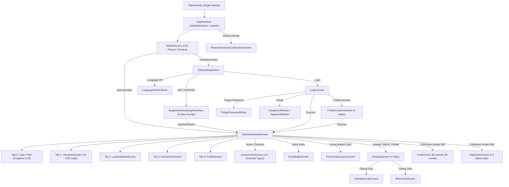

# Codeingo / AshCrypt Android Screens — Full Analysis & Code Report

> **Project:** `com.simats.codeingo` (branded in-app as **AshCrypt** / **CNS Defense**)  
> **UI Framework:** Jetpack Compose + Material 3 (`compileSdk = 35`, `minSdk = 26`, `targetSdk = 35`), Hilt DI, Navigation Compose, Room, Retrofit/Kotlinx Serialization, Coil GIF, Lottie, Konfetti, Rive.  
> **Architecture Pattern:** Single-Activity (`MainActivity`) driving a `NavHost` (`AppNavHost`) plus a multi-tab `MainDashboardScreen` that hosts 5 `HorizontalPager` tabs, fullscreen `zIndex` overlays (Arenas, Diagnostic, Micro-Labs), and modal bottom sheets/dialogs.

---

## 1. High-Level Navigation Architecture

All navigation starts in [MainActivity.kt](file:///Users/user1/Code_in_go_android/app/src/main/java/com/simats/codeingo/MainActivity.kt#L22-L67), which calls `enableEdgeToEdge()`, holds the system splash using a `ViewTreeObserver.OnPreDrawListener` until `GameManager.instance.isInitialized.value` (with a `1500ms` timeout), wraps the tree in `CodeingoTheme` + `ProvideScreenMetrics`, and mounts `AppNavHost()`.



### Route Definitions & `AppNavHost` Wiring

From [Routes.kt](file:///Users/user1/Code_in_go_android/app/src/main/java/com/simats/codeingo/navigation/Routes.kt#L3-L24):

```kotlin
sealed class Screen(val route: String) {
    object Splash : Screen("splash")
    object Onboarding : Screen("onboarding")
    object Login : Screen("login")
    object ProfileCreation : Screen("profile_creation")
    object Dashboard : Screen("dashboard")
    object Assessment : Screen("assessment/{unitId}/{levelNumber}/{totalLevelsInUnit}/{isBoss}") {
        fun createRoute(unitId: Int, levelNumber: Int, totalLevelsInUnit: Int = 6, isBoss: Boolean = false) =
            "assessment/$unitId/$levelNumber/$totalLevelsInUnit/$isBoss"
        fun createRoute(lessonId: String) = "assessment/1/1/6/false"
    }
    object BossBattle : Screen("boss_battle/{bossId}") {
        fun createRoute(bossId: String) = "boss_battle/$bossId"
    }
    object Visualizer : Screen("visualizer")
    object PracticeHub : Screen("practice_hub")
    object PhoenixSanctuary : Screen("phoenix_sanctuary")
    object PhoenixEggHatch : Screen("phoenix_egg_hatch")
    object Settings : Screen("settings")
    object AnimationLab : Screen("animation_lab")
    object MotionLab : Screen("motion_lab")
}
```

And from [AppNavHost.kt](file:///Users/user1/Code_in_go_android/app/src/main/java/com/simats/codeingo/navigation/AppNavHost.kt#L86-L106):

```kotlin
composable(
    route = Screen.Splash.route,
    exitTransition = {
        fadeOut(animationSpec = tween(350))
    }
) {
    SplashScreen(
        onFinishedSplash = {
            val destination = runCatching {
                if (com.simats.codeingo.domain.AuthService.instance.isAuthenticated.value) {
                    Screen.Dashboard.route
                } else {
                    Screen.Onboarding.route
                }
            }.getOrDefault(Screen.Onboarding.route)
            navController.navigate(destination) {
                popUpTo(Screen.Splash.route) { inclusive = true }
            }
        }
    )
}
```

> **Route Registration Gap:** `Screen.Visualizer`, `Screen.PracticeHub`, and `Screen.PhoenixEggHatch` are declared in [Routes.kt](file:///Users/user1/Code_in_go_android/app/src/main/java/com/simats/codeingo/navigation/Routes.kt#L17-L20) but have **no `composable(...)` blocks** in [AppNavHost.kt](file:///Users/user1/Code_in_go_android/app/src/main/java/com/simats/codeingo/navigation/AppNavHost.kt#L86-L269). Navigating to them via `navController` would throw an `IllegalArgumentException`. Instead, `VisualizerScreen` lives inside `MainDashboardScreen`'s pager, `PhoenixEggHatch3DView` is rendered inline inside `AssessmentScreen`/`BossBattleScreen`, and `PracticeHubScreen` is currently unreachable (see Section 9).

---

## 2. Complete Screen & Modal Inventory

| Category | Screen / Composable | File Path | Mounting Mechanism | Primary State / VM |
| :--- | :--- | :--- | :--- | :--- |
| **Entry** | `SplashScreen` | [SplashScreen.kt](file:///Users/user1/Code_in_go_android/app/src/main/java/com/simats/codeingo/ui/splash/SplashScreen.kt#L67) | `AppNavHost` (`splash`) | Local frame-nano timeline |
| **Onboarding** | `OnboardingScreen` | [OnboardingScreen.kt](file:///Users/user1/Code_in_go_android/app/src/main/java/com/simats/codeingo/ui/onboarding/OnboardingScreen.kt#L106) | `AppNavHost` (`onboarding`) | `LocalizationManager` |
| **Onboarding** | `BeginnerOnboardingFlowView` | [BeginnerOnboardingFlowView.kt](file:///Users/user1/Code_in_go_android/app/src/main/java/com/simats/codeingo/ui/onboarding/BeginnerOnboardingFlowView.kt#L102) | Overlay inside `OnboardingScreen` | Local step state + `GameManager` |
| **Onboarding** | `LanguagePickerSheet` | [LanguagePickerSheet.kt](file:///Users/user1/Code_in_go_android/app/src/main/java/com/simats/codeingo/ui/onboarding/LanguagePickerSheet.kt#L52) | `ModalBottomSheet` | `LocalizationManager` |
| **Auth** | `LoginScreen` | [LoginScreen.kt](file:///Users/user1/Code_in_go_android/app/src/main/java/com/simats/codeingo/ui/auth/LoginScreen.kt#L129) | `AppNavHost` (`login`) & `ProfileScreen` Dialog | `AuthRepository`, `SyncRepository`, `AuthService` |
| **Auth** | `ProfileCreationScreen` | [ProfileCreationScreen.kt](file:///Users/user1/Code_in_go_android/app/src/main/java/com/simats/codeingo/ui/auth/ProfileCreationScreen.kt#L116) | `AppNavHost` (`profile_creation`) & `ProfileScreen` Dialog | `AuthRepository`, `AuthService` |
| **Auth** | `ForgotPasswordSheet` | [ForgotPasswordSheet.kt](file:///Users/user1/Code_in_go_android/app/src/main/java/com/simats/codeingo/ui/auth/ForgotPasswordSheet.kt#L86) | `ModalBottomSheet` (Login & Settings) | `AuthRepository` |
| **Auth** | `GoogleAuthSheet` / `AppleAuthSheet` | [GoogleAuthSheet.kt](file:///Users/user1/Code_in_go_android/app/src/main/java/com/simats/codeingo/ui/auth/GoogleAuthSheet.kt#L63) | `ModalBottomSheet` (Login & Signup) | Local sheet callbacks |
| **Shell** | `MainDashboardScreen` | [MainDashboardScreen.kt](file:///Users/user1/Code_in_go_android/app/src/main/java/com/simats/codeingo/ui/dashboard/MainDashboardScreen.kt#L183) | `AppNavHost` (`dashboard`) | `MainDashboardViewModel` (`@HiltViewModel`) + `GameManager` |
| **Tab 1** | `VisualizerScreen` | [VisualizerScreen.kt](file:///Users/user1/Code_in_go_android/app/src/main/java/com/simats/codeingo/ui/visualizer/VisualizerScreen.kt#L122) | `HorizontalPager` page 1 | `GameManager`, `LocalizationManager` |
| **Tab 2** | `LeaderboardsScreen` | [LeaderboardsScreen.kt](file:///Users/user1/Code_in_go_android/app/src/main/java/com/simats/codeingo/ui/leaderboards/LeaderboardsScreen.kt#L87) | `HorizontalPager` page 2 | `LeaderboardViewModel` (`@HiltViewModel`) |
| **Tab 3** | `ArenasHubScreen` | [ArenasHubScreen.kt](file:///Users/user1/Code_in_go_android/app/src/main/java/com/simats/codeingo/ui/arenas/hub/ArenasHubScreen.kt#L134) | `HorizontalPager` page 3 | `GameManager` |
| **Tab 4** | `ProfileScreen` | [ProfileScreen.kt](file:///Users/user1/Code_in_go_android/app/src/main/java/com/simats/codeingo/ui/profile/ProfileScreen.kt#L72) | `HorizontalPager` page 4 | `GameManager`, `LocalizationManager`, `PhoenixEmotionManager` |
| **Quiz** | `AssessmentScreen` | [AssessmentScreen.kt](file:///Users/user1/Code_in_go_android/app/src/main/java/com/simats/codeingo/ui/exercise/AssessmentScreen.kt#L152) | `AppNavHost` (`assessment/...`) | Local state + `LessonCompletionUseCase` |
| **Boss** | `BossBattleScreen` | [BossBattleScreen.kt](file:///Users/user1/Code_in_go_android/app/src/main/java/com/simats/codeingo/ui/exercise/BossBattleScreen.kt#L88) | `AppNavHost` (`boss_battle/{bossId}`) | Local state + `CourseRepository` + `GameManager` |
| **Diagnostic** | `DiagnosticScreen` | [DiagnosticScreen.kt](file:///Users/user1/Code_in_go_android/app/src/main/java/com/simats/codeingo/ui/exercise/DiagnosticScreen.kt#L76) | Fullscreen overlay in `MainDashboardScreen` | Local state + `ConceptMasteryDao` + `GameManager` |
| **Micro-Labs** | `BitTogglerLab`, `ModuloClockLab`, `XorBoardLab` | [BitTogglerLab.kt](file:///Users/user1/Code_in_go_android/app/src/main/java/com/simats/codeingo/ui/exercise/labs/BitTogglerLab.kt#L62) | Fullscreen overlay in `MainDashboardScreen` | Local interactive bit/modulo/XOR state |
| **Arenas (5)** | `CipherSanctumArenaScreen`, `BlockCipherForgeArenaScreen`, `KeyExchangeCitadelArenaScreen`, `IntegrityFoundryArenaScreen`, `CyberBastionArenaScreen` | [CipherSanctumArenaScreen.kt](file:///Users/user1/Code_in_go_android/app/src/main/java/com/simats/codeingo/ui/arenas/cipher_sanctum/CipherSanctumArenaScreen.kt#L78) | Fullscreen overlay (`zIndex(500f)`) in `MainDashboardScreen` | `ArenaProgressionManager` + `ArenaCompletionUseCase` |
| **Phoenix** | `PhoenixSanctuaryScreen` | [PhoenixSanctuaryScreen.kt](file:///Users/user1/Code_in_go_android/app/src/main/java/com/simats/codeingo/ui/phoenix/PhoenixSanctuaryScreen.kt#L149) | `AppNavHost` (`phoenix_sanctuary`) | `GameManager` (18 stages) |
| **Phoenix** | `PhoenixEvolutionCelebrationScreen` | [PhoenixEvolutionCelebrationScreen.kt](file:///Users/user1/Code_in_go_android/app/src/main/java/com/simats/codeingo/ui/phoenix/PhoenixEvolutionCelebrationScreen.kt#L74) | Global overlay in `AppNavHost` | `GameManager.showEvolutionModal` |
| **Phoenix** | `PhoenixEggHatch3DView` | [PhoenixEggHatch3DView.kt](file:///Users/user1/Code_in_go_android/app/src/main/java/com/simats/codeingo/ui/phoenix/PhoenixEggHatch3DView.kt#L85) | Inline victory screen in `AssessmentScreen` & `BossBattleScreen` | Local crack-step animation |
| **Settings** | `SettingsScreen` | [SettingsScreen.kt](file:///Users/user1/Code_in_go_android/app/src/main/java/com/simats/codeingo/ui/settings/SettingsScreen.kt#L110) | `AppNavHost` (`settings`) | `ThemeManager`, `MotionController`, `PhoenixEmotionManager`, `SharedPreferences` |
| **Modals** | `GemShopSheet`, `StreakSocietySheet`, `PhoenixEmotionPickerSheet`, `AskAshBottomSheet`, `DSAChapterStoryIntroSheet`, `DSAFinalMasterJourneyView` | [GemShopSheet.kt](file:///Users/user1/Code_in_go_android/app/src/main/java/com/simats/codeingo/ui/shop/GemShopSheet.kt#L182) | `ModalBottomSheet` / `Dialog` in `MainDashboardScreen` / `ProfileScreen` | `GameManager`, `StreakManager`, `PhoenixEmotionManager` |
| **Debug Labs** | `AnimationLabScreen`, `MotionLabScreen` | [AnimationLabScreen.kt](file:///Users/user1/Code_in_go_android/app/src/main/java/com/simats/codeingo/ui/components/AnimationLabScreen.kt#L71) | `AppNavHost` (guarded by `BuildConfig.DEBUG` in `SettingsScreen`) | `MotionController`, `EffectBudgetManager` |
| **Unwired** | `PracticeHubScreen`, `CipherLabScreen`, `UniversalVisualizerView`, `AshCryptPlusSheet`, `AnimationGalleryScreen`, `ExamReadinessDashboard`, `CipherCardShareView`, `DailyCipherChallengeCard`, `FriendsSocialLayer` | Various under `ui/` | Present in codebase, not reachable from active navigation | See Section 9 |

---

## 3. Entry, Onboarding & Authentication Screens

### 3.1 `SplashScreen`
- **File:** [SplashScreen.kt](file:///Users/user1/Code_in_go_android/app/src/main/java/com/simats/codeingo/ui/splash/SplashScreen.kt#L67-L390)
- **Behavior:** Runs a 3.5-second frame-synchronized (`withFrameNanos`) physics timeline across 4 phases:
  1. `[0.0s–0.45s]` Distance fly-in (`easeFlyIn = 1 - (1 - p0)^3`).
  2. `[0.45s–0.62s]` Kinetic energy squeeze (`sin(pSqueeze * PI)`).
  3. `[0.62s–1.25s]` Explosion into 32 3D glossy ember particles (`RealisticSplashBubble`) + dual expanding shockwave rings.
  4. `[1.25s–3.50s]` Spiral vortex re-formation + damped elastic landing (`exp(-5.5 * p) * cos(14 * p)`).

```kotlin
LaunchedEffect(Unit) {
    val startNanos = System.nanoTime()
    while (true) {
        withFrameNanos { frameTimeNanos ->
            elapsedTimeSec = (frameTimeNanos - startNanos) / 1_000_000_000f
        }
        if (elapsedTimeSec >= 3.5f) {
            onFinishedSplash()
            break
        }
    }
}
```

### 3.2 `OnboardingScreen` & `BeginnerOnboardingFlowView`
- **Files:** [OnboardingScreen.kt](file:///Users/user1/Code_in_go_android/app/src/main/java/com/simats/codeingo/ui/onboarding/OnboardingScreen.kt#L106-L583), [BeginnerOnboardingFlowView.kt](file:///Users/user1/Code_in_go_android/app/src/main/java/com/simats/codeingo/ui/onboarding/BeginnerOnboardingFlowView.kt#L79-L845), [LanguagePickerSheet.kt](file:///Users/user1/Code_in_go_android/app/src/main/java/com/simats/codeingo/ui/onboarding/LanguagePickerSheet.kt#L52-L173)
- **OnboardingScreen:** Hosts `PhoenixAtmosphericBackgroundView`, `HeaderView` (language picker pill + login link), a 4-page `HorizontalPager` (`HeroPageSlide` with `AnimatedHomeMascotView` + 3 `FeatureSlide`s), and pinned `AppButton`s (`GET STARTED` -> launches `BeginnerOnboardingFlowView`; `I ALREADY HAVE AN ACCOUNT` -> `Screen.Login`).
- **BeginnerOnboardingFlowView:** An 8-step interactive onboarding flow that includes a live Caesar shift dial exercise (`KHOOR -> HELLO`), saves preferences per user to `ashcrypt_onboarding_prefs`, awards `+20 XP`, and triggers `AuthService.instance.signInAsGuest()` before navigating to `Dashboard`.

```kotlin
enum class OnboardingStep(val stepIndex: Int) {
    WELCOME(0),
    GOAL_SELECTION(1),
    DAILY_TIME(2),
    PRIOR_LEVEL(3),
    CAESAR_INTRO(4),
    CAESAR_LESSON(5),
    FIRST_SUCCESS(6),
    INITIALIZING(7)
}
```

### 3.3 `LoginScreen`, `ProfileCreationScreen` & Auth Sheets
- **Files:** [LoginScreen.kt](file:///Users/user1/Code_in_go_android/app/src/main/java/com/simats/codeingo/ui/auth/LoginScreen.kt#L129-L1188), [ProfileCreationScreen.kt](file:///Users/user1/Code_in_go_android/app/src/main/java/com/simats/codeingo/ui/auth/ProfileCreationScreen.kt#L116-L1247), [ForgotPasswordSheet.kt](file:///Users/user1/Code_in_go_android/app/src/main/java/com/simats/codeingo/ui/auth/ForgotPasswordSheet.kt#L86-L475), [GoogleAuthSheet.kt](file:///Users/user1/Code_in_go_android/app/src/main/java/com/simats/codeingo/ui/auth/GoogleAuthSheet.kt#L63), [AppleAuthSheet.kt](file:///Users/user1/Code_in_go_android/app/src/main/java/com/simats/codeingo/ui/auth/AppleAuthSheet.kt#L55)
- **Security & Auth Handling:**
  - `LoginScreen` and `ForgotPasswordSheet` attach `WindowManager.LayoutParams.FLAG_SECURE` via `DisposableEffect(activity)` to prevent screenshots during credential entry.
  - `LoginScreen` acquires Hilt-injected `AuthRepository` and `SyncRepository` via `EntryPointAccessors.fromApplication(..., AuthServiceEntryPoint::class.java)`.
  - On `ApiResult.NetworkError`, `LoginScreen` falls back to `AuthService.shared.verifyPassword(trimmed, password)`.
- **ProfileCreationScreen:** 4-step wizard (`1: Age`, `2: Coding Goal` + Google quick-fill, `3: Name/Email/Password`, `4: Flame Ignition Celebration`). Registers via `authRepository.register(...)`, automatically attempts `authenticate(...)` on HTTP `409`, and falls back locally on `NetworkError`.
- **ForgotPasswordSheet:** 5-state machine (`ENTER_EMAIL` -> `SENDING_EMAIL` -> `VERIFY_CODE` -> `RESET_PASSWORD` -> `SUCCESS`).

---

## 4. Main Dashboard Shell & Core Tabs

### 4.1 `MainDashboardScreen` & `MainDashboardViewModel`
- **Files:** [MainDashboardScreen.kt](file:///Users/user1/Code_in_go_android/app/src/main/java/com/simats/codeingo/ui/dashboard/MainDashboardScreen.kt#L183-L2009), [MainDashboardViewModel.kt](file:///Users/user1/Code_in_go_android/app/src/main/java/com/simats/codeingo/ui/dashboard/MainDashboardViewModel.kt#L33-L366), [BottomNavBar.kt](file:///Users/user1/Code_in_go_android/app/src/main/java/com/simats/codeingo/navigation/BottomNavBar.kt#L80-L351)
- **Pager & Bottom Nav:** Hosts a 5-page `HorizontalPager` paired with `BottomNavBar` (a custom liquid-glass floating capsule bar with viscoelastic horizontal stretch `stretchX = 1f + abs(delta) * 0.40f`).
- **Learn Tab (`DashboardTab.LEARN`) Stack:**
  1. `TopStatsHeader` + `DynamicPillHUD`.
  2. Live Backend Sync Banner & Admin Broadcast `systemAnnouncement` banner (from `MainDashboardViewModel`).
  3. `EthicalReengagementGreeting` + `ContinueHeroCard` + `DailyGoalAndStreakPill` + `TodaysMissionsCarousel` + `DailyRewardChestCard`.
  4. `BasecampFoundationsCard`: Chapter 0 card launching `DiagnosticScreen`, 3 Micro-Labs, and Stages `101..105`.
  5. Winding 25-Chapter Curriculum Path (`ChapterRegistry.getCoreUnits() + ChapterRegistry.getExpansionUnits()`): `UnitSectionBanner`, stepping-stone connectors, `LessonNodeButton` (3D pushable bevel nodes), and `PhoenixNodeJumpFlightView`.
  6. Floating Stage Action Card (`selectedStageCardNode`) + `GrandMasterJourneyCard`.

```kotlin
val dashboardTabs = remember {
    listOf(
        DashboardTab.LEARN,
        DashboardTab.VISUALIZER,
        DashboardTab.LEADERBOARDS,
        DashboardTab.ARENAS,
        DashboardTab.PROFILE
    )
}
```

Full-screen overlay mounting inside `MainDashboardScreen`:

```kotlin
activeWorldArena?.let { arenaKey ->
    BackHandler {
        activeWorldArena = null
    }
    Box(
        modifier = Modifier
            .fillMaxSize()
            .zIndex(500f)
    ) {
        when (arenaKey) {
            ArenaRoute.CIPHER_SANCTUM -> CipherSanctumArenaScreen(onDismiss = { activeWorldArena = null })
            ArenaRoute.BLOCK_CIPHER_FORGE -> BlockCipherForgeArenaScreen(onDismiss = { activeWorldArena = null })
            ArenaRoute.KEY_EXCHANGE_CITADEL -> KeyExchangeCitadelArenaScreen(onDismiss = { activeWorldArena = null })
            ArenaRoute.INTEGRITY_FOUNDRY -> IntegrityFoundryArenaScreen(onDismiss = { activeWorldArena = null })
            ArenaRoute.CYBER_BASTION -> CyberBastionArenaScreen(onDismiss = { activeWorldArena = null })
            else -> CipherSanctumArenaScreen(onDismiss = { activeWorldArena = null })
        }
    }
}
```

### 4.2 `VisualizerScreen` (Tab 1)
- **File:** [VisualizerScreen.kt](file:///Users/user1/Code_in_go_android/app/src/main/java/com/simats/codeingo/ui/visualizer/VisualizerScreen.kt#L122-L1904)
- **Dual Mode:** Switches between `VisualizerDisplayMode.LIST` (search bar, 5 category filter chips: `All`, `Classical`, `Symmetric`, `Asymmetric`, `Hashing & Protocols`, plus 5-chapter roadmap cards) and `VisualizerDisplayMode.VISUALIZER` (`TopicDetailView` with a 4-mode `CNSLabModeTabBar`).

```kotlin
when (selectedType) {
    DSAVisualizerType.ARRAY -> CaesarCipherVisualizer(mode = activeLabMode)
    DSAVisualizerType.STACK -> DESFeistelVisualizer(mode = activeLabMode)
    DSAVisualizerType.QUEUE -> AESMatrixVisualizer(mode = activeLabMode)
    DSAVisualizerType.LINKED_LIST -> VigenereCipherVisualizer(mode = activeLabMode)
    DSAVisualizerType.BINARY_TREE -> DiffieHellmanVisualizer(mode = activeLabMode)
    DSAVisualizerType.AVL_TREE -> RSAPublicKeyVisualizer(mode = activeLabMode)
    DSAVisualizerType.TRIE -> ECCPointVisualizer(mode = activeLabMode)
    DSAVisualizerType.GRAPH -> SHA256Visualizer(mode = activeLabMode)
    DSAVisualizerType.SORTING -> HMACCollisionVisualizer(mode = activeLabMode)
    DSAVisualizerType.STEP_RECORDER -> TLS13HandshakeVisualizer(mode = activeLabMode)
}
```

### 4.3 `LeaderboardsScreen` & `LeaderboardViewModel` (Tab 2)
- **Files:** [LeaderboardsScreen.kt](file:///Users/user1/Code_in_go_android/app/src/main/java/com/simats/codeingo/ui/leaderboards/LeaderboardsScreen.kt#L87-L837), [LeaderboardViewModel.kt](file:///Users/user1/Code_in_go_android/app/src/main/java/com/simats/codeingo/ui/leaderboards/LeaderboardViewModel.kt#L19-L64)
- **States:** `completedLessons < 3` -> `LockedLeaderboardsView`; `isLoading && rankings.isEmpty()` -> spinner; `rankings.isEmpty()` -> `EmptyLeaderboardView`; otherwise `UnlockedLeaderboardsView` + `MilestoneCeremonyOverlay`.

### 4.4 `ArenasHubScreen` (Tab 3)
- **File:** [ArenasHubScreen.kt](file:///Users/user1/Code_in_go_android/app/src/main/java/com/simats/codeingo/ui/arenas/hub/ArenasHubScreen.kt#L134-L567)
- **Content:** Player combat stats HUD (`5 / 5 ACTIVE ARENAS`, `35 STATIONS`, `CRYPTO XP`) and 5 `ArenaBattleHeroCard`s driven by `CNS_ARENAS_SPECS`, locked/unlocked by `spec.unitNumber <= maxUnlockedChapter`. Uses frozen parity route keys from [ArenaRoute.kt](file:///Users/user1/Code_in_go_android/app/src/main/java/com/simats/codeingo/ui/arenas/routing/ArenaRoute.kt#L12-L35).

### 4.5 `ProfileScreen` (Tab 4)
- **File:** [ProfileScreen.kt](file:///Users/user1/Code_in_go_android/app/src/main/java/com/simats/codeingo/ui/profile/ProfileScreen.kt#L72-L1808)
- **States:** Switches between `AuthenticatedProfileBody` and `UnauthenticatedProfileBody` (with `Create Account`, `Sign In`, and `Quick Demo Sign In`).
- **Sections when authenticated:** `UserHeaderCard`, `LevelProgressCard`, `YourPhoenixCustomizationSection`, 2x2 `StatisticsSection`, `LearningJourneySection`, `AchievementsSection`, `CryptoCodexGallery`, `AddFriendsSection`, and Sign Out confirmation `AlertDialog`.

---

## 5. Learning, Assessment, Boss & Micro-Lab Screens

### 5.1 `AssessmentScreen`
- **File:** [AssessmentScreen.kt](file:///Users/user1/Code_in_go_android/app/src/main/java/com/simats/codeingo/ui/exercise/AssessmentScreen.kt#L152-L1569)
- **Flow:** Optional `MiniLessonIntroCards` -> Active Question Stage (`12+` exercise types) -> `HeartRecoveryView` (if 0 hearts) / `PhoenixEggHatch3DView` (if `isBoss`) / `CelebrationOverlay`.

Exercise dispatch inside [AssessmentScreen.kt](file:///Users/user1/Code_in_go_android/app/src/main/java/com/simats/codeingo/ui/exercise/AssessmentScreen.kt#L666-L848):

```kotlin
when (currentQuestion.gameType) {
    DSAExerciseType.MULTIPLE_CHOICE  -> { /* HolographicCommandTile list */ }
    DSAExerciseType.MATCH_PAIRS      -> MatchPairsExerciseView(...)
    DSAExerciseType.ORDER_STEPS      -> OrderStepsExerciseView(...)
    DSAExerciseType.FILL_CODE        -> FillCodeExerciseView(...)
    DSAExerciseType.COMPLEXITY_DIAL,
    ExerciseType.KEY_SIZE_DIAL       -> ComplexityDialExerciseView(...)
    DSAExerciseType.TRUE_FALSE_SWIPE -> TrueFalseSwipeExerciseView(...)
    ExerciseType.CIPHER_WHEEL        -> CipherWheelExerciseView(...)
    ExerciseType.BIT_FLIPPER         -> BitFlipperExerciseView(...)
    ExerciseType.ROUND_BUILDER       -> RoundBuilderExerciseView(...)
    ExerciseType.MODULAR_MATH        -> ModularMathExerciseView(...)
    ExerciseType.PACKET_TRIAGE       -> PacketTriageExerciseView(...)
    ExerciseType.SPOT_THE_FLAW       -> SpotTheFlawExerciseView(...)
}
```

### 5.2 `BossBattleScreen`
- **File:** [BossBattleScreen.kt](file:///Users/user1/Code_in_go_android/app/src/main/java/com/simats/codeingo/ui/exercise/BossBattleScreen.kt#L88-L534)
- **Mechanics:** Loads `DSABossSpec` via `CourseRepository.getBossById(bossId)`, tracks `bossHp`, 3 `learnerHearts`, and countdown timer.

```kotlin
com.simats.codeingo.ui.phoenix.PhoenixEggHatch3DView(
    unitId = unitId,
    levelNumber = boss.targetPhoenixStageAwarded,
    totalLevelsInUnit = 6,
    isBoss = true,
    xpEarned = bossXP,
    starsEarned = starsEarned,
    accuracyPercentage = 100,
    onContinue = {
        GameManager.instance.addStars(starsEarned)
        GameManager.instance.awardBossVictory(boss, unitId)
        GameManager.instance.completeLessonAndExtendStreak()
        onVictory()
    },
    onFinish = {
        GameManager.instance.addStars(starsEarned)
        GameManager.instance.awardBossVictory(boss, unitId)
        GameManager.instance.completeLessonAndExtendStreak()
        onVictory()
    },
    onUpgradePhoenixNextUnit = {
        GameManager.instance.addStars(starsEarned)
        GameManager.instance.awardBossVictory(boss, unitId)
        GameManager.instance.completeLessonAndExtendStreak()
        onVictory()
    }
)
```

### 5.3 `DiagnosticScreen` & Chapter 0 Micro-Labs
- **`DiagnosticScreen`** ([DiagnosticScreen.kt](file:///Users/user1/Code_in_go_android/app/src/main/java/com/simats/codeingo/ui/exercise/DiagnosticScreen.kt#L76-L594)): 12-question zero-XP, zero-heart-cost placement test across 4 categories (`BINARY_HEX`, `MODULO`, `XOR`, `SECURITY`), saving mastery to Room `ConceptMasteryDao` and recommending Chapter 0 or Chapter 1.
- **Micro-Labs (mounted fullscreen from `BasecampFoundationsCard`):**
  - [BitTogglerLab.kt](file:///Users/user1/Code_in_go_android/app/src/main/java/com/simats/codeingo/ui/exercise/labs/BitTogglerLab.kt#L62): 8-bit interactive switchboard (`128..1` weights) computing Decimal, Hex, ASCII, and challenge targets.
  - [ModuloClockLab.kt](file:///Users/user1/Code_in_go_android/app/src/main/java/com/simats/codeingo/ui/exercise/labs/ModuloClockLab.kt#L67): Animated Canvas clock supporting Mod 12, Mod 26, and Mod 7 with `((x % n) + n) % n`.
  - [XorBoardLab.kt](file:///Users/user1/Code_in_go_android/app/src/main/java/com/simats/codeingo/ui/exercise/labs/XorBoardLab.kt#L58): 4-bit interactive `P ⊕ K = C` board proving `(P ⊕ K) ⊕ K = P`.

---

## 6. The 5 Interactive Crypto Arenas (35 Levels)

All 5 arenas are launched from `MainDashboardScreen` (`activeWorldArena` overlay at `zIndex(500f)`), share common HUD/briefing/debrief/loadout components (`ArenaBriefingView`, `ArenaDebriefView`, `ArenaComboHUD`, `ArenaLoadoutSheet`, `ArenaProgressionManager`, `ArenaScoring`), and integrate with `ArenaCompletionUseCase`.

| Arena Screen | Route Key | Level Enum & 7 Levels |
| :--- | :--- | :--- |
| [CipherSanctumArenaScreen.kt](file:///Users/user1/Code_in_go_android/app/src/main/java/com/simats/codeingo/ui/arenas/cipher_sanctum/CipherSanctumArenaScreen.kt#L78) | `"array"` | `CipherSanctumLevel`: `CaesarDialLevel`, `FindTheShiftLevel`, `FrequencyRadioLevel`, `VigenereRotorsLevel`, `RailFenceGridLevel`, `CryptanalysisSprintLevel`, Boss: `SphinxBossBattleLevel` |
| [BlockCipherForgeArenaScreen.kt](file:///Users/user1/Code_in_go_android/app/src/main/java/com/simats/codeingo/ui/arenas/block_cipher_forge/BlockCipherForgeArenaScreen.kt#L81) | `"linkedlist"` | `BlockCipherForgeLevel`: `SBoxForgeLevel`, `ShiftRowsSliderLevel`, `MixColumnsMixerLevel`, `AddRoundKeyLockLevel`, `ModeDetectiveLevel`, `AvalancheSprintLevel`, Boss: `BlockOverlordBossLevel` |
| [KeyExchangeCitadelArenaScreen.kt](file:///Users/user1/Code_in_go_android/app/src/main/java/com/simats/codeingo/ui/arenas/key_exchange_citadel/KeyExchangeCitadelArenaScreen.kt#L77) | `"stack"` | `KeyExchangeCitadelLevel`: `ClockArithmeticLevel`, `PaintMixHandshakeLevel`, `TrapdoorLabLevel`, `KeyPairForgeLevel`, `CurveWalkerLevel`, `KeySizeGauntletLevel`, Boss: `QuantumCryptanalystBossLevel` |
| [IntegrityFoundryArenaScreen.kt](file:///Users/user1/Code_in_go_android/app/src/main/java/com/simats/codeingo/ui/arenas/integrity_foundry/IntegrityFoundryArenaScreen.kt#L77) | `"queue"` | `IntegrityFoundryLevel`: `DigestPressLevel`, `BitFlipLabLevel`, `SpongeChamberLevel`, `WaxSealLevel`, `SignatureSealLevel`, `BirthdayRadarLevel`, Boss: `CollisionBeastBossLevel` |
| [CyberBastionArenaScreen.kt](file:///Users/user1/Code_in_go_android/app/src/main/java/com/simats/codeingo/ui/arenas/cyber_bastion/CyberBastionArenaScreen.kt#L78) | `"tree"` | `CyberBastionLevel`: `TlsHandshakeLevel`, `CipherSuiteLabLevel`, `IpsecTunnelLevel`, `StatefulFirewallLevel`, `DnssecChainLevel`, `SynCookieDefenseLevel`, Boss: `CyberTitanBossLevel` |

Shared arena heart-deduction and level-completion pattern (from [CipherSanctumArenaScreen.kt](file:///Users/user1/Code_in_go_android/app/src/main/java/com/simats/codeingo/ui/arenas/cipher_sanctum/CipherSanctumArenaScreen.kt#L139-L180)):

```kotlin
fun onDeductHeart() {
    if (equippedTool == ArenaTacticalTool.SECOND_CHANCE && !toolUsedInLevel) {
        toolUsedInLevel = true
    } else {
        gameManager.loseHeart()
        comboCount = 0
        shakeController.shake()
        if (heartsCount <= 1) {
            debriefIsVictory = false
            showDebrief = true
        }
    }
}

fun onActionSuccess(points: Int = 100) {
    comboCount++
    score += com.simats.codeingo.domain.scoring.ArenaScoring.calculateEarnedPoints(points, comboCount)
}
```

---

## 7. Phoenix Companion, Sanctuary & Modals

- **`PhoenixSanctuaryScreen`** ([PhoenixSanctuaryScreen.kt](file:///Users/user1/Code_in_go_android/app/src/main/java/com/simats/codeingo/ui/phoenix/PhoenixSanctuaryScreen.kt#L149-L624)): 2-column grid of all 18 Phoenix evolution stages (`allPhoenixStages`) filterable by `ALL (18)`, `ACT 1: HATCH`, `ACT 2: TRIALS`, `ACT 3: COSMIC`, with 360° preview `PhoenixStageDetailSheet`.
- **`PhoenixEvolutionCelebrationScreen`** ([PhoenixEvolutionCelebrationScreen.kt](file:///Users/user1/Code_in_go_android/app/src/main/java/com/simats/codeingo/ui/phoenix/PhoenixEvolutionCelebrationScreen.kt#L74-L328)): Global overlay inside `AppNavHost` triggered by `GameManager.showEvolutionModal`.
- **`PhoenixEmotionPickerSheet`** ([PhoenixEmotionPickerSheet.kt](file:///Users/user1/Code_in_go_android/app/src/main/java/com/simats/codeingo/ui/phoenix/PhoenixEmotionPickerSheet.kt#L77-L389)): Catalog of 28 mascot emotions (`allPhoenixEmotions`) + `Auto Emotion Engine` toggle.
- **`GemShopSheet`** ([GemShopSheet.kt](file:///Users/user1/Code_in_go_android/app/src/main/java/com/simats/codeingo/ui/shop/GemShopSheet.kt#L182-L1668)): Cosmetic store (`Hats`, `Outfits`, `Accessories`, `Effects`, `Hearts`) with live try-on preview.
- **`StreakSocietySheet`** ([StreakSocietySheet.kt](file:///Users/user1/Code_in_go_android/app/src/main/java/com/simats/codeingo/ui/streak/StreakSocietySheet.kt#L71-L358)): Midnight countdown timer, 24h streak repair (50 gems), Weekend Amulet & Quiet Mode toggles.

---

## 8. Settings & Debug Developer Labs

### 8.1 `SettingsScreen`
- **File:** [SettingsScreen.kt](file:///Users/user1/Code_in_go_android/app/src/main/java/com/simats/codeingo/ui/settings/SettingsScreen.kt#L110-L2392)
- **4 Tabs (`Preferences`, `Notifications`, `Courses`, `Account`):** Theme switching, language picker, `EffectTier` (`FULL`/`REDUCED`/`OFF`), haptics/sound, password reset, mascot emotion engine, arena dossiers, progress reset, export security dossier, and Google Play-compliant account deletion:

```kotlin
TextButton(onClick = {
    showDeleteAccountAlert = false
    scope.launch {
        runCatching {
            com.simats.codeingo.data.db.CodeingoDatabase.getDatabase(context).offlineSyncDao().clearAll()
        }
        com.simats.codeingo.domain.AuthService.instance.deleteAccount()
        onLogout()
    }
}) {
    Text("PERMANENTLY DELETE", color = DuolingoRed, fontWeight = FontWeight.Black)
}
```

### 8.2 Debug Labs (Guarded by `BuildConfig.DEBUG`)
- **`AnimationLabScreen`** ([AnimationLabScreen.kt](file:///Users/user1/Code_in_go_android/app/src/main/java/com/simats/codeingo/ui/components/AnimationLabScreen.kt#L71-L367)): Interactive playground for `EffectTier`, `DynamicPillController` events, `ParticlePool`, and gated springs.
- **`MotionLabScreen`** ([MotionLabScreen.kt](file:///Users/user1/Code_in_go_android/app/src/main/java/com/simats/codeingo/ui/debug/MotionLabScreen.kt#L103-L736)): Debug gallery for `EffectBudgetManager` (`isCalmMode`, `isQuietHoursEnabled`), all 11 motion modifiers, `FlipCard`, `ExplodeHost`, `ConfettiHost`, and `NumberRollText`.

---

## 9. Architectural Findings, Bugs & Unwired Code

1. **Unreachable `PracticeHubScreen` & Broken `SideMenuDrawer` `SHOP`/`PRACTICE` Routing:**
   - In [MainDashboardScreen.kt](file:///Users/user1/Code_in_go_android/app/src/main/java/com/simats/codeingo/ui/dashboard/MainDashboardScreen.kt#L216-L246), `dashboardTabs` only contains 5 tabs (`LEARN`, `VISUALIZER`, `LEADERBOARDS`, `ARENAS`, `PROFILE`), yet `SideMenuDrawer` renders all 8 entries of `DashboardTab.values()`.
   - Tapping `Practice` in `SideMenuDrawer` redirects `pagerState` to `VISUALIZER` instead of `PracticeHubScreen`.
   - Tapping `Shop` in `SideMenuDrawer` computes `dashboardTabs.indexOf(DashboardTab.SHOP) == -1`, so nothing happens.
2. **Three Declared Routes Missing from `AppNavHost`:**
   - `Screen.Visualizer`, `Screen.PracticeHub`, and `Screen.PhoenixEggHatch` in [Routes.kt](file:///Users/user1/Code_in_go_android/app/src/main/java/com/simats/codeingo/navigation/Routes.kt#L17-L20) are not registered in [AppNavHost.kt](file:///Users/user1/Code_in_go_android/app/src/main/java/com/simats/codeingo/navigation/AppNavHost.kt).
3. **Orphaned / Unmounted ViewModels:**
   - [LessonViewModel.kt](file:///Users/user1/Code_in_go_android/app/src/main/java/com/simats/codeingo/ui/exercise/viewmodel/LessonViewModel.kt#L57), [MistakeVaultViewModel.kt](file:///Users/user1/Code_in_go_android/app/src/main/java/com/simats/codeingo/ui/practice/viewmodel/MistakeVaultViewModel.kt#L20), and [DashboardViewModel.kt](file:///Users/user1/Code_in_go_android/app/src/main/java/com/simats/codeingo/ui/dashboard/viewmodel/DashboardViewModel.kt#L12) are `@HiltViewModel` classes with zero callers.
4. **Unwired Visualizers & Sandbox Modules:**
   - [UniversalVisualizerView.kt](file:///Users/user1/Code_in_go_android/app/src/main/java/com/simats/codeingo/ui/visualizer/scaffold/UniversalVisualizerView.kt#L56) (and its 25-spec [CnsVisualizerRegistry.kt](file:///Users/user1/Code_in_go_android/app/src/main/java/com/simats/codeingo/ui/visualizer/scaffold/CnsVisualizerRegistry.kt#L7)) is never invoked from `VisualizerScreen`.
   - [CipherLabScreen.kt](file:///Users/user1/Code_in_go_android/app/src/main/java/com/simats/codeingo/ui/visualizer/CipherLabScreen.kt#L75) and 5 standalone visualizers ([CertificateChainVisualizer.kt](file:///Users/user1/Code_in_go_android/app/src/main/java/com/simats/codeingo/ui/visualizer/CertificateChainVisualizer.kt#L49), [EcbCbcCtrVisualizer.kt](file:///Users/user1/Code_in_go_android/app/src/main/java/com/simats/codeingo/ui/visualizer/EcbCbcCtrVisualizer.kt#L62), [KerberosVisualizer.kt](file:///Users/user1/Code_in_go_android/app/src/main/java/com/simats/codeingo/ui/visualizer/KerberosVisualizer.kt#L58), [MerkleTreeVisualizer.kt](file:///Users/user1/Code_in_go_android/app/src/main/java/com/simats/codeingo/ui/visualizer/MerkleTreeVisualizer.kt#L49), [PasswordHashingVisualizer.kt](file:///Users/user1/Code_in_go_android/app/src/main/java/com/simats/codeingo/ui/visualizer/PasswordHashingVisualizer.kt#L51)) are not wired into `VisualizerScreen`.
5. **Unwired Profile/Monetization/Social Cards:**
   - [AshCryptPlusSheet.kt](file:///Users/user1/Code_in_go_android/app/src/main/java/com/simats/codeingo/ui/shop/AshCryptPlusSheet.kt#L44), [DailyCipherChallenge.kt](file:///Users/user1/Code_in_go_android/app/src/main/java/com/simats/codeingo/ui/challenge/DailyCipherChallenge.kt#L62), [ExamReadinessDashboard.kt](file:///Users/user1/Code_in_go_android/app/src/main/java/com/simats/codeingo/ui/profile/ExamReadinessDashboard.kt#L51), [CipherCardShareView.kt](file:///Users/user1/Code_in_go_android/app/src/main/java/com/simats/codeingo/ui/profile/CipherCardShareView.kt#L56), [FriendsSocialLayer.kt](file:///Users/user1/Code_in_go_android/app/src/main/java/com/simats/codeingo/ui/social/FriendsSocialLayer.kt), [AnimationGalleryScreen.kt](file:///Users/user1/Code_in_go_android/app/src/main/java/com/simats/codeingo/ui/components/AnimationGalleryScreen.kt#L59), [LoadingScreen.kt](file:///Users/user1/Code_in_go_android/app/src/main/java/com/simats/codeingo/ui/dashboard/LoadingScreen.kt#L53), and [DashboardSkeletonLoading.kt](file:///Users/user1/Code_in_go_android/app/src/main/java/com/simats/codeingo/ui/dashboard/DashboardSkeletonLoading.kt#L34) are standalone/unmounted in the active app flow.
