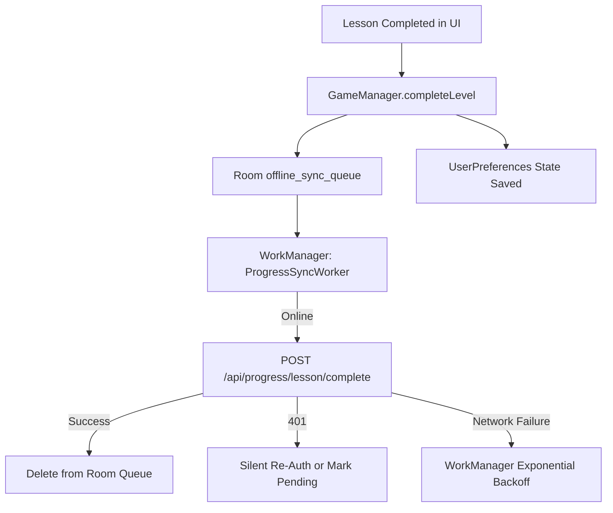

# API SYNCHRONIZATION DESIGN (API_SYNC_DESIGN.md)
## Production-Grade Architecture for Codeingo Android Backend Integration
**Author:** Senior Android Engineering  
**Version:** 1.0.0  
**Target:** Codeingo Android (Kotlin / Jetpack Compose) ↔ Spring Boot REST Backend  
**Approved Decisions:** D1 through D8 (Step 0 Audit)

---

## 1. Core Principles & Invariants

1. **Remote Progression, Local Content:**
   - [`ChapterRegistry.kt`](file:///c:/Users/baran/AndroidStudioProjects/Codeingo/app/src/main/java/com/simats/codeingo/data/repository/ChapterRegistry.kt) is the single ground truth for all UI: Chapter 0 Basecamp, Chapters 1–5 Core, Chapters 6–10 Expansion, and 35 interactive arena challenges.
   - Any curriculum structures received from remote `/api/courses/*` are strictly discarded to prevent wiping the CNS UI with iOS DSA content.
2. **User State Synchronization:**
   - The remote REST API synchronizes user progress (`completedLessonIds`), currencies (`totalXp`, `gemsCount`), and streak metrics (`currentStreak`).
3. **Zero UI/Content Regression:**
   - No UI changes or network blocking spinners on gameplay screens. UI advances instantly; all synchronization operates asynchronously in the background.

---

## 2. Decision Summary (Approved D1 – D8)

* **D1 (Account Model):** Android passes `activeCourseId: "cns_defense"` across auth and profile endpoints. Client enforces strict course partitioning: only lesson IDs matching `cns.*` are ingested from the server; foreign iOS DSA IDs (`u*`) are silently ignored.
* **D2 (Hearts Authority):** Display and gameplay hearts are **client-authoritative (max 10 hearts)** with local timer regeneration. Android does not call `/api/users/me/refill-hearts` (which sets hearts to 5 and costs 350 gems) until the backend supports configurable max hearts.
* **D3 (XP & Gems Authority):**
  * Completed lessons: Union (`localSet ∪ remoteSet`).
  * XP & Gems: Server total is authoritative on sync, plus re-application of pending local outbox deltas (`totalXP = maxOf(localXP, serverXP + pendingLocalDeltas)`). Never apply a negative delta.
* **D4 (Lesson ID Scheme):** Stable, namespaced IDs are programmatically derived from [`ChapterRegistry.kt`](file:///c:/Users/baran/AndroidStudioProjects/Codeingo/app/src/main/java/com/simats/codeingo/data/repository/ChapterRegistry.kt) (`cns.c0.l1`..`cns.c10.l5`). Reverse mapping strictly ignores unknown IDs.
* **D5 (Guest & First Login):** Guest user initiated via `POST /api/auth/guest-start`. When an existing local user logs in or registers, their existing completed lessons in `UserPreferences` are automatically queued into Room outbox and synced to the cloud. Local progress is never wiped.
* **D6 (Leaderboard Scope):** All XP earned across Android (Basecamp, Core, Expansion, and Arenas) contributes to the user's total XP and leaderboard ranking.
* **D7 (Phase 2+ Features):** Remote game sessions (`/api/game/sessions/*`) are excluded because they deduct hearts server-side from a 5-heart pool and serve DSA questions. Shop remains local. Mascot telemetry is deferred to Phase E (opt-in only).
* **D8 (Backend Requests):** Formally submitted via [`BACKEND_CONTRACT.md`](file:///c:/Users/baran/AndroidStudioProjects/Codeingo/BACKEND_CONTRACT.md).

---

## 3. Network Foundation Architecture

### 3.1 Build Configurations & Environments
Base URLs are dynamically provided via Gradle build configuration / `local.properties`:
- `debug`: Points to emulator loopback `http://10.0.2.2:8080/` or local dev tunnel. Cleartext enabled exclusively in debug via `network_security_config_debug.xml`.
- `staging`: Points to staging dev tunnel `https://qkc9q70m-8080.inc1.devtunnels.ms/` with HTTPS.
- `release`: Points strictly to production `https://api.codeingo.com/` with HTTPS only.

### 3.2 Dependencies Matrix
```toml
[versions]
retrofit = "2.11.0"
okhttp = "4.12.0"
tink = "1.15.0"
workmanager = "2.10.0"

[libraries]
retrofit-core = { group = "com.squareup.retrofit2", name = "retrofit", version.ref = "retrofit" }
retrofit-converter-kotlinx = { group = "com.squareup.retrofit2", name = "converter-kotlinx-serialization", version.ref = "retrofit" }
okhttp-core = { group = "com.squareup.okhttp3", name = "okhttp", version.ref = "okhttp" }
okhttp-logging = { group = "com.squareup.okhttp3", name = "logging-interceptor", version.ref = "okhttp" }
tink-android = { group = "com.google.crypto.tink", name = "tink-android", version.ref = "tink" }
androidx-work-runtime-ktx = { group = "androidx.work", name = "work-runtime-ktx", version.ref = "workmanager" }
```

### 3.3 OkHttp Interceptor & Security Hardening
* **Timeouts:** 15s read/write, 6s connect.
* **Logging (`HttpLoggingInterceptor`):**
  * Active in `DEBUG` only.
  * Headers: Redacts `Authorization: Bearer [REDACTED]`.
  * Body: Level `HEADERS` on `/api/auth/*` to prevent leaking plaintext passwords or tokens into Logcat; Level `BODY` on non-auth endpoints.
* **Bearer Injection:** Attached strictly to authenticated requests targeting the configured API base host.

### 3.4 Secure Token Storage (Tink AEAD + DataStore)
* Replaces deprecated `androidx.security.crypto`.
* Uses Google Tink Android Keystore-backed AEAD (`AesGcmKeyManager`).
* Tokens are encrypted at rest with AES-256-GCM and stored in a private DataStore.
* Excluded from Android Auto Backup (`allowBackup="false"` in manifest).

---

## 4. Programmatic Lesson ID Mapping Architecture

To guarantee zero drift between UI nodes and backend tracking, IDs are generated programmatically:

```kotlin
object LessonIdAdapter {
    private const val PREFIX = "cns"

    fun toBackendLessonId(chapterNumber: Int, levelNumberInChapter: Int): String {
        return "$PREFIX.c$chapterNumber.l$levelNumberInChapter"
    }

    fun toBackendIdForLevelIndex(levelIndex: Int): String {
        return when {
            ChapterRegistry.isBasecampLevel(levelIndex) -> "$PREFIX.c0.l${levelIndex - 100}"
            ChapterRegistry.isExpansionLevel(levelIndex) -> {
                val chapter = ((levelIndex - 26) / 5) + 6
                val stage = ((levelIndex - 26) % 5) + 1
                "$PREFIX.c$chapter.l$stage"
            }
            else -> {
                val chapter = ((levelIndex - 1) / 5) + 1
                val stage = ((levelIndex - 1) % 5) + 1
                "$PREFIX.c$chapter.l$stage"
            }
        }
    }

    fun toLocalLevelIndex(backendId: String): Int? {
        if (!backendId.startsWith("$PREFIX.c")) return null
        val parts = backendId.removePrefix("$PREFIX.c").split(".l")
        if (parts.size != 2) return null
        val chapter = parts[0].toIntOrNull() ?: return null
        val stage = parts[1].toIntOrNull() ?: return null

        return when (chapter) {
            0 -> 100 + stage
            in 1..5 -> ((chapter - 1) * 5) + stage
            in 6..10 -> 25 + ((chapter - 6) * 5) + stage
            else -> null
        }
    }
}
```

---

## 5. Offline Outbox & Sync Architecture



### 5.1 Room Database Migration (`version = 1 -> 2`)
* Table: `offline_sync_queue`
* Fields:
  * `id`: Long (Auto-increment PK)
  * `idempotencyKey`: String (UUID)
  * `userId`: String
  * `lessonId`: String
  * `accuracyPercentage`: Int
  * `completedAtEpochMs`: Long
  * `state`: String (`PENDING`, `IN_FLIGHT`, `FAILED_PERMANENT`)
  * `attemptCount`: Int
  * `lastErrorMessage`: String?
* Unique index: `(userId, lessonId)` keeping the highest accuracy.

### 5.2 WorkManager Drain Worker
* Name: `ProgressSyncWorker` (runs as unique work `codeingo_progress_sync_work`).
* Constraints: `NetworkType.CONNECTED`.
* Backoff: `BackoffPolicy.EXPONENTIAL` starting at 10 seconds.
* Behavior on error:
  * `5xx` / Socket timeout -> Return `Result.retry()`.
  * `401 Unauthorized` -> Flag auth required, pause sync.
  * `429 Too Many Requests` -> Parse `Retry-After` header and delay.
  * `4xx Client Error` -> Mark record `FAILED_PERMANENT` to avoid infinite retry loops.

### 5.3 Echo Loop Prevention
When remote snapshot is pulled from `GET /api/progress/status`:
* `applyRemoteSnapshot(snapshot)` updates internal `_totalXP`, `_completedLessonIds`, and `_completedLevelIndices` **directly without triggering `completeLesson()` or enqueueing outbox records**.
* Prevents infinite round-trip upload loops.

---

## 6. Phased Implementation Plan

```
Phase A: Network Foundation, Auth & Profile Fetch, Read-Only Progress Status [STOP]
Phase B: Outbox Room Queue & WorkManager Background Lesson Completion Upload [STOP]
Phase C: Hearts, Gems & Currency Reconciliation [STOP]
Phase D: Course-Scoped Leaderboard [STOP]
Phase E: Mascot Equip & Consented Telemetry [STOP]
Phase F: Account Deletion, Privacy Policy, Data Safety & R8 Verification [STOP]
```
